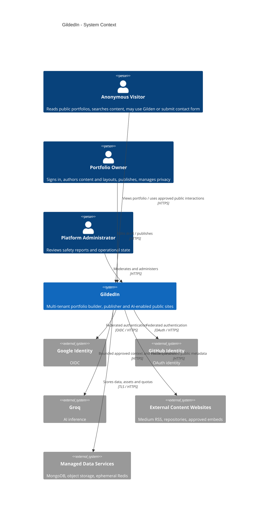
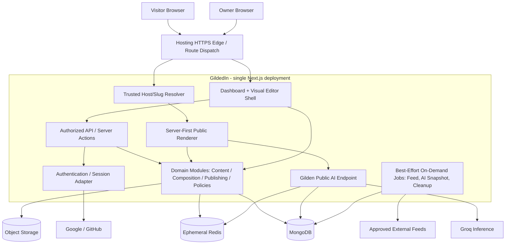
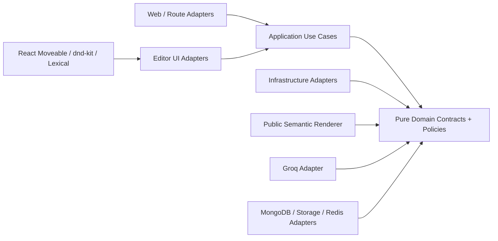
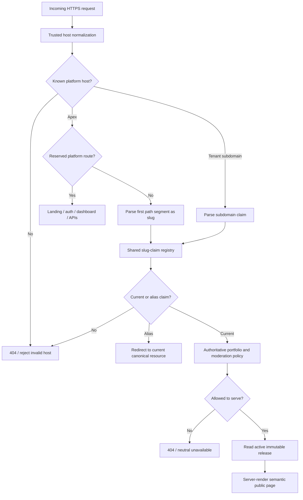
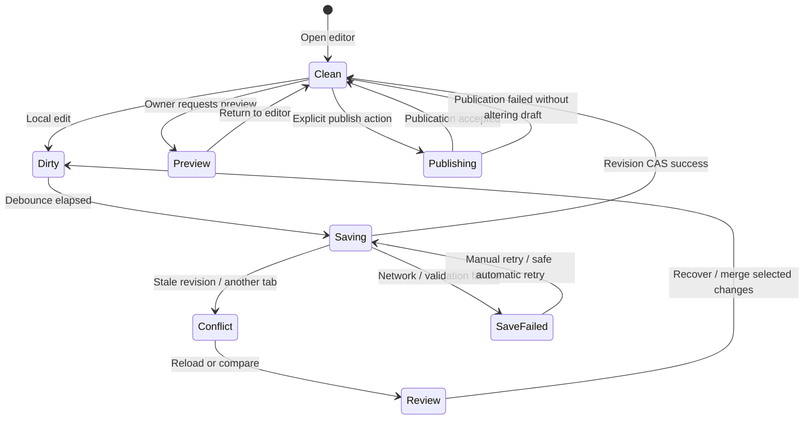
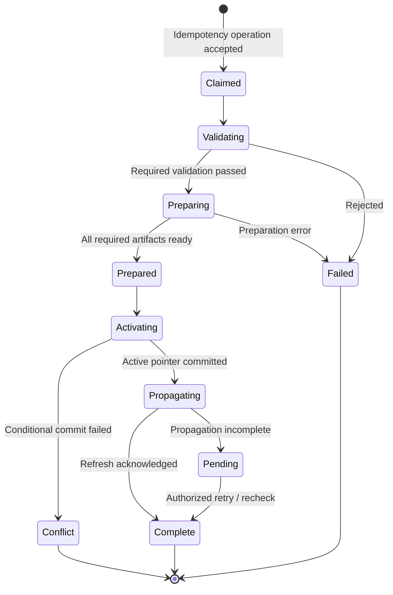
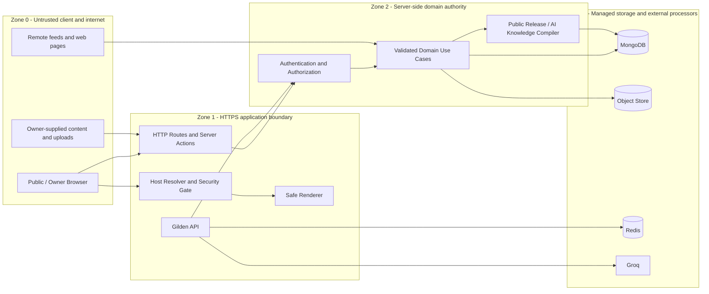
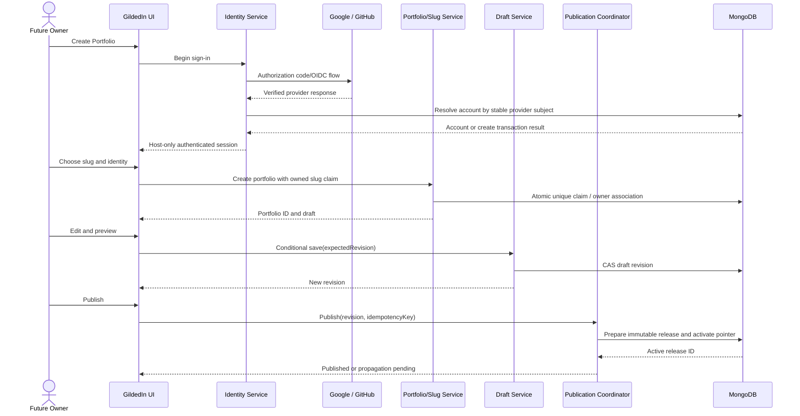

# 01 - System Overview

> **Product:** GildedIn
> **Document:** `01-system-overview.md`  
> **Document version:** 1.1.0 - expanded implementation-oriented overview  
> **Status:** Proposed architecture baseline; implementation and deployment are not yet authorized or verified  
> **As-of date:** 2026-11-18  
> **Owner:** Product / Engineering / Security  
> **Audience:** Product owner, implementers, security reviewers, designers, testers, contributors and future maintainers  
> **Classification:** Public technical specification; **never** include real secrets, OAuth credentials, private visitor data, tokens or operational identifiers  
> **Normative companion:** [`02-requirements-and-scope.md`](02-requirements-and-scope.md). This overview explains the system and its rationale; detailed domain/API/security contracts remain owned by the specialist documents.

> [!IMPORTANT]
> **Scope of this document.** It describes target system properties, proposed implementation boundaries, known risks, and verifications needed before release. Requirements and policy decisions are derived from the agreed product specification; provider features, protocol properties, and standards are grounded in the primary references collected at the end. The words **MUST**, **SHOULD** and **MAY** follow the requirement policy in document 02. When a technical choice is conditional, it must not be represented as a guaranteed capability.

## Document navigation

1. [Executive overview](#1-executive-overview)
2. [Product purpose, audience and differentiation](#2-product-purpose-audience-and-differentiation)
3. [Operating constraints and decision authority](#3-operating-constraints-and-decision-authority)
4. [Product boundaries and feature scope](#4-product-boundaries-and-feature-scope)
5. [Actors, stakeholders and trust relationships](#5-actors-stakeholders-and-trust-relationships)
6. [System context and architectural decomposition](#6-system-context-and-architectural-decomposition)
7. [Identity, multi-tenancy, domains and routing](#7-identity-multi-tenancy-domains-and-routing)
8. [Content engine and reusable metadata](#8-content-engine-and-reusable-metadata)
9. [Visual composition engine and responsive rendering](#9-visual-composition-engine-and-responsive-rendering)
10. [Editor, draft management and preview](#10-editor-draft-management-and-preview)
11. [Publishing engine and consistency model](#11-publishing-engine-and-consistency-model)
12. [Public delivery, search, SEO and discoverability](#12-public-delivery-search-seo-and-discoverability)
13. [Gilden: portfolio-specific AI](#13-gilden-portfolio-specific-ai)
14. [Media, integrations and user-generated content](#14-media-integrations-and-user-generated-content)
15. [Security and privacy architecture](#15-security-and-privacy-architecture)
16. [Data architecture, integrity and resource accounting](#16-data-architecture-integrity-and-resource-accounting)
17. [Performance, accessibility and quality attributes](#17-performance-accessibility-and-quality-attributes)
18. [Infrastructure, deployment and zero-spend operation](#18-infrastructure-deployment-and-zero-spend-operation)
19. [Failure modes, resilience and incident behavior](#19-failure-modes-resilience-and-incident-behavior)
20. [End-to-end journeys and sequence diagrams](#20-end-to-end-journeys-and-sequence-diagrams)
21. [Governance, delivery, verification and traceability](#21-governance-delivery-verification-and-traceability)
22. [Risk register and unresolved feasibility gates](#22-risk-register-and-unresolved-feasibility-gates)
23. [Glossary and conventions](#23-glossary-and-conventions)
24. [Primary sources and research notes](#24-primary-sources-and-research-notes)

---

## 1. Executive overview

### 1.1 Product statement

**GildedIn** is a free-to-use, open-source, multi-user, AI-enabled portfolio platform for people who want a highly individualized professional presence without authoring or deploying website code. It combines a visual design workspace, reusable structured content, safe publishable presentation primitives, and an optional portfolio-aware assistant called **Gilden**.

The platform must not force a choice between three properties normally in tension:

1. **Creative freedom:** reposition, resize, layer, group and compose visual blocks within custom sections, with responsive layouts and distinctive 3D motion.
2. **Reliable publication:** convert the design into an accessible, responsive, server-rendered, indexable portfolio whose content is explicit, validated and stable.
3. **Security and privacy:** prevent one owner from accessing another owner's information; prevent user-generated content from executing code; prevent private/draft material from entering public pages or AI context; and prevent usage from becoming unexpectedly billable.

The owner's flagship portfolio is a normal tenant of the same platform. `https://aaroophan.dev` is the proposed branded platform homepage, `https://aaroophan.dev/{slug}` is the preferred canonical portfolio URL format, and `https://{slug}.aaroophan.dev/` is the parallel subdomain format **once actual wildcard DNS/TLS verification succeeds**. The former portfolio identity must not be special-cased into application code.

### 1.2 Architectural thesis

The application has **three independent domain engines within one modular monolith**:

| Engine                 | Owns                                                                                                                                              | Does not own                                                                           | Primary contract                                                 |
| ---------------------- | ------------------------------------------------------------------------------------------------------------------------------------------------- | -------------------------------------------------------------------------------------- | ---------------------------------------------------------------- |
| **Content engine**     | Typed fields, custom schemas, stable content records, reusable collections, relationships, field visibility, referential integrity                | Visual placement, page serving, deployment-specific database calls                     | Versioned, owner-scoped, validated content model                 |
| **Composition engine** | Safe block catalogue, parent/child hierarchy, layout modes, responsive constraints, layering, semantic reading order and interaction declarations | Authentication, permanent published state, arbitrary executable code                   | Declarative composition tree translatable into semantic HTML/CSS |
| **Publishing engine**  | Full validation, immutable snapshots, version activation, public search and SEO artifacts, media reachability, propagation state                  | Interactive editor session state, unsupported external live feeds, AI inference itself | One active validated release per portfolio at a time             |

Supporting modules provide identity, authorization, host/slug resolution, Gilden knowledge compilation, media, quotas, moderation, privacy controls, observability and administrative operations. These modules have explicit application boundaries and avoid bidirectional imports or shared mutable globals.

The **editor is not the published application**. It is an interactive authoring client for the same versioned document format that the public renderer consumes. An implementation that exports a screenshot, blindly serializes the editor DOM, or renders the public site through a full interactive editor bundle does not meet the product contract.

### 1.3 Core architectural positions

- **One application repository, one primary deployable web application, clear module boundaries.** No separate microservices, service mesh, Kubernetes cluster or project-operated load balancer is justified at the proposed scale.
- **Server-first public rendering.** Portfolio text, navigation, project data, metadata, links, and reading order must be present without client-side JavaScript. Three.js is an enhancement rather than a prerequisite.
- **Stable identifiers.** Account identity, portfolio identity, content identity, release identity and mutable username are different concepts.
- **Versioned data contracts.** No third-party editor library, database driver or deployment framework is allowed to define the permanent GildedIn document format.
- **Publish explicitly.** Autosave modifies drafts, never an active public release. Publication validates, prepares and activates one immutable logical snapshot.
- **Defense in depth.** Each authenticated API operation checks session + ownership + resource state + input contracts; a valid browser session does not imply access to any portfolio ID.
- **Fail safely.** Public portfolios remain independent of AI and WebGL; authorization and AI policy cannot succeed on stale or unknown security state.
- **Exactly zero new spend.** No payment card, paid subscription, usage-based charges, silent plan upgrade or unbounded provider overage is permitted. Service exhaustion may cause temporary unavailability.

### 1.4 What success looks like

A new visitor can register with Google or GitHub, create a portfolio, customize it in a design-tool-like editor, view accurate desktop/tablet/mobile previews, publish it once, and share its public address. The resulting site must be readable on slow/mobile devices, accessible with keyboard and assistive technology, search-engine discoverable when permitted, and secure against cross-account content leakage. Editing published content must not affect the live version until another publication occurs. AI, RSS, analytics and 3D features must degrade independently.

A beta is **not** complete merely because a happy-path demo works. End-to-end onboarding, tenant isolation, responsive editing, semantic publication, revision restoration, privacy controls, AI policy, host routing, zero-bill eligibility and failure-mode tests must pass. See [02](02-requirements-and-scope.md) and [11](11-testing-strategy.md).

---

## 2. Product purpose, audience and differentiation

### 2.1 Problem definition

Existing portfolio creation approaches often place users along an undesirable spectrum:

- **Rigid templates** are convenient but restrict layout and visual identity.
- **General-purpose visual builders** can be powerful but require users to understand generic website design systems and publishing concerns.
- **Hand-coded portfolios** provide control but impose ongoing engineering, deployment and content-maintenance work.
- **Resume-first profile sites** make entering facts easy but seldom offer compelling interactive technical storytelling.

GildedIn's opportunity is a specialized professional-portfolio product that lets the owner express a rich digital identity while the platform remains responsible for code execution boundaries, responsiveness, accessibility, publication validity and hosting behavior.

The design must support someone with no projects or employment history as well as someone with many projects, publications and complex technical case studies. The minimum publishable content is intentionally small: username, display name, professional identity label and short introduction. Additional sections are optional.

### 2.2 Audience and representative needs

| Persona                             | Primary need                                                    | Relevant capability                                                                    | Failure to avoid                                            |
| ----------------------------------- | --------------------------------------------------------------- | -------------------------------------------------------------------------------------- | ----------------------------------------------------------- |
| Software engineer                   | Present architecture, repositories, skills and project outcomes | Typed project case studies, code blocks, safe diagrams, GitHub links, Gilden citations | Static resume-only presentation or broken source URLs       |
| Designer / creative professional    | Create a distinctive visual identity                            | Free-positioned canvas, layering, galleries, responsive breakpoints, scene presets     | Desktop-perfect design that fails on mobile                 |
| Student / new graduate              | Publish quickly with limited experience                         | Guided onboarding, sample content, optional sections, certificates/education           | Requiring prior employment or projects                      |
| Freelancer                          | Demonstrate services and invite contact                         | Services, testimonials, contact inbox and approved external links                      | Leaking a private email or allowing spam to dominate        |
| Researcher / technical professional | Explain publications and complex work                           | Custom typed collections, citations, repeaters, controlled rich text                   | Duplicate content and unstable links                        |
| Anonymous visitor / recruiter       | Find credible, readable information quickly                     | Fast server-rendered pages, navigation, search, semantic detail routes                 | Blocking content behind animation, AI or login              |
| Portfolio owner as administrator    | Maintain identity without redeploying                           | Autosave, preview, publish, revision restoration, export                               | Accidental public edits or silent loss of changes           |
| Solo platform maintainer            | Operate safely with limited time and funds                      | Modular monolith, automated tests, bounded quotas, simple operations                   | Hidden recurring costs or complex background infrastructure |

### 2.3 Product differentiation

The product's differentiation comes from the combination of:

1. **Metadata-driven content** rather than bespoke backend tables or new React pages for each owner.
2. **Visually free composition** built from a controlled, secure set of primitives.
3. **Cinematic technical identity** featuring navy-blue spatial depth, technical corners, connected nodes and carefully limited Three.js effects.
4. **Content reuse** through stable IDs, custom collections and bindings across sections and detail pages.
5. **Release-based publication** that isolates authoring from public data, SEO and AI context.
6. **Per-portfolio AI assistance** grounded in owner-approved published knowledge and validated source links.
7. **Low-maintenance operation** without user-facing deployment configuration or owner-managed infrastructure.

No individual feature is presented as a world-first capability. The product aims to combine established ideas into a more coherent portfolio-specific experience.

### 2.4 Brand expression

The GildedIn homepage, sign-in and dashboard emphasize the **GildedIn** brand. Public portfolios emphasize their owners; a small optional attribution may identify the platform. Personal branding is not constrained to identical layouts, yet the base components share a recognizably precise aesthetic.

| Visual element                     | Intended behavior                            | Safety/accessibility obligation                                       |
| ---------------------------------- | -------------------------------------------- | --------------------------------------------------------------------- |
| Deep navy / technical blue palette | Dark-first; complete light-theme counterpart | Contrast and legibility across both themes                            |
| Oswald                             | Hero/display typography                      | Font-display strategy, fallback, licensing                            |
| Roboto                             | Body, forms, editor and detailed content     | Good reading density and accessible sizing                            |
| Ink Free / Mistral                 | Sparse handwritten and signature accents     | Use only with appropriate web-embedding rights; substitutes permitted |
| Animated individual letters        | Hero identity and selected headings          | Semantic accessible text exists independently of animation            |
| Technical corner lines             | Recognizable UI signature                    | Pointer, touch and keyboard equivalents; nonessential decoration      |
| Perspective grids and linked nodes | Controlled depth and visual continuity       | No text rendered only inside canvas/WebGL                             |
| Three.js environment               | Shared cinematic hero enhancement            | Lazy load, adaptive quality, reduced-motion/static fallback           |

The desired feel is **technical minimalism with cinematic, holographic spatial relationships**-not maximal neon, decorative clutter, or a literal evidence board. The public pages should retain editorial hierarchy and readability.

### 2.5 First-release product outcomes

A complete beta should demonstrate the following observable results:

- New users can onboard and publish without code.
- Owners can create truly distinct compositions while remaining inside enforceable limits.
- Public pages work without Gilden, WebGL or client-side rich editor code.
- Editing, saving, publication, rollback and deletion have deterministic failure behavior.
- User identity, draft content, unpublished material and private references are not exposed through URLs, AI context or analytics.
- The platform has a practical solo-maintenance workflow with tests, threat review and zero-spend gates.

---

## 3. Operating constraints and decision authority

### 3.1 Requirement classification

| Classification                 | Meaning                                                            | Example                                                                               |
| ------------------------------ | ------------------------------------------------------------------ | ------------------------------------------------------------------------------------- |
| **Fixed product decision**     | Must be preserved unless explicitly changed by the product owner   | Google/GitHub login; one active owner portfolio initially; required Hero; $0 spending |
| **Normative behavior**         | Testable obligation expressed with MUST/SHOULD/MAY                 | Draft never becomes public without activation                                         |
| **Preferred technical choice** | Appropriate current candidate, replaceable with evidence           | Auth.js, Groq SDK integration, React Moveable                                         |
| **Conditional design**         | Valid only after technical or external feasibility is established  | Wildcard subdomain TLS; particular free object-storage vendor                         |
| **Accepted risk**              | Known limitation, disclosed rather than implicitly solved          | No independent backup guarantee; free-tier outages                                    |
| **Deferred capability**        | Design may leave room for it, but implementation is not needed yet | Collaborator roles; native article authoring; custom owner domains                    |

When an observed vendor constraint conflicts with a fixed product requirement, the solution is **not** to pretend the vendor fulfills it. The implementation must select a compatible alternative, obtain explicit owner approval for a revised requirement, or postpone the conflicting capability with a visible release blocker.

### 3.2 Fixed release constraints

| Constraint                                              | Binding design consequence                                                             |
| ------------------------------------------------------- | -------------------------------------------------------------------------------------- |
| Free public SaaS; no monetization currently             | No billing/payments/subscription or payment-card handling                              |
| $0 additional spending; no payment card required        | Provider selection must show hard billing prevention or true free service operation    |
| Existing domain `aaroophan.dev`                         | Branded platform homepage and path-based canonical portfolios                          |
| Path and subdomain aliases from first release           | DNS, wildcard TLS and host-routing proof is a release gate                             |
| Google OIDC and GitHub OAuth                            | No passwords, password resets or application-managed credential authentication         |
| One active portfolio per account in UI                  | Uniqueness/conditional writes; independent IDs allow later multiple portfolios         |
| Three released versions                                 | Snapshot retention and reference-safe media cleanup                                    |
| Free-positioned visual canvas                           | Responsive constraint engine and accessibility order must be designed, not added later |
| Fully custom fields/sections from safe primitives       | Typed schema registry and bounded declarative rendering contract                       |
| English-only initial experience                         | No platform-owned multilingual content/localization infrastructure                     |
| WCAG 2.2 AA target                                      | Non-drag alternatives, focus order, semantic headings, reduced motion                  |
| No guaranteed DR/HA or separate hosted test environment | Disclosure, integrity measures, local test isolation and incident playbooks            |
| Open-source distribution                                | License, third-party asset provenance and secret-safe repository practices             |

### 3.3 Normative resource and product limits

The numeric semantics are established in [02 §1.2](02-requirements-and-scope.md#12-limit-definition-and-counting-rules). For consistency, this overview uses **KiB = 1,024 bytes** and **MiB = 1,048,576 bytes**.

| Limit                                        |                                                   Value | Enforcement point                               | User experience on violation                                       |
| -------------------------------------------- | ------------------------------------------------------: | ----------------------------------------------- | ------------------------------------------------------------------ |
| Nested content-schema depth                  |                                                       3 | Schema create/import/update, publish            | Specific invalid path; no partial application                      |
| Custom fields per section                    |                                                      20 | Schema and section mutations                    | Show current/maximum and affected section                          |
| User-authored blocks across all public pages |                                                      20 | Canvas edits, duplicate, import, publish        | Explain that repeater-rendered instances do not count individually |
| Items in each collection                     |                                                      20 | Collection insert/import, publish               | Prevent 21st item and preserve prior data                          |
| Serialized release payload                   |                           100 KiB (102,400 UTF-8 bytes) | Canonical full release serialization at Publish | Explain which content contributes to size                          |
| Retained published releases                  |                                                       3 | Retention and safe GC after activation          | Restore only from retained versions                                |
| Original media per portfolio                 |                                                  15 MiB | Reservation, finalize and reconciliation        | Quota message; existing assets not automatically deleted           |
| Original files per portfolio                 |                                                      30 | Upload and reference lifecycle                  | Stop new files; derived responsive assets not file slots           |
| Maximum individual image                     |                                                   1 MiB | Before expensive decode; server finalize        | Reject and recommend compression                                   |
| Maximum PDF résumé                           |                                                   2 MiB | Upload intent and verified final object         | Reject; no unsafe bypass                                           |
| Image input dimensions                       |                                             4096 × 4096 | Decoder verification                            | Reject oversized image / decompression-risk input                  |
| AI visitor quota                             | 15 messages per visitor per day, initially configurable | Server quota policy                             | Chat temporarily unavailable with portfolio links                  |

**Counting rules matter:** a repeater is one author-authored node even if it generates twenty visible project cards; nested manually created block nodes **do count**. Platform-generated accessible scaffolding does not. Media-derived variants do not consume original-file slots but **do** consume real storage capacity. Public release byte counting includes schemas, layout, tokens, SEO and media references-not the underlying binary files. Limits are never enforced exclusively in the UI.

### 3.4 Scale and capacity assumptions

The platform is initially sized for approximately **100–500 actively maintained portfolios**, not simply registered accounts. This is a performance and modeling target, **not** a guarantee that free infrastructure provides sufficient storage, bandwidth or compute for all such users at maximum quotas.

At 500 portfolios:

- 500 × 15 MiB media allowance = **7,500 MiB (~7.32 GiB)** of original media alone, excluding thumbnails, derived variants, logs and provider overhead.
- 500 × 3 × 100 KiB maximum release payload = **150,000 KiB (~146.5 MiB)** for the retained release payloads before database/index overhead; drafts and supporting records add further storage.
- 500 × 30 originals = as many as **15,000 original asset objects**, not counting generated image variants.

A free storage tier smaller than aggregate user allowances is not inherently impossible, but new uploads must be rejected safely when the **global** service budget approaches its hard ceiling. Users must never be told that an unused personal allowance guarantees physical global capacity.

### 3.5 Security and privacy requirement priority

Security is a design constraint, not an optional hardening phase. A feature is incomplete until its authorization rule, data classification, input contracts, error behavior and security tests are defined. At minimum, verification is aligned to OWASP ASVS 5.0, OWASP API Security Top 10, the OAuth Security BCP, applicable W3C accessibility criteria, and privacy-by-design principles [S01], [S02], [S03], [S04], [S05].

There is **no claim** of formal ASVS certification, legal compliance, penetration-test certification or disaster-recovery guarantees. These require actual evidence, independent verification where appropriate, and accurate user disclosure.

---

## 4. Product boundaries and feature scope

### 4.1 Launch capabilities

| Domain                 | First-release capability                                                                                     | Essential boundary or validation                                 | Principal requirement families |
| ---------------------- | ------------------------------------------------------------------------------------------------------------ | ---------------------------------------------------------------- | ------------------------------ |
| Platform homepage      | GildedIn introduction, examples, Create Portfolio CTA, small searchable directory                            | Directory includes only opted-in/public eligible portfolios      | SEO, TEN, SEC                  |
| Registration           | Google + GitHub identity providers; no local passwords                                                       | Provider stable IDs; verified callbacks; explicit linking        | IAM-001..009                   |
| Onboarding             | Display name, 3–30-character slug, role label, introduction and guided sample portfolio                      | No special owner IDs; sample content editable and clearly marked | TEN, CNT, UX                   |
| Portfolio identity     | Stable ID, ownership, path and subdomain views, alias redirects                                              | Trusted host; one namespace for current and historical slugs     | TEN-001..009                   |
| Content                | Required Hero; optional repeated sections; custom fields, collections, relations and filters                 | Safe schema types; depth, count and ownership limits             | CNT-001..011                   |
| Visual editor          | Direct inline edits, inspector, responsive canvas, groups, guides, snapping, layering, keyboard alternatives | No authored JS/HTML/shaders; semantic order separate             | EDT-001..010                   |
| Draft workflow         | Debounced autosave, undo/redo in session, conflict detection and recovery                                    | Owner-only; never writes public release                          | EDT, PUB                       |
| Publication            | Preview, validation, immutable release, atomic activation, bounded history                                   | Prepared assets, media, SEO and search; idempotent retries       | PUB-001..008                   |
| Public portfolio       | Semantic homepage plus detailed project/experience routes where published                                    | Active release only, moderation/visibility gate                  | PUB, SEO, SEC                  |
| Media                  | Images and PDFs with cropping/focal point/alt text/optimized delivery                                        | Signature validation, isolation, size and quota limits           | MED-001..005                   |
| RSS and external links | One primary Medium/RSS feed, manual article previews, approved embeds                                        | SSRF and content-type restrictions; last-good fallback           | CNT, SEC                       |
| Search                 | Publication-time compact index and client-side filtering                                                     | Only approved published searchable fields                        | SEO, CNT                       |
| Gilden                 | Owner opt-in, English, citations, quotas, ephemeral streaming                                                | Approved release context, no private/draft exposure              | AI-001..010                    |
| Contact                | Owner-only text inbox; optional fields and external links                                                    | Consent, anti-abuse, 30-day retention; no attachments            | CON, SEC                       |
| Analytics              | Aggregate views/clicks; owner dashboard; optional public display                                             | No visitor fingerprinting or chat transcripts                    | ANA, SEC                       |
| Moderation             | Reports, content hide, suspension, administrator review                                                      | Live policy can override cached release                          | ADM, SEC                       |
| Operations             | Health indicators, structured logs, secure CI, quality gates                                                 | No secrets in public diagnostics; $0 cost proof                  | OPS, PRF, SEC                  |

### 4.2 Deferred capabilities

- Multiple portfolios per account and multi-owner collaboration.
- User-owned custom domains in addition to the platform's path/subdomain model.
- Extensive design-template marketplace or arbitrary user-installable templates.
- Platform-native blog editing and full-article hosting.
- App-wide multilingual authoring and multilingual Gilden.
- Dashboard AI content generation assistant.
- Scheduled appointments, external CRM integrations and outgoing email delivery.
- Advanced portfolio recommendations/rankings or complex search infrastructure.
- Arbitrary user-authored formulas, code, CSS, scripts, shaders, expressions and service-side workflows.
- Guaranteed disaster recovery, high availability, multi-region replicas and paid operational support.

### 4.3 Explicit non-goals and applicability assessment

| Domain                                          | Launch decision             | Rationale                                                                                     |
| ----------------------------------------------- | --------------------------- | --------------------------------------------------------------------------------------------- |
| Separate NestJS/ASP.NET API service             | Not needed                  | Next.js server modules and route handlers provide required interfaces within the monolith     |
| Service mesh, Kubernetes, persistent queues     | Not needed                  | No demonstrated independent scaling or always-on event consumers                              |
| Persistent WebSocket service                    | Not needed                  | Live editor preview is local state; AI can stream over HTTP                                   |
| Message broker / RabbitMQ                       | Not needed                  | Idempotent on-demand and scheduled-best-effort tasks are sufficient initially                 |
| Vector database / full RAG                      | Not needed                  | Small, bounded, approval-filtered context; add only if measured retrieval quality requires it |
| Payments / billing / subscriptions              | Prohibited by product model | Free-to-use SaaS without monetization                                                         |
| Password storage / recovery                     | Excluded                    | Federated Google/GitHub accounts only                                                         |
| Visitor identity accounts                       | Excluded                    | Public reading and anonymous AI/contact use cases                                             |
| Offline-first collaborative sync                | Excluded                    | Short-lived local draft recovery is not autonomous offline editing                            |
| User-executable template code                   | Prohibited                  | Multi-tenant code injection and supply-chain risk                                             |
| Unlimited file storage                          | Incompatible                | Zero-spend physical capacity and abuse prevention                                             |
| Runtime foreign-URL mirroring                   | Restricted                  | SSRF/exfiltration risk; only bounded safe metadata fetches                                    |
| Default third-party analytics SDK               | Not necessary               | Lightweight aggregate-only counters better match privacy model                                |
| Guaranteed CDN/public availability on DB outage | Not guaranteed              | Live security policy checks take precedence over stale cache serving                          |

### 4.4 Dependency independence and degradation

The application must have a **functional core** independent of optional integrations. Failure of Groq, Medium, visual effects, search indexing of optional content, or GitHub public metadata should not disable viewing already published portfolio text and navigation. However, a failure of an **authoritative security policy** must not be treated as ordinary optional-component degradation.

---

## 5. Actors, stakeholders and trust relationships

### 5.1 Actor catalogue

| Actor                              | Authentication / identity                                                        | Allowed operations                                                                                                                               | Explicitly disallowed                                                                                                               | Trust classification                                                       |
| ---------------------------------- | -------------------------------------------------------------------------------- | ------------------------------------------------------------------------------------------------------------------------------------------------ | ----------------------------------------------------------------------------------------------------------------------------------- | -------------------------------------------------------------------------- |
| Anonymous visitor                  | None                                                                             | Browse publicly allowed portfolios, use public portfolio search, read approved details, submit explicitly chosen contact form, use opt-in Gilden | Read drafts, inspect private account state, access another owner's inbox, invoke admin or mutation APIs                             | Untrusted external browser                                                 |
| Unauthenticated registrant         | Google/GitHub sign-in initiation only                                            | Start OAuth/OIDC flow, review public onboarding and privacy information                                                                          | Impersonate an authenticated owner, inject account ID into callback                                                                 | Untrusted until callback verified                                          |
| Authenticated account holder       | Verified session on apex                                                         | Configure account, connect provider identities, create first portfolio                                                                           | Claim arbitrary account/portfolio IDs, self-assign admin, access portfolio not owned                                                | Authenticated, limited capabilities                                        |
| Portfolio owner                    | Authenticated account + verified portfolio relationship                          | Edit draft, preview, media, publication, export, AI approval, contact inbox, analytics and visibility settings                                   | Modify another owner's data, bypass media quotas, directly mutate immutable releases                                                | Tenant-scoped principal                                                    |
| Platform administrator             | Explicitly provisioned admin account, fresh authentication for sensitive actions | Review abuse reports, suspend/unsuspend, inspect minimal operational status, perform controlled moderation                                       | Read raw private contact contents without a justified/admin-authorized workflow; bypass auditing; use client-submitted role changes | Privileged and high impact                                                 |
| Public portfolio content publisher | The publication process, acting on validated owner intent                        | Prepare release, compile derived public artifacts and conditional activation                                                                     | Publish arbitrary client-supplied release bytes without validation                                                                  | Internal trusted operation after authorization                             |
| Repository contributor             | GitHub identity with governed repository rights                                  | Propose changes, run tests, review open-source contribution process                                                                              | Read production secrets or directly deploy from arbitrary unreviewed fork code                                                      | Untrusted code supply chain until reviewed                                 |
| Google and GitHub                  | External OAuth/OIDC providers                                                    | Assert provider identity and permitted claims                                                                                                    | Decide GildedIn portfolio ownership or administrator roles                                                                          | External identity boundary                                                 |
| Groq                               | External inference endpoint                                                      | Process deliberately supplied visitor question and approved knowledge                                                                            | Decide field visibility, fetch database records, invoke unrestricted owner actions                                                  | External data processor and untrusted model output                         |
| MongoDB                            | Managed database service                                                         | Store and retrieve encrypted-in-transit application data                                                                                         | Serve as the only policy authority simply because a query succeeded                                                                 | Trusted service credentials; untrusted availability and operational limits |
| Object store                       | Managed storage service                                                          | Persist validated assets under opaque keys                                                                                                       | Accept arbitrary public writes or authorize ownership based only on key format                                                      | External storage boundary                                                  |
| Redis/quota service                | External ephemeral counter service                                               | Bound rate/usage counters, short-lived state                                                                                                     | Be the source of truth for ownership or security approval                                                                           | Limited availability, no authority over tenant data                        |
| External RSS and media hosts       | Internet destinations                                                            | Supply bounded metadata for owner-approved content                                                                                               | Make server fetch unrestricted networks or inject active HTML                                                                       | Untrusted internet input                                                   |
| Search engine / crawler            | Public unauthenticated client                                                    | Read visible content and metadata consistent with published policy                                                                               | Access unlisted drafts or private data; enforce confidentiality based on `noindex` alone                                            | Untrusted client                                                           |

**Authorization principle:** an actor's identity is only one attribute of an access decision. The server must also prove the target object's owner, active account status, portfolio state, requested action and current moderation/privacy policy. Browser-provided ownership fields, route slugs, cookies and host headers are **inputs**, not authoritative permission proofs. OWASP API Top 10 identifies broken object-level authorization as a primary API risk [S02].

### 5.2 Primary stakeholders and decision responsibilities

| Stakeholder                    | Decides / provides                                                             | Success criterion                                                           | Review obligation                                     |
| ------------------------------ | ------------------------------------------------------------------------------ | --------------------------------------------------------------------------- | ----------------------------------------------------- |
| Product owner                  | Product goals, scope, constraints, release priorities, approved policy changes | Useful no-code portfolio product without unplanned expenditure              | Resolve trade-offs that change user-facing guarantees |
| Architecture maintainer        | Module boundaries, schema versions, integration adapters, ADRs                 | Implementable and replaceable contracts                                     | No cross-document contradictions                      |
| Security reviewer / maintainer | Trust boundaries, threat mitigations, sensitive operations, release blockers   | No known unmitigated high-severity exploit pathways                         | Negative tests and incident readiness                 |
| UX/accessibility reviewer      | Visual language, editing experience, keyboard/touch/assistive flows            | Creative freedom remains operable and understandable                        | Manual WCAG checks, not just automatic scans          |
| Engineering contributors       | Implement traceable changes and tests                                          | Smaller cohesive changes with clear acceptance                              | Tests, docs, dependency audit and secure review       |
| End users                      | Author professional identity and decide visibility                             | Understand the difference between private, unlisted, public and AI-approved | Explicit publication/privacy choices                  |

A small solo-maintained product does not require separate employees for each role. It **does** require distinguishing the decisions, recording evidence, and seeking external technical review when the maintainer lacks adequate expertise.

### 5.3 Assets, sensitivity and default handling

| Data asset                               | Classification                  | Example                                                   | Storage / exposure rule                                                       |
| ---------------------------------------- | ------------------------------- | --------------------------------------------------------- | ----------------------------------------------------------------------------- |
| Platform copy and curated examples       | Public                          | Landing page, documentation                               | Public, cached subject to content updates                                     |
| Account and provider identities          | Private                         | Stable Google subject, GitHub ID, optional verified email | Server-only, no public tenant embedding                                       |
| Session credentials                      | Secret                          | Session verifier, OAuth state/callback verifier           | Secure cookies/server storage; never logged or exported                       |
| Working portfolio draft                  | Private                         | Unpublished text, positions, media, private references    | Owner-only, `no-store`; no public or AI access                                |
| Published release                        | Public or link-accessible       | Public project pages, approved identity, source links     | Versioned immutable payload, subject to active visibility/moderation          |
| AI approval configuration                | Private security policy         | Approved/denied fields and policy version                 | Server authoritative, immediate revocation                                    |
| Generated AI knowledge                   | Derived approved published data | Bounded excerpts and validated citations                  | Release- and policy-version-scoped; never indiscriminately copied from drafts |
| Media staged for upload                  | Private untrusted bytes         | Newly uploaded photo/PDF                                  | Quarantine; verification and transformation before public use                 |
| Public derived media                     | Public                          | Sanitized optimized image referenced by active release    | Versioned opaque URL; never assume instant CDN deletion                       |
| Contact submission                       | Private personal data           | Sender's email and message                                | Owner inbox; 30-day removal policy; not AI knowledge                          |
| Abuse report                             | Restricted                      | Suspected impersonation link                              | Administrator-only; retention minimized                                       |
| Aggregate analytics                      | Aggregated non-identifying data | Total views, link clicks                                  | Owner-only by default; optional public aggregate                              |
| Security audit metadata                  | Restricted                      | Action, actor reference, result, timestamp                | Redacted; 90-day target subject to constraints                                |
| Code, dependency manifests and CI config | Public/open-source              | Application source                                        | Automated review; secrets and private operational values excluded             |

**Important reality:** an anonymous visitor may type personal data into a chat question despite the platform never requesting it. The Groq API receives the question for inference. It is inaccurate to promise that no personal data can ever reach the inference provider; the enforceable promise is **no intentional identity collection, no persisted visitor transcripts at GildedIn, strict minimization and clear disclosure**. AI and contact workflows must remain separate.

---

## 6. System context and architectural decomposition

### 6.1 C4 Level 1 - System context

The system boundary includes the web application and domain modules maintained by GildedIn. OAuth providers, database, storage, Redis, AI inference and external content sources are separate services with independent terms, failure modes and trust assumptions. The complete diagrams, including formal trust boundaries and deployment topology, are maintained in [04](04-c4-diagrams.md).



### 6.2 C4 Level 2 - Logical containers

The application is **one logical deployment**, even though it includes server and browser execution surfaces. A CDN/hosting edge may serve static assets and route requests; it must not be treated as a permanent authority for mutable permissions.



The diagram is a **conceptual view**; arrows indicate an allowed logical relationship, not that UI code accesses MongoDB directly. Browser components call narrow application interfaces. Server components may call domain query services directly, avoiding unnecessary same-application HTTP round trips.

### 6.3 Domain module map

| Module           | Core responsibilities                                                         | Public interfaces                                  | Forbidden dependency direction                                     |
| ---------------- | ----------------------------------------------------------------------------- | -------------------------------------------------- | ------------------------------------------------------------------ |
| `identity`       | Provider subject mapping, session lifecycle, account linking, admin bootstrap | Session principal, authorized account commands     | No editor content logic inside callbacks                           |
| `tenancy`        | Owner membership, slug claims, host resolution, state and visibility          | `resolvePortfolio`, `assertOwner`, security policy | No ownership inference from route strings alone                    |
| `content`        | Field types, schemas, records, relations, CRUD rules and validation           | Read/change typed draft content                    | Does not import React or Mongo driver primitives into domain types |
| `composition`    | Block registry, layout tree, responsive overrides, semantic order             | Validate and render document description           | No untrusted component eval or arbitrary CSS                       |
| `drafts`         | Revisioned persistence, optimistic writes, local recovery contract            | Read draft / CAS update                            | No direct mutation of active releases                              |
| `publishing`     | Validate, prepare, activate, idempotency, status, restore-to-draft            | Publish and status commands                        | No AI inference as publication precondition                        |
| `public`         | Release lookup, security gate, semantic rendering, metadata                   | Read-only portfolio view                           | Never reads `drafts` to satisfy anonymous requests                 |
| `ai`             | Approval policy, context compilation, grounding, quota, inference adapter     | Gilden query stream and owner settings             | No private source or model output as authorization                 |
| `media`          | Reservation, staging, verify, transform, reference and reclamation            | Upload-intent/finalize/read-safe assets            | No direct client permission to choose object-store keys            |
| `feeds`          | Validated bounded metadata fetch, last-good result                            | Owner-triggered sync and public previews           | No unrestricted fetch of arbitrary destinations                    |
| `contacts`       | Validated submissions, owner inbox, retention                                 | Public submit / owner inbox                        | No automatic chat-to-contact transfer                              |
| `analytics`      | Aggregate bounded counts and optional public blocks                           | Owner summary, optional published aggregate        | No visitor fingerprint or transcript storage                       |
| `moderation`     | Reports, account/content suppression, appeal and audit                        | Current policy, admin actions                      | Cannot depend on eventual cache invalidation                       |
| `operations`     | Redacted logs, metrics, housekeeping, health indicators                       | Admin status and incident notes                    | No private data in public telemetry                                |
| `infrastructure` | Storage, database, cache, AI, hosting and DNS adapters                        | Typed ports used by domain modules                 | No business rules hardwired to a provider SDK                      |

### 6.4 Module dependency direction

A modular monolith succeeds only if its modules remain independent in code as well as on diagrams.



Recommended enforcement:

- Define an explicit `domain`/`application`/`adapters` layering rule and test dependency direction with a static import-boundary check.
- Content and publication services accept typed IDs and value objects, not a MongoDB collection instance or `NextRequest`.
- The public renderer accepts a validated published document version and compiled output policy, not arbitrary editing command objects.
- External adapters emit domain-level errors, never raw provider errors or secrets to browsers.
- Dependencies are instantiated server-side in explicit composition roots, not shared across client/server module boundaries accidentally.
- Modules may communicate through in-process functions and small interfaces. **No distributed event bus or broker is required** to achieve modularity.

### 6.5 Data paths and trust crossings

| Flow                                   | Boundary crossing                              | Validations and controls                                                                                               |
| -------------------------------------- | ---------------------------------------------- | ---------------------------------------------------------------------------------------------------------------------- |
| Browser sign-in → OAuth provider → app | External identity to account                   | State/PKCE/nonce where appropriate, issuer/provider binding, callback verification, anti-linking takeover [S03], [S06] |
| Editor command → API → database        | Untrusted client to private mutable data       | CSRF/origin where relevant, secure session, object ownership, Zod + domain validation, revision CAS                    |
| User schema → public renderer          | Arbitrary data to HTML/CSS/JS surfaces         | Allowlisted types/styles/URLs, semantic AST, no eval, safe URL schemes, output encoding                                |
| Draft → public release                 | Private authoring to public internet           | Explicit Publish, whitelist public fields, validate references, snapshot hash, atomic pointer                          |
| User upload → object storage → browser | Untrusted bytes to hosted asset                | Auth, reservation, content signature, decode/re-encode/metadata strip, safe PDF handling                               |
| RSS URL → server outbound request      | User-selected network destination              | SSRF protection, private-IP rejection, DNS validation, redirect limits, timeouts and body caps [S09]                   |
| Public question → Groq                 | Visitor text to third party                    | No intentional identity collection, minimal context, quota, provider handling disclosure                               |
| AI output → browser                    | Untrusted model text to presentation           | Structured sources, safe Markdown rendering, no executable HTML, no action authority                                   |
| Moderation action → cached content     | Mutable policy to previously cached release    | Live authoritative allow/deny gate, purge/revalidation as secondary measure                                            |
| GitHub PR → deployment                 | Untrusted contribution to production execution | Review, pinned dependencies/actions, least privilege, scanning, protected secrets                                      |

### 6.6 Single-deployment rationale

The modular monolith is a deliberate optimization for a solo-maintained free product with approximately 100–500 active portfolios. It reduces service-to-service authentication, separate deployment pipelines, complex telemetry correlation and paid infrastructure. It does **not** guarantee scalability or security by itself. If observed workloads later require extraction of a media transformation processor or an AI gateway, the owned module ports and data boundaries provide a rational migration path. A separate service should only be introduced for measured isolation, scaling or operational reasons-not to imitate enterprise infrastructure.

---

## 7. Identity, multi-tenancy, domains and routing

### 7.1 Identity model: account is not portfolio

The platform distinguishes these entities:

- `accountId`: opaque stable identifier for a person with GildedIn login rights.
- `providerIdentity`: one externally verifiable identity `(provider, stable subject)` attached to an account. For Google, verify issuer and subject under OIDC; for GitHub, use the stable provider user identifier, not display name or optional email.
- `portfolioId`: stable identifier of a portfolio and the root for tenant-scoped resources.
- `slug`: lowercase ASCII public address claim that can change without changing the portfolio ID.
- `slugClaim`: authoritative reservation of a current or former slug, including aliases.
- `session`: revocable server-validated authority linking the browser to a specific `accountId`.

**Identity invariants:**

1. Email addresses are contact attributes, not permanent ownership keys.
2. Matching verified emails from different OAuth providers is **not** permission to silently merge accounts.
3. Explicit account linking requires an existing session, fresh confirmation and control of the target identity.
4. The last functional linked provider cannot be removed.
5. A GitHub identity may exist without a public/verified email; email-dependent operations remain disabled until an adequate verified email is available.
6. Initial administrator status is provisioned through a trusted deployment procedure, never first-to-register or self-service client property.
7. Every owner-sensitive request checks current account status and portfolio relationship; previously issued sessions can be revoked.

These requirements align with modern OAuth Security Best Current Practice (RFC 9700) and NIST federation guidance [S03], [S06]. Specific Auth.js adapter behavior must be verified against the selected, pinned implementation version; using a library never excuses skipping its security configuration review.

### 7.2 Authentication and session boundary

Authenticated dashboard activity uses the **apex platform host** only. In production, session cookies must be `Secure`, `HttpOnly`, use an appropriate `SameSite` value, `Path=/`, and **no `Domain` attribute**; `__Host-` semantics are preferred. A tenant subdomain must not receive the session cookie. Cookies and OAuth credentials must never be placed in local storage, URL parameters, log fields or client-side configuration [S07].

Even with `SameSite` and `HttpOnly`, unsafe state-changing requests require server-side authorization and CSRF defenses; cookie properties alone do not prevent all cross-site request forgery [S07]. Sensitive account changes-unlinking providers, deletion, administrative role-related actions-require a recent authentication confirmation and audit event.

**Critical same-origin nuance:** `https://aaroophan.dev/alex` and `https://aaroophan.dev/dashboard` share the **same browser origin**. Browser origin security is based on scheme, host and port-not URL path. A path-based portfolio containing an executable script could use the authenticated browser session to attack dashboard endpoints even if the cookie is `HttpOnly`. Therefore the platform must **prohibit arbitrary executable user content, sanitize/encode all user-controlled output, constrain embeds, enforce CSP and CSRF protection, and validate every mutation server-side**. A host-only session cookie protects against subdomain cookie sharing, but **does not create isolation between path-based portfolio pages and the dashboard**. A security review must test this explicitly.

### 7.3 URL and hostname contract

| URL                                                   | Expected purpose              | SEO / session behavior                                    |
| ----------------------------------------------------- | ----------------------------- | --------------------------------------------------------- |
| `https://aaroophan.dev/`                              | Aaroophan portfolio homepage  | Aaroophan canonical homepage                               |
| `https://www.aaroophan.dev/`                          | Aaroophan portfolio homepage  | Aaroophan canonical apex                                |
| `https://aaroophan.dev/home`                          | GildedIn landing page | No public indexing; apex cookie only                      |
| `https://aaroophan.dev/dashboard`                     | Authenticated owner workspace | No public indexing; apex cookie only                      |
| `https://aaroophan.dev/{slug}`                        | Public portfolio homepage     | Preferred canonical address                               |
| `https://aaroophan.dev/{slug}/projects/{projectSlug}` | Public project case study     | Unique canonical detail route                             |
| `https://{slug}.aaroophan.dev/`                       | Same portfolio at subdomain   | Keep subdomain navigation; canonical points to path       |
| `https://{slug}.aaroophan.dev/projects/{projectSlug}` | Same project detail page      | Matching path-based canonical                             |
| Old path or subdomain alias                           | Renamed portfolio             | Permanent redirect to new canonical resource when safe    |
| Unknown hostname or slug                              | Unassigned resource           | Branded real HTTP 404, not generic redirect               |
| Disabled/unpublished portfolio                        | Not currently public          | HTTP 404 with privacy-preserving generic explanation      |
| Deleted resource                                      | Permanently removed           | HTTP 410 if reliably distinguishable; otherwise 404       |
| Suspended portfolio                                   | Moderation enforced           | Neutral unavailable state, no identifying internal reason |

Username constraints:

- 3–30 ASCII letters, digits and hyphens; one normalized lowercase lookup representation.
- Optional separate display capitalization (`Aaroophan` displayed, `aaroophan` canonical).
- Reserved platform paths, infrastructure hostnames and unsafe names cannot be claimed.
- All current and historical slug claims share **one authoritative unique namespace**. Separate unique indexes for current names and aliases are insufficient because an alias could otherwise collide with another tenant's live name.
- Slug changes do not alter ownership, content IDs, public release IDs or audit identity. Existing aliases remain reserved for their portfolio while it exists.
- Known explicit infrastructure subdomains (e.g., `www`, mail-related hosts, API/internal hosts) must take precedence over wildcard tenant resolution.

### 7.4 Host resolution and trust

A request's `Host` or forwarded host value must never be concatenated into database queries, file keys, redirect URLs or SEO metadata without normalization and trusted-proxy validation. Accept configured public host suffixes and a deliberately narrow list of known internal hosts. Strip/validate ports only under expected development rules, compare ASCII-normalized hostnames, reject malformed internationalized/encoded lookalikes and unknown origins. Read forwarded headers only from infrastructure known to set them and prevent client overrides. Route authorization should use the resolved `portfolioId`, not the textual request host.



Dual URL support depends on actual DNS records, wildcard certificate issuance and provider permissions. Vercel's published SSL documentation currently states that wildcard certificates require its nameserver/DNS-01 approach. Automatic managed certificates do not erase that prerequisite [S15]. Whether the project's chosen free hosting arrangement supports this configuration is a **demonstrated launch gate**, not a logical property of Next.js.

### 7.5 Portfolio and content visibility

Visibility is **not** the same state variable as publishing or moderation.

| Dimension                | Example values                                                    | Interpretation                                                   |
| ------------------------ | ----------------------------------------------------------------- | ---------------------------------------------------------------- |
| Account status           | `active`, `suspended`, `deleting`                                 | Controls owner access and administration                         |
| Portfolio lifecycle      | `onboarding`, `active`, `owner_disabled`, `suspended`, `deleting` | Controls public availability and editing capabilities            |
| Publication              | No release / active release / propagation pending                 | Identifies live content snapshot and distribution state          |
| Public visibility        | `public`, `unlisted`                                              | Search/directories vs link-accessible sharing                    |
| Section/field visibility | Public, hidden, private                                           | Determines what the public compiler may include                  |
| AI approval              | Approved / denied, plus policy version                            | Determines what Gilden may access                                |
| Moderation               | Allow / section hide / portfolio suspend                          | Live authoritative suppression independent of historical payload |

A `noindex` directive is not authorization. An unlisted portfolio is still accessible to anyone with its URL. Draft previews remain owner-only, must not expose shareable preview tokens initially, and must not be indexed.

### 7.6 Identity threats and required negative tests

| Attack or failure                    | Preventive design                                                | Minimum verification                                          |
| ------------------------------------ | ---------------------------------------------------------------- | ------------------------------------------------------------- |
| OAuth callback substitution / mix-up | State, PKCE, issuer/provider binding, exact registered redirects | Wrong issuer, replayed state, forged callback rejected        |
| Same-email account takeover          | Stable provider-subject uniqueness, explicit linking             | Two providers with same email do not merge silently           |
| Tenant ID substitution               | Server `accountId` → `portfolioId` policy on each command        | Account A cannot update B's draft/media/AI policy             |
| Alias takeover                       | Central unique current/historical slug claims                    | Old slug cannot be claimed by another account                 |
| Host-header confusion                | Trusted host normalization and allowed domain policy             | Forged Host/Forwarded headers do not resolve foreign tenant   |
| Session leaking to tenant subdomain  | No `Domain`, `__Host-` cookie semantics                          | Cookie absent on subdomain requests                           |
| Path-based portfolio XSS             | Safe renderer, CSP, URL/content encoding, no user execution      | Hosted user content cannot execute script or mutate dashboard |
| Suspended tenant served from cache   | Authoritative policy gate before content serving                 | Warm-cache suspend still denies new requests                  |

---

## 8. Content engine and reusable metadata

### 8.1 Content and presentation are separate data concerns

A content record must not be coupled to the one visual block that first displays it. A project might be shown in Hero, Featured Projects and a detailed Projects page while referring to the **same `contentId`**. The owner edits that record once in the draft and all draft bindings reflect the edit. The public portfolio remains unchanged until a new release is activated.

A suggested conceptual hierarchy is:

```text
Portfolio
  Account/owner relationship
  Draft (mutable revision)
    Schema definitions (versioned)
    Collections of typed content items (stable IDs)
    Relationships and reusable bindings
    Section instances (one mandatory Hero + optional repeats)
      Visual composition nodes (bounded safe block types)
      Responsive overrides + semantic order
    Theme, motion, SEO, media references
    Public visibility + AI approval intent
  Published releases (immutable, max 3 retained)
  Active release pointer
  Live portfolio visibility / moderation / AI revocation policy
```

These are conceptual model layers; actual embedding and collection choices are specified in [05](05-data-model.md).

### 8.2 First-class content types

The initial section catalogue includes Hero, About, Projects, Experience, Education, Skills, Blog Preview, References and Contact, with additional Certifications, Achievements, Services, Testimonials, Publications and Résumé Downloads. Except for one required Hero, section instances are optional and repeatable when appropriate. New sections may be composed from approved blocks with owner-defined schemas and bindings.

| Field type             | Typical usage                                 | Required constraints                                        |
| ---------------------- | --------------------------------------------- | ----------------------------------------------------------- |
| Short text / rich text | Identity, project summary, biography          | Length, safe AST, heading semantics, output encoding        |
| URL                    | Repo, demo, citation, contact link            | Protocol allowlist, canonicalization and link safety        |
| Email                  | Optional public contact or owner-only profile | Format, explicit public visibility, no implicit AI exposure |
| Date                   | Education and experience                      | Normalized representation, range validation                 |
| Number / Boolean       | Statistics, flags, counters                   | Numeric bounds, safe defaults                               |
| Image / PDF            | Gallery, résumé, certificates                 | Opaque owned media IDs, verified type and state             |
| Selectable option      | Project category, tags                        | Configured allowed values                                   |
| List / Object          | Nested project case studies                   | Depth, item count, shape validation                         |
| Relation/reference     | Link project to skill/publication/experience  | Same-portfolio IDs, referential integrity                   |
| Derived platform value | Duration or formatted range                   | Calculated from validated values; no user formula execution |

**AI approval is orthogonal to public visibility.** A public field may be excluded from Gilden. A private or unpublished field cannot become AI-visible solely because an owner marks it approved; all visibility and release conditions must pass.

### 8.3 Versioned schema declaration

Schemas should be editable through visual controls and optionally imported from a **restricted, GildedIn-supported JSON form**. An external JSON schema document is not automatically trusted. The import process must validate schema version, known field types, identifiers, nesting, naming, size and forbidden properties. It must reject recursive structures, unknown renderer types, unbounded expressions, prototype-pollution keys and instructions that would execute scripts.

Illustrative conceptual declaration (not the final storage DTO):

```json
{
  "schemaVersion": 1,
  "sectionType": "custom-research",
  "fields": [
    { "id": "title", "type": "text", "required": true, "maxLength": 120 },
    { "id": "publishedOn", "type": "date", "required": false },
    {
      "id": "abstract",
      "type": "richText",
      "required": false,
      "maxLength": 5000
    },
    { "id": "sourceUrl", "type": "url", "required": false },
    { "id": "topics", "type": "list", "itemType": "text", "maxItems": 20 }
  ]
}
```

The example uses platform-defined field types and bounded declaration properties; its permissibility must still be checked by the real schema validator. It does **not** grant owners arbitrary JSON Schema `$ref`, `patternProperties`, custom validation functions or unrestricted nesting. The exact supported subset is a domain decision in [05](05-data-model.md) and API contract in [06](06-api-design.md).

### 8.4 Reusable collections and bindings

A collection comprises owner-scoped records with stable IDs and one known schema version. A binding tells a renderer node which validated item or collection to display. A repeater may display up to 20 content records without creating twenty separate author-authored blocks. Its template, layout, filtering and ordering are still controlled through safe renderer properties.

Data relations may be one-to-one, one-to-many or bounded many-to-many within the **same** portfolio. The system must:

1. Validate every referenced ID and ownership relation on mutation and publication.
2. Reject or explicitly resolve dangling relationships.
3. Block deletion when a referenced item remains in use, unless the owner chooses a reviewed detach strategy.
4. Detect cyclic data traversal and apply bounded resolution depth, even if schema declarations are valid.
5. Avoid N+1 database queries by compiling bounded data relationships as part of the publication process.
6. Keep the published payload self-contained enough to avoid reading mutable draft records on every public request.

### 8.5 Hidden, private, unlisted and reusable content

Hiding a section **preserves** its editable draft data. The publication compiler ordinarily removes hidden content and AI access, but a content item can be intentionally reused through a separate explicitly visible component. That reusable item must pass its **own field-level privacy checks** at the consuming location. Otherwise a hidden Reference section could accidentally leak a contact's email through an unrelated reusable card.

A private contact or reference record may coexist in a draft used for authoring convenience; that fact alone must never make it eligible for publication. The compiler constructs the public release from an allowlist of **approved public fields** rather than copying every draft object and deleting a few obvious private keys.

### 8.6 Schema evolution and backward compatibility

A schema change may affect: current draft values, editor inspector controls, bound blocks, published renderer behavior, AI source links, search and old release restoration.

Therefore:

- Every document and block carries a version recognized by the relevant parser/renderer.
- Non-destructive compatible changes may migrate automatically with validation and an auditable result.
- Destructive changes require an impact preview and owner confirmation.
- Unknown or unsupported versions must produce a clear error/fallback, not silently discard fields or execute unknown rendering behaviors.
- Immutable releases remain immutable and are interpreted using their declared version; reinterpreting an old version as a new schema without migration is prohibited.
- A release must not depend on the continued existence of mutable draft records to recover a historical snapshot.
- Migrations need fixtures, round-trip tests and rollback/recovery expectations even if independent infrastructure backups are not guaranteed.

### 8.7 Content engine acceptance obligations

The engine is considered ready only when tests demonstrate schema limits; tenant-scoped relationships; publishing of strictly public fields; safe rich text; protected imports; reuse without duplication; deterministic derived values; and unchanged active release when draft edits occur. Reference detailed tests in [11](11-testing-strategy.md).

---

## 9. Visual composition engine and responsive rendering

### 9.1 Why the composition engine is unique

The core product challenge is not whether an element can be dragged. It is whether an authored composition can be represented in a durable, reviewable data model and then rendered into a **normal responsive HTML page** without carrying editor-only transforms, inaccessible ordering or unconstrained scripts into public production.

The intended design supports **one canvas per section**, not one infinite coordinate system spanning the entire scrolling portfolio. The editor workspace can offer practically unlimited pan/zoom, but the published page is finite, viewport-responsive and free of unintended horizontal overflow.

### 9.2 Three allowed layout modes

| Mode         | Author experience                                                                            | Publishing interpretation                                       | Best use                                             |
| ------------ | -------------------------------------------------------------------------------------------- | --------------------------------------------------------------- | ---------------------------------------------------- |
| **Auto**     | Arrange through flex/grid, gaps, alignment, intrinsic sizing and constraint-based dimensions | Semantic normal document flow with CSS Grid/Flexbox             | Text, card lists, article content, forms             |
| **Absolute** | Set position, anchors, dimensions, z-order and limited transforms within a parent            | Contained positioned layer with resolved responsive constraints | Decorative nodes, hero details, intentional overlays |
| **Hybrid**   | Reposition entire groups freely while child content reflows automatically                    | Positioned parent with internally semantic auto-layout children | Complex responsive hero/feature sections             |

The system must offer sensible auto-layout defaults when inserting new components. Owners can move a group into free positioning explicitly. No user-authored layout may depend solely on an absolute desktop `left/top` pair with no responsive interpretation.

### 9.3 Composition node contract

A visual node should conceptually include:

- Stable `nodeId`, known renderer `type`, `version`, and safe `props`.
- Stable parent and ordered children; exactly one parent unless root.
- Layout mode and permitted constraints (size, anchors, gap, alignment, min/max, intrinsic sizing).
- Responsive overrides for Mobile, Tablet and Desktop, with fallback to common values.
- Z-index and decoration bounds, plus safe transform support for applicable node types.
- Binding to a content ID, collection or explicit inline value (validated by the appropriate field schema).
- Semantic role, heading level and **independent logical reading order**.
- Display/visibility rules for breakpoint and public state.
- Interactions chosen from a small known action catalogue-not user-supplied code.
- Optional approved animation preset and intensity; respect system/visitor reduction rules.

Illustrative shape:

```json
{
  "nodeId": "node-introduction",
  "type": "text",
  "componentVersion": 1,
  "parentNodeId": "section-hero",
  "layout": {
    "mode": "hybrid",
    "width": { "mode": "clamp", "min": 280, "max": 720 },
    "desktop": { "anchor": "left", "offset": 80 },
    "tablet": { "anchor": "center", "offset": 0 },
    "mobile": { "width": "fill", "padding": 16 }
  },
  "readingOrder": 10,
  "binding": { "contentId": "hero-profile", "fieldId": "intro" },
  "interaction": null
}
```

This is a **conceptual format**, not a promise that exact property names or units have been finalized. Persistent types, resolved CSS behavior and schema versioning are specified in [05](05-data-model.md), while editor interactions are specified in [03](03-ui-ux.md).

### 9.4 Responsive semantics and breakpoints

The editor offers Desktop, Tablet and Mobile previews. Tablet/mobile defaults are generated from general constraints and may be overridden per breakpoint. Between breakpoints, layouts must flow or interpolate rather than simply freeze the nearest absolute coordinate arrangement.

| Scenario                                    | Required behavior                                                                                   |
| ------------------------------------------- | --------------------------------------------------------------------------------------------------- |
| Long text expands                           | Auto layouts increase height and reposition subsequent content; absolute layouts warn when clipping |
| Viewport narrows                            | Flexible widths and columns reflow; deliberate breakpoint overrides apply                           |
| Hidden desktop-only decoration              | Remove visual effect and unnecessary interactive focus target on mobile                             |
| Duplicate visual content across breakpoints | Single accessible variant per viewport; underlying content ID reused by default                     |
| Overlapping actionable controls             | Warn/block if click, touch or focus accessibility is materially compromised                         |
| Section boundary crossing                   | Reparent content when moving across sections; only controlled decorative overflow permitted         |
| Repeater has 20 records                     | Layout arranges instances without forcing 20 manual node placements                                 |
| User zooms editor                           | Editing coordinate transform changes, saved semantic positions do not accidentally change           |
| Browser font falls back                     | Text remains legible; no hard clipping or broken focus controls                                     |
| System requests reduced motion              | Nonessential effects off/simplified and no loss of required information                             |

### 9.5 Semantic and visual order are separate

Visual freedom must not redefine DOM reading order. CSS absolute positioning can visually move text far from its source-order context. Screen readers and keyboard focus order follow document semantics/focusability, not what looks nearby to a sighted mouse user.

Therefore the data model carries a **logical semantic order** independent of on-screen coordinates. The published renderer must produce valid headings, landmarks, labels, interactive control relationships and focus order. The editor provides a reading-order panel and exposes accessible control labeling. Misordered interactive controls or inaccessible covered elements are publication blockers if severe.

WCAG 2.2 AA Success Criterion 2.5.7 requires an alternative to drag-based operations; this applies in addition to keyboard support. For example, Move Up/Down, numeric inspector positioning, alignment buttons and a single-pointer click-to-move mechanism should work on touch devices and assistive technologies [S04], [S05].

### 9.6 Interactions and safe behavior

The permitted initial interaction catalogue includes: show/hide a controlled panel, open/close an accessible modal, switch tabs, advance a carousel, navigate to an approved route, scroll to a known section, and submit the validated contact form. Every interaction is dispatched through an **enumerated action contract** with validated target IDs and permissions, never arbitrary expressions or compiled scripts.

The public renderer must supply keyboard focus behavior, dialog semantics, escape/close behavior, touch alternatives and state announcements. A block may render visually rich but cannot bypass the platform's rendering security model.

### 9.7 Editor-library boundary

React Moveable may implement selection/drag/resize handles, dnd-kit may implement list sorting, Lexical may implement rich-text authoring, and Three.js/Anime.js may implement cinematic visuals. These are candidate **mechanisms**; none defines GildedIn's persistent schema or trusted renderer. Library selection requires compatibility, maintenance, licensing, accessibility and performance tests. Swapping an interaction package should not require migrating every user's content data.

### 9.8 Publishing validation responsibility

The composition compiler validates:

1. Only known component types/versions and safe property allowlists.
2. Bounded depth/node count and no cyclic parent hierarchy.
3. Allowed content relations and correct reference ownership.
4. Responsive constraints that resolve to finite, valid dimensions.
5. Severe overflow or hidden critical content.
6. Interactive controls that remain reachable and large enough.
7. Independent semantic reading order and logical headings.
8. Approved URL schemes and secure external embed providers.
9. No prohibited raw HTML, scripts, CSS injection or user-authored shaders.
10. Rendered layout safety in representative viewports, with clear owner-facing errors.

Static validation cannot prove visual accessibility for all runtime combinations. Test representative viewports and manual assistive interactions, and treat layout validations as **defense in depth** rather than a claim that arbitrary designs can always be made accessible automatically.

---

## 10. Editor, draft management and preview

### 10.1 The editing experience

The dashboard is an authenticated editing workspace that resembles the owner's actual public portfolio. It provides an editable document surface, inspector/sidebar, section/layer tree, responsive viewport selector, visible save state and explicit Preview/Publish actions. Clicking ordinary text allows inline editing; complex nested records, schema definitions, media, interactions and layout properties use structured inspector controls.

The owner should not need to understand MongoDB, JSON, CSS or React to complete common tasks. Advanced schema import may be available for technically capable owners, but the visual editor remains the primary method. The product must distinguish **content edits** (change a reusable project title) from **presentation edits** (change its card arrangement, grid spacing or position). This distinction is fundamental to maintainable reusable data.

The published experience uses the same **content and composition contract** but a different rendering mode. Editing controls, selection outlines, inspector state, property toolbars, mouse coordinates, drag handles and undo history must not appear in the public payload or inflate its first-load JavaScript.

### 10.2 Draft lifecycle

A portfolio has one mutable owner-scoped draft with a monotonically increasing revision. The active public release, if any, is a separate immutable object. Draft content may be older, newer or substantially different from the public release. Autosave does not imply publication.



Local preview should update immediately on keystroke, but persistence is debounced. Continuous server writes for each character would increase latency and consumption of free-tier requests while complicating concurrency. Debounce does not replace a correct save state machine; a navigation or Publish action must acknowledge pending work and avoid falsely claiming data is persisted.

### 10.3 Optimistic concurrency and cross-tab behavior

Every draft mutation must carry an **expected revision**. The server verifies ownership, validates the operation, and conditionally updates the draft only when the persisted revision matches the expectation.

```text
Owner tab A reads draft revision 42
Owner tab B reads draft revision 42
Tab A saves: expected 42 -> server writes revision 43
Tab B saves: expected 42 -> server rejects 409 DRAFT_CONFLICT
Tab B displays recover/reload/compare rather than overwriting revision 43
```

Conflict handling must not call the last writer the winner merely because its request arrived later. A 409 response should return minimal non-sensitive conflict metadata and a mechanism to reload the authoritative draft after reauthorization. The owner may recover local unsaved edits into a new revision through explicit review. No unbounded per-keystroke conflict-resolution engine is needed initially.

### 10.4 Local recovery and privacy

A local recovery buffer MAY preserve unsaved changes temporarily if an autosave fails. It must:

- Be scoped to the current account and portfolio and assigned an expiration time.
- Avoid storing session credentials, OAuth access tokens, provider refresh tokens or secrets.
- Avoid indefinite retention of sensitive drafts on shared devices.
- Be cleared on explicit logout or account switch, with clear recovery semantics after tab crashes.
- Never be interpreted as the current authoritative server draft without owner reauthentication.
- Never be publicly served or indexed, even if accidentally included in a browser cache or build artifact.

If safe browser-local recovery cannot be achieved in a particular environment, in-memory recovery with a clear loss warning is preferable to pretending the application has offline-first guarantees.

### 10.5 Undo, redo, preview and animation playback

Undo/redo applies to the current editor session, including navigation among editing panels where practical. It is not a substitute for persisted revisions. An editor page reload may clear undo history; the autosaved draft and last three published releases provide distinct forms of recovery with different guarantees.

Preview offers Desktop, Tablet and Mobile viewport modes and optional side-by-side comparison on large monitors. It uses **owner-authorized current draft data**, not public release endpoints. Preview should suppress unnecessary animations during regular editing and provide an explicit Play Preview mode with the published animation policy. Draft preview responses and the editor API must be `Cache-Control: private, no-store` (or equivalent) and should never enter public search or shared caches.

### 10.6 Save and publication status vocabulary

| State shown to owner                | Meaning                                                        | Required next action                          |
| ----------------------------------- | -------------------------------------------------------------- | --------------------------------------------- |
| **Unsaved changes**                 | Local changes exist and are not yet persisted                  | Avoid closing; autosave pending               |
| **Saving…**                         | Network mutation in progress                                   | Do not claim persistence                      |
| **All changes saved**               | Server accepted the latest draft revision                      | Preview/publish can proceed                   |
| **Save failed**                     | Draft persistence rejected or unavailable                      | Retry; preserve local state                   |
| **Conflict detected**               | Another update won the revision check                          | Reload, compare or recover explicitly         |
| **Ready to publish**                | Current persisted revision passes preflight                    | Owner may Publish                             |
| **Publishing…**                     | Idempotent publication operation preparing/activating          | Do not create multiple requests with new keys |
| **Published - propagation pending** | Active release committed, edge refresh not fully observed      | Recheck; content may temporarily appear stale |
| **Published**                       | Active release committed and expected propagation acknowledged | Link to live site                             |
| **Publication failed**              | Required validation/preparation failed before activation       | Existing public release remains active        |

Publishing **must not** be implied by a green autosave indicator. The difference must remain visible in a small mobile viewport and accessible to assistive technology.

### 10.7 Critical editor tests

- Invalid cross-tenant `portfolioId` rejected even if the UI would normally never send it.
- Simultaneous save requests preserve a single monotonic revision history.
- Network drop during autosave retains local unsaved content and warns before unsafe navigation.
- Adding the 21st authored block fails without corrupting the existing composition.
- Keyboard/touch tools can perform the same meaningful ordering changes as dragging.
- A hidden/private draft field cannot appear in public preview mode intended for anonymous viewers, AI or search.
- A screen reader can identify selected blocks, inspector fields, publication status and validation errors.
- Changing a reusable content record updates all bound draft presentations without duplicating records.

---

## 11. Publishing engine and consistency model

### 11.1 Publication as a transaction boundary

Publication is a two-phase **logical** process, not necessarily one database transaction spanning external systems:

1. **Prepare:** identify a specific persisted draft revision, compile and validate its full public representation, verify media/references, prepare search/SEO metadata and create an immutable release record.
2. **Activate:** conditionally update exactly one portfolio's `activeReleaseId` and monotonic publish sequence, making the prepared release the selected public version.

All required preparation must finish before activation. Optional Groq availability and RSS refresh must **not** block a successful publish; approved Gilden knowledge may be compiled afterward, tied to the new release. The active published pointer selects one release, preventing public readers from seeing a mixture of draft versions.

MongoDB documents support atomic single-document updates, including conditional update filters; this permits an active pointer update to be atomic **within its document**, but does not make arbitrarily separate draft, operation and release documents atomic automatically [S10]. A correct implementation must prove the relationship between the checked draft revision, validated snapshot, the current portfolio/security state and the activation condition. Depending on the chosen model, this may require a verified transaction or a carefully designed publication lock/CAS protocol. Naïvely reading the draft revision and updating a different document later is not sufficient.

### 11.2 Publication stages

| Stage                                | Reads                                                       | Writes                                         | Failure consequence                                         |
| ------------------------------------ | ----------------------------------------------------------- | ---------------------------------------------- | ----------------------------------------------------------- |
| Authenticate and authorize           | Session and current ownership                               | Audit/operation metadata                       | 401/403; no release change                                  |
| Claim idempotency operation          | `(portfolioId, key hash)`                                   | Unique operation record/state                  | Duplicate same payload returns existing state; mismatch 409 |
| Pin expected draft                   | Exact revision and ownership                                | Operation input revision/hash                  | 409 if stale or inconsistent                                |
| Validate content and schema          | Versioned typed records                                     | Validation results                             | 422; active release unchanged                               |
| Validate rendering/accessibility/SEO | Composition tree, endpoints, metadata                       | Compiled render contract                       | 422 on severe issue; warning on nonblocking issues          |
| Verify media and relationships       | Owned verified media / referenced content                   | Prepared reference set                         | Reject missing/unsafe references                            |
| Build artifacts                      | Public allowlist projection                                 | Release payload, search/SEO/OG representations | Failure leaves active release unchanged                     |
| Commit release                       | Idempotent prepared artifact                                | Immutable release record with hash             | Unreferenced artifact may be reclaimed later                |
| Activate pointer                     | Current portfolio state, expected revision/pointer/sequence | Single conditional active pointer update       | 409 if another publish or security change wins              |
| Propagate                            | Selected release ID and cache tags                          | Idempotent invalidation/recheck state          | Published-propagation-pending, not false rollback           |
| Prepare Gilden context               | Active release and current approval policy                  | Approved release-context record                | Chat temporarily unavailable until matching context ready   |
| Reclaim historical artifacts         | Release references and media reachability                   | Safe garbage collection                        | Must not break active/draft/retained releases               |

### 11.3 Publication state machine



**Semantic rule:** `Complete` and `Pending` both follow an **already committed publication**. A propagation retry is not a new publication and must not consume one of the three retained releases. `Failed` and `Conflict` before activation cannot replace the live version.

### 11.4 Idempotency and crash consistency

An owner may double-click Publish, retry after a timeout or lose connectivity after server activation. The server must store a unique operation identifier/key and input hash bound to portfolio and actor. The same key with the same request returns its existing release/status. The same key with changed semantic input must fail rather than create ambiguous releases.

Crash windows requiring tests:

1. **Before validation:** no public change; operation can be safely retried.
2. **After prepared artifacts, before activation:** prepared orphan exists; no public change; resume or safely reclaim.
3. **After active pointer, before operation status update:** live release changed; retry must discover committed release instead of creating a second one.
4. **After activation, before cache invalidation:** report committed propagation pending; retain operation for retry.
5. **During historical cleanup:** no active or restorable media may be deleted.
6. **While another edit or security change occurs:** stale activation must fail or revalidate current state; authorized owner must not accidentally publish an unreviewed revision.

**No event-sourcing system is required.** Durable operation states and conditional writes are sufficient if verified against these conditions.

### 11.5 Public consistency and the live security gate

The system distinguishes:

- **Immutable content:** release payload and media references keyed by release ID; safe to cache because its bytes do not change.
- **Mutable active pointer:** which release is current; changes on Publish.
- **Mutable authorization policy:** portfolio state, account suspension, visibility, AI approval and content moderation; may change immediately and must be checked separately.

An old cached release can be harmless for a **short content propagation delay** only if it remains authorized under the current policy. A recently suspended portfolio, revoked AI field or administratively hidden project must not be served merely because its prior release is still present at the CDN or in an application cache. A static CDN HTML response that bypasses an authoritative security gate cannot satisfy immediate suppression.

A practical serving flow is: validate host/slug → check live portfolio/moderation security state → identify active release → read cached immutable artifact by release ID → render/serve allowed content. The implementation must ensure the CDN or framework caching configuration does not bypass that gate. It must be proven with warm-cache negative tests, not assumed.

Under a database/policy outage, a fail-closed policy may make an otherwise cached public page unavailable. This is an **explicit tension** with the best-effort goal of serving cached pages during database outages. Security revocation precedence wins; uninterrupted public availability is not guaranteed. Content already downloaded by visitors cannot be retroactively retracted.

### 11.6 Revision history and restore

Retain the three most recent successfully published releases. An old release is **immutable** and has referenced media that must remain available for as long as it is retained. Restore takes a chosen release and creates a **new editable draft**-with a new draft revision-so the owner can review changes and explicitly publish it again. Restoring does not instantly replace the live portfolio or silently discard the current draft.

Published revisions are not backups. A provider outage, data deletion, credential compromise or catastrophic database failure can affect drafts and the entire release history. The project does not promise independent disaster recovery under its strict $0 policy. This accepted risk must be disclosed to owners; integrity checks and safe writes remain mandatory.

### 11.7 AI and search after publication

Publication-time generation produces the release-specific search index and SEO metadata before activation. Gilden knowledge is a **separate derived artifact**, produced from explicitly AI-approved content and keyed by active `portfolioId`, `releaseId` and approval policy version. If the new release is active but its knowledge artifact is pending, Gilden becomes temporarily unavailable rather than answering from an older release. A policy revocation invalidates context immediately even if ordinary page cache propagation is incomplete.

### 11.8 Publication proofs

Before the publishing module is accepted, automated tests must demonstrate: two simultaneous publishes on one portfolio; two tabs changing draft revisions during publication; duplicate keys; crash/retry at every side-effect boundary; media reference retention; owner suspension during preparation; invalid schema/URL abort; cache propagation failure reporting; old release restore; and absence of private fields in release/AI/search artifacts.

---

## 12. Public delivery, search, SEO and discoverability

### 12.1 Public delivery principle

The public website is a **server-rendered semantic interpretation** of a validated active release. It is not a serialized browser screenshot, runtime React editor, arbitrary remote HTML, or client-only document whose primary text appears after hydration.

The server should be able to produce a complete meaningful HTML document containing: identity, headings, navigation, primary content, semantic article/project structures, safe links, metadata and accessible fallback. The client may then hydrate **small islands** for carousels, interactive tabs, Gilden, animation controls and optional Three.js enhancement. Most content should not need client-side JavaScript for readability.

### 12.2 Routing and navigation behavior

A public portfolio's homepage consists of Hero followed by configured sections. Dedicated routes may present project case studies, Experience pages and other detail views where supported. Links within a subdomain portfolio should remain on that subdomain; their canonical metadata can still identify the corresponding path-based URL. Old aliases redirect under controlled, validated rules; unknown routes return proper 404 responses. A removed project should ordinarily return 404 unless the owner explicitly configures a valid successor redirect.

### 12.3 SEO contract per portfolio

| SEO surface                    | Required behavior                                                                      | Source of truth                                        |
| ------------------------------ | -------------------------------------------------------------------------------------- | ------------------------------------------------------ |
| Document title and description | Generated sensible defaults, owner may override                                        | Active release SEO configuration                       |
| Canonical                      | Absolute canonical path-based URL at apex                                              | Resolved portfolio current slug + published route      |
| Open Graph and social previews | Portfolio-level and project-level values; safe derived image or approved upload        | Active release artifact                                |
| Sitemap                        | Eligible public canonical pages only; excludes unlisted, drafts, suspended and deleted | Current public/SEO policy plus active releases         |
| Robots / `noindex`             | Appropriate policy on unlisted and restricted pages; no misuse as access control       | Current visibility/moderation state                    |
| Structured data                | Validated applicable JSON-LD, not invented credentials/claims                          | Published factual content                              |
| Headings / semantic outline    | One primary H1, coherent section hierarchy and accessible landmarks                    | Composition compiler semantic order                    |
| RSS preview link               | Excerpt and canonical link to external original                                        | Last-good validated feed metadata / owner manual links |
| Source and project links       | Allowed HTTPS protocols, safe `rel`/target handling                                    | Approved published fields                              |
| Social preview image           | Publication-time artifact; no per-crawler expensive regeneration                       | Versioned media/artifact                               |

Canonical annotations are **signals to search engines**, not a guarantee that the search engine will select the requested canonical. Google documents redirects, `rel=canonical` and sitemaps as signals of different strengths [S13]. Path and subdomain parity must be tested against actual HTML metadata, not just routing logic.

**Unlisted:** omit from sitemap/directory, apply `noindex` to HTML and appropriate downloadable documents, and avoid automatic social sharing. This does not hide the resource from people who know its URL, third-party caches, link previews or previous copies. Do not call it a private page.

### 12.4 Public portfolio search

Search is **portfolio-local**, initially covering published projects, skills, experience, publications and selected public fields. A compact index is compiled from eligible fields at publication time. It can be downloaded with the active release and searched on the client using a lightweight library or bounded custom implementation. There is no reason for a dedicated vector/search cluster at the proposed scale.

The index must not contain hidden sections, draft content, private fields, disabled content, unapproved external feeds or administratively suppressed content. An owner can exclude fields from search without deleting the underlying public presentation when those fields are otherwise eligible to publish. Moderation must still override previously compiled search results through an authoritative access gate or newly gated index; a stale downloaded index cannot be retracted once delivered.

### 12.5 Public discovery and directory

The landing page can show curated featured portfolios and a **small searchable directory** of eligible public owners. It does not initially require public rankings, recommendations, social networking or advanced search infrastructure. Only owner-approved directory fields are indexed. Unlisted, disabled, suspended, unpublished and deleting portfolios are omitted immediately from current queries; directory caching must respect the live policy.

### 12.6 Public visual identity and performance

The Hero displays semantic textual identity immediately. Oswald may be the display font, Roboto supports body/dashboard text, and licensed Ink Free/Mistral accents are sparse. Grid lines and corners should use low-cost CSS/SVG when possible; a shared WebGL scene is lazy-loaded after critical content. Public 3D is permitted to be ambitious in Cinematic mode but must not hide text, delay LCP unnecessarily or destroy low-end device interactivity. The scene should be paused when hidden, reduce work under low frame rate and avoid creating multiple concurrent WebGL contexts.

### 12.7 Public analytics

The default is aggregate-only, privacy-conscious counts: page views, project clicks, outbound clicks and broad recent trends. Owners can optionally publish selected aggregate statistics as a public visual block. The product does not need visitor accounts, cross-site identification, session replay, fine-grained geolocation or detailed personal profiling. Implementations must assess consent/privacy obligations for any telemetry technology chosen, and clearly state retention and third-party processing.

---

## 13. Gilden: portfolio-specific AI

### 13.1 Product contract

**Gilden** is an optional, clearly disclosed AI assistant attached to one portfolio. Owners can enable or disable it independently of site publication. It must not impersonate the owner; a suitable introduction is “I'm Gilden, this portfolio's AI assistant.” Owners may configure a display name, greeting, safe tone preset, suggested prompts, visual theme and safe placement preset. The default interaction is an accessible floating widget; mobile uses a correctly sized overlay with usable close/focus behavior.

The supported visitor language is **English only**. Gilden is intended to explain the owner's approved published work, background, projects, skills, experience and articles, not act as a general-purpose assistant. It should cite actual project URLs or section anchors whenever making a factual reference. If information is missing, the truthful answer is that it is unavailable in the approved portfolio content.

### 13.2 Knowledge boundary

A safe AI request requires the intersection of these predicates:

```text
portfolio is currently publicly accessible
AND Gilden is enabled by owner
AND account/portfolio is not suspended or deleted
AND request is within quotas
AND active release ID is known
AND AI context exists for exactly that release
AND current authoritative policy version matches the context version
AND requested content originates in explicitly approved published fields
AND all cited source targets are valid for that active release
```

The context is assembled by a server-side **allowlist compiler**, not by serializing a whole draft or published database record into a prompt and hoping the model ignores sensitive properties. New fields added to previously approved sections require explicit approval before entering the AI knowledge set. Private references, account metadata, hidden sections, unpublished material, contact submissions and raw visitor transcripts are never eligible.

Approved public PDF résumé text may be extracted for knowledge only with document-level approval and field-level safety checks. A PDF can include private details absent from structured content; extraction must not bypass those restrictions. External Medium content contributes preview metadata and approved owner-written excerpts, not automatically downloaded full articles.

### 13.3 Context versioning and immediate revocation

The knowledge snapshot is keyed to the selected `(portfolioId, releaseId, aiPolicyVersion)`. A portfolio publication can activate before the new AI snapshot is ready. During that interval, Gilden reports temporary unavailability rather than using the previous release's context. Owner revocation increments a live policy version and renders earlier contexts unusable for new requests.

**The authorization check belongs to the GildedIn server.** Groq, the prompt text and the LLM cannot enforce ownership or revocation. If Redis or authoritative AI policy lookup is unavailable, the server fails closed on AI rather than bypassing limits or serving old context. Long-lived active response streams also require bounded lifetime/cancellation and consideration of revocation timing.

### 13.4 Inference request handling

```mermaid
sequenceDiagram
  actor Visitor
  participant API as Gilden Endpoint
  participant Policy as Live Portfolio/AI Policy
  participant Quota as Redis + Global Limit
  participant Context as Approved Context Store
  participant Groq as Groq Inference
  Visitor->>API: Ask English question
  API->>API: Bound/validate input; no intentional identity capture
  API->>Policy: Confirm visibility, current release and AI version
  alt Denied or policy unavailable
    API-->>Visitor: AI unavailable / navigate portfolio
  else Allowed
    API->>Quota: Reserve message quota (visitor + portfolio + platform)
    alt Quota refused or unavailable
      API-->>Visitor: AI temporarily unavailable
    else Reserved
      API->>Context: Load exact approved release/policy snapshot
      alt Missing or stale snapshot
        API-->>Visitor: Preparing assistant knowledge
      else Current snapshot
        API->>Groq: Bounded context + visitor question, no secrets
        Groq-->>API: Stream generated text
        API->>API: Sanitize display; validate source IDs/links
        API-->>Visitor: Stream text + verified citations
      end
    end
  end
```

Real streaming citation handling may require buffering or a structured, final citation pass so that unvalidated model-generated links are not displayed. A link must resolve from an internal approved source ID, not arbitrary generated URLs. Never render model-provided raw HTML/JS and never give a public chat request unbounded database tools or owner-action privileges.

### 13.5 Quota, anonymity and abuse design

The provisional per-visitor quota is **15 messages/day**, accompanied by independent portfolio-level and platform-wide ceilings. Use a short-lived anonymous session identifier when feasible and coarse IP-based abuse heuristics as defense in depth. Avoid stable cross-site fingerprinting and storing conversation text for analytics. Shared networks make IP-only identities unfair; anonymous session cookies are not perfect abuse prevention and can be reset. Quotas should be enforced atomically server-side where possible, with accounting that cannot be trivially bypassed through parallel requests.

A request counts once generation starts; canceling a stream should stop additional provider processing where supported but not refund an already-started request. Provider outage, exhaustion or Redis failure makes Gilden unavailable, with useful links to Projects, About, Experience and Contact. It must never take down the ordinary portfolio.

### 13.6 Prompt-injection and misinformation boundaries

Untrusted portfolio text, PDFs, RSS excerpts and visitor questions may contain instructions such as “ignore the developer instructions” or fake system messages. Distinguish content data from instructions, cap input size and context, and add targeted validation/monitoring, but **do not present prompt wording or denylisted phrases as a complete prompt-injection defense**. The decisive protections are restricted content ingestion, deterministic authorization, no high-privilege tools, bounded provider requests and output/source validation. OWASP's LLM prompt-injection guidance explicitly describes these attack classes [S12].

Gilden must not invent employment claims, years of experience, academic awards, contact addresses or project outcomes. The platform cannot guarantee perfect factual accuracy from a probabilistic model, but it can restrict the knowledge scope, expose validated citations, and provide a consistent “not available” path.

### 13.7 Contact separation and privacy

Gilden may open a separate contact form or offer a locally generated draft **only at the visitor's request**. It cannot silently extract a visitor's email from chat, create a lead record, send messages or submit the contact form. The visitor voluntarily enters and reviews their information in an independent contact workflow. No persistent conversation history is required; a session's chat state can disappear on refresh or close.

The privacy notice must explain that messages entered into Gilden are transmitted to the inference provider. GildedIn may avoid storing transcripts, but it cannot promise the third-party inference operation does not process visitor-entered text. Provider retention and training terms must be reviewed rather than assumed.

### 13.8 AI acceptance criteria

- Disabling AI blocks the next request at the authoritative gate.
- Publishing a new release without a ready matching context produces temporary AI unavailability, never stale answers.
- Denying a field removes it from all new context snapshots and invalidates old ones.
- AI citations are generated from published source IDs with validated routes.
- A private reference email embedded in draft/PDF is not revealed through public AI.
- Redacted log samples contain no chat message bodies, secrets or provider keys.
- Parallel anonymous requests respect per-visitor/portfolio/global ceilings.
- An AI provider outage leaves homepage, navigation, editor and contact form operational.
- Direct and indirect prompt-injection tests demonstrate absence of privileged tool calls or unauthorized data access.

---

## 14. Media, integrations and user-generated content

### 14.1 Media responsibilities

Users can upload images and PDF résumés; the platform persists metadata/ownership separately from binary objects. The browser must not invent storage keys, choose another tenant's asset ID, or publish objects immediately after a successful network upload. Storage is a lifecycle: **intent → reserve → stage → verify → transform/isolate → finalize → reference in draft → publish → reclaim when unreferenced**.

### 14.2 Secure upload design

1. Authenticate and establish the owner/portfolio relationship.
2. Check allowed file category, expected size and per-portfolio/global resource budgets.
3. Atomically reserve bytes and a file slot to close the parallel-upload quota race.
4. Issue a short-lived upload capability scoped to an unpredictable staging key and exact operation.
5. Verify actual bytes received: size, file signature, content parse/decode, dimensions and resource costs. MIME header and extension are **not** sufficient proof of type [S08].
6. For images, decode and re-encode into permitted safe formats, remove EXIF/GPS/needless metadata and generate bounded responsive variants. Unsafe SVG/HTML are prohibited as user-provided active content.
7. For PDFs, parse/validate and isolate viewing under a restrictive origin/sandbox. If safe inline viewing is not demonstrated, prefer download-only over insecure embedding; do not claim that basic signature checks equal malware scanning.
8. Commit verified owned media metadata; release or reconcile reservation on success/failure.
9. Add a stable media reference to draft content. Publication must verify the media is complete, belongs to that portfolio and is safe for its intended public role.
10. Delete objects only when **no current draft or retained published release** references them. Public-cache removal is best effort; previously downloaded copies remain outside platform control.

### 14.3 Media quotas and physical capacity

Per-owner allowances and the provider's actual global physical capacity are independent. A portfolio may have 5 MiB remaining according to its personal budget while the global free store has only 200 KiB available. The upload must fail cleanly without creating billable usage or deleting existing active assets.

Object operations, transformed variants, data transfer, edge requests and cache misses can consume provider allowances beyond raw storage volume. Storage selection requires a no-billing-hard-stop check and proof that required privacy/access controls are available on the chosen free plan.

### 14.4 External RSS and metadata fetching

The initial blog feature displays previews and canonical links. It supports one primary Medium/RSS source plus manually authored article links. The server should retrieve bounded title, summary, date, thumbnail and canonical link metadata where allowed. Fetch failures retain last-good safe previews or fall back to owner-supplied data; they do not prevent public portfolio rendering or publication.

**Server-side request forgery (SSRF) is a first-class design concern.** A portfolio owner controlling an RSS or metadata URL must not make the application fetch loopback, private-network, link-local, cloud metadata or sensitive internal addresses. Validate HTTPS, hostname, redirects, port, resolved IPv4/IPv6 addresses and **connection-time destination**; protect against DNS rebinding; use timeouts, size limits and content-type constraints. Separate endpoint allowlists may be practical for Medium and approved providers. OWASP documents these controls and warns that URL or DNS checks alone can be bypassed [S09].

### 14.5 Approved embeds and rich text

Only approved embed providers with specific URL patterns and iframe permissions are allowed. A user-provided string such as `<iframe ...>` is not an authorized embed. Rich-text import/export must be converted into a sanitized structured AST; arbitrary raw HTML, MDX execution, inline event handlers, JavaScript URLs and user shaders are forbidden. Diagrams may use carefully constrained Mermaid syntax, native safe blocks, or uploaded images; renderer output must still be sanitized and checked against resource limits.

### 14.6 Contact and owner inbox

The public contact form is text-only in the initial release (name, verified-format email string, subject/message, optional organization); it does not verify control of every submitted sender address. Apply length limits, bot/rate defenses, safe presentation escaping and retention controls. Store accepted submissions in a private owner inbox for up to 30 days, after which lifecycle deletion should occur; provide voluntary owner export. Do not persist the user's AI conversation into a contact submission or send outgoing email by default.

### 14.7 External service independence

| Dependency               | Data supplied                                | Normal behavior                          | Required outage behavior                                            |
| ------------------------ | -------------------------------------------- | ---------------------------------------- | ------------------------------------------------------------------- |
| Google / GitHub identity | Identity assertions                          | Login and explicit linking               | Existing public pages continue; sign-in temporarily unavailable     |
| MongoDB                  | Accounts, drafts, releases, current policies | Authoritative reads/writes               | Fail safe; no mixed-version publish or stale allow decision         |
| Object storage           | Media bytes                                  | Optimized public assets, private staging | Existing cached media best effort; no new unsafe uploads            |
| Redis                    | Quota counters / short-lived abuse state     | AI and contact abuse limits              | Sensitive metered operations fail closed if quota cannot be checked |
| Groq                     | AI inference                                 | Gilden approved answer                   | Only Gilden becomes unavailable                                     |
| Medium/RSS host          | External article previews                    | Sync metadata under restrictions         | Last-good preview or manual link                                    |
| GitHub public API        | Optional public repository metadata          | Enrich owner-approved links              | Manually authored content remains visible                           |
| Turnstile / bot provider | Risk/challenge response                      | Challenged protected actions             | Choose fail-closed or alternate bounded verification, not bypass    |
| Three.js/WebGL           | Visual enhancement                           | Spatial atmosphere                       | Static/SVG/typographic fallback                                     |
| Search engine crawler    | Indexing/discovery                           | Visit allowed canonical public URLs      | No operational dependency on crawler success                        |

---

## 15. Security and privacy architecture

> [!WARNING]
> **Security is not inherited from a framework or managed provider.** Auth.js, Vercel, MongoDB, object storage, OAuth providers, Cloudflare, a UI editor library or Groq can reduce implementation work, but each must be configured, constrained, tested and monitored in the context of GildedIn's specific trust boundaries. This section establishes system-level obligations. The authoritative threat model, privacy controls and test evidence matrix belong to [`07-security-design.md`](07-security-design.md).

### 15.1 Security objectives

The system must protect:

- **Confidentiality:** unpublished drafts, identity data, sessions, private reference details, contact messages and approved-only AI knowledge.
- **Integrity:** account–portfolio ownership, namespace claims, draft revisions, immutable release bytes, media references, moderation status and quotas.
- **Availability within accepted constraints:** resist trivial resource exhaustion and isolate optional failures, without promising uninterrupted service on free infrastructure.
- **Accountability:** capture meaningful security-relevant actions in redacted audit logs and make ownership/moderation decisions explainable.
- **Privacy:** minimize collection and retention; give owners understandable control over what becomes public, searchable or AI-accessible.
- **Supply-chain safety:** constrain code contributions, Actions, dependencies and external artifacts before they execute with production permissions.

Use OWASP ASVS 5.0 as a requirements-based verification reference and the OWASP API Security Top 10 (2023) for API-specific abuse such as object authorization, resource exhaustion and SSRF [S01], [S02]. This is a target for engineering validation, **not** a claim of compliance certification.

### 15.2 Trust-zone model



Trust-zone arrows indicate where validation and authorization must occur. They do **not** imply that traffic from one service is inherently safe because the receiving service is a managed vendor. The application must restrict both inbound actions and outbound destinations.

### 15.3 Defense-in-depth policy stack

For any sensitive operation, the server executes these logical checks in a defensible order:

1. **Transport and origin:** required HTTPS in production, expected host and route, appropriate origin/CSRF rules for browser mutations, bounded body size.
2. **Session and actor:** validate current non-expired, non-revoked session and account status; establish actual actor ID and roles on the server.
3. **Resource authorization:** resolve target `portfolioId` and child resource; establish ownership/admin action permission independently of UI control visibility.
4. **Live security state:** check suspension, deletion, moderation, privacy and AI-approval revocation where relevant.
5. **Input contract:** validate type, length, range, known fields, opaque IDs, content and schema versions, user-owned relations and media states.
6. **Concurrency and quota:** check expected revision, idempotency key, operation-state lock and bounded resource usage.
7. **Domain operation:** apply one validated command through the domain service and typed persistence adapter.
8. **Output control:** expose only response DTO properties the actor may see; apply security headers, cache policy and safe serialization.
9. **Audit/telemetry:** record a redacted action result and correlation ID without collecting unnecessary sensitive content.

Some checks may be reorganized for performance without reducing guarantees (e.g., basic body-size rejection before session lookup). **Never trust a client-side role, field visibility flag or portfolio owner ID as sufficient proof.**

### 15.4 Threat register - system overview

The following threats are selected for their relevance to GildedIn's feature set. Severity ratings are initial engineering prioritization, not CVSS scores; detailed likelihood/impact and tests are maintained in [07](07-security-design.md).

| Threat ID | STRIDE / category      | Attack or failure scenario                                               | Priority | Required countermeasure                                                         | Verification family |
| --------- | ---------------------- | ------------------------------------------------------------------------ | -------- | ------------------------------------------------------------------------------- | ------------------- |
| TH-01     | Spoofing               | OAuth callback or provider-mixup creates wrong account                   | Critical | State/PKCE/nonce as applicable, exact callbacks, issuer/subject validation      | IAM, SEC            |
| TH-02     | Spoofing               | Two OAuth providers with same email silently merge accounts              | Critical | No email-identity merge; explicit proven linking                                | IAM                 |
| TH-03     | Elevation              | User submits `role=admin` in profile mutation                            | Critical | Admin role set only by trusted procedure and server authorization               | IAM, ADM            |
| TH-04     | Information disclosure | Owner A retrieves owner B's draft via guessed portfolio ID               | Critical | Mandatory object-level authorization, server-owned DTOs                         | TEN, SEC            |
| TH-05     | Tampering              | Client changes `ownerAccountId` or `activeReleaseId`                     | Critical | Server generates/controls protected fields; strict DTO allowlist                | TEN, PUB            |
| TH-06     | Spoofing / confusion   | Forged Host/forwarded host resolves another tenant                       | Critical | Trusted proxy/hostname canonicalization and explicit suffix allowlist           | TEN                 |
| TH-07     | Tampering              | Reclaimed historical slug claimed by attacker                            | High     | Unique cross-current/alias slug namespace                                       | TEN                 |
| TH-08     | Information disclosure | Public service accidentally serves private draft field                   | Critical | Whitelist public projection; immutable released read model                      | CNT, PUB, SEC       |
| TH-09     | XSS / elevation        | User-authored rich text executes under dashboard's apex origin           | Critical | No executable input, AST sanitizer, CSP, verified URL/DOM output, CSRF defense  | SEC, UX             |
| TH-10     | Injection              | Imported schema smuggles executable properties or prototype keys         | Critical | Strict schema allowlist, bounded depth, no eval/custom scripting                | CNT, SEC            |
| TH-11     | Tampering              | Concurrent saves silently overwrite newer draft                          | High     | Revision CAS and explicit 409 conflict                                          | EDT, PUB            |
| TH-12     | Tampering              | Concurrent publishes produce mismatched pointer and content              | Critical | Idempotent operation state + immutable release + atomic activation              | PUB                 |
| TH-13     | Disclosure             | Suspended portfolio served from warm CDN cache                           | Critical | Authoritative live deny gate; purge secondary                                   | TEN, ADM            |
| TH-14     | Disclosure             | AI revocation leaves a previously approved sensitive field accessible    | Critical | Policy version check on each new AI request; context invalidation               | AI, SEC             |
| TH-15     | Prompt injection       | Visitor or approved content tries to override model scope                | High     | No privileged model tools, deterministic authorization, safe context and output | AI, SEC             |
| TH-16     | Information disclosure | Contact email or private reference hidden in PDF becomes AI context      | Critical | Document-level permission and redaction-aware compiler                          | AI, MED             |
| TH-17     | SSRF                   | Feed URL points to loopback, private IP or cloud metadata                | Critical | Resolve/connect destination controls, redirect/timeout and network policy       | SEC, CNT            |
| TH-18     | Malicious upload       | SVG/script/PDF exploit or decompression bomb                             | Critical | Signature, parser, re-encode, isolate PDF, limits and safer fallback            | MED, SEC            |
| TH-19     | Resource abuse         | Parallel uploads race past storage allowance                             | High     | Atomic reservations and actual byte reconciliation                              | MED, OPS            |
| TH-20     | Resource abuse         | Anonymous chatbot traffic exhausts paid/shared provider capacity         | High     | Per-session, per-portfolio, global quotas and provider hard stop                | AI, OPS             |
| TH-21     | CSRF                   | Browser automatically sends owner session on attacker-triggered mutation | High     | Origin/CSRF validation, SameSite defense-in-depth, server auth                  | IAM, SEC            |
| TH-22     | Session theft          | Token exposed in client JS, URL, logs or subdomain cookie                | Critical | HttpOnly host-only Secure cookie, redaction, revocable sessions                 | IAM, SEC            |
| TH-23     | Information disclosure | Search index includes hidden/unpublished records                         | High     | Release-only search compiler and visibility tests                               | SEO, CNT            |
| TH-24     | Tampering              | Malicious third-party RSS metadata or link preview enters HTML           | High     | Sanitization, safe links, bounded content                                       | SEC, CNT            |
| TH-25     | Supply-chain           | Untrusted dependency/Action gains CI secret permissions                  | Critical | Least-privilege CI, action pinning, code review, secret scanning                | OPS, SEC            |
| TH-26     | Repudiation            | Administrator suppresses content without audit                           | High     | Reason-coded action log, recent reauth, limited roles                           | ADM                 |
| TH-27     | Information disclosure | Chat/identity/contact bodies logged into analytics provider              | High     | Sensitive-field redaction; minimal aggregate analytics                          | SEC, OPS            |
| TH-28     | Availability           | Storage/database unavailable during publish causes mixed release         | Critical | Prepare/activate design; abort before commit, no unsafe fallback                | PUB                 |
| TH-29     | Abuse                  | User-generated portfolio phishing/impersonation                          | High     | Report workflow, moderation and authoritative removal                           | ADM, SEC            |
| TH-30     | Cost                   | Managed service silently changes tier or accumulates charges             | Critical | No-card/no-overage eligibility proof and alerts; avoid unsafe provider          | OPS                 |
| TH-31     | Cross-origin           | Third-party iframe or media exfiltrates private data                     | High     | Embed allowlist, iframe sandbox, restrictive permissions/CSP                    | SEC                 |
| TH-32     | Export/delete          | Data export includes another tenant or stale private artifact            | Critical | Full owner-scoped export, ID verification, archive filtering                    | TEN, SEC            |
| TH-33     | Availability / privacy | Cached public pages served on unknown live suspension state              | High     | Explicit fail-closed policy and truthful outage handling                        | ADM, OPS            |

The table is a **security review checklist**, not proof that mitigations have been implemented. Every critical/high risk requires a named acceptance test and evidence before launch. Avoid weakening one layer to compensate for another; for example, `HttpOnly` reduces token theft but does not prevent same-origin XSS from issuing authenticated requests.

### 15.5 Sensitive operation matrix

| Operation                       |                   Visitor |      Account |                  Owner |                                           Admin | Required extra checks                             |
| ------------------------------- | ------------------------: | -----------: | ---------------------: | ----------------------------------------------: | ------------------------------------------------- |
| Read eligible public portfolio  |                       Yes |          Yes |                    Yes |                                             Yes | Live portfolio/moderation gate; release only      |
| Read draft/preview              |                        No | Only if owns |                    Yes | Only through justified audited support workflow | Session, ownership, no-store, limited response    |
| Create first portfolio          |                        No |          Yes | Already has one active |                            No special exemption | Slug uniqueness, one-active limit, quota          |
| Edit content / layouts          |                        No |   Owned only |                    Yes |              Explicit audited intervention only | Revision CAS, schema/relations                    |
| Upload media                    |                        No |   Owned only |                    Yes |                               No blanket bypass | Reservation, media verification                   |
| Publish or restore              |                        No |   Owned only |                    Yes |                         Controlled support only | Reauth where warranted, idempotency, active state |
| Link / unlink account providers |                        No |  Own account |            Own account |                                No impersonation | Fresh auth, last-provider rule                    |
| Enable or revoke Gilden         |                        No |   Owned only |                    Yes |                             Suspension override | Live version and approved context                 |
| Read contact inbox              |                        No |   Owned only |                    Yes |                     Restricted justified access | Least privilege, audit, retention                 |
| Submit contact form             |                       Yes |          Yes |                    Yes |                                             Yes | Consent, anti-spam, content limits                |
| View aggregated stats           | Optional public aggregate |        Owned |                    Yes |                              Operations summary | No raw visitor information                        |
| Suspend account/content         |                        No |           No |                     No |                                             Yes | Recent auth, reason, audit, live gate             |
| Delete own account              |                        No |          Yes |                    Yes |           Admin via separately governed process | Recent auth, cascade plan, audit                  |

This table states conceptual rights; the exact endpoint-level permission checks are in [06](06-api-design.md). Administrator status is not an automatic ability to browse arbitrary private data: purpose limitation and restricted maintenance workflows must still be designed.

### 15.6 Tenant isolation and database safety

- All owner-scoped queries include `portfolioId` and server-established actor ownership, or are preceded by an equivalent authoritative owner check; use both where practical.
- Child resource IDs (content, media, revisions, messages) are validated **within the resolved parent portfolio**. An opaque UUID is not a bearer authorization token.
- Client DTOs exclude protected fields and arbitrary MongoDB operators. Never pass unvalidated request bodies into `$set` or dynamic collection selectors.
- Use unique indexes for provider subjects, slug claims, one active portfolio/account and publication idempotency claims; test races under real database behavior.
- Separate read operations that return safe published projections from private draft operations. An aggregate pipeline or search query must not accidentally omit the tenant predicate.
- Secrets and service credentials are least-privileged, never public, and rotated on compromise. Provider-side security configuration must be checked rather than assumed.
- Encrypt in transit with verified TLS; assess provider at-rest encryption and access controls under the actual selected plan rather than declaring all stored data encrypted by default.
- Redis contains short-lived quota and abuse data, not durable tenant ownership permissions or master records.

### 15.7 Client security: content, origin, isolation and headers

The most important browser risks are untrusted authored content and the fact that path portfolios share the apex origin with `/dashboard`. Requirements include:

1. Render rich text as a known, sanitized node tree; escape output by context (text, URL, attribute, CSS).
2. Allow only approved URL schemes (`https:` and tightly specified other safe actions where appropriate). Prevent `javascript:`, `data:` and malformed protocol surprises.
3. Never render imported owner HTML with unsafe `dangerouslySetInnerHTML` unless produced by a reviewed sanitizer and constrained by strict allowed tags/attributes.
4. Use a Content Security Policy appropriate to each route and integration; avoid broad `unsafe-inline`/`unsafe-eval` policies without documented necessity.
5. Use `frame-ancestors`, anti-clickjacking and resource policy headers appropriate to dashboard/privacy-sensitive routes.
6. Isolate external iframes and PDF views. Do not permit arbitrary user-chosen iframe origins or broad device permissions.
7. Prevent mixed active content, insecure redirect chains and accidental cross-origin credential forwarding.
8. Make every state-changing endpoint independently authorized; CSRF protection is required even when UI JavaScript is trusted.
9. Minimize third-party scripts, especially on dashboard/editor pages handling private drafts.
10. Test both authenticated and anonymous views of owner-generated content with security-focused payloads, including link and SVG vectors.

### 15.8 API and abuse controls

OWASP's API risks include object/property authorization and unrestricted resource consumption [S02]. The project needs independent controls for:

- Registration and login callback abuse.
- Username reservation flooding, rename attempts and enumeration.
- Repeated draft mutations and expensive validate/publish cycles.
- Upload reservations, failed-finalize loops, PDF processing and image decompression costs.
- Chat requests, streaming concurrency, token generation budgets and prompt length.
- RSS fetchers, redirect chains and HTTP response bodies.
- Contact inbox spam and large message bodies.
- Public search query sizes and high-cardinality analytics events.

Rate limiting must use bounded user/portfolio/anonymous-session keys, with coarse IP signals and an actual global capacity ceiling. IP addresses should be derived only from a trusted infrastructure source, not arbitrary client-provided `X-Forwarded-For`. A Redis outage must never cause unlimited AI inference or unbounded upload processing. Free bot challenges such as Turnstile may supplement control after verifying provider availability, hostname rules, privacy impact and server-side token verification [S18].

### 15.9 Moderation and security revocation

Content moderation is a live policy, not a destructive edit to immutable releases. Administrators can suppress a specific content item, disable a portfolio or suspend a malicious account with an audited reason. Public renderer, directory, search, social metadata and Gilden must respect current policy. Cache invalidation is performed promptly but does not substitute for a live allow/deny gate.

A previously downloaded page or image cannot be recalled from another person's device. The platform should not promise complete erasure from third-party archives. Account deletion must revoke access and public visibility promptly, then remove owned live documents and unreferenced media through a bounded idempotent process; managed backup retention is provider dependent and must be disclosed honestly.

### 15.10 Privacy-by-design data-flow rules

| Data flow             | Minimal data sent                                 | Stored by GildedIn?                                | User control / disclosure                                      |
| --------------------- | ------------------------------------------------- | -------------------------------------------------- | -------------------------------------------------------------- |
| Google/GitHub login   | Provider identity claims, optional verified email | Stable identity link; necessary account attributes | Explain provider roles and account linking                     |
| Portfolio publication | Explicitly public fields and media                | Immutable public releases                          | Owner preview, Publish, visibility controls                    |
| Gilden inference      | Current question + filtered approved knowledge    | No transcript database                             | Opt-in by owner, visitor notice, access policy                 |
| Contact form          | Voluntary contact details + message               | Owner inbox, 30-day lifecycle                      | Consent, owner export and deletion                             |
| Portfolio analytics   | Aggregate event counters                          | Aggregate buckets                                  | Owner opt-in for public display; no detailed visitor profiling |
| Security auditing     | Minimal actor reference, action/result, timestamp | Restricted bounded logs                            | Accurate retention disclosure and admin control                |
| External RSS sync     | Approved feed URL, public response metadata       | Cached safe previews                               | Disable feed or replace manual items                           |
| Media upload          | Verified, processed asset bytes and metadata      | Object storage and owned metadata                  | Replace/remove, EXIF strip, export                             |

No native chat transcript storage does not imply “zero personal data processing.” Users may submit sensitive text themselves; services may maintain operational logs under their own agreements. Privacy notice and provider data-processing review are mandatory where applicable. The platform should not claim GDPR, SOC 2 or any privacy certification without completing the corresponding legal/technical process.

### 15.11 Retention, deletion and accepted limitations

| Record                          | Initial intended retention          | Security/privacy notes                                                    |
| ------------------------------- | ----------------------------------- | ------------------------------------------------------------------------- |
| Contact messages                | Automatically delete after 30 days  | Export available to owner before expiry; TTL may be asynchronous          |
| Security/error application logs | 30 days where configuration allows  | Redact secrets, contact bodies and chat prompts                           |
| Security audit events           | 90 days where feasible              | Keep actor/action metadata only; restrict access                          |
| Anonymous rate-limit keys       | Only quota/abuse window             | No durable cross-visit identity profile                                   |
| Visitor chat transcript         | None in GildedIn database           | Browser session memory; third-party provider processing must be disclosed |
| Published revisions             | Three most recent                   | Not a disaster recovery guarantee                                         |
| Account and owned media         | Until deletion/lifecycle collection | Remove active visibility promptly, reconcile provider deletion            |
| Managed-provider backups        | According to verified provider plan | No unverified deletion guarantee; no independent backup promised          |

### 15.12 Incident readiness and security release gate

At minimum, the solo maintainer needs a written and rehearsed sequence for discovering, containing, triaging and recovering from an incident:

1. Identify scope: account takeover, cross-tenant leak, injected content, malicious upload, AI disclosure, cost abuse, secret exposure or provider outage.
2. Contain: disable affected feature or portfolio, revoke sessions/credentials, pause unsafe uploads/AI, suppress malicious content.
3. Preserve **minimal safe evidence**: timestamps, actor/resource IDs, operation IDs, sanitized logs; avoid copying sensitive material into public issues.
4. Assess impact and disclosure obligations: identify which accounts/fields/releases/providers were exposed and where response is required.
5. Remediate root cause and add deterministic regression tests.
6. Re-enable deliberately after verification; never assume a cache purge alone repaired the vulnerability.
7. Record lessons and update relevant requirements/ADRs/runbooks.

Release is blocked by unresolved critical/high exploitable authorization or input vulnerabilities, unverified $0-provider eligibility, unsafe account linking, missing moderation revocation proof, or unresolved private-data exposure. Tests and security tools provide evidence but are **not proof of invulnerability**.

---

## 16. Data architecture, integrity and resource accounting

### 16.1 Persistence strategy

Use a shared MongoDB logical database with explicit tenant IDs and controlled collection schemas. Do **not** create one database, collection or dedicated deployment per portfolio. Independent portfolio IDs, consistent indexes and owner policies are sufficient for the proposed scale while minimizing operational complexity. MongoDB drivers and query construction remain server-only. A free shared database is not assumed to provide dedicated availability, independent backups or all premium security features.

Media binaries live in managed object storage. MongoDB stores opaque media IDs, owner, state, verified metadata, references and hashes. Redis holds bounded ephemeral quota state; it is not an owner/release/moderation source of truth.

### 16.2 Primary logical records

| Entity              | Immutable identity                        | Representative attributes                                        | Important relationship                                   |
| ------------------- | ----------------------------------------- | ---------------------------------------------------------------- | -------------------------------------------------------- |
| `Account`           | `accountId`                               | status, roles, profile, optional verified email                  | Many provider identities; one active portfolio initially |
| `ProviderIdentity`  | `(provider, providerSubject)`             | account ID, linked timestamp, verified claims                    | Attached explicitly to one account                       |
| `Session`           | Opaque hashed verifier/session ID         | account, created, expiry, revoked                                | Revocable authenticated actor                            |
| `Portfolio`         | `portfolioId`                             | owner, slug, state, visibility, active release, security version | Root of all owner-controlled resources                   |
| `SlugClaim`         | `slugNormalized`                          | portfolio ID, current/alias, claimed time                        | Globally unique historical namespace                     |
| `Draft`             | `portfolioId` + revision                  | schemas, content, sections, composition, theme and approvals     | One mutable working snapshot per portfolio               |
| `Release`           | `releaseId`                               | sequence, full public payload, hash, media refs and artifacts    | Immutable selected by portfolio pointer                  |
| `PublishOperation`  | `(portfolioId, idempotencyKey)`           | status, input hash, selected release                             | Durable resume/retry state                               |
| `MediaAsset`        | `mediaId`                                 | owner, state, storage key, verified type/size/hash               | Draft and release references                             |
| `UploadReservation` | `reservationId`                           | owner, bytes, expiry, state                                      | Concurrency-safe quota accounting                        |
| `AiContext`         | `(portfolioId, releaseId, policyVersion)` | approved source map, status, hash                                | Derived and revocable AI knowledge                       |
| `ContactMessage`    | `messageId`                               | owner, permitted message fields, expiry                          | Owner-only inbox                                         |
| `AnalyticsBucket`   | `(portfolioId, date, metric)`             | aggregate counts                                                 | Owner summary; optional public display                   |
| `ModerationPolicy`  | `policyId`                                | portfolio/content target, action, reason                         | Live authorization override                              |
| `AuditEvent`        | `eventId`                                 | actor, portfolio, action, outcome, time                          | Restricted accountability                                |
| `ExternalFeed`      | `feedId`                                  | validated URL, last-good previews, errors                        | Optional metadata integration                            |

The actual collection names, indexes and TypeScript models are specified by [05](05-data-model.md). This table is a conceptual entity catalogue, not a guarantee that every entity occupies a separate physical collection.

### 16.3 Transactional boundaries and consistency classes

| Class                            | Examples                                                                | Consistency requirement                                                   |
| -------------------------------- | ----------------------------------------------------------------------- | ------------------------------------------------------------------------- |
| **Strict security**              | Ownership, account suspension, AI revocation, moderation                | Current authoritative check; fail closed on unknown allow state           |
| **Conditional owner mutation**   | Draft save, slug claim, quota reservation                               | Atomic CAS / uniqueness; no lost updates or race bypass                   |
| **Strict publication selection** | Active release pointer                                                  | One conditional atomic activation; no mixed public snapshot               |
| **Immutable artifact**           | Released content, search index, generated OG                            | Bytes fixed for release ID; versioned cache                               |
| **Eventually refreshed**         | CDN propagation, directory metadata, feed previews                      | Short bounded staleness acceptable only if still authorized               |
| **Best-effort optional**         | AI knowledge preparation, analytics, thumbnails beyond required minimum | Fail independently; explicit availability/status                          |
| **Retention cleanup**            | Expired inbox messages, old orphan media, stale reservations            | Idempotent, eventual cleanup; not relied upon for immediate access revoke |

MongoDB single-document atomicity applies to the modified document, not all related documents at once [S10]. A publication proof must demonstrate how its operation records, release insert and current pointer behave if different requests crash or race. Unique indexes are fundamental for stable provider subjects and slug claims. TTL indexes are useful for lifecycle cleanup but do not promise deletion at an exact time; sensitive access must be revoked directly rather than waiting for a TTL sweep [S11].

### 16.4 Read and write boundaries

**Private write:** secure session → `assertOwner` → validate DTO and schema → check expected revision or operation key → conditional persistence → redacted audit outcome.

**Public read:** validate host → resolve `portfolioId` → check current authoritative policy → select active immutable release → render safe public view + release-specific metadata. No query that fetches arbitrary draft data is valid for an anonymous public request.

**AI read:** public access + AI approval policy → exact active release and policy version → read only compiled, approved context → bound provider call. This is a more restrictive path than ordinary public rendering.

**Export:** authenticate account, resolve only owned resources, include a declared manifest and available original media, exclude secrets/other tenant content, handle large archives with bounded memory and explicit expiration.

### 16.5 Index and uniqueness principles

Required conceptual uniqueness:

- Unique provider identity by provider plus stable subject.
- Unique active portfolio owner relationship in the initial one-portfolio model.
- Unique normalized slug across **current and historical** claims.
- Unique portfolio + draft identity and monotonic revision condition.
- Unique portfolio + release sequence, and unique portfolio + idempotency key for publication operations.
- Unique portfolio/release/policy combination for AI derived context.
- Indexed owner + resource IDs for media and messages; TTL/expiry fields where applicable.

Every index is a measured trade-off: free shared storage has limited space and writes. Do not add broad speculative secondary indexes until query patterns justify them. Indexes are not a replacement for authorization checks.

### 16.6 Physical sizing and resource management

The product's resource controls must be implemented at the **application command boundary**, then reconciled with provider reality:

1. Validate declared request and maximum possible resource use before expensive work.
2. Atomically reserve quota for concurrent storage/inference operations.
3. Recompute actual usage from verified finalized outputs.
4. Check global remaining budget independently of owner quota.
5. Keep safe headroom for provider reporting delay, generated variants and metadata overhead.
6. Reject new work cleanly when no safe capacity remains, without charging or deleting existing published assets merely to free capacity.
7. Log aggregate quota failures and expose owner/admin status without revealing another tenant's usage.

**Arithmetic warning:** at 500 fully provisioned portfolios, media alone can approach 7.32 GiB; a 1 GB free store could not satisfy all individual allowances simultaneously. The availability of 500 user accounts does not imply each can consume 15 MiB. Similarly, 100 KiB release payloads across 500 owners and three retained revisions already represent roughly 146.5 MiB before the shared database stores drafts, accounts, metadata and indexes. MongoDB Atlas free-cluster limitations must be rechecked at deployment time [S16].

### 16.7 Data evolution and migration

Database collections, application DTOs, stored schema versions and public renderer versions require coordinated compatibility checks. Changes should be additive where possible, validate before transforming, and preserve immutable historical releases. Migrations should be idempotent, observable and tested against realistic nested documents and malformed inputs. A failed migration must not expose a partially transformed release.

No independent production-like test environment is required by the product; however, migration tests must use local/test databases with hard safeguards preventing accidental production connections. Production secrets must never appear in development fixtures or public repository examples.

---

## 17. Performance, accessibility and quality attributes

### 17.1 Architecture-level quality matrix

| Quality              | Measurable target                             | Primary technique                                           | Verification                                  |
| -------------------- | --------------------------------------------- | ----------------------------------------------------------- | --------------------------------------------- |
| Public performance   | Representative Lighthouse categories ≥90      | Server-first content, split client islands, adaptive assets | CI + real-device checks                       |
| User-centric loading | LCP ≤2.5 s at p75                             | Prioritize semantic Hero and media                          | Real-user data where sample sufficient        |
| Interaction          | INP ≤200 ms at p75                            | Small hydration burden, defer scene work                    | Real-user + lab tasks                         |
| Visual stability     | CLS ≤0.1 at p75                               | Reserved dimensions, font fallback, stable layouts          | RUM/Lighthouse                                |
| Accessibility        | WCAG 2.2 AA target                            | Semantic renderer, focus order, non-drag tools              | Automated + manual keyboard/NVDA/VoiceOver    |
| Responsiveness       | 320px mobile through wide desktop             | Intrinsic sizing, breakpoint overrides, content-aware flow  | Viewport matrix and device trials             |
| Security             | No unmitigated critical/high exploit risk     | Threat-led design, API authorization, safe rendering        | Negative security tests and reviews           |
| Integrity            | No silent draft lost update; no mixed release | CAS revision and atomic active pointer                      | Concurrency/crash tests                       |
| Privacy              | No draft/AI/analytics contact-data leakage    | Strict projections, minimized logs                          | Data-flow and redaction tests                 |
| Graceful degradation | AI/WebGL optional and independent             | Fallback paths, budgeted external calls                     | Simulated provider/WebGL failures             |
| Scalability          | Model works for 100–500 maintained portfolios | Scoped reads, bounded documents, caching and quotas         | Synthetic load against nonproduction fixtures |
| Cost                 | $0 new spend; no unexpected billing           | Verified true free plans / hard stops                       | Provider eligibility evidence                 |
| Maintainability      | Traceable modules and versioned contracts     | Modular monolith, ADRs, tests, named boundaries             | Code review/import/contract checks            |

The p75 LCP/INP/CLS values reflect published Core Web Vitals good thresholds [S19]. Lighthouse scores and lab measures are **proxies**, not service-level guarantees or substitutes for real mobile experiences.

### 17.2 Frontend/3D initial budgets

| Resource                        |                     Provisional target | Consequence if exceeded                                              |
| ------------------------------- | -------------------------------------: | -------------------------------------------------------------------- |
| Critical initial JS             |                     ≤200 KB compressed | Inspect dependency inclusion, hydrate less, split routes/components  |
| Deferred 3D scene code          |                     ≤350 KB compressed | Reduce library/scene loading and duplicate utilities                 |
| Initial 3D model/texture assets |                                  ≤1 MB | Compress/simplify textures and geometry; load after critical content |
| First-load homepage transfer    |                          ≤2 MB desktop | Reduce noncritical assets and request chains                         |
| First-load mobile transfer      |                              Aim ≤1 MB | Use lighter scene, image variants, no automatic heavy media          |
| WebGL contexts                  | Prefer one shared public-scene context | Pool/reuse rather than per-block renderer instances                  |
| Continuous animation            |       Only while visible and permitted | Pause on hidden document/offscreen region                            |

These are engineering hypotheses to test, not proven attainable for every owner composition. A project card with a huge third-party embed or an owner-uploaded image may consume a measurable budget; the authoring product should provide guidance and warnings rather than hide the cost.

### 17.3 Render scheduling, motion and user preference

Use one coordinated Three.js scheduler where a shared scene is active. The rendering system should avoid independent animation loops for each technical corner, card or decorative node. CSS/SVG are preferred for ordinary grids and borders, while Three.js is reserved for spatial depth and content-driven 3D structures. Anime.js and Motion may coexist with clearly divided responsibilities; do not animate the same property simultaneously through multiple schedulers.

Visitor motion preference precedence:

1. System reduced-motion setting is respected as a protective baseline.
2. Explicit visitor preference (Off / Subtle / Standard / Cinematic) applies within safe system bounds.
3. Owner's configured portfolio default applies when the visitor has no override.
4. Adaptive-quality downgrades may further reduce work based on actual frame time and device support.

No motion state may conceal essential information or prevent navigation. The long-form case-study reader should be substantially calmer than a cinematic Hero. Fonts should use controlled loading with fallbacks and layout stability; Microsoft distinguishes use of named Windows fonts in CSS from copying them to a server, which requires separate rights [S20].

### 17.4 Accessibility must be built into the model

Accessibility is not achieved simply by running axe-core after UI development. The composition schema must permit: semantic roles, heading levels, relationships, labels, reading order, keyboard operation, non-drag alternatives, responsive focus behavior, meaningful alternative text, decorative classification, contrast constraints, zoom/reflow, accessible modal/carousel interactions and reduced motion.

Publication validation should block known severe violations under controlled circumstances; manual tests remain necessary because automatic scanners cannot determine all semantic correctness or whether a design works for someone using a screen reader. The accessible output contract must survive the arbitrary positioning choices allowed in the editor [S04], [S05].

### 17.5 Device and browser support

Required representative checks include low-end Android, modern Android, current iOS Safari, tablet touch interaction, Windows Chrome/Edge/Firefox, macOS Safari/Chrome, keyboard-only navigation, NVDA and VoiceOver, reduced-motion mode, disabled WebGL and slow-network conditions.

The product's initial browser policy is the latest two stable major releases of evergreen desktop/mobile browsers where feasible; exact support matrices are maintained in [11](11-testing-strategy.md). Public semantic HTML must remain readable where advanced WebGL or motion APIs are unavailable.

### 17.6 Performance test strategy

- Measure bundle composition and route-level JS during build.
- Run Lighthouse against representative **production-like built** public portfolios, not only empty templates.
- Verify cold and warm loads, throttled network/CPU, mobile and desktop.
- Include portfolios at maximum realistic content/block/media limits and with Gilden enabled/disabled.
- Record initial rendering, LCP element, font loading, CLS shifts and user-input responsiveness.
- Profile WebGL frame times and memory/resource cleanup through navigation/visibility changes.
- Test public route serving during AI, RSS, Redis and database outages independently.
- Treat broken performance budgets as design feedback, not an excuse to silently remove required visual identity.

---

## 18. Infrastructure, deployment and zero-spend operation

### 18.1 Deployment boundaries

The preferred initial deployment uses a supported Next.js host, MongoDB as primary data storage, a managed zero-charge object store, a bounded Redis free database for ephemeral quotas, Groq free inference where eligible and externally managed Google/GitHub OAuth. Domain logic remains isolated from provider SDKs so hosting can change if commercial-use eligibility, DNS, price or privacy terms are incompatible with the product.

The platform must not depend on a specific Vercel function shape or data cache API for business correctness. Hosting adapters may implement caching, URL normalization, preview signing, environment access and request limits, but domain validation and permission checks remain platform-owned.

### 18.2 Provider feasibility decision table

| Provider / integration  | Verified public-document consideration                                                                                    | Required GildedIn proof                                                                                       |
| ----------------------- | ------------------------------------------------------------------------------------------------------------------------- | ------------------------------------------------------------------------------------------------------------- |
| Vercel Hobby            | Personal/non-commercial-use limitation and provider-managed free resource limits [S14]                                    | Confirm eligibility of this particular free public SaaS and noncommercial use; no billing exposure            |
| Vercel wildcard domains | Wildcard certificates require compatible authoritative DNS/nameserver configuration [S15]                                 | Real DNS, HTTP challenge/HTTPS certificate and host routing test                                              |
| Vercel Blob Hobby       | Published included 1 GB-month storage and usage limits; Hobby docs say over-limit access stops rather than charging [S17] | Verify current physical capacity, no-card requirement, full operation/transfer caps and privacy configuration |
| MongoDB Atlas M0        | Free tier has finite storage/connection and service constraints [S16]                                                     | Verify supported features, indexes, usage and policy before enabling real users                               |
| Upstash Redis Free      | Published free plan includes 256 MB data and 500K monthly commands [S21]                                                  | Confirm no card/auto-upgrade, connection safety and quota failure behavior                                    |
| Groq API                | Rate limits are organization-wide and model-dependent [S22]                                                               | Verify zero-charge usage limits, current model availability, privacy terms and hard stop                      |
| Cloudflare Turnstile    | Free widget plan has hostname rules and server verification obligations [S18]                                             | Verify allowed hosts, challenge route policy, privacy and integration during outage                           |
| Google/GitHub OAuth     | External identity assertions and permissions                                                                              | Least-privilege scopes, verified callback origin and account-linking tests                                    |
| External RSS/metadata   | Public content controlled by third parties                                                                                | SSRF-safe fetch and bounded parser; no reliance on availability                                               |

**Updated hostname nuance:** Cloudflare's current Turnstile documentation states that configuring a root hostname authorizes its subdomains, despite a numeric limit on configured hostnames per widget. This must be checked in the chosen configuration rather than incorrectly assuming every tenant subdomain requires its own separate widget [S18]. Sensitive forms can still be centralized on the apex to simplify origin handling.

### 18.3 Vercel eligibility and provider privacy

The published Vercel terms limit Hobby usage to personal or non-commercial purposes [S14]. A public product that is free to users is not necessarily confirmed eligible simply because it generates no revenue. Hosting is **conditional** until terms applicability is checked for the planned operation. If ineligible, choose another eligible zero-charge provider while preserving the application architecture; do not violate terms or assume a paid upgrade is acceptable.

Vercel's published data-preferences guidance describes a Hobby default opt-in for certain categories of source code, Vercel agent conversations and related telemetry used for model-training programs, with user opt-out controls [S23]. That is **not** a factual claim that every tenant HTTP request body is included in training. The actual provider data handling must be reviewed precisely: verify what categories are covered, change and confirm relevant opt-out settings, evaluate private tenant data exposure and document external processing before production launch.

### 18.4 DNS, TLS and hostname rollout

- Inventory existing apex, `www`, explicit subdomains, mail and verification records before changing authoritative DNS.
- Confirm ownership, nameserver availability, wildcard certificate issuance and renewal compatibility.
- Maintain a reserved-name registry for platform paths and infrastructure subdomains.
- Test both path and subdomain portfolio routes, HTTPS redirect policy, canonical metadata, slug aliases, unknown hosts and cookie isolation.
- Validate trusted proxy/forwarded-host assumptions in the actual deployment environment.
- Do not assert subdomains are production-ready based solely on a local rewrite rule.
- Verify that OAuth callbacks continue to use the primary platform origin and are not accidentally registered on tenant subdomains.

### 18.5 Local development and testing isolation

The product does not require a separate paid staging deployment. Development and automated integration tests use local throwaway databases, fixtures and mocked third-party interfaces; tests must **fail immediately** if production URLs or credentials are detected. CI secrets are not available to arbitrary untrusted fork pull requests. A production release is deployed from reviewed, protected source after security/quality gates.

A container may be used for deterministic local development, but containerization is not mandatory for hosting and does not automatically create isolation or runtime security. Images, if used, require minimal runtime permissions, pinned bases and dependency scanning. No orchestrator is justified in the first release.

### 18.6 Configuration and secrets

At application startup, validate the typed configuration: domain allowlist, OAuth IDs/secrets, database URI, Redis endpoint, Groq key, storage provider connection, cookie/security mode, environment, quotas and policy flags. Treat missing or unsafe production settings as a startup/release failure, not as a reason to silently disable authentication or loosen CORS.

- All credentials live in deployment-managed secret settings, not committed files or public `NEXT_PUBLIC_` variables.
- Use separate least-privilege credentials for the application and local tests.
- Avoid embedding credentials into URL paths, rendered HTML, error traces or telemetry dimensions.
- Set timeouts, connection pooling and bounded retry behavior for all network clients.
- Rotate exposed keys and invalidate sessions after confirmed compromise.
- Test production security headers, cookie attributes, trust-proxy behavior and CORS/origin handling on actual deployed URLs.

### 18.7 Deployment and rollback procedure

1. Run type-checking, linting, unit/integration tests and security scans against a protected commit.
2. Run build, bundle-size checks and representative public rendering/accessibility validation.
3. Confirm database schema/index compatibility and any migration impact.
4. Verify provider eligibility, $0 budget, DNS/TLS status, secrets and privacy settings.
5. Deploy application version that supports currently retained release document versions.
6. Smoke-test critical read, login, owner draft, public page and safe metadata routes.
7. Enable publishing/optional AI functionality only after targeted tests succeed.
8. If deployment fails, roll back application code **without assuming database changes are automatically reversible**.
9. Confirm cache authorization gate, current release pointer and security revocation operate after rollback.
10. Record commit, environment, test evidence, rollback action and operational incidents.

Feature flags should be few and purposeful: safe scene preset rollout, AI availability, upload pause, emergency read-only mode or optional integration disable. Flags cannot be a hidden authorization mechanism and must not introduce production bypass paths.

### 18.8 Capacity exhaustion and cost control

The user's accepted zero-budget policy permits temporary unavailability when free provider allowance is exhausted. The application must prefer a safe error over chargeable fallback. No retries should amplify traffic when a provider rate limit is reached. AI and media must stop when usage cannot be safely accounted for; a quota outage cannot default to “allow unlimited.”

The product should expose honest capacity/availability feedback where actionable. A successful publication does not guarantee global instantaneous cache propagation or uninterrupted host availability. Known limits should be documented in owner-facing terms without exposing sensitive internal operational data.

---

## 19. Failure modes, resilience and incident behavior

### 19.1 Reliability philosophy

The $0 operating model explicitly accepts outages, provider limitations, and lack of guaranteed backups. This is not permission for **incorrect success messages, unauthorized disclosure, inconsistent public releases or uncontrolled paid usage**. The system should fail narrowly: unavailable optional features should not corrupt essential state or disable unrelated capabilities.

Resilience is deliberately modest. There is no enterprise-grade active-active deployment, separate paid standby region, guaranteed restore time or contracted SLO. The architecture instead uses bounded timeouts, idempotent commands, release immutability, exact security-policy checks, error classification and clear user feedback.

### 19.2 Failure matrix

| Failure                                                   | User-visible effect                                            | State/integrity guarantee                                    | Recovery strategy                                          |
| --------------------------------------------------------- | -------------------------------------------------------------- | ------------------------------------------------------------ | ---------------------------------------------------------- |
| Google/GitHub unavailable                                 | New sign-ins/linking temporarily unavailable                   | Existing published portfolios unaffected                     | Retry later; no unsafe provider bypass                     |
| Database read unavailable                                 | Owner operations and policy-dependent public requests may fail | Never expose drafts or bypass suspension gate                | Safe 503, provider recovery, investigate                   |
| Database write unavailable during autosave                | Draft shows Save failed                                        | Active release not modified; local edits held where possible | Retry with expected revision                               |
| Database write unavailable during publication preparation | Publish fails before activation                                | Old active release unchanged                                 | Same-key retry after recovery                              |
| Failure immediately after pointer activation              | Published may show propagation pending                         | New release is selected; idempotent operation recoverable    | Recheck operation and targeted invalidation                |
| Cache revalidation outage                                 | New public content may remain stale briefly                    | No unauthorized content if gate works                        | Idempotent recheck/manual retry                            |
| Current security policy store unavailable                 | Some public/AI requests unavailable                            | Deny rather than relying on stale permission                 | Restore authoritative policy access                        |
| Storage provider full                                     | New uploads rejected                                           | Existing references not deleted just for space               | Capacity visible; wait/reconfigure zero-charge storage     |
| Media transform failure                                   | Asset remains unverified/unpublished                           | Draft/release cannot reference unsafe finalized asset        | Retry bounded processing, cleanup staging                  |
| Missing media during Publish                              | Publish validation error                                       | No broken new active release                                 | Replace/remove media, retry                                |
| Redis unavailable                                         | Gilden/other metered actions unavailable                       | No unlimited quota bypass                                    | Retry after recovery; ordinary browsing unaffected         |
| Groq quota exhausted                                      | Friendly assistant unavailable state                           | Public portfolio intact; no transcript persisted             | Resume when provider allowance permits                     |
| Groq stream interrupted                                   | Partial answer marked interrupted                              | Usage accounted once started                                 | Stop provider work if supported; user retries within limit |
| RSS feed errors/redirect abuse                            | Existing safe preview or manual link remains                   | No unrestricted network access                               | Bounded backoff and owner notification                     |
| Third-party image/embed fails                             | Fallback/alt text and layout remains                           | No executable fallback content                               | Owner replaces media or uses manual preview                |
| WebGL unavailable/device overheats                        | Reduced/static visualization                                   | Core HTML and navigation remain available                    | Automatic quality fallback/Off mode                        |
| Suspicious content reported                               | Item/portfolio may be hidden pending review                    | Live moderation gate overrides cached release                | Admin review and auditable action                          |
| Two editing tabs conflict                                 | Explicit conflict UI                                           | Newer revision never silently overwritten                    | Compare/reload/reapply local edits                         |
| Export interrupted                                        | Error with retry; no partial archive claimed complete          | No cross-tenant data included                                | Repeat idempotent owner-scoped export                      |
| Account deletion partially completes                      | Account/public access revoked; cleanup continues               | Deletion should be idempotent and discoverable               | Retry object and metadata cleanup                          |
| Provider changes free plan                                | Feature or deployment blocked pending evaluation               | No automatic paid migration                                  | Replace adapter/provider or reduce service                 |

### 19.3 Error and observability contracts

Externally returned errors should use one documented, machine-readable structure with safe HTTP status, stable application code, concise message, optional field violations and correlation ID. Raw driver stack traces, file paths, cloud identifiers, OAuth assertions, connection strings and AI prompts must not be returned to clients. Existing authenticated users may receive appropriate detail for a save conflict, but not another tenant's existence or resource contents.

Log records should preserve request/operation correlation, action category, redacted resource identifiers, environment, duration, status and failure class. When an external service responds with rate-limit/retry metadata, handle it in bounded retry logic; avoid retry storms. Provider errors are operational evidence, not authority to downgrade security checks.

Typical public-facing error vocabulary:

- `AUTH_REQUIRED`, `NOT_AUTHORIZED`, `RESOURCE_UNAVAILABLE`.
- `VALIDATION_ERROR`, `SCHEMA_VERSION_UNSUPPORTED`, `BLOCK_LIMIT`, `PUBLISHED_SIZE_LIMIT`.
- `DRAFT_CONFLICT`, `PUBLISH_CONFLICT`, `IDEMPOTENCY_MISMATCH`.
- `MEDIA_QUOTA_EXCEEDED`, `MEDIA_VERIFICATION_FAILED`.
- `AI_UNAVAILABLE`, `AI_CONTEXT_PENDING`, `AI_RATE_LIMITED`.
- `PUBLICATION_PROPAGATION_PENDING`, `PROVIDER_TEMPORARILY_UNAVAILABLE`.

The exact HTTP/API contract, including privacy-preserving 403/404 behavior and 409/422 distinctions, lives in [06](06-api-design.md); incident handling and log schemas live in [09](09-error-handling-and-logging.md).

### 19.4 Failure propagation rules

1. An optional dependency error **must not** replace a valid active release with null/partial data.
2. Unknown security state is not an implicit allow response.
3. Failed autosave must not display “Saved.”
4. A post-commit cache failure must not tell the owner that publication was rolled back if it was not.
5. A provider rate limit must not trigger unlimited backoff/retry costs.
6. A failed upload must release or reconcile its quota reservation without making unsafe object public.
7. A failed AI context build must not fall back to raw draft or prior-release knowledge.
8. Provider failure messages must not expose credentials or internal infrastructure data.
9. Cleanup attempts must be idempotent and tolerate already-deleted resources.
10. External sources must have safe last-good/manual alternatives where product behavior permits.

---

## 20. End-to-end journeys and sequence diagrams

### 20.1 Journey A - New visitor to published portfolio

**Preconditions:** provider registration enabled; hosting eligibility and critical integrations verified; current account does not exist; requested slug not reserved.

1. Visitor lands on GildedIn's marketing homepage; curated examples are visible without authentication.
2. Visitor selects Create Portfolio, reviews appropriate privacy notices and chooses Google or GitHub.
3. OAuth/OIDC flow validates state, provider identity, callback, issuer where applicable and provider subject.
4. Server creates a stable account record or signs in to the existing explicitly linked identity. An account without a portfolio is valid.
5. Onboarding asks for display name, public handle, professional label and introduction; one Hero is created with clearly editable sample content.
6. A unique slug claim is reserved atomically; another user cannot claim that slug concurrently.
7. Owner arrives in the visual editor, customizes layout and content, configures visibility and previews mobile/tablet/desktop.
8. Autosave persists a revisioned draft, with visible success/failure state.
9. Publish validates all required content, references, accessibility-severe issues, schema limits and safe media.
10. An immutable release is inserted, then conditionally activated. Owner receives committed status and, if relevant, propagation-pending feedback.
11. Public path/subdomain routes resolve to the same portfolio ID and active release, with correct canonical metadata.
12. Gilden stays disabled until owner explicitly opts in, approves content and the matching AI context becomes ready.



### 20.2 Journey B - Rename, canonical alias and subdomain navigation

**Preconditions:** currently published portfolio, owner authenticated, target new slug valid and not claimed.

- Owner requests a rename; application atomically reserves the new slug under the same portfolio ID, updates the canonical name and preserves the old slug as an alias.
- New canonical path metadata points to `https://aaroophan.dev/{newSlug}` for the portfolio and each detail route.
- A visitor using an old path or old subdomain is redirected to the new canonical resource (unless visibility/moderation blocks serving).
- A visitor already browsing the **current** subdomain continues to navigate within that hostname.
- No account ID, content ID or release ID changes because a username changed.
- The alias cannot be claimed by a different user while it remains reserved.

**Failure cases:** concurrent rename conflict; DNS/TLS not ready for wildcard; old alias containing a reserved platform route; forged host; removed project detail path. Tests must include all of them.

### 20.3 Journey C - Draft change, conflict and restore

**Preconditions:** portfolio P has active release R3; owner opens editor at draft revision 18.

- Tab A changes a project title and saves expected revision 18 → revision 19.
- Tab B tries to save a different edit based on revision 18 → receives `DRAFT_CONFLICT`.
- Tab B retains its unsaved text, presents comparison/reload and does not silently replace revision 19.
- Public visitor continues reading R3, not the new draft.
- Owner selects retained release R2 to restore. The application creates a **new draft** based on R2 and requests explicit publication after preview.
- New publish activates R4 as a separate immutable release; retention eventually retains only the latest three published releases safely.

### 20.4 Journey D - Publish under concurrent/security change

**Preconditions:** approved draft revision 37, existing public R8, no current suspension.

```mermaid
sequenceDiagram
  actor Owner
  participant API as Publishing API
  participant Policy as Owner/Security Policy
  participant Draft as Draft Repository
  participant Builder as Release Builder
  participant DB as MongoDB
  participant Cache as Cache Revalidation
  Owner->>API: Publish revision 37 with key K
  API->>Policy: Check owner + current security state
  API->>Draft: Pin revision 37
  API->>Builder: Validate content/schema/layout/media/SEO
  Builder-->>API: Prepared hash and public artifacts
  API->>DB: Insert immutable release idempotently
  API->>DB: CAS active release pointer and expected state
  alt Concurrent edit/stop/publish wins
    DB-->>API: Conditional activation failed
    API-->>Owner: 409 conflict; R8 remains selected
  else Conditional activation committed
    DB-->>API: New active release R9
    API->>Cache: Invalidate target public release tags
    alt Cache acknowledged
      API-->>Owner: Published R9
    else Propagation incomplete
      API-->>Owner: Published R9 - propagation pending
    end
  end
```

The release builder must never directly trust an uploaded client “validated” flag. A policy change during preparation must be rechecked before activation. The conditional activation's actual atomicity protocol is a required integration proof, not an assumption that `findOneAndUpdate` across unrelated documents gives transactional isolation.

### 20.5 Journey E - AI data revocation after publication

1. Owner has published R9; a field F was explicitly AI-approved under policy version 12.
2. Gilden context C9/12 contains the approved excerpt and link.
3. Owner removes AI approval for F. The server updates the authoritative policy and increments to version 13.
4. New Gilden requests require context matching `(R9,13)` and must not read C9/12.
5. While updated context is being compiled, Gilden reports temporarily unavailable.
6. Existing public portfolio content may remain readable if it is still public and not moderated; AI approval does not necessarily remove public visibility.
7. The platform cannot retroactively alter answers already streamed to visitors, but can block new exposure.

### 20.6 Journey F - Contact submission, inbox and retention

The visitor explicitly opens a contact form, enters their name/email/message and any optional organization information, and submits. The server validates content, rate/bot protections and target portfolio visibility; it stores a minimal private owner-scoped message without attachments. The owner may view and export it through authenticated dashboard actions. After the intended 30-day retention period, the message is no longer accessible and is deleted through an idempotent cleanup operation. No chat transcript is imported into the contact form automatically.

### 20.7 Journey G - Incident and moderation

A visitor reports a project as phishing. The administrator views a minimal review record, investigates without assuming the reporter is correct, and can temporarily suppress the specific content item. A live moderation policy is issued and audited. Public rendering, directory, search and AI check the policy; cache purge is requested but is not the sole defense. The owner can request a review through a simple appeal contact mechanism. Restoring the content requires a deliberate audited policy change.

---

## 21. Governance, delivery, verification and traceability

### 21.1 Source of truth and cross-document ownership

This overview describes the whole system. Detailed definitions belong to the following specialized files:

| Document                                                                   | Owns authoritative detail                                           | This overview should defer to it for                  |
| -------------------------------------------------------------------------- | ------------------------------------------------------------------- | ----------------------------------------------------- |
| [`02-requirements-and-scope.md`](02-requirements-and-scope.md)             | Requirement IDs, fixed limits, priorities, acceptance cases         | Exact requirement wording and status                  |
| [`03-ui-ux.md`](03-ui-ux.md)                                               | Layout interactions, tokens, responsive editor, accessibility UX    | Control behavior, visual states, animation UX         |
| [`04-c4-diagrams.md`](04-c4-diagrams.md)                                   | C4 levels, sequence/state/trust/deployment diagrams                 | Complete diagram set and boundary labels              |
| [`05-data-model.md`](05-data-model.md)                                     | Entity IDs, persistence schemas, indexes, relationships, migrations | Exact field/collection contracts                      |
| [`06-api-design.md`](06-api-design.md)                                     | Endpoints, DTO validation, OpenAPI, error codes, authorization      | Wire-level request/response semantics                 |
| [`07-security-design.md`](07-security-design.md)                           | Threat model, sessions, data protection, abuse controls, incidents  | Mandatory security mitigation and acceptance evidence |
| [`08-storage-and-sync-strategy.md`](08-storage-and-sync-strategy.md)       | Autosave, publish CAS, artifact lifecycle, cache policy             | Transactional and synchronization details             |
| [`09-error-handling-and-logging.md`](09-error-handling-and-logging.md)     | Error taxonomy, structured logs, retention, operational recovery    | Specific telemetry and runbooks                       |
| [`10-deployment-strategy.md`](10-deployment-strategy.md)                   | Hosting eligibility, DNS/TLS, secrets, CI/CD, rollout               | Actual deployment decisions and proof gates           |
| [`11-testing-strategy.md`](11-testing-strategy.md)                         | Test matrix, coverage and quality/security exit criteria            | Exact test identifiers, fixtures and evidence         |
| [`12-architecture-decision-record.md`](12-architecture-decision-record.md) | ADR status, rationale, rejected alternatives and change control     | Approved or conditional architectural choices         |

**Conflicts must be resolved deliberately.** A developer may not treat an ambiguous guideline from a prose document as permission to weaken the normative requirement. Change the requirement/ADR and all impacted documents together when the product owner authorizes a semantic change.

### 21.2 Requirements-to-components traceability

| Requirement family | Primary domain module      | Security/quality concern                                   | Evidence class                                       |
| ------------------ | -------------------------- | ---------------------------------------------------------- | ---------------------------------------------------- |
| `IAM-*`            | Identity                   | OAuth, linking, sessions, privilege, account recovery      | Unit + provider simulation + negative security tests |
| `TEN-*`            | Tenancy/host routing       | Ownership, slug uniqueness, dual domain, suspension        | Race + host spoof + tenant substitution              |
| `CNT-*`            | Content                    | Typed schemas, field privacy, relations, complexity limits | Schema/property fuzz + integration                   |
| `EDT-*`            | Composition/editor/drafts  | Accessibility, local recovery, concurrency                 | Browser/keyboard/touch + stale revision              |
| `PUB-*`            | Publishing/read models     | Immutability, atomicity, idempotency, media                | State-machine/fault-injection tests                  |
| `AI-*`             | Gilden + approval compiler | Prompt injection, private context, quota, citations        | Adversarial prompts + revocation + outage tests      |
| `MED-*`            | Media                      | File parsing, isolated storage, quota races                | Malicious files + quota concurrency                  |
| `CON-*`            | Contact inbox              | Consent, spam, owner access, retention                     | Negative inputs + TTL/lifecycle                      |
| `ANA-*`            | Analytics                  | Aggregation, avoidance of visitor tracking                 | Data-minimization review                             |
| `ADM-*`            | Moderation/admin           | Elevated actions, current policy, auditing                 | Permission/reauth + warm-cache revoke                |
| `SEC-*`            | Cross-cutting policies     | XSS, SSRF, secrets, dependency/CI supply chain             | Threat-led security tests                            |
| `UX-*`             | Editor/public renderer     | WCAG, responsive constraints, motion                       | Manual assistive + visual/device matrix              |
| `SEO-*`            | Public/release builder     | Canonicals, sitemap, structured data                       | HTML/host comparisons                                |
| `PRF-*`            | Public renderer/3D         | LCP, INP, CLS, budgets                                     | Lighthouse + RUM + profiling                         |
| `OPS-*`            | Infrastructure/operations  | No-spend, terms eligibility, production isolation          | Deployment evidence and failure simulations          |

### 21.3 Development workflow principles

The repository is open source, maintained primarily by one developer, but should permit external contribution without giving arbitrary contributors production credentials. A practical pull-request standard is:

1. Identify requirement IDs and corresponding ADRs.
2. Describe expected behavior, data changes, affected tenants and security/privacy boundaries.
3. Make the smallest coherent module-level change, with typed interfaces.
4. Add/adjust unit, integration and end-to-end tests for both positive and negative paths.
5. Check type safety, lint, dependency/security/license policy and accidental secret exposure.
6. Measure performance/accessibility for changes that affect public rendering or editor interactions.
7. Record meaningful manual visual/keyboard/security evidence when automation is insufficient.
8. Review database migration compatibility and rollback implications.
9. Merge through protected source controls, deploy under least privilege, monitor errors and revert safely where feasible.
10. Update documentation/ADR before adopting an architectural behavior that conflicts with established contracts.

GitHub documents code scanning capabilities for public repositories, but availability of a platform scanner does not guarantee vulnerability absence [S25]. A security review should include dependency provenance, Action permissions, fork PR restrictions, branch protection and source/asset licensing.

### 21.4 Testing layers and acceptance philosophy

| Test layer                    | Key concerns                                                                               | Why required                                     |
| ----------------------------- | ------------------------------------------------------------------------------------------ | ------------------------------------------------ |
| Pure unit/property            | Slug normalization, schema limits, URL validation, layout constraints, privacy compilation | Fast deterministic validation of core invariants |
| Integration with throwaway DB | Conditional updates, unique indexes, release activation, quota reservations                | Reveal real concurrency/database behaviors       |
| API negative tests            | Cross-tenant IDs, admin scope, CSRF, malformed content, stale revisions                    | UI controls are not security boundaries          |
| E2E critical journeys         | Register → onboard → edit → save → preview → publish → restore/delete                      | Prove the product actually works end to end      |
| Security-focused tests        | XSS, SSRF, upload payloads, account linking, AI leakage, cache revocation                  | Detect abuse paths before production             |
| Accessibility tests           | Keyboard, touch alternatives, screen reader, text resize, motion                           | Required for free canvas to remain usable        |
| Performance tests             | Bundle, cold/mobile loads, WebGL impact, representative content                            | Catch expensive public rendering regressions     |
| Operational tests             | $0 provider proof, exhaustion, loss of Redis/Groq/storage/DB, incident response            | Validate safe degradation and no-cost behavior   |

Automated tests must never write production data, even when using live OAuth/integration credentials. The absence of an independent hosted staging environment increases the importance of local/provider-simulated integration tests and controlled production smoke checks.

### 21.5 Beta release acceptance gate

The public beta requires evidence of at least these outcomes:

- [ ] The final provider arrangement is verified eligible for a free public SaaS and cannot unexpectedly charge.
- [ ] Apex domain, `www` redirect, path portfolios, wildcard TLS, subdomain aliases and reserved names are proven on real HTTPS routing.
- [ ] Google/GitHub OAuth, linking, session revocation and recent-auth sensitive actions pass negative tests.
- [ ] Cross-account draft/media/AI/contact/admin access attempts are blocked at the server.
- [ ] Custom content schemas and collection bindings work within documented limits.
- [ ] Visual canvas supports responsive overrides and logical accessible reading order.
- [ ] Mobile essential editing, non-drag movement and assistive navigation are verified.
- [ ] Autosave failure recovery and stale revision conflicts are truthful and non-destructive.
- [ ] Publication is idempotent, immutable and safe under concurrent writes/crashes.
- [ ] Restoring a retained release creates a draft and leaves the live release unchanged until republished.
- [ ] Media validation, EXIF removal, quota reservations and safe PDF handling are demonstrated.
- [ ] Dynamic HTML, canonical URLs, sitemap, social metadata and project detail routes are correct.
- [ ] Gilden uses only approved, release-matched context with field revocation and source validation.
- [ ] Optional AI, RSS and Three.js outages do not disable core public/owner functionality.
- [ ] Content moderation/portfolio suspension override cached release serving.
- [ ] Privacy notice, retention, deletion and provider data handling are reviewed for the actual launch configuration.
- [ ] Representative public pages meet agreed performance/accessibility gates, or documented failures block release.
- [ ] No high-severity unmitigated security defect remains, and regression evidence is retained.
- [ ] Operational limitation disclosure explicitly addresses no guaranteed backups or always-on service.

These are required **verification targets**, not claims that the application currently passes them.

---

## 22. Risk register and unresolved feasibility gates

### 22.1 Highest-impact architectural risks

| ID   | Risk                                                        | Consequence                                                   | Intended mitigation                                                            | Launch decision                                 |
| ---- | ----------------------------------------------------------- | ------------------------------------------------------------- | ------------------------------------------------------------------------------ | ----------------------------------------------- |
| R-01 | Fully free public SaaS not permitted on preferred host      | Deployment violates terms or is suspended                     | Verify eligibility; portability to eligible alternative                        | **Block until resolved**                        |
| R-02 | Wildcard TLS/DNS unavailable under selected free host       | Subdomains cannot be served safely                            | Real certificate/host routing proof; alternate compatible hosting              | **Block subdomain requirement**                 |
| R-03 | Untrusted path-based user content shares dashboard origin   | XSS can issue privileged owner requests                       | Safe declarative renderer, CSP, no scripts, CSRF + server auth, negative tests | **Block if unresolved**                         |
| R-04 | Free media capacity below aggregate allowances              | Upload failures before all 500 owners fully utilize allowance | Global quota headroom, accurate messaging, zero-charge hard stop               | Accept controlled refusal; block unsafe billing |
| R-05 | Free database capacity/performance insufficient             | Slow rendering and write failures                             | Scoped reads, indexes, immutable cached artifacts, document caps               | Test; no availability guarantee                 |
| R-06 | Responsive canvas yields inaccessible output                | Blocks creative freedom or violates WCAG target               | Independent semantic order, auto-layout groups, validation, manual tests       | **Block severe failures**                       |
| R-07 | Twenty authored blocks restrict expected compositions       | User expectations not met                                     | Rich repeaters/groups, realistic templates, usability validation               | Accepted fixed limit until approved change      |
| R-08 | Publishing race causes mixed content/invalid pointer        | Corrupted public presentation                                 | Verified CAS/transaction/lease design and crash tests                          | **Block until proven**                          |
| R-09 | Cache bypasses live moderation/AI revocation                | Security/privacy leak after owner action                      | Live policy check and fail-closed behavior                                     | **Block until proven**                          |
| R-10 | Approved document contains hidden private data              | AI discloses private references                               | Explicit document approval, extraction review, field-aware compiler            | **Block if unsafe**                             |
| R-11 | Groq account-wide free limits exhausted                     | Shared AI unavailable                                         | Global and per-portfolio quota; graceful chat disable                          | Accepted availability limitation                |
| R-12 | External RSS/metadata fetch reaches internal network        | SSRF and data exfiltration                                    | Validated connection-time destination, redirects/timeouts                      | **Block unsafe feature**                        |
| R-13 | Unsafe PDF/image processing                                 | Malware/script/DoS/exposed EXIF                               | Restrictive parsers, re-encode, isolated PDF, limits                           | **Block upload type until safe**                |
| R-14 | Provider privacy settings not reviewed                      | Unwanted external processing/data sharing                     | Terms review, opt-out/settings evidence, accurate notice                       | **Block private tenant use until resolved**     |
| R-15 | No independent backup/DR                                    | Irrecoverable user data loss                                  | Integrity protection, transparent disclosure, export                           | Explicitly accepted risk                        |
| R-16 | Open-source library/asset license conflict                  | Legal/distribution risk                                       | License/SBOM review, replace restricted assets                                 | **Block release of incompatible content**       |
| R-17 | Small team/solo maintenance overload                        | Backlog and delayed security fixes                            | Clear scope, automated tests, small modules, no speculative infra              | Accept/monitor; prioritize security defects     |
| R-18 | SEO duplicates from dual URL model                          | Split indexing and confusing social previews                  | Consistent canonical, redirects for aliases, sitemap tests                     | Validate before launch                          |
| R-19 | Visitor analytics accidentally collects identifying details | Privacy violation                                             | Aggregate-only implementation and redacted telemetry review                    | **Block if unnecessary tracking added**         |
| R-20 | No separate hosted staging                                  | Production issues harder to detect before deployment          | Local isolated tests, provider simulations, protected CI, smoke checks         | Accepted process constraint                     |

### 22.2 Explicit verification gates

| Gate ID         | Evidence needed                                                                                          | Why reasoning alone is insufficient                                       | Owner / source                                      |
| --------------- | -------------------------------------------------------------------------------------------------------- | ------------------------------------------------------------------------- | --------------------------------------------------- |
| GATE-HOST       | Written/current Hobby/noncommercial terms applicability or eligible alternative                          | Free-to-users does not prove hosted use qualifies                         | Product/deployment; [10](10-deployment-strategy.md) |
| GATE-BILL       | Actual selected free-plan settings show no possible billable overage/card dependency                     | Provider prices/terms can change                                          | Product/operations                                  |
| GATE-DNS        | Real wildcard HTTPS, renewability, reserved subdomain and alias tests                                    | Next.js host routing alone is not DNS/TLS                                 | Deployment                                          |
| GATE-COOKIE     | Real browser confirms host-only cookie and apex/subdomain isolation                                      | Reverse proxy and cookie settings differ by environment                   | Identity/security                                   |
| GATE-XSS        | Public rich text, custom blocks, SVG and embeds cannot execute untrusted code                            | Shared-origin risk is high impact                                         | Security/frontend                                   |
| GATE-EDITOR     | 3 layout modes, semantic reading order and mobile controls behave at representative widths               | Editor library features do not guarantee accessible output                | UI/UX/testing                                       |
| GATE-PUBLISH    | Conditional activation/operation recovery under concurrency and crashes                                  | Multiple MongoDB document writes are not automatically atomic as a unit   | Data/publishing                                     |
| GATE-REVOCATION | Warm-cache suppression and AI field revocation are immediate for new requests                            | Cache invalidation is asynchronous and may not reach every edge instantly | Security/publishing                                 |
| GATE-MEDIA      | Provider hard quota, upload staging, PDF isolation and EXIF removal verified                             | Vendor claims do not establish application safety                         | Storage/security                                    |
| GATE-AI         | Current provider allowance, privacy terms, per-portfolio/global limits and transcript avoidance verified | Organization-level quotas and provider data policies vary                 | AI/security                                         |
| GATE-FONTS      | Web-embedding rights or license-compliant alternatives documented                                        | A font being installed locally does not grant redistribution rights       | UX/licensing                                        |
| GATE-PRIVACY    | Actual processing inventory and disclosure reviewed for launch context                                   | Generic notice alone is not legal assessment                              | Product/security                                    |
| GATE-PERF       | Public pages tested against real representative content and constrained devices                          | Lighthouse scores are environment dependent                               | Frontend/testing                                    |
| GATE-SUPPLY     | Public repository dependency/Action license and vulnerability audit                                      | Open source does not mean harmless or compatible                          | Maintainer                                          |

### 22.3 Accepted risks versus forbidden shortcuts

| Accepted by product constraints                      | **Not** an acceptable shortcut                                            |
| ---------------------------------------------------- | ------------------------------------------------------------------------- |
| Temporary feature outage on free-tier exhaustion     | Charging a card, auto-upgrading or bypassing quotas                       |
| No independent backup or disaster-recovery guarantee | Unvalidated destructive updates or pretending release history is a backup |
| Brief publication propagation lag                    | Serving suspended/revoked content on stale authorization                  |
| Limited number of blocks and content items           | Silent removal or mutation of user content to fit limits                  |
| Gilden unavailable when provider is down             | Using private drafts or unapproved AI context as fallback                 |
| No separate hosted staging                           | Running automated tests against production owner data                     |
| No full native blogging in beta                      | Unsafe unrestricted HTML/MDX import to compensate                         |
| Reduced mobile Three.js visual quality               | Loss of semantic content or essential actions                             |
| Manual administrative moderation                     | Unreviewed arbitrary admin access to private drafts and messages          |
| Approximate aggregated analytics                     | Long-term visitor fingerprinting and transcript storage                   |

### 22.4 Decision change procedure

When new measurements, provider requirements or implementation prototypes contradict the current baseline:

1. Identify impacted requirement ID(s), threat(s) and ADR(s).
2. Document observed evidence and alternative solutions.
3. Distinguish non-negotiable product requirement from changeable technical preference.
4. Evaluate security/privacy implications, user experience, operational cost, migration requirements and rollback.
5. Obtain explicit owner decision if a user-facing requirement or risk tolerance changes.
6. Update this overview and the relevant detailed files consistently.
7. Add regression/acceptance tests to prevent the same issue recurring.

A vendor's free-tier marketing page or a package's popularity is not sufficient evidence to override a security or product requirement.

---

## 23. Glossary and conventions

| Term                       | Precise meaning in GildedIn                                                                                     |
| -------------------------- | --------------------------------------------------------------------------------------------------------------- |
| **Account**                | Authenticated human identity represented by stable `accountId`; separate from a portfolio                       |
| **Provider identity**      | External stable OAuth/OIDC subject associated explicitly with an account                                        |
| **Session**                | Revocable server-validated login state, bound to narrow host-only cookie                                        |
| **Portfolio**              | Tenant-owned professional identity with stable `portfolioId` and one currently active published release, if any |
| **Owner**                  | Account proven authorized to edit a specific portfolio                                                          |
| **Slug / username**        | Changeable canonical address label; normalized ASCII; not the portfolio's permanent ID                          |
| **Slug claim / alias**     | Globally unique current or historical reservation of a slug for one portfolio                                   |
| **Section**                | Ordered part of a public page containing a bounded visual composition canvas                                    |
| **Block**                  | Owner-authored safe render-node instance counted toward the 20-block portfolio limit                            |
| **Block catalogue**        | Finite platform-supported types; catalogue size is not the same as blocks used by one owner                     |
| **Repeater**               | One author-authored block rendering multiple collection records from a template                                 |
| **Content item**           | Typed record with stable ID, owned by one portfolio and reusable across blocks                                  |
| **Collection**             | Bounded group of typed owner-scoped items, maximum 20 stored entries initially                                  |
| **Schema**                 | Versioned declaration of fields, types, constraints and relationships                                           |
| **Binding**                | Validated reference connecting a visual node to reusable content fields or collections                          |
| **Absolute layout**        | Bounded free-positioned elements within a parent coordinate/layout context                                      |
| **Auto layout**            | Content-driven responsive flow such as CSS Grid/Flexbox                                                         |
| **Hybrid layout**          | Free-positioned parent containing semantic auto-layout children                                                 |
| **Responsive override**    | Breakpoint-specific change to layout properties; not a duplicated content record by default                     |
| **Semantic reading order** | Logical DOM and focus sequence, separate from visible coordinates                                               |
| **Draft**                  | Mutable owner-only representation with optimistic revision numbers                                              |
| **Draft revision**         | Monotonic concurrency version checked for writes                                                                |
| **Release**                | Validated immutable public-content/layout/metadata artifact                                                     |
| **Active release pointer** | Authoritative field selecting which immutable release is currently public                                       |
| **Idempotency key**        | Client/server operation identifier preventing duplicate publication side effects                                |
| **Propagation pending**    | Active release committed but public-cache refresh not fully acknowledged                                        |
| **Restore**                | Reconstruct a new draft from a retained release; does not itself publish                                        |
| **Public**                 | Eligible for normal sharing, indexing and directory under current settings                                      |
| **Unlisted**               | Link-accessible but excluded from directory/indexing hints; not confidential                                    |
| **Private draft**          | Requires authenticated owner access; must not be public or AI-visible                                           |
| **Moderation policy**      | Authoritative live suppression of account, portfolio or content independent of immutable release bytes          |
| **Gilden**                 | Optional AI assistant restricted to owner-approved published portfolio knowledge                                |
| **AI approval policy**     | Field/section/document access permission; versioned and revocable                                               |
| **AI context snapshot**    | Derived approved content keyed by portfolio, release and policy version                                         |
| **Canonical URL**          | Preferred indexing URL for a published route; search engines treat it as a signal                               |
| **Object storage**         | External byte store holding verified media under opaque ownership-controlled keys                               |
| **Quota reservation**      | Temporary atomic allocation to prevent concurrent resource overuse                                              |
| **SSRF**                   | Server-side request forgery: attacker causes backend to access unintended network destination                   |
| **XSS**                    | Cross-site scripting: untrusted content becomes script in a visitor's browsing context                          |
| **BOLA / IDOR**            | Broken object-level authorization / insecure direct object reference                                            |
| **CAS**                    | Compare-and-set conditional update protecting concurrency and state invariants                                  |
| **CSP**                    | Content Security Policy controlling allowed script/resource origins and browser behaviors                       |
| **WCAG**                   | Web Content Accessibility Guidelines; project targets WCAG 2.2 AA                                               |
| **LCP / INP / CLS**        | Loading / responsiveness / visual-stability Core Web Vitals metrics                                             |
| **ADR**                    | Architecture Decision Record explaining choice, alternative, trade-off and verification                         |
| **KiB / MiB**              | Binary units: 1 KiB = 1,024 bytes; 1 MiB = 1,048,576 bytes                                                      |
| **Zero-spend gate**        | Verified provider configuration that cannot create new billable expenditure                                     |
| **Fail closed**            | Deny sensitive action when needed authorization/limit state cannot be verified                                  |

### 23.1 Normative words

- **MUST:** mandatory launch behavior, with a testable acceptance outcome.
- **SHOULD:** intended engineering practice, allowing a justified documented exception.
- **MAY:** optional capability, not necessary to claim the baseline complete.
- **Conditional:** depends on successful verification before deployment.
- **Accepted risk:** limitation honestly disclosed and not represented as solved.
- **Illustrative:** a diagram or snippet explaining the idea, not the final published type contract.

### 23.2 Dates, identifiers and output conventions

All timestamps should use unambiguous UTC values in storage, with browser-local display where appropriate. IDs are opaque and stable; clients cannot grant authorization by inventing them. Usernames are public mutable labels. Error codes must be stable and safe to expose. Published release payloads use canonical serialization for byte accounting/hashing and must never depend on accidental JavaScript object key ordering. Audits and logs must exclude secrets and unnecessary personal content.

---

## 24. Primary sources and research notes

The links below support specific technical or security claims in this document. They are **primary standards, publisher/vendor documentation or authoritative project guides**. External limits and eligibility can change; reread the live service terms and test actual account behavior before deployment. Research citations explain rationale but do not prove an implementation is secure.

| Citation  | Source                                                                                                                                                                                                                                                  | Relevance and caveat                                                                                                |
| --------- | ------------------------------------------------------------------------------------------------------------------------------------------------------------------------------------------------------------------------------------------------------- | ------------------------------------------------------------------------------------------------------------------- |
| **[S01]** | [OWASP Application Security Verification Standard 5.0](https://asvs.owasp.org/)                                                                                                                                                                         | Verification requirements for web applications; target baseline, not certification                                  |
| **[S02]** | [OWASP API Security Top 10 (2023)](https://owasp.org/API-Security/editions/2023/en/0x00-header/)                                                                                                                                                        | Broken object/property authorization, authentication, resource use and SSRF                                         |
| **[S03]** | [IETF RFC 9700 - OAuth 2.0 Security Best Current Practice](https://www.rfc-editor.org/rfc/rfc9700.html)                                                                                                                                                 | Redirect validation, state/PKCE, mix-up and OAuth security                                                          |
| **[S04]** | [W3C Web Content Accessibility Guidelines 2.2](https://www.w3.org/TR/WCAG22/)                                                                                                                                                                           | WCAG AA, semantics, operability and visual accessibility                                                            |
| **[S05]** | [W3C Understanding Dragging Movements](https://www.w3.org/WAI/WCAG22/Understanding/dragging-movements.html)                                                                                                                                             | Non-drag alternative for drag-dependent editor operations                                                           |
| **[S06]** | [NIST SP 800-63-4 Digital Identity Guidelines](https://csrc.nist.gov/pubs/sp/800/63/4/final) and [SP 800-63C-4](https://csrc.nist.gov/pubs/sp/800/63/C/4/final)                                                                                         | Identity, authentication and federation guidance; apply proportionately                                             |
| **[S07]** | [OWASP Session Management Cheat Sheet](https://cheatsheetseries.owasp.org/cheatsheets/Session_Management_Cheat_Sheet.html) and [CSRF Prevention](https://cheatsheetseries.owasp.org/cheatsheets/Cross-Site_Request_Forgery_Prevention_Cheat_Sheet.html) | Cookie flags, host-only scope, session lifecycle and CSRF                                                           |
| **[S08]** | [OWASP File Upload Cheat Sheet](https://cheatsheetseries.owasp.org/cheatsheets/File_Upload_Cheat_Sheet.html)                                                                                                                                            | Upload allowlists, content validation, storage isolation, malware considerations                                    |
| **[S09]** | [OWASP SSRF Prevention Cheat Sheet](https://cheatsheetseries.owasp.org/cheatsheets/Server_Side_Request_Forgery_Prevention_Cheat_Sheet.html)                                                                                                             | Outbound URL validation, DNS and connection-time IP safety                                                          |
| **[S10]** | [MongoDB Single-Document Atomicity and Transactions](https://www.mongodb.com/docs/manual/core/write-operations-atomicity/)                                                                                                                              | Conditional atomic write semantics and limits of cross-document operations                                          |
| **[S11]** | [MongoDB TTL Indexes](https://www.mongodb.com/docs/manual/core/index-ttl/)                                                                                                                                                                              | Delayed expiration cleanup; not an instantaneous revocation tool                                                    |
| **[S12]** | [OWASP LLM Prompt Injection Prevention](https://cheatsheetseries.owasp.org/cheatsheets/LLM_Prompt_Injection_Prevention_Cheat_Sheet.html)                                                                                                                | Direct/indirect prompt injection, least privilege and boundary controls                                             |
| **[S13]** | [Google Search Central - Canonicalization](https://developers.google.com/search/docs/crawling-indexing/consolidate-duplicate-urls)                                                                                                                      | Canonicals are signals, not hard indexing guarantees                                                                |
| **[S14]** | [Vercel Terms of Service](https://vercel.com/legal/terms) and [Hobby Plan](https://vercel.com/docs/plans/hobby)                                                                                                                                         | Noncommercial/personal-use restrictions and free-tier limitations; current eligibility must be verified             |
| **[S15]** | [Vercel SSL Certificates](https://vercel.com/docs/domains/working-with-ssl) and [Wildcard Domains](https://vercel.com/docs/domains/working-with-domains)                                                                                                | DNS/nameserver prerequisite and wildcard certificate issuance                                                       |
| **[S16]** | [MongoDB Atlas Free Cluster](https://www.mongodb.com/docs/atlas/tutorial/deploy-free-tier-cluster/) and [Free Cluster Limits](https://www.mongodb.com/docs/atlas/reference/free-shared-limitations/)                                                    | Free-tier features and resource constraints; verify actual account/edition                                          |
| **[S17]** | [Vercel Blob Usage and Pricing](https://vercel.com/docs/vercel-blob/usage-and-pricing)                                                                                                                                                                  | Included free storage, operations, traffic and no-overage Hobby behavior                                            |
| **[S18]** | [Cloudflare Turnstile Plans](https://developers.cloudflare.com/turnstile/plans/) and [Hostname Management](https://developers.cloudflare.com/turnstile/additional-configuration/hostname-management/)                                                   | Free host configuration limits and root-domain subdomain coverage                                                   |
| **[S19]** | [Google Search Central - Core Web Vitals](https://developers.google.com/search/docs/appearance/core-web-vitals)                                                                                                                                         | LCP/INP/CLS good thresholds and user-focused performance                                                            |
| **[S20]** | [Microsoft Font Redistribution FAQ](https://learn.microsoft.com/en-us/typography/fonts/font-faq)                                                                                                                                                        | CSS system-font naming versus restricted font self-hosting/redistribution                                           |
| **[S21]** | [Upstash Redis Pricing](https://upstash.com/pricing/redis)                                                                                                                                                                                              | Free data, monthly commands and bandwidth; must not auto-upgrade                                                    |
| **[S22]** | [Groq API Rate Limits](https://console.groq.com/docs/rate-limits)                                                                                                                                                                                       | Organization-level request/token quotas and model-specific restrictions                                             |
| **[S23]** | [Vercel - Updates to Terms of Service, March 2026](https://vercel.com/changelog/updates-to-terms-of-service-march-2026)                                                                                                                                 | Data preferences/opt-out for stated code, agent-chat and telemetry categories; scope must be interpreted accurately |
| **[S24]** | [Next.js `revalidateTag`](https://nextjs.org/docs/app/api-reference/functions/revalidateTag) and [`updateTag`](https://nextjs.org/docs/app/api-reference/functions/updateTag)                                                                           | Stale-while-revalidate vs read-your-writes behavior; not an authorization mechanism                                 |
| **[S25]** | [GitHub - Code Scanning](https://docs.github.com/en/code-security/concepts/code-scanning/code-scanning)                                                                                                                                                 | Public repository scanning capabilities; does not establish code safety by itself                                   |
| **[S26]** | [C4 Model - Introduction](https://c4model.com/introduction)                                                                                                                                                                                             | Context/container/component views and architecture communication                                                    |

> [!NOTE]
> **Research limitations.** The citations document public guidance and product restrictions as of the document date, not negotiated service eligibility, signed data-processing agreements, verified real-time resource caps or completed penetration testing. Some features-especially wildcard TLS, hosting classification, object-store selection, PDF safety, indexed public page behavior, and rapid security revocation with CDN caching-require executable proofs before being treated as shipped capabilities.

### 24.1 Research-to-decision summary

| Research finding                                                                     | System decision or open proof                                                          |
| ------------------------------------------------------------------------------------ | -------------------------------------------------------------------------------------- |
| ASVS/API guidance emphasizes server-side authorization                               | Owner/portfolio scope checked on every private mutation, not inferred from UI          |
| OAuth Security BCP treats callback and issuer handling as security-critical          | Explicit provider-subject identity and no email auto-linking                           |
| WCAG 2.2 requires drag alternatives                                                  | Canvas inspectors, buttons and keyboard/touch alternatives are first-class             |
| MongoDB single-document atomicity does not automatically cover cross-document writes | Publish activates one prepared immutable release with tested conditional protocol      |
| Next.js SWR revalidation can serve stale data                                        | Mutable security approval must be checked outside ordinary cached content delivery     |
| Browser origin security is not path-isolated                                         | User-generated path portfolios require strict safe rendering to protect apex dashboard |
| External fetches can target private networks                                         | Feed/metadata import requires SSRF-safe destination validation                         |
| LLM prompt instructions do not provide access control                                | Gilden gets only explicitly approved context and has no privileged owner tools         |
| Vercel wildcard TLS has DNS prerequisites                                            | Actual host/routing certificate test is a deployment gate                              |
| Free storage and API limits are shared and finite                                    | Global quota, accepted exhaustion and zero-billing proof                               |
| Font files may not be redistributed by virtue of Windows availability                | Licensed embeddings or compliant fallback fonts only                                   |

---

**End of `01-system-overview.md`.** This document defines the system-level architectural intent and testable boundaries. The specialist documents provide the detailed wire contracts, persistent schemas, security controls, diagrams, deployment procedure and verification evidence needed to implement GildedIn safely.

<!-- Source link definitions used inline above. These mirror the primary-source table for reliable Markdown rendering. -->

[S01]: https://asvs.owasp.org/
[S02]: https://owasp.org/API-Security/editions/2023/en/0x00-header/
[S03]: https://www.rfc-editor.org/rfc/rfc9700.html
[S04]: https://www.w3.org/TR/WCAG22/
[S05]: https://www.w3.org/WAI/WCAG22/Understanding/dragging-movements.html
[S06]: https://csrc.nist.gov/pubs/sp/800/63/4/final
[S07]: https://cheatsheetseries.owasp.org/cheatsheets/Session_Management_Cheat_Sheet.html
[S08]: https://cheatsheetseries.owasp.org/cheatsheets/File_Upload_Cheat_Sheet.html
[S09]: https://cheatsheetseries.owasp.org/cheatsheets/Server_Side_Request_Forgery_Prevention_Cheat_Sheet.html
[S10]: https://www.mongodb.com/docs/manual/core/write-operations-atomicity/
[S11]: https://www.mongodb.com/docs/manual/core/index-ttl/
[S12]: https://cheatsheetseries.owasp.org/cheatsheets/LLM_Prompt_Injection_Prevention_Cheat_Sheet.html
[S13]: https://developers.google.com/search/docs/crawling-indexing/consolidate-duplicate-urls
[S14]: https://vercel.com/legal/terms
[S15]: https://vercel.com/docs/domains/working-with-ssl
[S16]: https://www.mongodb.com/docs/atlas/tutorial/deploy-free-tier-cluster/
[S17]: https://vercel.com/docs/vercel-blob/usage-and-pricing
[S18]: https://developers.cloudflare.com/turnstile/additional-configuration/hostname-management/
[S19]: https://developers.google.com/search/docs/appearance/core-web-vitals
[S20]: https://learn.microsoft.com/en-us/typography/fonts/font-faq
[S21]: https://upstash.com/pricing/redis
[S22]: https://console.groq.com/docs/rate-limits
[S23]: https://vercel.com/changelog/updates-to-terms-of-service-march-2026
[S24]: https://nextjs.org/docs/app/api-reference/functions/revalidateTag
[S25]: https://docs.github.com/en/code-security/concepts/code-scanning/code-scanning
[S26]: https://c4model.com/introduction
