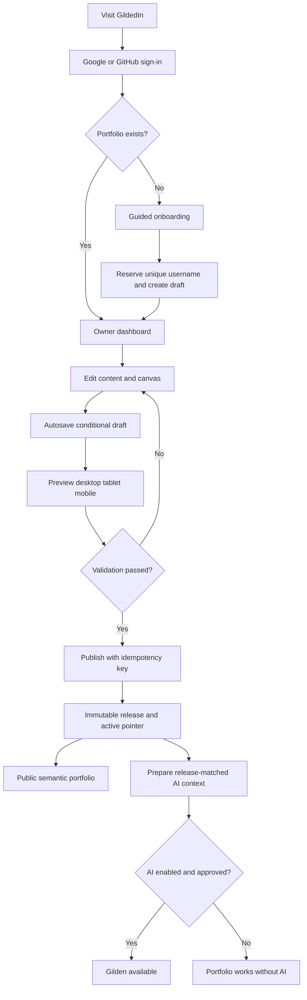
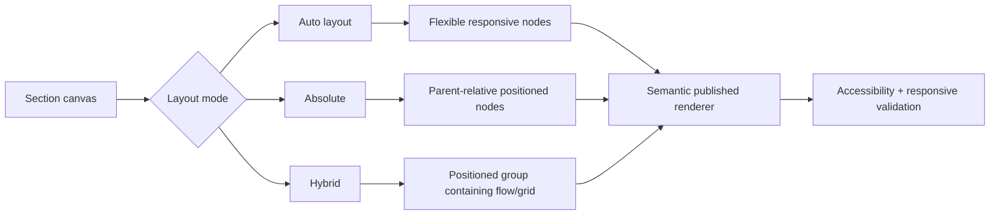
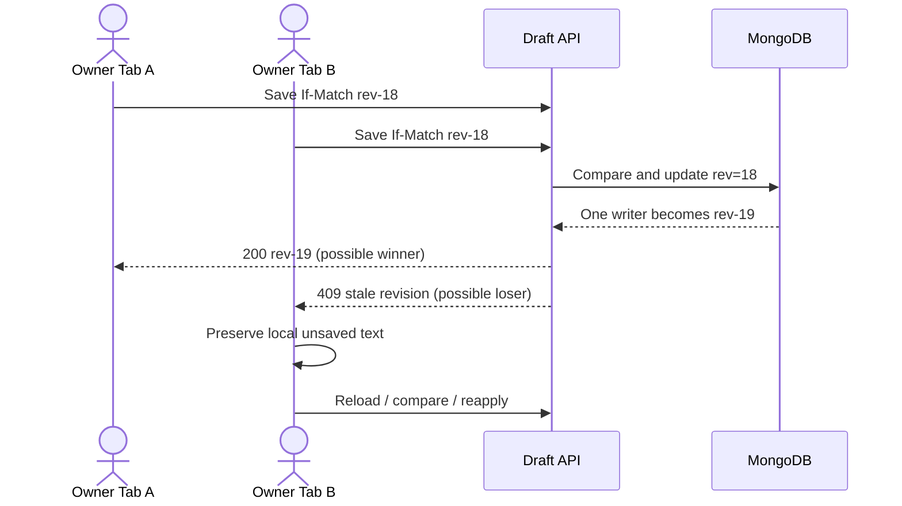
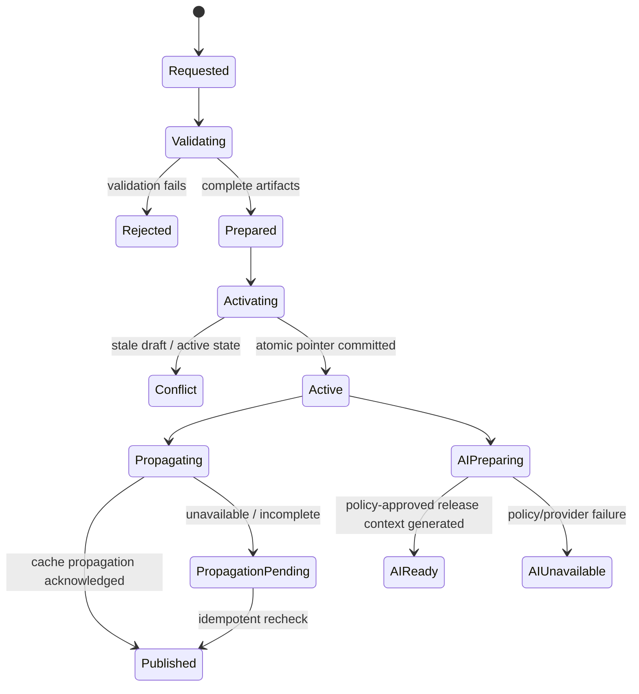
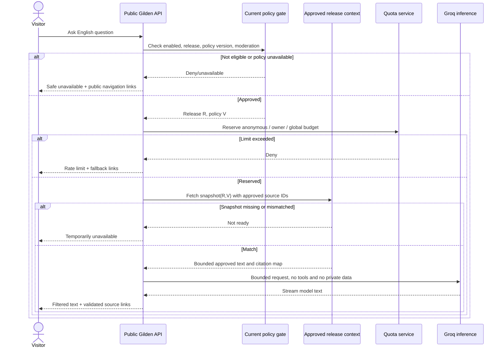
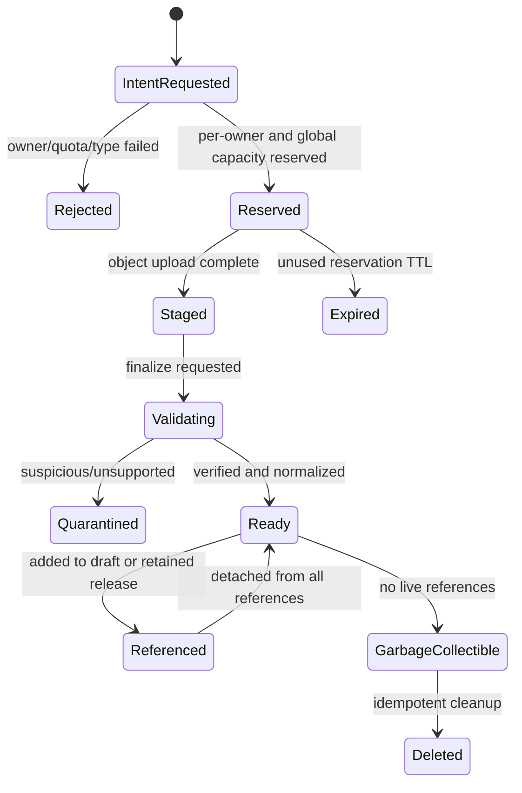
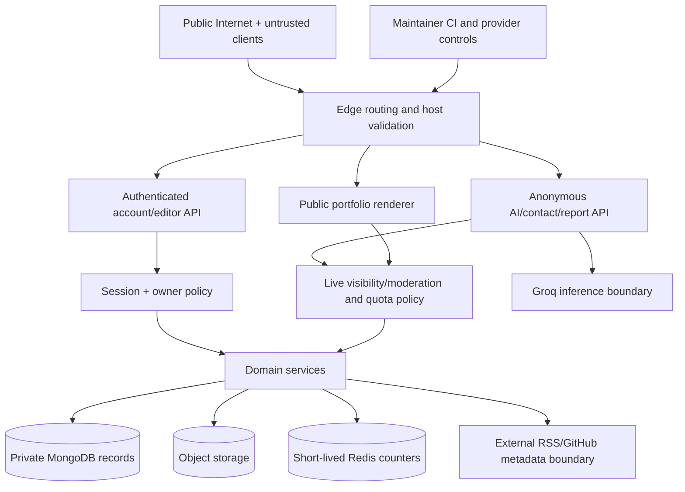

# 02 - Requirements and Scope: Comprehensive Product, Security and Quality Specification

> **Status:** Normative implementation baseline; verification gates identified ·
> **Version:** 2.0.0 ·
> **Date:** 2026-11-18 ·
> **Product:** GildedIn
> **Document owner:** Product/Architecture  
> Cross-reference: [Overview](01-system-overview.md) · [UX](03-ui-ux.md) · [Data](05-data-model.md) · [API](06-api-design.md) · [Security](07-security-design.md) · [Testing](11-testing-strategy.md) · [Decisions](12-architecture-decision-record.md).

## 1. Requirements language, priority, and authority

`MUST` is release-blocking behavior; `SHOULD` is intended unless a documented ADR accepts an exception; `MAY` is optional. **P0** security/data/ownership or required functional baseline; **P1** launch differentiation and quality; **P2** optional or staged enhancement. Priority determines implementation sequence, not whether a stated first-release MUST can be silently removed. For each item, `AC` is a testable acceptance condition. The test identifiers map to [11](11-testing-strategy.md).

| Status                   | Meaning                                                                |
| ------------------------ | ---------------------------------------------------------------------- |
| Fixed product decision   | Binding unless the product owner explicitly changes it                 |
| Preferred implementation | Replaceable when evidence supports a different choice                  |
| Feasibility gate         | Must be verified in the real deployment before release                 |
| Accepted risk            | Known consequence, documented/disclosed; not implicitly solved         |
| Excluded                 | Not an initial product requirement and must not be built speculatively |

### 1.1 Non-negotiable constraints

- New spending **$0**: no subscription, required payment card, metered bills, or hidden overage exposure. Existing paid resources can be reused while available, but renewals are not assumed.
- Free public SaaS, open source, worldwide registration, no monetization planned. Vercel Hobby eligibility is **unverified**, despite being preferred; hosting must be replaceable.
- Single Next.js TypeScript modular monolith; MongoDB; managed object storage subject to hard zero-charge constraint; Google + GitHub sign-in; Groq inference initially.
- Users get one active portfolio per account initially; accounts and portfolios are separate entities. No email-based automatic account merge.
- Canonical `https://aaroophan.dev/{slug}` and equivalent wildcard `{slug}.aaroophan.dev` routes in initial release **subject to demonstrated DNS/TLS operation**; platform root is GildedIn, `/dashboard` protected.
- One required Hero first; remaining types optional, reusable and reorderable. **20 authored blocks across the entire portfolio**, maximum **3 nested schema levels**, **20 custom fields per section**, **20 collection items**, **100 KiB serialized release payload** (100 KiB defined here as 102,400 UTF-8 bytes), and **3 retained published revisions**. Note: earlier product discussion used '100 KB' without decimal/binary precision; this specification chooses 100 KiB to remove byte ambiguity; change through an ADR if literal 100,000 bytes is required.
- Editor: free-positioned section canvases, responsive hybrid/auto/absolute groups, structured editing, inline text, mobile essential controls, three breakpoints, non-drag alternatives, semantic reading order.
- Publishing: debounce autosave → preview → validate → immutable release → atomic activation → propagation; explicit publish; owner-only previews; no draft leakage.
- AI is owner opt-in, uses approved released English content, no visitor identity/chat transcript storage, supports citations and streaming, quota, immediate authorization revocation and independent failure.
- Media per portfolio: max **15 MiB** stored, **30 files**; per image **1 MiB**, per PDF **2 MiB**, input dimensions ≤4096 × 4096; global provider quota overrides per-owner allowance. Here MiB explicitly means 1,048,576 bytes. Media limits may require product owner confirmation if strict decimal MB was intended; the limits are not silently increased.
- No guaranteed independent backups, restoration or uninterrupted availability. Three versions **do not** provide disaster recovery. Retained data may be lost irrecoverably; disclose risk. Protect integrity and safe writes nonetheless.
- Default `public` vs `unlisted` applies only when there is an active release. Unlisted means link-accessible but not private. Admin suspension overrides public state.
- No separate production-like testing environment; local/mocked tests must never reach production data.
- Initial portfolio language English; Gilden accepts/responds in English. Accessibility target WCAG 2.2 AA. Performance targets are quality gates, not guaranteed service-level promises.

### 1.2 Limit definition and counting rules

| Limit                    | Counts                                                                                                                         | Does not count                                                                                                    | Failure behavior                               |
| ------------------------ | ------------------------------------------------------------------------------------------------------------------------------ | ----------------------------------------------------------------------------------------------------------------- | ---------------------------------------------- |
| 20 blocks/portfolio      | All owner-authored render nodes on all public pages, including nested blocks; one reusable repeater node counts once           | Automatically rendered repeater item instances; platform-generated section scaffolding and accessibility wrappers | 422 `BLOCK_LIMIT` with count; no partial write |
| 20 custom fields/section | Custom schema definitions declared by the section                                                                              | Mandatory platform-defined identity fields                                                                        | 422 `FIELD_LIMIT`                              |
| Depth 3                  | Nested object/list schema container levels from root item                                                                      | Presentation-only grouping that does not nest content schema                                                      | 422 `DEPTH_LIMIT`                              |
| 20 items/collection      | Stored entries per owner-created or section collection                                                                         | Displayed filtered views of same IDs                                                                              | 422 `COLLECTION_LIMIT`                         |
| 100 KiB release          | UTF-8 bytes of canonical serialized immutable release: content, layouts, schemas, props, tokens, metadata and media references | Binary media and separate derived search/AI artifacts                                                             | 422 `PUBLISHED_SIZE_LIMIT`                     |
| 3 releases               | Latest 3 immutable published versions; older ones reclaimed safely                                                             | Working draft; failed preparation artifacts                                                                       | Best-effort GC after no references             |
| 30 media files/portfolio | Existing original files, including inactive draft/release references                                                           | Derived responsive variants (still consume physical provider quota)                                               | 409/422 quota error                            |

Each counted unit is revalidated server-side, including after imports, cloning, restores, and concurrent writes. A single edited document can be smaller than the final 100 KiB release; the final limit is enforced again at Publish. See [05](05-data-model.md).

## 2. Functional requirements - identity and tenancy

| ID      | Priority | Requirement                                                                      | Acceptance criteria / verification                                                          |
| ------- | -------- | -------------------------------------------------------------------------------- | ------------------------------------------------------------------------------------------- |
| IAM-001 | P0       | Public Google OIDC and GitHub OAuth registration/sign-in                         | Success and rejection paths proven with provider simulation; no custom passwords (T-IAM-01) |
| IAM-002 | P0       | Identity joins on `(provider, stable subject)`, not email                        | Same email with different provider creates no silent takeover (T-IAM-02)                    |
| IAM-003 | P0       | Account linking requires current session + fresh confirmation of target identity | Cross-account merge rejected unless both identities controlled (T-IAM-03)                   |
| IAM-004 | P0       | Cannot remove last usable verified provider                                      | Conflict response; owner remains able to authenticate (T-IAM-04)                            |
| IAM-005 | P0       | Revocable secure host-only session on apex                                       | No session cookie sent to tenant subdomain; logout invalidation (T-IAM-05)                  |
| IAM-006 | P0       | Admin role provisioned in trusted procedure, not first sign-up                   | Unprivileged users cannot become admin; bootstrap auditable (T-IAM-06)                      |
| IAM-007 | P1       | Registration may end without portfolio                                           | Dashboard offers onboarding; no null-owner anomalies (T-IAM-07)                             |
| IAM-008 | P0       | Sensitive actions demand recent reauthentication                                 | Delete, unlink, ownership changes, admin actions checked (T-IAM-08)                         |
| IAM-009 | P1       | Verified GitHub subject permitted without public email                           | Email-dependent feature stays disabled until verification (T-IAM-09)                        |
| TEN-001 | P0       | Separate stable `accountId` and `portfolioId`                                    | Rename does not change ownership or references (T-TEN-01)                                   |
| TEN-002 | P0       | All private tenant operations enforce owner or admin check                       | Cross-account ID substitution always 403/404 (T-TEN-02)                                     |
| TEN-003 | P0       | One active portfolio per account in beta                                         | Concurrency-safe uniqueness; schema allows later expansion (T-TEN-03)                       |
| TEN-004 | P0       | Unique canonical ASCII slug 3–30, lowercased; reserved words blocked             | Parallel claims yield one winner; consistent normalized handling (T-TEN-04)                 |
| TEN-005 | P1       | Keep old slugs assigned to same portfolio while it exists                        | Old path and subdomain redirect; hijack prevented (T-TEN-05)                                |
| TEN-006 | P0       | Path and subdomain host resolve the same portfolio/release                       | All detail routes mirror content and are tested with actual TLS (T-TEN-06)                  |
| TEN-007 | P0       | Trusted hostname validation and unknown subdomain 404                            | Forged Host/X-Forwarded-Host has no cross-tenant effect (T-TEN-07)                          |
| TEN-008 | P1       | `www` redirects to apex; both URL models support same navigation                 | Subdomain links stay on subdomain; canonical points to path (T-TEN-08)                      |
| TEN-009 | P0       | Suspended/disabled portfolio suppressed even with stale release cached           | Every public entry path checks authoritative policy (T-TEN-09)                              |

## 3. Functional requirements - content, editor and publishing

| ID      | Priority | Requirement                                                                                          | Acceptance criteria / verification                                                           |
| ------- | -------- | ---------------------------------------------------------------------------------------------------- | -------------------------------------------------------------------------------------------- | -------------------------------------------------------------------------------- |
| CNT-001 | P0       | Hero mandatory, unique and first; other sections repeatable                                          | Validation rejects duplicate Hero and invalid order (T-CNT-01)                               |
| CNT-002 | P0       | Typed configurable fields, nested objects/lists, constraints                                         | Known types and JSON imports cannot smuggle untrusted operations (T-CNT-02)                  |
| CNT-003 | P0       | Reusable stable content IDs and references                                                           | Update once changes all draft bindings; public unchanged until Publish (T-CNT-03)            |
| CNT-004 | P1       | User-defined sections and safe layouts from block catalog                                            | No executable components, CSS or scripts accepted (T-CNT-04)                                 |
| CNT-005 | P0       | Referential integrity across owner-scoped collections                                                | Deletion with live references requires explicit detach; no foreign tenant binding (T-CNT-05) |
| CNT-006 | P1       | Hidden section content persists in draft but is not published/AI-visible                             | Public and Gilden omit excluded content (T-CNT-06)                                           |
| CNT-007 | P1       | Visual schema designer and safe JSON-schema-subset import                                            | Unsupported `$ref`, recursive/remote refs and prototypes rejected (T-CNT-07)                 |
| CNT-008 | P1       | Built-in derived dates/durations only                                                                | No arbitrary formula evaluation; deterministic output (T-CNT-08)                             |
| CNT-009 | P1       | Projects: categories, filtering, feature flag, shareable case-study detail pages                     | Correct canonical, links, and stable slug behavior (T-CNT-09)                                |
| CNT-010 | P1       | Medium RSS/username/manual links, preview metadata only                                              | Feed outage leaves cached content; SSRF checks (T-CNT-10)                                    |
| CNT-011 | P1       | Public portfolio search uses generated release-only client index                                     | Hidden/private content absent from index (T-CNT-11)                                          |
| EDT-001 | P0       | Inline edits plus inspector for structured objects                                                   | Local preview updates immediately; input remains valid (T-EDT-01)                            |
| EDT-002 | P0       | Per-section free-positioning with auto/absolute/hybrid groups                                        | Coordinates/constraints serialize and reproduce across viewport modes (T-EDT-02)             |
| EDT-003 | P0       | Desktop/tablet/mobile previews with derived layouts and overrides                                    | No unexpected horizontal overflow, missing controls or text clipping (T-EDT-03)              |
| EDT-004 | P0       | Semantic reading order distinct from visual stacking                                                 | Keyboard/screen-reader traversal makes sense at every width (T-EDT-04)                       |
| EDT-005 | P1       | Grouping, resizing, snapping, z-order, locking, multi-select, undo/redo                              | Non-drag keyboard or inspector alternatives (T-EDT-05)                                       |
| EDT-006 | P1       | Repeater block renders typed collection with accessible navigation                                   | Generated cards don't each count toward owner node limit (T-EDT-06)                          |
| EDT-007 | P1       | Safe interactions: tabs, modal, carousel, scroll, show/hide, form                                    | No arbitrary JS; equivalent keyboard interaction (T-EDT-07)                                  |
| EDT-008 | P0       | Draft autosaves with debounce, visible save/failure status                                           | Network failure retains changes; no silent loss (T-EDT-08)                                   |
| EDT-009 | P0       | Optimistic draft revision and compare/recovery on 409 conflict                                       | Two tabs cannot silently overwrite (T-EDT-09)                                                |
| EDT-010 | P0       | Owner-only preview and Play Animation Preview                                                        | URL guessing does not expose draft (T-EDT-10)                                                |
| PUB-001 | P0       | Validate schema, semantic accessibility, links, file readiness and output byte limits before publish | Hard violations block atomic activation (T-PUB-01)                                           |
| PUB-002 | P0       | Immutable release and single atomic active pointer                                                   | No mixed content across concurrent readers (T-PUB-02)                                        |
| PUB-003 | P0       | Idempotent publish operation keyed to owner+portfolio+key                                            | Retry yields same release/status (T-PUB-03)                                                  |
| PUB-004 | P1       | Cache propagation status and safe recheck/retry                                                      | Failure after activation reports `propagation_pending` (T-PUB-04)                            |
| PUB-005 | P0       | Restore version as draft; explicit re-publish                                                        | Existing public release not overwritten on restore (T-PUB-05)                                |
| PUB-006 | P1       | Retain three release versions and referenced media                                                   | GC never removes media used by retained revision (T-PUB-06)                                  |
| PUB-007 | P0       | Separate visibility (`public                                                                         | unlisted`) and moderation                                                                    | Changes apply without content re-publication and bypass stale release (T-PUB-07) |
| PUB-008 | P1       | Owner may disable/unpublish or permanently delete portfolio                                          | Correct 404/410 and cache suppression behavior (T-PUB-08)                                    |

## 4. Functional requirements - AI, media, analytics and administration

| ID      | Priority | Requirement                                                                  | Acceptance criteria / verification                                           |
| ------- | -------- | ---------------------------------------------------------------------------- | ---------------------------------------------------------------------------- |
| AI-001  | P0       | Gilden optional, owner opt-in, English only                                  | Disabled default; enable only with released approved intro content (T-AI-01) |
| AI-002  | P0       | Section + field allowlist, newly added fields default denied                 | New private fields never enter generated context (T-AI-02)                   |
| AI-003  | P0       | Gilden uses matching approved published release, not draft                   | In-progress publish never mixes knowledge versions (T-AI-03)                 |
| AI-004  | P0       | Live revocation/pause before every request                                   | Policy-store outage fails closed; old context rejected (T-AI-04)             |
| AI-005  | P0       | Factual answers use validated release source IDs                             | No fabricated project links; unsupported claims refused (T-AI-05)            |
| AI-006  | P1       | Streams where supported, with cancellation and fallback                      | Interrupted output marked; quota still consumed (T-AI-06)                    |
| AI-007  | P0       | 15 visitor messages/day, owner/month and platform global ceilings            | Atomic counters, 429/503 safe degradation (T-AI-07)                          |
| AI-008  | P0       | No visitor chat transcript or identity stored by GildedIn                    | Only short-lived technical rate-limit tokens/aggregate counts (T-AI-08)      |
| AI-009  | P1       | Owner selects Gilden name, tone preset, greeting, placement                  | No arbitrary system prompt / control bypass (T-AI-09)                        |
| AI-010  | P1       | Optionally approved public PDF text and FAQ                                  | Explicit document-level consent and sensitive text redaction (T-AI-10)       |
| MED-001 | P0       | Secure image and PDF uploads with ownership, limits, signatures              | Spoofed/malicious files rejected; no raw user path usage (T-MED-01)          |
| MED-002 | P0       | EXIF removal, image re-encode, alt text and crop/focal data                  | New safe variant, original never accidentally exposed (T-MED-02)             |
| MED-003 | P0       | Provider/global and per-portfolio quotas enforce before write                | Concurrent uploads cannot exceed allocated safe capacity (T-MED-03)          |
| MED-004 | P0       | Referenced media survives revisions; orphan cleanup and deletion             | No broken release on replace/delete (T-MED-04)                               |
| MED-005 | P1       | View/download résumé with restrictive response headers                       | PDFs not served as executable HTML; owner privacy controls (T-MED-05)        |
| CON-001 | P1       | Consent-based text-only contact form, owner inbox                            | No exposed owner email needed; 30-day TTL; abuse protected (T-CON-01)        |
| ANA-001 | P1       | Privacy-preserving aggregated views/clicks and optional public stats         | No fingerprinting; public counters owner-opt-in (T-ANA-01)                   |
| ADM-001 | P0       | Admin suspensions and per-item moderation overlay                            | Policy wins over cached release/search/AI (T-ADM-01)                         |
| ADM-002 | P1       | Abuse report and owner appeal mechanism                                      | Admin records action, scoped reason and timestamps (T-ADM-02)                |
| ADM-003 | P1       | Compact operational status panel, no secrets                                 | Restricted admin access; no public internal error details (T-ADM-03)         |
| ACC-001 | P1       | Export structured data, layouts, asset manifest and available original media | Archive readable outside GildedIn, accessible only by owner (T-ACC-01)       |
| ACC-002 | P0       | Idempotent account deletion, immediate public suppression, queued cleanup    | No public access after acceptance; disclosed backup lag (T-ACC-02)           |

## 5. Nonfunctional, security and operational requirements

| ID      | Priority | Requirement                                                                                                                | Acceptance / evidence                                                           |
| ------- | -------- | -------------------------------------------------------------------------------------------------------------------------- | ------------------------------------------------------------------------------- |
| SEC-001 | P0       | Threat-model high-risk data flows before implementation                                                                    | Reviewed threat register with owners and tests (T-SEC-01)                       |
| SEC-002 | P0       | Default-deny server-side authorization including property-level controls                                                   | BOLA/BOPLA mutation and reads fail consistently (T-SEC-02)                      |
| SEC-003 | P0       | HTTPS, secure cookies, CSRF and origin checks, CSP                                                                         | Production headers/callback tests (T-SEC-03)                                    |
| SEC-004 | P0       | Structured validation for every input and safe output encoding                                                             | XSS, prototype pollution, unsafe URL tests (T-SEC-04)                           |
| SEC-005 | P0       | SSRF-defended RSS, link preview and remote asset fetches                                                                   | DNS rebinding, redirect and metadata-IP rejection (T-SEC-05)                    |
| SEC-006 | P0       | Secrets server-only, least privilege, rotate and audit                                                                     | No secrets in client bundle or logs (T-SEC-06)                                  |
| SEC-007 | P0       | Upload, CSP and iframe allowlisting prevent arbitrary code execution                                                       | Polyglot file, malicious PDF, rich-text fuzz tests (T-SEC-07)                   |
| SEC-008 | P0       | Public AI cannot access data beyond policy-approved release                                                                | Prompt injection + hidden-field leakage tests (T-SEC-08)                        |
| SEC-009 | P0       | Rate limits, body limits, budget ceilings and bot mitigations                                                              | Abuse tests avoid unbounded resource requests (T-SEC-09)                        |
| SEC-010 | P0       | Audit admin access, publishing, identity linking, deletion, moderation                                                     | No sensitive chat data or token logging (T-SEC-10)                              |
| SEC-011 | P0       | Production secrets protected against untrusted PR execution                                                                | Branch protection and restricted CI permissions (T-SEC-11)                      |
| SEC-012 | P1       | Privacy notice, explicit AI visibility, retention/deletion rules                                                           | Data-inventory and legal launch checklist (T-SEC-12)                            |
| UX-001  | P0       | WCAG 2.2 AA target on public and essential editor flows                                                                    | axe + manual keyboard/VoiceOver/NVDA (T-UX-01)                                  |
| UX-002  | P0       | No WebGL or animation required for core content                                                                            | Motion-off and WebGL-disabled tests (T-UX-02)                                   |
| UX-003  | P1       | Signature dark-blue aesthetic, font rules and 3D scene presets                                                             | Responsive design QA + font license check (T-UX-03)                             |
| UX-004  | P1       | Off/Subtle/Standard/Cinematic controls and system reduced motion precedence                                                | Preference and visibility lifecycle tests (T-UX-04)                             |
| SEO-001 | P1       | Unique server-rendered metadata, canonicals, sitemaps, JSON-LD and OG                                                      | Compare path/subdomain detail pages (T-SEO-01)                                  |
| SEO-002 | P0       | Draft/unlisted/suspended excluded from index/discovery                                                                     | robots/noindex/sitemap status tests (T-SEO-02)                                  |
| PRF-001 | P1       | Representative public Lighthouse ≥90 in four applicable categories                                                         | CI artifacts and manual device validation (T-PRF-01)                            |
| PRF-002 | P1       | p75 LCP≤2.5s, INP≤200ms, CLS≤0.1                                                                                           | Real-user or documented lab proxy until sample sufficient (T-PRF-02)            |
| PRF-003 | P1       | Progressive WebGL and JS/asset transfer budgets                                                                            | Budget checks, adaptive quality and fallback (T-PRF-03)                         |
| OPS-001 | P0       | Zero new spending and no payment-card dependency                                                                           | Provider-plan evidence and cost gate (T-OPS-01)                                 |
| OPS-002 | P0       | Hosting portability, no hidden Vercel business logic                                                                       | Build/deploy adapter proof (T-OPS-02)                                           |
| OPS-003 | P0       | Production isolation from local tests; no test writes to live resources                                                    | CI environment guard and negative test (T-OPS-03)                               |
| OPS-004 | P1       | Structured redacted logging, metrics and bounded retention                                                                 | 30-day logs, 90-day audit where technically feasible (T-OPS-04)                 |
| OPS-005 | P0       | Allow free-tier exhaustion to degrade safely, never bypass authorization or charge                                         | Quota/failure simulations (T-OPS-05)                                            |
| OPS-006 | P0       | Clear disclosure: no guaranteed backup, availability or disaster recovery                                                  | Owner-facing notice verified (T-OPS-06)                                         |
| OPS-007 | P0       | Review hosting provider content-use/model-training terms and verify opt-out/privacy settings before processing tenant data | Config evidence, terms review and safe alternate host when necessary (T-OPS-07) |

## 6. Privacy and data minimization requirements

| Data category                              | Storage basis and visibility                                    | Retention / deletion rule                                            | Special treatment                                                                 |
| ------------------------------------------ | --------------------------------------------------------------- | -------------------------------------------------------------------- | --------------------------------------------------------------------------------- |
| Provider ID, name, optional verified email | Private account; used for identity/service                      | Account life; purge on deletion subject to audit/backup limits       | Never use email as permanent ownership key                                        |
| Draft content and private reference data   | Owner only                                                      | Until deleted; not present in public assets                          | Segregate from published release and AI compiler                                  |
| Published owner-approved content           | Public/URL-accessible depending on visibility                   | While published and retained releases                                | Index only with owner policy; cannot retract previously downloaded copies         |
| Uploaded images/PDF                        | Scoped by owner, visibility-specific                            | Delete once no draft/release references                              | Strip metadata; virus risk not eliminated by MIME checks                          |
| Visitor chat                               | Memory only per page session; sent to AI provider for inference | No transcript DB at GildedIn                                         | Warn against including sensitive information; provider handling must be disclosed |
| Rate-limit metadata                        | Random short session tokens and coarse abuse signals            | TTL to quota window                                                  | Avoid persistent fingerprinting or message storage                                |
| Contact submissions                        | Private owner inbox                                             | Auto-delete 30 days                                                  | Consent and spam checks; no attachments                                           |
| Analytics                                  | Aggregated counts                                               | Rolling bounded retention per [09](09-error-handling-and-logging.md) | No individual visitor history; optional public aggregate                          |
| Security/error logs                        | Admin-only sanitized metadata                                   | 30 days, subject to provider limitations                             | No credentials, raw chat or full request bodies                                   |
| Security audit events                      | Admin-only minimal identity/action/result                       | 90 days, subject to applicable law and provider limits               | Minimal IDs; no replayable tokens                                                 |
| Provider/backups                           | According to service terms                                      | Provider-dependent; disclose max 30 days only if enforceable         | No unsupported deletion guarantee                                                 |

Privacy notices and processing practices require a jurisdiction-specific legal check before public operation. `noindex` and `unlisted` do not make content confidential. External AI providers receive visitor text and approved context for inference; therefore an absolute guarantee of zero personal data transmission is **not achievable** if a visitor types personal data. GildedIn must not solicit it, must minimize it, and must disclose the provider interaction.

## 7. Non-goals and applicability matrix

| Topic                                        | Status                    | Reason / future trigger                                                                      |
| -------------------------------------------- | ------------------------- | -------------------------------------------------------------------------------------------- |
| Microservices, message broker and Kubernetes | Excluded                  | One modular deployment; background work can use short idempotent on-demand tasks             |
| WebSocket server                             | Excluded                  | AI uses HTTP streaming; editor local preview doesn't require collaboration                   |
| Vector DB / full RAG                         | Excluded                  | 100 KiB release + filtered context; introduce only after measured need                       |
| Payment systems                              | Excluded                  | No monetization, subscriptions or purchases                                                  |
| Native email sending                         | Deferred                  | Zero-cost inbox; sending provider needs safety/cost evaluation                               |
| Private visitor accounts                     | Excluded                  | Public reading and ephemeral chat only                                                       |
| Cross-account collaboration                  | Deferred                  | One owner; account model leaves expansion possible                                           |
| Custom CSS, JS or shaders                    | Prohibited                | Untrusted code execution and CSP complexity                                                  |
| Arbitrary third-party iframe                 | Prohibited                | Strict provider allowlist only                                                               |
| Custom domains                               | Deferred                  | First release uses apex paths + subdomains                                                   |
| Internationalization                         | Deferred                  | English-only release                                                                         |
| Offline-first sync                           | Excluded                  | Short-lived local recovery only, no autonomous offline mutations                             |
| Guaranteed HA and DR                         | Excluded/accepted risk    | $0 and no independent backups; disclose explicitly                                           |
| Containers and IaC                           | Optional tooling          | Docker local dev only if practical; no orchestrator                                          |
| Data protection law compliance               | Applicability review      | Publish accurate privacy notice; don't claim certifications                                  |
| Incident response                            | Required minimal playbook | Manual owner-admin response and public suppression in [09](09-error-handling-and-logging.md) |
| Dependency/supply-chain scanning             | Required                  | Threat surface of open-source app and third-party Actions                                    |

## 8. Representative acceptance scenarios (Gherkin)

```gherkin
Feature: Owner isolation
  Scenario: Authenticated owner cannot modify another portfolio
    Given A and B are separate accounts with distinct portfolios
    When A attempts PATCH /api/v1/portfolios/{B-portfolioId}/draft
    Then the server returns 403 or indistinguishable 404
    And B's draft revision and content are unchanged

Feature: Publication atomicity
  Scenario: Failed preparation cannot update live portfolio
    Given portfolio P has active release R1
    And draft D2 contains invalid heading order
    When its owner publishes D2
    Then publication returns 422 with field-level violations
    And activeReleaseId remains R1

Feature: AI field revocation
  Scenario: Removed consent takes effect before next inference
    Given released context includes field F at policy version 8
    When the owner revokes F and policy becomes version 9
    Then the next Gilden request cannot use F
    And if current policy cannot be verified the chat endpoint is unavailable

Feature: Responsive editing
  Scenario: Layout is accessible without dragging
    Given a block is selected in mobile editor
    When the owner uses inspector controls to move it
    Then its mobile override changes and autosaves
    And semantic reading order remains keyboard accessible

Feature: Billing limit
  Scenario: Storage reaches hard provider capacity
    Given available zero-charge storage is exhausted
    When the owner uploads another asset
    Then upload fails without creating a billable service operation
    And the already-published portfolio remains unchanged when possible
```

## 9. Coverage and traceability

| Primary family        | Defining documents                                                                                   | Representative tests                    |
| --------------------- | ---------------------------------------------------------------------------------------------------- | --------------------------------------- |
| IAM / TEN             | [05](05-data-model.md), [06](06-api-design.md), [07](07-security-design.md)                          | T-IAM-01..09, T-TEN-01..09              |
| CNT / EDT             | [03](03-ui-ux.md), [05](05-data-model.md), [06](06-api-design.md)                                    | T-CNT-01..11, T-EDT-01..10              |
| PUB                   | [05](05-data-model.md), [08](08-storage-and-sync-strategy.md)                                        | T-PUB-01..08                            |
| AI                    | [07](07-security-design.md), [08](08-storage-and-sync-strategy.md), [06](06-api-design.md)           | T-AI-01..10                             |
| MED / CON / ANA / ADM | [05](05-data-model.md), [07](07-security-design.md), [09](09-error-handling-and-logging.md)          | T-MED, T-CON, T-ANA, T-ADM              |
| SEC / OPS             | [07](07-security-design.md), [09](09-error-handling-and-logging.md), [10](10-deployment-strategy.md) | T-SEC-01..12, T-OPS-01..07              |
| UX / SEO / PRF        | [03](03-ui-ux.md), [10](10-deployment-strategy.md), [11](11-testing-strategy.md)                     | T-UX-01..04, T-SEO-01..02, T-PRF-01..03 |

Each pull request affecting a requirement MUST cite its `ID` and add/update test evidence. `12-architecture-decision-record.md` governs changes to technical decisions. No feature is "done" on visual demonstration alone; demonstrate negative authorization cases, degraded dependencies and the published rendering contract.

## 10. Sources and standards

- [OWASP ASVS 5.0](https://asvs.owasp.org/) and [API Top 10](https://owasp.org/projects/api-security-project) - security coverage.
- [W3C WCAG 2.2](https://www.w3.org/TR/WCAG22/) - AA, dragging alternatives, focus, content structure.
- [NIST SP 800-63-4](https://www.nist.gov/publications/nist-sp-800-63-4-digital-identity-guidelines) - identity/authentication guidance.
- [OAuth 2.0 Security BCP, RFC 9700](https://www.rfc-editor.org/rfc/rfc9700.html) - redirect/callback/PKCE boundaries.
- [Google Search canonicalization](https://developers.google.com/search/docs/crawling-indexing/consolidate-duplicate-urls) - aliases and duplicate SEO.
- [Vercel Hobby terms](https://vercel.com/legal/terms), [Blob quota](https://vercel.com/docs/vercel-blob/usage-and-pricing), [MongoDB Atlas limits](https://www.mongodb.com/docs/atlas/reference/free-shared-limitations/) - capacity/eligibility risks.

---

## 11. Detailed specification method and requirements governance

> **Document structure:** Sections 1–10 establish the normative requirement ID registry and its basic acceptance map. Sections 11 onward elaborate those same requirements into behavioral contracts, boundary cases, threat-related constraints, operational implications, end-to-end scenarios, test evidence and change control. The same ID always denotes the same obligation. This specification is self-contained enough for implementation planning; the other eleven architecture documents provide specialized detail rather than competing interpretations.

### 11.1 Product intent and definition of done

**Product statement.** GildedIn is a free, open-source, multi-user portfolio creation and publishing service. An owner can register, maintain independently identified professional content, construct visually distinctive responsive portfolio pages without code, preview changes, and explicitly publish a secure, immutable version. A public visitor can browse published content without an account. An owner may optionally enable Gilden, a portfolio-scoped assistant that answers from approved published material. The platform itself provides onboarding, a curated showcase, a lightweight searchable directory, secure account management, and minimal administration.

**Value proposition.** GildedIn combines (a) expressive design-tool-level composition; (b) typed, reusable, owned content; (c) accessible, search-engine-readable output; and (d) opt-in, source-grounded AI. It is not a generic website-building environment and it must not give owners unrestricted executable code on the public site.

**Feature completion rule.** A feature is _implemented_ only after the following are supplied and verified:

1. An owner-visible interaction and its accessibility alternative, or a documented reason the feature has no UI.
2. Authentication and **resource-specific** authorization, including negative and cross-tenant tests.
3. A defined request contract, validation, state transition, persistence semantics, and rollback/error behavior.
4. Relevant privacy classification, visibility rules, retention policy, and data-export/deletion treatment.
5. Public rendering and SEO behavior, where applicable, including draft and unlisted exclusion.
6. Abuse limits; timeouts; provider-unavailable behavior; and zero-charge consequences where externally hosted.
7. Unit/integration/E2E and any necessary manual accessibility/security evidence, linked to a requirement ID.
8. Updated documentation and an ADR when a normative decision or security boundary is changed.

A screenshot, a successful click-through in a development browser, a passing happy-path unit test, or an AI-generated assertion does **not** separately establish completion.

### 11.2 Requirement precedence and interpretation

| Evidence or document                               | Authority                            | Resolution rule                                                                      |
| -------------------------------------------------- | ------------------------------------ | ------------------------------------------------------------------------------------ |
| Explicit fixed product constraint in this document | Binding                              | Must be implemented or the launch is blocked; change requires product-owner approval |
| P0 security invariant                              | Binding                              | Cannot be waived by UI convenience, performance score, or provider limitation        |
| P1 release feature                                 | Binding if stated as MUST            | May be scheduled after prerequisite P0 work, not silently discarded                  |
| Preferred stack/hosting/library                    | Replaceable                          | Select using feasibility, license, security, portability and measured performance    |
| Detailed model/API specification                   | Technical contract                   | Must satisfy requirements here; revise both documents for a deliberate change        |
| Vendor documentation/plan limits                   | External fact to verify              | Must be rechecked at provisioning and periodically, not assumed perpetual            |
| Example JSON, UML, diagram, UI illustration        | Illustrative unless marked normative | Does not silently create a new fixed requirement                                     |

`MUST` / `MUST NOT` are mandatory; `SHOULD` / `SHOULD NOT` establish a strong default requiring a recorded exception; `MAY` permits an optional behavior that must nevertheless be secure if shipped. Priority labels and scope classifications are separate concepts: P0 means implementation ordering and launch-criticality, not a statement that P1 requirements are unimportant.

### 11.3 Requirement metadata and traceability conventions

Each actionable requirement has: a stable ID, normative statement, rationale, priority, scope, actor, affected assets, testable acceptance condition, negative tests, technical owner, evidence link, status and optional ADR link. Requirements must **not** be renumbered when a feature moves between release phases. A removed requirement is marked deprecated with rationale, rather than reused for something unrelated.

Suggested machine-readable record for repository-maintained traceability:

```yaml
id: TEN-002
name: Cross-tenant authorization
priority: P0
scope: launch
status: specified
normative: MUST
actors: [owner, administrator]
assets: [portfolio, draft, release, media, inbox]
preconditions: [authenticated_session, resolved_portfolio]
acceptance:
  - A cannot read, write, export or delete B's private resources
  - rejected requests do not mutate B's revision or counters
negative_tests: [T-TEN-02, T-SEC-02]
primary_design: [05-data-model.md, 07-security-design.md]
related_adr: ADR-003
evidence: pending
```

Status vocabulary: `proposed`, `specified`, `implemented`, `verified`, `blocked`, `deferred`, `deprecated`. Only verified status can satisfy a beta gate. Do not use `passed` when testing was skipped or unavailable. Change the specification, test and threat model in the same pull request when changing a security-sensitive contract.

### 11.4 Stakeholders, decisions and accountability

| Stakeholder                        | Primary concern                                            | Product obligation                                                               | Escalation path                             |
| ---------------------------------- | ---------------------------------------------------------- | -------------------------------------------------------------------------------- | ------------------------------------------- |
| Portfolio owner                    | Creative freedom, data safety, publishing confidence       | Ownership clarity, draft recovery, accessible editor, export, meaningful quotas  | Owner UI support and platform administrator |
| Anonymous visitor                  | Fast readable portfolio, accurate AI, safe links and forms | No login requirement, privacy notice, accessible navigation, safe fallbacks      | Report Portfolio or operator contact        |
| Platform administrator             | Containment of abuse and operational failures              | Minimally privileged controls, audit trail, suspension, privacy-safe diagnostics | Product maintainer                          |
| Maintainer/contributor             | Feasible architecture and reproducible tests               | Typed module boundaries, security checks, ADRs, controlled changes               | Code review and release gate                |
| Reference/testimonial subject      | Consent and non-exposure of private details                | Default-private fields, owner acknowledgement of consent, removal process        | Owner and platform administrator            |
| External identity and AI providers | Defined API contract, limited processing                   | Minimal scopes, bounded calls, no leaked provider secrets                        | Provider status/incident process            |

The product is primarily operated by a solo maintainer but must be understandable and testable by external contributors. The administrator is a **role**, not an implicit owner of all published content; privileged private-resource access requires a justified task, documented scope and audit evidence.

### 11.5 Assumptions, dependencies and feasibility gates

| Key  | Classification       | Statement                                                                                                        | Verification or risk                                                               |
| ---- | -------------------- | ---------------------------------------------------------------------------------------------------------------- | ---------------------------------------------------------------------------------- |
| F-01 | Launch blocker       | The selected host permits this public, free multi-user SaaS under its actual terms                               | Written policy/eligibility assessment; alternative provider if not permitted [R17] |
| F-02 | Launch blocker       | Wildcard subdomains resolve and receive trusted HTTPS certificates for all supported slugs                       | Real DNS/TLS tests, not a library unit test                                        |
| F-03 | Launch blocker       | Every enabled provider can be operated with no payment card or exposure to usage charges                         | Account/plan/billing-setting evidence; fail closed or replace provider             |
| F-04 | Launch blocker       | Production identity-provider redirect callbacks work without widening redirect allowlists                        | Exact configured callback and state/nonce/PKCE tests [R03]                         |
| F-05 | Launch blocker       | Hosting provider processing and model-training use of tenant content is compatible with approved privacy choices | Review current terms and verify opt-out/configuration where applicable             |
| F-06 | Launch blocker       | Storage objects cannot bypass global capacity or be made public before validation                                | Concurrency/visibility probe and billing ceiling                                   |
| F-07 | Launch blocker       | AI provider content-handling terms and limits are disclosed and acceptable                                       | Provider settings, model availability and quota test [R20]                         |
| F-08 | Licensing blocker    | Fonts, visual assets and code dependencies are legally distributable or replaceable                              | Asset and license inventory; fallback if rights absent                             |
| F-09 | Operational risk     | No independent guaranteed backup/disaster recovery is funded                                                     | Accurate owner disclosure; no false recovery promise                               |
| F-10 | Capacity uncertainty | 100–500 actively maintained portfolios is the planning range, not a verified throughput promise                  | Benchmarks and provider-account measurements                                       |

**Unverified** is not equivalent to **unsafe** or **safe**; it means the feature cannot be declared deployable until evidence is recorded. Do not invent a production operational guarantee to fill the gap.

---

## 12. Product use cases, user stories and expected journeys

### 12.1 Actor capabilities and entry conditions

| Actor                                | Entry point                                 | Allowed without authentication                                                                                              | Requires authenticated owner                                                                                                  | Privileged administrator only                                   |
| ------------------------------------ | ------------------------------------------- | --------------------------------------------------------------------------------------------------------------------------- | ----------------------------------------------------------------------------------------------------------------------------- | --------------------------------------------------------------- |
| Visitor                              | Platform homepage, public path or subdomain | Browse public published pages; search published content; use optional Gilden; submit separate consented contact/report form | No                                                                                                                            | No                                                              |
| Registered account without portfolio | `/dashboard`                                | Public functionality only                                                                                                   | Create portfolio, manage identity and provider links, delete/export account                                                   | No                                                              |
| Portfolio owner                      | `/dashboard/{...}`                          | Public functionality                                                                                                        | Edit content/layout, upload media, preview, publish, restore, control visibility/AI, read inbox and aggregates, export/delete | No                                                              |
| Administrator                        | Restricted admin routes                     | Public functionality                                                                                                        | Own portfolio as ordinary owner                                                                                               | Moderation, account suspension, reports, safe operations status |

No visitor authentication is required for public content. Unlisted portfolios are **not confidential**; their address is simply excluded from elective discovery/indexing mechanisms. No user is permitted to publish a custom script or install arbitrary code through their editing privileges.

### 12.2 Primary happy-path lifecycle



### 12.3 Detailed use-case contracts

**UC-01: Sign up.** Precondition: identity provider reachable; platform not suspended. Owner selects one of two providers. Callback is cryptographically correlated to the request, validated against an exact redirect, and associated with a stable provider identity. If this is a new provider identity, create an account; do not merge by matching email. Account creation succeeds with no portfolio; next step is onboarding. Failure produces a safe generic response, not a provider token or stack trace. _Related:_ IAM-001/002/007/009, SEC-003.

**UC-02: Link identity.** The owner must already be authenticated and satisfy freshness requirements. Linking initiates a separate authorization flow and verifies ownership of the target provider identity. A provider identity already bound to another account cannot be silently transferred. At least one verified usable identity must remain. A failed attempt leaves both accounts unchanged. _Related:_ IAM-003/004/008, SEC-002.

**UC-03: Create portfolio.** Owner chooses a 3–30-character slug, identity label, introduction and initial appearance. The platform validates the normalized slug against the combined current-and-history namespace atomically. It creates owner relationship and draft without publishing anything or granting ownership based on a URL string. Double submission yields one active portfolio. _Related:_ TEN-001/003/004, CNT-001.

**UC-04: Edit an existing portfolio.** Owner selects text or a safe block. The editor updates local preview immediately; debounced saves use a monotonically increasing draft revision. Section-specific data can be reused by multiple blocks. Competing tabs cannot silently overwrite each other. Published content remains fixed. _Related:_ CNT-002..007, EDT-001..009.

**UC-05: Resize and reposition.** Owner changes position or dimensions using mouse/touch or keyboard/inspector controls. Editor applies parent constraints; semantic reading order does not accidentally inherit absolute coordinates. Changes may override one predefined breakpoint without copying the entire layout. Severe interactive overlap and clipped content are reported before publication. _Related:_ EDT-002..007, UX-001.

**UC-06: Preview and publish.** Owner previews a saved draft through a protected route; rejects externally shared guessed URLs. Publish verifies expected revision, authoritative policy, schema, block/content limits, media readiness, semantic and SEO rules. A complete release is prepared then atomically selected, with idempotent retry support. On cache propagation failure owner sees `propagation_pending`, not fictional instantaneous delivery. _Related:_ PUB-001..007, SEC-002.

**UC-07: Restore prior release.** Owner selects one of the three retained releases, reviews changes, and restores it into a new draft. No public change occurs until a separate explicit Publish. References to retained media remain valid. _Related:_ PUB-005/006, MED-004.

**UC-08: Open a portfolio by subdomain.** The host is validated using trusted request information, slug resolved to immutable portfolio ID, live visibility/moderation checked, and exact published release rendered. Internal navigation remains on the subdomain; canonical metadata points to the equivalent path URL. Unknown subdomain returns 404. _Related:_ TEN-006..009, SEO-001/002.

**UC-09: Ask Gilden.** Anonymous visitor asks an English question. The assistant endpoint verifies enabled flag, live approvals, current release and snapshot version, quotas and permitted citations. It sends only sanitized, explicitly AI-approved public context to Groq and streams where supported. It never acquires an owner session, reads private drafts, or captures contact details. If the provider is unavailable, the portfolio continues normally. _Related:_ AI-001..010, SEC-008/009.

**UC-10: Contact owner.** Visitor opens a separate text form, provides optional organization and consented contact details, passes input limits/bot controls, and submits. A short-lived owner-only inbox entry is created. No chat transcript is attached, no visitor contact data is inferred from Gilden, and the submission expires automatically. _Related:_ CON-001, SEC-012.

**UC-11: Report abusive content.** Visitor reports a portfolio or specific published URL. Administrator reviews sanitized evidence and can hide an item or suspend the portfolio. Live policy override prevents new public/AI/search access regardless of stale release caches. Owner can request review through defined support channel. _Related:_ ADM-001..003, TEN-009, SEC-010.

**UC-12: Export/delete account.** Owner reauthenticates, requests export or permanent deletion. Export includes only authorized structured content, layout configuration, a documented manifest, and available original media. Deletion immediately revokes account activity and public visibility, then performs idempotent data/media cleanup respecting retained provider limitations. No guarantee of recovery is implied. _Related:_ ACC-001/002, IAM-008, OPS-006.

### 12.4 Persona-specific acceptance paths

| Persona                      | Primary journey                                    | Friction the product must prevent                                      | Evidence                     |
| ---------------------------- | -------------------------------------------------- | ---------------------------------------------------------------------- | ---------------------------- |
| New student                  | Register, choose identity, publish Hero/About only | Requiring work history or projects before publishing                   | T-IAM-07, T-CNT-01, T-PUB-01 |
| Developer with many projects | Import/manual entries, tags, case studies, search  | Duplicating the same project across sections; inaccurate code snippets | T-CNT-03/09/11               |
| Designer                     | Use canvas, layers, responsive layouts and gallery | Desktop-only output; drag-only controls                                | T-EDT-02..07, T-UX-01        |
| Freelancer                   | Offer services, contact form, public portfolio     | Exposing private email, message spam, invisible consent                | T-CON-01, T-SEC-09           |
| Privacy-conscious owner      | Keep references hidden, approve AI field-by-field  | New custom fields silently becoming public/AI-visible                  | T-CNT-06, T-AI-02/04         |
| Anonymous hiring manager     | Read experience, case studies, contact link        | Blocked page due to WebGL, AI outage or registration wall              | T-UX-02, T-OPS-05            |
| Maintainer                   | Release safely without cost/secret exposure        | Untrusted PR accessing production, hidden overages                     | T-SEC-11, T-OPS-01/03        |

---

## 13. Identity, ownership, hostnames and public route requirements (IAM/TEN)

### 13.1 Identity claims are not ownership grants

An OAuth/OIDC response proves a provider-authenticated identity under the verified flow; it does not authorize access to arbitrary portfolios. Ownership is an application-level relation from a stable account ID to a stable portfolio ID. Email, display name, slugs and public project URLs MUST NOT be used as the authoritative owner key [R03], [R04], [R02].

- Identity uniqueness: `(provider, providerSubject)` after validation against the intended issuer/provider; raw email must not be the uniqueness basis for merging identities.
- Separate account and portfolio records, so an account with no portfolio is valid and future multiple portfolios do not require remapping every content object.
- Every owner command must resolve the authenticated account and check actual owner/resource relation **server-side** after loading the resource; passing another ID in JSON must never expand authority.
- The intended owner account is selected server-side; owner ID provided by the browser is rejected or ignored according to a documented strict input contract.
- A compromised or reassigned slug does not imply a change in owner or content relationships; slug history is a namespace, not an identity system.
- Admin access is not the default fallback for missing ownership; each privileged operation has a precise authorization policy, purpose and auditable event.

### 13.2 OAuth and account linking security criteria

| Scenario                                            | Required outcome                                               | Negative assertion                                           |
| --------------------------------------------------- | -------------------------------------------------------------- | ------------------------------------------------------------ |
| Google first-time sign-in                           | Account created from validated stable subject                  | Forged ID token, wrong issuer/audience rejected              |
| GitHub first-time sign-in                           | Account created from validated provider identity               | Public email is not trusted as identity evidence             |
| Same user signs in with different provider unlinked | Separate account unless explicit linking completed             | Identical email cannot silently join                         |
| Owner links provider                                | Fresh owner session and proof of control over target           | Attacker cannot link their provider to victim account        |
| Provider already linked elsewhere                   | Reject or require deliberate ownership proof for both accounts | No silent transfer or duplicate identities                   |
| Owner unlinks provider                              | Maintain at least one usable verified sign-in method           | Last-provider unlink rejected                                |
| Recovery when sole provider unavailable             | Direct owner to identity-provider recovery                     | No undocumented email/manual takeover                        |
| Logout/account suspension                           | Revoke applicable GildedIn session(s)                          | Previously captured session cannot continue write operations |
| Reauthentication for destructive action             | New confirmation bound to same account and action window       | Old auth result cannot authorize deletion                    |

The selected OAuth library MUST be configured according to its actual callback, state/PKCE/nonce semantics and version. Do not assume a library's default session cookie or token revocation implementation is appropriate without review. RFC 9700 requires strict redirect matching and CSRF/mix-up protections for relevant OAuth flows [R03].

### 13.3 Host-only session and same-origin protection

**Normative cookie expectations:** HTTPS; `Secure`, `HttpOnly`, explicit `SameSite=Lax` or `Strict` following tested sign-in behavior; path `/`; no `Domain=` attribute for primary-origin session; `__Host-` prefix where supported [R10], [R11]. Tokens and sensitive session material never appear in query strings, local storage, repository sources, analytics events or public HTML.

**Important distinction:** A host-only cookie not sent to `alex.aaroophan.dev` is necessary but not sufficient to make an untrusted subdomain harmless. A malicious portfolio origin can still initiate requests to the platform's apex host, and same-site relationships do not replace anti-CSRF controls. All sensitive cookie-authenticated write routes MUST validate method, origin/referer policy, CSRF design, and owner/role authorization. Untrusted author-authored links/embeds cannot install executable code on the apex host.

Identity-related status and failure handling:

| Condition                             | Response behavior                                                              |
| ------------------------------------- | ------------------------------------------------------------------------------ |
| No current valid session              | 401/redirect to sign-in for editor; never reveal draft                         |
| Authenticated but wrong owner         | 403 or indistinguishable 404; no resource existence detail                     |
| Link collision                        | 409 with safe retry/support guidance                                           |
| Provider temporarily down             | Authentication unavailable, existing public pages remain readable where cached |
| Session expired during autosave       | Hold local unsaved changes; prompt sign-in; never save as another account      |
| Sensitive operation freshness expired | Require reauthentication; no side effect                                       |

### 13.4 Slug and hostname grammar

**Canonical slug:** ASCII `[a-z0-9]` at both ends, internal hyphens allowed, 3–30 characters, lowercase for lookup and canonical URLs. Display capitalization is presentation metadata only. Avoid Unicode normalization ambiguities in route identity. A server can accept uppercase input and normalize it or reject it consistently; it must not allow case-colliding claims. Names like `api`, `dashboard`, `login`, `admin`, `www`, `app`, `help`, and `settings`, plus reserved infrastructure names, are blocked.

```regex
^(?=.{3,30}$)[a-z0-9](?:[a-z0-9-]*[a-z0-9])?$
```

Additional anti-abuse constraints: no adjacent or leading/trailing hyphens if adopted as a fixed validator; no slug that collides with static platform routes, pre-existing DNS services, protected subdomains, or previously claimed historical handles. The implementation MUST use an atomic uniqueness guarantee for **both current and historical claims**, not two unrelated collections vulnerable to a rename race. Public alias lookup must be bounded and cannot create redirect loops.

### 13.5 Routing and public presence matrix

| Incoming origin/path                                  | Successful behavior                                      | Failure/security behavior                                                 |
| ----------------------------------------------------- | -------------------------------------------------------- | ------------------------------------------------------------------------- |
| `https://aaroophan.dev/`                              | GildedIn platform landing, featured examples/directory   | Never resolve an owner portfolio from unknown host data                   |
| `https://www.aaroophan.dev/*`                         | Permanent redirect to apex equivalent where appropriate  | Preserve safe routes only; never open redirect                            |
| `https://aaroophan.dev/{slug}`                        | Public portfolio home through active release             | Draft/unpublished 404; unlisted allowed with `noindex`; suspended blocked |
| `https://aaroophan.dev/{slug}/projects/{projectSlug}` | Published project case study                             | Missing/removed project 404/410 as defined                                |
| `https://{slug}.aaroophan.dev/`                       | Same released portfolio home                             | Host route must be on validated TLS-enabled suffix                        |
| `https://{slug}.aaroophan.dev/projects/{projectSlug}` | Equivalent project content; navigation retains subdomain | Canonical points to path URL; missing content cannot leak                 |
| `https://aaroophan.dev/dashboard`                     | Owner-authenticated dashboard                            | On subdomain, platform dashboard route is not honored                     |
| Unknown hostname/subdomain                            | None                                                     | Neutral branded 404; no tenant enumeration through redirects              |
| Old valid slug/host                                   | Redirect to current portfolio route                      | No alias takeover; no redirect through attacker URL                       |

**SEO interpretation:** The subdomain URL is a navigable duplicate origin; the canonical metadata points to the path-based URL. Canonicals are signals rather than guarantees of search-engine selection [R12]. Do not use `noindex` indiscriminately on every subdomain page to force canonical selection; validate the actual search and privacy policy independently. For each host, `robots.txt` and sitemap must reflect its supported routes; platform sitemaps list canonical **published and indexable** URLs only.

### 13.6 Security acceptance for routes and tenancy

At minimum, test: encoded slashes and dot segments; uppercase and invalid slugs; Unicode homographs; unknown TLD; spoofed `Host`/`X-Forwarded-Host`; conflicting forwarded-proto; wildcard hostname with extra labels; extremely long path; owner A accessing owner B's draft/release/media/inbox/search/AI setting/export; alias swap while a publication is active; stale CDN cache after suspension; archived slug reused by another owner; blocked reserved hostnames; OAuth return target as external URL.

**Invariance check:** Changing public URL identity must never change the stable portfolio ID, tenant authorization, active release pointer, or media ownership. Authorization does not depend on whether a request originated through the path or the subdomain.

---

## 14. Content engine, schemas, binding and reusable information (CNT)

### 14.1 Content is distinct from composition

The content engine stores _what is known about the owner_: name, professional label, project records, achievements, skills, authored links, publication metadata, etc. The visual composition engine stores _where and how_ a supported renderer presents it. Their separation is a mandatory product quality property:

1. One project ID can appear in the Hero, featured grid, Projects section and related experience without duplicate authoring.
2. Updating an underlying item updates every **draft** binding in the editor without changing an already published release.
3. Layout moves, resizing, grouping or theme changes do not mutate underlying content IDs or sever references.
4. Changing a content schema causes explicit compatibility validation before dependent blocks are rendered/published.
5. Hidden/private fields cannot be revealed by selecting a different visual component, an AI context builder, a generated search index, an OG preview or a media URL.
6. Metadata references and renderer props are **declarative data** and must not be interpreted as executable code, raw CSS directives or network request instructions.

Owners may create new sections using approved primitives and define content schemas with bounded nested objects, lists and relationships. "Custom" means configurable content and compositions, not arbitrary React components or server-side scripts.

### 14.2 Section catalogue and minimum obligations

| Section type    | Multiplicity                                   | Default public representation                                         | Content and privacy rules                                                                                  |
| --------------- | ---------------------------------------------- | --------------------------------------------------------------------- | ---------------------------------------------------------------------------------------------------------- |
| Hero            | Exactly 1 and first                            | Identity introduction, primary actions, signature technical animation | Display name, professional label and introduction required before publish; never depend on 3D to read them |
| About           | Optional/repeatable as controlled by catalogue | Narrative, values/interests, profile media                            | Owner controls visibility and AI approvals per field                                                       |
| Projects        | Optional/repeatable                            | Featured tiles, categorized repeater, project detail routes           | Stable IDs; title/slug/category/role/stack/links/gallery; rich case-study blocks                           |
| Experience      | Optional/repeatable                            | Timeline/cards, detail when configured                                | Dates, role and organization normalized; derived duration is deterministic                                 |
| Education       | Optional/repeatable                            | Education timeline/cards                                              | Sensitive or optional institution details explicitly controlled                                            |
| Skills          | Optional/repeatable                            | Badges, technical matrix, networks                                    | Skills can reference projects; never invent proficiency ratings                                            |
| Blog            | Optional/repeatable                            | External article previews and outbound canonical links                | RSS metadata only; source outage is non-blocking                                                           |
| References      | Optional/repeatable                            | Consented public recommendations or hidden records                    | Default private; contact details not public or AI-approved by implication                                  |
| Contact         | Optional/repeatable                            | Approved outbound methods and/or protected form                       | No compulsory publication of owner's private email                                                         |
| Certifications  | Optional/repeatable                            | Credential cards/list                                                 | Owner-authored metadata; external verification links optional                                              |
| Achievements    | Optional/repeatable                            | Awards/highlights                                                     | No platform-invented claims                                                                                |
| Services        | Optional/repeatable                            | Capabilities/offerings                                                | Does not imply payments/scheduling infrastructure                                                          |
| Testimonials    | Optional/repeatable                            | Consent-based quotes                                                  | Subject consent and privacy controls required                                                              |
| Publications    | Optional/repeatable                            | Papers/research/public links                                          | Verify URLs and avoid inferred citations                                                                   |
| Résumé download | Optional/repeatable                            | Secure view/download action                                           | PDF validation, owner visibility and deletion control                                                      |
| Custom Content  | Optional/repeatable                            | Blocks using approved types and schema                                | Same privacy, quota and accessibility requirements as built-ins                                            |

At publish time the platform MUST produce one valid Hero and one top-level semantic H1 even if the owner uses visually styled headings in other blocks. A section may be hidden without deleting its draft data. Reused content is included in the published release only through a permitted visible binding and the relevant field policy; a record existing in the database is not sufficient publication permission.

### 14.3 Field type requirements and validation semantics

| Field type | Accepted content                            | Essential validation                                                          | UI/UX obligation                                |
| ---------- | ------------------------------------------- | ----------------------------------------------------------------------------- | ----------------------------------------------- |
| Text       | Unicode plain text                          | Length bound; escape output; no raw HTML                                      | Single-line and multiline modes                 |
| Rich text  | Restricted structured document              | Allowed nodes/attributes only; sanitize on import and output; links validated | WYSIWYG with supported Markdown import/export   |
| URL        | Absolute permitted URL                      | Protocol allowlist, hostname parsing, no JS/data schemes                      | Show safe preview; clear invalid URL errors     |
| Email      | Contact-format string                       | Reasonable syntax/length; private-by-default                                  | Never make it public through accidental binding |
| Date       | Valid date or bounded date-time             | ISO normalization, sensible min/max and ranges                                | Date picker plus accessible text alternative    |
| Number     | Finite numeric value                        | Min/max/precision, reject NaN/Infinity/coercion abuse                         | Numeric input and readable unit labels          |
| Boolean    | Explicit true/false                         | No truthy-string coercion                                                     | Accessible switch/checkbox                      |
| Image      | Server-issued media ID                      | Same-owner, finalized, safe type and allowed visibility                       | Crop, focal point, text alternative             |
| PDF        | Server-issued media ID                      | Same-owner, finalized, validated document                                     | Safe view/download, descriptive label           |
| Select     | One of configured stable option IDs         | Unknown value rejected; changes migrate explicitly                            | Keyboard-operable selection                     |
| List       | Bounded repeated homogeneous items          | Length, item schema, max depth, total size                                    | Add/remove/reorder with non-drag control        |
| Object     | Bounded typed nested properties             | Per-path validation and prototype pollution prevention                        | Structured inspector                            |
| Relation   | Stable reference to authorized content item | Same portfolio, existing ID, allowed relationship kind                        | Picker and deletion-impact preview              |

Validation occurs on import, create/update, server-side autosave, publication, export transformation and any version upgrade that modifies schemas. Some draft fields may temporarily be incomplete while the owner edits; **publication** enforces complete published required-field and relationship rules. Destructive schema edits must present affected paths, dependent bindings, and potential data conversion before confirmation. Automatic migration is limited to safe, demonstrably lossless conversions.

### 14.4 Schema definition and migration behavior

- Every schema has a stable ID and explicit version. Each stored content item is associated with the compatible schema version.
- Schema changes are parsed as data, validated against a restricted supported shape, and never dynamically `eval`uated, imported as code, or resolved from arbitrary network URLs.
- JSON import is optional advanced authoring convenience, subject to the same field/depth/size limits as visual authoring; reject recursive remote `$ref`, arbitrary functions, unsafe keys such as `__proto__`, and unknown executable directives.
- Deleting a field with content or changing a field type may make existing values invalid. Show impact count and examples of affected paths; require confirmation; preserve published immutable releases.
- Migration of a rich-text node or an interactive block must not silently erase content; preserve unknown future data as safely non-rendered only when compatibility permits, otherwise block publication and require an explicit migration.
- Prevent cyclic relationships or enforce bounded traversal, as the composition and AI builders must not recurse without limit.
- Cross-portfolio relation targets are forbidden even if a user knows another portfolio's stable content ID; public links can reference external URLs without becoming internal owner relations.

Illustrative **safe content definition** (field names/IDs are examples, not finalized database syntax):

```json
{
  "schemaId": "research-papers-v1",
  "version": 1,
  "ownerPortfolioId": "portfolio-example",
  "fields": [
    {
      "id": "paper-title",
      "name": "title",
      "type": "text",
      "required": true,
      "maxLength": 160
    },
    {
      "id": "published-on",
      "name": "publishedOn",
      "type": "date",
      "required": false
    },
    { "id": "paper-url", "name": "url", "type": "url", "required": false },
    {
      "id": "paper-abstract",
      "name": "abstract",
      "type": "richText",
      "required": false
    }
  ]
}
```

The HTTP API MUST derive `ownerPortfolioId` from authenticated tenancy and may refuse client-submitted server-owned fields. This example documents the semantic concept, not permission to accept any browser-supplied ownership ID.

### 14.5 Content identity and reference resolution

Every authored item is identified by an immutable internal content ID, independent of name, current slug, section placement or ordering. References should be explicit stable IDs with an expected type. On rendering, resolve only items included in the relevant authorized draft or published release. The resolver must:

- Check that the target exists, belongs to the same portfolio and has a compatible declared schema.
- Enforce the target field's public/search/AI policy for the requested _use_, not merely its existence.
- Detect cycles and depth violations before traversal.
- Return a typed missing/deleted/inaccessible state rather than silently substituting another similarly named item.
- Refuse deletion of an item with outstanding references until the owner deliberately detaches, replaces or deletes dependents.
- Maintain the same identity when an item is moved between categories or sections.

**No content duplication guarantee:** A single project object shown on multiple screens is not duplicated as independent authoring records. The immutable published release may include a denormalized representation for speed as long as all its copies are derived from the **same single release snapshot** and satisfy privacy rules.

### 14.6 Publications, classifications and collection search

Projects support owner-defined categories, a featured flag/preset, galleries, filtering and shareable detail pages. Case-study content supports structured project identity plus rich narrative blocks describing problem, architecture, implementation, challenges, outcomes and lessons. Articles are previews linking to the original external canonical destination; the platform does not host full native articles in the initial release. The owner may curate additional research publications and technical notes as structured custom content.

Search uses a publication-generated lightweight index derived only from approved published, searchable fields, normalized for querying within the portfolio. Search must not reach private draft content or build free-form unbounded MongoDB queries from visitor input. The platform homepage's small directory is a separate opt-in discovery feature, and inclusion there never overrides the portfolio's unlisted or moderation state.

### 14.7 Scope and limit accounting - concrete examples

**Example within the 20-block boundary:** one authored Hero title, one animated letter-title wrapper, one CTA group, one 3D scene preset, one About body, one Projects repeater, one Experience timeline repeater, one Skills repeater, one References list, one Contact form and several decoration nodes can produce a substantial site. The platform must define whether wrappers/containers that an owner creates are countable visual nodes (they are); generated repeater item instances are not. A preset's platform-managed internal accessible wrappers are not additional authored nodes.

**Example at collection limit:** A reusable collection with 20 project records may render into two separate repeaters (featured and all projects). Both derive from the same 20 IDs; there are not 40 records, and each repeater is one authored block. Adding project 21 fails without mutating existing 20. A new _different_ typed collection can have its own allowance if within the portfolio's remaining release size and schema limits.

**Example at release limit:** An individual media file's bytes are not serialized inside a public release; its owner-scoped ID, safe URL/reference, dimensions, crop data, descriptive alt text and visibility flags are included in the 100 KiB release limit. Adding many content items may exceed the release byte threshold before hitting a count limit. The editor must provide a size estimate and explain the actual failed constraint rather than claim the file upload is too large.

---

## 15. Responsive visual editor and UX requirements (EDT/UX)

### 15.1 Two representations with one versioned composition model

GildedIn is intentionally not a screenshot publisher. The public site must remain selectable, keyboard-operable, semantically navigable HTML even when the editor permits free positioning. The editor and public renderer share a versioned declarative composition model, but they have different execution responsibilities:

| Editor runtime                                                     | Public rendering runtime                                               |
| ------------------------------------------------------------------ | ---------------------------------------------------------------------- |
| Selection outlines, resize handles, snap guides, drag interactions | Semantic HTML, responsive CSS and small interactive islands            |
| Ephemeral selection, zoom, pan, hover and inspector state          | No editor controls or editing event listeners                          |
| Editable draft and unsaved local values                            | Immutable selected published release only                              |
| Desktop/tablet/mobile viewport emulation                           | Responsive behavior across intermediate widths                         |
| Motion normally paused/simplified                                  | Visitor-selected, motion-safe progressive enhancement                  |
| Inspector for layout constraints and reading order                 | Accessibility tree and keyboard order derived from validated semantics |
| Editor library may implement drag/resize                           | No public reliance on editor library's transforms                      |

The composition schema is owned by GildedIn. React Moveable, dnd-kit, Lexical, Motion, Anime.js, React Three Fiber or similar libraries may be used under reviewed licenses; they do not define the permanent stored node format or security guarantees.

### 15.2 Required layout modes and semantics

**Auto layout.** Default for newly inserted content; includes flex/grid flow, gaps, alignment, wrapping, min/max size, intrinsic heights and repeaters. Content changes should naturally reflow. No arbitrary clipping or horizontal scroll is allowed for normal text.

**Absolute layout.** A child is freely positioned **relative to a bounded parent** using logical coordinates, anchors, constraints, aspect ratio and z-order. It is appropriate for hero decorations and controlled overlays. Coordinates do not bypass parent constraints or accessibility rules; fixed-size text with clipped output is a publication error when meaningful content is lost.

**Hybrid layout.** A positioned parent group contains internally responsive auto-layout children. The owner may move and resize the group while the children preserve content flow. This is the preferred mode for sophisticated sections.



**Section boundaries:** The scrolling portfolio contains independent section canvases. Owners reorder sections and reparent supported blocks between them. By default, children remain within their parent; limited decorative overflow cannot obscure essential navigation or interactive targets. A practically infinite editor workspace may pan and zoom without creating an infinite public document.

### 15.3 Minimum node information

Each owner-created visual node must encode or reference the following, either directly or through a typed preset:

- Stable node ID, safe block type, supported component version and parent section/container ID.
- Visual sibling order, z-order, and an explicit semantic reading/focus order where necessary.
- Layout mode; anchor positions; width/height strategy; sizing min/max; aspect ratio; overflow behavior and constraints.
- Desktop base layout and only necessary tablet/mobile overrides; no accidental duplicated content sources.
- Content binding by stable content ID + approved field projection (or a safe bounded static literal).
- Accessibility attributes: semantic role/heading level, label/description, text alternative, decorative flag and supported focus behavior.
- Safe theme token references and motion preset/intensity overrides; no raw arbitrary executable styles.
- Visibility by breakpoint and by public/published policy; metadata for safe predefined interactions.
- Version metadata sufficient for non-destructive schema migrations and release rendering.

**User-created groups are nodes and consume block slots.** Platform-generated wrappers needed for accessibility, implementation or rendering do not consume slots. A node property that attempts to reference another tenant or a non-existent component version fails validation.

### 15.4 Responsive policy

- Exactly three user-facing editing modes-desktop, tablet and mobile-with runtime CSS and container behavior that handles **continuous intermediate widths**.
- Derived tablet/mobile arrangements from desktop constraints must be owner-adjustable. Store explicit overrides rather than entire cloned compositions unless justified by versioned rendering needs.
- Each breakpoint may change layout, position and nonessential decorative visibility, but must not create an unintended duplicate accessible document or expose otherwise private content.
- At 320 CSS px and appropriate zoom/reflow conditions, ordinary text and primary controls must remain usable; complex genuinely two-dimensional content may use an accessible contained scrolling region as permitted by WCAG [R05].
- On touch, basic editing, section ordering, preview, saving and publication remain usable. Fine-grained numeric inspector controls supplement mouse-only precision. Each drag control has an equivalent click/tap/keyboard mechanism.
- In no-WebGL mode, semantic content, contact actions, project links and editor operations remain available without hidden dependency on a graphics canvas.

### 15.5 Canvas authoring operations and acceptance tests

| Operation              | Expected behavior                                                      | Failure/negative case                                             |
| ---------------------- | ---------------------------------------------------------------------- | ----------------------------------------------------------------- |
| Select single/multiple | Inspector shows bounded valid properties; selection indication visible | Hidden/read-only node cannot be modified by client state spoofing |
| Drag and reposition    | Parent constraints, snapping and transformed bounds honored            | Off-page position cannot create unintended scroll                 |
| Resize                 | Aspect/min/max constraints; responsive preview updates                 | Meaningful text clipping detected                                 |
| Group/ungroup          | Stable hierarchy, relative geometry and binding preserved              | No cycles or illegal cross-section attachment                     |
| Reorder/reparent       | Correct document/layout order per operation                            | Cross-tenant content/item references rejected                     |
| Lock                   | Prevent accidental owner editing in UI                                 | Lock does not grant or override authorization                     |
| Align/distribute       | Deterministic geometry; undoable                                       | Invalid alignment on incompatible modes explained                 |
| Duplicate              | Allocates new node ID, intentional shared content binding              | Cannot exceed block/field/release limits                          |
| Keyboard move          | Increment/position fields with visible focus                           | Feature not drag-only [R05]                                       |
| Edit reading order     | Logical sequence distinct from visual z-order                          | Duplicate focus or illogical headings blocked                     |
| Preview motion         | Temporary full animation in preview                                    | Reduced-motion setting still honored                              |
| Undo/redo              | Reverses in-session local actions until reasonable navigation boundary | Cannot undo published version or another tab's edits silently     |

### 15.6 Safe interaction library

Initial block catalogue includes headings, text, image/media, link/button, containers, grids, cards, repeaters, galleries, tabs, accordions, carousels, timelines, comparison tables, a separate contact form, and limited dialogs. The only user-configurable actions are bounded show/hide, tab selection, modal open/close, carousel navigation, validated route navigation, scroll-to-section, and contact form submission. Owners cannot define arbitrary JavaScript expressions, network calls, DOM selectors, WebSocket endpoints, arbitrary CSS injection, shell commands or programmable event graphs.

Interactive controls must remain accessible via keyboard and touch, have meaningful labels, support focus trapping and restoration where a modal is present, and preserve semantic state (`aria-expanded`, `aria-selected`, etc.) as appropriate. Announcements to assistive technology should be useful rather than noisy. The renderer must apply link URL safety policy irrespective of how an owner configured the editor.

### 15.7 Visual identity, fonts and animation behavior

**Brand style:** Dark navy/technical blue primary palette; restrained cyan; thin linking lines, holographic nodes, precise technical corners, subtle grid depth and cinematic transitions. Avoid cluttered neon, full-screen particles everywhere, generic glassmorphism and overanimated long-form prose.

**Fonts:** Oswald for display; Roboto for body/controls; Ink Free for limited handwritten notes; Mistral for rare signature accents. Font assets may be self-hosted only where their redistribution/embedding licenses permit it; otherwise use a licensed replacement. Fallbacks must preserve readability and limit layout shift.

**Animation rules:**

1. Semantic Hero text renders immediately, independent of the visual reveal. Individual-letter introduction can play once per browser-tab session with replay control.
2. Technical corners provide subtle coherent signature motion on load/focus/hover and selected transitions. All effects remain interruptible.
3. Three.js can render a single shared full-viewport scene behind Hero content, adapt to actual frame time and pause offscreen/hidden; CSS/SVG do simple frame and grid effects.
4. Owners choose Off, Subtle, Standard or Cinematic; **system reduced-motion preference takes precedence**, then visitor-local preference within safe bounds, then owner default, then adaptive downgrades.
5. Long-form content and case-study text default to calm typography-led presentation. Three.js must never be a prerequisite to read content or submit forms.
6. Browser support covers contemporary Chrome, Firefox, Edge and Safari (including iOS) with safe fallbacks; a failure to initialize WebGL must not throw away the surrounding React page.

### 15.8 Editor save, status and local recovery

**Preview update:** immediate on local edits. **Persistence:** debounced and conditional on the server draft revision. **Public publication:** only explicit owner Publish action. All three must be distinguishable in the UI.

| State shown to owner    | Meaning                                                 | Required action/constraint                                     |
| ----------------------- | ------------------------------------------------------- | -------------------------------------------------------------- |
| `Editing`               | Local draft differs from last confirmed server revision | Do not claim saved                                             |
| `Saving`                | A bounded save request in progress                      | Avoid duplicate mutation; support cancellation/retry policy    |
| `Saved`                 | Server acknowledged current local revision              | Show confirmation; public remains unchanged                    |
| `Offline / save failed` | Server could not accept latest local version            | Retain local work, show retry, guard accidental navigation     |
| `Conflict`              | Server revision advanced elsewhere                      | Block overwrite; allow reload/compare/reapply                  |
| `Ready to publish`      | Latest saved draft passes preflight                     | Publishing still requires final authoritative validation       |
| `Publishing`            | Idempotent operation underway                           | Disable conflicting publication requests but permit safe retry |
| `Published`             | Active release pointer committed                        | Do not imply every edge cache is updated                       |
| `Propagation pending`   | Release active but invalidation not confirmed           | Offer Recheck; public may briefly show previous release        |
| `AI preparing`          | Release active; its Gilden context not yet ready        | Public website unaffected; chatbot unavailable                 |

Local browser recovery storage is optional and best-effort; if used, scope it to the account and portfolio, limit bytes and lifetime, avoid secrets/third-party contact data where practical, clear on logout/account switch, and **never** treat it as authoritative ownership. A network or server failure must not silently discard text that remains in current editor memory. A stale tab must not overwrite newer persisted content even if its UI falsely thinks it is current.

---

## 16. Drafting, immutable publication, revision restoration and cache semantics (PUB)

### 16.1 Publication state is independent from visibility and moderation

A portfolio can have a working draft and an active published release simultaneously. The release pointer determines **which snapshot** to render. Visibility policy decides whether the release is publicly available, unlisted or disabled; moderation may further override availability. These concepts must not be encoded as a single fragile string.

| Active release? | Visibility           | Moderation                          | Public result                                             | AI result                                                  |
| --------------- | -------------------- | ----------------------------------- | --------------------------------------------------------- | ---------------------------------------------------------- |
| No              | Any                  | None                                | 404; no public portfolio                                  | Disabled                                                   |
| Yes             | Public               | None                                | Public route; indexable only if indexing enabled          | Only if owner enabled and approved context ready           |
| Yes             | Unlisted             | None                                | URL-accessible, `noindex`, absent from sitemaps/directory | Owner's AI policy still applies; not automatically enabled |
| Yes             | Disabled/unpublished | None                                | 404 (or neutral unavailable per policy)                   | Disabled                                                   |
| Yes             | Any                  | Suspended                           | Neutral unavailable; suppression takes precedence         | Disabled immediately                                       |
| Yes             | Public               | Single content item hidden by admin | Render eligible items only; suppressed item absent        | Hidden item absent from context and citations              |
| Deleted         | Any                  | Any                                 | 410 when feasible or neutral 404                          | Disabled                                                   |

`noindex` is a search-discovery hint, **not** authentication. The public renderer must perform authoritative security and moderation checks even if the active release was previously cached. If the authoritative policy cannot be verified, do not serve security-sensitive previously permitted content on the assumption that nothing changed.

### 16.2 Draft write and concurrency contract

The draft contains content schemas, data, layout, theme, SEO settings, approved media references and AI permission intentions. Each accepted server write increments a revision or advances an equivalent strong conditional revision identifier.



Exactly which tab wins is irrelevant. The invariant is that only one stale conditional update can succeed and the second is explicitly notified. MongoDB single-document operations are atomic; related multi-document updates need more careful design or a transaction supported by the selected tier and concerns [R13]. The application must check matched-count/expected revision, not infer success solely because the driver call returned no exception.

**Draft update negative requirements:** A rejected cross-tenant request, invalid field, malicious URL, stale revision or quota violation makes **no partial persistent change**. Client-supplied timestamps/owner IDs/active release IDs are not trusted. Autosave must be bounded with backoff; failed retries must not unleash an unbounded stream of writes.

### 16.3 Prepare-then-activate publication lifecycle

Publication is modeled as a durable operation with a unique owner/portfolio/idempotency key and expected draft revision.

1. **Authorize** - verified session, owner, recent sensitive-action freshness if required, no suspension/deletion conflict.
2. **Pin** - load a single expected draft revision; reject if stale or incomplete.
3. **Validate** - content schema, owner references, node limits, semantic order, accessibility guardrails, required fields, media, links, SEO, released byte size and policy projections.
4. **Materialize** - generate immutable release content, page routing index, search index, social metadata and media reference set; compute canonical content hash.
5. **Reserve** - store idempotent publication operation state; ensure duplicate key cannot generate another release.
6. **Commit** - persist a complete immutable release and **atomically change the active pointer** with expected state checks. A transaction or carefully ordered single-document activation design is used only if the chosen data/tier can actually enforce the invariant.
7. **Propagate** - request targeted cache revalidation, mark status accordingly, and expose safe retry/inspection information.
8. **AI derive** - build approved knowledge for exactly the committed active release, independent of public activation; Gilden remains unavailable until it is ready.
9. **Retain/clean** - keep the newest three active published revision records and their referenced assets; reclaim unreferenced older artifacts only after safe checks.



The state diagram includes independent public-propagation and AI-preparation paths; `AIReady` is **not** a prerequisite for the public publication state. Failed preparation never changes the selected release. A crash after the pointer switches may leave operation metadata unfinished, but retry must reconcile the active pointer and respond with the original operation/release result.

### 16.4 Immutable release and consistency rules

**Release invariants:**

- An immutable release is never patched in place after publication; corrections create a new draft/release or a separate authoritative live safety policy.
- A public request samples a single active release ID and uses that ID for HTML, SEO, project detail pages, search metadata and content links within the response.
- No public request can assemble a mixture of draft data and released data or a mixture of two release IDs.
- Generated search indexes and canonical metadata are prepared from the same candidate release as the page content.
- Media referenced by active or restorable releases cannot be physically deleted by a racing cleanup operation.
- A revoked AI field, hidden moderated project, or suspended portfolio is excluded through a live security gate even when ordinary content cache still contains a previously valid release.
- A publication request with the same idempotency key must not create a second release or consume another retention slot.
- A restoration creates a draft based on a retained release; publishing that draft creates a new release with a new sequence number.

**Uncertain provider behavior** is addressed through deterministic failure: if the database tier or code cannot guarantee a safe atomic selector, the feature is a launch blocker. Do not replace the requirement with "best effort" merely because MongoDB is usually reliable.

### 16.5 Publication error taxonomy and owner actions

| Condition                               | Expected API/UI                       | Persistent state                           | Owner recovery                     |
| --------------------------------------- | ------------------------------------- | ------------------------------------------ | ---------------------------------- |
| Required content missing                | 422 field errors                      | No new active release                      | Edit and republish                 |
| Invalid schema/unsafe block             | 422 with path                         | No new active release                      | Resolve identified node            |
| Stale draft revision                    | 409 conflict                          | No activation                              | Reload/compare then retry          |
| Another publish owns idempotency key    | Return same operation / safe conflict | No duplicate release                       | Check operation status             |
| Media still processing                  | 409/422 media-not-ready               | No activation                              | Wait for finalize or replace       |
| Database unavailable before commit      | 503 safe failure                      | Existing release remains selected          | Retry after recovery with same key |
| Crash after commit, before response     | Retry reconciles committed release    | New release already active                 | Safe idempotent retry              |
| Cache revalidation failure after commit | `propagation_pending`                 | New release active                         | Recheck Publication                |
| Groq unavailable during context build   | `ai_preparing`/`ai_unavailable`       | Public release active                      | Public portfolio unaffected        |
| Admin suspension races publish          | Block/suppress via live policy        | May have prepared artifacts, no visibility | Admin resolution required          |

### 16.6 Restore and retention semantics

Keep three newest successful published revisions. A revision may be displayed to the owner for comparison and restored as a **new draft** after checking current account ownership and media availability. If the requested older release is no longer retained, report it clearly. Restoring a historical revision must not silently overwrite unsaved editor work: the UI must request confirmation/offer recovery and protect current draft version. A restored draft must pass the _current_ renderer/schema safety rules; compatibility conversions may be necessary, and publication is blocked until validated.

Asset cleanup considers references from (a) the current draft, (b) the active public release, (c) all three retained releases, (d) staged uploads and (e) in-flight operations. Garbage collection runs only after an explicit and replayable reference check, with idempotent deletion behavior. A missing asset in a historical release is a detected integrity fault, not an accepted silently broken restore.

### 16.7 Cache rules and safety constraints

- Public immutable release content may be CDN- or application-cached, tagged by portfolio and release ID, and deliberately allowed a short propagation delay after Publish.
- Author/editor APIs, sessions, draft previews, inbox, export, admin status and sensitive operations use no-store semantics and access checks on every request.
- Security policy that suppresses a portfolio, hides content or revokes AI access is **not** validated merely by revalidating an HTML cache; apply a live authoritative policy check or an architecture proven equivalent under all public routes. If the gate is unavailable, fail closed for protected content.
- If the chosen Next.js route uses `revalidateTag`, understand that `revalidateTag(tag, 'max')` permits stale-while-revalidate; use immediate expiration/read-your-writes where actually needed and supported [R14].
- A public response must not leak cached authenticated data across account, host or slug boundaries. Cache keys incorporate normalized, trusted host/route identity and the correct release selector.
- A media CDN may retain previously downloaded content temporarily; owner-facing deletion copy must not promise immediate recall from every external browser/cache or third-party service.

The **release** is the content consistency boundary; the **live policy gate** is the safety boundary. Neither can replace the other.

---

## 17. Gilden: portfolio-specific AI and explicit information boundaries (AI)

### 17.1 Product obligations and exclusion principle

Gilden is a **public, owner-opt-in, portfolio-specific assistant**. It must truthfully identify itself as AI, not impersonate the owner, and answer in English about the owner's **approved published** expertise and professional content. Gilden does not need a vector database, agent framework, general web browsing, external tools or autonomous action system for launch. Groq is the initial inference provider behind an owned adapter, not an authorization system [R09], [R20].

When AI is disabled, rate-limited, out of quota, unavailable or unable to validate its knowledge boundary, the rest of the public portfolio MUST remain readable and functional. Gilden cannot change draft data, send email, initiate a contact submission or perform account/portfolio management on behalf of a visitor.

### 17.2 Data separation as enforceable requirements

| Data class                                         | Public renderer                                   | Visitor's Gilden request                                                       | Platform analytics              | Owner dashboard                  |
| -------------------------------------------------- | ------------------------------------------------- | ------------------------------------------------------------------------------ | ------------------------------- | -------------------------------- |
| Published public text, approved for AI             | Allowed                                           | Allowed after live policy validation                                           | Aggregate counts only           | Allowed                          |
| Published public text, **not** AI-approved         | Allowed                                           | **Denied**                                                                     | No text copies                  | Allowed                          |
| Published field hidden by responsive setting       | Rendering conditional                             | Not automatically AI-approved; explicit policy controls                        | No content                      | Allowed                          |
| Unpublished draft                                  | Denied                                            | **Denied**                                                                     | Denied                          | Owner only                       |
| Reference's private phone/email                    | Denied by default                                 | **Denied**                                                                     | Denied                          | Owner only                       |
| Account provider identity, tokens and security log | Denied                                            | **Denied**                                                                     | Anonymous aggregates only       | Scoped account data              |
| Approved public PDF excerpt                        | View/download where permitted                     | Allowed only after explicit document-level approval, safe extraction/redaction | No extracted body               | Owner only for extraction review |
| External Medium article full text                  | Not copied into portfolio as native article       | Denied unless separately approved excerpt authored by owner                    | Metadata counts only            | Link/preview management          |
| Ephemeral visitor question                         | Visible only in visitor's current browser session | Sent to configured inference provider for answer                               | **No transcript retention**     | No individual conversations      |
| Contact form submission                            | Denied                                            | No implicit access or transfer                                                 | Submission count aggregate only | Private expiring inbox           |

The platform **cannot guarantee that a visitor never sends personal information to Groq**. Even an anonymous visitor may type personal information; the API must not request identity, the UI must discourage sharing sensitive information, the application must not persist transcripts, and the privacy notice must accurately disclose provider processing. "No visitor identity collection" means no deliberate visitor identity workflow, not a physically impossible guarantee about arbitrary free-text input.

### 17.3 AI context compilation and version agreement

1. Owner publishes a release with a defined AI field/section/document approval policy.
2. After publication, a compiler reads **only the immutable released representation** and filters by the live-versioned approval policy. New fields are default denied.
3. The compiler produces a bounded structured context with source IDs, safe public citations/URLs and an explicit release ID plus policy version. It does not serialize every database object indiscriminately.
4. A visitor request rechecks current active portfolio/release, owner-enabled flag, moderation policy and AI approval **before** sending content to the model.
5. If the active release has changed but matching context is not ready, Gilden responds temporarily unavailable. It must not silently fall back to prior-release context.
6. If the approval version has changed, old context is invalid immediately. If the authoritative policy cannot be checked, inference fails closed.
7. Source links in the response are selected from vetted source IDs in the active approved release, not accepted from unconstrained model text.



**Race limitation to specify:** Approval revocation must take effect for _new_ inference attempts immediately after policy commit. An in-flight request racing revocation must be cancelled or suppress output when technically possible; the release gate cannot guarantee that bytes already sent to a third party are recalled. The UI/privacy copy must not claim otherwise. Long streaming responses SHOULD periodically revalidate access or use a revocation-aware cancellation signal, bounded by cost and latency.

### 17.4 Prompt injection and output trust requirements

Treat visitor text, owner-authored portfolio content, uploaded documents, external RSS metadata, code examples and all model output as untrusted. Formatting them into "system", "user" and "document" sections helps organization but **does not create a cryptographic security boundary**. OWASP documents prompt-injection risks and emphasizes enforcing deterministic permissions outside the model [R09].

Mandatory controls:

- No arbitrary model tool access; no repository access, email sending, file-system operations, database querying, URL fetches or write actions available to the public model.
- No protected content in the model's request context in the first place. A polite model refusal is not a substitute for data minimization.
- Strict limits on user question size, known language policy, output size, context size, token budget, streaming duration and concurrent requests.
- Server-generated citation map from vetted release references; invalid, cross-tenant or nonexistent citations are omitted or cause a safe replacement.
- Model text is rendered as sanitized Markdown/text, not executable HTML, MDX, JavaScript, SVG or user-inserted link markup without URL validation.
- If the requested fact is absent from approved content, Gilden says it cannot verify that information; it must not fabricate career history, employers, education, metrics or personal contact details.
- Safe refusal for unrelated general questions while allowing high-level technical explanations directly related to approved project experience.
- Red-team tests for direct/indirect injection, hidden reference data, malicious project code, document prompt injection, fake source IDs, cross-portfolio references and output links to attacker-controlled targets.

### 17.5 Limits, streaming, cancellation and failure handling

| Situation                                         | Required behavior                                                  | Resource accounting                                      |
| ------------------------------------------------- | ------------------------------------------------------------------ | -------------------------------------------------------- |
| Owner never opted in                              | Widget absent/disabled with no public model calls                  | Zero AI usage                                            |
| Approved content too sparse                       | Answer only what is present; no invented facts                     | Normal bounded request if enabled                        |
| 15 visitor messages/day reached                   | 429 or user-friendly quota status with public links                | Do not bypass by refreshing tab                          |
| Portfolio/monthly or platform-wide budget reached | AI unavailable for affected scope                                  | Other public content available                           |
| Anonymous cookie deleted                          | Secondary coarse abuse limit still applies                         | Do not create persistent fingerprint                     |
| Redis unavailable                                 | Fail closed for paid/resource-intensive inference                  | No unmetered fallback                                    |
| Groq 429/5xx/timeout                              | Bounded retry only if clearly safe; otherwise unavailable          | No infinite retry or escalating token spend              |
| Visitor cancels stream                            | Mark partial answer interrupted; stop provider stream if supported | Started request counts toward quota                      |
| Model returns fake URL/source                     | Discard unsafe link; do not display as trusted citation            | Record aggregate error only                              |
| Active release updates during request             | Do not issue new requests with old context                         | Current in-flight streaming subject to revocation design |
| Owner disables AI                                 | New calls denied immediately                                       | No dependence on public cache refresh                    |

Anonymous short-lived session identifiers may be used to count a visitor quota; optional coarse, short-lived abuse signals can mitigate mass reset attempts. Avoid long-term IP-profile histories, tracking pixels, full prompts in logs and provider-specific hidden monitoring. The owner dashboard receives only aggregated message count, availability, quota status and relevant safe error category.

### 17.6 Gilden presentation requirements

Gilden may use a floating, visually distinctive assistant widget compatible with the technical theme. It must identify itself as AI and remain unobtrusive, movable among safe presets but not allowed to cover navigation or essential content. Its mobile presentation is an appropriately sized dismissible overlay with focus management. The owner controls display name, greeting, suggested prompts, tone preset and approved theme colors, but **not** unrestricted system instructions.

The chatbot may offer a link to a separate contact form and may suggest a local draft message on explicit visitor request. It does not prepopulate identity fields from chat, auto-submit forms, schedule appointments, or pass chat history into an inbox. It must show citations as human-readable links to actual published sections/projects; links must work under both URL models.

---

## 18. Media, external integrations, contact, analytics and moderation (MED/CON/ANA/ADM)

### 18.1 Media storage lifecycle and trust states

An uploaded file is not trusted merely because the browser selected it, its extension looks familiar, or the object store accepted it. Uploaded bytes need layered validation [R06]. The recommended lifecycle and required externally observable outcomes are:



**Upload contract:** owner-authorized intent; declared media type/bytes; reserve per-owner and global physical capacity; narrow upload capability; object stored outside the public release path until verified; server checks **actual bytes**, extension, type signature, dimensions/parseability, safe decoding and processing; remove EXIF/GPS; re-encode images; finalize safe asset record; only then permit publication. Signed upload tokens must be short-lived and constrained to the expected object/user, and object-store paths must never incorporate an unchecked original filename.

**Media privacy states:** draft-only media is not publicly accessible simply because an object URL can be guessed. Public media is delivered with safe content headers and caching; an asset removed from public publication may continue in retained revisions and therefore must not be garbage-collected prematurely. If its visibility is administratively revoked, live access control and URL invalidation are required where feasible; already downloaded third-party copies cannot be recalled.

### 18.2 File quotas, physical service limits and failure behavior

| Quota                  |                           Owner-facing limit | Server check                                                       | Physical concern                                            |
| ---------------------- | -------------------------------------------: | ------------------------------------------------------------------ | ----------------------------------------------------------- |
| Original media storage |                         15 MiB per portfolio | Concurrent atomic reservation + finalize reconciliation            | Free store could run out globally first                     |
| Original files         |                             30 per portfolio | Count non-deleted original objects with active lifecycle relevance | Variants use physical bytes, not original-file slots        |
| Image upload           |                     1 MiB max original input | HTTP request cap, bytes, decoder                                   | Decompression bomb/image dimension checks                   |
| PDF résumé             |                                        2 MiB | Signature, restrictive viewer and parser validation                | MIME/type checking does not establish malware-free status   |
| Image dimensions       |                      4096×4096 input maximum | Decode metadata safely, enforce memory cap                         | Large image can be expensive despite small compressed bytes |
| Global storage         | Provider's verified zero-charge hard ceiling | Independent shared reserve with headroom                           | No charges, no automatic deletion of published media        |

At 500 owners fully using 15 MiB, **7,500 MiB (~7.32 GiB)** of original media could be required, plus variants and metadata. A 1 GB service cannot guarantee every owner their nominal allowance at that scale. This is an accepted capacity risk, not a data integrity excuse. New uploads must refuse gracefully at true global capacity; existing published content should remain untouched where provider behavior permits. Never select a provider with uncontrolled billable overages under the $0 constraint [R18].

### 18.3 PDF, image and embed handling

- **Images:** support safe common raster formats chosen by implementation. Re-encode supported formats to a trusted output type; strip EXIF/location; apply bounds to decoder memory/time; generate responsive sizes and factual dimensions; require informative alt text or explicitly mark decorative images.
- **PDFs:** verify file signature and parseability, reject suspicious or unsupported structures, restrict content disposition and browser rendering context. No promise that parsing detects all malicious PDFs. When reliable free antivirus scanning/sanitization is unavailable, the design must minimize exposure and reject uncertain files as appropriate. Owner can View or Download; PDF text extraction for AI needs a separate explicit consent/preview/redaction step.
- **External embeds:** allowlisted providers only, verified HTTPS URLs, restrictive iframe sandbox/permissions and minimal `referrerpolicy`; avoid raw arbitrary iframe HTML. A blocked embed must leave a usable link or explanatory fallback.
- **SVG:** user-authored SVG upload requires exceptional sanitization and trusted serving isolation; do not assume it is an innocuous image. If safe validation/isolation is not available, exclude SVG from accepted upload formats initially.
- **Media metadata:** alt text, caption, crop, focal point and ownership are separate fields; a benign image upload does not implicitly approve it for public indexing or AI access.

### 18.4 External blog and metadata integration

Initial capability: a Medium username or a single primary RSS URL plus manually authored article links. Retrieve only minimum preview metadata such as title, date, short excerpt, thumbnail if safe and canonical source URL. Do not import full copyrighted article bodies automatically, and do not imply cross-provider ownership from a matching username. RSS failures must leave last-known-good previews or display manual entries without blocking publication.

The server-side fetcher is an **SSRF attack surface** [R07]. Required controls include allowed protocols, validated host/port, DNS and resolved-IP checks for internal/reserved addresses, redirect validation on every hop, bounded response bytes/time/redirect count, content-type limits, safe XML parsing without entity expansion, limited concurrency and request-rate caps. Do not trust the hostname's initial lookup if a later redirect or DNS resolution changes the destination. Never fetch `file:`, local loopback, cloud metadata or private-network resources via an arbitrary owner-supplied URL.

Manual link previews should remain usable without any external fetch: title, description and image may be entered by the owner. GitHub public repository metadata is a separate optional read-only integration; GitHub login does not automatically authorize reading private repositories or grant broader scopes.

### 18.5 Contact form and owner inbox

**Separation from AI:** A visitor who uses Gilden remains anonymous; Gilden can direct them to Contact, but must not collect identity or submit the message. The Contact form is an independent, explicitly volunteered transaction.

| Field                   | Required                          | Exposure/privacy rule                                       |
| ----------------------- | --------------------------------- | ----------------------------------------------------------- |
| Visitor name            | Required for contact submission   | Owner-only inbox, never directory/search/AI                 |
| Visitor email           | Required if reply is expected     | Validate syntax/length; private to owner, never public HTML |
| Subject                 | Optional                          | Sanitized/plaintext; bounded length                         |
| Message                 | Required                          | Bounded text; reject scripts or render escaped              |
| Organization            | Optional                          | Personal data; use only for contact context                 |
| Consent acknowledgement | As legally/operationally required | Clear statement of purpose, retention and owner recipient   |

Text-only, with no attachment upload. Apply rate limiting, bot challenge when warranted, input limits, spam rejection and per-portfolio capacity bounds. Acknowledgement must not reveal whether a particular private email address exists. Messages are owner-scoped, visible only to that owner, and automatically deleted after **30 days**, with safe handling of retention failures and provider-backup exceptions. An owner may export messages privately before expiration; indefinite in-platform retention is not provided. A 30-day cleanup implementation may use database TTL plus explicit application checks; TTL deletion timing is not guaranteed exact to the second, so the read API must enforce expiration itself.

### 18.6 Privacy-conscious analytics

The owner can see approximate aggregate page views, project clicks, and outbound-link events. Public aggregate display is **off by default** and requires an explicit owner choice. No session replay, durable visitor identifiers, fingerprinting, chat text, raw contact content, or detailed geographical profiling is needed. Avoid merging analytics into authentication or AI rate-limit identity. Incoming events should use a small allowlist of types, known public portfolio IDs, bounded metadata and short-term deduplication where technically justified. Public stats must not expose administrator diagnostics or cross-portfolio private analytics.

Edge cases include ad blockers, browser privacy settings, automated crawlers, refreshes, flaky networks and duplicate event delivery. Analytics are approximate and may be undercounted/overcounted; the UI should label aggregates accurately. They must not introduce a critical dependency for public rendering and must obey the no-charge service budget.

### 18.7 Directory and discovery

Platform homepage shows GildedIn positioning, editor previews, a Create Portfolio action, curated examples and a lightweight searchable public directory. Only published, indexable, non-suspended, owner-approved portfolios appear. A public portfolio may choose not to be listed while remaining indexable on external search engines, if the product exposes these as distinct policy controls; exact behavior must be consistent and documented in UI. Unlisted and disabled content never appears in the directory.

Directory queries should use bounded search fields such as public display name, professional label and approved tags; avoid indexing private data, generating popularity rankings, or consuming a dedicated remote search service. Search result cards must not disclose another owner's draft or private account profile fields.

### 18.8 Moderation and reporting

Visitors can report a portfolio and optionally the precise public project/section URL, choosing a reason such as impersonation, malicious link/phishing, harassment or harmful content. The administrative queue stores minimal report metadata and follows bounded retention. The administrator can apply a live per-portfolio suspension or hide an individual item. Moderation is **an overlay**, not a mutation of immutable user releases. It must override all entry routes and derived representations, including cached HTML, sitemap/directory, search and Gilden.

| Administrative action | Scope              | Safeguard                                        | Observable public effect                                |
| --------------------- | ------------------ | ------------------------------------------------ | ------------------------------------------------------- |
| Review report         | Pending item       | Admin authorization, sanitized context           | No arbitrary data disclosed                             |
| Hide project/content  | Specific item ID   | Explicit reason and audit                        | Content excluded from public and AI views               |
| Suspend portfolio     | Portfolio          | Sensitive confirmation and audit                 | Neutral unavailable page; no edit, AI or public listing |
| Lift suspension       | Portfolio          | Verified admin decision and audit                | Existing valid release may become visible again         |
| Resolve report        | Report ID          | Recorded disposition without raw private details | No public reporter identity disclosure                  |
| Receive appeal        | Owner support flow | Limit information given to avoid abuse           | Review channel available, no guaranteed outcome         |

All administrative mutations require role checks, scope validation, reauthentication/freshness where sensitive, CSRF protection, audit events, and no insecure direct object references. A platform administrator cannot silently edit an owner's private draft merely to enforce moderation; use the moderation overlay and minimal authorized tooling instead.

---

## 19. Security and privacy requirements as architectural invariants (SEC)

### 19.1 Design-basis standards and applicability

Security engineering is guided by OWASP ASVS 5.0.0 [R01], OWASP API Security Top 10 [R02], OAuth 2.0 Security BCP RFC 9700 [R03], NIST SP 800-63-4 identity guidance [R04], OWASP's file upload/SSRF/XSS/LLM guidance [R06–R09], and secure development practices in NIST SSDF [R21]. These are requirement sources and threat-model references, **not certifications or blanket guarantees**. Select applicable controls based on actual data flows, user-generated content, OAuth, storage and public API risks; do not pretend that adopting a library establishes compliance.

**Primary assets:** account-to-provider identity links; active sessions; private drafts and reference details; authenticated draft/media APIs; published releases; historical username namespace; media objects; AI approval policy and compiled context; contact submissions; administrative moderation; API tokens/secrets; private logs and operational state.

**Primary threat actors:** anonymous malicious visitor; malicious or compromised portfolio owner; attacker-controlled portfolio subdomain; compromised OAuth account; attacker controlling RSS/link target; attacker uploading hostile media; dependency/CI compromise; AI prompt-injection attacker; compromised service provider; accidental operator misconfiguration.

### 19.2 Explicit trust-zone model



The diagram is logical, not proof that every connection is safe. Each arrow crossing a zone needs transport protection, input validation, identity/authorization where applicable, resource bounds and observability proportional to sensitivity. External providers are not assumed trustworthy simply because they are popular or use HTTPS.

### 19.3 Risk-to-requirement control matrix

| Threat / abuse case                      | Prevention or containment                                | Negative verification                          | Owner-visible outcome                     |
| ---------------------------------------- | -------------------------------------------------------- | ---------------------------------------------- | ----------------------------------------- |
| IDOR/BOLA cross-tenant draft read        | Server-side resource ownership check                     | A reads B ID, including UUID guessing          | Generic forbidden/not found               |
| Property-level escalation                | Strict input/output allowlists                           | Inject `ownerId`, `role`, `activeReleaseId`    | Rejected; no mutation                     |
| Forged hostname / proxy headers          | Trusted host/router policy; explicit suffix              | Attacker changes `Host`/forwarded host         | Neutral 404; no cross-tenant content      |
| Cookie/session theft                     | HTTPS, host-only HttpOnly cookie, expiration             | Subdomain access and XSS probes                | Reauth/revoke exposed session             |
| CSRF through subdomain same-site request | Verified CSRF/origin rules on writes                     | Malicious subdomain submits apex update        | Denied                                    |
| OAuth link takeover                      | State/nonce/PKCE/exact redirect, explicit link flow      | Same email and forged callback                 | Separate accounts / denied                |
| Stored XSS via rich text                 | Structured allowed nodes, escaping/sanitization          | Script/event handler in rich text              | Rejected/safe text                        |
| Dangerous embed/link                     | Allowed providers and URL schemes                        | `javascript:`, open redirect, untrusted iframe | Link/preview rejected                     |
| Prototype pollution/import abuse         | Schema strict keys, depth and byte limits                | `__proto__`, recursive reference               | Safe 422                                  |
| SSRF from feed/link preview              | DNS/IP/redirect protections and timeouts                 | Loopback, metadata IP, rebinding               | Import unavailable without site failure   |
| Hostile image                            | Signature, bounded decode, re-encode/metadata strip      | Polyglot, decompression bomb, oversized image  | Upload rejected                           |
| Malicious PDF                            | Isolation and restricted viewing                         | Fake PDF, script-like payload                  | PDF rejected/quarantined                  |
| Draft-to-public leak                     | Separate draft read model and release pointer            | Guess preview URL/API                          | 401/404, no draft bytes                   |
| Stale public content after suspension    | Live moderation gate                                     | Cached R1 after suspension                     | Blocked                                   |
| AI private-field leak                    | Deny-by-default context projection                       | Hidden canary in draft/reference               | Never transmitted to Groq                 |
| AI revocation bypass                     | Live policy version before inference                     | Revoke while old context cached                | New calls denied                          |
| Prompt injection                         | No model tools; validate sources/output                  | Malicious document or visitor instruction      | Bounded harmless response                 |
| AI quota abuse                           | Atomic rate reservations, global ceiling                 | Many sessions/shared IP/Redis down             | AI disabled, pages unaffected             |
| Bot/spam/contact abuse                   | Bounded form, challenge and rate limit                   | Flood, huge message, duplicate                 | Safe rejection                            |
| Storage exhaustion billing               | Provider hard stop and shared reservation                | Concurrent near-cap uploads                    | No bill/partial published asset           |
| CI secret disclosure                     | Least-privilege Actions, no prod secrets on untrusted PR | Fork PR exfiltration fixture                   | CI blocked                                |
| Supply-chain compromise                  | Lockfile review, updates, scanners and pinning           | Malicious transitive/action version            | Release blocked                           |
| Admin overreach                          | Explicit scoped admin functions and audit                | Admin exports arbitrary owner draft            | Denied unless separately authorized       |
| Privacy retention breach                 | TTL and app-level expiration checks                      | Expired contact item read                      | Denied/cleanup queued                     |
| No-backup data loss                      | No false guarantees, safe writes, disclosure             | Simulated data outage/loss                     | Truthful limitation, no invented recovery |

### 19.4 Data minimization and visibility lattice

Data categories are not interchangeable. The platform should use **separate policy dimensions** for account-private, draft-only, published-public, unlisted, search-indexable, AI-approved and administratively suppressed information. A field can be public yet not AI-approved; a portfolio may be unlisted yet accessible by URL; a hidden draft field can exist while being absent from every published artifact.

Default rules:

1. New accounts, provider identities and security attributes are private; never used as content fields without explicit authoring.
2. New portfolio data fields and reference contact information are private in the draft until explicitly included in published output; new fields are **not AI-approved** by inheritance.
3. Content approved for public release is not automatically approved for AI; field-level overrides exclude sensitive fragments.
4. Unlisted affects discoverability, not route authorization; private draft preview requires owner session.
5. Suspended or moderated content is suppressed by an authoritative live policy, not solely by physically modifying cached release data.
6. Deleted user content must be removed from live access promptly; provider backups and previously downloaded copies are treated as disclosed limitations.
7. The browser does not receive private draft or account fields in props or HTML simply to hide them with CSS; minimize at server serialization boundary.

### 19.5 Security and privacy protections by component

| Component        | Minimum controls                                                                                                          |
| ---------------- | ------------------------------------------------------------------------------------------------------------------------- |
| OAuth callback   | Exact registered redirect, state/nonce and PKCE as applicable, issuer/provider check, anti-mix-up, safe return URLs [R03] |
| Session          | Host-only Secure HttpOnly cookie, bounded lifetime, revocation, CSRF/origin validation, HTTPS [R10–R11]                   |
| Owner API        | Authn, object- and property-level authz, Zod strict validation, conditional revision, rate/body limits, no-store          |
| Admin API        | Dedicated role checks, reauthentication for sensitive operations, audit, safe metadata projection                         |
| Public page      | Trusted host+slug, live policy gate, published-only projection, safe rich-text renderer, CSP                              |
| Content engine   | Schema validation, same-owner relations, no executable imports, limited depth/count/bytes                                 |
| Canvas renderer  | Safe node registry, escaping, typed interaction allowlist, semantic output, no raw scripts                                |
| Media pipeline   | Upload intent authorization, bytes/signature/dimensions, quarantine, re-encode, private staging                           |
| RSS/link service | SSRF controls, strict time/size/redirect limits, no local/private network access                                          |
| Gilden           | Explicit approved context, live policy/version, no model tools, bounded inference, source checks                          |
| Contact inbox    | Separate consented form, anti-spam, owner-only, 30-day retention                                                          |
| Cache/CDN        | No caching of private data, correct host/route/release key, policy revocation independent of TTL                          |
| CI/CD            | No untrusted PR secrets, pinned actions/restricted token, scans, reproducible build, verified deploy                      |
| Ops/logging      | Structured redacted logs, limited retention, no raw chat/prompts/tokens/private messages                                  |

### 19.6 Encryption, secrets and network security

**In transit:** Production endpoints use valid HTTPS/TLS. Disable insecure mixed content and avoid leaking bearer tokens in URLs. Connections to MongoDB, storage, Redis and Groq must use the provider-supported secure transport with certificate validation. `https://` alone does not establish a trusted _authorization decision_ or guarantee a remote provider's data practices.

**At rest:** Provider-managed encryption is an option only after the exact service/tier's behavior has been verified; do not label all data "end-to-end encrypted." Application secrets are maintained in provider secret stores/environment facilities, never committed to open source or injected into public JavaScript bundles. Configuration is validated at boot and errors are sanitized. Where feasible, grant each integration the narrowest credential scope and rotate on compromise. A protected secret may still leak through logs/CI if those paths are not reviewed.

**Browser hardening:** Apply a tested CSP compatible with actual Next.js, OAuth and WebGL requirements, avoid blanket `unsafe-inline` allowances when nonces/hashes can be supported, set `X-Content-Type-Options: nosniff`, appropriate frame-ancestors/referrer/permissions policies, and HSTS only after all relevant hostname/TLS prerequisites are proven. Do not use CSP as the sole XSS defense [R08].

**Network interfaces:** Reject non-HTTPS public origins in production; restrict credentialed CORS to intended trusted origin where cross-origin API access is actually required; do not use wildcard CORS with credentials. The public path/subdomain hosts are deliberately untrusted content origins. All write endpoints enforce server authorization and CSRF, not merely browser UI visibility.

### 19.7 User-generated content and same-origin risk

A user can create content rendered on `aaroophan.dev/{slug}` under the **same origin** as `/dashboard`. This creates a high-value stored XSS risk: a script injection in public portfolio content could act on behalf of an authenticated viewer/owner on the apex host despite host-only cookies. A subdomain uses a different origin but remains within a related site for cookie/CSRF purposes. Therefore:

- Never allow user-authored executable JavaScript, arbitrary CSS capable of confusing UI/security dialogs, raw MDX, unsanitized SVG, arbitrary iframes or untrusted React components.
- Server-render only supported safe block components with strict properties, validated links and contextual output encoding/sanitization.
- Review every rich-text renderer, Markdown plugin and diagram library for HTML injection paths, event handlers and unsafe URL protocols.
- Protect all authenticated writes with CSRF/origin checks, including attempts initiated from another portfolio subdomain.
- Test public portfolio rendering while an owner is signed into the platform, because a vulnerability may matter only in that session context.
- Consider stronger isolation options (separate render origin) if safe same-origin hosting cannot be verified; the product's URL requirements do not justify waiving XSS risk.

This shared-origin threat should be considered **critical** in the threat model. It directly influences editor block types, sanitation, plugin choices, CSP, upload serving and UI affordances.

### 19.8 Logging, monitoring, audits and retention

OWASP recommends excluding credentials, session tokens and sensitive personal information from logs [R15]. GildedIn collects only the operational information needed to diagnose security and reliability issues:

| Record              | Allowed fields                                           | Prohibited by default                                | Retention target                  |
| ------------------- | -------------------------------------------------------- | ---------------------------------------------------- | --------------------------------- |
| Request error       | Request ID, route category, status, safe reason, timing  | Raw request bodies, cookies, access tokens, raw chat | 30 days                           |
| Publish audit       | Actor ID, portfolio ID, release ID, outcome, timestamp   | Full content snapshot in log                         | 90 days                           |
| Auth linking audit  | Actor, provider type, action and result                  | OAuth tokens, email from unrelated account           | 90 days                           |
| Moderation audit    | Admin ID, resource ID, policy action, reason code        | Raw protected content where not needed               | 90 days                           |
| Contact inbox       | Separate encrypted/controlled business record            | Analytics and AI ingestion                           | 30 days automatic expiry          |
| Visitor AI usage    | Aggregate counts, quota outcome, safe model/error code   | Visitor identity, prompt/response body               | Short bounded usage window        |
| Anonymous analytics | Portfolio ID, allowed event/category and aggregate count | Persistent tracking identity, message content        | Aggregated/bounded policy         |
| Incident evidence   | Minimum necessary sanitized findings                     | Production secrets and third-party personal data     | Case-specific documented schedule |

Actual provider log retention and deletion capability must be verified; if 30/90 days are not enforceable, revise infrastructure or disclose real limits instead of claiming exact guarantees. A log can be a personal data record even if it does not contain full message bodies.

### 19.9 Secure development and supply-chain requirements

The open-source nature of the repository requires particular care with contributor pull requests and CI workflows:

- Review and commit a deterministic lockfile; pin security-critical CI actions to reviewed commit SHAs where feasible [R22].
- `pull_request_target` or any privileged workflow must never execute untrusted pull-request code with production secrets.
- Keep production credentials out of ordinary test jobs, forks, preview builds and local fixtures. Use short-lived credentials when provider-supported.
- Run TypeScript/type safety, linting, representative tests, dependency/license/secret scanners and source/static analysis as appropriate; document skipped checks.
- Block verified critical/high vulnerabilities relevant to reachable code, exposed secrets, incompatible licenses and broken tenant/authorization invariants.
- Maintain a dependency inventory and security response process, including timely patch review and rollbacks; avoid unsupported packages for high-risk parsing/upload/authentication layers.
- Review provider actions, outbound network integrations, optional WebGL/animation packages and transitive dependencies for operational footprint and license compatibility.
- Never advertise a vulnerability scanner's "green" result as proof the application has no vulnerabilities.

### 19.10 Privacy notice, data subject requests and legal scope

Provide clear notice describing: what GildedIn processes; public/unlisted behavior; OAuth provider identity information; media; optional AI provider processing; contact submissions and their owner recipient; analytics/rate-limit metadata; retention/deletion limitations; and the absence of guaranteed independent backups. Do not substitute a vague statement like "we don't collect data" for the actual processing. Compliance obligations for worldwide signup depend on applicable law, user geography and processing details; conduct jurisdiction-specific legal review before operating publicly. Do not claim GDPR, SOC 2 or any certification without evidence.

Product-level privacy acceptance: a user must be able to obtain their data export, request/deploy permanent deletion workflows, revoke AI approvals, hide a portfolio, control public statistics and understand the limitation that prior public downloads and provider backups may remain beyond immediate platform control. A policy change that **removes** access must take effect independently of ordinary CDN cache freshness.

---

## 20. Nonfunctional quality requirements (UX, SEO, PRF, OPS)

### 20.1 Quality attributes and measurement method

Quality targets apply to **representative deployed behavior**, not merely to an empty starter page. Each test report must record revision, device/browser profile, fixture characteristics, environmental assumptions, measured values, and known limitations. A test measured on localhost with warm caches is not a verified production-performance result.

| Attribute                 | Target or invariant                                                  | Evaluation context                                                        | What does **not** count as evidence                |
| ------------------------- | -------------------------------------------------------------------- | ------------------------------------------------------------------------- | -------------------------------------------------- |
| Accessibility             | WCAG 2.2 AA target in public portfolio and essential editor journeys | Manual keyboard/VoiceOver/NVDA plus automated axe checks                  | An axe scan alone                                  |
| Loading                   | LCP ≤2.5 seconds at real-user p75 when sample adequate               | Field telemetry grouped by meaningful URL/device                          | Single development Lighthouse run                  |
| Interaction               | INP ≤200 ms at p75                                                   | Real interactions, including navigation, contact controls, editor actions | Animations that merely look smooth                 |
| Visual stability          | CLS ≤0.1 at p75                                                      | Warm/cold loads and font/media states                                     | One screenshot at a fixed width                    |
| Representative Lighthouse | ≥90 in Performance, Accessibility, Best Practices and applicable SEO | Production-built public routes, mobile and desktop fixtures               | SEO score for authenticated dashboard              |
| Responsiveness            | Usable at small viewports including 320 CSS px and at high zoom      | Real devices, touch, keyboard, breakpoint transitions                     | Only testing 3 editor preview buttons              |
| Tenant safety             | Zero unauthorized cross-account reads/writes in accepted test suite  | Randomized ID swapping and API/property fuzz tests                        | API schema validation without authorization checks |
| Public consistency        | Each response derives from one immutable active release              | Crash/concurrency tests, metadata/search consistency                      | Only verifying a happy-path Publish toast          |
| Privacy                   | No drafts/private fields to public props, AI or search               | Data-flow probes and sentinel fixtures                                    | Having a privacy notice                            |
| Degradation               | AI/Redis/RSS/WebGL outages do not break core portfolio navigation    | Fault injection and slow network                                          | Mocking all dependencies as always successful      |
| Cost                      | No new expenditure or exposure to billable overages                  | Provider-account documented checks and refusal tests                      | Assuming a free tier cannot ever charge            |
| Maintainability           | Documented typed module boundaries, tests and ADRs                   | Code review, dependency scanning and architectural checks                 | Number of folders or design patterns alone         |

Google's Core Web Vitals thresholds are guidance for field experience, with LCP, INP and CLS measured at the 75th percentile [R16]. Initial low-traffic beta may not have enough field samples; use lab and manual measurements **as proxies**, explicitly report insufficient field data, and avoid fabricated p75 claims.

### 20.2 Engineering budget boundaries

The first public homepage and representative portfolio should be tested against these provisional budgets, derived from product direction rather than a guarantee by any library:

| Resource or behavior            |                                       Proposed budget | Measurement and response                                                     |
| ------------------------------- | ----------------------------------------------------: | ---------------------------------------------------------------------------- |
| Critical initial JavaScript     |                                   ≤200 KiB compressed | Build analysis and actual cold transfer; split and hydrate less if exceeded  |
| Deferred Three.js/scene code    |                                   ≤350 KiB compressed | Inspect chunks and avoid duplicated engine copies                            |
| Initial 3D model/texture assets |                                                ≤1 MiB | Compress geometry/textures, defer until visible                              |
| First load desktop transfer     |                                                ≤2 MiB | Capture full resource waterfall and cache status                             |
| First load mobile transfer      |                                            Aim ≤1 MiB | Use lighter visual assets and optional scene                                 |
| WebGL contexts                  |                 Prefer one shared active public scene | Count contexts and test navigation/resource disposal                         |
| Content release                 |                                 ≤100 KiB as specified | Server canonical serialization, not browser estimate                         |
| Chat input                      | Bounded, initial suggestion ≤2,000 Unicode characters | Reject before inference; final API limit versioned in [06](06-api-design.md) |
| Admin/inbox pagination          |                       Bounded cursor and hard maximum | No unbounded scans even for authenticated accounts                           |
| Network/provider timeouts       |                        Explicit per-operation budgets | Abort requests; do not block public rendering for optional integrations      |

Targets may require tuning after actual profiling. A change to the **fixed product limits** needs explicit approval and ADR; a measured bundle budget adjustment can be an engineering decision if the user's performance and accessibility objectives remain satisfied. Never weaken ownership checks or the live moderation gate merely to improve Lighthouse scoring.

### 20.3 Performance architecture acceptance

- Public portfolio identity, key headings, structured content and essential navigation are server-rendered or otherwise immediately accessible without waiting for full React hydration.
- Public page data is read from one validated active release through server-side domain access; avoid chaining nine independent public HTTP calls to the same Next.js application when direct server access suffices.
- Lazy-load editor libraries on editor routes only; never ship selection/resizing libraries to ordinary public visitors.
- Lazy-load Three.js and expensive effects after critical HTML and meaningful content are ready, with reduced-motion and WebGL fallback.
- Use image srcsets/appropriate sizes, explicit aspect ratios and correctly prioritized essential hero media; avoid layout shifts from font swapping and late media dimensions.
- Pause offscreen and hidden-tab render work; adapt frame time, DPR, particle count and materials to actual device conditions.
- Reuse connections to MongoDB according to safe server lifecycle patterns; use bounded queries, indexes aligned to real lookups and no unbounded server-side content recursion.
- Defer analytics and optional AI UI scripts; their failure cannot cause an exception in public page rendering.
- Protect expensive API endpoints from unbounded computation, document size, deep nesting and request fan-out.
- For SEO-sensitive pages, include semantic content in the initial HTML and ensure canonical metadata is not overwritten incorrectly by client code [R12].

### 20.4 SEO and discoverability requirements

| Route or asset              | Metadata behavior                                                 | Indexing behavior                               | Failure case                                      |
| --------------------------- | ----------------------------------------------------------------- | ----------------------------------------------- | ------------------------------------------------- |
| GildedIn apex homepage      | Platform title, description, OG, structured data as applicable    | Public indexable                                | No tenant identity accidentally used              |
| Canonical path portfolio    | Owner-configured/default title, OG, description and canonical     | Indexable only when allowed                     | No private fields or unpublished content          |
| Subdomain portfolio         | Same content, path-based canonical, host-correct links/navigation | Canonical preference signaled                   | No duplicate/different canonical per same page    |
| Project case study          | Distinct metadata and OG derived from project in active release   | Included if published and indexable             | Removed project responds 404/410                  |
| Other published detail page | Section-specific metadata and canonical                           | Included only if public/indexable               | Hidden detail route not in sitemap                |
| Unlisted public portfolio   | Minimal public metadata where necessary; `noindex`                | Excluded from directory/sitemap                 | `noindex` must not be described as access control |
| Draft preview               | Owner-only, `noindex`, no-store                                   | Never indexed                                   | URL guessing does not reveal HTML                 |
| Suspended/deleted           | Neutral unavailable, 404/410 as policy                            | Excluded promptly                               | Cached old HTML not permitted by live gate        |
| Search index                | Derived from active release only                                  | No standalone private indexing surface          | Hidden fields never serialized                    |
| Uploaded résumé             | Safe headers; optional rel canonical where appropriate            | Explicit owner setting; no private PDF indexing | Accidental draft-only PDF public access blocked   |

Public sitemap should list eligible canonical path URLs and published detail routes; on subdomains, host-specific `robots.txt` and sitemap generation must be deliberate. Google treats canonical metadata as a **preference signal**, not an unconditional indexing command [R12]. Sitemap inclusion, robots rules and structured data do not create confidentiality. Generated OG cards should be materialized from the same release (or safely fail back) rather than perform unbounded database work per crawler request.

### 20.5 Accessibility requirements by surface

| Surface                 | Required behavior                                                    | Essential manual proof                             |
| ----------------------- | -------------------------------------------------------------------- | -------------------------------------------------- |
| Marketing pages         | Logical landmarks, labels, heading hierarchy, readable CTA           | Keyboard navigation and mobile reflow              |
| Sign-in/onboarding      | Accessible provider buttons, failures and instructions               | Focus order and provider redirect return           |
| Content editor          | Labels/errors, no drag-only editing, reading order inspector         | Keyboard-only selection, move, resize and grouping |
| Responsive canvas       | Live preview understandable without visual precision                 | NVDA/VoiceOver plus inspector controls             |
| Media form              | Descriptive alt/decorative designation, crop alternative             | Screen reader + keyboard form                      |
| Public project detail   | Semantic headings, code blocks, tables and references                | Zoom/reflow and correct link purpose               |
| Tabs/accordion/carousel | Keyboard support, state semantics, no focus loss                     | Manual focus and arrow/tab controls                |
| Modal/contact           | Focus trapping/return, error associations and submission status      | Screen reader submit/error/retry                   |
| Gilden widget           | Explicit AI identity, accessible open/close, streaming announcements | Mobile, keyboard and reduced-motion                |
| Animated Hero           | Static semantic text present regardless of animation                 | Reduced-motion and WebGL-disabled                  |

A canvas with visually reordered content is not exempt from a sensible semantic reading order. WCAG 2.2 success criterion 2.5.7 requires functionality that uses dragging to also be achievable without the dragging movement where applicable [R05]. Prioritize these constraints in the composition schema rather than attempting to fix them with labels after publication.

### 20.6 Availability and correctness are different objectives

The product accepts **temporary unavailability** due to free-tier quotas and explicitly excludes guaranteed high availability and disaster recovery. It does **not** accept integrity corruption, silent lost updates, cross-tenant disclosure, uncontrolled bills, or insecure permission bypass because a provider is under load. On database outage, cached public content may remain readable where the live policy can still be verified; if moderation/visibility cannot be verified, protected content must not be served simply from stale cache.

A useful failure mode is one in which the user gets a precise safe error and existing persisted data remains intact. A bad failure mode is a green success toast followed by missing content, hidden content leakage, duplicate releases or a billable automatic fallback.

---

## 21. Operational constraints and architectural applicability assessment

### 21.1 Essential versus unnecessary infrastructure

GildedIn's scale target and $0 constraint favor a single deployable Next.js modular monolith. The system still needs clear internal boundaries and idempotent operations; it does **not** need a microservice topology to be secure or scalable to hundreds of portfolios.

| Topic                                 | Decision                                                                                       | Why / exact condition for reconsideration                                                           |
| ------------------------------------- | ---------------------------------------------------------------------------------------------- | --------------------------------------------------------------------------------------------------- |
| Frontend and server backend           | **In scope**: one Next.js application with typed server/domain modules                         | Server-render public, interactive editor, API routes/actions                                        |
| Database                              | **In scope**: MongoDB, scoped documents and indexed lookups                                    | Document-shaped content, stable IDs, optimistic concurrency                                         |
| Caching/CDN                           | **In scope**: release-aware public caching                                                     | Published content is read-heavy; safety policy remains authoritative                                |
| Managed object storage                | **In scope**, conditional on hard zero-charge plan                                             | Uploaded images/PDFs cannot be deployed as code assets                                              |
| Short-lived rate-limit store          | **In scope** where necessary: Upstash Redis or qualifying equivalent                           | Shared quota enforcement and abuse containment                                                      |
| Background jobs                       | **Limited in scope**: short idempotent on-demand/scheduled operations                          | AI snapshot, metadata refresh, cleanup and revalidation may be triggered without a permanent worker |
| Queues/message broker                 | **Excluded** initially                                                                         | No measured need for RabbitMQ/Kafka or independent service fan-out                                  |
| WebSockets/realtime collaboration     | **Excluded** initially                                                                         | Local instant preview and HTTP conditional writes suffice                                           |
| AI inference                          | **In scope**: bounded Groq adapter                                                             | Portfolio-specific optional chat, no separate agent service                                         |
| Vector search / full RAG pipeline     | **Excluded** initially                                                                         | Bounded 100 KiB releases, simple approved context and source map                                    |
| Payments/subscriptions                | **Excluded**                                                                                   | Free public SaaS with no monetization                                                               |
| Transactional email                   | **Deferred**                                                                                   | Owner inbox works without third-party email infrastructure                                          |
| User-owned custom domains             | **Deferred**                                                                                   | Built-in path and wildcard subdomain required first                                                 |
| Internationalization                  | **Deferred**                                                                                   | English-only public/editor/AI baseline                                                              |
| Collaborative co-editing              | **Deferred**                                                                                   | Single portfolio owner, cross-tab conflict detection only                                           |
| Native article publishing             | **Deferred**                                                                                   | External Medium RSS/manual links initially                                                          |
| Offline-first writes                  | **Excluded**                                                                                   | Recovery draft in browser memory is not autonomous offline sync                                     |
| Native mobile apps                    | **Excluded**                                                                                   | Responsive web app for owner and visitor                                                            |
| Container orchestration/Kubernetes    | **Excluded**                                                                                   | No long-running multi-container infrastructure required                                             |
| Local Docker                          | **Optional**                                                                                   | Helpful reproducible tests if it remains simple and free                                            |
| Infrastructure as Code                | **Limited/optional**                                                                           | Documented settings/DNS checks may be sufficient for one small hosted app                           |
| Dedicated search cluster              | **Excluded**                                                                                   | Published client index and bounded directory filtering                                              |
| Dedicated load balancer/reverse proxy | Provider-managed where available                                                               | No custom networking infrastructure without evidence                                                |
| Dedicated observability SaaS          | **Excluded if paid**                                                                           | Structured logs/metrics and provider-free tooling first                                             |
| Guaranteed backups/DR                 | **Explicitly not promised**                                                                    | Accepted risk with disclosure; integrity still mandatory                                            |
| Formal certification                  | **Not claimed**                                                                                | Standards used as design guidance; legal/compliance applicability reviewed                          |
| Penetration testing                   | **Required proportionate security validation**, not necessarily paid third-party certification | High-risk areas tested manually and automatically; external review if available                     |
| Decommissioning                       | **In scope** as a documented exit path                                                         | Data exports, disable public sites, revoke secrets, remove hosted data where controllable           |

### 21.2 Hosting and provider selection requirements

A provider must pass **all** applicable gates before its SDK or credentials become a production dependency:

1. **Eligibility:** Its current terms permit a free publicly accessible user-generated portfolio service; do not infer this solely from "Hobby" or "Free" labels.
2. **No new spending:** It does not require a payment card, a paid subscription or enableable surprise overages; any hard service stop is accepted and disclosed.
3. **Privacy:** Its data-use, telemetry, retention and model-training terms are reviewed; required opt-out/settings are verified before processing private tenant content.
4. **Security:** It offers suitable TLS, access control, secret handling, data isolation and reliable object/data operations for the specific use, backed by verification not brand reputation.
5. **Portability:** Product rules do not require provider-specific concepts in domain modules; adapters localize infrastructure details.
6. **Capacity:** Document included storage, egress, compute, requests, write limits and global aggregate consumption; validate that default owner quotas cannot create unexpected charges.
7. **Operations:** Account status, outage/failure detection and clean closure/revocation procedures are defined.
8. **License/terms:** Open-source code, proprietary visual assets and font hosting are allowed under each relevant license.

For Vercel Hobby, its published terms restrict the plan to personal or non-commercial use; specific product eligibility remains a launch verification requirement [R17]. Vercel Blob's included usage and overage terms require checking the current account plan, not simply assuming a listed free allowance is unlimited [R18]. DNS/wildcard certificate behavior is separately tested in the deployed domain. If the chosen service cannot meet the zero-charge rule, choose another provider or mark the affected feature as blocked; do not quietly enable billing.

### 21.3 Resource exhaustion matrix

| Exhausted/unavailable resource | User-visible behavior                                   | Data/authorization invariant                            |
| ------------------------------ | ------------------------------------------------------- | ------------------------------------------------------- |
| Hosting compute/functions      | Temporary unavailability is accepted                    | No alternative paid deployment is automatically created |
| MongoDB storage/write quota    | Save/publish fails truthfully; public cache best effort | No half-published release or cross-tenant fallback      |
| Object storage bytes           | New uploads refused                                     | Existing media not automatically deleted                |
| Object storage transfer        | Image delivery may be degraded/unavailable              | Do not leak private draft objects or incur charges      |
| Groq quota/model availability  | Gilden temporarily unavailable with navigation links    | Public site, contact and editor unaffected              |
| Redis quota                    | Gilden/resource-heavy abuse-sensitive calls fail closed | No unbounded uncapped AI fallback                       |
| RSS/Medium provider            | Last safe preview or manual links remain                | No remote fetch needed to serve portfolio               |
| GitHub public metadata         | Manual project data remains                             | GitHub OAuth scope not expanded implicitly              |
| DNS/wildcard/TLS               | Subdomain cannot claim ready                            | No insecure HTTP fallback with sessions                 |
| CI/free minutes                | Release checks may be delayed                           | Never skip P0 safety checks to deploy anyway            |
| Analytics service              | Counters missing/stale                                  | Portfolio content remains readable                      |
| Error-monitoring service       | Use safe minimal logs where possible                    | No secret/raw chat logging as emergency fallback        |

**Operational philosophy:** Small and predictable failure modes are better than hidden retries or auto-scaling into a bill. Circuit breakers and bounded retries are reasonable patterns; the platform need not introduce a distributed queue or autoscaling controller to have them.

### 21.4 Environment and configuration requirements

There is no requirement to maintain a paid or separate hosted staging environment. Tests run against isolated local ephemeral resources and mocked external services; integration checks use designated nonproduction providers when available without cost. Production secrets and production database/storage addresses MUST be rejected by test processes, even if a developer copied an environment file by mistake.

Example **configuration shape only**; values must be verified and never committed with real secrets:

```yaml
app:
  public_origin: https://aaroophan.dev
  path_portfolios: true
  wildcard_portfolios: true
  canonical_url_mode: path
  environment: production
  allow_private_test_mutations: false
security:
  allowed_public_hosts: [aaroophan.dev, www.aaroophan.dev]
  allow_wildcard_subdomains: true
  cookie_host_only: true
  allowed_auth_providers: [google, github]
  raw_html_from_users: false
  custom_scripts_from_users: false
limits:
  custom_schema_depth: 3
  custom_fields_per_section: 20
  authored_blocks_per_portfolio: 20
  items_per_collection: 20
  release_bytes: 102400
  retained_releases: 3
  media_original_bytes_per_portfolio: 15728640
  media_files_per_portfolio: 30
  image_input_bytes: 1048576
  resume_pdf_input_bytes: 2097152
ai:
  enabled_by_default: false
  provider: groq
  daily_messages_per_anonymous_visitor: 15
  fail_closed_when_policy_or_quota_unavailable: true
operations:
  require_zero_charge_providers: true
  independent_backup_guarantee: false
  production_test_write_protection: true
```

Configuration parsing itself must be strict: reject missing critical secrets, invalid hostnames, negative limits, conflicting public origin values, and an attempt to run production with a testing bypass. Environment-variable names, schema bindings and provider-specific key names belong in deployment strategy; the conceptual example does not prescribe a library.

### 21.5 CI/CD, branching, security response and deployment requirements

- Use one application repository; protect the default branch with required type/lint/test/security jobs and review appropriate to the contributor model.
- Build releases from reviewed source and deterministic dependencies; prohibit production secrets in public PR checks and preview deployments.
- Review dependency advisories, license compatibility and action SHA pinning. Run smoke tests for both path and subdomain routing, auth callbacks, public rendering, content hiding and AI policy after deployment.
- Use a small feature flag set only for meaningful staged rollout/degradation (e.g., AI provider enabled, scene preset availability, RSS sync). Feature flags are not a replacement for server authorization or explicit publish state.
- Maintain a concise manual incident playbook for leaked secrets, account takeover, stored XSS, phishing content, abusive AI use, provider outage, failed release propagation and data-loss events.
- Incident containment priorities: revoke compromised credentials/session access, suppress abusive content, stop further unauthorized processing, preserve minimal safe evidence, and release a regression fix.
- Do not promise restoration from a backup that the product does not actually maintain. Report outages/data loss accurately.
- Decommissioning must include disabling registration/public routing, revoking OAuth/app API credentials, exporting accessible owner content where possible, deleting provider resources and documenting unavoidable retention limitations.

---

## 22. HTTP API, errors, concurrency and operational interface contracts

### 22.1 API shape, state ownership and request boundaries

The detailed endpoint inventory and OpenAPI contract live in [06-api-design.md](06-api-design.md). This section establishes product requirements the API may **not** violate:

- JSON/HTTP contracts are explicit, versioned where necessary, and typed from validated schemas. All mutation endpoints have a documented actor, permission, request schema, output projection, side effect, idempotency or concurrency model, and error status.
- Public read endpoints resolve a trusted portfolio/hostname and **released** content. They must not accept a client-supplied `ownerId` or `releaseId` as authority to access private data.
- Private owner endpoints require authenticated host-only session and per-resource authorization, plus CSRF/origin checks; `Cache-Control: no-store` for sensitive results.
- Admin endpoints are separated by role policy, reauthentication for sensitive mutations, audit events and scope allowlists.
- External provider callbacks are distinct from business APIs and follow their verified protocol-specific validation rules.
- Unknown JSON keys are rejected or deliberately ignored under an explicit schema contract; elevated fields (`role`, `ownerId`, `publishedReleaseId`, `policyVersion`) are never mass-assigned from body data.
- Requests are limited for bytes, nesting depth, array cardinality, rate, per-account concurrency and provider processing time. Input parse must not allocate unbounded memory before validation.
- Public text output and links are sanitized/encoded for their context. Form submissions and rich text are not reflected into unsafe HTML.
- Each error has a bounded machine-readable code, field/path issues where safe, opaque request ID and no internal secrets/stack traces.

### 22.2 API error envelope example

RFC 9457 standardizes a machine-readable `application/problem+json` pattern for HTTP APIs [R23]. GildedIn can extend it with bounded fields such as `code`, `requestId`, and `issues`, never including raw confidential content.

```http
HTTP/1.1 409 Conflict
Content-Type: application/problem+json
Cache-Control: no-store
X-Request-Id: req_7d34

{
  "type": "https://aaroophan.dev/problems/draft-conflict",
  "title": "Draft version conflict",
  "status": 409,
  "code": "DRAFT_CONFLICT",
  "detail": "The portfolio draft was updated in another editing session.",
  "requestId": "req_7d34",
  "issues": [
    {"path": "draftRevision", "message": "Refresh or compare changes before saving."}
  ]
}
```

### 22.3 Status-code and idempotency expectations

| Condition                                      | Suggested HTTP outcome                                  | Important semantic rule                            |
| ---------------------------------------------- | ------------------------------------------------------- | -------------------------------------------------- |
| No authenticated session                       | 401                                                     | Never return private record                        |
| Authenticated but unauthorized                 | 403 or indistinguishable 404                            | Avoid useful tenant enumeration                    |
| Unknown published item                         | 404                                                     | Not a 200 empty placeholder for removed project    |
| Permanently deleted item                       | 410 when feasible                                       | Avoid detail leak beyond deleted status            |
| Invalid submitted data                         | 400/422 depending on contract                           | No partial state change; field path issues         |
| Missing acceptable media/content type          | 415/422                                                 | Inspect actual bytes, not client label alone       |
| Resource count/provider capacity exceeded      | 409/413/422/507 as contract defines                     | Never automatically enable billable fallback       |
| Stale draft or duplicate claimed slug          | 409                                                     | Client recovery explicit                           |
| Authenticated mutation lacks valid CSRF/origin | 403                                                     | Session cookie alone does not authorize mutation   |
| Anonymous rate budget exceeded                 | 429                                                     | Retry guidance only when safe/grounded             |
| Provider unavailable                           | 502/503/504 appropriate to cause                        | Optional dependency failure isolated               |
| Internal unexpected failure                    | 500 safe generic problem                                | Logs sanitized, request ID correlatable            |
| Operation already committed but response lost  | 200/201 with original operation/result or stable status | Repeated publish must not create duplicate release |

Use `Idempotency-Key` for publication and other side effects where retries can duplicate work, and `If-Match`/revision for conditional draft mutation. The server must durably associate an idempotency key with operation and result. Generating a random key on _each retry_ defeats idempotency; browser retry logic must reuse the original key.

### 22.4 Safe cross-host interaction rules

Since the public platform uses both apex path portfolios and subdomain portfolios, it is essential to define whether a browser request is routed to the apex or current subdomain. Public data read requests from a subdomain can be same-host where feasible; any central API request from a subdomain is cross-origin and is subject to CORS/cookie/CSRF decisions independent of DNS. Owner mutation APIs remain on the apex, protected and authenticated, not an open shared cookie API across user-controlled subdomains.

The browser must not treat a response from `alex.aaroophan.dev` as proof of ownership of `aaroophan.dev` or another tenant. A portfolio author can create links to the platform's login/dashboard but cannot claim session scopes or privileged origins. Avoid permissive `Access-Control-Allow-Origin: *` responses for private/credentialed requests.

### 22.5 Event, job and side-effect semantics

A separate queue is not required. Some work is asynchronous or retriable-publishing propagation, AI context preparation, feed synchronization, retention cleanup, storage finalization. Every such operation needs a stable job/operation ID, bounded execution, idempotent reentry, clear partial-completion status and a mechanism to be retried through authorized user actions or low-cost scheduled execution.

Do not claim "event-driven architecture" simply because handlers call each other; document actual durable state transitions and retry semantics. A failed optional job cannot roll back a securely committed publication unless it was part of pre-publication validation. A failed safety-critical gate (such as AI policy verification) must deny the affected operation even if optional retries exist.

---

## 23. Acceptance scenarios: executable behaviors and adversarial examples

The following examples are **normative scenarios** when they map directly to MUST requirements. The Gherkin wording is illustrative test syntax; actual fixtures may use Playwright, Vitest, API tests or an equivalent runner. Each scenario must be backed by evidence and include failure-path assertions, not only UI snapshots. A scenario involving another owner's information uses controlled synthetic tenants A/B and never real production records.

### 23.1 Identity and tenant isolation

```gherkin
Feature: Multi-provider account identity
  Scenario: Same email does not merge unlinked accounts
    Given provider Google authenticates subject google-123 with verified email E
    And provider GitHub authenticates subject github-789 with verified email E
    When the GitHub user signs in without an authenticated linking operation
    Then the service does not attach github-789 to the Google account
    And the service does not grant the GitHub user access to the Google account's portfolio
    And no account ownership relation is silently changed

  Scenario: Owner cannot modify another tenant by changing the URL ID
    Given account A owns portfolio PA
    And account B owns portfolio PB
    And A is signed in through a valid session
    When A submits a valid-looking draft mutation addressed to PB
    Then the service rejects it with a safe forbidden or not-found outcome
    And PB's draft revision is unchanged
    And PB's content and media are unchanged
    And the response contains no private PB fields

  Scenario: Last authentication provider cannot be disconnected
    Given account A has exactly one verified usable login provider
    When A attempts to disconnect that provider
    Then the service returns a conflict without detaching the provider
    And A remains able to authenticate
```

### 23.2 Routing, host and cookie security

```gherkin
Feature: Dual-route portfolio identity
  Scenario: Same portfolio appears at both supported URLs
    Given portfolio PA has canonical slug alex and active release R7
    When a visitor opens https://aaroophan.dev/alex
    And the visitor opens https://alex.aaroophan.dev/
    Then both pages represent PA and R7
    And the subdomain navigation remains on alex.aaroophan.dev
    And both pages identify https://aaroophan.dev/alex as canonical

  Scenario: Forged forwarding headers cannot select another tenant
    Given a request enters through a trusted production edge
    When the client supplies an untrusted X-Forwarded-Host identifying a different user
    Then the application does not use that header as authoritative tenant identity
    And it does not return the other user's private or published content under the wrong host

  Scenario: Subdomain does not receive platform session cookie
    Given an owner is signed in on https://aaroophan.dev
    When the browser visits https://alex.aaroophan.dev
    Then the apex host-only session cookie is not sent to the subdomain
    And a request originating from that subdomain cannot mutate the owner's draft without CSRF and authorization checks
```

### 23.3 Content, composition and accessibility

```gherkin
Feature: Reusable content and safe composition
  Scenario: Shared project data updates draft consumers only
    Given project X is bound into Hero and Projects repeater in draft D
    And published release R contains the earlier X title
    When the owner changes project X's draft title
    Then both draft bindings display the new title
    And public release R still displays the previous title
    And the same project content ID is retained

  Scenario: Block limit counts authored nodes, not rendered repeater cards
    Given a portfolio has 19 authored visual blocks
    And a collection contains 20 project items
    When the owner adds one project repeater block
    Then the authored block count becomes 20
    And its 20 generated project cards do not each consume a block slot
    When the owner tries to add another authored visual block
    Then the server rejects the operation without partially updating the draft

  Scenario: Accessible positioning without dragging
    Given an editor user selects a positioned content group
    When the user changes its X and Y values using keyboard-accessible inspector controls
    Then its selected breakpoint layout updates
    And the change is undoable and autosaveable
    And logical screen-reader reading order is preserved

  Scenario: Malicious custom schema cannot run code
    Given the owner has permission to import a custom schema
    When a JSON import contains executable expressions or prototype-polluting keys
    Then the importer rejects the unsafe schema
    And no server or browser code is executed
    And no partial schema is persisted
```

### 23.4 Draft, publication and revision integrity

```gherkin
Feature: Draft publication is consistent and retry-safe
  Scenario: Concurrent editor tabs cannot silently overwrite
    Given the persisted draft is revision 34
    And tabs A and B both hold revision 34
    When both attempt different conditional saves
    Then at most one mutation advances the draft to revision 35
    And the other receives a conflict and retains its local changes

  Scenario: Publication validation failure preserves current public release
    Given portfolio PA has active release R5
    And draft D contains an unfinalized media asset and an invalid content binding
    When PA's owner requests publication
    Then the request is rejected with actionable field/path errors
    And PA's active release remains R5
    And R5's HTML, search index and metadata remain mutually consistent

  Scenario: Retried publication cannot create a second release
    Given publication request K successfully activated release R6
    And the browser did not receive the success response
    When the browser retries the same operation key K
    Then the service returns the R6 operation result/status
    And no duplicate release or extra retention-slot consumption occurs

  Scenario: Cache propagation failure is not false publication failure
    Given release R6 is durably selected as active
    And targeted cache invalidation fails temporarily
    When the publishing endpoint responds
    Then it reports publication committed with propagation pending
    And provides an idempotent Recheck Publication action

  Scenario: Restore cannot silently publish historical content
    Given releases R3, R4 and R5 are retained with R5 active
    When the owner chooses to restore R3
    Then the service creates a new editable draft based on R3
    And public visitors continue seeing R5
    Until the owner explicitly validates and publishes a new release
```

### 23.5 AI privacy and revocation

```gherkin
Feature: Gilden uses only explicitly approved published knowledge
  Scenario: Private reference data never enters the model request
    Given draft D contains a private reference telephone sentinel SECRET_PHONE
    And active release R contains public project data but not SECRET_PHONE
    When the visitor asks Gilden for the reference's telephone number
    Then the outbound model request contains no SECRET_PHONE
    And the response does not reveal SECRET_PHONE
    And no model output or prompt is written to the application database or request logs

  Scenario: New field does not inherit section AI permission
    Given section Skills is approved for AI at policy version 3
    When the owner adds a new private custom field to Skills
    Then that new field is not approved for Gilden by default
    And context compilation excludes it until explicitly authorized and released

  Scenario: Immediate revocation defeats stale context
    Given AI knowledge context R9-V5 contains approved field F
    When the owner revokes F and current policy advances to V6
    Then the next model request cannot be constructed with R9-V5
    And if policy verification is unavailable the assistant fails closed

  Scenario: Out-of-quota AI does not affect portfolio
    Given a visitor exceeds their daily message allowance
    When they ask another question
    Then Gilden returns a safe rate-limit message
    And the Projects, About and Contact pages remain available
    And no paid provider fallback is invoked
```

### 23.6 Media, SSRF, contact and moderation

```gherkin
Feature: Dangerous input and moderation safety
  Scenario: RSS target cannot fetch internal network resources
    Given a portfolio owner supplies an RSS URL
    When its DNS resolution or redirect points to a private or metadata IP
    Then the fetch is rejected before contacting that target
    And existing published article previews remain available where cached

  Scenario: Media capacity is enforced across concurrent uploads
    Given global free media capacity is near its configured safe ceiling
    When several owners begin simultaneous upload reservations
    Then only reservations fitting the remaining safe capacity succeed
    And no successful request creates an unexpected paid storage operation
    And existing published media references are not deleted

  Scenario: Moderation overrides cached publication
    Given release R is publicly cached for portfolio P
    When an administrator suspends P
    Then all public entry routes suppress P regardless of R's cache freshness
    And Gilden and public portfolio search cannot reveal its suppressed content

  Scenario: Expired contact submissions cannot be retrieved
    Given contact submission M belongs to owner A
    And M is older than the allowed retention window
    When owner A requests inbox messages
    Then M is absent regardless of asynchronous database TTL cleanup timing
    And owner B cannot read M by changing a message identifier
```

### 23.7 Operational and supplier failure cases

```gherkin
Feature: Free-tier operation and degraded services
  Scenario: Hosting service stops handling requests at allowance limit
    Given the selected free host has reached its hard resource limit
    When the system cannot accept another operation
    Then the user may receive temporary unavailability
    And no billable account/plan is automatically activated

  Scenario: Production test guard rejects unsafe configuration
    Given a test runner was launched with production database or storage credentials
    When the runner initializes its fixtures
    Then it stops before its first data mutation
    And no production records or objects are changed

  Scenario: WebGL fails to initialize
    Given the visitor's browser has no working WebGL context
    When a public portfolio loads
    Then semantic Hero text, navigation, projects and contact actions remain usable
    And a lightweight static/SVG technical background is shown

  Scenario: Secret-scanning release gate fails
    Given a contributor PR contains a synthetic secret canary
    When CI security checks execute
    Then the secret-detection step blocks the affected release
    And the canary is not published in preview artifacts or logs
```

### 23.8 Property-based and adversarial test obligations

Automated testing should cover more than a finite curated set. Suggested generated properties:

- For every valid owner A and other owner B, no read/mutate/export/delete request by A can return or alter B's protected resources.
- For every supported normalized slug, there is at most one active/historical claimant and at most one stable portfolio resolution.
- For every layout tree, parent relations are acyclic, node counts are bounded, all block types exist in the versioned registry and all published bindings resolve to allowed same-owner data.
- For every successful publish operation, there is one immutable release and one active pointer; retries preserve the same operation identity.
- For every generated search/AI/public projection, source IDs are a subset of eligible items in the selected active published release and current policy.
- For every quota reservation sequence, consumed+reserved capacity does not exceed the locally configured safe ceiling, even under concurrent requests.
- For every supported viewport, essential text and interactive controls remain operable without mandatory WebGL or dragging; flag any layout failure requiring manual correction.

Fuzz the precise attack surfaces-JSON schema import, rich text, URL parser, image/PDF upload, RSS redirects, hostname resolution, public search queries and AI citation mapping-with explicit time/size bounds. Never run uncontrolled fuzzing or load tests against a free production host.

---

## 24. Release scope, readiness gates and acceptance evidence

### 24.1 Required baseline for the first public beta

A public beta is **not** accepted merely because a user can publish a visually compelling page. At a minimum it includes the functional capabilities already marked launch scope in §4.1, plus required security and operational verifications. The product can internally sequence features, but fixed baseline capabilities must be complete before a release is declared to satisfy this specification.

| Gate                                       | Requirement families | Acceptance evidence                                                                    | Gate status initially |
| ------------------------------------------ | -------------------- | -------------------------------------------------------------------------------------- | --------------------- |
| G-01 Product/hosting eligibility           | OPS, scope           | Dated provider terms assessment, permitted use, zero-charge settings and fallback plan | Not verified          |
| G-02 Identity and sessions                 | IAM, SEC             | Two-provider sign-in, explicit linking, anti-takeover, session/cookie/CSRF tests       | Not verified          |
| G-03 Tenant and host isolation             | TEN, SEC             | Cross-tenant matrix, fake Host and wildcard routing/TLS proof                          | Not verified          |
| G-04 Content/schema safety                 | CNT, SEC             | Type/depth/byte limits, safe import, cycle and private-field tests                     | Not verified          |
| G-05 Editor experience                     | EDT, UX              | Desktop/tablet/mobile authoring, keyboard alternatives, responsive constraints         | Not verified          |
| G-06 Draft persistence                     | EDT, PUB             | Autosave, offline failure, stale-tab conflict and owner preview tests                  | Not verified          |
| G-07 Publication integrity                 | PUB, MED, SEO        | Immutable pointer, idempotency, crash injection, 3-version restore and asset lifetime  | Not verified          |
| G-08 Public delivery                       | TEN, SEO, PRF        | Semantic HTML, metadata, path/subdomain links, sitemaps, WebGL fallback                | Not verified          |
| G-09 AI privacy and resilience             | AI, SEC              | Opt-in, field approvals, release match, citations, revocation, quotas, Groq outage     | Not verified          |
| G-10 Contact, analytics, moderation        | CON, ANA, ADM        | Owner inbox retention, aggregate privacy, reporting/suspension from cache              | Not verified          |
| G-11 Data rights and limitation disclosure | ACC, SEC, OPS        | Export/deletion flow, true data/AI notice, backup/availability limitations             | Not verified          |
| G-12 Operational security                  | SEC, OPS             | Secret/license scans, CI hardening, test isolation, provider config review             | Not verified          |
| G-13 Quality attributes                    | UX, PRF              | WCAG manual/automated evidence, representative Lighthouse, bundle and device test      | Not verified          |

"Not verified" is the expected document-authoring status; this document is a design specification, not evidence of shipped production functionality.

### 24.2 Launch-blocking defect criteria

A release MUST be blocked for any of the following:

- Demonstrable unauthorized cross-tenant access, privilege escalation or sensitive data exposure.
- Stored/reflected XSS executing via user-generated portfolio content, unsafe iframe/raw code support or an uncontrolled upload execution path.
- A draft, reference/private contact field, visitor contact submission, session secret or unauthorized AI context reaching the public release, analytics, search, metadata or logs.
- Incorrect OAuth account merge/provider linking, insecure callback validation, unsafe host-only session handling or CSRF-vulnerable mutation.
- Publication flow that can produce a mixed release, silently overwrite a newer draft, duplicate committed revisions, or delete media still used by a retained release.
- Moderation/visibility/AI revocation that can be bypassed via cache, another hostname or the AI context/version.
- Inability to provide safe HTTPS wildcard routing for a declared supported subdomain route.
- Storage/infrastructure configuration that could incur new charges or requires a prohibited payment card.
- Use of a host whose applicable terms prohibit the proposed deployment, or unresolved provider privacy/content-use settings that conflict with product obligations.
- A reproducible severe WCAG failure in a core public/editor task with no acceptable alternative, such as drag-only required editing.
- Missing essential data-loss/no-guaranteed-backup disclosure or materially inaccurate claims about privacy, security, hosting or recovery.
- Production secrets accessible to untrusted PR workflows, public browser bundles or error logs.

A feature-level outage (e.g., temporarily unavailable Groq) is not automatically a platform-level launch blocker _if_ the feature's independent failure behavior is correct, users are informed accurately, and all required baseline test scenarios were verified when the provider was available.

### 24.3 Evidence artifact format

Every release acceptance record should contain:

```yaml
product: GildedIn
release_commit: <git-sha>
verification_date: <YYYY-MM-DD>
environment: <isolated-test-or-production>
requirement_id: PUB-002
test_id: T-PUB-02
status: passed # passed | failed | not_run | blocked
actor_or_threat_case: owner-publish-under-concurrent-read
input_fixture: synthetic-portfolio-A
expected_invariant: one-active-immutable-release
observed_result: <summary>
artifacts:
  - <link-to-sanitized-test-output>
  - <link-to-reproducible-trace-or-screenshot>
reviewer: <person-or-role>
limitations:
  - <provider-caveat-or-not-tested-case>
```

Do not put real tokens, complete request bodies, private uploaded documents, full chat transcripts or third-party contact details into publicly accessible CI artifacts. If evidence requires private access, link to an appropriately restricted source. Sanitized unit test traces and synthetic sentinel data are usually sufficient.

### 24.4 Suggested verification cadence

| Trigger                                  | Minimum regression scope                                                                  | Responsible reviewer                        |
| ---------------------------------------- | ----------------------------------------------------------------------------------------- | ------------------------------------------- |
| Every PR                                 | Type/lint/unit, requirement-linked tests, secrets/dependencies, build                     | Author and code reviewer                    |
| Change to auth/routing/access policy     | Full IAM/TEN/SEC adversarial integration and cookie/host checks                           | Maintainer/security reviewer                |
| Change to editor/content schema          | Content, responsive canvas, accessibility and migration fixtures                          | Maintainer + representative keyboard tester |
| Change to publishing/cache/storage       | Concurrency, crash points, idempotency, media reference and policy-gate tests             | Maintainer                                  |
| Change to AI prompt/context/approvals    | Hidden-field sentinel, source ID, revocation, quota and injection test suite              | Maintainer                                  |
| Change to public rendering or animations | Production bundle/Lighthouse, multiple devices, reduced motion/WebGL fallback             | Maintainer                                  |
| Weekly where free allowances permit      | Dependency and deployed-page checks, DNS/TLS, key endpoint health                         | Maintainer                                  |
| Before beta launch                       | End-to-end acceptance matrix, manual accessibility, provider feasibility and abuse review | Product owner/maintainer                    |
| After an incident                        | New minimal regression test proving root cause and remediation                            | Maintainer                                  |

Tests affecting production must remain read-only unless a particular audited production smoke test is specifically authorized; the general automated test suite must reject production write credentials. Free-tier service limits mean load tests are conducted against isolated synthetic resources or a controlled local simulation, not by overwhelming real public endpoints.

---

## 25. Requirement crosswalk and change-impact map

### 25.1 Requirements to design documents

| Family | Product description                                              | Detailed design authority                                                                                                                                                      | Primary evidence                                     |
| ------ | ---------------------------------------------------------------- | ------------------------------------------------------------------------------------------------------------------------------------------------------------------------------ | ---------------------------------------------------- |
| IAM    | Account registration, linking, sessions, recovery constraints    | [05-data-model.md](05-data-model.md), [06-api-design.md](06-api-design.md), [07-security-design.md](07-security-design.md)                                                     | Provider callback, account takeover and unlink tests |
| TEN    | Tenant ownership, slugs, dual routes and policy gate             | [04-c4-diagrams.md](04-c4-diagrams.md), [05-data-model.md](05-data-model.md), [07-security-design.md](07-security-design.md)                                                   | Two-tenant and host-routing matrix                   |
| CNT    | Schemas, collections, sections, references, search               | [03-ui-ux.md](03-ui-ux.md), [05-data-model.md](05-data-model.md)                                                                                                               | Schema/import/relation/visibility tests              |
| EDT    | Free-positioned editor, responsive constraints, autosave         | [03-ui-ux.md](03-ui-ux.md), [05-data-model.md](05-data-model.md), [06-api-design.md](06-api-design.md)                                                                         | Responsive, keyboard and concurrency tests           |
| PUB    | Immutable release, activation, cache, retention/restore          | [05-data-model.md](05-data-model.md), [08-storage-and-sync-strategy.md](08-storage-and-sync-strategy.md)                                                                       | Crash/fault injection and idempotency                |
| AI     | Gilden context, citations, quotas, fail-closed policies          | [06-api-design.md](06-api-design.md), [07-security-design.md](07-security-design.md), [08-storage-and-sync-strategy.md](08-storage-and-sync-strategy.md)                       | AI privacy/red-team/failure suite                    |
| MED    | Storage, upload lifecycle, file security, quotas                 | [07-security-design.md](07-security-design.md), [08-storage-and-sync-strategy.md](08-storage-and-sync-strategy.md)                                                             | Malicious file and global quota race tests           |
| CON    | Contact form and owner inbox                                     | [05-data-model.md](05-data-model.md), [06-api-design.md](06-api-design.md)                                                                                                     | Retention/consent/tenant-scope tests                 |
| ANA    | Aggregate private/public statistics                              | [05-data-model.md](05-data-model.md), [09-error-handling-and-logging.md](09-error-handling-and-logging.md)                                                                     | Analytics allowlist and privacy tests                |
| ADM    | Abuse reporting, suspension, moderation                          | [07-security-design.md](07-security-design.md), [09-error-handling-and-logging.md](09-error-handling-and-logging.md)                                                           | Cached-content suspension and audit tests            |
| ACC    | Export, account removal                                          | [05-data-model.md](05-data-model.md), [07-security-design.md](07-security-design.md), [08-storage-and-sync-strategy.md](08-storage-and-sync-strategy.md)                       | Cross-tenant export and idempotent deletion tests    |
| SEC    | Threat model, hardening, privacy, CI safety                      | [07-security-design.md](07-security-design.md), [10-deployment-strategy.md](10-deployment-strategy.md)                                                                         | OWASP-aligned negative controls and review           |
| UX     | Brand, typography, motion, a11y, responsive behavior             | [03-ui-ux.md](03-ui-ux.md)                                                                                                                                                     | Device, assistive-tech and WebGL fallback tests      |
| SEO    | Canonicals, routes, OG, sitemaps                                 | [03-ui-ux.md](03-ui-ux.md), [06-api-design.md](06-api-design.md)                                                                                                               | Host/path metadata and indexing checks               |
| PRF    | Core Web Vitals and bundle budgets                               | [03-ui-ux.md](03-ui-ux.md), [11-testing-strategy.md](11-testing-strategy.md)                                                                                                   | Lighthouse/bundle and p75 where available            |
| OPS    | Free-tier portability, configuration, logs, CI and outage policy | [09-error-handling-and-logging.md](09-error-handling-and-logging.md), [10-deployment-strategy.md](10-deployment-strategy.md), [11-testing-strategy.md](11-testing-strategy.md) | Provider review, CI/failure gates                    |

For **each** requirement family, an accepted implementation issue should link at least one requirement ID, relevant ADR, design chapter, positive test and negative/failure test. A requirement marked P0 that has not been tested remains a launch blocker even if its code was merged successfully.

### 25.2 Change-impact and re-review rules

| Change                                               | Required cross-document review                                                      |
| ---------------------------------------------------- | ----------------------------------------------------------------------------------- |
| User changes free hosting or payment-card constraint | Scope, deployment, provider risks, privacy disclosure and ADR                       |
| User changes block/schema/release/media limits       | Scope, data model, API validation, editor counters, tests and ADR                   |
| Developer changes slug grammar or canonical strategy | Routing, auth cookies, host security, sitemap, redirects, tests                     |
| Developer changes OAuth provider/account linking     | Identity model, API, session, privacy, audit and account-recovery tests             |
| Developer introduces new block type                  | UI/UX, safe renderer, schema, CSP, accessibility, validation and tests              |
| Developer changes public caching                     | Publishing, moderation, AI revocation, SEO and threat review                        |
| Developer changes AI provider or adds tools          | Context policy, external processing disclosure, quota, threat model and AI tests    |
| Developer adds third-party embed or RSS feature      | SSRF/XSS, privacy, license, quota and failure matrix                                |
| Developer changes retention/deletion behavior        | Data model, privacy notice, audit, deletion/export tests                            |
| Developer changes public analytics                   | Visitor privacy, storage, opt-in, disclosure, performance and consent applicability |

An ADR records the **decision**, while this document records the **product obligation**. An ADR cannot quietly waive a fixed requirement by selecting a technology that lacks a required capability. If the proposed technology cannot meet the requirement, the implementation is blocked pending an authorized change or a suitable alternative.

### 25.3 Requirement regression rule

No P0 invariant may become weaker without an explicit owner-approved change, an updated threat model and corresponding updated negative tests. Examples of prohibited silent regressions include: removing the AI live policy check for speed, expanding session cookie Domain to all subdomains for convenience, using a body-supplied owner ID, turning on auto-link-by-email, allowing arbitrary iframe/HTML because a template needs it, or hiding an inaccessible button behind a visual-only explanation.

---

## 26. Accepted risks, exclusions and unresolved verification ledger

### 26.1 Accepted product risks (not hidden assumptions)

| ID    | Accepted limitation                                          | Required transparency / protection                                      | Trigger for reassessment                       |
| ----- | ------------------------------------------------------------ | ----------------------------------------------------------------------- | ---------------------------------------------- |
| AR-01 | No guaranteed independent backups                            | Disclose possible unrecoverable data loss; protect integrity on writes  | Loss event, owner growth, free recovery option |
| AR-02 | No guaranteed high availability                              | Fail truthfully when free service is down                               | Repeated outages, business requirement changes |
| AR-03 | Global capacity may be smaller than sum of individual quotas | Block new media safely at global ceiling; show quota status             | Storage use/owner count approaches limit       |
| AR-04 | AI may be unavailable due to free quotas/provider            | No effect on public reading; safe unavailable UI                        | Usage trends demand different allocation       |
| AR-05 | Cached public content may briefly lag publication            | Show propagation pending and recheck; live security revocation separate | Measured harmful stale duration                |
| AR-06 | Three retained releases are not backups                      | Owner documentation and safe media references                           | Paid or genuine free durable backup capability |
| AR-07 | External Medium/GitHub metadata may become stale             | Cached previews/manual fields and source timestamp                      | Repeated integration failures                  |
| AR-08 | Browser-side recovery draft can be lost                      | Truthful save state; retry and compare; no fake persistence             | Demand for offline-first capabilities          |
| AR-09 | Canonical hints are not ranking/indexing guarantees          | Host-consistent metadata and sitemaps                                   | Search engine results differ unexpectedly      |
| AR-10 | AI models may hallucinate even with approved context         | Verify citations, narrow claims, no unauthorized tools                  | Repeated misinformation/support reports        |
| AR-11 | Deleting public data cannot recall all external copies       | Accurate deletion/privacy copy; remove controlled originals             | Legal request or provider capability change    |

**Risk acceptance is scoped.** AR-04 is not permission for Gilden to leak private data when Redis fails. AR-05 is not permission for a suspended portfolio to remain publicly readable from cache. AR-01 is not permission for silent database corruption. AR-10 is not permission to fabricate verifiable career achievements deliberately.

### 26.2 Deferred or excluded capabilities

| Capability                                          | Initial status                            | Rationale and enabling condition                               |
| --------------------------------------------------- | ----------------------------------------- | -------------------------------------------------------------- |
| Multiple active portfolios per account              | Deferred UI; model supports               | Introduce when real owner workflows require it                 |
| Team collaboration/multi-user editing               | Deferred                                  | Needs roles, conflict merging and shareable previews           |
| Owner-supplied custom domains                       | Deferred                                  | Already require two platform URL forms; TLS verification first |
| Rich public portfolio recommendations/rankings      | Excluded                                  | Lightweight directory and curated showcase sufficient          |
| Paid plans, subscriptions, ads                      | Excluded                                  | Explicit no-monetization direction                             |
| Native articles/blog hosting                        | Deferred                                  | External preview/link model adequate                           |
| Platform chatbot that edits drafts                  | Excluded                                  | Public Gilden is informative only; no privileged tools         |
| Autonomous AI agents, model tool calls              | Excluded                                  | Avoid unnecessary action/permission risk                       |
| Full semantic/vector RAG                            | Excluded for beta                         | Source-approved bounded release context sufficient             |
| Arbitrary owner JavaScript/React components         | Prohibited                                | Untrusted code execution and same-origin XSS risk              |
| Arbitrary HTML/iframes/shaders                      | Prohibited                                | Restricted safe block and embed catalogue                      |
| Advanced formulas/programmable rules                | Deferred                                  | Built-in simple computed dates/durations only                  |
| Arbitrary responsive breakpoints                    | Deferred                                  | Desktop, tablet and mobile plus responsive CSS                 |
| Persistent realtime multi-user edits                | Deferred                                  | Owner-local preview plus revision conflicts                    |
| Offline-first collaborative sync                    | Excluded                                  | Best-effort local draft recovery only                          |
| Email marketing/notifications                       | Excluded                                  | In-app contact inbox only                                      |
| Visitor identity/accounts                           | Excluded                                  | Public anonymous visitor model                                 |
| Multilingual authoring/AI                           | Deferred                                  | English-only initial scope                                     |
| Dedicated external search or analytics SaaS         | Excluded unless proven necessary and free | Bounded published index and aggregates                         |
| Guaranteed DR or paid backup                        | Excluded                                  | $0 accepted risk                                               |
| Microservices, Kafka/RabbitMQ, Kubernetes           | Excluded                                  | Modular monolith and simple idempotent jobs                    |
| Automated payments/booking/contact submission by AI | Prohibited initially                      | Explicit user-controlled separate form                         |

### 26.3 External feasibility verification ledger

The architecture is documented, but no vendor capability is deemed proven in production by this text. These remain explicit checks:

- [ ] Vercel Hobby or alternative host allows the real, non-commercial public multi-user platform under its current terms [R17].
- [ ] The selected host and storage have no unapproved billable overage mechanism, card requirement or auto-upgrade [R17–R18].
- [ ] Wildcard DNS, certificate coverage and trusted hostname routing work for existing records and expected public subdomains.
- [ ] Provider data-use/AI-training terms and required opt-outs are reviewed and recorded for private tenant content.
- [ ] Google/GitHub callbacks and provider linking are configured with exact valid redirect URI policy [R03].
- [ ] Auth.js/Next.js versions and API semantics selected for the implementation match tested behavior, not stale examples.
- [ ] MongoDB chosen cluster supports the selected atomic release-activation implementation and index rules [R13], [R24].
- [ ] Object storage supports safe private staging, access control, content headers and hard zero-charge limits.
- [ ] Groq selected model and provider account meet chat rate limits, API key restrictions and privacy disclosure [R20].
- [ ] Turnstile or equivalent optional anti-bot capability works without an unmanageable per-subdomain hostname requirement [R19].
- [ ] All third-party packages, web fonts, icons, images and template assets are licensed for the intended open-source distribution.
- [ ] External legal/privacy requirements are reviewed for worldwide sign-up and stated data practices.
- [ ] Tests can run isolated locally without production secrets or production writes; no separate paid staging requirement is introduced.

If a launch condition cannot be met, the release must be blocked or the product owner must explicitly change the affected requirement; do not infer consent from lack of objection.

---

## 27. Standards, primary-source evidence and research notes

**Source review date:** 2026-11-18. Links below are directly published standards, primary project documentation or authoritative provider references. External provider plans, pricing, quotas and license terms can change; the date attached to a verification artifact matters. Standards underpin the design rationale; final implemented compliance still requires tests and evidence. The normative product requirements remain those stated in this specification, not an assumption that every item of every cited document is automatically mandatory.

| Ref | Primary source                                                                                                                                                                                    | Why it matters to GildedIn                                                                                                    |
| --- | ------------------------------------------------------------------------------------------------------------------------------------------------------------------------------------------------- | ----------------------------------------------------------------------------------------------------------------------------- |
| R01 | [OWASP Application Security Verification Standard (ASVS), v5.0.0](https://asvs.owasp.org/)                                                                                                        | Structured security requirements for web applications and services; use as a verification checklist rather than certification |
| R02 | [OWASP API Security Top 10 (2023)](https://owasp.org/www-project-api-security/) and [API1 BOLA](https://api-security.owasp.org/editions/2023/en/0xa1-broken-object-level-authorization/)          | Object-/property-level authorization, abuse and sensitive API resource access                                                 |
| R03 | [RFC 9700 - Best Current Practice for OAuth 2.0 Security](https://www.rfc-editor.org/rfc/rfc9700.html)                                                                                            | Exact redirect matching, CSRF, PKCE, mix-up protection and secure flows                                                       |
| R04 | [NIST SP 800-63-4 - Digital Identity Guidelines](https://www.nist.gov/publications/nist-sp-800-63-4-digital-identity-guidelines)                                                                  | Identity/federation, authentication and session-management considerations                                                     |
| R05 | [W3C - Web Content Accessibility Guidelines 2.2](https://www.w3.org/TR/WCAG22/)                                                                                                                   | WCAG 2.2 AA target, dragging alternative, reflow, focus and accessible controls                                               |
| R06 | [OWASP - File Upload Cheat Sheet](https://cheatsheetseries.owasp.org/cheatsheets/File_Upload_Cheat_Sheet.html)                                                                                    | File extension/signature validation, storage isolation, upload security and defense in depth                                  |
| R07 | [OWASP - SSRF Prevention Cheat Sheet](https://cheatsheetseries.owasp.org/cheatsheets/Server_Side_Request_Forgery_Prevention_Cheat_Sheet.html)                                                     | RSS/metadata fetch restrictions and internal-network protections                                                              |
| R08 | [OWASP - Cross-Site Scripting Prevention Cheat Sheet](https://cheatsheetseries.owasp.org/cheatsheets/Cross_Site_Scripting_Prevention_Cheat_Sheet.html)                                            | Safe rendering, HTML sanitization and content-context encoding                                                                |
| R09 | [OWASP - LLM Prompt Injection Prevention Cheat Sheet](https://cheatsheetseries.owasp.org/cheatsheets/LLM_Prompt_Injection_Prevention_Cheat_Sheet.html)                                            | Untrusted prompts, tool privilege, context boundaries and model output control                                                |
| R10 | [OWASP - Session Management Cheat Sheet](https://cheatsheetseries.owasp.org/cheatsheets/Session_Management_Cheat_Sheet.html)                                                                      | Host-only sessions, HttpOnly/Secure cookies and CSRF defense in depth                                                         |
| R11 | [MDN - Set-Cookie reference](https://developer.mozilla.org/en-US/docs/Web/HTTP/Reference/Headers/Set-Cookie)                                                                                      | Cookie attributes, prefix constraints including `__Host-`, and browser semantics                                              |
| R12 | [Google Search Central - Specify canonical URLs](https://developers.google.com/search/docs/crawling-indexing/consolidate-duplicate-urls)                                                          | Path/subdomain duplicate management; canonical signals versus guarantees                                                      |
| R13 | [MongoDB - Transactions and atomicity](https://www.mongodb.com/docs/manual/core/transactions/)                                                                                                    | Atomic single-document operations and multi-document transaction decisions                                                    |
| R14 | [Next.js - `updateTag`](https://nextjs.org/docs/app/api-reference/functions/updateTag) and [Next.js 16 caching guidance](https://nextjs.org/docs/app/guides/upgrading/version-16)                 | Precise cache expiration versus stale-while-revalidate propagation                                                            |
| R15 | [OWASP - Logging Cheat Sheet](https://cheatsheetseries.owasp.org/cheatsheets/Logging_Cheat_Sheet.html)                                                                                            | Minimize sensitive fields, tokens and unnecessary personal data in logs                                                       |
| R16 | [Google Search Central - Core Web Vitals](https://developers.google.com/search/docs/appearance/core-web-vitals)                                                                                   | LCP, INP and CLS good-performance thresholds and field measurement principles                                                 |
| R17 | [Vercel - Terms of Service](https://vercel.com/legal/terms)                                                                                                                                       | Hobby personal/noncommercial restriction, provider rights and applicable data practices                                       |
| R18 | [Vercel - Blob usage and pricing](https://vercel.com/docs/vercel-blob/usage-and-pricing)                                                                                                          | Included storage/operations/egress and verification of billing behavior                                                       |
| R19 | [Cloudflare - Turnstile plans](https://developers.cloudflare.com/turnstile/plans/)                                                                                                                | Free-plan widget/hostname constraints and bot-challenge applicability                                                         |
| R20 | [Groq - API rate limits](https://console.groq.com/docs/rate-limits)                                                                                                                               | Provider-shared limits, budget guards and safe fallback                                                                       |
| R21 | [NIST SP 800-218 - Secure Software Development Framework](https://csrc.nist.gov/pubs/sp/800/218/final)                                                                                            | Design/review/test/response practices for secure delivery                                                                     |
| R22 | [GitHub Actions - Secure use reference](https://docs.github.com/en/actions/reference/security/secure-use)                                                                                         | Untrusted PR isolation, permissions, secrets, action trust                                                                    |
| R23 | [RFC 9457 - Problem Details for HTTP APIs](https://www.rfc-editor.org/rfc/rfc9457.html)                                                                                                           | Machine-readable, safe standardized HTTP error envelope                                                                       |
| R24 | [MongoDB - Index properties](https://www.mongodb.com/docs/manual/core/indexes/index-properties/) and [case-insensitive indexes](https://www.mongodb.com/docs/manual/core/index-case-insensitive/) | Unique ownership/slug constraints, indexes and query compatibility                                                            |
| R25 | [Google Search Central - Google Search technical requirements](https://developers.google.com/search/docs/essentials/technical)                                                                    | Crawl/index prerequisites and server-delivered discoverable content                                                           |
| R26 | [Auth.js - Provider reference](https://authjs.dev/reference/core/providers)                                                                                                                       | Real provider integration behavior; validate actual installed package/version                                                 |
| R27 | [OpenAPI Specification 3.1.2](https://spec.openapis.org/oas/v3.1.2.html)                                                                                                                          | API contract structure compatible with JSON Schema and typed validation                                                       |
| R28 | [Vercel - Working with domains (wildcards)](https://vercel.com/docs/domains/working-with-domains) and [SSL certificates](https://vercel.com/docs/domains/working-with-ssl)                        | Deployment-specific wildcard DNS, certificate and hosting prerequisites                                                       |
| R29 | [MongoDB Atlas - Free cluster limitations](https://www.mongodb.com/docs/atlas/reference/free-shared-limitations/)                                                                                 | Storage/capacity constraints to verify before initial production deployment                                                   |

**Evidence distinction:** Statements about product features and constraints derive from GildedIn's approved product requirements. Statements about external standards or provider behavior are research-based and are linked above. Where those providers' current terms differ from a proposed implementation, **the requirement is not silently modified**; the feasibility gate remains open until checked and accepted.

### 27.1 Research-derived design conclusions (not blanket prescriptions)

- OAuth/OIDC is preferable to building a password system for the selected product scope, but it does not remove the need for secure sessions, authorization, account recovery boundaries and link takeover defense [R03–R04].
- MongoDB is appropriate for the typed content/composition document model, provided owner-scoped queries, indexes, atomic pointer updates and measured transaction requirements are implemented and tested [R13], [R24].
- A server-first Next.js public renderer supports SEO and small hydration surfaces, but the framework does not itself guarantee a safe public/private projection, fast WebGL, good accessibility or correct caching [R12], [R14], [R16].
- Cloudflare Turnstile can be evaluated for suspicious form interactions; its free hostname limits mean a challenge widget on hundreds of independent portfolio subdomains is not assumed feasible [R19].
- Using Groq does not guarantee anonymity: the user's question and selected approved context are transmitted to an external inference provider. The design must minimize data, review terms and enforce policy locally [R09], [R20].
- A free provider allowance does not create an unlimited storage/compute entitlement; global quota handling and no-charge verification are separate from the per-owner product limits [R17–R18], [R29].
- WCAG conformance cannot be inferred from choosing accessible UI packages; the content/canvas model and published layout must themselves support semantics and non-drag operations [R05].

---

## 28. Glossary and cross-document terminology

| Term                    | Meaning in GildedIn                                                                                               |
| ----------------------- | ----------------------------------------------------------------------------------------------------------------- |
| Account                 | Stable authenticated GildedIn identity that may own a portfolio; not synonymous with a public URL                 |
| Provider identity       | Stable Google/GitHub provider-subject pair explicitly associated with a GildedIn account                          |
| Portfolio               | Stable owner-scoped resource with identity, draft, active release and policy; has a stable portfolio ID           |
| Tenant                  | A portfolio's security/data-ownership boundary; account may own it, public visitor does not                       |
| Slug                    | Lowercase canonical public identifier embedded in path/subdomain; can change without changing portfolio ID        |
| Slug alias              | Previously used identifier still reserved to the same portfolio; redirect to current identity                     |
| Draft                   | Private mutable working state, saved with optimistic revision; never read directly by public pages                |
| Editor canvas           | Design-tool authoring surface and tools; not the production renderer                                              |
| Composition node/block  | Owner-authored safe visual primitive with version, layout, binding and semantic data; consumes author block limit |
| Generated repeater item | Rendered instance created from a reusable collection; does not itself consume authored-block slots                |
| Reusable content        | Typed item with stable ID referenced by multiple draft/released blocks                                            |
| Schema                  | Versioned definition of field types, validations, nested data shape and allowed relations                         |
| Layout constraint       | Declarative sizing/position/anchor/flow requirement interpreted across responsive widths                          |
| Semantic reading order  | Logical accessibility/content order independent of visual coordinates or z-index                                  |
| Published release       | Immutable, complete content/layout/metadata snapshot, referenced through the active release pointer               |
| Active pointer          | Atomic authoritative selection of one published release for a portfolio                                           |
| Publication operation   | Idempotent, validated prepare/activate/propagate command with stable operation key                                |
| Propagation pending     | Durable release selection succeeded, but public caches may not yet reflect it everywhere                          |
| Visibility              | Public/unlisted/disabled availability separate from presence of a release or moderation                           |
| Moderation overlay      | Live administrative suppression policy overriding immutable released artifacts                                    |
| Unlisted                | URL-accessible published content excluded from elective discovery/indexing; not private                           |
| AI approval policy      | Explicit field/section/document allowlist version controlling what Gilden may receive                             |
| AI knowledge snapshot   | Approved, release-matched derived context with validated source IDs and policy version                            |
| Gilden                  | Optional per-portfolio, public, English-language assistant grounded in approved published content                 |
| Media reservation       | Owner- and globally bounded capacity claim before accepting upload data                                           |
| Media finalize          | Server verification/normalization that turns staged bytes into a publishable asset                                |
| Source ID               | Verified identifier of a published field/section/project used for AI citations and search                         |
| Canonical URL           | Preferred indexable path-based URL for a published portfolio/detail route, including subdomain equivalents        |
| P0/P1/P2                | Priority and launch criticality label; not itself a license to remove mandatory first-release features            |
| Feasibility gate        | External technical/provider/legal fact to prove before claiming deployment readiness                              |
| Accepted risk           | Explicit known limitation (e.g., no guaranteed backups), not a waived security or integrity invariant             |
| No-charge operation     | Provider arrangement with zero new spend, no payment card, and no exposure to uncontrolled usage billing          |

---

## 29. Completion statement and document maintenance

This document establishes the **requirements baseline** for GildedIn. It does not certify that any control has been implemented or that any chosen provider supports all required capabilities. The product is architecturally ready for detailed implementation issue decomposition when the maintainer can map each issue to:

1. The requirement IDs and relevant normative clauses in this document.
2. The dedicated data, API, UX, security and deployment design documents.
3. Threats, authorization and privacy obligations affected by the change.
4. Positive, negative, concurrency and degraded-dependency tests as applicable.
5. Explicit provider/license feasibility verification where external dependencies are involved.
6. Reviewable acceptance evidence and any approved ADR changes.

**Final product principle:** GildedIn must allow design-tool-level creative freedom **without trading away** a secure tenant boundary, private drafts, controlled publication, semantic accessible HTML, public-page performance or honest user privacy. Technical choices must be judged against this product contract rather than introduced solely because they are modern or impressive.
