# 04 - C4 Diagrams, Trust Boundaries, Runtime Topology and Architectural Interaction Atlas

> **Product:** GildedIn
> **Document:** `04-c4-diagrams.md`  
> **Document version:** 2.0.0  
> **Status:** Proposed, security-reviewed architecture specification; not evidence of deployment  
> **As of:** 2026-11-18  
> **Steward:** Product architecture / engineering / security  
> **Audience:** Implementers, reviewers, security testers, contributors, platform operator  
> **Classification:** Public architecture documentation; examples use fictitious identifiers and no real secrets  
> **Primary scope authority:** [02 - Requirements and scope](02-requirements-and-scope.md)  
> **Explanatory baseline:** [01 - System overview](01-system-overview.md)  
> **Companions:** [03 - UI/UX](03-ui-ux.md), [05 - Data model](05-data-model.md), [06 - API design](06-api-design.md), [07 - Security design](07-security-design.md), [08 - Storage and sync](08-storage-and-sync-strategy.md), [09 - Error handling](09-error-handling-and-logging.md), [10 - Deployment](10-deployment-strategy.md), [11 - Testing](11-testing-strategy.md), [12 - ADRs](12-architecture-decision-record.md)

> [!IMPORTANT]
> This document defines intended architecture, system boundaries, interactions, and obligations. A diagram is a **design contract**, not evidence that a library, provider, DNS record, storage policy, identity provider configuration, or deployment exists or has passed verification. Hosted features remain conditional on documented plan terms and actual proof of zero-charge operation. The specification deliberately distinguishes a **C4 container** (running application or data store) from an application **module** and from a Docker container. The definitions and diagram review practices follow [C4](https://c4model.com/diagrams) and its [notation guidance](https://c4model.com/diagrams/notation).

> [!WARNING]
> No environment, client, service, package, token, cache, AI model, domain, or managed provider is inherently trusted. Trust is granted only for the minimum action after validating the relevant identity, resource, payload, policy, and deployment boundary. Security controls described in this file are mandatory preconditions, not annotations to add after implementation. See [OWASP threat modeling](https://cheatsheetseries.owasp.org/cheatsheets/Threat_Modeling_Cheat_Sheet.html), [OWASP ASVS](https://asvs.owasp.org/) and [OWASP authorization](https://cheatsheetseries.owasp.org/cheatsheets/Authorization_Cheat_Sheet.html).

---

## Quick navigation

1. [Reader's guide and architectural authority](#0-readers-guide-and-architectural-authority)
2. [System context and external systems](#1-system-context-people-product-and-external-systems)
3. [C4 Level 2: executable containers](#2-c4-level-2-executable-containers-and-network-protocols)
4. [C4 Level 3: application components](#3-c4-level-3-application-component-architecture)
5. [Threat boundaries and security data flows](#4-data-flow-diagrams-trust-and-threat-boundaries)
6. [Runtime sequences and failure paths](#5-dynamic-architecture-runtime-journeys-and-protocol-sequences)
7. [State machines](#6-lifecycle-state-machines-and-orthogonal-policy-dimensions)
8. [Conceptual data and consistency](#7-conceptual-data-diagram-and-consistency-boundaries)
9. [Deployment, domain and CI topology](#8-deployment-architecture-infrastructure-edge-routing-dns-and-isolation)
10. [Security tests and evidence](#9-security-validation-runtime-observability-and-architecture-test-evidence)
11. [ADRs, risks and feasibility gates](#10-architecture-decisions-risks-and-feasibility-gates)
12. [Glossary and interpretation rules](#11-glossary-diagram-semantics-and-anti-misinterpretation-notes)
13. [Sources and standards](#12-sources-standards-and-verification-references)
14. [Architecture acceptance checklist](#13-completion-criteria-for-this-architecture-atlas)

---

## 0. Reader's guide and architectural authority

### 0.1 Purpose

This file is the **architecture map** for GildedIn. It is designed to answer all of the following without source-code speculation:

1. Who interacts with the platform, why, and over which network boundary?
2. Which software systems belong to GildedIn, which are external, and which are merely proposed infrastructure?
3. What is deployed together, what runs in the browser, and where is persisted state held?
4. Which internal domain components own authentication, tenants, content, composition, publication, rendering, AI, media, contact, and moderation?
5. Which component may call another, and which dependencies are prohibited?
6. What becomes trustworthy at each boundary, and what evidence is required?
7. How do normal and adverse flows proceed: sign-in, account linking, autosave, publish, cache propagation, AI queries, uploads, content deletion, SSRF defense, and administrative suppression?
8. Which single-document atomicity guarantees are relied upon, and which multi-record workflows require compensation and recovery?
9. How do both path-based and subdomain portfolio URLs resolve to the same stable tenant identity?
10. Which behaviors remain functional without WebGL, Redis, Groq, RSS, or some managed platform resources?
11. What must be demonstrated in tests before a public release is eligible to ship?
12. How should the diagrams be maintained as the domain evolves?

A diagram MUST be understandable with its caption, legend, relationships, and failure caveats. Do not infer guarantees from a visually connected arrow.

### 0.2 Normative convention

- **MUST** = release-blocking product/security obligation unless an approved change supersedes the requirement.
- **SHOULD** = recommended implementation with an explicit, reviewed exception allowed.
- **MAY** = genuinely optional or phased enhancement.
- **Proposed** = architectural choice not yet validated or committed in running infrastructure.
- **Verified** = supported by an actual repeatable test or external provider confirmation, with linked evidence.
- **Fail closed** = refuse the sensitive operation when the authorization / revocation policy cannot be established.
- **Best effort** = attempt and report honestly; no availability or durability guarantee is implied.

Where a diagram and the normative requirements conflict, document [02](02-requirements-and-scope.md) wins until the discrepancy is resolved through [12](12-architecture-decision-record.md). Security policy is specified in [07](07-security-design.md); data structure and invariants in [05](05-data-model.md); endpoint contracts in [06](06-api-design.md).

### 0.3 Architecture principles

| Principle                | Architectural rule                                                                        | Review implication                                                  |
| ------------------------ | ----------------------------------------------------------------------------------------- | ------------------------------------------------------------------- |
| Modular monolith         | One primary Next.js/TypeScript deployment containing cohesive modules                     | Logical components do not become independently hosted microservices |
| Server-first publication | Public content, metadata, headings, navigation and links render without client JavaScript | Client editor runtime is never required to read public pages        |
| Three domain engines     | Content, composition, publication own separate validated representations                  | An editor library cannot become the permanent persistence schema    |
| Independent identity     | `accountId`, `portfolioId`, `contentId`, `releaseId`, `slug` have different meanings      | A slug or email is never an authorization principal                 |
| Explicit ownership       | Every private operation is scoped by authenticated account AND authorized portfolio       | Filtering by submitted `portfolioId` alone is insufficient          |
| Draft vs release         | Autosave changes a draft; only Publish activates an immutable release                     | No public reader can assemble a mixture of draft/live content       |
| Security revocation      | Current account/portfolio/moderation/AI policy is authoritative                           | Cached artifacts alone are not sufficient access gates              |
| Data minimization        | Private, hidden, unpublished, or unapproved data does not enter public or AI projections  | Projection must be allowlist-based and tested adversarially         |
| Browser origin awareness | Tenant paths share the platform origin; tenant subdomains do not share apex cookies       | Path-based user content demands especially strong XSS prevention    |
| Resource restraint       | No new spending, payment card, billed overages, or silent plan escalation                 | Storage, AI, hosting and CI providers require explicit plan proof   |
| Progressive enhancement  | Core site works without WebGL, AI, JS visual effects, or optional feeds                   | Failing a decorative system cannot blank core published content     |
| Honest recovery posture  | Three retained versions are not independent backups                                       | Outage and loss cases must not promise disaster recovery            |

### 0.4 Primary limits and assumptions

These are product constraints reflected throughout the diagrams, not proposed scalability defaults:

| Concern                     | Initial product rule                                                                                                                             |
| --------------------------- | ------------------------------------------------------------------------------------------------------------------------------------------------ |
| Public platform host        | `https://aaroophan.dev` with platform branding                                                                                                   |
| Canonical public portfolios | `https://aaroophan.dev/{slug}`                                                                                                                   |
| Alternate tenant host       | `https://{slug}.aaroophan.dev/` with equivalent detail paths; requires DNS/TLS proof                                                             |
| Authentication              | Google OIDC and GitHub OAuth; explicitly linked provider identities                                                                              |
| Account/portfolio           | One active portfolio per owner initially; stable separate IDs                                                                                    |
| Custom content depth        | Maximum three nested schema levels                                                                                                               |
| Custom fields               | Maximum 20 per section                                                                                                                           |
| Owner-authored visual nodes | Maximum 20 across the entire portfolio, nested nodes included; generated repeater instances excluded                                             |
| Collection entries          | Maximum 20 per collection                                                                                                                        |
| Published payload           | Maximum 102,400 bytes of canonical serialized release data, excluding binary assets                                                              |
| Published revisions         | Three retained versions                                                                                                                          |
| Media quota                 | 15 MiB original media per portfolio, 30 original files; image <= 1 MiB; PDF <= 2 MiB; input image <= 4096 x 4096                                 |
| Visibility                  | `public` or `unlisted` independently of active publication and moderation                                                                        |
| Chat                        | Owner-opt-in Gilden, English-only, explicit approved published knowledge, provisional 15 messages/anonymous visitor/day plus owner/global quotas |
| Operating budget            | No new charges, billing card or metered overages; availability may end at quota exhaustion                                                       |
| Hosting                     | Vercel preferred but conditional; provider portability required                                                                                  |
| Backups                     | No guaranteed independent disaster recovery; owner export available where feasible                                                               |
| Quality                     | WCAG 2.2 AA acceptance target; representative public Lighthouse target >= 90; p75 LCP <= 2.5s, INP <= 200ms, CLS <= 0.1                          |

The byte and MiB units are those defined in [02](02-requirements-and-scope.md); they MUST be enforced in the same way in the backend, editor, documentation and tests. Client-side counters are only explanatory. The server alone decides limits.

### 0.5 C4 diagram taxonomy, portability and documentation style

C4 supplies levels of abstraction rather than one mandatory syntax: **Level 1 system context**, **Level 2 containers**, **Level 3 components**, and optional **Level 4 code**. Dynamic and deployment diagrams complement those levels. C4 itself does not require code diagrams, and hand-written class diagrams decay quickly; this specification therefore does not claim to freeze internal classes. See [C4 levels](https://c4model.com/diagrams), [C4 deployment](https://c4model.com/diagrams/deployment), and [C4 FAQ](https://c4model.com/diagrams/faq).

**Source format:** all diagrams are embedded Mermaid text blocks. Canonical C4 diagrams use `C4Context`, `C4Container`, `C4Component`, `C4Dynamic`, and `C4Deployment` where applicable; supplemental `flowchart`, `sequenceDiagram`, `stateDiagram-v2`, and `erDiagram` express behavioral / security concerns. Mermaid calls its C4 syntax **experimental**; a Markdown host may use a Mermaid version that does not support it. Each canonical C4 view therefore includes enough textual inventory and relationship tables to remain useful even when it cannot render. Validate against a pinned Mermaid version before publication. [Mermaid C4 reference](https://mermaid.js.org/syntax/c4.html).

**Naming and syntax rules:**

- Each diagram has an ID `D-XX-NN`, a title, stated C4 level or supporting type, and a purpose.
- Boxes denote an actor, software system, C4 container, component, store, state or process as explicitly stated by that view.
- Arrows are directional, labeled, and identify a meaningful operation or protocol; an arrow is never proof of authorization.
- External dependencies are marked `_Ext` in Mermaid C4 or explicitly labelled **external** in supporting diagrams.
- Database/storage components on C4 diagrams are only drawn inside the product boundary if actually owned/operated by the product. Managed services remain external, even though GildedIn owns the stored data.
- A C4 "container" is **not** a Docker image or an internal module. Client-side editor code executing inside the browser can be modeled as a separately executing container; one deployed Next.js application can contain multiple internal components.
- Any cache/privacy guarantee requiring a policy check MUST indicate where that check executes and what happens if it fails.
- No diagram may depict private account data as available to anonymous visitors or Gilden.

### 0.6 Consistent identifiers and classification

**Domain identifiers** (opaque in public interfaces): `accountId`, `providerIdentityId`, `portfolioId`, `slugClaimId`, `contentId`, `sectionId`, `nodeId`, `draftRevision`, `operationId`, `releaseId`, `mediaId`, `policyVersion`. Use UUIDs/opaque strings rather than exposing MongoDB collection internals. `slug` is not the stable tenant key. `releaseId` identifies an immutable content version, not a public authorization token.

| Data class           | Examples                                                                | Primary permitted readers                                          | Default public/AI status                       |
| -------------------- | ----------------------------------------------------------------------- | ------------------------------------------------------------------ | ---------------------------------------------- |
| Account-private      | Email, linked identities, tokens, sessions, registration metadata       | Identity module, authorized account owner/admin                    | Never public or AI                             |
| Draft-private        | Unpublished text/layout, media staging, versions, local recovery        | Authenticated authorized owner                                     | Never public or AI                             |
| Published-public     | Explicitly visible content in activated release                         | Authorized public renderer, direct visitors when visibility allows | Public; AI requires separate opt-in            |
| Published-unlisted   | Same release format, no public directory/search inclusion               | Anyone with direct URL, subject to moderation                      | Not private; AI depends on owner opt-in/policy |
| AI-approved          | Selected released fields, curated FAQs, approved sanitized PDF extracts | AI context builder and Gilden gateway                              | Public to model for approved queries only      |
| Moderation-sensitive | Reports, suspensions, evidence, denial reasons                          | Authorized administrator                                           | Never public; owner gets bounded status        |
| Contact-private      | Voluntary contact submissions, inbox state                              | Owner, authorized moderation/legal process if applicable           | Never chat input or public                     |
| Operational          | Minimal redacted audit/error records, quota counters                    | Authorized operators                                               | Aggregates only where explicitly approved      |

### 0.7 Diagram inventory

| ID             | View                       | Main concern                                   | Owner                | Related requirements   |
| -------------- | -------------------------- | ---------------------------------------------- | -------------------- | ---------------------- |
| D-C4-01        | C4 Level 1 context         | People, outside services and platform          | Architecture         | IAM, TEN, OPS          |
| D-C4-02        | C4 Level 2 container       | Executing applications, data stores, providers | Architecture         | SEC, OPS, PUB          |
| D-C4-03        | Level 3 request/identity   | Ingress, sessions, tenancy, host resolution    | Security             | IAM, TEN, SEC          |
| D-C4-04        | Level 3 authoring          | Editor, content, composition, draft            | Product engineering  | CNT, EDT               |
| D-C4-05        | Level 3 publishing         | Validation, release and side effects           | Product engineering  | PUB, SEO, MED          |
| D-C4-06        | Level 3 public delivery    | Policy, immutable rendering, search/SEO        | Product engineering  | TEN, PUB, SEO          |
| D-C4-07        | Level 3 Gilden             | Live policy, quota, context, citations         | AI/security          | AI, SEC                |
| D-C4-08        | Level 3 media/integrations | Upload, feed, contact, analytics, admin        | Platform engineering | MED, CON, ANA, ADM     |
| D-C4-09        | C4 dynamic: owner publish  | Prepare-and-activate journey                   | Architecture         | PUB-001..008           |
| D-C4-10        | C4 deployment              | Runtime and managed dependencies               | Platform engineering | OPS-001..007           |
| D-DFD-01..06   | Threat boundary maps       | Untrusted inputs, capabilities, data egress    | Security             | SEC-001..012           |
| D-SEQ-01..16   | Dynamic scenarios          | Normal, conflict, outage, attack               | Product/security     | IAM/TEN/EDT/PUB/AI/MED |
| D-STATE-01..07 | Lifecycle models           | State orthogonality and transitions            | Data engineering     | PUB/MED/AI/ACC         |
| D-ER-01        | Conceptual data model      | Identity, drafts, releases, references         | Data engineering     | TEN/CNT/PUB            |
| D-DEP-01..03   | Deployment and CI views    | Environments, DNS, secrets, promotion          | Platform engineering | OPS/SEC                |

Diagram IDs remain stable when diagrams are revised. When one must be replaced by multiple views, keep its former ID as a documented alias until dependent issue/test references migrate.

---

## 1. System context: people, product and external systems

### 1.1 External actors and trust assumptions

| Actor                              | Motivation                                                                   | Permitted actions                                                                             | Explicitly prohibited                                                                                              |
| ---------------------------------- | ---------------------------------------------------------------------------- | --------------------------------------------------------------------------------------------- | ------------------------------------------------------------------------------------------------------------------ |
| Anonymous visitor                  | Discover portfolios, read projects, search, contact or optionally use Gilden | Read only visible released material; submit bounded anti-abuse-protected contact/report input | Access account details, owner drafts, raw uploads, unapproved AI context, administrative data                      |
| Registered owner without portfolio | Create first portfolio                                                       | Sign in, edit account, enter onboarding                                                       | Query a portfolio owned by someone else                                                                            |
| Portfolio owner                    | Design and maintain own professional identity                                | Edit approved draft, media, AI approval, settings, Publish, export, delete                    | Edit another owner's content; change moderation policy; choose administrator role                                  |
| Platform administrator             | Address abuse and operational failures                                       | Review reports, suspend resources, read sanitized diagnostic data, manage platform settings   | Silently impersonate visitors, bypass tenant controls by accident, read message bodies without justified privilege |
| Open-source contributor            | Improve code through reviewed contributions                                  | Submit public PRs, run tests with fixtures                                                    | Access real production secrets or resources from untrusted PR execution                                            |
| External search crawler            | Index eligible public content                                                | Fetch SSR pages, sitemap, structured data                                                     | Access protected drafts or account routes through robots policy alone                                              |

Trust is about the operation being authorized, not an intrinsic property of a user type. An authenticated owner remains an **untrusted editor of content** and may intentionally or accidentally submit malicious HTML, oversized documents, forged relationships, dangerous URLs, or AI prompt-injection text. Administrator credentials remain vulnerable to compromise and require an auditable blast-radius-limited design.

### 1.2 D-C4-01 - C4 Level 1: system context

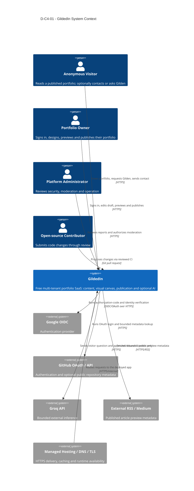

**Interpretation:** GildedIn owns the business rules, tenant and content semantics, publication and AI access policy. Identity providers authenticate subject identities but **do not** decide GildedIn portfolio ownership. Groq produces untrusted text and **does not** authorize access. Hosting terminates or forwards traffic but does not grant the request privileges. External RSS and GitHub metadata are untrusted inputs, even if retrieved from a popular domain. Search engines are anonymous visitors with crawling behavior, not trusted internal actors.

### 1.3 Context relationship register

| Flow ID | Sender -> receiver     | Payload                                                                  | Trust decision                                                          | Failure and privacy requirement                                            |
| ------- | ---------------------- | ------------------------------------------------------------------------ | ----------------------------------------------------------------------- | -------------------------------------------------------------------------- |
| C-01    | Browser -> public HTML | Host, path, query, allowed content                                       | Host/slug validation, live policy gate                                  | Unknown host/slug real 404; no draft fallthrough                           |
| C-02    | Owner -> protected API | Session cookie, typed command, expected revision                         | Session, owner, tenant, origin, state, validation                       | Invalid token 401, unauthorized tenant 403/404; no payload echo            |
| C-03    | App -> Google/GitHub   | OAuth authorize/callback and token exchange                              | State, provider binding, PKCE, ID token/subject validation              | Cancelled/forged callback does not provision an account                    |
| C-04    | App -> Groq            | Filtered current release knowledge, untrusted question, bounded metadata | AI approval/policy/version/quota, output handling                       | Provider failure affects only Gilden; no transcripts persisted by GildedIn |
| C-05    | App -> RSS/Medium      | Allowlisted remote fetch of preview metadata                             | SSRF validation, size/time caps, sanitized result                       | Preserve last-good preview; never ingest full article by default           |
| C-06    | App -> object storage  | Staged verified files and owned public variants                          | Pre-reservation, capability expiry, byte signature/decoder verification | Reject/clean invalid media; never expose permanent credentials             |
| C-07    | App -> MongoDB         | Owner-scoped commands and active release reads                           | Conditional writes, least privilege, validated identifier               | DB failure does not authorize stale sensitive content                      |
| C-08    | App -> Redis           | Short-lived quotas/counters and TTL data                                 | Scoped key design and atomic reservation                                | Quota store outage makes AI unavailable; no paid fallback                  |
| C-09    | CI -> hosting          | Built artifact and authorized deployment metadata                        | Trusted branch, protected secrets, dependency/license scans             | Untrusted PRs never receive production credentials                         |

### 1.4 The primary product boundary

The product boundary includes the Next.js application modules, first-party UI code, deployable application artifact, owned schemas, release policies and operational procedures. It does **not** include the internal implementations of Google's identity system, GitHub, Groq, Vercel, MongoDB Atlas, object storage vendors, Redis vendors, or external content websites. Their APIs have contractual semantics and failure possibilities, but they are still third parties.

Neither user ownership of a portfolio nor the successful receipt of an OAuth access token implies that a browser may directly query MongoDB or object storage. All durable owner operations pass through GildedIn's application-level authorization decisions.

---

## 2. C4 Level 2: executable containers and network protocols

### 2.1 The container interpretation

A _container_ is an executable unit or data store. For GildedIn this means:

- A **browser-side authoring/interaction application** shipped with public/editor pages, running within a user's browser and treated as untrusted from the server's perspective.
- One **Next.js server application** running SSR, API route handlers, server actions, domain services and provider adapters. It is one logical deployable even if the host creates many instances.
- A managed **MongoDB** database operated by an external provider, containing GildedIn records; a storage boundary, not an application microservice.
- A managed **object store** for original/staged/verified assets and public media variants, subject to security and zero-charge feasibility.
- A managed **Redis** service for ephemeral quotas and counters, not identity, publication or moderation truth.
- External **OAuth**, **Groq**, and **RSS/public metadata** systems consumed over verified HTTPS.

The web browser and running app may share a machine with other untrusted software, extensions and processes. The client is never an authorization enforcement point for server data. The CDN and DNS are **deployment infrastructure** rather than owners of publication or user permissions.

### 2.2 D-C4-02 - C4 Level 2: container diagram

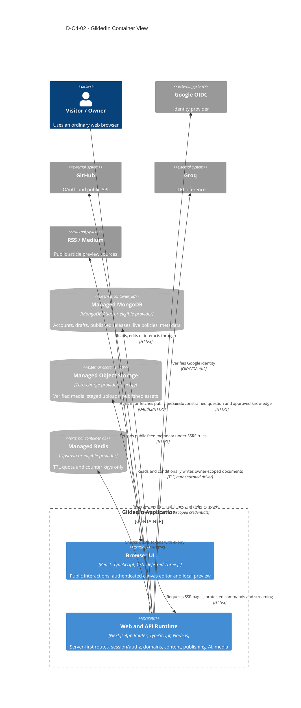

**Note on external data stores:** The diagram marks managed MongoDB, Redis and storage as _external hosted containers_ while recognizing that the stored GildedIn data is owned and governed by the product. This is a deployment/operational distinction, not a denial of data stewardship. Do not interpret `ContainerDb_Ext` as permission to place MongoDB inside browser code or use public connection strings.

### 2.3 Container responsibility and authority matrix

| Container       | Runs where                      | Owns                                                                                               | Does not own                                                                  | Minimum hardening                                                                                       |
| --------------- | ------------------------------- | -------------------------------------------------------------------------------------------------- | ----------------------------------------------------------------------------- | ------------------------------------------------------------------------------------------------------- |
| Browser UI      | User browser                    | Interaction state, local undo history, consent/motion preferences, rendered canvas, transient chat | Authorization truth, secrets, published content activation                    | No secrets, output encoding, CSP-compatible UI, accessible controls, client recovery scoped and cleared |
| Next.js runtime | Managed serverless/Node runtime | HTTP entry points, domain validation, tenant policy, publish coordinator, adapters, SSR            | Global DNS/identity-provider policies, guaranteed provider uptime             | Typed configs, no production secrets in client bundle, CSRF/session/ownership guards, logs redacted     |
| MongoDB         | Managed external database       | Persistent document state and unique indexes                                                       | Files/images as binary store, billing safety, request authorization semantics | TLS credentials, least privilege, unique indexes, query bounds, no production test writes               |
| Object storage  | Managed external storage        | Uploaded binary objects, verified public assets                                                    | Ownership policy decisions, antivirus or safe decoding automatically          | Private staging, opaque keys, owner-scoped finalize, MIME/signature inspection, quota stop              |
| Redis           | Managed external cache          | Ephemeral atomic counters and TTL keys                                                             | Identity session authority, live revocation, published releases               | Scoped prefixes, TTL, rate-limit fail-close for AI, rotation                                            |
| OAuth providers | External SaaS                   | Authentication for a stable provider subject                                                       | GildedIn admin role, tenant authorization                                     | Exact callbacks, verified issuer/subject, explicit link confirmation                                    |
| Groq            | External inference              | Generate bounded response tokens                                                                   | Whether content is approved, whether a visitor is allowed                     | Only minimal approved content, bounded generation, failure/cancellation isolation                       |
| RSS sources     | External websites               | Public feed material                                                                               | Safety of URLs, HTML, redirects or embedded scripts                           | SSRF protection, bounded parser, sanitize only previews                                                 |

### 2.4 Inter-container communication policies

1. Browser calls the product over HTTPS. Owner mutations use host-only apex cookies with `Secure`, `HttpOnly`, `SameSite` and `__Host-` semantics when supported; no `Domain=.aaroophan.dev`.
2. No browser-originated request can write to MongoDB or Redis using permanent provider credentials. An object-store direct upload is permitted only with a short-lived, exact-key capability minted after owner authorization and quota reservation.
3. Application-to-DB access uses TLS, restricted credentials, bounded queries and conditional writes; domain checks precede data adapter calls. A valid DB connection is **not** proof of a valid tenant request.
4. Application-to-OAuth uses the approved authorization-code flow, exact redirect URIs, state/PKCE where applicable, verified provider binding, and stable subject resolution.
5. Application-to-Groq uses approved **release** knowledge and a separately checked live AI policy, quota reservation, input limits, and a stable source-ID catalog. A model output is data, not an instruction or permission grant.
6. External fetchers have a separate security profile: bounded HTTPS-only URLs, redirect and IP/DNS checks, content-type/size/time limits, and safe previews. The network may not contact local/private/metadata endpoints.
7. Public rendering MAY use cached immutable published content, but a warmed cached body MUST NOT become a mechanism to bypass live owner-disabled, moderation or AI revoke checks. This may require disabling a cache mode for sensitive routes if the host cannot enforce a dynamic gate.
8. Optional services fail independently. A Redis/Groq/RSS outage cannot block already published static content; a DB outage can make policy-dependent public requests unavailable instead of pretending stale authorization is safe.

### 2.5 Why there is no separate API or AI microservice

The existing product scale target is approximately 100-500 actively maintained portfolios; there is no requirement for independently deployable domain services, service discovery, interservice identity, distributed transactions, separate load balancers, Kubernetes, custom WebSocket infrastructure or a vector database. The Next.js application may separate public rendering and protected APIs into modules and bundles, but these remain one logical deployment. Adding a service is justified only by a demonstrated isolation, throughput, security or operational need and a new ADR; placing a domain directory in a different folder is not a service split.

### 2.6 Executing browser processes and static outputs

The public renderer returns semantic HTML plus minimal progressive-enhancement JavaScript. The browser only loads the Three.js environment, Gilden widget, interactive gallery or animations when necessary and permitted by policy/user preference. The authenticated editor loads richer controls (selection, inspector, rich text, responsive previews), which must not become dependencies of public SSR or search crawlers. Static generated OG images, RSS previews and search artifacts may be served through the app or supported object/CDN storage; their release identity must match current publication policy.

---

## 3. C4 Level 3: application component architecture

### 3.1 Definition, responsibility and dependency direction

All components in this section are **logical units inside the Next.js application**, unless explicitly marked browser-side or external. They do not own independent production URLs, deployments, databases or message brokers. Domain modules should expose typed command/query interfaces with no dependency on `NextRequest`, `NextResponse`, React components, MongoDB collection objects, or vendor SDKs. Adapters translate between the domain and those technologies.

Conceptual dependency direction:

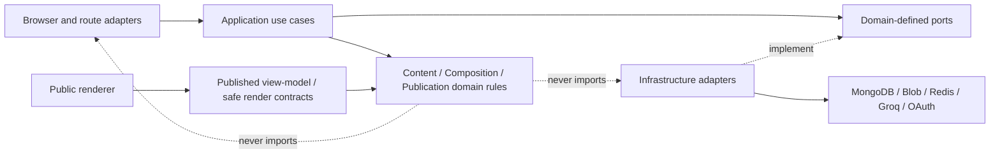

The dashed edges are architectural rules rather than actual runtime calls. Component tests and static dependency checks MUST verify that domain modules do not reach out to higher-level frameworks. Real import restrictions should be chosen during implementation, with appropriately designed module interfaces instead of an elaborate DI container for its own sake.

### 3.2 Component catalog and owner-of-truth registry

| Component                | Module identifier | Owns or enforces                                                                   | Input contract                         | Output / side effects                           |
| ------------------------ | ----------------- | ---------------------------------------------------------------------------------- | -------------------------------------- | ----------------------------------------------- |
| Request ingress          | `HTTP`            | Content-type, origin, method, limits and normalized request context                | HTTPS request                          | Safe typed request/context or rejected response |
| Hostname resolver        | `HOST`            | Apex/wildcard/`www` routing, reserved name precedence, host normalization          | Trusted host/path                      | Normalized route mode, slug, detail path        |
| Slug registry            | `SLUG`            | Current and historical claims, alias redirects, collision prevention               | Normalized slug                        | Stable portfolioId or missing/redirect state    |
| Identity adapter         | `AUTH`            | OIDC/OAuth callback verification, account/provider join, session issuance          | Provider response                      | Stable authenticated accountId, session         |
| Session guard            | `SESSION`         | Current session, expiration, revoke and recent-auth                                | Host-only cookie                       | Auth context, deny or required reauth           |
| Authorization policy     | `POLICY`          | Owner/admin scope, lifecycle, visibility, moderation, privileged actions           | Auth context, portfolioId, action      | Allow/deny with policy snapshot/version         |
| Account management       | `ACCOUNT`         | Linking/unlinking, account status, export/delete command                           | Auth context / provider subject        | Account changes and audit event                 |
| Content schema engine    | `CONTENT`         | Types, field limits, relations, private/public projection                          | Versioned draft schema                 | Validated data graph or typed errors            |
| Composition model        | `COMPOSE`         | Layout node tree, breakpoints, reading order, interactions and bounds              | Versioned nodes/constraints            | Safe plan or publish-blocking errors            |
| Draft manager            | `DRAFT`           | Revisioned autosave, optimistic concurrency, owner preview                         | Expected revision and command          | New draft revision or 409                       |
| Publication coordinator  | `PUBLISH`         | Idempotent operation, validation orchestration, release preparation and activation | Owner, draftRevision, key              | Immutable release pointer and status            |
| Search/SEO compiler      | `INDEX`           | Search artifact, canonical metadata, OG manifest, crawler policies                 | Public release projection              | Version-bound derived assets                    |
| Public release reader    | `RELEASE`         | Active release resolution, version checks and current visible projection           | portfolioId / activeReleaseId          | Immutable read model                            |
| Semantic renderer        | `RENDER`          | Safe block registry, SSR HTML, accessibility order, responsive layout              | Published composition and content      | HTML/CSS and deferred assets                    |
| Media service            | `MEDIA`           | Upload reservations, verified assets, metadata stripping, reference-safe GC        | Owner, staged bytes, reservation       | Media IDs and safe variants                     |
| AI policy service        | `AI-POLICY`       | Opt-in, approvals, immediate deny/revoke, context version                          | portfolioId/field approvals            | Authoritative policyVersion + deny              |
| AI knowledge builder     | `AI-KB`           | Approved release extraction, source ID map, bounded context                        | releaseId and policyVersion            | Ready snapshot or unavailable                   |
| Gilden gateway           | `GILDEN`          | Quota, streamed inference, user question safety, citations                         | Anonymous question + portfolioId       | Streamed bounded answer or safe unavailable     |
| External preview fetcher | `FETCH`           | SSRF-safe outbound metadata/RSS retrieval                                          | Approved URL/feed identifier           | Sanitized preview records or last-good fallback |
| Contact inbox            | `CONTACT`         | Consent-based inbound message, owner read/export, retention                        | Validated text-only submission         | Short-lived private message record              |
| Aggregate analytics      | `METRICS`         | Privacy-minimal counters and optional public aggregates                            | Scoped events without visitor tracking | Aggregate buckets only                          |
| Moderation/admin         | `ADMIN`           | Report intake, policy overrides, status panels, audited actions                    | Authorized admin operation             | Live suppressions and sanitized audit record    |
| Observability            | `OBSERVE`         | Correlation IDs, minimal structured logs, error mapping                            | Operation outcome                      | Redacted event/metric, no secret content        |

No component receives blanket access to all MongoDB collections. Repository methods accept scoped IDs and return minimal DTOs, and only the authorized use case can invoke privileged repository operations. Shared helper modules do not provide a general unguarded `findOne(collection, id)` interface to route handlers.

### 3.3 D-C4-03 - C4 Level 3: ingress, identity and portfolio authorization

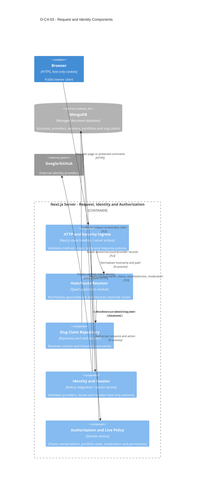

#### Component boundary obligations

- `HOST` MUST use a known, allowlisted canonical host interpretation and reject spoofed or unknown hosts. If behind a reverse proxy, the trusted source of forwarded headers must be explicitly established at deployment. Neither Next.js nor a reverse proxy makes arbitrary `X-Forwarded-Host` values trustworthy by default.
- `SLUG` MUST query one authoritative claims namespace for canonical and historical aliases. Alias resolution is a redirect decision, never a change in owner identity or an elevation of privileges.
- `SESSION` MUST check expiration/revocation and use stable `accountId` as its principal. Sensitive actions require fresh authentication and audit.
- `POLICY` MUST authorize `accountId` to operate on `portfolioId` and requested resource type. Scope and status predicates apply to reads and writes, not only UI links.
- The editor browser cannot request another owner's draft using an arbitrary ID even when the server route parameter is syntactically valid.
- `ADMIN` access is not granted by a client property, provider email string, or first registration. Initial admin bootstrap is an explicit trusted procedure.
- The browser is not authoritative for `role`, `ownerAccountId`, `mediaId`, `releaseId`, `securityVersion` or mutable policy fields.

**Identity verification:** Google OIDC issuer/subject, OAuth authorization code, state/PKCE and provider mix-up protections follow the selected provider and [OAuth BCP RFC 9700](https://www.rfc-editor.org/rfc/rfc9700.html). GitHub stable provider identity is not a public email address. Account linking requires an authenticated existing account and proof of control over the new identity. Account merges require proof of control over both existing accounts.

### 3.4 D-C4-04 - C4 Level 3: content, canvas and draft authoring

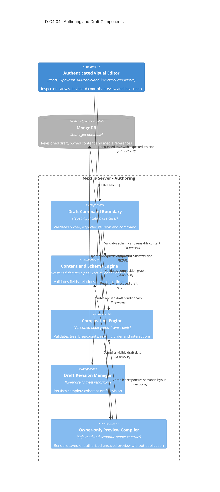

The editor owns **interaction mechanics**; the composition engine owns the persistent meaning of the layout. Moveable, dnd-kit, Lexical, Anime.js, Motion and React Three Fiber are implementation candidates only. Their internal event payloads, DOM structure and plugin extension points MUST NOT be serialized as permanent release schema. A library swap cannot change the meaning of published content without an explicit versioned migration.

#### Draft and canvas invariants

1. The unique required Hero is the first public section. Other sections are optional, repeatable and rearrangeable.
2. Each section is a finite semantic layout container. The _editor workspace_ may pan/zoom across a large area, but published output cannot create unbounded viewport overflow.
3. Every authored node has stable node ID, parent relationship, explicit type, layout mode, constraints, and logical reading order; content bindings refer to stable `contentId`, never CSS selectors.
4. Three modes are available: automatic layout, absolute positioning within parent, and hybrid groups. Responsive overrides are derived from base constraints and only stored when required.
5. Desktop, tablet and mobile previews are supported. Essential editing functions remain usable on mobile via controls that do not require precision dragging.
6. Multi-select, alignment, snapping, grouping, layering, lock state and duplication are authoring features; constraints and resulting DOM order are validated independently.
7. The published renderer uses semantic HTML/CSS; it does not depend on a canvas screenshot or a running editor instance.
8. A field marked hidden/private or excluded from publication does not accidentally become visible via a data binding, repeated collection, project detail route, search index, AI context or social card.
9. Changing a shared content item updates every draft binding, while the active public release remains unchanged until a new activation.
10. Deleted content referenced by other nodes/records is blocked until all dependencies are explicitly detached or removed.
11. Draft concurrency is enforced by server-side compare-and-set. A stale tab obtains 409 and must reconcile; a server never silently overwrites the newer draft.
12. Client-only local recovery data is an optional loss-prevention aid, not an additional permanent authoritative version. It MUST be user/portfolio scoped and cleared appropriately on sign-out/account change.

See [03 - UI/UX](03-ui-ux.md), [05 - Data model](05-data-model.md), and [WCAG 2.2 dragging alternatives](https://www.w3.org/TR/WCAG22/#dragging-movements).

### 3.5 D-C4-05 - C4 Level 3: publishing and immutable release activation

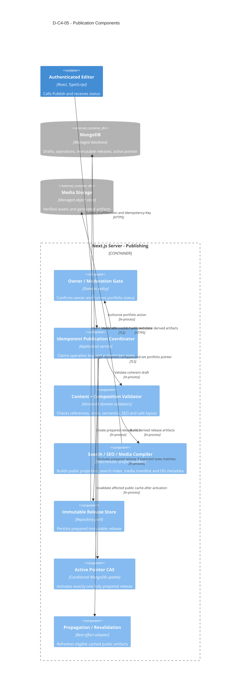

**Important atomicity distinction:** MongoDB's atomicity guarantee applies to the **single portfolio document update** that changes `activeReleaseId` under a matching condition. Inserting a prepared release, updating its status, changing a draft, generating media, and purging CDN cache are **not one global ACID operation**. The architecture tolerates failures by preparing immutable content first, activating a pointer conditionally, and recording separate propagation progress and idempotent retry state. See [MongoDB atomicity](https://www.mongodb.com/docs/manual/core/write-operations-atomicity/).

#### Publication stage contract

| Stage      | Input                                                   | Durable output                                      | If it fails                                                    | Visibility                                                 |
| ---------- | ------------------------------------------------------- | --------------------------------------------------- | -------------------------------------------------------------- | ---------------------------------------------------------- |
| Receive    | Authenticated owner, expected revision, idempotency key | Unique operation record                             | Reject malformed/duplicate mismatched request                  | Previous release stays active                              |
| Validate   | Complete matching draft                                 | Validation report / draft hash                      | 422 or 409; no active pointer change                           | Previous release stays active                              |
| Prepare    | Sanitized projection, media references, SEO/search      | Immutable release + complete artifacts              | Retry/reconcile prepared records; no partial public activation | Previous release stays active                              |
| Activate   | Release ID, expected active pointer/draft revision      | Atomic `activeReleaseId` update, monotonic sequence | Conflict/recovery; never blindly force                         | Exactly one active logical release                         |
| Propagate  | Activated releaseId and route/tag list                  | Best-effort cache refresh evidence                  | Mark `propagation_pending`; allow safe retry                   | Temporarily stale public bytes permitted where policy safe |
| AI prepare | Active release and approved policyVersion               | Derived AI context (or unavailable)                 | Gilden remains unavailable until matching snapshot ready       | Public pages do not depend on AI                           |
| Retain/GC  | Three retained versions, draft and media references     | Orphan cleanup when safe                            | Delay deletion rather than break old releases                  | Active/retained media never prematurely removed            |

A publication operation record is the durable source of operation status. A client's HTTP timeout does **not** prove publication failed. Read the operation by idempotency key or operation ID and return the current state instead of starting a new release blindly.

### 3.6 D-C4-06 - C4 Level 3: secure public route and semantic release rendering

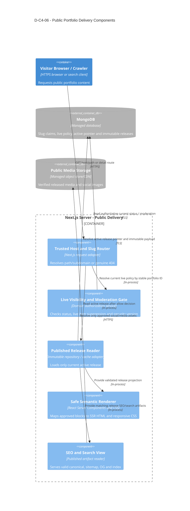

The public renderer MUST operate with a **complete published release** and a **current allow decision**. It cannot construct content by reading individual draft sections at request time. The same release ID binds HTML, project detail data, site search, SEO, image manifests, and context derivation. A cache of immutable released bytes may improve availability, but it does not authorize serving those bytes to a newly suspended portfolio.

#### Same-origin security consequence

`https://aaroophan.dev/dashboard` and `https://aaroophan.dev/alex` are the same **scheme/host/port** origin. This means malicious executable content in a portfolio page could attempt actions using the same-origin authenticated browser. `HttpOnly` prevents JavaScript reading the session cookie but does not by itself prevent request abuse. Accordingly, owner-controlled text, Markdown, SVG, diagrams, embed URLs, link properties and dynamic component declarations **must never become arbitrary executable HTML/JS**. The renderer relies on a fixed, reviewed component registry, output encoding, URL/protocol validation, appropriate content security policy, CSRF protections on unsafe operations, and owner permissions on every mutation. Separate tenant subdomains have different origins, but they do not remove the path-based risk. See [OWASP XSS](https://cheatsheetseries.owasp.org/cheatsheets/Cross_Site_Scripting_Prevention_Cheat_Sheet.html) and [OWASP CSRF](https://cheatsheetseries.owasp.org/cheatsheets/Cross-Site_Request_Forgery_Prevention_Cheat_Sheet.html).

#### Public read modes and response handling

| Public condition              | Host response                                         | Indexing                            | AI                                              | Public cache policy                                 |
| ----------------------------- | ----------------------------------------------------- | ----------------------------------- | ----------------------------------------------- | --------------------------------------------------- |
| Current published public      | HTTP 200 after live policy check                      | Eligible if configured              | If enabled and approved                         | Versioned release bytes may cache safely after gate |
| Current published unlisted    | HTTP 200 via direct URL                               | `noindex`, not in directory/sitemap | Owner-controlled opt-in; still release-approved | Do not promote in shared discovery indexes          |
| No active release             | Genuine 404                                           | Excluded                            | Disabled                                        | Do not cache private preview result                 |
| Owner disabled                | Privacy-preserving 404                                | Excluded                            | Disabled                                        | Live denial must override warmed content            |
| Moderation suspended          | Neutral unavailable (actual status policy)            | Excluded                            | Disabled                                        | Authoritative policy applied on all routes          |
| Deleted portfolio             | 410 only when reliably recognized, else 404           | Excluded                            | Disabled                                        | No private details in response                      |
| Old slug alias                | Permanent safe redirect to current canonical resource | New canonical                       | Resolve only new portfolioId                    | Do not redirect to arbitrary user URL               |
| Unknown host/subdomain        | Genuine 404                                           | Excluded                            | Disabled                                        | No fallback to someone else's tenant                |
| Live policy store unavailable | Fail closed for sensitive public authorization        | No stale sensitive release          | Disabled                                        | No cached bypass of revocation                      |

The exact neutral suspension response code is a product/API policy decision; status codes MUST be consistent and avoid revealing internal moderation reasons. Subdomain visitor navigation preserves its host; canonical search metadata may point to the apex path equivalent. Robots/noindex are discoverability signals, not confidentiality protections.

### 3.7 D-C4-07 - C4 Level 3: Gilden AI gateway and approved knowledge

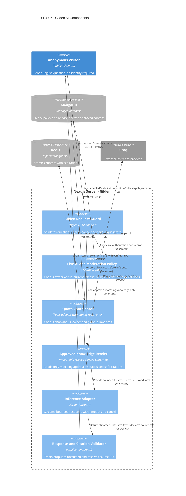

**No knowledge leakage policy:** Gilden is not a database query agent. The model receives a filtered, allowlisted, release-matched knowledge artifact, never arbitrary draft JSON, sessions, provider secrets, moderation evidence, raw private reference information, or entire PDFs without explicit reviewed extraction. A provider's response does not become an authorized statement just because it came from a trusted vendor. Source URL references are generated from validated release content IDs and known route builders, never from free-form model text.

**Quota semantics:** a 15-message daily anonymous-session quota is only one layer. A bounded portfolio/month and global cap are also required. If Redis is unavailable or counters cannot be atomically reserved, AI fails closed and portfolio content remains accessible. If streaming starts and is interrupted, a message is counted. A cancellation request does not create a refund exploit. No platform-side chat transcript is persisted; the external inference provider still processes each question and approved context, which requires accurate user-facing privacy disclosure.

**Revocation semantics:** owner pause, AI field exclusion, portfolio disable and administrative moderation bump or otherwise invalidate authoritative access. Gilden checks live policy before generation and refuses stale context versions. During longer streams, periodically recheck policy where practical; bytes already sent cannot be recalled. A queued inference job is never permission to use revoked context on a later request. The ability to disable the public portfolio must not depend on Gilden uptime.

### 3.8 D-C4-08 - C4 Level 3: media, imports, analytics, contact and administration

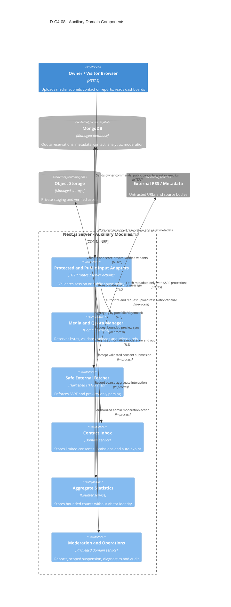

These supporting modules share the Next.js server deployment but not privilege. For example, the public contact endpoint cannot call administrative report resolution; the media endpoint cannot activate a release; and the feed fetcher cannot connect to arbitrary intranet or cloud metadata IPs simply because its caller is authenticated.

### 3.9 Forbidden internal dependencies

| Forbidden call/dependency                               | Reason                                                | Correct design                                                        |
| ------------------------------------------------------- | ----------------------------------------------------- | --------------------------------------------------------------------- |
| Editor component -> direct MongoDB client               | Exposes secrets and trusts browser-supplied ownership | Editor -> typed authorized API -> draft use case -> repository        |
| Editor component -> active release update               | Bypasses validation and immutable history             | Editor -> Publish command -> coordinator/CAS                          |
| Public renderer -> draft collection                     | Draft leakage and inconsistent published state        | Renderer -> active release projection                                 |
| Gilden -> arbitrary portfolio collections               | Hidden/private data can leak                          | Gilden -> filtered approved knowledge by active release/policyVersion |
| Gilden model output -> database mutation                | Prompt injection could modify the product             | AI is read-only to public released knowledge; no mutation tools       |
| Search index -> private fields or hidden drafts         | Leaks data via lookup/autocomplete                    | Build index from public projection only                               |
| Domain module -> vendor SDK                             | Couples policy to provider and hinders secure mocks   | Domain-defined port -> adapter implementation                         |
| Route handler -> generic unrestricted collection method | Insecure direct object/property access                | Narrow repository methods with server-scoped IDs                      |
| User JSON -> React component resolver by arbitrary name | Dynamic code execution / prototype pollution          | Fixed approved block registry; explicit schema validation             |
| Rich text -> raw unsanitized HTML or executable MDX     | Same-origin XSS threatens apex dashboard              | Safe rich text AST, encoding, strict allowed types                    |
| Untrusted PR -> production secrets/deploy permissions   | Supply-chain compromise                               | Separate trusted deploy job, least-privilege workflows                |
| CDN cached document -> bypass current suspend policy    | Stale sensitive public bytes served after revocation  | Live per-request gate before any eligible cached response             |

### 3.10 Suggested source organization (illustrative, not a committed file tree)

```text
src/
  app/                     # App Router entry points, route handlers and server components
  features/
    identity/              # OIDC/provider link use cases and session policy
    tenancy/               # portfolio ownership, slug claims, moderation checks
    content/               # validated fields, schemas, reusable content graph
    composition/           # versioned responsive composition model and renderer plan
    editor/                # browser canvas, inspector, preview adapters
    publishing/            # draft-to-release orchestration and propagation
    delivery/              # public release read model, SEO, search, safe SSR
    media/                 # upload reservations, validation, asset lifecycle
    gilden/                # AI access policy, context, quotas, citations, inference
    contact/               # text-only inbox and retention
    analytics/             # aggregate, privacy-limited metrics
    administration/        # moderation, reports, operational views
  shared/
    domain/                # opaque IDs, typed errors, value objects
    server/                # server-only config, trust-aware request context
    ui/                    # vetted accessible primitive components
  infrastructure/
    mongodb/               # typed repositories and unique index configuration
    object-storage/        # storage adapter, cost and quota checks
    redis/                 # expiring counter adapters
    oauth/                 # identity providers / session adapter
    groq/                  # provider adapter
    outbound-http/         # SSRF-protected feed metadata retrieval
```

This layout is a **possible maintainability convention**, not a requirement to reproduce directory names. Import restrictions and boundary tests matter more than the chosen folder structure. No hidden global event bus or internal message broker is required. Cross-module side effects are coordinated through explicit use cases with idempotent retries where needed.

---

## 4. Data-flow diagrams: trust and threat boundaries

C4 diagrams are optimized for understanding responsibilities and dependencies. A threat model also needs **processes, data stores, external entities, data classes, protocols and trust crossings**. OWASP's guidance recommends data-flow diagrams for identifying those boundaries and applying structured threat analysis. Each DFD below is therefore a supporting security view, not a replacement for the C4 abstraction. See [OWASP Threat Modeling](https://cheatsheetseries.owasp.org/cheatsheets/Threat_Modeling_Cheat_Sheet.html) and [OWASP DevSecOps DFD process](https://owasp.github.io/DevSecOpsGuideline/2-Process/2-1-Design/2-1-1-Threat-modeling/).

### 4.1 Trust-zone registry

| Trust zone | Name                          | Contents                                               | Assumptions permitted                                           | Assumptions prohibited                                                                |
| ---------- | ----------------------------- | ------------------------------------------------------ | --------------------------------------------------------------- | ------------------------------------------------------------------------------------- |
| TZ-0       | Public Internet               | Anonymous visitors, bots, crawlers, untrusted browsers | TLS may protect transit after configuration and verification    | Browser-supplied IDs, `Origin`, `Host`, content, JavaScript or claims are trustworthy |
| TZ-1       | Authenticated browser         | Owner's local UI and short-lived state                 | Session cookie may exist for apex only                          | Frontend role, draft, owner/portfolio ID or read-only UI makes a request authorized   |
| TZ-2       | Hosting edge                  | TLS, routing, caching and managed request handling     | Edge proxy may be configured to send trusted metadata           | Edge automatically knows tenant ownership, moderation, account roles or data privacy  |
| TZ-3       | Application runtime           | Next.js request adapters and typed domain modules      | Server-side secrets available only to authorized modules        | Every module has permission to query every portfolio and provider                     |
| TZ-4       | Persistent data plane         | MongoDB and managed media store                        | TLS and credentialed connectivity under validated configuration | Network access implies authorization, or stored metadata is safe to render            |
| TZ-5       | Ephemeral control plane       | Redis TTL quotas and optional stat counters            | Atomic operations if provided and verified                      | Redis decides owner identity, release activation or legal data retention              |
| TZ-6       | Third-party identities        | Google OIDC, GitHub OAuth                              | Verifiable stable provider subject                              | Email equality establishes ownership or a provider decides GildedIn admin role        |
| TZ-7       | Third-party content/inference | Groq, RSS, public GitHub metadata, video embeds        | APIs return data under their own terms                          | Returned text, HTML, links or model output are safe instructions                      |
| TZ-8       | Contributor and CI            | GitHub source, PRs, automation, deployment credentials | Trusted protected branch may trigger deployment                 | Any pull request may access production secrets or run privileged external scripts     |

The zone map is deliberately capability-based. A file uploaded by a legitimate owner is still untrusted binary content. A prompt sent by a visitor to Gilden is untrusted natural-language data. A response from Groq is not elevated to trusted source content. A published content record has passed application validation but may still be inappropriate for display under a newly issued moderation policy.

### 4.2 D-DFD-01 - End-to-end trust zone data movement

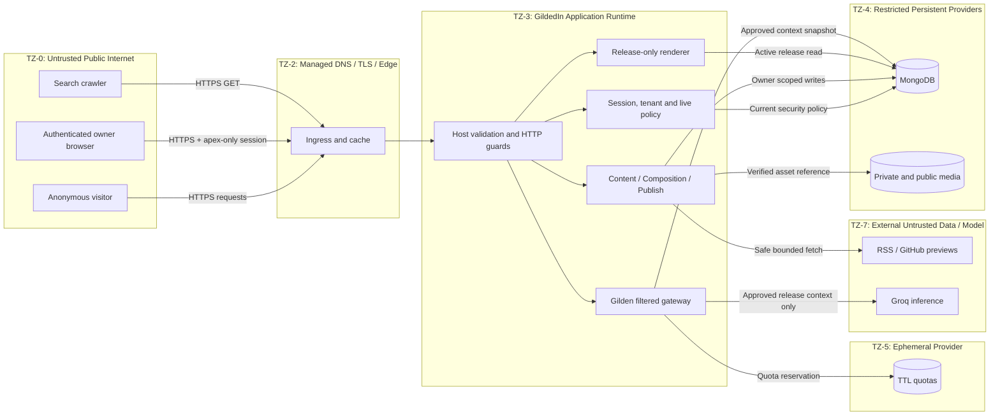

**Review point:** the edge can cache generated HTML, but if the implementation bypasses `Policy` on a cache hit, the diagram does not meet `TEN-009`, `PUB-007`, `AI-004` or `ADM-001`. Where edge and app hooks cannot enforce the intended policy safely, use a more conservative uncached route instead of weakening revocation semantics. A cached _asset_ may remain available temporarily after deletion; the product must not promise instantaneous worldwide recall.

### 4.3 D-DFD-02 - Same-origin portfolio content risk

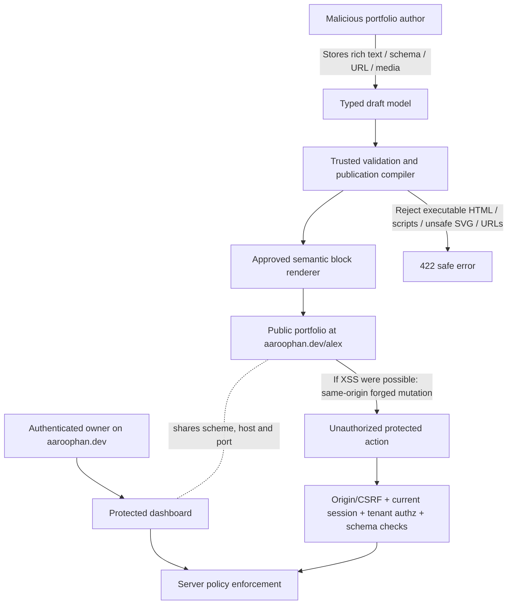

**This is an attack model, not a valid intended flow.** Browser origin isolation distinguishes `alex.aaroophan.dev` from `aaroophan.dev`, but **does not** distinguish `/alex` from `/dashboard` on the apex. The session cookie remains host-only to protect subdomains, yet path-based tenant content must be treated as the same-origin XSS attack surface as the dashboard. The primary defense is a verified non-executable rendering contract; CSRF, input validation and authorization are additional layers. User-controlled raw scripts, event handlers, arbitrary CSS injection and unreviewed iframes are excluded. PDFs require safe isolation or a download-only fallback where no secure inline strategy is available. [OWASP XSS](https://cheatsheetseries.owasp.org/cheatsheets/Cross_Site_Scripting_Prevention_Cheat_Sheet.html), [OWASP CSRF](https://cheatsheetseries.owasp.org/cheatsheets/Cross-Site_Request_Forgery_Prevention_Cheat_Sheet.html).

### 4.4 D-DFD-03 - Data projection and AI information boundary

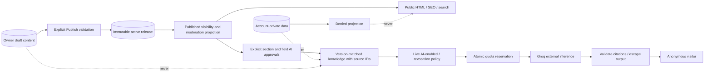

Any prompt context generated from a whole MongoDB section object violates this boundary. The public projection itself must be filtered: a field could be private even if stored in the same draft as a public field. AI approval is more restrictive than general publication. A **new field defaults to AI-denied**, regardless of previous section-level approval. An AI-approved PDF extract must be purposefully parsed and reviewed; storing a public PDF does not automatically authorize all its embedded text to reach Groq.

The model is not permitted to issue database write operations, alter content, collect visitor identity, or invent citations. Owners may configure a safe tone/name preset, not an unrestricted instruction that overrides these constraints. Groq receives visitor question text during inference; the privacy notice must accurately disclose external processing. [OWASP LLM Prompt Injection Prevention](https://cheatsheetseries.owasp.org/cheatsheets/LLM_Prompt_Injection_Prevention_Cheat_Sheet.html).

### 4.5 D-DFD-04 - Media trust transitions

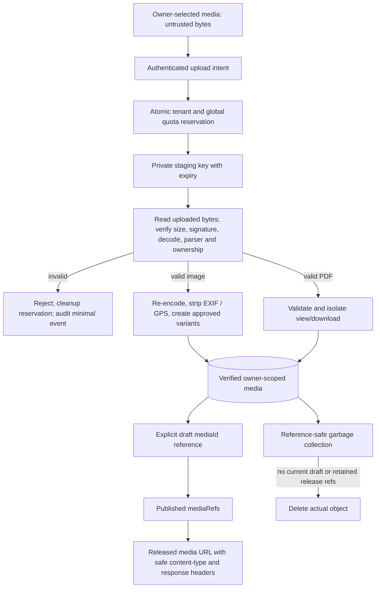

An upload is not trusted at the moment the object-store API accepts it. Its bytes must pass application-controlled finalization before becoming available in the editor's trusted media registry or public release. File size and dimension limits must be verified against the actual uploaded bytes and decoded representation, not only the client's declared `Content-Type`/size. Do not use user-supplied filenames as storage keys. Do not publish raw SVG/HTML with executable behavior. [OWASP File Upload](https://cheatsheetseries.owasp.org/cheatsheets/File_Upload_Cheat_Sheet.html).

### 4.6 D-DFD-05 - Outbound fetch and SSRF boundary

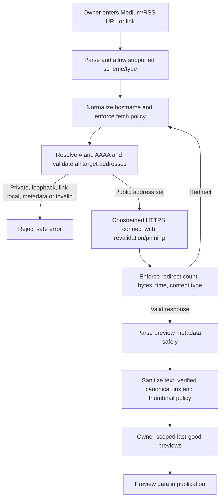

Resolve-and-connect safety cannot be satisfied by a one-time DNS lookup followed by an unconstrained HTTP library that may resolve the name again. Redirects require their own target validation. Internal addresses, non-public ranges, credential-bearing URLs and unexpected ports must be denied according to a strict policy; if this cannot be reliably implemented on the chosen host, external fetching is **disabled** and manual preview fields remain available. Authentication of the owner does not make an owner-provided URL safe to fetch. [OWASP SSRF Prevention](https://cheatsheetseries.owasp.org/cheatsheets/Server_Side_Request_Forgery_Prevention_Cheat_Sheet.html).

### 4.7 D-DFD-06 - Contributor, CI, secrets and deployment

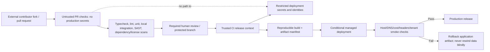

The protection boundary here is not GitHub itself. It is the **workflow trust level** and whether untrusted PR code can execute with production credentials. Forked pull requests, dependency install scripts, arbitrary workflow expressions and cache artifacts must be considered supply-chain attack surfaces. Protected branch jobs should use least-privilege credentials, pin actions/dependencies per policy, and avoid exposing production secrets to third-party PR workflow execution. [OWASP CI/CD Security](https://owasp.org/www-project-top-10-ci-cd-security-risks/), [GitHub Actions security](https://docs.github.com/en/actions/security-for-github-actions/security-guides/security-hardening-for-github-actions).

### 4.8 Entry-point and STRIDE-oriented review table

| Entry point          | Example attacker capability                   | Threat class                          | Principal control                                      | Mandatory negative test                        |
| -------------------- | --------------------------------------------- | ------------------------------------- | ------------------------------------------------------ | ---------------------------------------------- |
| Public host and path | `Host` or `X-Forwarded-Host` spoof            | Spoofing / disclosure                 | Allowlisted trusted host parser, single slug namespace | Wrong host cannot access unrelated portfolio   |
| Account login/link   | Replayed OAuth callback / same email          | Spoofing / elevation                  | State, PKCE/provider subject, explicit linking         | Distinct accounts never auto-merge             |
| Draft content        | Malicious text, URL, JSON key, prototype path | Tampering / elevation                 | Typed schemas, safe AST and renderer                   | Script never executes or alters prototype      |
| Cross-tenant APIs    | Replace target `portfolioId` or `mediaId`     | Disclosure / tampering                | Server owner predicates and policy                     | Owner A cannot inspect/update B resources      |
| Draft autosave       | Two tabs write different versions             | Tampering / lost update               | Compare-and-set on revision                            | Stale tab receives 409 and recovery option     |
| Publish              | Double click, lost HTTP response              | Integrity / resource abuse            | Idempotency key, immutable release, CAS                | One activated release per operation            |
| Public cache         | Serve stale page after suspension             | Disclosure                            | Live gate or safe uncached fallback                    | Warm-cache suspend denies new accesses         |
| RSS/preview          | Resolve to cloud metadata/private IP          | Disclosure / SSRF                     | DNS+connection validation, redirect checks             | Local/private target rejected                  |
| Media upload         | Spoofed PDF/image/polyglot                    | XSS / malware / DoS                   | Decoding, isolation, byte/size cap                     | Malicious file cannot become public            |
| Gilden               | Inject instructions in approved project text  | Information disclosure / manipulation | Context allowlist, no tools, citation validation       | Cannot reveal private fields or invented links |
| Contact form         | Spam or malicious links                       | DoS / abuse                           | Body limits, anti-bot, TTL, safe output                | Flood limited; owner inbox encoded             |
| Admin moderation     | Forged admin role or action                   | Elevation / repudiation               | Trusted bootstrap, recent auth, audited decisions      | Normal owner cannot access admin endpoints     |
| CI/PR                | Build script exfiltrates secrets              | Supply-chain compromise               | Untrusted PR isolation and protected deploy            | PR cannot read production secret variables     |

**Review output:** each high-risk flow must have an owner, a preventative control, an abuse-path test, a failure response, and a status (`unverified`, `verified`, `blocked`, `accepted-risk`). Do not mark a boundary verified because a diagram exists. Risks belong in [07](07-security-design.md) and evidence belongs in [11](11-testing-strategy.md).

---

## 5. Dynamic architecture: runtime journeys and protocol sequences

The diagrams in this section describe **intended execution order and decisions**, not a commitment to particular class names. A sequence includes meaningful failure cases rather than only the happy path. For external providers, the arrows identify a logical protocol exchange and not the exact SDK function signature. Route inventory and typed error envelopes are specified in [06](06-api-design.md).

### 5.1 D-C4-09 - C4 dynamic view: owner publishes a draft

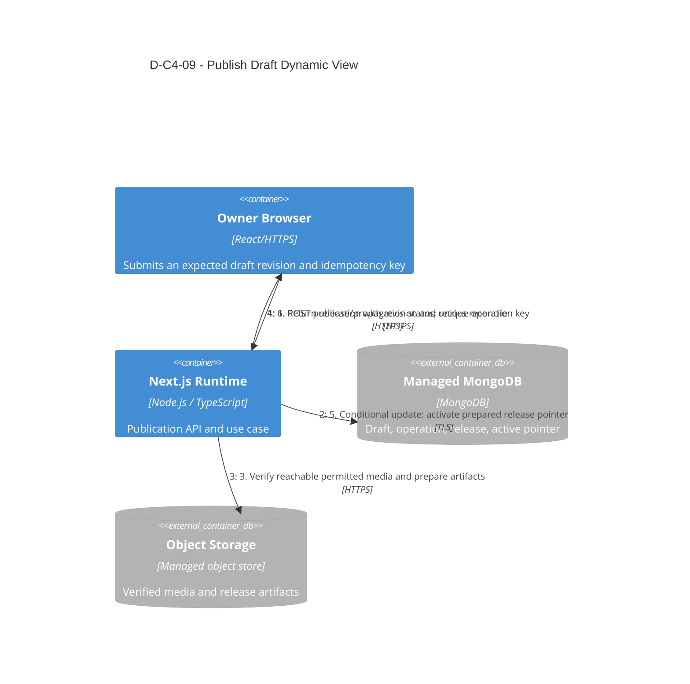

This intentionally emphasizes one atomic **selector** instead of claiming that the entire distributed workflow commits transactionally. The sequence diagram below shows its important asynchronous and crash cases.

### 5.2 D-SEQ-01 - First-time Google or GitHub authentication

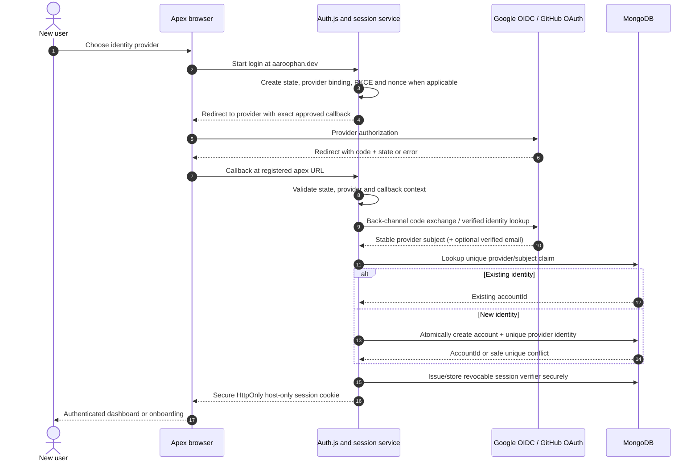

**Invariants:** only verified provider identity is authoritative, not displayed name or email; callback state/PKCE and provider binding must be validated against the pinned Auth.js/provider integration; a failure during account creation must not leave a partially privileged account or automatically assign an unrelated portfolio. GitHub identities without verified email may exist while email-dependent features remain disabled. No local password reset endpoint is introduced.

### 5.3 D-SEQ-02 - Explicit account linking and safe unlinking

```mermaid
sequenceDiagram
  autonumber
  actor Owner
  participant UI as Account settings
  participant API as Protected account API
  participant Auth as OAuth provider adapter
  participant DB as MongoDB identity registry
  Owner->>UI: Link second provider
  UI->>API: Link intent (host-only authenticated session)
  API->>DB: Check account active and recent authentication
  API-->>UI: Signed/short-lived link state or reauth required
  UI->>Auth: Start provider proof with link context
  Auth-->>UI: Provider redirect and verified callback
  UI->>API: Complete linking intent
  API->>DB: Unique(provider, stableSubject) collision check
  alt Identity belongs to another account
    API-->>UI: Conflict; never merge by email
  else New verified identity
    API->>DB: Add linked identity conditionally and audit
    API-->>UI: Linked providers updated
  end
  Owner->>UI: Request unlink
  UI->>API: DELETE provider identity with reauthentication
  API->>DB: Confirm target belongs to owner and another usable method remains
  API-->>UI: Success or explicit safety conflict
```

**Adversarial test:** Google user A and GitHub user B can share an email-like attribute without becoming the same GildedIn account. Linking two already-existing accounts requires proof of both and a deliberately reviewed merge operation, not a shortcut in the callback handler.

### 5.4 D-SEQ-03 - Portfolio creation, unique slug and rename

```mermaid
sequenceDiagram
  autonumber
  actor Owner
  participant API as Portfolio use case
  participant Slug as Slug claim registry
  participant DB as MongoDB
  Owner->>API: Create portfolio with display identity and requested slug
  API->>API: Session/owner/one-active-portfolio/ASCII and reserved-name checks
  API->>Slug: Reserve lowercase slug using unique claim
  Slug->>DB: Conditional insert into one shared slug namespace
  alt Existing current/alias claim
    DB-->>API: Unique conflict
    API-->>Owner: 409 username unavailable
  else Claimed
    API->>DB: Create portfolio + owner draft/claim relationship
    API-->>Owner: PortfolioId and canonical URL
  end
  Owner->>API: Rename to a new valid slug
  API->>DB: Check owner, status and rename operation preconditions
  API->>Slug: Reserve new unique claim before switching current
  API->>DB: Update canonical slug; mark previous claim alias
  API-->>Owner: Current address; previous addresses redirect
```

**Partial-write problem:** reserving a claim and updating a portfolio are separate MongoDB records. A transaction is appropriate only if available, configured and tested for the chosen tier. Otherwise implement an idempotent staged claim/lease and reconciliation procedure that cannot publish two owners with the same alias, cannot accidentally release a live claim, and never authorizes by slug text. Unique claim indexes remain mandatory in both approaches.

### 5.5 D-SEQ-04 - Path and subdomain public request routing

```mermaid
sequenceDiagram
  autonumber
  actor Visitor
  participant Edge as TLS/DNS/host edge
  participant App as Trusted host and route resolver
  participant DB as Slug and live policy records
  participant Reader as Published release reader
  participant SSR as Semantic HTML and metadata
  Visitor->>Edge: GET /alex or https://alex.aaroophan.dev/
  Edge->>App: Forward original validated host/path context
  App->>App: Normalize host, reject unknown host, reserve platform routes
  App->>DB: Resolve canonical or alias slug claim
  alt Unknown slug or hostname
    App-->>Visitor: Genuine HTTP 404
  else Historical alias
    App-->>Visitor: Safe permanent redirect to current slug
  else Current portfolioId
    App->>DB: Read current status, visibility, moderation and active release
    alt Disabled, suspended, deleted or no release
      App-->>Visitor: 404 / neutral unavailable / 410 as policy allows
    else Authorized public read
      App->>Reader: Load one active immutable release by ID
      Reader->>SSR: Return published projection, SEO and search version
      SSR-->>Visitor: SSR HTML; optional deferred visual effects
    end
  end
```

**Routing proof:** test apex, `www`, registered subdomain, alias subdomain, unknown host, reserved path, nested detail page, uppercase input, IDNA tricks, explicit infrastructure subdomain and forged forwarded headers. On a subdomain, internal navigation stays on that subdomain; canonical metadata identifies the path-based URL. Robots and sitemaps are host-appropriate and exclude unlisted/suppressed resources.

### 5.6 D-SEQ-05 - Debounced autosave and two-tab conflict

```mermaid
sequenceDiagram
  autonumber
  actor Owner
  participant A as Editor tab A
  participant B as Editor tab B
  participant API as Draft API
  participant DB as MongoDB
  Owner->>A: Change text / layout
  A->>A: Update local preview and undo history
  A->>API: PUT draft with If-Match rev-12 (debounced)
  B->>API: PUT different draft with If-Match rev-12
  API->>DB: Atomic conditional update where revision == 12
  DB-->>API: One update matched, revision becomes 13
  API-->>A: 200 rev-13 if A wins
  API-->>B: 409 conflict if B loses
  B->>B: Keep unsaved local changes; show comparison/recovery
  B->>API: GET owner-only latest draft rev-13
  API-->>B: Current revision and safe conflict details
  B->>B: Reconcile or deliberately reapply on rev-13
```

The sequence does not guarantee which tab wins. Its guarantee is **one conditional writer succeeds**, the loser gets an explicit conflict, and neither loses unsaved edits without a recoverable indication. The client is not permitted to force an update with an absent/invalid `If-Match` simply to suppress a conflict. A network timeout after a successful save triggers a safe refetch or revision reconciliation rather than blind repeated mutations.

### 5.7 D-SEQ-06 - Publication prepare, CAS activation and crash recovery

```mermaid
sequenceDiagram
  autonumber
  actor Owner
  participant UI as Editor publish UI
  participant API as Publication coordinator
  participant DB as MongoDB
  participant Build as Content/Layout/SEO/Search/Media validators
  participant Cache as Cache revalidator
  participant AI as AI context builder
  Owner->>UI: Click Publish
  UI->>API: POST draftRevision=13, Idempotency-Key=K1
  API->>DB: Authorize owner and claim unique operation K1
  API->>DB: Load exactly draft revision 13
  API->>Build: Validate all mandatory constraints and prepare artifacts
  alt Validation fails or media missing
    Build-->>API: Structured 422 failure
    API->>DB: Record operation failure; active pointer unchanged
    API-->>UI: Errors with content node/field locations
  else Candidate prepared
    API->>DB: Insert immutable prepared release R6 with input hash
    API->>DB: CAS activeReleaseId R5 -> R6 with expected draft state
    alt CAS did not match
      DB-->>API: Conflict
      API-->>UI: 409 stale publish; R5 still active or newer winner
    else CAS succeeded
      DB-->>API: Activated R6
      par Independent post-commit operations
        API->>Cache: Revalidate affected routes/tags best effort
      and
        API->>AI: Build released approved context for R6 and policyVersion
      end
      alt Cache update fails
        API->>DB: Mark propagation_pending
        API-->>UI: Published; propagation pending with safe recheck
      else Cache update succeeds
        API-->>UI: Published R6
      end
    end
  end
  Note over UI,DB: If HTTP response is lost after activation, retry K1 must reconcile R6, never create R7
```

**Important concurrency rule:** the pointer activation uses one conditional MongoDB document write. `publishOperations`, `releases` and `portfolios` may be separate collections; they are not magically part of the same atomic write. Crash recovery looks up the operation and active pointer by stable IDs and hashes, then reconciles status. A prepared release that never became active must not be advertised as published. Cache propagation does not determine whether activation committed. See [MongoDB atomicity](https://www.mongodb.com/docs/manual/core/write-operations-atomicity/) and [08](08-storage-and-sync-strategy.md).

### 5.8 D-SEQ-07 - Publication retry and update propagation

```mermaid
sequenceDiagram
  autonumber
  actor Owner
  participant UI as Dashboard
  participant API as Publication status API
  participant DB as Operation and portfolio records
  participant Cache as Next.js/host cache adapter
  Owner->>UI: Request publication status for K1 / operationId
  UI->>API: GET publication status (authenticated)
  API->>DB: Authorize owner and read idempotent operation/active release
  alt Operation activated, propagation incomplete
    API-->>UI: activeReleaseId=R6; propagation_pending
    Owner->>UI: Recheck Publication
    UI->>API: POST recheck with idempotent operationId
    API->>Cache: Retry only affected current-release paths/tags
    alt Revalidation acknowledged
      API->>DB: Mark propagation complete
      API-->>UI: Published and propagated
    else Still unavailable
      API-->>UI: Published; retry remains possible
    end
  else Operation never activated
    API-->>UI: Failed/conflict state; original public release unchanged
  end
```

**Provider-specific API caveat:** Next.js `updateTag` is restricted to Server Actions; a Route Handler cannot invoke it as if it were a general cache purge operation. Route Handler revalidation may use supported `revalidateTag`/`revalidatePath` behavior, with explicit semantics for stale-while-revalidate. Choose and test the correct adapter. No cache invalidation API is a substitute for live revocation. [Next.js 16 cache guidance](https://nextjs.org/docs/app/guides/upgrading/version-16), [`updateTag`](https://nextjs.org/docs/app/api-reference/functions/updateTag).

### 5.9 D-SEQ-08 - Moderation, owner disable and security policy race

```mermaid
sequenceDiagram
  autonumber
  actor Admin
  participant API as Authorized moderation API
  participant DB as Live policy store
  participant Edge as Public route or cache
  actor Visitor
  Admin->>API: Suspend portfolio or hide contentId
  API->>API: Verify admin role, recent auth and scoped action
  API->>DB: Commit authoritative deny policy and increment securityVersion
  DB-->>API: New policy version
  API-->>Admin: Suppression accepted, audit reference
  API-->>Edge: Best-effort cache purge/revalidation
  Visitor->>Edge: GET warm-cached portfolio/project URL
  Edge->>DB: Enforce current security policy at an unbypassable gate
  alt Current policy denies
    Edge-->>Visitor: Neutral unavailable/404; no old protected content
  else Policy unknown or DB unavailable
    Edge-->>Visitor: Fail closed; no assumed prior allow
  end
```

The `Edge -> DB` arrow is **logical**, not a claim that every CDN can query MongoDB directly. The required behavior may be implemented at an application ingress that always executes before serving a cached body, using an appropriately designed authoritative policy mirror. If the hosting product cannot guarantee such a gate for a given cache mode, that mode must be disabled for security-sensitive content. This remains an external feasibility and adversarial testing gate. A page already downloaded by a browser cannot be recalled retroactively.

### 5.10 D-SEQ-09 - Gilden: approved knowledge, rate limits and streaming

```mermaid
sequenceDiagram
  autonumber
  actor Visitor
  participant UI as Public Gilden widget
  participant API as Gilden request guard
  participant DB as Live policy + context store
  participant Redis as Ephemeral quota store
  participant Groq as External AI inference
  Visitor->>UI: Ask an English portfolio question
  UI->>API: POST validated question and short-lived anonymous session
  API->>DB: Resolve portfolio, active release, live AI enabled and policyVersion
  alt Portfolio/AI disabled or policy inaccessible
    API-->>UI: AI unavailable with static portfolio links
  else Policy permits
    API->>Redis: Atomically reserve visitor, portfolio and platform allowances
    alt Quota unavailable/exhausted
      API-->>UI: 429 or 503; no model call
    else Reservation approved
      API->>DB: Load ready approved context for active release and policyVersion
      alt Missing, old or invalidated context
        API-->>UI: AI preparing/unavailable; no stale-context fallback
      else Matching context
        API->>Groq: Send bounded question + approved source-labelled facts
        Groq-->>API: Stream response text
        API->>API: Treat output as untrusted; map trusted source IDs to links
        API-->>UI: Incremental answer with verified citations
        opt Visitor cancels after streaming starts
          UI->>API: Abort request
          API->>Groq: Cancel generation where supported
          API-->>UI: Interrupted response remains; quota consumed
        end
      end
    end
  end
```

A future `policyVersion` increment immediately makes an old AI context unusable. New fields default denied. Hidden/moderated/revoked content must never be supplied to Groq merely because an older context snapshot exists. The system does not store visitor chat transcripts or identity; short-lived quota tokens are operational metadata. The visitor can type personal information into a question, so provider data-handling disclosure and sensible input limits remain necessary. The AI gateway must not fetch arbitrary URLs at model instruction or accept model-generated arbitrary citations.

### 5.11 D-SEQ-10 - Safe media upload intent and finalized asset

```mermaid
sequenceDiagram
  autonumber
  actor Owner
  participant UI as Dashboard media picker
  participant API as Media use case
  participant DB as Quota reservations / media registry
  participant Store as Private staging object storage
  participant Scan as Safe decoder / normalizer
  Owner->>UI: Select image or PDF
  UI->>API: POST upload intent with declared size/type
  API->>API: Authenticate owner, portfolio, file-count/size limits
  API->>DB: Atomic per-portfolio and global byte reservation
  alt Quota denied
    API-->>UI: 409/422 quota error, no storage capability
  else Reservation accepted
    API-->>UI: Narrow single-object short-lived upload capability
    UI->>Store: Upload staged object (never public)
    UI->>API: Finalize using mediaId/reservationId
    API->>Store: Read actual staged bytes using server credentials
    API->>Scan: Validate signature, decoder, size, dimensions, PDF safety
    alt Bytes invalid or reservation expired
      API->>Store: Delete staged object best effort
      API->>DB: Release reservation idempotently
      API-->>UI: Safe validation error
    else Valid
      Scan-->>API: Normalized permitted asset + metadata
      API->>Store: Store verified asset/variants under opaque key
      API->>DB: Commit owner-scoped media registry and quota use
      API-->>UI: Verified mediaId and available variants
    end
  end
```

The object storage provider must support a genuinely nonbillable free plan with enforceable exhaustion behavior and no required payment card. If the provider cannot safely mint upload capabilities, a bounded application-stream upload is a **conditional alternative** subject to serverless request-size/runtime limits. Neither approach is implicitly secure merely because storage is managed. Public media publication requires a verified asset referenced by an active release; private staging keys cannot be guessed or crawled.

### 5.12 D-SEQ-11 - External RSS/Medium synchronization with failure isolation

```mermaid
sequenceDiagram
  autonumber
  actor Owner
  participant API as Feed sync use case
  participant Guard as Safe outbound fetcher
  participant Site as Public RSS / Medium endpoint
  participant DB as Cached preview metadata
  Owner->>API: Sync configured feed or Medium username
  API->>API: Verify owner, rate limit, permitted feed settings
  API->>Guard: Request bounded metadata fetch
  Guard->>Guard: HTTPS URL validation, DNS/IP/redirect rechecks, timeout limits
  alt Unsafe target or network failure
    Guard-->>API: Safe fetch error
    API->>DB: Preserve last-good preview and record minimal status
    API-->>Owner: Sync failed; portfolio remains available
  else Safe target
    Guard->>Site: GET bounded feed request
    Site-->>Guard: XML/metadata response
    Guard->>Guard: Enforce content length/type and sanitize extracted previews
    Guard-->>API: Title, excerpt, date, canonical link, optional thumbnail
    API->>DB: Update cached preview records and sync status
    API-->>Owner: Preview records available for draft review
  end
```

The feed import is **not** a generalized web crawler, browser automation agent, or HTML-to-Markdown ingest service. The first-release scope is preview metadata only, plus manually authored links. No extracted full article body enters Gilden automatically. Retrying a third-party fetch must not run an unbounded loop or override the zero-cost operational budget.

### 5.13 D-SEQ-12 - Anonymous contact submission and bounded inbox retention

```mermaid
sequenceDiagram
  autonumber
  actor Visitor
  participant Form as Published contact form
  participant API as Public contact endpoint
  participant Abuse as Validation and abuse guard
  participant DB as Contact inbox
  actor Owner
  Visitor->>Form: Enter name/email/message with explicit consent
  Form->>API: POST text-only fields to resolved portfolio
  API->>Abuse: Check host, visible contact form, rate, content and bot risk
  alt Invalid or over quota
    Abuse-->>API: Reject without creating inbox message
    API-->>Form: Bounded actionable error
  else Accepted
    API->>DB: Store owner-scoped message with expiresAt (+30 days)
    API-->>Form: Confirmation without exposing owner's email
  end
  Owner->>API: GET own inbox with apex session
  API->>DB: Verify owner and retrieve limited message page
  DB-->>Owner: Encoded content and expiry info
  Note over API,DB: Expired messages cleaned by TTL plus explicit retention checks
```

Gilden does **not** collect the visitor's contact details. It may open the separate form but cannot submit it or copy chat history automatically. Public report forms share input-validation and abuse boundaries but have different privileged readers and should not be placed in the owner's contact inbox.

### 5.14 D-SEQ-13 - Owner requests export and permanent deletion

```mermaid
sequenceDiagram
  autonumber
  actor Owner
  participant API as Account service
  participant DB as MongoDB
  participant Store as Object storage
  participant Public as Host/AI live gate
  Owner->>API: Export portfolio
  API->>API: Current owner + recent auth; limit export and archive size
  API->>DB: Snapshot owner-scoped draft, releases and metadata
  API->>Store: Fetch permitted owner assets
  API-->>Owner: Protected bounded archive or segmented export
  Owner->>API: Confirm delete account with recent reauth
  API->>DB: Atomically mark account deleting and revoke public/AI access
  API->>Public: Require live deny for all future accesses
  API-->>Owner: Deletion accepted, cleanup in progress
  API->>DB: Idempotent deletion of drafts, identity, messages, policies and releases
  API->>Store: Remove unreferenced owned media objects and revoke capabilities
  API->>DB: Record minimal audit completion metadata
  API-->>Owner: Completion only after checks confirm cleanup
```

**Caveats:** a file exported by the owner is outside GildedIn's control. Managed storage backups and external crawlers may retain copies for their own documented periods. Deletion requests must suppress public access immediately in the product's authorization model, even if physical cleanup is deferred. Without independent backups, data loss may be unrecoverable; do not claim that three revisions provide disaster recovery.

### 5.15 D-SEQ-14 - Responsive rendering and optional Three.js lifecycle

```mermaid
sequenceDiagram
  autonumber
  actor Visitor
  participant HTML as Server-rendered portfolio
  participant UI as Browser enhancement boundary
  participant Scene as Deferred Three.js scene
  Visitor->>HTML: GET published portfolio
  HTML-->>Visitor: Semantic Hero, headings, links, project data and CSS
  Visitor->>UI: Page hydrates optional interactions
  UI->>UI: Read reduced-motion, user preference and capability signals
  alt WebGL disabled, low-power or Off mode
    UI-->>Visitor: Static/SVG technical grid and usable content
  else Allowed and scene visible
    UI->>Scene: Lazy initialize shared environment after critical paint
    Scene-->>Visitor: Adaptive spatial animation (non-blocking)
    opt Frame time degrades
      UI->>Scene: Lower pixel ratio, particle density or frame updates
    end
    opt Tab hidden or immersive section offscreen
      UI->>Scene: Pause rendering and nonessential listeners
    end
    opt Scene unmounted
      UI->>Scene: Dispose GPU allocations and listeners
    end
  end
```

The SSR page must remain meaningful before Three.js loads and when it never loads. Infinite editor panning is an authoring affordance, not a published navigation requirement. A content-driven 3D node graph uses **approved public release content**, never hidden draft metadata. The owner-controlled animation default yields to a visitor's saved preference and system reduced-motion settings. Only real-device measurements establish that scene complexity is acceptable.

### 5.16 D-SEQ-15 - Administrative content suppression and appeal

```mermaid
sequenceDiagram
  autonumber
  actor Reporter as Anonymous reporter
  participant API as Public report API
  participant DB as Reports and moderation records
  actor Admin
  participant Gate as Live public policy
  Reporter->>API: Submit reason and optional project URL
  API->>API: Validate length, rate, safe URL and abuse policy
  API->>DB: Store minimal report with review status
  Admin->>API: Review report using recent authenticated admin session
  API->>DB: Retrieve scoped report and relevant published evidence
  alt Confirm high-risk item
    API->>DB: Commit contentId suppression + audit + securityVersion
    API->>Gate: Invalidate policy/cache best effort
    API-->>Admin: Item hidden from public, search and Gilden
  else Dismiss or request clarification
    API->>DB: Record bounded resolution
  end
  Note over API,DB: Appeal is admin-reviewed; no automatic re-publication of prohibited content
```

Administrative suppression must not edit an immutable release in place or erase the owner's draft without an explicit, audited content-handling decision. The current security overlay filters the relevant item across public output, search, social metadata and approved AI context. Such filtering may require the renderer to avoid serving an unmodified cached HTML body; this must be demonstrated in production.

### 5.17 D-SEQ-16 - Explicit fail-safe degradation matrix as flow

```mermaid
flowchart TD
  Request[Feature request] --> Type{Required core or optional?}
  Type -->|Public page| Policy{Live access policy known?}
  Policy -->|No| Deny[Fail closed: safe unavailable]
  Policy -->|Yes| Cached{Active release available?}
  Cached -->|Yes| Serve[Serve validated published content]
  Cached -->|No| Unavailable[404 or service unavailable; never draft fallback]
  Type -->|Editor write| DB{Session, owner and database available?}
  DB -->|No| Preserve[Preserve client edits; no false saved status]
  DB -->|Yes| Save[Validate and conditional write]
  Type -->|AI question| Quota{Live AI policy and quota available?}
  Quota -->|No| AIOff[Offer static portfolio links]
  Quota -->|Yes| Infer[Use approved matching context]
  Type -->|RSS sync| Remote{External feed reachable safely?}
  Remote -->|No| Previous[Use last-good preview or hide feed]
  Remote -->|Yes| Sync[Update approved preview metadata]
  Type -->|3D scene| GPU{Capability and motion preference allow?}
  GPU -->|No| Static[Semantic page with static SVG/CSS]
  GPU -->|Yes| Animate[Adaptive rendering; pause offscreen]
```

No diagram branch authorizes paying for additional compute, switching to a billable provider, changing the model to a less-safe one, bypassing quotas, or exposing private content in order to stay available.

---

## 6. Lifecycle state machines and orthogonal policy dimensions

State diagrams model **allowed transitions**, not merely UI labels. A state is authoritative only at the record/domain boundary that owns it. It is dangerous to combine all lifecycle, visibility, revision, moderation, account and AI states into one enum, because they may change independently.

### 6.1 D-STATE-01 - Account lifecycle

```mermaid
stateDiagram-v2
  [*] --> Registering
  Registering --> Active: Verified provider subject + account created
  Registering --> Rejected: Callback/claims invalid
  Active --> Suspended: Security/admin policy
  Suspended --> Active: Audited reinstatement
  Active --> Deleting: Fresh reauth and deletion acceptance
  Suspended --> Deleting: Authorized deletion
  Deleting --> Deleted: Identity/data cleanup verified
  Deleted --> [*]
  Rejected --> [*]
```

**Account invariant:** while `Active`, the account has at least one linked usable identity if it uses OAuth login. An identity can be linked or unlinked without changing the account ID or inadvertently transferring portfolio ownership. A blocked last-provider unlink must leave the account functional. Deleted account IDs may remain as minimal irreversible/hardened audit references for a disclosed period, but the system must not retain unnecessary sensitive user data indefinitely.

### 6.2 D-STATE-02 - Portfolio lifecycle (not publication or visibility)

```mermaid
stateDiagram-v2
  [*] --> Onboarding: Owner creates portfolio record
  Onboarding --> Active: First valid release activates
  Onboarding --> OwnerDisabled: Owner disables before first publish
  Active --> OwnerDisabled: Owner disables public serving
  OwnerDisabled --> Active: Owner re-enables and active release exists
  Active --> Suspended: Administrator action
  OwnerDisabled --> Suspended: Administrator action
  Suspended --> Active: Admin lift; owner-enabled and active release
  Suspended --> OwnerDisabled: Admin lift; owner had disabled
  Onboarding --> Deleting: Owner deletion
  Active --> Deleting: Owner deletion
  OwnerDisabled --> Deleting: Owner deletion
  Suspended --> Deleting: Authorized deletion
  Deleting --> Deleted: Cleanup completion
  Deleted --> [*]
```

The initial portfolio may exist without an active release and must not be public. `OwnerDisabled` controls availability independently of whether the active release remains stored. `Suspended` supersedes owner choice. A portfolio does not become `Active` merely because a draft autosave succeeds. A suspended portfolio cannot be reactivated by a routine owner Publish or visibility change. Reinstatement is an audited administrator decision.

### 6.3 D-STATE-03 - Public visibility and moderation are separate dimensions

```mermaid
stateDiagram-v2
  state Visibility {
    [*] --> Public
    Public --> Unlisted: Owner changes discovery setting
    Unlisted --> Public: Owner enables discovery
  }
  state Moderation {
    [*] --> Allowed
    Allowed --> ItemRestricted: Admin hides specific item
    ItemRestricted --> Allowed: Admin lifts item restriction
    Allowed --> Suspended: Admin suspends portfolio
    ItemRestricted --> Suspended: Admin suspends portfolio
    Suspended --> Allowed: Audited lift
  }
```

These two axes are orthogonal to both the portfolio's lifecycle and whether it has a published release. A Public portfolio with no release still returns 404. An Unlisted portfolio has no directory/sitemap entry, but visitors with the URL can still read it unless another gate denies. A moderated item is suppressed even when an old immutable release still contains its source record. Moderation does not silently rewrite historical releases.

### 6.4 D-STATE-04 - Draft revision / autosave status

```mermaid
stateDiagram-v2
  [*] --> Clean: Draft loaded rev-N
  Clean --> Dirty: Local edit
  Dirty --> Saving: Debounce expires
  Saving --> Clean: Accepted, revision advanced
  Saving --> Conflict: Expected revision mismatched
  Saving --> SaveFailed: Network / server failure
  Conflict --> Recovering: Compare current and local states
  Recovering --> Dirty: Reapply on current revision
  SaveFailed --> Dirty: Retry while preserving local edits
  Dirty --> Clean: Explicit discard with confirmation
```

The browser's `Clean` state means the displayed draft corresponds to an acknowledged server revision; it does not mean the content is publicly published. Local undo/redo may change `Dirty` state. Server failure must not make the UI display "Saved" or allow a user to assume the public portfolio changed.

### 6.5 D-STATE-05 - Publication operation with orthogonal post-activation work

```mermaid
stateDiagram-v2
  [*] --> Received
  Received --> Validating
  Validating --> FailedBeforeActivation: Unauthorized/stale/invalid/media error
  Validating --> Prepared: Fully validated immutable artifacts exist
  Prepared --> Activating: Conditional pointer write
  Activating --> Conflict: Expected pointer or draft revision changed
  Activating --> Activated: CAS commits
  Activated --> PropagationPending: Cache revalidation begun or unavailable
  PropagationPending --> Complete: Affected cache updates confirmed
  Activated --> Complete: Propagation immediately acknowledged
  FailedBeforeActivation --> [*]
  Conflict --> [*]
  Complete --> [*]
```

The operation status does not convey AI context readiness. Independently, the AI context for `(portfolioId, releaseId, policyVersion)` may be `preparing`, `ready`, `invalidated` or `unavailable`. The release must remain immutably identifiable across the operation. `Complete` does **not** mean that all search engines, browsers, edge nodes and third-party social crawlers have simultaneously forgotten old copies.

### 6.6 D-STATE-06 - Media reservation, verification and reference retention

```mermaid
stateDiagram-v2
  [*] --> Reserved
  Reserved --> Staged: Uploaded into private staging
  Reserved --> Expired: Reservation deadline
  Staged --> Verifying: Finalize requested
  Verifying --> Verified: Content inspection and normalization pass
  Verifying --> Rejected: Signature/decoder/quota/policy failure
  Verified --> InDraft: Draft references asset
  InDraft --> Released: Active release references asset
  Released --> RetainedOnly: Removed from active but referenced by retained version
  RetainedOnly --> Released: Re-published/restored in active release
  InDraft --> Orphan: No draft/release references
  RetainedOnly --> Orphan: Last retained reference removed
  Verified --> Orphan: Never referenced / abandoned
  Orphan --> Deleted: Safe verified garbage collection
  Rejected --> Deleted: Cleanup
  Expired --> Deleted: Cleanup
  Deleted --> [*]
```

**Physical store state may lag logical state.** A transient image transform failure must not mark an asset verified. Garbage collection uses reference evidence from the active draft plus all retained releases; never delete because an image is absent from the current homepage alone. A cleanup race with a new publication is resolved through a reservation/lease or safe conditional reference procedure, not by optimistic deletion. Provider and CDN caches may retain content temporarily after actual deletion.

### 6.7 D-STATE-07 - AI knowledge snapshot and live permission

```mermaid
stateDiagram-v2
  [*] --> Disabled: Owner opt-in absent
  Disabled --> Preparing: Owner enables + active approved release exists
  Preparing --> Ready: Snapshot matches release and policyVersion
  Preparing --> Unavailable: Provider/compilation/validation failure
  Ready --> Invalidated: New release or approval/policy revocation
  Ready --> Disabled: Owner pauses AI or portfolio disabled
  Invalidated --> Preparing: Recompile from approved current release
  Unavailable --> Preparing: Idempotent retry with live policy
  Unavailable --> Disabled: Owner pauses / portfolio unavailable
  Disabled --> [*]
```

`Ready` is only valid when a separate live policy check also permits inference **now**. An `aiContexts` record with a `ready` string is not sufficient if its `releaseId` or `policyVersion` differs from the active policy. Revoke on approval removal, portfolio disable, admin suppression, account deletion and security status changes. The next new query must not fall back to a stale context.

### 6.8 D-STATE-08 - Contact inbox message retention

```mermaid
stateDiagram-v2
  [*] --> Accepted: Validated visitor consent submission
  Accepted --> Unread
  Unread --> Read: Owner opens message
  Read --> Exported: Owner downloads own copy
  Unread --> Expired: 30-day retention reached
  Read --> Expired: 30-day retention reached
  Exported --> Expired: 30-day retention reached
  Accepted --> Deleted: Owner explicitly deletes
  Unread --> Deleted: Owner explicitly deletes
  Read --> Deleted: Owner explicitly deletes
  Expired --> Deleted: Physical TTL/cleanup
  Deleted --> [*]
```

Exporting a message does not extend in-platform retention and does not authorize indefinite retention of contact data in the service. MongoDB TTL deletion is not instantaneous; expiration must also be enforced at read time while cleanup is pending. See [MongoDB TTL indexes](https://www.mongodb.com/docs/manual/core/index-ttl/).

### 6.9 State transition authorization matrix

| Operation              | Actor                      | Precondition                                           | Atomic record boundary                                              | Result if denied/conflicted                        |
| ---------------------- | -------------------------- | ------------------------------------------------------ | ------------------------------------------------------------------- | -------------------------------------------------- |
| New account            | Verified provider callback | Valid state/provider subject; unique provider ID       | Identity claim and account operation with uniqueness/reconciliation | No provisioned session / safe error                |
| Link provider          | Authenticated owner        | Recent auth, proof new subject, uniqueness             | Provider identity record                                            | 409, no automatic merge                            |
| Create portfolio       | Owner                      | One-active-portfolio limit, unique slug                | Portfolio and claim coordination                                    | 409, no shadow duplicate                           |
| Rename slug            | Owner                      | New slug claim free; portfolio active/authorized       | Slug claim operation + portfolio selector                           | Original slug remains valid on failure             |
| Autosave               | Owner                      | Expected draft revision, validated content             | Single draft document CAS                                           | 409 with local recovery                            |
| Publish                | Owner                      | Active account, valid draft, approved media            | Prepared release + portfolio pointer CAS                            | Prior active release unchanged                     |
| Change Public/Unlisted | Owner                      | Authorized portfolio, active release for public access | Portfolio policy record                                             | No unauthorized discovery change                   |
| Disable portfolio      | Owner                      | Authorized request                                     | Current portfolio availability policy                               | Immediate future public deny                       |
| Suspend portfolio      | Administrator              | Recent auth + justified scoped action                  | Moderation/portfolio policy record                                  | Audit + deny; no owner bypass                      |
| Disable Gilden         | Owner or admin restriction | Portfolio access or moderation authority               | Live AI policyVersion                                               | Future inference denied; stale context invalidated |
| Start upload           | Owner                      | Reservation and quota permits                          | Reservation/counter CAS                                             | No staging capability on failure                   |
| Restore revision       | Owner                      | Retained release exists; current draft protected       | New draft revision CAS                                              | Old release remains active                         |
| Delete account         | Owner with recent auth     | Verified account and deletion intent                   | Account status/session revoke gate first                            | Public/sessions blocked before async cleanup       |

### 6.10 Product state matrix: examples to prevent conflation

| Account  | Portfolio lifecycle | Release            | Visibility     | Moderation           | Expected public result                         | AI result                                            |
| -------- | ------------------- | ------------------ | -------------- | -------------------- | ---------------------------------------------- | ---------------------------------------------------- |
| Active   | Onboarding          | None               | Public setting | None                 | 404                                            | Disabled                                             |
| Active   | Active              | R3                 | Public         | None                 | SSR R3; indexable only with SEO opt-in         | If approved context R3 is ready                      |
| Active   | Active              | R3                 | Unlisted       | None                 | URL-accessible; noindex                        | Owner opt-in still required                          |
| Active   | OwnerDisabled       | R3                 | Public         | None                 | 404; stored release remains                    | Disabled                                             |
| Active   | Suspended           | R3                 | Public         | Portfolio suspension | Neutral unavailable                            | Disabled                                             |
| Active   | Active              | R3                 | Public         | Project P7 hidden    | SSR R3 excluding P7; P7 route unavailable      | P7 excluded from citations/context                   |
| Deleting | Deleting            | R3                 | Any            | Any                  | Unavailable                                    | Disabled                                             |
| Active   | Active              | R4 newly activated | Public         | None                 | R4 or brief allowed stale R3 while propagating | Unavailable until policy-matched R4 context is ready |
| Active   | Active              | R4                 | Public         | AI revoked           | Public R4 unaffected                           | Unavailable immediately on new requests              |

---

## 7. Conceptual data diagram and consistency boundaries

### 7.1 D-ER-01 - ER-level model of relationships and ownership

```mermaid
erDiagram
  ACCOUNT ||--o{ PROVIDER_IDENTITY : links
  ACCOUNT ||--o{ SESSION : owns
  ACCOUNT ||--o{ PORTFOLIO : owns
  ACCOUNT ||--o{ AUDIT_EVENT : initiates
  PORTFOLIO ||--o{ SLUG_CLAIM : reserves
  PORTFOLIO ||--|| DRAFT : edits
  PORTFOLIO ||--o{ RELEASE : publishes
  PORTFOLIO ||--o{ PUBLISH_OPERATION : tracks
  PORTFOLIO ||--o{ MEDIA_ASSET : stores
  PORTFOLIO ||--o{ AI_CONTEXT : approves
  PORTFOLIO ||--o{ CONTACT_MESSAGE : receives
  PORTFOLIO ||--o{ ANALYTICS_BUCKET : aggregates
  PORTFOLIO ||--o{ MODERATION_POLICY : restricts
  PORTFOLIO ||--o{ ABUSE_REPORT : receives
  DRAFT ||--o{ CONTENT_ITEM : embeds
  CONTENT_ITEM ||--o{ CONTENT_RELATION : references
  RELEASE ||--o{ MEDIA_ASSET : refers_to
  RELEASE ||--o{ AI_CONTEXT : derives
  ACCOUNT {
    string accountId PK
    string status
  }
  PORTFOLIO {
    string portfolioId PK
    string ownerAccountId FK
    string canonicalSlug
    string activeReleaseId
    int securityVersion
  }
  DRAFT {
    string portfolioId PK
    int revision
    string schemaVersion
  }
  RELEASE {
    string releaseId PK
    string portfolioId FK
    int sequence
    string payloadHash
  }
  SLUG_CLAIM {
    string normalizedSlug PK
    string portfolioId FK
    string claimKind
  }
```

**Scope note:** this is a _conceptual ER view_, not an assertion that each entity is a separate MongoDB collection. `CONTENT_ITEM`, `CONTENT_RELATION`, schema definitions and section nodes may be embedded in each portfolio's draft and copied into immutable release payloads. Published releases are separated from private drafts even if some underlying schema classes are shared. See [05](05-data-model.md).

### 7.2 Ownership joins and reference graph

```mermaid
flowchart LR
  Account[accountId] -->|owns| Portfolio[portfolioId]
  Portfolio -->|has current and alias| Claims[normalized slugClaims]
  Portfolio -->|edits via revision| Draft[draft revision N]
  Draft -->|defines| Schema[typed field schemas]
  Draft -->|contains| Content[contentId reusable items]
  Draft -->|positions| Nodes[nodeId composition nodes]
  Nodes -->|binds to| Content
  Content -->|references within same tenant| Content
  Portfolio -->|selects| Release[activeReleaseId]
  Release -->|freezes| Published[content + layout + media IDs + SEO + search refs]
  Published -->|approved subset| Knowledge[AI context by policyVersion]
```

A public slug is a locator. A `contentId` is a stable entity within the portfolio. `nodeId` is a visual instance that may display a content item, including repeaters. A release captures the specific content and composition at publication. Reusing a project in Hero and Projects refers to the same underlying draft content item; the public release contains a coherent snapshot and does not query mutable draft references at runtime.

### 7.3 Suggested MongoDB collection and index boundary table

| Logical collection   | Required uniqueness/lookup                                      | Explicit security property                   |
| -------------------- | --------------------------------------------------------------- | -------------------------------------------- |
| `accounts`           | Unique accountId                                                | Admin flags server-only and audited          |
| `providerIdentities` | Unique `(provider, providerSubject)`                            | Never authorize by email string              |
| `sessions`           | Hashed session verifier, expiration                             | Host-only authentication, revoke on deletion |
| `portfolios`         | Unique `portfolioId`, owner uniqueness for one active portfolio | Owner and status check required              |
| `slugClaims`         | Unique `normalizedSlug` across **current and aliases**          | Old slug cannot be claimed by another tenant |
| `drafts`             | Unique `portfolioId`, monotonic revision                        | Owner-only CAS updates                       |
| `releases`           | Unique `releaseId`, `(portfolioId,sequence)`                    | Immutable release; no client direct writes   |
| `publishOperations`  | Unique `(portfolioId,idempotencyKeyHash)`                       | Same request retries return one result       |
| `mediaAssets`        | Opaque media ID and indexed portfolio                           | No unverified public media                   |
| `uploadReservations` | Unique reservation ID + expiry                                  | Atomic quota and timed cleanup               |
| `aiContexts`         | Unique `(portfolioId,releaseId,policyVersion)`                  | Context cannot outlive live approval         |
| `contactMessages`    | Portfolio and expiry indexes                                    | Owner-only, bounded retention and read       |
| `analyticsDaily`     | Unique portfolio/date/metric bucket                             | Aggregate, not identity-level tracking       |
| `moderationPolicies` | Portfolio and optional content ID                               | Checked outside immutable release cache      |
| `auditEvents`        | Correlation and time indexes                                    | Redacted, least privilege, bounded retention |

All indexes and operations are **proposed target constraints** until migration/bootstrap scripts and integration tests prove they exist and behave as specified. MongoDB unique indexes do not provide business authorization on their own. Index creation/migration failure is a deployment gate if it would break tenancy, alias uniqueness, idempotency or protected quotas.

### 7.4 Atomicity, consistency and data owner-of-truth map

| State                  | Source of truth                                    | Atomic operation expectation                               | Eventual/best-effort behavior                            |
| ---------------------- | -------------------------------------------------- | ---------------------------------------------------------- | -------------------------------------------------------- |
| Active account/session | Identity store                                     | Session revoke/check and provider uniqueness               | OAuth provider outages can prevent new login             |
| Tenant ownership       | `portfolios.ownerAccountId`, scoped indexes/policy | Conditional owner-sensitive writes                         | No reliance on cached client claims                      |
| Username claim         | Unified `slugClaims`                               | Unique claim insert; multi-record reconciliation if needed | Redirect cache may propagate after rename                |
| Editor draft           | One revisioned `drafts` document                   | Single-record compare-and-set                              | Local preview immediately; server save debounced         |
| Publication activation | `portfolios.activeReleaseId`                       | Single-document conditional pointer update                 | Search/SEO prepared before activation; cache later       |
| Immutable release      | `releases` record and hash                         | Complete insert before activation                          | Prepared orphan released only after safe cleanup         |
| Media reservation      | Quota counter and reservation records              | Race-safe per-tenant/global reservation protocol           | Provider usage telemetry may lag; headroom required      |
| AI approval            | Live AI access fields + `policyVersion`            | Policy bump/deny authoritative                             | Context rebuild may lag; Gilden unavailable until ready  |
| Moderation             | Authoritative moderation/portfolio status          | Suppression before acknowledging action                    | Cache purge is secondary, not permission granting        |
| Contact                | `contactMessages`                                  | Validated bounded insert                                   | TTL/physical deletion asynchronous; reads enforce expiry |
| Analytics              | Aggregate counters                                 | Best-effort bounded increments                             | Loss of a counter does not block public pages            |

The system MUST NOT claim cross-service distributed transactions or exactly-once delivery simply because a local MongoDB write is atomic. For multi-step effects, adopt explicit idempotency keys, conditional writes, stable operation statuses, reconciliation and safe garbage collection. [MongoDB atomicity](https://www.mongodb.com/docs/manual/core/write-operations-atomicity/).

### 7.5 Release snapshot consistency invariants

For any public response `R`:

1. Resolve a current permitted portfolio and active `releaseId` at a logically consistent point.
2. HTML, page data, SEO title/description, OG manifest, search index and media references within `R` MUST refer to that selected release, not to independently changing draft data.
3. The authoritative visibility/moderation overlay may deny or suppress material from that release without mutating the historical payload.
4. An owner-visible Draft or Preview response does not assert that the associated release is publicly active.
5. A request that races with activation may validly see the previous or new **complete** release subject to propagation rules; it may not see half of both.
6. AI query context must be complete and match the active release and current policyVersion. The previous release's context cannot be used merely to improve apparent availability.
7. A previous release remains restorable as draft only while retained and compatible with current schema/security rules.
8. Deleting media is not allowed while it is referenced by an active draft or any retained release.

### 7.6 Strong consistency is not the same as global instant visibility

When `activeReleaseId` changes, the database has a new logical source of truth. An edge server may still have a previously valid cache entry. Ordinary content propagation can briefly be stale where the chosen policy permits. However, a suspension, AI revocation, or mandatory sensitive-content suppression is a security decision requiring the live deny gate on future requests. These are different consistency requirements and MUST be configured separately.

---

## 8. Deployment architecture: infrastructure, edge routing, DNS and isolation

### 8.1 Production deployment is conditional

The target deployment contains one web application and several externally managed persistence/integration services. Vercel Hobby is the preferred **candidate**, not a guaranteed legal or technical fit. Vercel states that Hobby is restricted to non-commercial personal use, while the contemplated product is a publicly accessible multi-user SaaS without monetization. Its use must be found compliant for this exact scenario or replaced with another compatible zero-charge host. The design must not depend on Vercel-only business objects; however, the deployment adapter may use provider-specific routing, caching and asset APIs after a documented approval. [Vercel Hobby](https://vercel.com/docs/plans/hobby), [Vercel fair-use guidelines](https://vercel.com/docs/limits/fair-use-guidelines).

This deployment diagram is a **logical proposed topology**. It does not claim that specific DNS records, provider credentials, TLS certificates, billing controls or data policies have been configured. The application MUST NOT be launched with an unknown payment-card exposure, unreviewed data-training policy or unverified wildcard domain operation.

### 8.2 D-C4-10 - C4 deployment: proposed live environment

```mermaid
C4Deployment
    title D-C4-10 - Proposed Production Deployment (Logical)
    Deployment_Node(client, "Public User Device", "Chrome / Firefox / Safari / Edge") {
        Container(browser, "Browser Runtime", "HTML / CSS / React / optional Three.js", "Reads public pages and hosts owner editor")
    }
    Deployment_Node(edge, "Managed DNS, TLS and CDN Edge", "Conditional eligible provider") {
        Container(cdn, "HTTPS Delivery Boundary", "TLS termination / routing", "Routes apex and verified wildcard domains")
    }
    Deployment_Node(host, "Managed Server Runtime", "Vercel Hobby candidate or equivalent zero-charge host") {
        Container(app, "Next.js Application", "Next.js App Router / TypeScript / Node.js", "Public SSR, protected API, domain services and provider adapters")
    }
    Deployment_Node(data, "External Managed Data Providers", "Verified free non-billable plans") {
        ContainerDb(db, "MongoDB", "Managed document database", "Identities, drafts, releases and policy")
        ContainerDb(blob, "Object Storage", "Managed verified file store", "Private staging and published variants")
        ContainerDb(redis, "Redis", "TTL counter service", "Ephemeral quotas only")
    }
    Deployment_Node(partners, "External Third-Party APIs", "Independent providers") {
        Container(google, "Google OIDC", "OAuth/OIDC", "Identity verification")
        Container(github, "GitHub OAuth/API", "OAuth/HTTPS", "Identity and public project metadata")
        Container(groq, "Groq API", "HTTPS", "External inference")
        Container(rss, "RSS/Medium", "HTTPS", "Preview metadata")
    }
    Rel(browser, cdn, "GET/POST public or apex authenticated routes", "HTTPS")
    Rel(cdn, app, "Trusted forward / routes", "HTTPS or provider-internal")
    Rel(app, db, "Reads/writes scoped data", "Authenticated TLS")
    Rel(app, blob, "Stages and verifies media", "HTTPS")
    Rel(app, redis, "Reserves expiring AI quotas", "TLS/HTTPS")
    Rel(app, google, "OIDC authentication", "HTTPS")
    Rel(app, github, "OAuth/metadata lookup", "HTTPS")
    Rel(app, groq, "Approved released context only", "HTTPS")
    Rel(app, rss, "SSRF-constrained preview fetch", "HTTPS")
```

**Operational boundary:** the product owns the domain rules and data, but external managed providers operate infrastructure, billing plans, physical disks, network paths and other customers' workloads. Their management planes are separate trust boundaries. No diagram implies private networking, guaranteed regional residency, automatic backup, fixed uptime or dedicated compute where the chosen free plan does not actually provide it.

### 8.3 D-DEP-01 - Dual domain request routing and authority

```mermaid
flowchart TD
  DNS[DNS resolution: apex, www, wildcard label] --> TLS[TLS/SNI certificate for requested hostname]
  TLS --> Trusted[Provider gateway forwards validated host provenance]
  Trusted --> Classify{Normalize and classify host}
  Classify -->|aaroophan.dev| Apex{Reserved platform path?}
  Apex -->|yes| Platform[Marketing / account / dashboard / public API]
  Apex -->|no| PathSlug[Extract first pathname segment as slug]
  Classify -->|www.aaroophan.dev| Www[Permanent safe redirect to apex]
  Classify -->|known one-label tenant host| HostSlug[Extract normalized subdomain slug]
  Classify -->|other| NoHost[HTTP 404]
  PathSlug --> Claims[Current+historical slug registry]
  HostSlug --> Claims
  Claims --> Match{Claim exists and valid?}
  Match -->|no| NotFound[HTTP 404]
  Match -->|alias| Alias[Safe current-slug redirect]
  Match -->|current| Policy[Live portfolio status/moderation gate]
  Policy -->|allow| Published[One active release and published detail route]
  Policy -->|deny or unknown| Denied[404 / neutral unavailable]
```

The **domain's DNS records are not an implementation detail that a hosting provider can always hide**. If the chosen provider requires authoritative nameservers for wildcard DNS-01 certificate issuance, nameserver changes and preservation of existing MX/TXT/CAA and explicitly configured subdomain records are prerequisites. Vercel's wildcard documentation specifically requires the nameservers method. [Vercel wildcard troubleshooting](https://vercel.com/docs/domains/troubleshooting), [Vercel domain configuration](https://vercel.com/docs/domains/working-with-domains).

**Host-header restrictions:** `Host`, `Forwarded` and `X-Forwarded-Host` are attacker-controlled unless a verified proxy strips and sets them with known provenance. The host resolver MUST make decisions using the actual deployment's trusted request metadata, an allowlist of legitimate public domains, and correctly normalized ASCII host labels. Reject unknown ports in production, unrecognized hostnames, multi-level arbitrary subdomains, punycode/confusable variants outside the supported grammar, `localhost` except in expressly configured local development, and encoded path tricks. Use a canonical URL builder; do not echo arbitrary supplied host values into redirect `Location`, OG metadata, callback URLs or absolute asset links.

### 8.4 Hostname, cookie, CORS and content-security boundary

| Browser host class                           | Session cookie                                                                             | API policy                                     | CORS policy                                         | SEO and indexing                           |
| -------------------------------------------- | ------------------------------------------------------------------------------------------ | ---------------------------------------------- | --------------------------------------------------- | ------------------------------------------ |
| `aaroophan.dev` marketing                    | No authentication required for GET                                                         | Public, rate limited when appropriate          | Same-origin by default                              | Platform canonical                         |
| `aaroophan.dev/dashboard/*`                  | `__Host-...` host-only session                                                             | Authenticated + CSRF/origin + owner checks     | No wildcard credentialed origins                    | noindex; private no-store                  |
| `aaroophan.dev/{slug}`                       | Browser may send apex cookie on same-origin request, but public page must not depend on it | Public gate only; no draft leakage             | No user-defined script or unsafe iframe             | Path canonical                             |
| `{slug}.aaroophan.dev/*`                     | **No apex cookie transmitted**                                                             | Public host maps to portfolioId; no owner auth | Public endpoints respond on tenant origin as needed | Canonical points to path-based counterpart |
| `www.aaroophan.dev`                          | Redirect-only                                                                              | No tenant slug resolution                      | Not a credentialed API entry                        | Permanent apex redirect                    |
| Unknown or reserved infrastructure subdomain | No tenant authentication                                                                   | 404 or explicitly owned infrastructure route   | Deny                                                | Excluded                                   |

**Subdomain public API strategy:** a visitor using a tenant subdomain may call that same subdomain's `/api/v1/public/*`; the app resolves the tenant from the trusted host context. Protected owner APIs remain on the apex, and must not accept wildcard credentialed cross-origin requests. Public form and Gilden endpoints still require their own abuse/security validation; same-origin does not mean rate limits can be skipped. See [06](06-api-design.md).

**CSP and content safety:** a same-origin path cannot be sandboxed as a separate web origin through URL routing alone. GildedIn must use a strictly constrained component registry, output encoding, approved link/iframe provider rules, context-specific escaping and appropriate CSP. Arbitrary owner JavaScript, runtime CSS injection and unsanitized HTML are outside the product scope. Where a diagram renderer or PDF viewer is not demonstrably safe, isolate it or disable unsafe inline rendering.

### 8.5 D-DEP-02 - Protected CI/CD and production release controls

```mermaid
flowchart TD
  Source[Public source repository] --> PR[Pull request from trusted or untrusted contributor]
  PR --> Checks[Unprivileged CI: format, lint, types, unit, local integration, scans]
  Checks --> Review{Review + required checks pass?}
  Review -->|no| Stop[Do not merge or deploy]
  Review -->|yes| Main[Protected branch commit]
  Main --> Trusted[Trusted build/deploy context; no untrusted PR secrets]
  Trusted --> Build[Build Next.js, audit dependencies, generate integrity evidence]
  Build --> VerifyEnv[Validate provider plan, secrets, configured host and privacy controls]
  VerifyEnv -->|fail| Block[Deployment blocked; report reason]
  VerifyEnv -->|pass| Deploy[Deploy application artifact to approved host]
  Deploy --> Smoke[Verify auth, host routes, headers, two-tenant denial, render and cost status]
  Smoke -->|pass| Complete[Release accepted]
  Smoke -->|fail| Rollback[Rollback code artifact or disable affected feature; protect data]
```

**Release sequencing:** database schema/index changes must be compatible with both the currently running application and any immediate application rollback. An application rollback is not permission to restore an old database snapshot over new user drafts. Destructive schema migrations require explicit rollback/migration plans. Ensure deployed artifacts are built from reviewed source with a pinned lockfile; supply-chain scanning is required before any production secrets are exposed to build steps. Dependency updates are reviewed instead of blindly assumed safe.

**Minimum CI permissions:** test jobs require no production credentials and read-only repository access; deployment jobs run only from a protected/trusted branch with narrowly scoped credentials; third-party PR code must never execute with production secrets. Use only reviewed GitHub Actions and explicit permissions. GitHub documents free standard hosted runner usage for public repositories, but provider limits and actual availability still require checking before the CI strategy is treated as cost-free. [GitHub Actions billing](https://docs.github.com/en/actions/concepts/billing-and-usage), [Actions security hardening](https://docs.github.com/en/actions/security-for-github-actions/security-guides/security-hardening-for-github-actions).

### 8.6 D-DEP-03 - Local, test and production separation

```mermaid
flowchart LR
  Dev[Developer workstation] --> Local[Local Next.js / local or disposable test DB]
  Local --> Mock[Mocked OAuth, Groq, RSS, storage and Redis adapters]
  PR[Untrusted PR CI] --> Temp[Ephemeral fixture database with nonproduction namespace]
  PR --> Mock
  Main[Protected reviewed main] --> Release[Trusted deployment pipeline]
  Release --> Prod[Production Next.js and verified free providers]
  Prod --> LiveDB[(Production MongoDB)]
  Prod --> LiveBlob[(Production object storage)]
  Prod --> LiveRedis[(Production quota Redis)]
  Local -. must never write .-> LiveDB
  Temp -. must never connect .-> LiveDB
  Mock -. must never require .-> LiveBlob
```

There is no requirement for a separately hosted production-like staging environment. Unit/integration tests use local fixtures and temporary databases; external service adapters are mocked unless a specific safe smoke test is explicitly authorized. A test runner **MUST refuse to start** if its configuration resembles production database/Blob connection details, domain credentials or live secret names. An automated test cannot use public production tenant data as fixtures without authorization and privacy review. Production smoke tests are read-only or use a specially controlled non-public synthetic account, as described in [11](11-testing-strategy.md).

### 8.7 Deployment capacity, budget and failure characteristics

| Dependency     | Current documented candidate              | Limit or risk to verify                                                         | Safe architectural response                                                       |
| -------------- | ----------------------------------------- | ------------------------------------------------------------------------------- | --------------------------------------------------------------------------------- |
| Host           | Vercel Hobby                              | Non-commercial eligibility; CPU, invocation and edge caps; provider permissions | Confirm eligibility, configure hard no-charge behavior; move host if not eligible |
| MongoDB        | Atlas M0 or equivalent                    | Free storage/connection/operational restrictions                                | Bounded records and indexes; reject writes before known limits where measurable   |
| Object storage | Vercel Blob Hobby or eligible alternative | 1 GB included size; operations/transfer/feature caps; no-card requirement       | Global capacity guard and refusal of new uploads on exhaustion                    |
| Redis quotas   | Upstash Free or equivalent                | 500,000 commands/month; 256 MB; bandwidth; no unintended pay-go migration       | Minimal TTL counters; AI unavailability when unavailable                          |
| AI inference   | Groq Free/allowance                       | Account-level requests and tokens; external content processing                  | Global and per-owner caps; feature unavailable if exhausted                       |
| OAuth          | Google/GitHub                             | Provider policies, callback limits, API permissions, outages                    | Existing sessions honored only when valid; new login may fail safely              |
| Public feeds   | RSS/Medium                                | Server-side SSRF, rate limits, transient failures                               | Cached preview metadata; manual link fallback                                     |
| CI             | Public repository GitHub Actions          | Workflow security, runner usage restrictions                                    | Trust separation, short jobs and local tests                                      |
| DNS/TLS        | Vercel nameservers or eligible host       | Wildcard record, CAA/MX preservation, valid certs                               | No wildcard acceptance until live verified                                        |
| Analytics      | Minimal aggregate store                   | Bot traffic, retention and privacy constraints                                  | Bounded aggregate metrics; no fingerprinting                                      |

**Illustrative capacity arithmetic:** 500 owners x 15 MiB original media allowance = 7,500 MiB (about 7.32 GiB), **before** thumbnails, responsive variants, previews, and storage overhead. A provider with only 1 GB included storage cannot let every owner exhaust their individual quota. The system therefore needs a separate global capacity check and headroom; per-owner limits are ceilings, not guarantees of available allocation. Reject new upload reservations before a hard global limit, without deleting currently referenced media simply to free space. Provider transfer/operation quotas must be monitored separately from bytes in storage.

### 8.8 Vercel privacy and provider terms verification gate

As of the documentation review, Vercel's terms and March 2026 change notice describe optional AI model-training use of some submitted service content for Hobby/trial users, with an opt-out in account/team settings. Before processing sensitive tenant data, the operator MUST verify the exact current provider terms, eligibility, data-processing disclosures, settings and opt-out status, and preserve non-sensitive evidence of that review. **A free plan is not a privacy guarantee.** If the platform cannot meet the necessary privacy or zero-charge conditions on that provider, it cannot be used until an acceptable arrangement is selected. [Vercel terms](https://vercel.com/legal/terms), [Vercel AI training settings update](https://vercel.com/changelog/updates-to-terms-of-service-march-2026).

No diagram authorizes putting Groq, Auth.js, MongoDB or storage credentials in `NEXT_PUBLIC_*` environment values. Encrypt transport to providers and protect credentials at rest using the actual chosen service mechanisms; never assert encryption defaults without checking them. Rotate exposed secrets and revoke compromised credentials as part of the incident response runbook.

### 8.9 Availability is deliberately bounded

There is no paid SLA, always-on worker cluster, replicated application data across independent providers, independent backup/disaster-recovery service or guaranteed public content availability. Managed quotas may pause uploads, AI, public rendering or other operations when exhausted. A cached release may be served best-effort during a database outage **only if a current authoritative security policy can still be verified**; if not, fail closed. The chosen design prioritizes no unexpected charges and confidentiality over availability. This is a consciously accepted product risk, not an undocumented missing feature.

---

## 9. Security validation, runtime observability and architecture test evidence

### 9.1 Why architecture diagrams are test artifacts

A diagram is useful only when its boundaries match actual code, infrastructure and runtime behavior. This document makes those boundaries testable. Each diagram has at least one **positive behavior**, **negative or adversarial behavior**, **failure behavior**, and **evidence artifact**. A code review must consider whether any new flow bypasses a depicted guard, e.g., an alternate server action writing drafts without ownership checks or a new image proxy fetching arbitrary URLs.

Recommended evidence kinds:

- **Static review:** source file/commit and dependency lint proving that domain modules cannot import privileged adapters or frontend-only modules.
- **Unit test:** schema, slug, policy, serialization and source map boundaries exercised with deterministic fixtures.
- **Integration test:** real local/isolated MongoDB indexes and conditional operations with concurrent clients; no production database involved.
- **End-to-end test:** browser journeys with two adversarial tenants, session cookies, responsive editor and publication UI.
- **Security proof:** forged hosts, IDOR/BOLA, same-origin XSS, SSRF, malicious file, AI injection, fail-closed policy outage.
- **Deployment proof:** live DNS/TLS output, provider plan/consent configuration, low-level production headers, trusted CI workflow and cost controls.
- **Usability/accessibility proof:** keyboard/assistive technology, reduced motion, WebGL off, low-end devices and task completion.
- **Operations proof:** logs contain correlation IDs without secrets or private content, errors map to stable problem codes, administrative audit events are accurate.

### 9.2 Diagram-to-requirement-and-evidence matrix

| Diagram or family              | Principal requirements                       | Required evidence                                                              | Release blocker                                           |
| ------------------------------ | -------------------------------------------- | ------------------------------------------------------------------------------ | --------------------------------------------------------- |
| D-C4-01 / D-C4-02              | IAM-001, TEN-001, OPS-001, OPS-002           | Dependency inventory, provider eligibility and environment table               | Unknown paid/billable dependency                          |
| D-C4-03; D-SEQ-01..03          | IAM-001..009, TEN-002..005, SEC-002..003     | OAuth state/link tests; two-account tenant isolation; unique claim concurrency | Identity takeover / alias collision                       |
| D-C4-04; D-SEQ-05              | CNT-001..008, EDT-001..010                   | Schema fuzz, keyboard editing, two-tab 409, release unchanged                  | Draft leak or lost updates                                |
| D-C4-05; D-C4-09; D-SEQ-06..07 | PUB-001..008, MED-004                        | Fault-injected release activation, duplicate idempotency key, media GC         | Mixed or double release / loss of rollback                |
| D-C4-06; D-SEQ-04; D-SEQ-08    | TEN-006..009, PUB-007, ADM-001, SEO-001..002 | Warm-cache disable/suspend; both host types; dynamic canonical tests           | Cached revoked content remains accessible to new requests |
| D-C4-07; D-SEQ-09              | AI-001..010, SEC-008..009                    | New field denied; stale context rejected; quotas atomically counted            | Private text leakage / quota bypass                       |
| D-C4-08; D-SEQ-10..12          | MED-001..005, CNT-010, CON-001, ANA-001      | File spoof/EXIF/PDF, SSRF redirect/DNS, contact TTL                            | Executable media / SSRF / private inbox leak              |
| D-C4-08; D-SEQ-15              | ADM-001..003, SEC-010                        | Non-admin moderation rejection; audit accuracy                                 | Untrusted privileged action                               |
| D-DFD-01..06                   | SEC-001..012                                 | Threat review, privacy and data minimization tests, CI secrets isolation       | High/critical threat not mitigated                        |
| D-STATE-01..08                 | IAM, TEN, PUB, MED, ACC                      | Transition table tests, denied transitions, cleanup reentrancy                 | Incorrect lifecycle transition permits access             |
| D-ER-01                        | TEN-001, CNT-003, PUB-002..003               | Unique indexes; stable ID and referential tests                                | Duplicate ownership / dangling source references          |
| D-C4-10; D-DEP-01..03          | OPS-001..007, SEC-006, SEC-011               | DNS/TLS, privacy opt-out, cost zero, protected CI, local-test production deny  | Provider eligibility or billing risk unresolved           |
| D-SEQ-14                       | UX-001..004, EDT-003                         | Keyboard/reduced motion/WebGL off, Lighthouse and Core Web Vitals              | Critical content inaccessible or performance regression   |
| D-SEQ-13                       | ACC-001..002, SEC-012                        | Fresh auth; export privacy; deletion suppression, cleanup evidence             | Deleted identity still obtains content/sessions           |

A single test may satisfy multiple diagrams, but an absent scenario cannot be marked covered just because another path passed. Evidence is timestamped and versioned by a commit/deployment/environment identifier. Tests using mock providers can prove application logic but cannot prove that real wildcard TLS, storage billing or OAuth production callback settings work.

### 9.3 Mandatory adversarial scenarios (security acceptance)

| Test ID  | Setup and attack                                                            | Required outcome                                            | Primary diagram |
| -------- | --------------------------------------------------------------------------- | ----------------------------------------------------------- | --------------- |
| T-IAM-01 | OAuth callback with mismatched state / incorrect issuer or provider binding | No session/account creation; safe rejection                 | D-SEQ-01        |
| T-IAM-02 | Two provider accounts with the same email claim                             | Never silently merged; independent account identities       | D-SEQ-02        |
| T-IAM-03 | Link existing identity already owned by another account                     | Safe 409 and no ownership transfer                          | D-SEQ-02        |
| T-IAM-04 | Attempt to unlink last usable provider                                      | Rejected; login remains usable                              | D-SEQ-02        |
| T-IAM-05 | Login on apex, visit `alex.aaroophan.dev`                                   | No apex session cookie sent to subdomain                    | D-DEP-01        |
| T-IAM-06 | First public registrant sends `admin: true`                                 | No admin grant; bootstrap remains controlled                | D-C4-03         |
| T-TEN-02 | Owner A uses owner B's draft/media/release/AI IDs                           | No data read or write, uniform policy errors                | D-C4-03/04      |
| T-TEN-04 | Concurrent users claim same case-folded username                            | Exactly one winner; no alias collision                      | D-SEQ-03        |
| T-TEN-05 | User tries claiming another tenant's historical slug                        | Rejected; old alias still resolves to original tenant       | D-SEQ-03        |
| T-TEN-06 | Compare path and subdomain public project pages                             | Same portfolioId and active release, correct canonical      | D-SEQ-04        |
| T-TEN-07 | Forged Host/forwarded header and reserved subdomain                         | Not served as a foreign tenant or used in redirects         | D-DEP-01        |
| T-TEN-09 | Warm-cached page, then owner disable / admin suspend                        | Subsequent requests denied across hosts and detail routes   | D-SEQ-08        |
| T-CNT-02 | JSON schema contains prototype paths, deep recursion, remote `$ref`         | Parsing rejects invalid feature without evaluation          | D-C4-04         |
| T-CNT-03 | Shared project edited in draft, referenced in two sections                  | Both draft views update, public release unchanged           | D-C4-04         |
| T-CNT-05 | Attempt to delete content referenced by another node                        | Block or explicit detach; no dangling public references     | D-ER-01         |
| T-CNT-06 | Hide field, bind it to a featured card and AI section                       | Hidden content absent from all released projections         | D-DFD-03        |
| T-CNT-10 | RSS redirects from public host to localhost/metadata IP                     | Request rejected at redirect/connection boundary            | D-DFD-05        |
| T-EDT-02 | Free-positioned group with nested auto layout                               | Serialized and reproduced within layout rules               | D-C4-04         |
| T-EDT-03 | Narrow mobile viewport and oversized text                                   | No critical clipped content or inaccessible buttons         | D-SEQ-14        |
| T-EDT-04 | Visual stacking differs from semantic order                                 | Keyboard/screen reader still coherent                       | D-C4-04         |
| T-EDT-05 | Keyboard-only user reorders/resizes group                                   | Non-drag alternative works and announces action             | D-C4-04         |
| T-EDT-09 | Simultaneous saves at the same revision                                     | Exactly one accepted; other receives recoverable 409        | D-SEQ-05        |
| T-EDT-10 | Anonymous user guesses preview URL                                          | No draft content, no cache leak, no indexable response      | D-DFD-01        |
| T-PUB-01 | Final published payload 102,401 UTF-8 bytes                                 | Reject before activation with typed limit error             | D-C4-05         |
| T-PUB-02 | Crash before/after pointer CAS                                              | Never serve half-constructed release                        | D-SEQ-06        |
| T-PUB-03 | Duplicate Publish key, lost HTTP response                                   | One release; retry returns same operation outcome           | D-SEQ-06        |
| T-PUB-04 | Cache revalidation failure post-activation                                  | Accurate pending status; no false failed commit             | D-SEQ-07        |
| T-PUB-05 | Restore old release while draft is dirty                                    | Confirmation/revision protection; public unchanged          | D-STATE-05      |
| T-PUB-06 | Delete image referenced by second retained release                          | Deny deletion until all references gone                     | D-STATE-06      |
| T-PUB-07 | Switch Public to Unlisted, retain same release                              | Direct page works, directory/sitemap excluded, noindex      | D-STATE-03      |
| T-AI-02  | Add new personal field under approved section                               | New field excluded by default from context                  | D-DFD-03        |
| T-AI-03  | Publish new release while old AI context ready                              | Gilden waits for matching context                           | D-SEQ-09        |
| T-AI-04  | Revoke field during AI traffic                                              | No new requests use revoked context; fail closed if unknown | D-SEQ-09        |
| T-AI-05  | Model returns fabricated URL or incorrect source ID                         | Citation omitted/rejected; trusted link builder only        | D-C4-07         |
| T-AI-07  | Concurrent quota requests on shared anonymous session                       | Counts atomically; no overdraw beyond configured limit      | D-SEQ-09        |
| T-AI-08  | Inspect DB/logs after chat                                                  | No chat transcript or visitor identity stored by GildedIn   | D-DFD-03        |
| T-MED-01 | Fake PDF `Content-Type`, image bomb, executable SVG                         | Rejected/isolated; never promoted to public asset           | D-SEQ-10        |
| T-MED-02 | Upload image with EXIF/GPS metadata                                         | Processed public variant has no identifying EXIF/GPS        | D-DFD-04        |
| T-MED-03 | Concurrent reservation near per-owner/global cap                            | Atomic capacity stop; no unbounded charge path              | D-SEQ-10        |
| T-ADM-01 | Admin hides project while public cache warm                                 | Public/search/AI stop exposing it on new requests           | D-SEQ-15        |
| T-ACC-02 | Delete account with active public release                                   | Immediate live deny, sessions revoked, cleanup idempotent   | D-SEQ-13        |
| T-SEC-03 | Cross-site POST without valid CSRF/origin conditions                        | Sensitive mutation rejected even if cookie sent             | D-DFD-02        |
| T-SEC-04 | WYSIWYG payload with HTML event handler / script URL                        | Safe encoding/rejection, no executed script                 | D-DFD-02        |
| T-SEC-05 | Redirect chain and DNS rebinding SSRF                                       | No request to internal/local/cloud metadata IP              | D-DFD-05        |
| T-SEC-06 | Build public client JS and inspect bundle                                   | No server secrets or unredacted tokens present              | D-DEP-02        |
| T-SEC-11 | Untrusted fork PR modifies CI and prints env                                | Production credentials not present in PR execution          | D-DFD-06        |
| T-UX-02  | Disable JS effects and WebGL, enable reduced motion                         | Published content and navigation remain functional          | D-SEQ-14        |
| T-SEO-02 | Draft, unlisted and suspended portfolios                                    | Not in public sitemaps/directory/index; proper headers      | D-C4-06         |
| T-OPS-01 | Exercise configured free plans at safe thresholds                           | No payment details, surprise charge path or auto-upgrade    | D-C4-10         |
| T-OPS-03 | Test command pointed at production URI                                      | Fails before any connection/write                           | D-DEP-03        |

These tests are **illustrative mappings to existing requirement IDs**, not claims that the tests have been implemented. Formal fixtures, exact expected error codes and their execution belong in [11](11-testing-strategy.md). Some controls (e.g., no private chat persistence, cross-tenant ownership) require both source inspection and runtime evidence, not solely unit tests.

### 9.4 Nonfunctional architecture verification

| Quality            | System-level measure                                                     | Diagram obligation                                     | Suggested evidence                                       |
| ------------------ | ------------------------------------------------------------------------ | ------------------------------------------------------ | -------------------------------------------------------- |
| Mobile rendering   | Public pages readable and usable with 3D disabled                        | D-SEQ-14 and D-C4-06                                   | Mobile browser + low-end device recordings               |
| Accessibility      | WCAG 2.2 AA target; keyboard/drag alternatives, focus order              | D-C4-04 and D-STATE models                             | axe plus manual NVDA/VoiceOver and keyboard walkthrough  |
| LCP                | p75 <= 2.5 s target                                                      | SSR and deferred 3D in D-SEQ-14                        | RUM where sample size valid; lab proxy otherwise         |
| INP                | p75 <= 200 ms target                                                     | Avoid public editor bundle and heavy main-thread input | Web Vitals telemetry + interaction lab test              |
| CLS                | p75 <= 0.1 target                                                        | Reserved media sizes and stable fallback scene         | RUM + representative device lab runs                     |
| Lighthouse         | >= 90 representative public performance/accessibility/SEO/best practices | SSR/SEO/3D as implemented                              | Production-mode CI artifacts                             |
| Initial JS         | <= 200 KiB compressed critical bundle target                             | Deferred Three.js and editor split                     | Bundle inspection tied to deployment                     |
| Deferred 3D JS     | <= 350 KiB compressed target                                             | Shared lazy-loaded scene                               | Route bundle report; may need redesign if exceeded       |
| Initial 3D assets  | <= 1 MiB target                                                          | Geometry/material reuse, reduced textures              | Transfer/resource log                                    |
| Full page transfer | <= 2 MiB desktop, aim <= 1 MiB mobile                                    | Image optimization and lazy loading                    | Network recordings                                       |
| Search correctness | Current release only, scoped public text                                 | D-C4-06 / D-ER-01                                      | Indexed field whitelist vs release hash                  |
| Resilience         | AI/RSS/3D fail without taking public pages down                          | D-SEQ-16                                               | Fault injection tests                                    |
| Cost               | $0 new charges; no card required                                         | D-C4-10 / D-DEP-02                                     | Screenshots/exports of provider plan settings and limits |
| Privacy            | No chat transcripts, no raw visitor profiles                             | D-DFD-03 and D-C4-07                                   | Storage/log review and provider disclosure               |

Numeric budgets are accepted **targets**, not a statement that source code or infrastructure currently achieves them. Performance acceptance requires real production-mode measurement; client device benchmarks are not interchangeable with real-user p75 without an adequately representative sample. [web.dev Core Web Vitals](https://web.dev/articles/vitals), [W3C WCAG 2.2](https://www.w3.org/TR/WCAG22/).

### 9.5 Observability architecture: what gets logged and what does not

Application logs should be structured, low-volume and privacy-conscious. A request flows through ingress, guards and domain use cases carrying a generated correlation/request ID, with minimal event IDs for sensitive actions. An event **must not** log bearer tokens, OAuth codes, session cookies, `Authorization` headers, private contact messages, chat prompts/responses, raw PDF text, secrets, arbitrary draft JSON, or provider full responses.

```mermaid
flowchart LR
  Request[HTTPS request] --> Correlation[Assign requestId and safe action classification]
  Correlation --> Domain[Authorized domain command/query]
  Domain --> Outcome[Stable result or typed error]
  Outcome --> Redact[PII/secret redaction and bounded fields]
  Redact --> Log[Structured provider log sink with restricted access]
  Redact --> Aggregate[Low-cardinality failure/usage metric]
  Domain --> Audit[Explicit important action: identity link, publish, suspend, delete]
  Audit --> Restricted[90-day bounded audit record]
```

| Event category     | Safe sample fields                                                                     | Never log                                                         |
| ------------------ | -------------------------------------------------------------------------------------- | ----------------------------------------------------------------- |
| Request completion | requestId, route template, status, duration, environment                               | Full URL containing secrets, cookies, email query, visitor chat   |
| Auth               | provider label, stable hashed account reference, success/failure code                  | Provider token, email subject claims verbatim, raw ID token       |
| Draft              | portfolioId (access-controlled log), expected/current revision, conflict type          | Draft body, private bio, contact info                             |
| Publish            | operationId, releaseId, validator code, phase and time                                 | Unredacted release content or embedded documents                  |
| Media              | opaque mediaId, reject code, declared/actual size, safe file class                     | Public signed URL tokens, original filename if personal           |
| AI                 | portfolioId, policyVersion, anonymous quota class, token-count aggregate, refusal code | Visitor messages, full system prompt, private approved facts text |
| Moderation         | admin actor reference, portfolio/content ID, action and reason code                    | Unnecessary personal report narrative in ordinary logs            |
| Contact            | messageId, result, age/expiry metadata                                                 | Message body, sender email/name                                   |
| Provider outage    | provider name, error class, retry count                                                | Full third-party error payload with secrets                       |

Error logs generally have a proposed 30-day retention; important security audits approximately 90 days subject to actual provider and legal review. When logs cannot be retained or deleted precisely under a free provider, the implementation must disclose that operational limitation and minimize fields accordingly. See [09](09-error-handling-and-logging.md) and [OWASP Logging Cheat Sheet](https://cheatsheetseries.owasp.org/cheatsheets/Logging_Cheat_Sheet.html).

### 9.6 Fault injection matrix

| Injected fault                              | State that must remain correct                                 | User-facing result                                                 | Unsafe shortcut to avoid                                 |
| ------------------------------------------- | -------------------------------------------------------------- | ------------------------------------------------------------------ | -------------------------------------------------------- |
| OIDC unavailable                            | No fabricated session or provider identity                     | Sign-in unavailable; retry later                                   | Trust unsigned client identity                           |
| MongoDB read unavailable                    | Authoritative policy unknown                                   | Private operations fail, public policy-dependent route unavailable | Assume cached allow still valid                          |
| MongoDB write loses connection after commit | Operation status reconciled idempotently                       | Pending/check status, never duplicate publish                      | Blind second release                                     |
| Redis unavailable                           | Public release unchanged                                       | Gilden unavailable                                                 | Allow unlimited free AI queries                          |
| Groq 429/unavailable                        | Public release and editor work                                 | Gilden unavailable with static links                               | Switch to unapproved billable model                      |
| RSS timeout                                 | Cached previews intact                                         | Sync warning                                                       | Unbounded retry or arbitrary fetch fallback              |
| Storage quota reached                       | Existing referenced media preserved                            | New upload refused                                                 | Overwrite or delete retained assets without user control |
| Image decode fails                          | No verified asset promoted                                     | Validation error                                                   | Trust MIME or filename alone                             |
| PDF unsafe to embed                         | Metadata/download safe only                                    | View disabled or isolated                                          | Same-origin inline PDF executable exposure               |
| Owner browser offline mid-edit              | Local state retained if feasible                               | Save failed / retry status                                         | Display "saved" or discard text                          |
| Canvas scene crashes                        | Semantic content intact                                        | Static fallback                                                    | Blank hero or infinite retry loop                        |
| Cache purge fails                           | Active DB pointer correct                                      | Published propagation pending                                      | Report publish failure after commit                      |
| Admin suspends mid-stream AI                | New requests denied; ongoing stream stopped if check supported | AI unavailable                                                     | Continue using stale approved snapshot indefinitely      |
| Security audit sink unavailable             | Important action policy evaluated                              | Operation handled per explicit audit-critical policy               | Silently perform untraceable critical admin action       |
| Rate threshold exhausted                    | No cost overage                                                | Temporary unavailable or 429                                       | Upgrade plan automatically                               |

### 9.7 Security decision locations by operation

| Operation            | Where identity is checked      | Where tenant ownership is checked | Where live policy is checked                       | Where side effect occurs            |
| -------------------- | ------------------------------ | --------------------------------- | -------------------------------------------------- | ----------------------------------- |
| GET private draft    | Session guard                  | Draft read use case               | Account/portfolio active                           | MongoDB query                       |
| PUT private draft    | Session+CSRF/origin            | Draft command                     | Account/portfolio active                           | Draft CAS                           |
| Publish              | Session+CSRF/origin            | Coordinator                       | Account/portfolio moderation and expected state    | Release insert + pointer CAS        |
| New media intent     | Session+CSRF/origin            | Media service                     | Account/portfolio active and quota                 | Reservation/capability issuance     |
| Finalize media       | Session+CSRF/origin            | Media reservation owner           | Asset verification / expiry                        | Verified object+metadata write      |
| GET public portfolio | Anonymous host resolution      | Slug -> portfolioId               | Portfolio live status and moderation               | Release read/SSR                    |
| POST Gilden          | Anonymous request guard        | Host/portfolio binding            | Live AI approval, release/policy version and quota | Groq inference                      |
| POST contact         | Public abuse and consent guard | Host/portfolio binding            | Public contact availability/moderation             | Owner-scoped inbox write            |
| Admin suspend        | Admin session/recent auth      | Target scoped admin policy        | Current privileges and target state                | Authoritative moderation record     |
| Account deletion     | Owner session/recent auth      | Account ID                        | Current status and deletion policy                 | Immediate deny + idempotent cleanup |

If a new entry point cannot identify a row-equivalent policy location, it is not implementation-ready. Frontend hiding and middleware-only redirection are not substitutes for use-case authorization. Next.js 16 describes Proxy as useful for request rewriting and optimistic checks, but not as a full session-management or authorization solution. [Next.js Proxy guidance](https://nextjs.org/docs/app/getting-started/proxy).

---

## 10. Architecture decisions, risks and feasibility gates

### 10.1 Architecture decision map

The detailed rationale and change history belong to [12 - ADRs](12-architecture-decision-record.md). This table maps structural decisions to the architectural views that rely upon them. An ADR is the place to revise a preference, not to erase a security requirement silently.

| ADR          | Decision summarized                                                      | Diagrams depending on it               | Change impact                                                                   |
| ------------ | ------------------------------------------------------------------------ | -------------------------------------- | ------------------------------------------------------------------------------- |
| ADR-001      | Single modular monolith                                                  | D-C4-02..08, D-C4-10                   | Splitting into services changes identity, deployment and consistency boundaries |
| ADR-002      | Server-first semantic rendering                                          | D-C4-06, D-SEQ-14                      | Client-rendered content affects crawlability and accessibility                  |
| ADR-003      | MongoDB with tenant-scoped IDs                                           | D-ER-01, D-C4-03/05                    | A schema or DB change must preserve ownership, CAS and unique claims            |
| ADR-004      | Stable provider identities and explicit linking                          | D-SEQ-01/02                            | Account takeover threat analysis must be repeated                               |
| ADR-005/006  | Drafts separate from immutable releases                                  | D-C4-04/05, D-STATE-05                 | Publication and revision history invariants may change                          |
| ADR-007/009  | Hybrid responsive composition with safe blocks                           | D-C4-04/06                             | Renderer, editor and published schema must migrate together                     |
| ADR-008      | Fixed initial product limits                                             | D-C4-04/05, D-DFD-04                   | Count/byte tests and user errors must be revised deliberately                   |
| ADR-010      | Host-only sessions / CSRF                                                | D-C4-03, D-DEP-01                      | Changing domain topology affects cookie and origin threat model                 |
| ADR-011      | Both path-based and subdomain portfolios                                 | D-SEQ-04, D-DEP-01                     | DNS, TLS, SEO, cookie and cache tests affected                                  |
| ADR-012/013  | Live moderation + cache-safe revocation                                  | D-C4-06, D-SEQ-08                      | Access gate must be reproven under each hosting/cache change                    |
| ADR-014/015  | Approved published Gilden knowledge / Groq adapter                       | D-C4-07, D-DFD-03                      | External disclosure, citations and policy version tests affected                |
| ADR-016      | Redis-based ephemeral quotas                                             | D-SEQ-09                               | Quota resilience/abuse controls affected by replacing Redis                     |
| ADR-017/018  | Quota-reserved safe media                                                | D-DFD-04, D-SEQ-10                     | Storage provider swap requires upload/finalize/cost proof                       |
| ADR-019      | SSRF-defended metadata fetch                                             | D-DFD-05, D-SEQ-11                     | New HTTP client or proxy requires DNS/redirect retesting                        |
| ADR-020      | One active portfolio per owner initially                                 | D-ER-01, D-SEQ-03                      | Multiple portfolios affect dashboard selection and unique indexes               |
| ADR-021/022  | Accepted no guaranteed backup, strict zero spend                         | D-C4-10, D-DEP-02                      | Recovery and hosting communication must be rewritten if changed                 |
| ADR-023      | Vercel conditional, portable host                                        | D-C4-10, D-DEP-01                      | Provider-specific routing and cache proofs must be refreshed                    |
| ADR-024/025  | Progressive Three.js and editor tool abstraction                         | D-SEQ-14, D-C4-04                      | Public bundle and accessible fallback affected                                  |
| ADR-026/029  | Browser/server/CI hardening and test isolation                           | D-DFD-02/06, D-DEP-03                  | Any newly trusted origin or credential path must be reviewed                    |
| ADR-027/028  | Aggregate-only analytics, expiring owner inbox                           | D-C4-08, D-SEQ-12                      | Data inventory, retention and visitor privacy affected                          |
| ADR-030/031  | Avoid unnecessary infrastructure; conditional MIT                        | D-C4-02/10                             | New service or distribution terms require fresh approval                        |
| ADR-032..036 | Typed APIs, RSS, independent failures, privacy, visibility orthogonality | All relevant sequences and state views | Normative contracts must remain synchronized                                    |

### 10.2 Open proof obligations: engineering must resolve before launch

These are **verification gates**, not general questions requiring additional product discovery. They can be assigned to implementation issues with explicit artifacts and pass/fail criteria.

| Gate           | Unknown or hazard                                              | Minimum demonstration                                                                                   | Fails safely by                                                                    |
| -------------- | -------------------------------------------------------------- | ------------------------------------------------------------------------------------------------------- | ---------------------------------------------------------------------------------- |
| GATE-HOST-01   | Whether public free SaaS qualifies for Vercel Hobby            | Provider policy confirmation or documented alternative eligibility; no paid plan                        | Choose eligible zero-charge host, otherwise no launch                              |
| GATE-DNS-01    | Actual wildcard DNS and certificate capability                 | Verified HTTPS for apex, `www`, two real tenant hosts, unknown host denial, renewal method              | Disable unsupported subdomain mode; first release scope cannot be claimed complete |
| GATE-DNS-02    | Existing DNS records on `aaroophan.dev`                        | Inventory and preservation plan for MX/TXT/CAA/A/AAAA/CNAME and explicit hosts                          | Block nameserver changes until safe                                                |
| GATE-PRIV-01   | Host data-training opt-out / processor handling                | Current provider terms, opt-out evidence and transparent privacy notice                                 | Do not route private tenant data to unreviewed provider                            |
| GATE-COST-01   | Absolute zero-bill enforcement across every service            | No payment card, no automatic paid upgrade, documented caps and stop behavior                           | Do not enable billing-capable service                                              |
| GATE-MEDIA-01  | Storage and upload capability safety                           | Private staging, scoped capabilities, finalized verified bytes, global atomic caps, owner-safe download | Disable uploads until proven safe                                                  |
| GATE-PDF-01    | Inline viewing on application origin                           | Isolated viewer origin/sandbox headers and unsafe-file rejection tests                                  | Download-only PDF UX                                                               |
| GATE-MONGO-01  | Correct CAS and unique-index behavior on selected tier         | Two-tab conflict, simultaneous slug claims, duplicate publication and crash recovery                    | Block publishing/registration when invariant not proven                            |
| GATE-REV-01    | Suspended or moderated content cannot bypass gate on cache hit | Warm CDN/SSR cache then disable, suspend, item-hide, revoke and test both hosts                         | Disable unsafe caching mode or fail public route closed                            |
| GATE-AI-01     | Field-level AI approvals and release-matched revocation        | New-field deny, PDF extract approval, old context invalidation, prompt injection resistance             | Keep Gilden disabled                                                               |
| GATE-FETCH-01  | SSRF-safe outbound fetch under actual hosting stack            | Public DNS -> redirect to private IP, IPv6, DNS rebinding, content length and timeout cases             | Disable automatic fetch; manual preview fields                                     |
| GATE-CI-01     | Untrusted PRs have no production secrets                       | Forked PR and protected deployment tests; package script review                                         | Disable unsafe workflow job                                                        |
| GATE-TEST-01   | Test code cannot touch production tenants                      | Config guard rejects actual production URI and object credentials                                       | Stop test before connection                                                        |
| GATE-UX-01     | Editor exports accessible responsive composition               | Keyboard move/resize, reading order, mobile text overflow, alt/contrast and screen-reader tests         | Block invalid Publish; keep working draft                                          |
| GATE-PERF-01   | Cinematic effects do not break performance targets             | Browser bundle/transfer metrics, Lighthouse and real-device Core Web Vitals                             | Default to lighter/static scene                                                    |
| GATE-LEGAL-01  | Global privacy and age/regulatory needs                        | Jurisdiction-specific applicability review and accurate notices                                         | Restrict/adjust launch where required                                              |
| GATE-SOURCE-01 | Open-source distribution rights                                | Dependencies/assets/font license inventory; selected license approval                                   | Exclude unlicensed assets and defer license claim                                  |

A gate can only be marked verified by reproducible evidence. Examples in source code and successful local tests do not prove a provider plan has the required cost, privacy, DNS or production behavior.

### 10.3 Accepted risks and non-goals

| Risk or excluded capability                                                      | Product stance               | Residual consequence                                                                                       |
| -------------------------------------------------------------------------------- | ---------------------------- | ---------------------------------------------------------------------------------------------------------- |
| No independent backup                                                            | Accepted under $0 constraint | A managed primary data-store failure may permanently lose data; export is not a guaranteed recovery system |
| No paid SLA/high availability                                                    | Accepted                     | Portfolio access may become temporarily unavailable                                                        |
| Free-tier exhaustion                                                             | Accepted but must never bill | Uploads, AI and possibly public access can pause                                                           |
| No dedicated message broker/queue                                                | Deliberate initial scope     | Some background side effects use idempotent retries/on-demand work; no constant worker guarantee           |
| No microservice architecture                                                     | Deliberate initial scope     | Modules share process/deployment blast radius; boundaries still tested                                     |
| No private portfolio visitor login                                               | Deferred                     | Unlisted URLs are not confidential; they are discoverability-limited                                       |
| No collaboration                                                                 | Deferred                     | Account owner is sole editor and publication authority                                                     |
| No payments or subscriptions                                                     | Excluded                     | No billing system, PCI scope or payment identity pipeline                                                  |
| No custom executable user scripts                                                | Excluded for security        | Canvas flexibility is constrained to approved content/interaction blocks                                   |
| No owner-authored arbitrary CSS                                                  | Excluded initially           | Customization happens through safe tokens, constraints and presets                                         |
| No AI dashboard-writing agent                                                    | Excluded                     | Gilden remains public portfolio-read-only assistant                                                        |
| No full article hosting                                                          | Excluded                     | RSS/manual previews link to external canonical articles                                                    |
| No indefinite contact retention                                                  | Explicitly bounded           | Messages expire at 30 days; owners may export their copies                                                 |
| No mandatory dedicated staging                                                   | Accepted cost decision       | Local fixture and mocked provider tests must be strong; trusted production smoke limited                   |
| No guaranteed complete erasure from third parties                                | Honest limitation            | Cached external copies and managed provider backup retention may persist temporarily                       |
| No complete guarantee of universal screen-reader experience from automated tests | Testing limitation           | Manual assistive-technology validation remains mandatory                                                   |

### 10.4 Change impact checklist for diagram evolution

Any proposal changing these topics must explicitly review the linked diagrams and requirements:

| Changed area                            | Mandatory re-review                                                          |
| --------------------------------------- | ---------------------------------------------------------------------------- |
| New authentication provider             | D-C4-01/03, D-SEQ-01/02, cookie/OAuth threat model, privacy notice           |
| Multiple portfolio ownership            | D-C4-03/04, D-ER-01, slug registry, every owner endpoint, editor selection   |
| More user-defined interactions          | D-C4-04/06, same-origin attack model, output encoding, keyboard alternatives |
| Additional server fetch sources         | D-DFD-05, D-SEQ-11, SSRF and provider quotas                                 |
| Another object storage provider         | D-C4-02/08/10, D-DFD-04, upload/release media retention                      |
| New caching layer or CDN                | D-C4-06, D-SEQ-08, D-DEP-01, suspension/security revocation tests            |
| Gilden tools, retrieval or model change | D-C4-07, D-DFD-03, prompt-injection controls, outbound data inventory        |
| Replacing MongoDB                       | D-ER-01, CAS and unique indexes, publication crash semantics                 |
| Changing content-size quotas            | D-C4-04/05, D-ER-01, user errors, performance/load expectations              |
| New public stats or contact capability  | D-C4-08, D-SEQ-12, retention/privacy and abuse defense                       |
| New public template or renderer         | D-C4-04/06, responsive composition schema, CSP and accessibility             |
| New CI or deployment platform           | D-DFD-06, D-DEP-02/03, secret scope, zero-billing and plan terms             |

### 10.5 Proposed diagram ownership and review cadence

A small project does not require a formal architecture committee. It does require ownership of security-sensitive changes. Suggested ownership:

- Product/architecture owner: all C4 context, container, component and deployment contracts.
- Content/editor implementation owner: composition, schema, autosave, semantic renderer and responsive proof.
- Security reviewer role: trust-zone diagrams, session/tenant/AI/media policy and adversarial tests. For a solo maintainer, this is a distinct review checklist or independent peer review for material changes.
- Provider/operator role: DNS/TLS, billing/plan evidence, backup limitation, deployment credentials and operational proof.
- QA reviewer: sequence/state acceptance, accessibility/performance regression and release evidence.

Update diagrams whenever a relevant trust boundary changes, an ADR changes ownership/dependency semantics, or a new runtime provider is introduced. Avoid churn for internal variable or file renames that do not alter architecture. Compare diagrams and implementation in a pull request, ideally using a generated diagram preview or a `mermaid` linter, and record the architecture document version with the corresponding implementation commit.

---

## 11. Glossary, diagram semantics and anti-misinterpretation notes

| Term                            | Meaning in this architecture                                                                                  |
| ------------------------------- | ------------------------------------------------------------------------------------------------------------- |
| C4 Person                       | A human who uses or affects the software system; actors are not automatically trusted                         |
| C4 Software System              | GildedIn as a whole, or a distinct outside system such as an identity provider                                |
| C4 Container                    | Independently executing app or data store (not necessarily Docker), such as the Next.js runtime or browser UI |
| C4 Component                    | Cohesive internal unit inside a container, such as the publication coordinator                                |
| Deployment node                 | Host/resource/environment running a container instance, such as a managed Node runtime or database service    |
| Trust boundary                  | Place where data or operations cross different privilege or ownership assumptions                             |
| Identity provider               | Google/GitHub providing verified provider subject; not owner authorization for GildedIn                       |
| Account ID                      | Stable GildedIn account principal independent of email and provider                                           |
| Portfolio ID                    | Stable tenant/resource identifier independent of mutable username                                             |
| Canonical slug                  | Lowercase normalized public username, separately reserved in `slugClaims`                                     |
| Historical alias                | Former username reserved to same portfolio for redirect/security                                              |
| Draft                           | Versioned private working content and composition, not public                                                 |
| Draft revision                  | Monotonic conditional edit version used by `If-Match`/compare-and-set                                         |
| Published release               | Immutable validated snapshot of public content, layout, schema and derived references                         |
| Active release pointer          | One portfolio field selecting the release served publicly                                                     |
| Idempotency key                 | Operation identifier ensuring a retry does not create a second publish/side effect                            |
| CAS                             | Compare-and-set conditional write that succeeds only when expected state matches                              |
| Semantic reading order          | Accessibility/navigation order independent of visual stacking/position                                        |
| Composition node                | Approved component instance with stable ID, constraints and safe content binding                              |
| Repeater                        | One authored node that renders multiple collection items from a typed template                                |
| Projection                      | Filtered representation of content for a particular audience or operation                                     |
| Moderation overlay              | Live authoritative restriction applied without rewriting immutable historical content                         |
| AI policy version               | Monotonic authorization version that invalidates old knowledge contexts                                       |
| AI context                      | Release-derived, allowlisted facts and validated source IDs approved for Gilden                               |
| Knowledge snapshot              | Immutable compiled AI data matched to releaseId and policyVersion                                             |
| Security-critical revocation    | Disable/hide decision that MUST apply before serving future sensitive responses                               |
| Revalidation                    | Cache refresh/invalidating an immutable content artifact; not authorization                                   |
| Unlisted                        | URL-accessible public page excluded from directory/sitemap and marked noindex; not authenticated private      |
| Object-store staging            | Short-lived non-public uploaded bytes that are not yet verified assets                                        |
| Signed/scoped upload capability | Expiring authorization limited to an exact pending object, not general storage access                         |
| SSRF                            | Server-side request forgery against internal or unauthorized addresses via outbound URL fetch                 |
| BOLA/IDOR                       | Insecure object reference where a caller substitutes another tenant's resource ID                             |
| Privacy-minimal analytics       | Aggregate counters without stable visitor fingerprints or individual chat logs                                |
| Zero-spend constraint           | Absolutely no new billable charge/subscription/payment card or automatic upgrade                              |
| Accepted recovery risk          | Explicit absence of guaranteed independent backup/disaster recovery                                           |
| Immutable artifact              | Content derived from one release ID, not mutated after activation                                             |
| Conditional hosting             | Candidate provider whose eligibility, privacy, quotas and routing must be verified                            |

### 11.1 Common misconceptions to avoid

- **"C4 container" does not mean "Docker container."** GildedIn can be a modular monolith hosted as serverless functions and still have C4 container and component views.
- **"Shared origin" is not "shared account."** Public tenant paths share the apex browser origin and need strong code-execution controls, even though each tenant's records are strictly isolated in the data layer.
- **"OAuth login" is not authorization.** A provider-verified subject does not grant access to an arbitrary portfolio ID.
- **"One source document" does not mean "one field visibility."** Public, hidden, private and AI-approved views of the same draft/release are deliberately different projections.
- **"Immutable release" is not "immutable security status."** Administrative moderation and owner disable can revoke access without rewriting a historical snapshot.
- **"Cached release" is not permission to serve it.** Live policy checks and fail-closed behavior remain necessary.
- **"Noindex" is not a private portfolio feature.** Anyone with an unlisted URL may read it.
- **"Verified media upload" is not "malware-free forever."** Parser and sanitization controls reduce known risk but cannot guarantee absence of all malicious behavior.
- **"No transcript storage" is not "no AI data processing."** A third-party model receives visitor text and approved knowledge for inference.
- **"Three published revisions" is not backup.** All can be lost in a primary provider failure.
- **"Managed certificates" do not eliminate DNS or TLS deployment proof.** A wildcard host requires real provider/domain configuration.
- **"No payment card" alone is not full cost verification.** Services may have different ownership/plan/account arrangements; every chosen dependency is reviewed.
- **"React Moveable" is not a secure responsive content model.** It implements authoring interactions while owned schemas define persisted meaning.
- **"A diagram rendered" is not a verified system.** Evidence requires tests and running configuration inspections.

---

## 12. Sources, standards and verification references

This bibliography prioritizes official project documentation and standards bodies. References describe _why a control or diagram convention is appropriate_; they do not prove the configuration has been implemented. Provider limits and terms change and must be rechecked at launch. Substantial technical/security claims within this file are linked at their point of use. This section provides the consolidated review list.

### 12.1 Architecture and diagram standards

1. [C4 Model - diagrams](https://c4model.com/diagrams) - system context, containers, components, code and supporting diagrams.
2. [C4 Model - notation](https://c4model.com/diagrams/notation) - readable labels, meaningful relationships, keys and consistency.
3. [C4 Model - container abstraction](https://c4model.com/abstractions/container) - a C4 container is an application or data store, not necessarily Docker.
4. [C4 Model - deployment diagrams](https://c4model.com/diagrams/deployment) - mapping instances to actual deployment nodes.
5. [C4 Model - FAQ](https://c4model.com/diagrams/faq) - appropriate abstraction level and change maintenance.
6. [Mermaid - C4 diagram syntax](https://mermaid.js.org/syntax/c4.html) - experimental syntax for `C4Context`, `C4Container`, `C4Component`, `C4Dynamic`, `C4Deployment`.
7. [Mermaid - flowchart](https://mermaid.js.org/syntax/flowchart.html), [sequence](https://mermaid.js.org/syntax/sequenceDiagram.html), [state](https://mermaid.js.org/syntax/stateDiagram.html), [entity relationship](https://mermaid.js.org/syntax/entityRelationshipDiagram.html) - supporting dynamic/data diagrams.

### 12.2 Security architecture, threats and protocols

8. [OWASP Application Security Verification Standard](https://asvs.owasp.org/) - baseline requirements for verification of web applications and services (5.0 family).
9. [OWASP API Security Top 10](https://owasp.org/API-Security/) - object/property-level authorization and other API-specific threats.
10. [OWASP Threat Modeling Cheat Sheet](https://cheatsheetseries.owasp.org/cheatsheets/Threat_Modeling_Cheat_Sheet.html) - trust boundaries and DFD methodology.
11. [OWASP DevSecOps threat-modeling workflow](https://owasp.github.io/DevSecOpsGuideline/2-Process/2-1-Design/2-1-1-Threat-modeling/) - flow analysis and STRIDE application.
12. [OWASP Authorization](https://cheatsheetseries.owasp.org/cheatsheets/Authorization_Cheat_Sheet.html) - least privilege, deny by default and per-request checks.
13. [OAuth 2.0 Security Best Current Practice, RFC 9700](https://www.rfc-editor.org/rfc/rfc9700.html) - OAuth protocol security, state/PKCE/redirect considerations.
14. [OpenID Connect Core](https://openid.net/specs/openid-connect-core-1_0.html) - issuer, subject and ID token verification semantics.
15. [OWASP Session Management](https://cheatsheetseries.owasp.org/cheatsheets/Session_Management_Cheat_Sheet.html) - secure session token and cookie handling.
16. [OWASP CSRF Prevention](https://cheatsheetseries.owasp.org/cheatsheets/Cross-Site_Request_Forgery_Prevention_Cheat_Sheet.html) - origin and anti-CSRF defense.
17. [OWASP Cross-Site Scripting Prevention](https://cheatsheetseries.owasp.org/cheatsheets/Cross_Site_Scripting_Prevention_Cheat_Sheet.html) - output encoding and avoiding unsafe execution sinks.
18. [OWASP File Upload](https://cheatsheetseries.owasp.org/cheatsheets/File_Upload_Cheat_Sheet.html) - extension, signature, safe storage and authorization.
19. [OWASP SSRF Prevention](https://cheatsheetseries.owasp.org/cheatsheets/Server_Side_Request_Forgery_Prevention_Cheat_Sheet.html) - safe network target and redirect handling.
20. [OWASP LLM Prompt Injection Prevention](https://cheatsheetseries.owasp.org/cheatsheets/LLM_Prompt_Injection_Prevention_Cheat_Sheet.html) - untrusted context separation and output safety.
21. [OWASP Logging](https://cheatsheetseries.owasp.org/cheatsheets/Logging_Cheat_Sheet.html) - redaction, sensitive event auditing and privacy.
22. [GitHub Actions hardening](https://docs.github.com/en/actions/security-for-github-actions/security-guides/security-hardening-for-github-actions) - workflow secrets and untrusted execution.
23. [OWASP CI/CD Security Top 10](https://owasp.org/www-project-top-10-ci-cd-security-risks/) - build/deploy supply-chain threats.

### 12.3 Data, frontend, accessibility and SEO

24. [MongoDB atomicity](https://www.mongodb.com/docs/manual/core/write-operations-atomicity/) - single-document atomicity and conditional updates.
25. [MongoDB transactions](https://www.mongodb.com/docs/manual/core/transactions/) - when multi-document atomicity is available and justified.
26. [MongoDB TTL indexes](https://www.mongodb.com/docs/manual/core/index-ttl/) - TTL cleanup is asynchronous; enforce logical expiration at read time.
27. [Next.js 16 Proxy](https://nextjs.org/docs/app/getting-started/proxy) - request rewriting and why Proxy is not a full authorization layer.
28. [Next.js 16 upgrade guidance](https://nextjs.org/docs/app/guides/upgrading/version-16) - current caching and revalidation model.
29. [Next.js `updateTag`](https://nextjs.org/docs/app/api-reference/functions/updateTag) - Server Actions-only immediate expiration semantics.
30. [Next.js `revalidateTag`](https://nextjs.org/docs/app/api-reference/functions/revalidateTag) - cache invalidation and stale-while-revalidate behavior.
31. [W3C WCAG 2.2](https://www.w3.org/TR/WCAG22/) - accessibility success criteria, particularly dragging alternatives and focus visibility.
32. [web.dev Core Web Vitals](https://web.dev/articles/vitals) - LCP, INP and CLS measurement.
33. [Google canonical URL guidance](https://developers.google.com/search/docs/crawling-indexing/consolidate-duplicate-urls) - canonical as a signal, not access control or guaranteed selection.
34. [Google robots and noindex guidance](https://developers.google.com/search/docs/crawling-indexing/block-indexing) - public discovery controls, not confidentiality.

### 12.4 Provider eligibility, cost and privacy

35. [Vercel Hobby Plan](https://vercel.com/docs/plans/hobby) - published Hobby usage and personal/non-commercial restrictions.
36. [Vercel Fair Use](https://vercel.com/docs/limits/fair-use-guidelines) - use restrictions and operational limits.
37. [Vercel wildcard domain troubleshooting](https://vercel.com/docs/domains/troubleshooting) - nameserver method for wildcard certificates.
38. [Vercel working with domains](https://vercel.com/docs/domains/working-with-domains) - DNS, wildcard and certificate workflow.
39. [Vercel Blob usage/pricing](https://vercel.com/docs/vercel-blob/usage-and-pricing) - free allowance and Hobby stop behavior; 1 GB included is not per owner.
40. [Vercel Terms](https://vercel.com/legal/terms) - hosting/processing agreement and model-training provisions to verify.
41. [Vercel March 2026 terms update](https://vercel.com/changelog/updates-to-terms-of-service-march-2026) - Hobby opt-out and data preference process.
42. [MongoDB Atlas free cluster limits](https://www.mongodb.com/docs/atlas/reference/free-shared-limitations/) - free-tier storage and operational restrictions.
43. [Upstash Redis pricing](https://upstash.com/pricing/redis) - free limits and paid upgrade boundaries.
44. [GitHub Actions billing](https://docs.github.com/en/actions/concepts/billing-and-usage) - public repository hosted runner usage under current terms.
45. [Groq rate limits](https://console.groq.com/docs/rate-limits) - provider request/token ceilings and failure handling.
46. [Cloudflare Turnstile documentation](https://developers.cloudflare.com/turnstile/) - challenge integration for abuse-prone interactions, if selected.

### 12.5 Verification notes and interpretation policy

- **Standard-backed claim:** C4 levels, OAuth/OIDC identity concepts, OWASP defense-in-depth, WCAG requirements, MongoDB single-document atomicity and Next.js API restrictions derive from technical documentation/standards above.
- **Product-derived requirement:** Exactly three published revisions, one active portfolio per owner, Gilden name and opt-in, 20-block limit, 102,400-byte release, four animation intensity modes and the dual URL scheme are GildedIn product decisions. External documents do not independently verify that these are optimal constraints.
- **Unverified deployment property:** Actual Vercel qualification, wildcard DNS, zero-card storage availability, provider-specific privacy preferences, runtime file-size limits, and global cache suppression require deployment checks. The diagram illustrates intended behavior, not evidence.
- **Architectural inference:** The recommendation to use a modular monolith with explicit ports, fail-closed policy gates and separate published read models is a reasoned fit to this product's scale and threat model. It is not an intrinsic requirement of Next.js or MongoDB.
- **Provider changes:** Product terms, quotas, framework APIs and external service policies can change. Verification evidence should record a date, source URL, accepted configuration and reviewer; do not pin a plan assumption forever.

---

## 13. Completion criteria for this architecture atlas

Before the architecture atlas is considered **accepted** for implementation issue breakdown:

- [ ] Each C4 diagram has a type, title, purpose and readable elements; external systems/providers are explicitly distinguished.
- [ ] Each logical component has one identifiable responsibility and no direct privileged bypass from browser/user content.
- [ ] Every sensitive cross-boundary flow has a listed identity, authorization, validation and failure decision.
- [ ] No component relies on a username or email address as permanent owner identity.
- [ ] Public paths and subdomains resolve a single portfolio ID, one active release, one live policy and correct SEO canonical.
- [ ] A public release cannot include unvalidated draft content; the editor never writes active releases directly.
- [ ] Publish duplicate-key retries, pointer CAS conflicts and post-commit cache failures have coherent, testable outcomes.
- [ ] AI generation uses only approved current-release context with live revocation and enforceable quotas.
- [ ] All direct/indirect imports of user HTML, diagram syntax, media files and URLs are subject to appropriate safe parsing and output controls.
- [ ] Production cache policy cannot be used to bypass a new suspension, deletion or moderation decision.
- [ ] Browser-hosted user content cannot execute arbitrary code on the dashboard origin.
- [ ] Local/PR test jobs cannot access production secrets, database or storage.
- [ ] The selected deployment is compatible with $0/no-card restrictions and has verified provider eligibility, DNS and TLS.
- [ ] Required manual accessibility, production-mode performance and WebGL-disabled tests have owners and evidence.
- [ ] No diagram asserts a guaranteed backup, SLA, paid availability, uninterrupted cache, or immediate removal of external cached copies.
- [ ] Every unresolved feasibility gate is tracked as a blocked deployment prerequisite, not a silent implementation assumption.
- [ ] Diagrams and companion documents use matching IDs, terms, roles, quotas, release state and policy semantics.
- [ ] The full Markdown is rendered using a pinned supported Mermaid version and checked for clipped labels, unreadable connectors and syntax errors before being treated as a deliverable preview.

**Architecture acceptance is not production release acceptance.** It means that implementers have a sufficiently explicit design, threat boundary, consistency model, and test plan to build features without inventing missing security decisions. Production readiness remains contingent on implementation, review, tests, provider eligibility and deployment evidence.
