# 05 - Data Model, Schemas, Ownership and Persistence

> **Product:** GildedIn
> **Document ID:** GI-ARCH-05  
> **Version:** 2.0.0 (implementation specification; design subject to feasibility gates)  
> **Status:** Normative proposed data contract, with explicitly identified conditional infrastructure choices  
> **Last reviewed:** 2026-11-18  
> **Audience:** product owner, frontend/backend engineers, security reviewers, test engineers, maintainers  
> **Owner:** Product Architecture  
> **Primary authority:** [02 - Requirements and Scope](02-requirements-and-scope.md)  
> **Related:** [01 - System Overview](01-system-overview.md) · [03 - UI/UX](03-ui-ux.md) · [04 - C4 Diagrams](04-c4-diagrams.md) · [06 - API Design](06-api-design.md) · [07 - Security Design](07-security-design.md) · [08 - Storage and Sync](08-storage-and-sync-strategy.md) · [09 - Error Handling](09-error-handling-and-logging.md) · [10 - Deployment](10-deployment-strategy.md) · [11 - Testing](11-testing-strategy.md) · [12 - ADRs](12-architecture-decision-record.md)

---

## Document contract and reading guide

This document specifies **what data exists, who owns it, which states are allowed, how relationships are represented, how persistence behaves under concurrency, how private and public representations differ, and what must be demonstrated before launch**. It is intentionally much more specific than a conceptual ER diagram.

The term **MUST** denotes a release-blocking requirement; **MUST NOT** a prohibition; **SHOULD** an expected default that needs an approved exception; **MAY** an optional capability. Requirement IDs refer to [02](02-requirements-and-scope.md), and acceptance-test IDs to [11](11-testing-strategy.md). TypeScript, JSON and `mongosh` examples are **design-level illustrative contracts** unless labeled directly executable. Final repository schemas must be generated or verified against the selected driver, library versions and real database tier.

**Security precedence:** If a convenience feature, a caching optimization, or a third-party library would violate tenant ownership, draft confidentiality, visibility policy, or AI revocation, **the feature must be restricted or redesigned**. Do not reinterpret a privacy rule to make an implementation easier.

**Source convention:** Citations of the form **[S01]** refer to primary specifications, vendor documentation, or OWASP guidance in [§31 - References](#31-research-references-and-source-evaluation). Provider limits are time-sensitive and must be rechecked at deployment. All dates are UTC unless an explicit timezone is part of a domain field.

### Document contents

1. Executive contract and non-negotiable invariants
2. Applicable persistence technologies and exclusions
3. Domain model and aggregate boundaries
4. Data-classification and privacy matrix
5. Common identifiers and serialization rules
6. Collection inventory, ownership and retention
7. Accounts, identities, sessions and account linking
8. Portfolios, hostname resolution and slug claims
9. Draft aggregate and content engine
10. Custom schemas and typed values
11. Relationships, bindings and reusable collections
12. Visual composition, breakpoints and accessibility order
13. Immutable public-release model
14. Publication operations and consistency
15. Media assets, upload reservations and quotas
16. AI contexts, approved knowledge and revocation
17. Moderation, visibility and abuse reporting
18. Contact inbox and data minimization
19. Analytics, directory and privacy-safe counters
20. RSS, external articles, SEO and search artifacts
21. MongoDB indexes and query contracts
22. Validation architecture and injection prevention
23. Retention, deletion, export and object lifecycle
24. Transaction and concurrency scenarios
25. Scaling, capacity and no-charge operations
26. Security threat-to-data-control register
27. Schema versioning and migrations
28. End-to-end data flow diagrams
29. Verification and test matrix
30. Open decisions and launch gates
31. Research references and source evaluation
32. Appendix: example contracts and commands

---

## 1. Executive contract and architectural invariants

GildedIn is a multi-user portfolio publishing platform. Each portfolio is a tenant-owned digital identity, not an isolated deployment or a hardcoded account route. A single application serves the platform's landing experience, authenticated editor, administrative interfaces, path-based portfolio URLs and equivalent user subdomains. Public visitors may view approved releases without logging in. Owners edit independently saved drafts. An explicit publication operation generates and activates immutable public content. The optional Gilden assistant receives only appropriately approved published knowledge.

The design separates **account identity**, **portfolio ownership**, **draft source material**, **visual composition**, **published artifacts**, **live security policy**, and **derived services**. This separation is both an architectural and privacy requirement.

### 1.1 Mandatory invariants

| ID         | Invariant                                                                                      | Enforced by                                          | Test obligation          |
| ---------- | ---------------------------------------------------------------------------------------------- | ---------------------------------------------------- | ------------------------ |
| DM-INV-001 | `accountId` and `portfolioId` are distinct opaque identifiers                                  | Domain constructors, unique indexes, policy service  | TEN-001                  |
| DM-INV-002 | A provider account belongs to at most one GildedIn account                                     | `(provider, providerSubject)` unique index           | IAM-002/003              |
| DM-INV-003 | Email is never the sole identity/ownership join key                                            | Identity linking authorization                       | IAM-002                  |
| DM-INV-004 | One first-release portfolio per account, including disabled/suspended states                   | Owner unique index and create guard                  | TEN-003                  |
| DM-INV-005 | No current or historical normalized slug is owned by two portfolios                            | Single `slugClaims` unique index                     | TEN-004/005              |
| DM-INV-006 | Every private read/write is scoped to authenticated actor and owner-authorized portfolio       | Repository boundaries + policy checks                | TEN-002                  |
| DM-INV-007 | Draft content never becomes public or AI-accessible merely because autosave succeeds           | Separate draft/release/context stores                | EDT-008, PUB-002, AI-003 |
| DM-INV-008 | Published rendering resolves one immutable release per response                                | Atomic active pointer + immutable release            | PUB-002                  |
| DM-INV-009 | A live suspension, disable, moderation restriction or AI revocation overrides cached content   | Authoritative policy gate                            | TEN-009, ADM-001, AI-004 |
| DM-INV-010 | Content references cannot escape the portfolio boundary                                        | Graph validation and scoped queries                  | CNT-005                  |
| DM-INV-011 | Unknown block components, scripts, untrusted HTML/CSS and unsafe bindings are rejected         | Registry, parser and publish compiler                | CNT-002/004, SEC         |
| DM-INV-012 | Every authored visual block consumes one of 20 portfolio-wide slots, including authored groups | Server-side counting function                        | EDT-002, CNT             |
| DM-INV-013 | Repeater-generated DOM items do **not** count as authored blocks                               | Compiler-derived nodes                               | EDT-006                  |
| DM-INV-014 | The serialized immutable release payload is at most 102,400 UTF-8 bytes                        | Canonical serializer and publish validator           | PUB-001                  |
| DM-INV-015 | At most three successful published releases are retained, with safe referenced-asset cleanup   | Retention worker/reconciliation                      | PUB-006                  |
| DM-INV-016 | Media is not publicly delivered before verification and promotion                              | Staging storage + media state machine                | MED-001/002              |
| DM-INV-017 | No file is deleted while referenced by a live draft or retained release                        | Reference scan; safe GC                              | MED-004                  |
| DM-INV-018 | Gilden uses a release-matched, explicitly approved context and current access policy           | Context compiler + live gate                         | AI-002/003/004           |
| DM-INV-019 | Visitor chat bodies are not stored by GildedIn                                                 | Runtime-only conversation, logging exclusions        | AI-008                   |
| DM-INV-020 | Anonymous contact data is never returned by public portfolio APIs or included in AI context    | Owner-only inbox and projection allowlists           | ACC, SEC                 |
| DM-INV-021 | Every mutation has bounded input, explicit authorization and server-chosen writable fields     | DTO + schema + service policy                        | SEC-001 onward           |
| DM-INV-022 | Provider quota exhaustion cannot trigger unapproved usage charges                              | Provider eligibility checks + hard admission control | OPS, MED-003             |

**Consistency rule:** A unique index is a last-line integrity mechanism, not a replacement for authorization. Likewise, a frontend check is not authorization. OWASP identifies object-level and property-level authorization as independent API risks [S08, S09].

### 1.2 Decisions intentionally not made by this model

- This document does not assume a particular paid deployment or guaranteed uptime.
- It does not assume MongoDB transactions, change streams, durable queues or scheduled jobs are available until the selected free tier is tested.
- It does not guarantee independent backups, disaster recovery, deletion from third-party caches, or recovery from catastrophic database loss.
- It does not grant visitors authenticated accounts or store chat transcripts.
- It does not introduce a vector database, a separate search cluster, microservices, per-tenant databases, GraphQL, CRDT collaboration or executable custom templates.
- It does not imply that `noindex` provides access control. **Unlisted is link-accessible, not private**.

## 2. Applicable persistence technologies and exclusions

| Technology                   | Status                             | Data responsibility                                                                              | Explicit limitations                                                                                    |
| ---------------------------- | ---------------------------------- | ------------------------------------------------------------------------------------------------ | ------------------------------------------------------------------------------------------------------- |
| **MongoDB**                  | Preferred primary store            | Accounts, ownership, drafts, releases, metadata, policy, indexes, operations, bounded aggregates | Free-tier storage/throughput hard limits; transaction capability/configuration to be verified [S01–S06] |
| **Managed object storage**   | Conditional/provider not finalized | Original/processed images, PDFs, safe media variants, optional exported archives                 | Must permit strict $0 and no mandatory card; objects are not authority for account access               |
| **Upstash Redis**            | Conditional ephemeral service      | Short-lived anonymous AI/rate counters, cooldowns and best-effort distributed coordination       | Not permanent ownership/publication/moderation store; loss must not grant authorization                 |
| **Next.js cache/CDN**        | Derived delivery layer             | Versioned public content and optimized assets                                                    | Cache cannot independently decide security policy; purge is not guaranteed universal revocation [S27]   |
| **Groq**                     | Conditional inference provider     | Receives approved context + visitor's submitted prompt only for an authorized request            | Not a source of truth; logging/retention must be disclosed/verified; quota use may become unavailable   |
| **Browser memory**           | Untrusted ephemeral                | In-progress edits, undo/redo, current chat session                                               | Never authoritative for saved draft or identity                                                         |
| **Browser recovery storage** | Optional and constrained           | Account/portfolio-scoped temporary unsaved edit recovery                                         | XSS/shared-device risk, expiry and logout cleanup; no tokens or secret values                           |
| **RSS/Medium/GitHub**        | Optional external metadata sources | Bounded validated public profile/article previews                                                | No implicit private repository access; fetches subject to SSRF controls                                 |

MongoDB's **16 MiB maximum BSON document size** is a database engine limit-not a permissible GildedIn content limit. GildedIn's smaller product limits and storage budgeting take precedence [S24]. For free Atlas clusters, the advertised **0.5 GB includes stored BSON and indexes**, so index proliferation consumes the same constrained resource as user data [S29]. The platform must not rely on automatic scaling.

### 2.1 Persistence boundary and adapter contract

All application code accesses the primary store through domain-focused repository interfaces. Controllers, React components, LLM adapters and animation modules **must not** construct arbitrary MongoDB predicates, update operators or collection names.

```ts
// Conceptual, not tied to a specific driver or ODM.
interface DraftRepository {
  getOwnedDraft(
    actorId: AccountId,
    portfolioId: PortfolioId,
  ): Promise<Draft | null>;
  compareAndSave(input: ValidatedDraftMutation): Promise<SaveOutcome>;
}
interface PublishedRepository {
  getActivePointer(
    portfolioId: PortfolioId,
  ): Promise<ActiveReleasePointer | null>;
  getImmutableRelease(
    portfolioId: PortfolioId,
    releaseId: ReleaseId,
  ): Promise<Release | null>;
  compareAndActivate(
    input: ValidatedActivationCommand,
  ): Promise<ActivationOutcome>;
}
interface SecurityPolicyRepository {
  getLivePortfolioPolicy(portfolioId: PortfolioId): Promise<LivePolicy | null>;
  compareAndRevokeAI(input: ValidatedRevocation): Promise<LivePolicy>;
}
```

Repository interfaces deliberately accept **validated commands** and return typed outcomes. They do not accept attacker-controlled Mongo filters, update documents or `Record<string, any>` objects.

### 2.2 Data locality and service partitioning

All tenants share a single logical application database and shared collections. A portfolio's private content is differentiated by `portfolioId`, not by connection string, database name, or Mongo collection. This reduces operational cost at 100–500 active portfolios, but requires rigorous tenant predicates and cache separation. A per-tenant database or bucket would increase provisioning, security configuration and free-tier namespace usage without a demonstrated requirement.

Separate **control-plane** operations (accounts, permissions, security policy, publication pointers) from **data-plane** operations (draft content, media bytes, cached public releases). The distinction is logical within one application, not a requirement for separate servers.

## 3. Domain and aggregate boundaries

### 3.1 Logical entity relationships

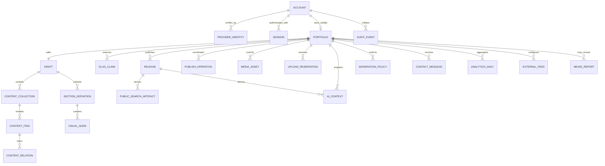

**ER interpretation:** Entities `CONTENT_COLLECTION`, `CONTENT_ITEM`, `CONTENT_RELATION`, `SECTION_DEFINITION` and `VISUAL_NODE` are primarily **embedded logical records** inside one portfolio Draft and compiled into Release payloads. They are **not** independent globally queryable tenant collections at launch. A release's media associations may be represented by explicit `mediaRefs` rather than an expensive many-to-many join collection.

### 3.2 Aggregate boundaries

| Aggregate         | Consistency boundary                    | Authoritative document                          | Invariants kept together                                                         |
| ----------------- | --------------------------------------- | ----------------------------------------------- | -------------------------------------------------------------------------------- |
| Account           | Identity/profile/status                 | `accounts`                                      | Active/suspended/deleting, role state, account lifecycle                         |
| Provider identity | External subject uniqueness             | `providerIdentities`                            | One provider subject maps to one account                                         |
| Session           | Individual session token                | `sessions`                                      | Revocation, expiry, account binding                                              |
| Portfolio control | One portfolio policy and active pointer | `portfolios`                                    | Owner, canonical slug mirror, live visibility/security, active release, counters |
| Slug claim        | One normalized string                   | `slugClaims`                                    | Exclusive ownership for current and alias slugs                                  |
| Draft             | Complete editable snapshot              | `drafts`                                        | Revision, content graph, visual graph, preview configuration                     |
| Release           | Immutable published snapshot            | `releases`                                      | One coherent public source version and artifacts                                 |
| Publish operation | One idempotent request                  | `publishOperations`                             | Retry identity, validation and activation progress                               |
| Media asset       | One logical uploaded object             | `mediaAssets`                                   | Verification, state, owner and object metadata                                   |
| AI context        | One approved release/policy tuple       | `aiContexts`                                    | Matching release, policy version, source citations                               |
| Moderation        | One live restriction                    | `moderationPolicies` + aggregate security state | Immediate denial notwithstanding cached content                                  |

MongoDB guarantees **single-document atomic writes**, including conditional updates whose filter matches current state. Multi-document updates are not automatically atomic without a transaction, which is why public activation centers on a single conditional `portfolios` update. Existing MongoDB guidance explicitly recommends embedding data that must change atomically [S01, S23].

### 3.3 Authority and derived-data principle

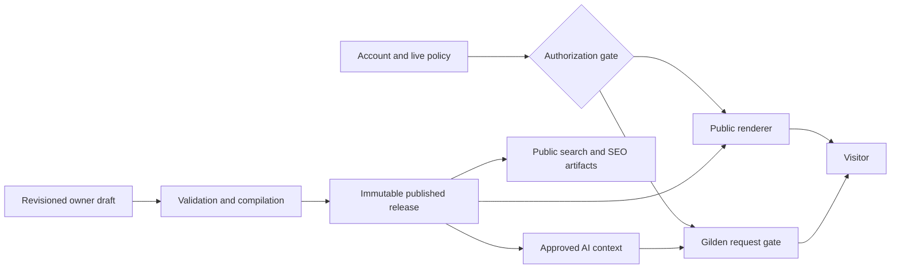

**Authoritative:** account/identity, current portfolio ownership/status, slug registry, validated draft and publication pointer. **Derived:** release search, Open Graph images, cached HTML, AI context, image variants, directory previews and owner analytics views. Derived artifacts must always be rebuildable from approved sources or explicitly treated as unavailable. A derived record must not silently override a live deny policy.

## 4. Data classification, disclosure and privacy controls

| Classification                 | Examples                                                           | Persisted where                                             | Public delivery                                                                  | AI delivery                                                         | Retention principle                  |
| ------------------------------ | ------------------------------------------------------------------ | ----------------------------------------------------------- | -------------------------------------------------------------------------------- | ------------------------------------------------------------------- | ------------------------------------ |
| **Account-private**            | IDP identifiers, verified email, account status, auth links        | Accounts/identities                                         | Never, except owner-chosen public identity fields explicitly copied into release | Never                                                               | Account lifetime; deletion workflow  |
| **Authentication-secret**      | Session verifier, provider access/refresh token if strictly needed | Hashed token in sessions; encrypted token only if justified | Never                                                                            | Never                                                               | Session lifetime/minimum necessary   |
| **Draft-private**              | Hidden sections, unpublished media refs, custom fields             | Draft/media staging                                         | Never                                                                            | Never                                                               | Until edited/deleted/account removal |
| **Published public**           | Approved biography, skills, project text, permitted media          | Immutable release                                           | Yes, unless current policy denies                                                | Only when separately AI approved                                    | Three retained versions as specified |
| **Unlisted published**         | Published text of unlisted portfolio                               | Immutable release                                           | Link-accessible; not search listed                                               | Subject to owner AI approval & policy                               | Same as published                    |
| **Owner-controlled sensitive** | References, contact details, phone/email visibility, personal PDFs | Draft/media/release only when deliberately published        | Denied by default                                                                | Separate explicit approval, with sensitive fields denied by default | Purpose-dependent                    |
| **Visitor-submitted private**  | Contact name/email/message                                         | Contact inbox                                               | Never                                                                            | Never                                                               | 30 days                              |
| **Anonymous operational**      | Short-lived rate tokens, aggregate views, request metrics          | Redis/aggregates/logs                                       | Aggregates only by opt-in                                                        | Not context                                                         | Short TTL/30–90-day logs             |
| **Administrator-private**      | Abuse reports, moderator notes, investigation reason               | Moderation/report collections                               | Never; only neutral public status                                                | Never                                                               | Limited documented window            |
| **Uploaded binary**            | Images, PDFs, derived responsive variants                          | Object storage                                              | Only approved publicly released objects                                          | Extracted PDF text only after separate approval                     | Reference-driven + deletion          |

**Data minimization is structural.** Public projections are allowlisted and compiled; they are not projections of entire account, Draft or database documents. Hidden and explicitly denied fields must be omitted **before** search generation, SEO generation, model prompts, or client serialization. Merely removing a field from a visible React component is insufficient. The same rule applies when an owner reuses a content item through a binding. A link-accessible unlisted portfolio is not confidential; this must be communicated in UI.

### 4.1 Threat boundaries for user-authored content

The path-based public route `aaroophan.dev/{slug}` shares an origin with the authenticated `/dashboard`. This increases consequences of content-based XSS because malicious same-origin script could make authenticated requests regardless of HttpOnly cookie protections. Consequently **no user-supplied executable JavaScript, raw HTML, unrestricted CSS, event handlers, external scripts or executable MDX** may reach published rendering. Sanitize or isolate rich text and approved embeds. Enforce an appropriate Content Security Policy and test against stored XSS. Subdomains provide a useful host boundary but **do not make the path-based origin safe by themselves**. This is a mandatory launch review [S10, S11].

### 4.2 Representation boundaries

An `Account` DTO, an editable Draft DTO, a public Release DTO and a Gilden Context DTO are **different shapes**. Do not use a single serialization type with optional fields for every interface. Prefer purpose-specific projection functions with explicit allowlists:

```ts
interface PublicPortfolioProjection {
  portfolioId: PortfolioId;
  releaseId: ReleaseId;
  canonicalPath: string;
  content: PublicContent;
  composition: ApprovedComposition;
  seo: ValidatedSeo;
  search: PublicSearchIndex;
}
// Deliberately has no ownerAccountId, provider identities, contact inbox,
// draft revision, private media keys, security audit details, or private fields.
```

## 5. Common identifiers, serialization and time

### 5.1 Identifier policy

Persist **opaque, server-issued domain IDs**. Recommended representation for portfolio/content/release IDs is a canonical UUID string, with consistent validation at every API, repository and render boundary; MongoDB `_id` is an implementation detail. A UUID is not a capability, password, access decision, or source of authorization. Do not reveal internal provider subjects through URL IDs. Stable IDs make renames and reusable content safe without reference rewriting.

| Identifier       | Scope                  | Mutability                                 | Public exposure                          | Notes                                                       |
| ---------------- | ---------------------- | ------------------------------------------ | ---------------------------------------- | ----------------------------------------------------------- |
| `accountId`      | Platform               | Never changes                              | No, unless strictly necessary            | Separate from provider email/subject                        |
| `identityId`     | Platform               | Never changes                              | No                                       | `(provider,providerSubject)` global uniqueness              |
| `sessionId`      | Session                | New on session rotation                    | No                                       | Only opaque cookie bearer presented; hashed stored verifier |
| `portfolioId`    | Platform               | Never changes                              | Internal API as required                 | Resolves same portfolio from paths/subdomains               |
| `slugNormalized` | Platform namespace     | Changeable current value; aliases retained | Yes                                      | Lowercase ASCII; single authoritative registry              |
| `sectionId`      | Portfolio              | Stable after create                        | May appear in anchors                    | Not array index or display label                            |
| `collectionId`   | Portfolio              | Stable after create                        | Only if referenced in public config      | Type metadata; not a Mongo collection name                  |
| `contentId`      | Portfolio              | Stable after create                        | May appear in signed/validated links     | Shared data reused in multiple sections                     |
| `fieldId`        | Section/schema         | Stable after create                        | Sometimes in exported schema             | Renaming a label does not alter identity                    |
| `nodeId`         | Portfolio visual graph | Stable after create                        | May be exposed in DOM-safe generated IDs | No trust from knowledge of node ID                          |
| `releaseId`      | Platform               | Never changes                              | Can identify public version internally   | Must be associated with correct portfolio                   |
| `operationId`    | Idempotent command     | Never changes                              | Owner-visible operation status           | Never used as authority to mutate                           |
| `mediaId`        | Platform               | Never changes                              | May appear in public media manifest      | Storage key remains private                                 |
| `sourceId`       | AI context             | Tied to release                            | Validated citation IDs may be exposed    | No path traversal or generated external URL                 |

If UUID v7 is adopted, its time-ordered property must not be treated as private randomness; use unguessable independent secrets for bearer tokens and upload capabilities. For samples below, example identifiers are fictitious. Define branded types to prevent accidental cross-ID assignment in TypeScript, but validate the runtime string because branded types do not exist at runtime.

```ts
type Brand<S extends string, Tag extends string> = S & { readonly __type: Tag };
type AccountId = Brand<string, "AccountId">;
type PortfolioId = Brand<string, "PortfolioId">;
type ContentId = Brand<string, "ContentId">;
type ReleaseId = Brand<string, "ReleaseId">;
type NodeId = Brand<string, "NodeId">;
type MediaId = Brand<string, "MediaId">;
```

### 5.2 Canonical serialized data

- JSON API representation: UTF-8; strings normalized in the domain serializer where appropriate (slugs, permitted enums, line endings). Do not mutate user-authored display text unexpectedly.
- MongoDB timestamps: BSON `Date` UTC; API output: RFC 3339/ISO 8601 strings with explicit `Z`; use one serialization layer.
- Numeric counters and revisions: nonnegative safe integers in APIs; exact BSON integer or long encoding defined per driver; no floating-point for counters, byte quotas, timestamps, or sequence comparisons.
- Optional field absence and explicit `null` have different semantics: a missing field means unset; `null` is permitted only in specific nullable contract fields. Do not use `undefined` inside canonical release JSON.
- Opaque storage keys are never copied into public URLs by a generic spread of Mongo documents.
- `createdAt`, `updatedAt`, `deletedAt`, `expiresAt`, `linkedAt`, `revokedAt` have explicit lifecycle meaning; timestamps are set by server, not accepted from untrusted clients.
- Documents carry `schemaVersion`; published visual payloads additionally carry `rendererVersion`, `blockRegistryVersion`, and `serializerVersion`.
- A canonical serializer must ensure deterministic property ordering, encoding, unknown-field elimination, and byte accounting; common JavaScript `JSON.stringify` alone is insufficient as a _specified_ canonicalization standard without defining ordering and supported types.
- Cryptographic hashes are computed over the **actual normative serialized bytes**. A frontend preview may estimate size, but only server-produced serialized bytes determine whether publication exceeds **102,400 bytes**.

For schema comparisons, choose a documented deterministic JSON canonicalization strategy (for example a tightly scoped RFC 8785-compatible approach, if applicable), test Unicode/number cases and reject unsupported values. Hashes are integrity/change-detection aids, **not** signatures unless keyed with an appropriate signing method and policy.

### 5.3 Status ownership and state evolution

Client payloads never write security/ownership fields. The domain service owns the state transition; repositories allow only a documented transition. Arrays representing multiple role grants must be validated against a role registry. A database migration may add fields, but cannot silently default a newly introduced sensitive visibility flag to public.

## 6. Collection inventory, cardinalities and retention

The following are **logical MongoDB collection names**. Names are owned by infrastructure migration code, never taken from user-provided schema names. Actual casing must be consistent with the API and app implementation.

| Collection           | ID / natural key                                    | Cardinality                          | Read actors                                        | Write actors                | Default classification    | Retention                        |
| -------------------- | --------------------------------------------------- | ------------------------------------ | -------------------------------------------------- | --------------------------- | ------------------------- | -------------------------------- |
| `accounts`           | unique `accountId`                                  | 1 per registered account             | Self/admin, internal IAM                           | IAM/admin lifecycle only    | Account-private           | Account lifetime and deletion    |
| `providerIdentities` | unique provider+subject                             | 1–N/account                          | IAM only                                           | Verified linking/unlink     | Account-private           | Account lifetime                 |
| `sessions`           | unique hashed opaque verifier                       | 0–N/account                          | IAM only                                           | Auth lifecycle              | Secret/auth               | Expires/revoked + TTL            |
| `portfolios`         | unique `portfolioId`                                | 0–1/account initially                | Owner/public gate/admin                            | Domain services             | Mixed control-plane       | Portfolio lifetime               |
| `slugClaims`         | unique normalized slug                              | 1 current + N historical aliases     | Host resolver                                      | Rename/create service       | Public routing            | Reserved while portfolio exists  |
| `drafts`             | unique `portfolioId`                                | 1 per portfolio                      | Owner only                                         | Validated draft service     | Draft-private             | Portfolio lifetime               |
| `releases`           | unique `releaseId`, unique `(portfolioId,sequence)` | 0–3 retained successful releases     | Public renderer via gate, owner, AI compiler       | Publish compiler only       | Sanitized published       | 3 retained successful versions   |
| `publishOperations`  | scoped idempotency key hash                         | Multiple/portfolio                   | Owner, admin ops                                   | Publisher service           | Internal/private          | Bounded state/history window     |
| `mediaAssets`        | unique `mediaId`                                    | 0–30 original assets/portfolio       | Owner + public approved asset gateway              | Media service               | Mixed                     | Reference driven                 |
| `uploadReservations` | unique reservation ID                               | Bounded active reservations          | Owner/worker                                       | Media quota service         | Internal/private          | Short TTL + reconciliation       |
| `quotaBuckets`       | global/portfolio quota IDs                          | 1 global + per portfolio when needed | Quota service/admin                                | Quota service               | Internal                  | While active                     |
| `aiContexts`         | unique portfolio+release+policy version             | 0–N/portfolio                        | Authorized Gilden service                          | Context compiler/revoker    | Approved public knowledge | Matching release + revocation    |
| `contactMessages`    | unique message ID                                   | Bounded/portfolio                    | Owner/admin under policy                           | Contact submission/deletion | Highly private            | 30 days                          |
| `analyticsDaily`     | unique portfolio+day+metric                         | Bounded/day                          | Owner, public if opted in                          | Validated aggregation       | Aggregate                 | Configurable bounded retention   |
| `moderationPolicies` | unique policy ID                                    | 0–N/portfolio                        | Admin/live gate                                    | Admin service               | Security-private          | Active and bounded audit/history |
| `abuseReports`       | unique report ID                                    | Bounded                              | Admin; limited reporter receipt                    | Report/admin service        | Report-private            | Documented minimal period        |
| `auditEvents`        | unique event ID                                     | Bounded                              | Authorized admin                                   | Server audit writer         | Security-private          | Proposed 90 days                 |
| `externalFeeds`      | unique `(portfolioId,feedId)`                       | At most 1 primary feed/portfolio     | Owner/feed worker; previews public through release | Feed service                | Mixed                     | Portfolio lifetime + preview TTL |
| `deletionOperations` | unique deletion op ID                               | 0–1 active/account                   | Owner/admin ops                                    | Account deletion worker     | Sensitive internal        | Minimize; idempotent             |

**Operational note:** Do not create a collection for every custom user content collection. An owner's `Research Papers` is a **domain collection embedded within the draft**, and does not consume a MongoDB namespace. Free Atlas tiers impose storage and namespace/operational constraints; unnecessary collections and indexes add overhead [S29].

### 6.1 Normalization choices and reasons

- Keep **one complete bounded Draft document** to support atomic save of a coherent owner editing snapshot.
- Store **immutable Releases separately** from the mutable Portfolio control document, so publication does not copy unbounded draft content into the live policy record.
- Store **slug claims separately** because historic aliases, uniqueness, and renames are namespace concerns shared by all tenants.
- Store **sessions and provider identities separately** because revocation/subject uniqueness are not naturally embedded in the same owner-editable aggregate.
- Store **contact inbox entries and audit events separately** so TTL and access restrictions do not mutate or expose published content.
- Store **media bytes externally**, preserving metadata and reference IDs within MongoDB.
- Keep **AI contexts separate from public Releases** so context preparation can fail independently, and revocation can invalidate use without rewriting historic releases.
- Avoid a generic `events` table, an arbitrary key/value store or unbounded append-only event sourcing unless a concrete feature and retention budget require them.

### 6.2 Safe pagination and query ceilings

Every list query must have a server-set maximum page size and stable sort. Suggested limits are **engineering defaults, not new user-facing product quotas**: 20 portfolios per directory page; 30 media metadata items; 20 inbox messages per page; 50 audit events per privileged administrative page. Prefer seek/cursor pagination using `(createdAt, _id)` or `(timestamp, id)` over offset pagination at scale. Cursor tokens must be authenticated/validated and cannot encode raw arbitrary Mongo predicates.

## 7. Identity, provider links, sessions and lifecycle

### 7.1 Account record

```ts
interface AccountRecord {
  accountId: AccountId;
  status: "active" | "suspended" | "deleting";
  displayName: string;
  preferredLocale: "en"; // published UI English in first release
  verifiedEmail?: string; // optional; not the owner key
  emailVerifiedAt?: string; // server verification evidence
  platformRoles: Array<"user" | "admin">;
  securityVersion: number;
  lastSensitiveAuthAt?: string;
  createdAt: string;
  updatedAt: string;
  deletingAt?: string;
  schemaVersion: number;
}
```

| Field                 | Write authority                      | Constraint                                  | Security purpose                               |
| --------------------- | ------------------------------------ | ------------------------------------------- | ---------------------------------------------- |
| `accountId`           | IAM creation only                    | Immutable unique                            | Stable owner identity                          |
| `status`              | IAM/admin lifecycle                  | Enum, transitions guarded                   | Account shutdown and suspend                   |
| `displayName`         | Self through allowlisted profile API | Bounded, stripped of executable markup      | Human-readable owner label                     |
| `verifiedEmail`       | Verified provider/email flow only    | Normalized, optional, not unique by default | Email-dependent features                       |
| `platformRoles`       | Trusted admin bootstrap/service only | Cannot be client supplied                   | Privileged access                              |
| `securityVersion`     | Security service                     | Monotonic CAS                               | Fast security/session invalidation if required |
| `lastSensitiveAuthAt` | Verified reauth procedure only       | Time-bounded                                | Sensitive action freshness                     |

Only an explicitly trusted administrator provisioning operation may grant `admin`. Never choose the first signer-in as administrator. A user with no portfolio is valid; accounts and portfolios have different lifetimes and may be created at different times.

### 7.2 Provider identity record

```ts
interface ProviderIdentityRecord {
  identityId: string;
  accountId: AccountId;
  provider: "google" | "github";
  providerSubject: string; // stable ID asserted by provider, not email
  issuer?: string; // required and verified for OIDC identities
  providerEmail?: string;
  providerEmailVerified?: boolean;
  linkedAt: string;
  linkedWithFreshProofAt: string;
  lastUsedAt?: string;
  schemaVersion: number;
}
```

For Google OIDC, the verified identity derives from the issuer and `sub` claim after validating the ID token, audience, nonce and relevant protocol requirements. For GitHub, use its stable account ID from the provider's authenticated response, **not login name or email**. A provider's display name, avatar and email can change. OAuth/OIDC account linking must require active control of the existing account and fresh proof of the newly linked provider [S12, S14].

**Unique index:** `{ provider: 1, providerSubject: 1 }` with `unique:true`. If multiple issuers are supported under a provider name, normalize an issuer-specific provider identity key; do not assume two `sub` values from unrelated issuers share namespace. Enforce account scope for listing/removing links.

**Linking two existing accounts:** do not silently transfer provider identities or portfolios. Treat as a separate privileged merge workflow requiring proof of both accounts, impact preview, auditable ownership transfer, and explicit user approval. Deferring full merges in beta is safer than implementing unsafe email-based fallback.

### 7.3 Session record and cookie handling

```ts
interface SessionRecord {
  sessionId: string;
  verifierHash: string; // deterministic keyed hash or strong hash, no raw bearer
  accountId: AccountId;
  createdAt: string;
  authenticatedAt: string;
  lastSeenAt?: string;
  expiresAt: string;
  revokedAt?: string;
  authProvider: "google" | "github";
  securityVersionAtIssue: number;
}
```

A browser receives a cryptographically unpredictable session cookie; the DB retains a **non-reversible verifier representation** appropriate for random high-entropy tokens. Logs and analytics never contain the cookie or plaintext bearer. Restrict cookie to primary platform host, `Secure`, `HttpOnly`, `Path=/`, appropriate `SameSite`, and **no `Domain=.aaroophan.dev`**. Prefer the `__Host-` prefix when supported. Set appropriate cache headers for all authenticated responses. Cookie design and CSRF checks are independently required [S15, S19].

**Reject a session** when missing, expired, revoked, bound to suspended/deleting account, missing necessary provider links, or carrying a superseded security version. TTL deletion does not decide validity: the request checks `expiresAt` and `revokedAt` itself because MongoDB TTL deletion can lag [S05]. Define idle expiry, absolute expiry, rotation and recent-authentication windows in [07](07-security-design.md); these are not inferred from the cookie lifetime alone.

### 7.4 Session and provider lifecycle

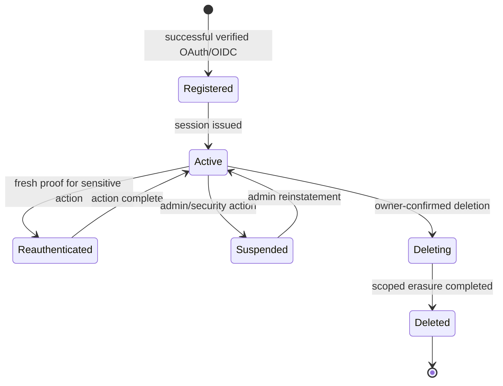

| Operation             | Data effects                                                     | Constraint                                        |
| --------------------- | ---------------------------------------------------------------- | ------------------------------------------------- |
| Google/GitHub sign in | Resolve provider subject, create account if none, create session | Do not auto-link by email                         |
| Link provider         | Create provider identity with unique subject                     | Existing session + fresh target provider proof    |
| Unlink provider       | Delete/revoke selected provider link                             | Reject last usable identity; recent auth required |
| Logout session        | Mark session revoked                                             | Revoke immediately; TTL later cleanup             |
| Logout all            | Revoke all sessions / bump account version                       | Keep audit event without token                    |
| Suspend account       | Block all sessions, owner operations, related public portfolios  | Live gate wins over cache                         |
| Delete account        | Revoke, suppress, stage scoped erasure, complete idempotently    | Audit minimized; no cross-account cascade         |

**Idempotency and link races:** two simultaneous link operations for the same external identity cannot create two owners; the unique index makes exactly one write succeed. On collision, return a controlled conflict and require proof of control over the existing linked GildedIn account rather than disclosing sensitive account metadata.

## 8. Portfolio identity, canonical routing and slug ownership

### 8.1 Portfolio control-plane record

```ts
interface PortfolioRecord {
  portfolioId: PortfolioId;
  ownerAccountId: AccountId;
  slug: string; // lowercase canonical, 3..30 ASCII
  displayHandle: string;
  status: "onboarding" | "active" | "owner_disabled" | "suspended" | "deleting";
  visibility: "public" | "unlisted";
  activeReleaseId: ReleaseId | null;
  publishSequence: number; // monotonic; no promise of contiguous values
  securityVersion: number;
  aiAccess: {
    enabled: boolean;
    revocationVersion: number;
    deniedSourceIds: string[];
    disabledAt?: string;
  };
  publicStatisticsEnabled: boolean;
  quotaSummary: {
    originalFileCount: number;
    usedBytes: number;
    reservedBytes: number;
  };
  createdAt: string;
  updatedAt: string;
  schemaVersion: number;
}
```

`activeReleaseId` is `null` until the first successful Publish. `visibility` is meaningful only for published content; an unpublished Draft is always private to the owner. An owner-disabled/suspended portfolio must not render a release even if the active pointer still names one. The active pointer update and authoritative policy revision belong in the same portfolio document for atomic publish-gate comparisons. A release may be independently retrievable only by authorized services that enforce portfolio identity.

**Ownership:** the first release has one portfolio per account, enforced using a unique index on `portfolios.ownerAccountId` that includes suspended/onboarding/disabled rows. Do not free an owner's slot through suspension. If the product later supports multiple portfolios, remove/change this index only through an explicit reviewed migration and revised authorization tests.

### 8.2 Slug grammar and reserved namespaces

Canonical normalized slug: lowercase ASCII `[a-z0-9]` with optional internal `-`, length **3–30**, no leading/trailing hyphen, no consecutive hyphen if the product policy chooses a stricter rule. Normalization is lowercase on ASCII only; never silently transliterate arbitrary Unicode into an ambiguous slug. Reject ambiguous percent-encoding, encoded slashes, path separators, control characters, dots, Unicode confusables and repeated normalization variants. User display capitalization (`Aaroophan`) is separately stored in `displayHandle` and **does not** affect routing identity.

Reserved slugs include, at minimum: `api`, `dashboard`, `login`, `logout`, `admin`, `settings`, `app`, `auth`, `help`, `support`, `privacy`, `terms`, `robots`, `sitemap`, `www`, `mail`, `static`, `assets`, `cdn`, `favicon`, `manifest`, `create`, `new`, `status`. Reserve also any future platform route and explicitly configured operational DNS subdomain. Maintain a centrally tested reserved-name registry used by **both** path/subdomain routes. This is not an exhaustive public specification of future routes; changes require careful collision migration.

```ts
const SLUG_PATTERN = /^[a-z0-9](?:[a-z0-9-]{1,28}[a-z0-9])$/;
// Additional validation excludes consecutive hyphens, reserved words,
// ASCII normalization ambiguities, and DNS/platform collision classes.
```

### 8.3 One authoritative slug namespace

```ts
interface SlugClaim {
  slugNormalized: string; // unique across *current* and *alias*
  portfolioId: PortfolioId;
  kind: "current" | "alias";
  claimedAt: string;
  retiredAt?: string; // when current slug becomes redirect alias
  redirectStatus?: 308;
  schemaVersion: number;
}
```

The `slugClaims` collection has **one unique index on `slugNormalized`** regardless of claim kind. Separate unique indexes on current and historical names in different collections are unsafe: one portfolio could reclaim another owner's retired username. The `portfolios.slug` field is a **mirror of the current claim** for convenient lookup/rendering, not a separate authority. The old slug remains owned by the same portfolio while it exists.

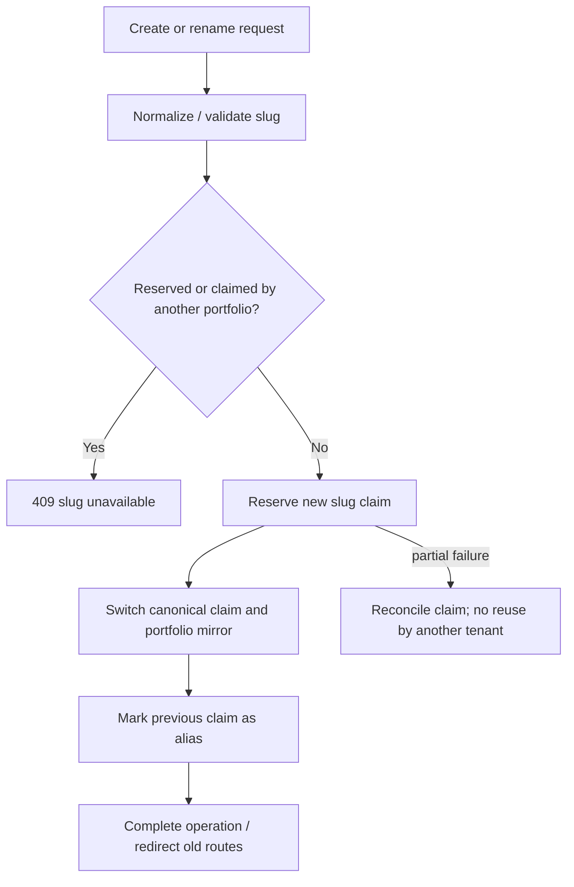

### 8.4 Rename atomicity and crash recovery

Rename spans more than one document (new slug claim, old claim, portfolio canonical mirror) and **cannot be made atomic by separate ordinary writes**. Two legitimate approaches exist:

1. **Preferred when verified available:** use a bounded MongoDB multi-document transaction for claim reservation, canonical switch and alias update. Keep external DNS/cache operations outside the transaction. Retry only transient transaction failures with a bounded policy and an idempotency key.
2. **Fallback:** a durable `renameOperations`/claim-lease state machine, where new slug is reserved first, old slug remains reserved until committed, and an authoritative canonical pointer in the portfolio changes atomically. Host resolution must reject ambiguous intermediate claims and redirect only after state reconciliation. A crash may temporarily reduce name availability but must never transfer ownership.

**Never** release the old slug before the new canonical claim is safely established. A second owner must not be able to claim any intermediate slug. The final algorithm must be concurrency-tested on the real selected Mongo tier; a diagram alone is not proof of atomicity.

### 8.5 Canonical paths, subdomains and lookup

| Input                                            | Expected identity                      | Route behavior                                                                 |
| ------------------------------------------------ | -------------------------------------- | ------------------------------------------------------------------------------ |
| `https://aaroophan.dev`                          | Platform, not tenant                   | GildedIn homepage                                                              |
| `https://aaroophan.dev/alex`                     | Slug claim `alex`                      | Canonical portfolio homepage                                                   |
| `https://alex.aaroophan.dev/`                    | Same claim `alex`                      | Equivalent portfolio homepage; canonical path to apex                          |
| `https://aaroophan.dev/alex/projects/item-a`     | Portfolio `alex` + published item slug | Dedicated detail page                                                          |
| `https://alex.aaroophan.dev/projects/item-a`     | Same portfolio/item                    | Navigation stays on subdomain; canonical path points to apex                   |
| `https://aaroophan.dev/old-name`                 | Alias claim                            | Permanent redirect to current canonical path, preserving supported detail path |
| `https://old-name.aaroophan.dev/projects/item-a` | Alias claim                            | Redirect to approved current canonical destination                             |
| `https://unknown.aaroophan.dev/`                 | No claim                               | Branded HTTP 404, no arbitrary homepage redirect                               |
| `https://www.aaroophan.dev/`                     | Reserved system host                   | Permanent redirect to apex                                                     |
| `https://aaroophan.dev/dashboard`                | Protected platform route               | Host-only auth and owner authorization                                         |

Host parsing uses a **trusted infrastructure-derived hostname** and an allowlist of permitted domains, not blindly trusted client `Host` or `X-Forwarded-Host` values. The route resolver must reject unknown ports/hostnames and suspicious forwarded headers. Published content resolution proceeds: normalize/validate host and path → resolve slug to `portfolioId` → check authoritative live policy → select one active release → render that release with validated relative links and canonical metadata. The response must not perform tenant lookup by insecure substring matching.

**Subdomain cookie separation:** the authenticated dashboard's host-only cookie must not be sent to tenant subdomains. Both URL models share release data, but they should not share authentication state or privileged APIs. Server-side same-origin risks on the apex path route still require aggressive rendered-content sanitization.

## 9. Draft aggregate: owner-authored source of truth

The Draft is the complete editable source representation for one portfolio. It includes **identity presentation**, ordered sections, reusable typed content, schema definitions, visual nodes, theme/animation settings, SEO preferences, owner AI approval intentions and references to approved or staged media. The Draft is **not** rendered publicly, returned to anonymous visitors, indexed for external search, or sent to Gilden.

### 9.1 Draft envelope

```ts
interface DraftRecord {
  portfolioId: PortfolioId; // unique, never client chosen
  revision: number; // starts at 0, increment on every accepted save
  schemaVersion: number; // persisted content schema contract
  rendererVersion: string;
  draftMutationId?: string; // last acknowledged mutation, bounded
  profile: PortfolioProfile;
  sections: SectionDefinition[];
  collectionDefinitions: CollectionDefinition[];
  contentCollections: ContentCollection[];
  nodes: VisualNode[];
  theme: PortfolioTheme;
  navigation: NavigationDefinition;
  seo: OwnerSeoSettings;
  aiApprovals: DraftAiApprovalConfiguration;
  mediaRefs: MediaId[];
  updatedAt: string;
  updatedBy: AccountId;
  createdAt: string;
}
```

**One-document save:** An approved draft mutation produces a new validated draft snapshot or bounded patch. Repository uses `{portfolioId, revision: expected}` for a compare-and-set update, incrementing revision within the same single-document operation. A 409 response means the server cannot prove the write is based on the current draft. Never automatically overwrite a conflicting revision. This is compatible with [S01] and requirements EDT-008/009.

**Saving is not publishing.** A draft can contain incomplete fields, hidden sections, new unapproved AI fields and staged media. It may be temporarily invalid for publication while remaining safely editable. However, the save path must still enforce structural safety, quota and malicious-input bounds; an invalid executable component is never accepted even into a draft.

### 9.2 Draft versus release validation

| Check                                                   | On every draft save                                                    | On Publish                                |
| ------------------------------------------------------- | ---------------------------------------------------------------------- | ----------------------------------------- |
| Authenticated owner/administrator operation             | Required                                                               | Required                                  |
| Allowed command/field names                             | Required                                                               | Required                                  |
| Revisions and concurrency                               | CAS required                                                           | Selected/pinned revision verified         |
| Unsupported widget or executable script                 | Reject                                                                 | Reject                                    |
| Unbounded arrays/text or total transport size           | Reject                                                                 | Reject                                    |
| Broken referential link                                 | Usually reject, except explicitly marked in-progress recoverable edits | Always reject                             |
| Empty optional sections                                 | Allowed                                                                | Allowed (hidden or omitted)               |
| Missing mandatory publication profile fields            | Can remain as incomplete draft                                         | Block                                     |
| Informative image lacking alt text                      | Warn / mark incomplete                                                 | Block                                     |
| Uploaded media still staging                            | Draft reference allowed in owner-only preview if securely delivered    | Block until finalized                     |
| Free-positioned text overflow                           | Warn / help fix                                                        | Severe clipping blocks                    |
| 20 authored blocks, 20 items, 20 custom fields, depth 3 | Enforce                                                                | Re-enforce                                |
| 100 KiB published release payload                       | Estimate only                                                          | Authoritative serialized byte check       |
| Public route/link integrity                             | Preview warning                                                        | Required; severe invalid references block |
| AI knowledge availability/inference                     | No need                                                                | Does not block public release             |

A Draft must never contain externally fetched markup blindly promoted into public HTML; preview uses the same safe component registry and content sanitizer as the public renderer, with additional owner authentication.

### 9.3 Section definitions

```ts
type SectionType =
  | "hero"
  | "about"
  | "projects"
  | "experience"
  | "education"
  | "skills"
  | "blog"
  | "references"
  | "contact"
  | "certifications"
  | "achievements"
  | "services"
  | "testimonials"
  | "publications"
  | "resume"
  | "custom";
interface SectionDefinition {
  sectionId: string;
  type: SectionType;
  title: string;
  navigationLabel?: string;
  order: number;
  visible: boolean;
  searchEligible: boolean;
  aiSectionApproved: boolean; // field overrides still required
  canvasRootId: string; // platform scaffold, not an authored node
  layoutPreset: string; // approved preset ID
  publicAnchor: string; // validated unique within portfolio
  schemaDefinitionId?: string;
}
```

Exactly **one Hero**, and Hero appears first. Other types can repeat, each with its own `sectionId`. Hiding a section preserves the owner's draft data but ordinarily suppresses it in the compiled release, public SEO, search and AI. If one underlying `contentId` is independently reused by another visible section, its visibility is evaluated **at the specific publication binding**, not inferred solely from its original location. This prevents unintentional backdoor publication of hidden reference data.

**Section identity:** array position is not the ID; owners may reorder sections freely after Hero. `publicAnchor` is stable where possible and unique among visible sections; renames of display titles do not automatically break deep links. Duplicate anchors are rejected or safely regenerated with owner-visible impact preview.

## 10. Schema engine and typed content

### 10.1 Field-definition types and validation

GildedIn permits a constrained visual schema designer and imports a **safe, documented subset** of JSON Schema. It is **not** a general JSON Schema interpreter and cannot safely execute arbitrary custom validation logic. JSON Schema Draft 2020-12 is the design reference [S17], while MongoDB's `$jsonSchema` has its own dialect and limitations [S07]. Zod/TypeScript-level validators and MongoDB collection validators are complementary, not interchangeable.

| Type       | Storage shape                          | Core validation                                                 | Rendering/meaning                                |
| ---------- | -------------------------------------- | --------------------------------------------------------------- | ------------------------------------------------ |
| `text`     | UTF-8 string                           | `minLength`, `maxLength`, trim policy                           | Plain escaped text                               |
| `richText` | Approved structured editor AST         | Allowed nodes/marks, total depth/length                         | Sanitized semantic HTML, never raw MDX           |
| `url`      | Canonical validated URL                | HTTPS or explicitly approved schemes; no `javascript:`, `data:` | Link metadata, safe `rel`/target                 |
| `email`    | String                                 | Conservative syntax, length and privacy flags                   | Contact identity only when deliberately released |
| `date`     | ISO date string or constrained instant | Parse, range, precision                                         | Chronological content                            |
| `number`   | Finite number                          | Range, precision, optional units                                | Data value, not executable expression            |
| `boolean`  | Boolean                                | Exact type                                                      | Configuration/content selection                  |
| `image`    | `mediaId` reference + caption/alt/crop | Portfolio ownership, finalized status                           | Responsive image artifact                        |
| `pdf`      | `mediaId` + display metadata           | Verified PDF, permissions                                       | View/download; AI extraction separate            |
| `select`   | Stable option ID                       | One of declared bounded values                                  | Label may be renamed                             |
| `list`     | Bounded array of typed items           | Depth, item count, individual type                              | Repeatable fields                                |
| `object`   | Object of typed fields                 | Depth and allowlisted keys                                      | Nested object record                             |
| `relation` | Stable target content ID(s)            | Target exists, same portfolio, allowed collection               | Reusable content graph                           |

Every custom field should support `fieldId`, `name`, `label`, `description`, `type`, `required`, `defaultValue`, `validation`, `publicVisibility`, `aiVisibility`, and searchable flag. Sensitive types default **not public**, **not searchable**, **not AI-approved**. Content owners may explicitly override permitted visibility; platform-reserved account/contact fields remain excluded regardless of owner-authored schema intent.

### 10.2 Data schema depth and counting

The maximum **content-schema nesting depth is 3** (nested `object` or `list` container levels from the root item). An example `Project → Architecture Decisions → Challenges` uses bounded nested containers; deeper nested structures must flatten or normalize into separately referenced collections. Layout grouping depth is a **different concept** and has its own safe compiler bound; do not use a schema-depth workaround to smuggle an infinitely recursive visual tree.

The limit **20 custom fields per section** counts custom field definitions declared for that section; mandatory platform-defined fields do not count. The limit **20 items per content collection** counts stored item records, not filtered cards or views. Owner-defined collections share the same quota semantics. Published content serialization must still fit **100 KiB total**, so many individually valid records may collectively be too large to publish.

**Protection against imported schema abuse:** reject `$ref`, `$dynamicRef`, remote URLs, unknown vocabularies, unbounded combinators (`anyOf`, `oneOf`, `allOf` without a specifically supported safe form), prototypes, property paths such as `__proto__` and `constructor`, special Mongo operators, regex patterns with unacceptable complexity, enormous enums, cycles and non-JSON values. Prefer compiled strict field-definition DTOs rather than executing arbitrary JSON Schema behavior. No user-supplied field name becomes a raw MongoDB update path.

### 10.3 Example collection definition

```json
{
  "collectionId": "research-papers",
  "displayName": "Research Papers",
  "schemaVersion": 1,
  "itemsLimit": 20,
  "fields": [
    {
      "fieldId": "paper-title",
      "name": "title",
      "label": "Paper title",
      "type": "text",
      "required": true,
      "validation": { "maxLength": 160 },
      "publicVisibility": "owner_choice",
      "aiVisibility": "requires_explicit_approval",
      "searchable": true
    },
    {
      "fieldId": "publication-date",
      "name": "publishedAt",
      "label": "Published on",
      "type": "date",
      "required": false,
      "publicVisibility": "owner_choice",
      "aiVisibility": "requires_explicit_approval"
    },
    {
      "fieldId": "source-url",
      "name": "sourceUrl",
      "label": "Publication URL",
      "type": "url",
      "required": false,
      "validation": { "allowedSchemes": ["https"] },
      "publicVisibility": "owner_choice",
      "aiVisibility": "requires_explicit_approval"
    }
  ]
}
```

The schema examples describe a **GildedIn-safe field registry**, not arbitrary executable JSON Schema input. The schema defines the allowed values; visual components decide how approved values are displayed. Custom field IDs are distinct from display names, enabling safe label changes and migration.

### 10.4 Content item record

```ts
interface ContentItem {
  contentId: ContentId;
  collectionId: string;
  slug?: string; // only if a dedicated public detail page exists
  fields: Record<string, ApprovedFieldValue>;
  categoryIds: string[];
  sortOrder: number;
  featured?: boolean;
  ownerVisibility: "draft_only" | "public_candidate";
  searchable: boolean;
  aiApprovedFieldIds: string[]; // effective context still compiled from live policy
  createdAt: string;
  updatedAt: string;
}
```

A `slug` for an item with a detail page must be unique in its **portfolio + route-kind namespace**, e.g. all project detail slugs within one portfolio, and cannot shadow system paths. It is **not** a global platform username. Renaming a project may produce an item-level redirect mapping if preserving its links is important, but GildedIn need not persist unlimited item-slug history; the behavior must be explicit and tested.

### 10.5 Built-in derived content

Only a small registry of deterministic derived values is initially supported: experience duration, project duration, date formatting and approved content-count summaries. Derived fields use validated source data, declared timezone/rounding conventions, no arbitrary formula code, and deterministic rendering on server/client. If dates are missing, the display fails gracefully rather than producing `NaN`, invalid duration or misleading results. No `eval`, JavaScript template expressions, user-defined database aggregation pipelines or remote code are allowed.

### 10.6 Rich text and diagrams

Represent rich text as a bounded, validated AST with an allowlisted node/mark registry. Support paragraphs, headings, lists, links, image references, tables, code blocks with language labels and approved diagrams. Mermaid-like syntax, when supported, must be parsed through controlled rendering with disabled scripting and sanitized output. Video embeds use an allowlist and restricted iframe permissions; arbitrary iframe HTML is rejected. Markdown import/export is a conversion utility, not a bypass of the AST validator. The published release should contain the **sanitized portable representation**, not the editor's untrusted serialized internals.

## 11. Content relationships, bindings and graph integrity

### 11.1 Reusable data and presentation are separate

An owner may define a project once and display it in a featured Hero card, a Projects repeater and a related-experience panel. Each view references the same stable `contentId`. Editing the item changes all **Draft** consumers immediately, but the public release does not change until Publish.

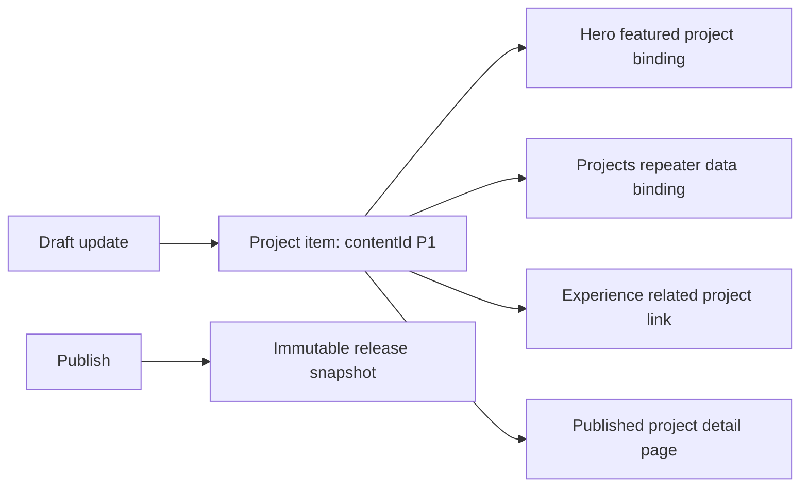

### 11.2 Binding contract

```ts
interface ContentBinding {
  source: "profile" | "collectionItem" | "collection" | "derived";
  collectionId?: string;
  contentId?: ContentId;
  fieldId?: string;
  derivedKey?: "experienceDuration" | "projectDuration" | "formattedDate";
  fallback?: string; // bounded, plain text only
}
```

Binding resolution must enforce the requested source's field-definition type, item ownership, visibility and compatibility with the destination component. A `contentBinding` must never contain a full arbitrary query, Mongo operator, JavaScript expression, URL to fetch, serialized function or cross-tenant account reference. The compiler resolves or rejects bindings **before** generating public search, SEO or AI artifacts.

### 11.3 Referential integrity rules

| Condition                                | Required behavior                                                                      |
| ---------------------------------------- | -------------------------------------------------------------------------------------- |
| Bind to nonexistent collection           | Validation error; no publish                                                           |
| Bind to nonexistent item ID              | Validation error; no publish                                                           |
| Bind to different `portfolioId`          | Reject as cross-tenant reference; audit suspicious attempts                            |
| Bind image field to text-only component  | Reject or explicit approved conversion, not implicit HTML                              |
| Delete item still used in visible block  | Block deletion; show impacted nodes; detach only with confirmation                     |
| Delete item used in hidden draft section | Preserve warning and allow explicit detachment decision                                |
| Reorder collection items                 | Update ordered item IDs or `sortOrder` within Draft, never rewrite IDs                 |
| Hide source section                      | Re-evaluate each individual use and owner's explicit visibility choices                |
| Revoke field AI approval                 | Invalidate live context regardless of stored historic release                          |
| Duplicate item or node                   | Generate new stable IDs for independent objects; preserve IDs only for true references |
| Import collection from JSON              | Remap imported IDs into owner namespace; verify all references                         |
| Restore old release into Draft           | Revalidate imported graphs against current IDs, media and renderer contracts           |

Relationship cardinalities may be one-to-one, one-to-many or many-to-many, but traversal depth and total related-item count are bounded. The publication compiler must detect cycles even if a relationship type theoretically permits them; repeated relations may be shown as links rather than recursively expanding until unbounded content. A useful policy is to render linked items at fixed depth, with a stable detail URL for additional information.

### 11.4 Search and visibility propagation

Only fields **actually included in the validated release** and **explicitly searchable under owner controls** may enter the client search artifact. Do not generate search indexes directly from Draft. Hidden sections, private references, unpublished media metadata, internal content relations and owner-account fields remain excluded. A field can be public but not searchable; a public field is **not automatically AI-approved**.

## 12. Visual composition data and responsive constraints

GildedIn's editor allows free-positioning, resizing, grouping, overlap, layering and nesting. Its public renderer must produce semantic, responsive HTML/CSS, not an editor screenshot. Consequently the saved model is an **approved, versioned composition language**, not arbitrary DOM, HTML, CSS, canvas commands or user-written scripts.

### 12.1 Composition node schema

```ts
type LayoutMode = "auto" | "absolute" | "hybrid";
type Breakpoint = "desktop" | "tablet" | "mobile";
type SafeInteraction =
  | { kind: "none" }
  | { kind: "navigate"; routeId: string }
  | { kind: "scrollToSection"; sectionId: string }
  | { kind: "togglePanel"; targetNodeId: NodeId }
  | { kind: "openModal"; targetNodeId: NodeId }
  | { kind: "switchTab"; groupNodeId: NodeId; tabId: string }
  | { kind: "advanceCarousel"; carouselNodeId: NodeId; delta: -1 | 1 }
  | { kind: "openContactForm" };
interface VisualNode {
  nodeId: NodeId;
  sectionId: string;
  parentNodeId?: NodeId;
  componentType: string; // approved versioned registry key
  componentVersion: number;
  props: Record<string, unknown>; // validated by component-specific schema
  contentBinding?: ContentBinding;
  layout: SafeLayout;
  responsiveOverrides?: Partial<Record<Breakpoint, Partial<SafeLayout>>>;
  visualOrder: number;
  readingOrder: number;
  semanticRole?:
    | "h1"
    | "h2"
    | "h3"
    | "paragraph"
    | "article"
    | "navigation"
    | "decorative";
  visibilityByBreakpoint?: Partial<Record<Breakpoint, boolean>>;
  interaction: SafeInteraction;
  locked?: boolean; // editor affordance, not security
}
```

The `props` type is intentionally generic **only at the declaration level**: actual validation uses a registry-specific strict schema for each `componentType`/version, rejects unknown properties and disallows arbitrary CSS strings or code. Unknown component versions may be viewed by an explicitly supported compatibility renderer; otherwise publication must fail with an actionable error, not silently drop content.

### 12.2 Layout mode contracts

| Mode       | Saved constraints                                                                             | Valid usage                                       | Forbidden behavior                                                  |
| ---------- | --------------------------------------------------------------------------------------------- | ------------------------------------------------- | ------------------------------------------------------------------- |
| `auto`     | `display:flex/grid`, flow, gap, align, grow, min/max, aspect ratio                            | Text, data cards, accessible content              | Absolute pixel-only coordinates as the sole layout model            |
| `absolute` | Parent-relative anchors, normalized x/y/size, min/max, optional aspect ratio, bounded z-index | Decorative overlays, intentional Hero composition | Exceeding section scope or covering essential controls unreported   |
| `hybrid`   | Moveable parent/group with responsive child auto layout                                       | Composed custom sections                          | Nested undefined layout semantics or incompatible child constraints |

```ts
interface SafeAutoLayout {
  mode: "auto";
  flow: "row" | "column" | "grid";
  gapToken?: string; // approved design token
  alignment?: "start" | "center" | "end" | "stretch";
  columns?: 1 | 2 | 3 | 4;
  minWidthToken?: string;
  maxWidthToken?: string;
}
interface SafeAbsoluteLayout {
  mode: "absolute";
  x: number;
  y: number; // normalized parent-local unit, bounded
  width: number;
  height: number; // parent-relative or intrinsic sizing rule
  anchorX: "left" | "center" | "right";
  anchorY: "top" | "center" | "bottom";
  zIndexToken: string; // approved scale, no 999999 arbitrary value
  minSizeToken?: string;
  maxSizeToken?: string;
  aspectRatio?: number;
  overflow: "visible-decorative" | "clip-decorative" | "visible-content";
}
interface SafeHybridLayout {
  mode: "hybrid";
  placement: SafeAbsoluteLayout;
  childrenFlow: SafeAutoLayout;
}
type SafeLayout = SafeAutoLayout | SafeAbsoluteLayout | SafeHybridLayout;
```

**Normative coordinate choice:** exact coordinate scale, token registry and interpolation behavior should be specified in `03-ui-ux.md` and versioned. An example numeric x/y is not permission to accept unlimited values. Normalize proportions with a documented algorithm, clamp impossible sizes, use intrinsic content measurement where appropriate, and preserve accessible reading order independently of `z-index`.

### 12.3 Responsive override resolution

The editor exposes **Desktop, Tablet and Mobile** viewport modes. Base layout definitions establish default constraints; a breakpoint override changes only explicitly overridden fields. At intermediate widths, CSS auto layouts and proportional constraints flow; do not snapshot three unrelated desktop screenshots. The resolved result must be deterministic and stable across server/client, avoiding hydration mismatch.

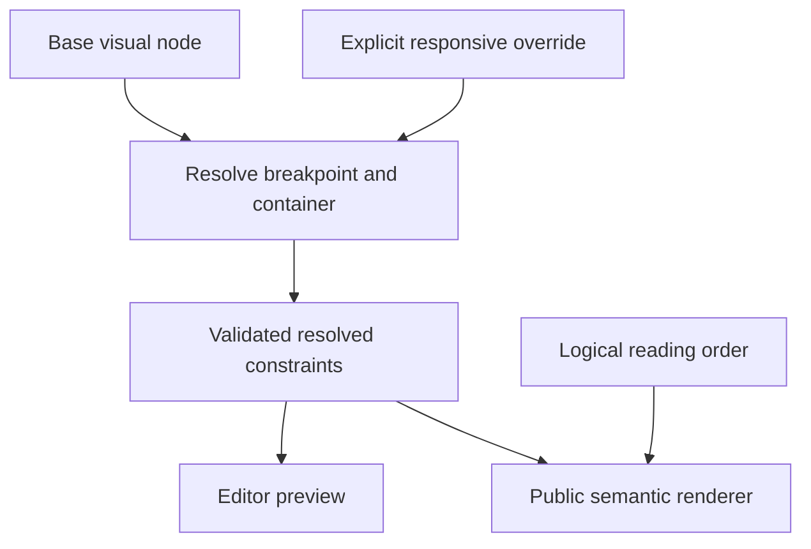

Owner-specific breakpoint visibility is allowed but must not render duplicate accessible content at the same viewport. If a component is hidden on mobile, the mobile semantic reading-order and navigation graphs must not retain an unreachable focusable node.

### 12.4 Accessibility and semantic order

- Store `readingOrder` independently from `visualOrder` or coordinates.
- Preserve a valid overall heading outline, with **one primary H1** on the page.
- Semantic role is validated against block type; the owner cannot arbitrarily redefine a `button` as a decorative `div` while retaining click behavior.
- Reading order must be coherent for keyboard users and assistive technology when spatial layout differs.
- Dragging is not the exclusive way to reposition or reorder; keyboard buttons and inspector inputs provide equivalent actions.
- Invisible overlays cannot steal focus or hide essential actions; publication validation rejects serious obstruction.
- User-authored `locked` only affects editing behavior, not authorization or security.
- Text growth must not silently clip meaningful published content; auto layouts resize naturally and free-positioned blocks surface overflow diagnostics.

### 12.5 Block-counting algorithm

The entire published portfolio, including detail pages, may contain **at most 20 owner-authored visual nodes**. A user-created group is a node and counts; a nested authored child is also a node and counts. A repeater node counts **once**, regardless of number of collection items it renders. Platform-generated section roots, semantic wrappers, internal tab panels generated from a block's approved configuration, and other non-authored DOM helpers do not count. A mobile override is an attribute of the same node, not another node.

The server must compute this count from the normalized graph rather than a client-provided `blockCount` number. The 21st node fails with `BLOCK_LIMIT`, including imports, duplications, undo/redo replays and release restoration. The component catalog may contain more than 20 **component types**; that does not change the number of authorized _instances_.

### 12.6 Composition structure validation

The compiler checks: unique node IDs, valid section IDs, parent ID belongs to same section, no ancestry cycles, bounded nesting, allowed block registry versions, permitted parent-child combinations, no duplicate H1, accessible order, bounded children count, valid z-order tokens, legal responsive overrides, valid safe interactions, no unsupported external URL or iframe, no unknown runtime props, no inaccessible overlapping controls, and no runaway rendered DOM expansion. Complex checks may require layout measurement in browser-based tests as well as static graph validation; a static validator alone cannot prove visual WCAG compliance.

### 12.7 Sample graph with one repeater

```json
{
  "sections": [
    {
      "sectionId": "hero",
      "type": "hero",
      "order": 0,
      "visible": true,
      "canvasRootId": "root-hero"
    },
    {
      "sectionId": "projects",
      "type": "projects",
      "order": 1,
      "visible": true,
      "canvasRootId": "root-projects"
    }
  ],
  "nodes": [
    {
      "nodeId": "n-title",
      "sectionId": "hero",
      "componentType": "heading",
      "componentVersion": 1,
      "contentBinding": { "source": "profile", "fieldId": "displayName" },
      "layout": { "mode": "auto", "flow": "column" },
      "readingOrder": 1,
      "visualOrder": 1,
      "semanticRole": "h1",
      "interaction": { "kind": "none" }
    },
    {
      "nodeId": "n-project-grid",
      "sectionId": "projects",
      "componentType": "repeater",
      "componentVersion": 1,
      "contentBinding": { "source": "collection", "collectionId": "projects" },
      "props": { "variant": "projectCards", "maxVisible": 20 },
      "layout": { "mode": "auto", "flow": "grid", "columns": 3 },
      "responsiveOverrides": {
        "mobile": { "columns": 1 },
        "tablet": { "columns": 2 }
      },
      "readingOrder": 2,
      "visualOrder": 2,
      "interaction": { "kind": "none" }
    }
  ]
}
```

This graph has **two authored nodes**, not 21 when the project collection contains 20 items. The sample is simplified; production DTO validation must supply other necessary fields and enforce the specific repeater prop registry.

---

## 13. Immutable published releases and public read representation

### 13.1 Why a release is an independently valid artifact

A release is the complete, security-filtered representation of one publish operation. It is not a list of draft IDs whose current values are later looked up. A public request MUST select exactly one release and MUST NOT join it to the mutable draft to fill missing properties. The payload contains the material needed to render the portfolio homepage, enabled detail pages, accessible navigation, external article previews, SEO defaults, permitted interactions, layout, theme and references to published media. A separate `releases` document must be write-once after its successful preparation and activation. Its `status` can be tracked in a separate publication operation rather than mutated as part of normal rendering.

The compact portfolio control record owns the `activeReleaseId`. The published read API obtains the control record and live policy, resolves the selected immutable release by **both** `portfolioId` and `releaseId`, and builds only the appropriate published response. An owner preview instead loads a selected draft revision, validates/compiles it without activation, and returns with `Cache-Control: no-store`. Reusing a preview cache for public responses is forbidden.

```ts
interface PublishedReleaseRecord {
  releaseId: ReleaseId;
  portfolioId: PortfolioId;
  sequence: number; // successful activations, monotonic per portfolio
  publicationOperationId: string;
  createdFromDraftRevision: number;
  createdAt: string;
  schemaVersion: number;
  rendererVersion: string;
  blockRegistryVersion: string;
  serializerVersion: string;
  contentHash: string; // hash of exact normalized serialized bytes
  canonicalPayloadBytes: number; // <= 102400
  payload: PublicReleasePayload; // immutable after successful preparation
  mediaRefs: MediaId[]; // bounded, unique, ownership-validated
  searchArtifact: PublicSearchArtifact;
  seoArtifact: PublicSEOArtifact;
  manifest: {
    compilationVersion: string;
    enabledRoutes: string[]; // normalized paths, not arbitrary external URLs
    sourceContentIds: ContentId[];
    warnings: string[]; // safe codes, not private draft fields
  };
}

interface PublicReleasePayload {
  profile: { displayName: string; identityLabel: string; introduction: string };
  sections: PublicSection[]; // Hero first, others ordered
  contentCollections: PublicCollection[];
  composition: PublicVisualGraph;
  theme: PublicTheme;
  publicSettings: PublicSettings;
  publishedMedia: Array<{ mediaId: MediaId; variant: string; alt: string }>;
}
```

The example deliberately separates the payload subject to the 100 KiB limit from `searchArtifact` and `seoArtifact`, which may be derived or held outside the canonical payload. Derived artifacts cannot be used to smuggle private data or evade business limits; input data is checked before and after compilation. The manifest itself is not untrusted client data. Every compiler output is checked for known keys and supported version combinations.

### 13.2 Release preparation as a pure transformation

The compiler takes an immutable copy of a validated draft revision and a bounded set of approved and verified media descriptions. It must produce identical bytes for the same inputs, registry version, and compilation settings. The operation should be modeled as:

```text
compile(draftRevision, mediaManifest, componentRegistryVersion, serializerVersion)
  -> ValidationReport | { publicPayload, canonicalBytes, hash, search, seo, sourceMap }
```

It is not acceptable for the compiler to query arbitrary current tenant records midway through serialization or implicitly fetch an external RSS document; those values could change during one publish. External previews become validated draft-snapshot values or explicitly named compilation inputs. User-authored HTML-like rich text is normalized to a safe AST before compilation; no raw database object is emitted into an HTML template, AI context, OG generator or JSON-LD script without a separate allowlist.

**Normalization order:** validate source version -> validate schema graph -> resolve stable content IDs and bindings -> apply per-surface visibility rules -> validate media readiness -> create semantic/render graph -> generate route and SEO structures -> build bounded search artifact -> canonicalize approved release payload -> compute byte count -> check 102,400-byte ceiling -> compute integrity hash -> create release. Security screening occurs before generating any derived artifact. Do not hash an incomplete or oversize artifact and then truncate it for storage; truncation corrupts data relationships and can cause unintended disclosure.

**Deterministic bytes:** RFC 8785 offers a JSON Canonicalization Scheme but requires I-JSON-compatible data and specific number/string handling [S13]. GildedIn may use a compliant library or an internally specified equivalent. When adopting JCS, serialize normal JSON values (no BSON-only types, `undefined`, `NaN`, `Infinity`, or unrepresentable integers). Preserve author-entered display strings, including Unicode, and never apply silent text normalization solely for hashes. Canonicalize normalized application structures, not raw MongoDB Extended JSON.

### 13.3 Separate release selection from current visibility

`portfolios.status`, `portfolios.visibility`, `portfolios.securityVersion` and administrative moderation are **live control fields**. A published snapshot must not decide whether it is still allowed to be shown. The public resolver must check current policy before serving an immutable payload; it also must avoid mixing a cached allowed policy with a fresh restriction. A valid `releaseId` is insufficient authority to view content.

| Control condition               | Public representation                | Search/SEO                      | AI                                             |
| ------------------------------- | ------------------------------------ | ------------------------------- | ---------------------------------------------- |
| `activeReleaseId == null`       | Branded 404                          | No entries                      | Disabled                                       |
| Public, active, not moderated   | Active release                       | Indexable if owner opts in      | If enabled and matching approved context ready |
| Unlisted, active, not moderated | Active release, link-accessible      | `noindex`, no directory/sitemap | May be enabled by owner; still published-only  |
| Owner-disabled                  | Branded 404                          | Remove from active discovery    | Deny                                           |
| Suspended                       | Neutral unavailable/blocked response | Excluded                        | Deny                                           |
| Deleting/deleted                | Unavailable; 410 as applicable       | Excluded                        | Deny                                           |
| Content-specific moderation     | Suppressed item and dependent links  | Remove affected content         | Deny affected source before next inference     |
| Policy unavailable              | Fail closed for revocable content    | No new disclosure               | Deny                                           |

A requirement to keep public pages readable through a database outage is **best-effort only** and cannot override fail-closed checks for content that might have been suspended or revoked. Cached static material cannot provide a guaranteed fresh revocation check when the live policy store is unavailable. If an authoritative external revocation gate cannot be consulted, serving a previously cached public document is a security design decision that must be rejected for sensitive moderation cases. See [07](07-security-design.md) and [08](08-storage-and-sync-strategy.md).

### 13.4 Retention of three versions

Keep the last three successfully activated releases, selected by monotonically increasing sequence. A failed/prepared release is not one of the three retained successful revisions. Pruning runs only after the new pointer activation is durable and the reference scan confirms that a release is no longer required by an in-flight operation, a restoration action, or an active pointer.

Do not modify an older release's content to make it compatible with a new renderer. Prefer versioned interpretation; for an incompatible old representation, compile a new draft and require the owner's explicit Publish. A `restore-draft` operation copies and migrates the chosen release to **a new draft revision** but does not modify or activate an existing release. A version remains eligible for reference-safe restoration until actual pruning completes. Retention may briefly exceed three during publication cleanup; the public user-facing maximum remains three retained _successful_ releases after reconciliation, not a license to delete referenced data prematurely.

### 13.5 Route and SEO consistency

The release's route manifest includes enabled project and detail slugs. A detail page is resolved against the selected release only. Never serve a project from an older release because its slug happened to match. Each route has one canonical path-based URL under `https://aaroophan.dev/{slug}`, with equivalent subdomain navigation. `slugClaims` resolves the tenant, and content routing uses the stable ID or per-release path mapping. A published project's title can change without changing its content ID. A project slug change requires redirect metadata only if the owner explicitly requests a move. Search/SEO artifacts are derived from public fields and current policy filters, not private drafts.

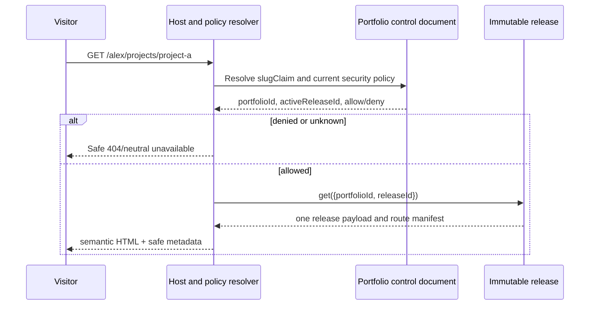

---

## 14. Publication operation records, idempotency and atomic state

### 14.1 Operation envelope

Publishing is an idempotent, versioned workflow. The `publishOperations` record is an internal **workflow journal**; it does not make several Mongo documents atomically consistent by itself. Its purpose is to identify a retry, report observable status, support reconciliation and avoid duplicate release activation.

```ts
type PublishStage =
  | "received"
  | "validating"
  | "preparing"
  | "prepared"
  | "activating"
  | "activated"
  | "propagation_pending"
  | "completed"
  | "failed_retryable"
  | "failed_terminal";

interface PublishOperation {
  operationId: string;
  portfolioId: PortfolioId;
  ownerAccountId: AccountId;
  idempotencyKeyHash: string; // keyed hash scoped to portfolio
  requestFingerprint: string; // revision + normalized accepted request
  draftRevision: number;
  expectedPreviousReleaseId: ReleaseId | null;
  stage: PublishStage;
  preparedReleaseId?: ReleaseId;
  activatedReleaseId?: ReleaseId;
  attemptedAt: string;
  updatedAt: string;
  finishedAt?: string;
  retryAfter?: string;
  errorCode?: string; // no private content in failure fields
  attemptCount: number;
  lease?: { owner: string; until: string; fencingToken: number };
}
```

The **same** `(portfolioId, idempotencyKeyHash)` with the **same** canonical request fingerprint MUST return the same operation/release outcome, including after a timeout. Reuse with a different payload is a conflict, not an invitation to replace the existing journal. Hash externally supplied keys before persistence. Keys should have bounded length and entropy; they are not authentication credentials and never grant access without an authenticated owner session.

### 14.2 Prepare -> insert -> activate ordering

1. Authorize owner, account and portfolio status; confirm expected draft revision.
2. Record or load a scoped operation; if it exists, compare request fingerprint and resume/report state.
3. Read exactly the revision promised by `If-Match` and compile a normalized snapshot.
4. Insert a release with unique operation and release identifiers, unique `(portfolioId, sequence)` as appropriate, and immutable payload. Handle duplicate-key errors as expected idempotency outcomes, not unexpected 500s.
5. Verify the release readback and its fully ready required artifacts.
6. Atomically update the **single portfolio control document** only if the owner, status, previous active pointer and publish generation still match. Set `activeReleaseId`, increment the successful publish sequence and record `lastActivatedOperationId` (or equivalent). If the pointer changed, return a conflict or match the already activated same operation.
7. Update the operation journal to `activated/propagation_pending` and trigger best-effort cache invalidation and AI knowledge preparation.
8. On repeated calls, inspect authoritative pointer and operation ID before trying activation again. Never insert a second successful release for one idempotency key.
9. Trim old releases and media only when reference safety can be proven.

**Important concurrency refinement:** Merely inserting a prepared release with `sequence = oldSequence+1` can race with another publish. Prefer a reserved operation ID and an unambiguous activation generation or store `sequence` on successful activation. The data model must specify how a prepared release's `sequence` is finalized without mutating public payload. One practical approach is to reserve sequence/generation through an atomic compare-and-set on the portfolio and bind exactly one operation to that generation; another is to store sequence in a separate activation ledger record, not in an otherwise immutable release. Both preserve the single public pointer. The chosen implementation MUST document a crash-safe sequence allocation algorithm and verify it under concurrent publications rather than asserting that MongoDB's unique index alone resolves it.

### 14.3 Compare-and-activate pseudocode

```ts
// Conceptual only. All inputs have been authenticated and validated.
async function activatePreparedRelease(command: ValidatedPublishCommand) {
  const prepared = await releaseRepo.findPrepared(
    command.portfolioId,
    command.operationId,
  );
  if (!prepared || !prepared.artifactsReady) return { kind: "not-ready" };

  const result = await portfolioRepo.compareAndSet({
    portfolioId: command.portfolioId,
    ownerAccountId: command.actorId,
    expectedActiveReleaseId: command.expectedPreviousReleaseId,
    expectedSecurityVersion: command.expectedSecurityVersion,
    expectedPublishGeneration: command.expectedPublishGeneration,
    operationId: command.operationId,
    newActiveReleaseId: prepared.releaseId,
  });
  if (result.kind === "conflict") return reconcilePointerOrConflict(command);
  await operations.markActivatedIdempotently(
    command.operationId,
    prepared.releaseId,
  );
  return { kind: "activated", releaseId: prepared.releaseId };
}
```

The pointer's compare-and-set is the **linearization point** for public content, not the journal update or cache purge. The current security state is evaluated in this conditional write; for example, an owner blocked between compilation and activation cannot activate a release after suspension. The result is carefully distinguished from propagation completion and from successful AI context preparation.

### 14.4 Crash and retry matrix

| Interruption                          | Durable truth                            | Safe next action                                                  | Forbidden action                              |
| ------------------------------------- | ---------------------------------------- | ----------------------------------------------------------------- | --------------------------------------------- |
| Before operation insert               | No operation                             | Create operation and validate                                     | Assume publication succeeded                  |
| Journal inserted, compile not started | Pending journal                          | Resume with same fingerprint                                      | Allocate new unrelated idempotency operation  |
| Compilation fails                     | Old active release                       | Record field-specific rejection; owner may fix draft              | Activate incomplete payload                   |
| Release inserted, pointer not updated | Prepared orphan                          | Resume conditional activation or GC after lease/reconciliation    | Serve prepared release publicly               |
| Pointer updated, journal not updated  | New active release                       | Recover by pointer/operation marker and repair journal            | Create second release or roll back implicitly |
| Cache revalidation fails              | New active release                       | Report propagation pending, retry idempotently                    | Report publication as never committed         |
| AI snapshot fails                     | New active release                       | Keep AI unavailable; retry on authorized action                   | Use older release knowledge                   |
| Pruning fails                         | New active release + extra retained data | Reconcile safely                                                  | Delete all old media blindly                  |
| Owner disables during publish         | Live policy denies                       | Abort activation if not yet activated; suppress if already active | Return public page without live gate          |
| Owner deletes account during publish  | Deletion policy denies                   | Stop operations, run deletion journal                             | Recreate portfolio from stale task            |

### 14.5 Background work without an assumed durable queue

Publication retries, AI snapshot compilation, RSS refreshes, media cleanup and contact retention may use on-demand requests, bounded scheduled invocations, or short-lived tasks. No always-on worker or message broker is required by the product. Each operation needs a persisted state marker and idempotent resumption only if it must survive a serverless process ending. Avoid describing a fire-and-forget promise as reliable: serverless request completion may terminate in-memory work. If no scheduler exists, the operator can invoke authorized maintenance endpoints and owners can use the safe Recheck Publication action. Retention tasks must be demonstrably executable within permitted platform limits.

---

## 15. Media storage metadata, upload reservations and quota accounting

### 15.1 Media object is not a public URL

Image and PDF bytes are never stored inside MongoDB document fields or as base64 inside a release. MongoDB stores an opaque logical `mediaId` with ownership, safe type metadata, content hash, lifecycle state and references to storage-provider object keys. Object storage is assumed untrusted until verified. The application database is the authority for ownership and allowed public use. A tenant prefix in a storage path is organizational only; it does not replace access checks [S10, S18].

```ts
type MediaState =
  | "intent_issued"
  | "uploading"
  | "quarantined"
  | "processing"
  | "ready_private"
  | "ready_public"
  | "deletion_pending"
  | "deleted"
  | "rejected";

interface MediaAsset {
  mediaId: MediaId;
  portfolioId: PortfolioId;
  uploadedByAccountId: AccountId;
  state: MediaState;
  kind: "image" | "resume_pdf";
  originalNameDisplay?: string; // optional sanitized display label, never a key
  declaredMimeType: string;
  verifiedMimeType?: string;
  bytesOriginal?: number;
  sha256?: string;
  image?: { width: number; height: number; orientationApplied: boolean };
  pdf?: { parseOk: boolean; pageCount?: number; aiExtractionAllowed: boolean };
  stagingKey?: string; // private, internal, never generic public response
  verifiedOriginalKey?: string; // private until publication policy permits serving
  variants: Array<{
    kind: string;
    objectKey: string;
    bytes: number;
    sha256: string;
  }>;
  createdAt: string;
  verifiedAt?: string;
  publishedAt?: string;
  deleteRequestedAt?: string;
  rejectionCode?: string;
  schemaVersion: number;
}
```

**Size constants:** per-portfolio original media <= 15 MiB; 30 originals; per-image upload <= 1 MiB; PDF <= 2 MiB; dimensions <= 4096 x 4096. The 15 MiB user quota is not the global physical storage allowance; derived image variants, old staged objects, retries and provider overhead count against actual infrastructure usage. These limits must be enforced when issuing an upload intent and again when finalizing the object after reading the true bytes. Client-declared sizes are estimates, not authority. The hard no-charge global limit takes precedence, even if the owner has free nominal quota remaining.

### 15.2 Reservation-based admission

The media quota data model uses an independently scoped **reservation** so concurrent browser tabs cannot each spend the same allowance. Before returning a short-lived upload capability, the service checks the owner, MIME allowlist, count and bytes, then performs an **atomic conditional update on a quota aggregate**. The aggregate includes confirmed originals plus outstanding reservations. The global aggregate must also be checked or reserved using a crash-safe admission algorithm; a best-effort global counter alone cannot prevent oversubscription when multiple uploads race.

```ts
interface UploadReservation {
  reservationId: string;
  portfolioId: PortfolioId;
  accountId: AccountId;
  mediaId: MediaId;
  intendedKind: "image" | "resume_pdf";
  claimedBytes: number;
  quotaBytesReserved: number;
  state:
    | "reserved"
    | "capability_issued"
    | "finalizing"
    | "committed"
    | "released"
    | "expired";
  createdAt: string;
  expiresAt: string;
  idempotencyHash: string;
}
interface QuotaBucket {
  bucketId: string; // e.g. portfolio:<id> or global:media
  committedBytes: number;
  reservedBytes: number;
  committedOriginalFiles: number;
  reservedOriginalFiles: number;
  capacityBytes: number;
  capacityFiles?: number;
  revision: number;
  updatedAt: string;
}
```

If two independent quota documents must be reserved without multi-document transactions, use an ordered prepare/commit saga with a bounded lease and compensation. **Never rely on two unrelated increments as a globally atomic admission operation.** A simpler early-release design can serialize intent creation through one global bucket and then verify the portfolio bucket before issuing a capability; it must compensate reservations on failure and reject if reconciliation confidence is lost. For 100-500 portfolios, a global serialized upload-admission boundary is an acceptable bottleneck. A permanent queue is not required. The selected algorithm must be documented with retry cases and concurrent tests before production.

**Reservation invariants:** reservation has exactly one owner and media; expiration cannot release quota for an upload already finalized; finalize cannot create a second original file on replay; a previously reserved media ID cannot be rebound to a new portfolio; committed quota reflects verified actual bytes, not the client claim. If actual bytes exceed reserved bytes, finalization fails safely and quarantine is removed after verified cleanup. If fewer bytes are written, release the unused reservation. A state reconciler checks expired leases and orphaned objects without relying on a clock-perfect Mongo TTL thread.

### 15.3 Secure object keys and promotion

Generated keys use server-owned opaque segments such as `staging/<opaque-reservation>/<opaque-random-key>` and `media/<opaque-portfolio-id>/<opaque-media-id>/<variant-name>`. Names never come from an uploaded filename, a request path or a client-supplied absolute URL. Signed upload capabilities must bind permitted operation, key, content length and expiration when the storage provider supports them; otherwise route upload through a validated bounded server endpoint. The exact provider capability is a launch feasibility gate.

Promotion to `ready_private` follows server verification of actual bytes, magic signature, format parsing, decompression bounds, image re-encoding and metadata removal. Uploaded PDFs require structural checks and conservative viewing behavior; successful parsing is **not** a malware-free guarantee [S18]. Raw and quarantined objects are not publicly servable. Public release references may use a verified media ID only after it is in a publishable state. Serving bytes directly from a public object URL is permitted only for immutable published variants that pass the public policy; secure/private documents require gated access and a practical revocation story.

### 15.4 Media reference ownership and garbage collection

A media item can be referenced by the current draft, one or more of three retained published releases and in-flight publication preparations. Do not delete it while any authoritative reference exists. The operation should collect **live references** from durable known sources, not depend exclusively on a possibly stale `referenceCount` field. A stored count is an optimization or reconciliation aid; it is not the sole deletion criterion.

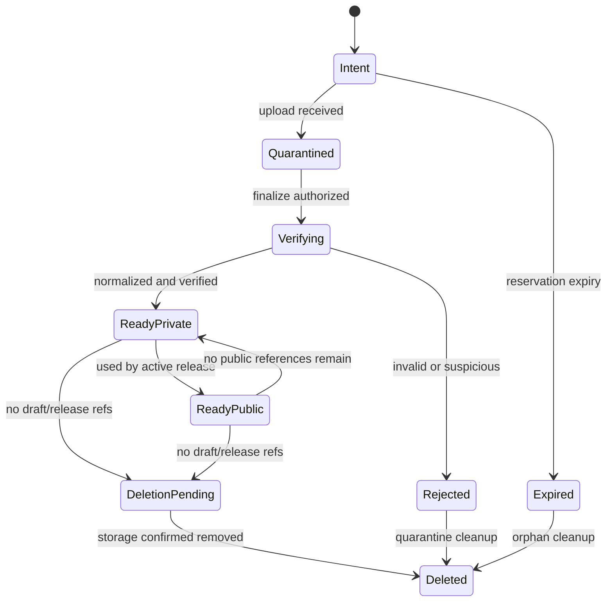

Deletion of old images should be batched and idempotent: mark pending -> exclude from new bindings -> verify references -> delete specific provider keys -> confirm disappearance where possible -> delete/tombstone metadata -> reconcile quotas. If deletion fails, retain pending metadata and retry; do not falsely report reclaimed capacity. If metadata is deleted before the provider object, orphaned bytes could accumulate indefinitely and create global quota exhaustion.

### 15.5 PDFs and AI-approved extraction

A public resume can be intentionally published without automatically authorizing its entire text for Gilden. The owner must separately approve extracted sections or a curated redacted extraction. The full extracted text is **private derived data by default**. Referenced individuals' phone numbers, emails and private addresses must not enter AI context simply because they appear on the PDF. A document-specific AI consent does not eliminate need for redaction and field-level approval. If redaction cannot be verified reliably, offer owner-reviewed excerpts instead of automatic full-document knowledge. Bound parsing time, page count, output characters and CPU to resist decompression/parser abuse. The source PDF remains hosted in storage; AI receives only approved derived text.

### 15.6 Media failure table

| Failure                            | Database effect                           | Client or operator effect               | Privacy guarantee                   |
| ---------------------------------- | ----------------------------------------- | --------------------------------------- | ----------------------------------- |
| Quota limit reached                | No new reservation                        | Explicit quota message                  | Existing objects unaffected         |
| Staging upload aborts              | Reservation eventually released           | Retry or restart intent                 | Staging never public                |
| Signature/format fails             | `rejected` and cleanup task               | Safe 422; no preview                    | Unverified bytes not served         |
| Provider returns ambiguous success | Re-read exact key and hash                | Reconcile, no blind duplicate           | Ownership unchanged                 |
| Image variant generation fails     | Preserve original verified private object | Retry or reject publication if required | No raw unsafe fallback              |
| Published asset removal requested  | Reference check rejects                   | Show dependent releases                 | Never break restorable releases     |
| Object delete fails                | Pending metadata retained                 | Retry or operator action                | Do not claim hard deletion complete |
| Entire object store unavailable    | Draft text remains readable               | Existing public media may fail          | No unverified alternative provider  |

---

## 16. Gilden knowledge, consent and immediate revocation

### 16.1 Purpose-built approved context

Gilden is not an authorization bypass for the public release. Its knowledge is an explicitly approved, release-bound **derived record** generated from the same public content and controlled by independent AI consent. It must not receive a raw draft, full MongoDB document, contact inbox, provider identity, session, moderation notes or hidden references. An owner can publish a field for human visitors but deny AI access to it. A public contact email is not automatically chat knowledge. In the initial release the visitor experience is English-only, does not require login and does not persist messages.

```ts
interface AIApprovalPolicy {
  portfolioId: PortfolioId;
  enabled: boolean;
  policyVersion: number; // monotonic; live authority
  approvedSectionIds: string[];
  approvedFieldIds: string[];
  deniedFieldIds: string[]; // deny wins over any section approval
  approvedDocumentExtractIds: string[];
  deniedSourceIds: string[];
  updatedByAccountId: AccountId;
  updatedAt: string;
}
interface AIContextSnapshot {
  contextId: string;
  portfolioId: PortfolioId;
  releaseId: ReleaseId;
  approvalPolicyVersion: number;
  contentHash: string;
  status: "preparing" | "ready" | "invalidated" | "failed";
  sources: Array<{
    sourceId: string;
    kind: "profile" | "section" | "content_item" | "approved_document" | "faq";
    contentId?: ContentId;
    approvedText: string;
    citationTarget: string; // validated relative/public canonical target
    sourceVersion: number;
  }>;
  createdAt: string;
  expiresAt?: string;
}
```

The context compiler performs **positive selection** from public release fields. Its output structure must have no unknown keys, no implicit fallback to full section JSON, a bounded token/character budget, and an explicit source-to-citation map. A missing approval record means deny, including when a section had previously been approved but newly added custom fields appear. Data classification and approval must be applied to every nested field and embedded collection item. OWASP recommends establishing authorization on every object and property; a prompt instruction cannot replace that control [S08, S09, S21, S31].

### 16.2 Context readiness and release matching

A public AI request reads: (1) verified portfolio resolved by host/slug/ID; (2) live status and moderation; (3) AI enabled/revocation version; (4) currently active `releaseId`; (5) matching ready AI context. Context `(releaseId=R1, policyVersion=7)` is ineligible if the active release is `R2` or the live approval policy is version 8. The chatbot must display an unavailable state rather than use stale, over-broad information. This rule applies on every turn, including each turn of a continued ephemeral browser session.

A release may become active before context compilation finishes; the portfolio still renders, while Gilden stays unavailable until the matching snapshot becomes `ready`. A failure of Groq or Redis must not disable navigation, publishing or editing. When Redis cannot enforce budget limits, default deny new paid-provider requests instead of permitting uncontrolled usage. Provider usage counters are a safety control, not an owner-configurable entitlement.

### 16.3 Immediate revocation is separate from context deletion

When an owner disables Gilden or revokes a field, the service atomically changes the live policy version and denied-source set **before** acknowledging success. Any stale context becomes invalid by version mismatch even if background deletion or cache invalidation is delayed. Moderation-driven AI revocation is also authoritative. Every request re-checks the live version just before dispatching content to the provider.

**In-flight requests:** an inference request that already sent context to an external model before revocation cannot retroactively remove information from that provider. Define an explicit cutover: no _new_ inference may use a revoked field after the server acknowledges revocation; active streams should be cancelled when detectably affected, but post-send erasure cannot be guaranteed. The owner's UI and privacy notice should not promise physically instantaneous recall of already transmitted data. Avoid logging raw AI requests and model completions; use aggregate counts and reason codes only.

### 16.4 Citation integrity

Citation targets are generated from the approved, active release's route manifest. The model returns permitted source IDs, not unconstrained URLs. The server maps those IDs to verified route or section anchors, enforces a maximum citation count, and ignores unsupported sources. External article links are cited only if their metadata is approved and link URLs pass the public-link allowlist. A citation to an unlisted-but-published section is allowed only within that same owner's public link-accessible portfolio and subject to AI approval. A suppressed project cannot be cited even if its old URL still exists on a cached result.

### 16.5 Anonymous quotas and ephemeral chat

Use short-lived random anonymous session IDs for the 15-message/visitor/day default and independent portfolio/global quotas. IDs are not a basis for recognizing a visitor across long periods or linking to analytics. Coarse, trusted-edge IP-based abuse checks may supplement the quotas; no IP-derived permanent profile is required. Store counter expiration in Redis and handle failure as a controlled unavailable state. Chat bodies are never inserted into MongoDB, logs, analytics events or audit trails by default.

There is a distinction between the platform not **persisting** visitors' chat bodies and the provider **processing** them to answer the request. Any visitor may type personally identifying content into a message; it will necessarily be transmitted to the inference provider during processing. GildedIn must not solicit identity information, should display an appropriate warning, minimize exposure and disclose actual external processing. It cannot honestly claim that no visitor information ever leaves the browser under all circumstances.

### 16.6 AI context threat/data test cases

| Scenario                                           | Data-layer expected result                                            |
| -------------------------------------------------- | --------------------------------------------------------------------- |
| Public approved project A and hidden project B     | Only A is eligible for context                                        |
| Section approved, new `phone` custom field added   | New field denied by default                                           |
| Publication R2 active, context R1 ready            | AI unavailable, no fallback to R1                                     |
| Owner denies source during chat                    | Next call denied; in-flight stream cancelled where possible           |
| Source link not in release manifest                | Citation rejected                                                     |
| Provider logs expose private reference             | Release blocker; context leak investigation                           |
| Groq or Redis unavailable                          | AI disabled for request; public portfolio unaffected                  |
| AI hallucinated URL                                | Server refuses arbitrary URL; valid source mapping only               |
| Prompt injection appears inside approved biography | Treat as untrusted data, do not let it issue system commands          |
| Anonymous chat includes email address              | Do not persist/store in analytics; provider-processing notice applies |

---

## 17. Moderation, publication visibility and privileged access

### 17.1 Orthogonal status dimensions

A portfolio has separate **ownership/account status**, **portfolio operational status**, **visibility/discovery**, **current release pointer**, **AI enabled state** and **moderation policy**. These dimensions must not be squeezed into one ambiguous `status` string. For example, unlisted still has an active public release, while owner-disabled is inaccessible independent of release contents. Draft means an unpublished representation and is not a visibility state for a public release.

| Dimension                    | Owner             | Source                                | Meaning                                       |
| ---------------------------- | ----------------- | ------------------------------------- | --------------------------------------------- |
| Account status               | IAM               | `accounts.status`                     | Can authenticate and manage data              |
| Portfolio operational status | Portfolio control | `portfolios.status`                   | Can display/edit/publish                      |
| Public discovery             | Owner/policy      | `portfolios.visibility`               | Public versus unlisted directory/index policy |
| Active published version     | Publisher         | `portfolios.activeReleaseId`          | Which immutable snapshot is current           |
| AI permission                | Owner/security    | `portfolios.aiAccess` / policy        | Current sources allowed for inference         |
| Moderation                   | Admin             | `moderationPolicies` + control mirror | Whole-site or item-level suppression          |

### 17.2 Authoritative moderation record

```ts
interface ModerationPolicy {
  policyId: string;
  portfolioId: PortfolioId;
  scope: "portfolio" | "content_item" | "route" | "media" | "ai";
  targetId?: string;
  effect: "deny_public" | "deny_ai" | "quarantine" | "suspend";
  reasonCode:
    | "impersonation"
    | "phishing"
    | "malware"
    | "harassment"
    | "policy_violation"
    | "other";
  issuedByAdminAccountId: AccountId;
  active: boolean;
  issuedAt: string;
  liftedAt?: string;
  expiresAt?: string;
  securityVersion: number;
  internalNoteRef?: string; // private, not exposed to visitors
}
```

A content-specific restriction is kept separately from the immutable release. Public rendering removes or masks the restricted item and all dependent navigation/search/AI references. The editor can show a restricted view with a safe explanation to the owner; it does not rewrite the published snapshot to disguise what was originally published. Admin action must be recently authenticated, explicitly authorized, auditable and non-overridable by portfolio owners. A pending admin operation cannot be marked done if the authoritative public gate still permits the unsafe content.

### 17.3 Race against cached responses

Caching immutable data is safe for ordinary content versioning; **caching permission as an eternal true value is not**. Cache keys for public artifacts must include tenant/release when applicable. A moderation version token can assist invalidation, but a user-facing `cache-control` header alone is not guaranteed revocation. Define the exact middleware/server gate that checks current deny policy before a cached payload can be returned; verify behavior for apex paths, wildcard subdomains, detail routes, SEO metadata, images and Gilden. If the provider's CDN architecture cannot enforce a live deny before serving a full-page static cache, that delivery architecture is unsuitable for unrestricted public user-authored content requiring immediate suppression. This is a feasibility condition, not a hypothetical resolved feature.

### 17.4 Abuse reports and appeals

```ts
interface AbuseReport {
  reportId: string;
  reportedPortfolioId: PortfolioId;
  reportedContentId?: ContentId;
  publicRoute?: string;
  reason: "impersonation" | "phishing" | "malware" | "harassment" | "other";
  description?: string; // bounded, sanitized, no required identity
  status: "new" | "under_review" | "resolved" | "dismissed";
  createdAt: string;
  reviewedBy?: AccountId;
  reviewedAt?: string;
  resolutionCode?: string;
  expiresAt: string;
}
```

Reports are anonymous and accept no required visitor identity. They contain potentially defamatory or sensitive free text; store separately from public content, bound size, and restrict access to administrators. Reports are not automatically treated as proof of wrongdoing. Public status pages must not expose reporter text, moderators' identities, investigation notes or sensitive actor identifiers. A simple owner appeal path must exist for suspended portfolios, but a full ticketing/CRM system is not required.

### 17.5 Platform administrator boundary

Admin roles are provisioned through an explicit trusted deployment process and verified from current server-side account state. They are not assigned by matching an email address, being first to register, a GitHub organization name or a client-supplied role. Administrative writes carry actor account ID, reason code, target and request ID. Permissions to view an abuse report do not imply permission to extract raw tenant data; actions should be scoped to their purpose. Cross-tenant administrative access must have its own route, policy and audit record, rather than using tenant methods with omitted predicates.

---

## 18. Owner-only contact inbox and visitor privacy

### 18.1 Contact submission record

```ts
interface ContactMessage {
  messageId: string;
  portfolioId: PortfolioId;
  receivedAt: string;
  expiresAt: string; // receivedAt + 30 days
  sender: { name: string; email: string; organization?: string };
  subject?: string;
  body: string;
  consentNoticeVersion: string;
  status: "new" | "read" | "flagged" | "deleted";
  antiAbuse: { decisionCode: string }; // not the sender's raw IP or fingerprint
}
```

The initial contact form is text-only, with no attachments or contact-to-AI transcript forwarding. The visitor explicitly submits identity information in this separate workflow; it is not a continuation of Gilden. The inbox is accessible only to the portfolio owner and a narrowly authorized platform administrator for abuse/security needs. Public APIs always omit sender and message content. An owner may export a contact message before expiry outside the platform, subject to responsibility for their own use of the information.

The data model must not embed unbounded contact messages inside the portfolio control document or immutable releases. Contact submissions have their own collection, private pagination and TTL. The form cannot be abused as an unauthenticated write channel without limits, spam checks, size caps and abuse response. Because there is no visitor account, a contact submission does not automatically confer a durable authenticated identity. Avoid storing raw visitor IPs as permanent contact records; short-lived abuse controls can operate separately.

### 18.2 Lifecycle and retention

- At insertion, server verifies that the portfolio is active and accepting contact; validates field bounds, consent notice version and any challenge result.
- Store only necessary text and minimal anti-abuse outcome, with fields escaped on read and rendered as text, never HTML.
- Owner can mark read/delete; deleting the message is an authenticated single-record operation scoped by portfolio.
- Expiration is checked at read time (`expiresAt > now`) and regularly cleaned by TTL or maintenance. TTL is **not** immediate deletion and must not be described as such [S05].
- Account deletion removes inbox access immediately and launches deletion of all messages for that owner.
- Plaintext message content is never included in error logs, metrics, backup test fixtures or analytics.

### 18.3 Optional public contact identity

An owner may separately publish approved contact links or a public email, but contact inbox records are never eligible for release compilation. Reusable `Contact` content fields can be visible publicly while excluded from AI through their independent approval flags. Reference contacts are private by default and must not become public merely through an inherited collection-level visibility setting.

---

## 19. Aggregated analytics, owner statistics and lightweight directory

### 19.1 Analytics data contract

The initial system collects low-granularity, privacy-conscious **aggregate** events. It does not maintain personal visit histories, replay sessions, advertising profiles, invasive geolocation or persistent cross-site visitor tracking. Page views, project clicks and outbound-link interactions can be counted in time buckets. A tenant can optionally publish aggregate statistics through an approved block; aggregate visibility is owner-controlled and is never equivalent to publishing raw request logs.

```ts
interface AnalyticsDaily {
  portfolioId: PortfolioId;
  day: string; // UTC YYYY-MM-DD
  metricKey:
    | "page_view"
    | "project_click"
    | "outbound_click"
    | "ai_start"
    | "ai_success"
    | "ai_unavailable";
  targetId?: string; // bounded current published source ID
  count: number;
  updatedAt: string;
}
```

Event ingestion validates the event type and a bounded target ID against an eligible public release. It does not accept arbitrary collection names, unbounded labels or URLs to turn them into high-cardinality metric keys. De-duplication and bot controls may use short-lived ephemeral signals, but the resulting persisted record is an aggregate count. Counts are approximate unless infrastructure can afford strong deduplication; the owner UI should say so.

### 19.2 Counter safety and public opt-in

Use atomic `$inc` on a unique bucket key or an equivalent Redis accumulator with bounded flushes. A database-only atomic counter is simplest for low traffic but must be guarded against amplification: per-event rate limiting, maximum event size and origin/referrer heuristics should apply. Incrementing unbounded metrics on every asset load would consume free database write allowance; track only selected interactions. Public statistics are compiled into the release or loaded through an explicitly privacy-safe public aggregate endpoint only when the owner has enabled them. Disabling public statistics must immediately prevent newly requested public aggregate reads; outdated cached widgets may require targeted invalidation and a realistic propagation statement.

### 19.3 Directory read representation

A searchable directory needs a bounded `directoryEntry` projection for **eligible** published, public, not suspended, explicitly discoverable portfolios. This may be embedded as a small public field on `portfolios` or be a separate derived collection if index/performance evidence warrants it. Recommended projection: portfolio ID, canonical slug, display name, professional role, approved excerpt, approved thumbnail ID, featured flag, and published update date. It must never include account email, linked provider subject, contact inbox, unpublished projects, or moderation notes.

```ts
interface DirectoryEntry {
  portfolioId: PortfolioId;
  canonicalSlug: string;
  displayName: string;
  roleLabel: string;
  preview: string;
  thumbnailMediaId?: MediaId;
  featured: boolean;
  activeReleaseId: ReleaseId;
  updatedAt: string;
}
```

The homepage shows curated featured examples plus basic keyword filtering. Avoid creating a global recommendation graph, personalized ranking system or complex search service. Directory inclusion must be derived from a current eligibility policy, not solely from a static release flag; unlisting or suspension should suppress immediately. Results are bounded and paginated. Owner search within one published portfolio is a separate artifact (next section).

---

## 20. RSS/Medium metadata, SEO and per-release search indexes

### 20.1 External feed as a bounded cache, not trusted source

```ts
interface ExternalFeed {
  feedId: string;
  portfolioId: PortfolioId;
  kind: "medium_username" | "rss_url";
  configuredSource: string; // normalized, sanitized, owner-only
  enabled: boolean;
  etag?: string;
  lastModifiedHeader?: string;
  lastAttemptAt?: string;
  lastSuccessAt?: string;
  lastErrorCode?: string;
  previews: Array<{
    externalId: string;
    title: string;
    excerpt: string;
    canonicalUrl: string;
    publishedAt?: string;
    thumbnailMediaId?: MediaId; // only verified local asset if present
  }>;
}
```

One primary RSS/Medium feed is supported initially, plus manually authored article links. The feed's response is **untrusted remote input**, not part of the database's trusted schema. Extract only title, excerpt, canonical URL, publication date and safe thumbnail metadata, with bounded lengths/item count. Do not ingest full external articles as Gilden knowledge. Store a bounded cache so an external feed outage does not break previously published pages. A feed refresh updates a draft/cache input, not the current release directly; a new publication is required to change content included in the immutable release. This avoids a public page that is nominally versioned but silently changes when RSS refreshes.

The fetch adapter needs SSRF defense including scheme validation, DNS resolution checks, redirect revalidation, connection-time restriction to validated public IPs, timeouts, response size limits and XML parser protections [S16]. If the chosen runtime cannot enforce those constraints reliably, turn off automatic fetching and accept owner-provided metadata/manual links rather than weakening SSRF defenses. `etag` and `lastModifiedHeader` are untrusted origin metadata and must never become arbitrary request headers without validation.

### 20.2 SEO artifact

SEO objects are derived only from published, permitted values. The route manifest is authoritative for path existence. Public canonical URLs must be generated from the platform's known URL rules and the canonical current slug, not from arbitrary owner-input strings. Subdomains retain the visitor's navigation host but use the path-based canonical URL initially.

```ts
interface PublicSEOArtifact {
  portfolioId: PortfolioId;
  releaseId: ReleaseId;
  canonicalBase: string; // from platform policy, not arbitrary input
  pages: Array<{
    routeKey: string;
    title: string;
    description: string;
    canonicalPath: string;
    ogMediaId?: MediaId;
    robots: "index,follow" | "noindex,nofollow";
    structuredDataType?: string;
  }>;
}
```

Sitemaps include eligible canonical published pages only; no draft, unlisted, suspended or moderated content. `robots.txt` and `noindex` are discovery hints, not access controls. Generated JSON-LD must be serialized with safe escaping in HTML contexts, including script-ending sequences, and may describe only published facts. Owner-edited title/description are plain strings and remain subject to length and content policy checks. Project detail pages get per-project Open Graph and canonical metadata where a published route exists.

### 20.3 Public search index

Search is intentionally small enough to build from an immutable release and query client-side. The artifact contains source IDs, public labels, bounded normalized terms, route targets and field-approved snippets. Hidden, private, unlisted-from-discovery, AI-denied or moderated fields do not enter an inappropriate search surface. **AI-denied is not necessarily search-denied**, because AI and search approvals are separate; search includes only fields whose own public search setting permits inclusion.

```ts
interface PublicSearchArtifact {
  portfolioId: PortfolioId;
  releaseId: ReleaseId;
  schemaVersion: number;
  documents: Array<{
    sourceId: string;
    title: string;
    type: "project" | "skill" | "experience" | "publication" | "custom";
    route: string;
    tokens: string[];
    excerpt: string;
  }>;
}
```

Every route and token set must be validated against the same release. Indexing is client-side over data that is **already public**, not a reason to expose hidden data. Total artifact size must remain bounded relative to the 100 KiB release. An ordinary request should download the search artifact only when a visitor opens portfolio search, not on every page load. Caches key on portfolio+release, with a separate live visibility gate.

### 20.4 Data lineage diagram

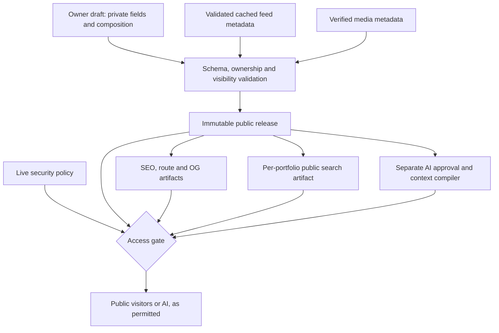

---

## 21. MongoDB indexes, uniqueness, query contracts and performance

### 21.1 Index design principles

MongoDB indexes are expensive shared resources on a free cluster. Create an index only when justified by a documented query, uniqueness invariant, TTL lifecycle, or bounded sort. Unique indexes are integrity constraints; do not assume an application-level `findOne()` followed by `insertOne()` prevents a registration or slug race. Compound indexes follow query predicate and sort patterns, with equality fields usually preceding range/sort fields as appropriate [S02, S03, S04]. Partial unique indexes apply uniqueness only to documents matching their filter, so never use them when historical aliases must remain reserved [S03].

The initial database uses a small global set of collections shared by all portfolios. User-created content collection names, field names and schema labels **must never** become Mongo collection names or index paths. Dynamic user fields do not automatically create indexes. A user's 20-item collection is accessed as part of an owned bounded draft/release; building a compound index for every tenant field would be wasteful and risky.

### 21.2 Proposed index inventory

The following is an **implementation proposal** to be reconciled with actual read/write profiling and the selected MongoDB tier. `_id` indexes already exist and are not duplicated unnecessarily. Omit optional analytics/directory indexes until their query plans are established. `expireAt` uses a BSON Date (not a string) with a TTL index `expireAfterSeconds: 0` where appropriate [S05].

| Collection           | Index                                               | Unique?                 | Query or invariant                       | Risk/caveat                                                     |
| -------------------- | --------------------------------------------------- | ----------------------- | ---------------------------------------- | --------------------------------------------------------------- |
| `accounts`           | `accountId:1`                                       | Yes                     | Resolve internal account and role        | `_id=accountId` could replace this index                        |
| `providerIdentities` | `provider:1,providerSubject:1`                      | Yes                     | OAuth subject cannot map to two accounts | Provider-subject normalization is critical                      |
| `providerIdentities` | `accountId:1`                                       | No                      | List linked providers for owner          | Must authorize account first                                    |
| `sessions`           | `sessionLookupId:1`                                 | Yes                     | Fast split-token verification            | Store only hash/verifier derived secret                         |
| `sessions`           | `expiresAt:1`                                       | No, TTL                 | Expire stale sessions                    | Authorization checks expiry now, not TTL later                  |
| `portfolios`         | `portfolioId:1`                                     | Yes                     | Public and owner control                 | Can use `_id` if canonical IDs map directly                     |
| `portfolios`         | `ownerAccountId:1`                                  | Yes initially           | One owned portfolio/account              | Revisit for multiple portfolios with explicit ADR               |
| `slugClaims`         | `slugNormalized:1`                                  | Yes, always             | Exclusive current+alias namespace        | Do NOT use `kind=current` partial unique                        |
| `slugClaims`         | `portfolioId:1,kind:1`                              | No                      | Find owner's claims and current claim    | Separate invariant: only one current claim/portfolio            |
| `drafts`             | `portfolioId:1`                                     | Yes                     | One bounded revisioned draft             | Prefer `_id=portfolioId` where practical                        |
| `releases`           | `portfolioId:1,sequence:-1`                         | Yes                     | Three newest successful releases         | Sequence assignment must be crash-safe                          |
| `releases`           | `portfolioId:1,releaseId:1`                         | Yes or inherent via IDs | Resolve public release with tenant scope | Global releaseId uniqueness alone is insufficient authorization |
| `publishOperations`  | `portfolioId:1,idempotencyKeyHash:1`                | Yes                     | Retry journal lookup                     | Same key/different body must conflict                           |
| `mediaAssets`        | `portfolioId:1,state:1`                             | No                      | Bounded owner asset listing/cleanup      | Cross-tenant lookups never omit portfolio ID                    |
| `uploadReservations` | `reservationId:1`                                   | Yes                     | Finalize exact reservation               | Staged media bound to one portfolio                             |
| `uploadReservations` | `expiresAt:1`                                       | No, TTL                 | Cleanup expired intents                  | Must reconcile allocated quota separately                       |
| `aiContexts`         | `portfolioId:1,releaseId:1,approvalPolicyVersion:1` | Yes                     | Version-matched context                  | Revoked contexts still not eligible                             |
| `contactMessages`    | `portfolioId:1,receivedAt:-1`                       | No                      | Owner inbox descending                   | Compound index costs storage; validate workload                 |
| `contactMessages`    | `expiresAt:1`                                       | No, TTL                 | 30-day retention                         | Read-time expiry check still required                           |
| `analyticsDaily`     | `portfolioId:1,day:1,metricKey:1,targetId:1`        | Yes                     | Atomic aggregate bucket                  | Avoid unbounded target cardinality                              |
| `moderationPolicies` | `portfolioId:1,active:1`                            | No                      | Live moderation lookup                   | Control mirror needed for fast whole-site deny                  |
| `abuseReports`       | `status:1,createdAt:-1`                             | No                      | Admin review queue                       | No public browsing                                              |
| `auditEvents`        | `expiresAt:1`                                       | No, TTL                 | 90-day cleanup                           | Records not truly tamper-proof on shared DB                     |
| `externalFeeds`      | `portfolioId:1`                                     | Yes initially           | One primary external feed                | Manual links remain embedded content                            |
| `deletionOperations` | `accountId:1,stage:1`                               | Conditionally           | Resume one active deletion               | Use explicit idempotency before unique partial policy           |

**Potential one-current-claim index:** `(portfolioId, kind)` unique only when `kind='current'` may enforce one current claim per portfolio, but correctness also depends on the order and atomicity of rename steps and whether `kind` has a stable discriminator. A separate index on `(portfolioId, kind)` with partial filter `{kind:'current'}` is feasible as a constraint; it is **not** the global alias reservation index. If rename uses a two-phase lease, the temporary transitional state must be deliberately supported by the uniqueness model and tested. A transaction-capable implementation may simplify this.

### 21.3 Example `mongosh` index declarations

These examples are directly executable _after_ matching collection names and field encodings are established. They do not create or migrate production data and should first be run in an isolated local database. If `portfolioId` is the actual `_id`, avoid redundant single-field indexes; keep compound indexes when warranted.

```javascript
// Selected critical constraints; not a complete production migration.
db.providerIdentities.createIndex(
  { provider: 1, providerSubject: 1 },
  { unique: true, name: "uq_identity_provider_subject" },
);
db.portfolios.createIndex(
  { ownerAccountId: 1 },
  { unique: true, name: "uq_initial_portfolio_owner" },
);
db.slugClaims.createIndex(
  { slugNormalized: 1 },
  { unique: true, name: "uq_slug_current_and_history" },
);
db.drafts.createIndex(
  { portfolioId: 1 },
  { unique: true, name: "uq_single_draft" },
);
db.releases.createIndex(
  { portfolioId: 1, sequence: -1 },
  { unique: true, name: "uq_portfolio_release_sequence" },
);
db.publishOperations.createIndex(
  { portfolioId: 1, idempotencyKeyHash: 1 },
  { unique: true, name: "uq_publish_idempotency" },
);
db.aiContexts.createIndex(
  { portfolioId: 1, releaseId: 1, approvalPolicyVersion: 1 },
  { unique: true, name: "uq_ai_context_version" },
);
db.contactMessages.createIndex(
  { expiresAt: 1 },
  { expireAfterSeconds: 0, name: "ttl_contact_messages" },
);
db.sessions.createIndex(
  { expiresAt: 1 },
  { expireAfterSeconds: 0, name: "ttl_sessions" },
);
db.uploadReservations.createIndex(
  { expiresAt: 1 },
  { expireAfterSeconds: 0, name: "ttl_upload_reservations" },
);
```

**TTL caution:** a TTL index on `uploadReservations` can remove the journal record before the quota bucket is compensated. Production may instead retain the journal in an `expired` state until reconciliation has been executed, then apply a TTL on a separate terminal-state timestamp. Do not blindly create the illustrative TTL index unless the release algorithm has proven that quota cleanup remains correct when the record disappears. More conservative design: a scheduled reconciler marks/resolves expired reservations and only then assigns `purgeAfter` for TTL.

### 21.4 Query contracts by actor and cost

| Query ID                         | Actor               | Predicate shape                                   | Projection                            | Max result | Index/guard                     |
| -------------------------------- | ------------------- | ------------------------------------------------- | ------------------------------------- | ---------- | ------------------------------- |
| Q-01 Account by provider subject | Auth adapter        | provider+subject                                  | accountId; minimal status             | 1          | Unique compound                 |
| Q-02 Owner portfolio             | Authenticated owner | ownerAccountId=actor                              | control public+owner fields allowlist | 1          | Unique owner                    |
| Q-03 Resolve slug                | Public router       | slugNormalized=canonical                          | portfolioId, kind                     | 1          | Unique slug                     |
| Q-04 Read draft                  | Authenticated owner | portfolioId+authorized owner                      | bounded full draft                    | 1          | Unique draft + owner guard      |
| Q-05 Save draft                  | Authenticated owner | portfolioId, expected revision                    | revision and timestamp                | 1 update   | Atomic conditional              |
| Q-06 Public pointer/policy       | Public router       | portfolioId                                       | status, activeReleaseId, policy       | 1          | Control indexed by ID           |
| Q-07 Public release              | Public renderer     | portfolioId, releaseId                            | public payload only                   | 1          | Scoped release lookup           |
| Q-08 List releases               | Owner               | portfolioId                                       | safe release summary only             | 3          | Descending sequence             |
| Q-09 AI context                  | Gilden service      | portfolioId, active release, policyVersion, ready | approved source entries               | 1          | Unique context                  |
| Q-10 Owner inbox                 | Owner               | portfolioId, expiresAt>now                        | bounded safe message DTO              | <=20/page  | Time-sorted index               |
| Q-11 Owner media                 | Owner               | portfolioId                                       | safe media list, no raw object keys   | <=30       | Portfolio+state                 |
| Q-12 Admin pending reports       | Administrator       | status in allowed                                 | restricted moderation DTO             | <=20/page  | Status/date index               |
| Q-13 Public directory            | Visitor             | current eligibility, public, not suspended        | minimal directory entry               | <=20/page  | Derived view; no private fields |

Queries must specify an allowlisted projection and a bounded result size, including admin APIs. `findOne({ _id: request.params.id })` is never a sufficient tenant authorization check for an owner resource. Untrusted user query JSON is never passed as a Mongo predicate. Sorting and pagination are selected from server-owned enumerations, not raw `$sort` expressions. In a document store, an `ObjectId` or UUID is a locator, not a capability to read the object [S08, S10].

### 21.5 Query-plan verification and index budget

Before release: create realistic fixtures for 100, 500 and 1,000 portfolios, including maximum-sized drafts and releases; benchmark the query inventory with `explain('executionStats')` in local/test setups; check indexed reads avoid unintended `COLLSCAN` on large shared collections; inspect key counts and index storage. A collection with 500 tiny documents might be faster scanned than indexed; don't optimize from theory alone. For the production-free database, index write cost, collection count and total storage matter alongside latency. Record every index name and migration checksum, and alert on unexpected index drift. Do not run expensive aggregation or index-building work in a user request path.

### 21.6 Explicitly excluded database mechanisms

- No per-portfolio MongoDB collection, wildcard index on every custom field or unbounded dynamic aggregation from a visitor query.
- No `$where`, server-side JavaScript evaluation, user-supplied aggregation stages or updates, or arbitrary regex from visitor search.
- No automatic sharding, change streams, Atlas Search, data federation or multi-region transactions without a measured need and confirmed free-tier availability.
- No raw files in GridFS; object storage is the selected media boundary subject to zero-charge verification.
- No export of an entire MongoDB document as an API response; always project known DTO fields.

---

## 22. Validation layers, field authorization and injection resistance

### 22.1 Four layers of validation

1. **Transport validation:** methods, content types, raw byte limits, path/host grammar, CSRF and session requirements. Inputs failing here never reach repositories.
2. **Domain validation:** normalized IDs, editable fields, role, tenancy, schema types, nested depth, collection count, block count, selected layout and AI approval rules.
3. **Database safety:** typed internal BSON mapping, collection schema constraints, unique indexes, conditional write predicates and transaction behavior where supported.
4. **Publish compiler:** graph integrity, stable reference resolution, public/AI disclosure policies, accessibility/SEO checks, media readiness, output sanitization and release-byte limit.

The layers are complementary. Client-side form validation is only UX. MongoDB `$jsonSchema` validation is a defense-in-depth layer, not a substitute for domain-specific cross-record policies or a tenant authorization check. MongoDB implements a supported subset of JSON Schema with BSON-specific types; do not assume an application JSON Schema can be copied unchanged into the database validator [S07].

### 22.2 NoSQL injection and mass assignment

An attacker may submit `{"portfolioId":{"$ne":null}}`, `{"$set":{"ownerAccountId":"other"}}`, unexpected `platformRoles`, extra `aiAccess` properties or a nested path such as `content.$[x]`. Accepting generic Mongo query or update documents enables operator injection and authorization bypass. Prevent this **by construction**:

- Treat incoming JSON as a DTO, not a Mongo filter or update document.
- Reject or strip unknown keys by endpoint policy; **reject** unknown keys for security-sensitive mutations.
- Use a request schema with exact enums, lengths, nesting limits and IDs.
- Derive actor ID, ownership, role, timestamps, security versions and release pointers from trusted server context.
- Construct update documents from named, authorized fields. Never spread the request body into `$set` or `$push`.
- Bind client-selected portfolio ID to server-verified owner before querying private content.
- Validate keys in custom fields against safe ID grammar; store display names as values, not arbitrary Mongo dotted field paths.
- Reject `.`/`$`-leading untrusted keys for any mode that might construct database paths, even if modern MongoDB allows some such literal field names.
- Forbid raw ODM population of untrusted relation IDs without tenant scoping.

OWASP's API3:2023 risk explicitly includes object-property authorization and mass assignment [S09]. A client hiding an inspector property does not reduce the required server policy.

### 22.3 Example database-level schema validator

The following sample is an **illustrative MongoDB validator**, not a replacement for domain validation. It uses BSON types and explicitly includes `_id` when `additionalProperties:false` is used. Test against the deployed MongoDB version before using it in a migration [S07].

```javascript
const portfolioValidator = {
  $jsonSchema: {
    bsonType: "object",
    required: [
      "_id",
      "portfolioId",
      "ownerAccountId",
      "status",
      "visibility",
      "securityVersion",
    ],
    additionalProperties: false,
    properties: {
      _id: {},
      portfolioId: { bsonType: "string" },
      ownerAccountId: { bsonType: "string" },
      slug: { bsonType: "string" },
      displayHandle: { bsonType: "string" },
      status: {
        enum: [
          "onboarding",
          "active",
          "owner_disabled",
          "suspended",
          "deleting",
        ],
      },
      visibility: { enum: ["public", "unlisted"] },
      activeReleaseId: { bsonType: ["string", "null"] },
      publishSequence: { bsonType: ["int", "long"] },
      securityVersion: { bsonType: ["int", "long"] },
      aiAccess: { bsonType: "object" },
      createdAt: { bsonType: "date" },
      updatedAt: { bsonType: "date" },
    },
  },
};
// Apply via a reviewed createCollection/collMod migration after matching
// every persisted field. Do not paste into production unmodified.
```

If the full production portfolio control record has additional persisted fields, the validator must include them. Introducing `additionalProperties:false` prematurely can reject valid internal fields; do not respond by silently relaxing all validation. Prefer a validated migration that explicitly updates the allowed field set. `validationLevel:'strict'` and `validationAction:'error'` are recommended for production once existing records are consistent. Relaxing to `moderate` can allow updates to previously invalid documents without enforcing their new validation, so treat it as a conscious migration technique, not default security [S07].

### 22.4 Consistency checks not expressible as a single Mongo validator

| Cross-record rule                             | Enforcement mechanism                           | Attack/failure test                        |
| --------------------------------------------- | ----------------------------------------------- | ------------------------------------------ |
| Owner may only save own draft                 | Session + portfolio owner check + scoped update | Edit B using A token                       |
| Slug claimed by exactly one portfolio         | Single unique slugClaims index + rename saga    | Concurrent claim, crash mid-rename         |
| All content relations point to same portfolio | Compile/validation by stable IDs                | Cross-tenant copied contentId              |
| No asset removed while referenced             | Transaction/guarded reference scan + GC state   | Delete old image while release R1 retained |
| AI context matches current release & policy   | Live request gate                               | Revoke field while context cache stale     |
| Public release <= 102400 bytes                | Canonical serializer before insert              | Oversize deeply nested content             |
| Layout has valid reading order                | Graph compiler + browser accessibility check    | Reorder visuals, verify keyboard order     |
| New block count <= 20                         | Domain graph count                              | Race import/clone/restore                  |
| Publication activation sees no suspension     | Atomic pointer CAS includes status/version      | Admin suspends during publish              |
| Global upload budget is not overspent         | Atomic admission/reservation + reconciliation   | Concurrent max-sized uploads               |

### 22.5 Validation errors must be safe

Return structured `application/problem+json` with stable code, affected field/section ID and remediation where appropriate. Do not return serialized rejected Mongo documents, BSON stack traces, provider error messages, internal query predicates, raw input content, session identifiers or other tenants' data. Distinguish `400` malformed syntax, `401` missing authentication, `403/404` unauthorized owned resource, `409` revision or uniqueness conflict, `413` transport size, `422` semantic validation and `503` unavailable dependency. If a unique index rejects a slug, surface a generic slug-unavailable message without disclosing another account's data.

---

## 23. Retention, deletion, export and lifecycle governance

### 23.1 Retention inventory

| Data category                               | Stored location                    | Policy and trigger                               | Enforcement                                     |
| ------------------------------------------- | ---------------------------------- | ------------------------------------------------ | ----------------------------------------------- |
| Account, provider links, session references | Account/identity/session documents | Until account deletion; sessions expire earlier  | Explicit revoke/delete + TTL                    |
| Draft-private content                       | `drafts`                           | Owner edits/deletes or account deletion          | Scoped update/delete                            |
| Published releases                          | `releases`                         | Three latest successful releases                 | Reference-safe cleanup                          |
| AI snapshots                                | `aiContexts`                       | Current matching approved release/policy only    | Immediate gate denial + best-effort cleanup     |
| Quarantined media                           | Object staging                     | Short lease, never public                        | Quota reconciliation, explicit storage deletion |
| Verified media                              | Object storage, metadata DB        | Draft/retained-release references, then deletion | Reference-aware GC                              |
| Contact messages                            | `contactMessages`                  | 30 days from reception                           | Read-time expiration + TTL/purge                |
| Rate-limit counters                         | Redis                              | Quota windows only                               | Provider TTL; failure deny                      |
| Security/error logs                         | Logging provider                   | 30 days planned                                  | Provider configuration, redaction, purge review |
| Security audit                              | `auditEvents` or provider          | 90 days planned                                  | TTL/purge, restricted admin reads               |
| Anonymous analytics                         | `analyticsDaily`                   | Configurable bounded reporting period            | Aggregate rollover/deletion                     |
| Abuse reports                               | `abuseReports`                     | Minimal review/appeal period, policy-determined  | Expiry or explicit resolution purge             |
| RSS preview cache                           | `externalFeeds`                    | Until newer validated sync or owner removal      | Bounded TTL and manual refresh                  |
| Delete operation journal                    | `deletionOperations`               | Until completion + minimal audit retention       | Idempotent cleanup                              |

A Mongo TTL index deletes asynchronously and is not a precise retention guarantee [S05]. Every private read must exclude expired messages/sessions without waiting for TTL; deletion operations should explicitly delete sensitive records on the appropriate lifecycle transition. Backups and provider-managed copies can outlive live removal; disclose what can actually be verified. The project accepts lack of independent guaranteed backup/DR, not a license to misrepresent third-party data-handling periods.

### 23.2 Account deletion as a workflow

1. Require recent reauthentication, account and portfolio status check, and explicit confirmation.
2. Atomically mark the account/portfolio deleting and immediately deny public visibility, AI, future editor writes and session use; revoke sessions and provider links through controlled steps.
3. Record an idempotent deletion operation with minimum required identifiers and stage. Do not store a password, full account profile or private draft in the journal.
4. Mark any in-flight publication/upload/feed/AI work as cancelled or ineligible by live generation checks.
5. Delete private contact inbox and draft content, remove directory entry and suppress sitemap routes.
6. Enumerate and delete owned releases, AI contexts, upload reservations, media metadata and exact object-storage keys after resolving references and ensuring no other portfolio owns them. Never use broad storage prefix matching without canonical exact boundaries.
7. Remove historical slug claims according to the anti-impersonation retention policy. If account deletion requires release of slugs, decide whether a limited tombstone must survive to protect previous URLs. Document that decision and expiry.
8. Remove provider identities, account records and any remaining secrets; retain only minimal authorized audit evidence for its policy period.
9. Reconcile failed cleanup stages; do not report full physical deletion while known provider objects remain.

**Important security race:** A deletion that revokes a session but leaves a queued publish command with a valid signed storage intent can allow resurrection if delayed work does not re-check current status. All durable work must verify the live account/portfolio generation before modifying or serving records. The `deletionOperations` record is not an authorization grant to access tenant data after deletion.

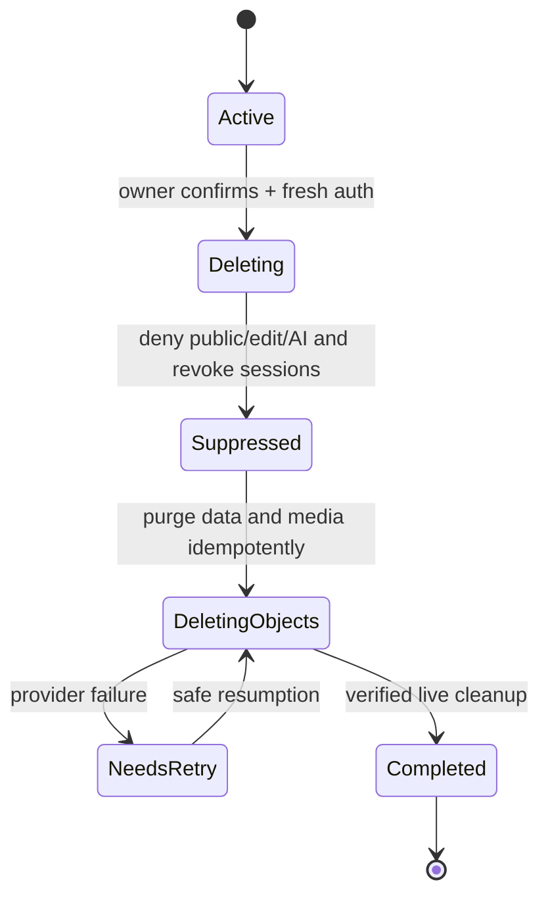

### 23.3 Export contract and privacy

An authenticated owner may export an independent archive of allowed account/portfolio content: metadata manifest, versioned draft schemas, reusable data, visual composition, design tokens, published release summaries/available data, and original media where available. The export must exclude OAuth secrets, session hashes, internal object keys, service credentials, raw abuse reports involving others, full security audit logs and any other tenant data. Contact inbox data may be exported only by the owner and within documented retention. The archive requires owner authorization at request and delivery time and a short expiry or direct bounded download; do not leave exports in a public storage bucket. If the account is suspended or deleting, export authorization follows explicitly documented admin/policy rules.

Suggested manifest:

```json
{
  "format": "gildedin-portfolio-export",
  "formatVersion": 1,
  "exportedAt": "2026-11-18T12:00:00Z",
  "portfolio": { "portfolioId": "example-opaque-id", "canonicalSlug": "alex" },
  "contentFiles": [
    "content/draft.json",
    "content/schemas.json",
    "content/layout.json"
  ],
  "media": [
    { "mediaId": "example-media-id", "relativePath": "media/hero.webp" }
  ],
  "integrity": { "algorithm": "SHA-256", "manifestDigest": "example-only" }
}
```

When implementing, define a real canonical manifest digest algorithm; the placeholder above is not evidence of cryptographic integrity. Export is an interoperability feature, not a replacement for managed backups.

### 23.4 Backups and disaster recovery limitations

There is no promised independent recovery service under the strict no-spend constraint. Published revisions coexist within the same primary storage domain and therefore share correlated failure risks. The owner-facing notice must acknowledge that hardware/provider incident, quota exhaustion, accidental deletion, corruption or administrative error could cause unrecoverable loss. Safe writes, validation, schema discipline and optional owner exports reduce risk but do not create a tested recovery guarantee. A future change to mandatory backups requires a new ADR, a no-billing-risk provider evaluation and periodic restoration evidence; never assert a recovery point objective or recovery time objective not actually supported by infrastructure.

---

## 24. Concurrency, isolation, partial failure and read-consistency scenarios

### 24.1 Explicit consistency requirements

GildedIn does **not** require that all data across all collections be changed in one global transaction. It does require:

- No draft write silently overwrites a later revision.
- No release becomes public until its payload and required public artifacts are complete.
- Each public response resolves a single active release, with live policy checked before disclosure.
- Exactly one successful publication is attributed to one idempotency key.
- A suspended/deleting account cannot activate a publication through a delayed operation.
- A slug cannot simultaneously belong to multiple portfolios or permit owner impersonation.
- A removed AI field cannot be used in a new inference after acknowledged revocation.
- Upload reservation, file commit and GC do not overspend global quota or delete referenced files.

MongoDB makes single-document writes atomic, while multiple-document updates require a transaction for true all-or-nothing atomicity [S01]. Many of these guarantees can be achieved without a mandatory transaction by choosing aggregate boundaries and authoritative compare-and-set transitions. **However, some multi-record operations (notably slug claim handoff, independent global/local quota reservations and account linking) need either a proven transaction or a deliberate saga with reconciliation and failure containment.** Do not describe sagas as atomic; the safe intermediate states must be explicitly defined.

### 24.2 Draft optimistic concurrency

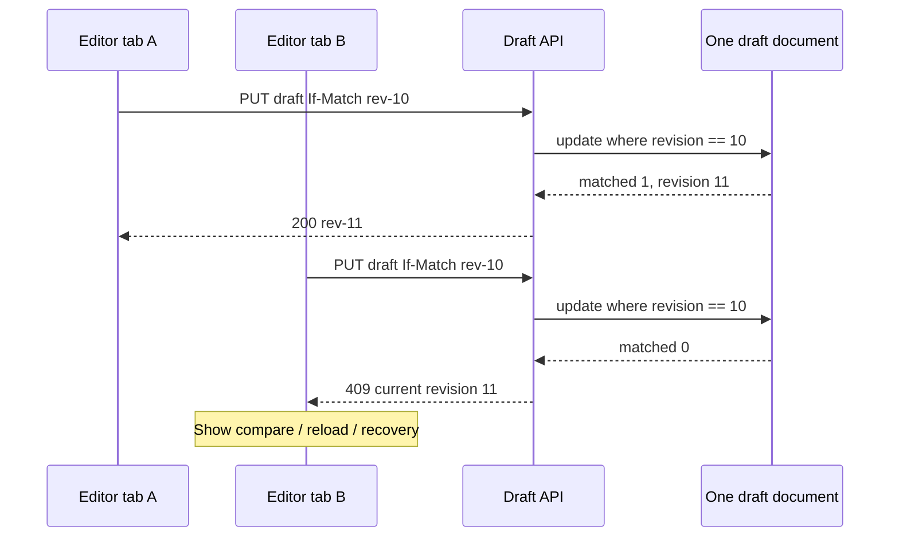

The database write must check at least `portfolioId` and current revision. The API must have authenticated the owner and rechecked account and portfolio state before applying an owned update. A generic API may also include `ownerAccountId` in the document predicate to guard against accidental authorizer bypass. Increment revision in the same Mongo document as the draft replacement/update. Always return a new strong ETag derived from revision; do not let the client choose the new revision. Replaying an identical stale request is still a conflict unless an explicit request-id deduplication policy says it was already accepted; if implemented, deduplication must be scoped to the same owner and draft.

**Autosave network ambiguity:** If the network drops after the server saved revision 11 but before tab A receives the response, tab A must query authoritative revision/status before retrying an unconditional full replacement. Otherwise, it may create needless conflict or attempt to overwrite tab B's later update. The editor's local recovery copy is not authoritative and must never automatically publish itself.

### 24.3 Username rename and exclusive alias ownership

A rename touches the exclusive slug claim and a portfolio's current display slug. A concurrent registration might try to claim the old or new name. The chosen algorithm must ensure no two portfolios can ever own either normalized slug. Prefer a Mongo transaction if the target tier supports it and operational limits are acceptable; still require unique indexes and tests. If transactions are unavailable, use a **reservation-first lease protocol** with a single unique slug registry and a domain-specific reconciliation state.

Safe saga outline:

1. Authenticated owner requests `newSlug`. Normalize and check grammar and reserved platform names.
2. Create/reserve the new `slugClaim` uniquely for the same `portfolioId`, tagged `pending` with operation ID. A collision returns slug unavailable.
3. Verify current old claim is still owned and current, and owner/account status has not changed. Conditional update portfolio control slug/generation to the new normalized handle.
4. Convert new claim to `current`, old claim to `alias` through a transaction or idempotent, monitored steps. At any crash boundary, the resolver must not interpret a pending slug as a working public alias owned by another user.
5. Reconcile inconsistent intermediate states by inspecting portfolio generation, old/new claim and operation ID; never release an old slug until ownership is certain.
6. Redirect old path/subdomain requests to current canonical URL, preserving safe detail paths if they still exist.

The resolver should derive the current canonical slug from portfolio control and authoritative claim, rather than assuming a stale alias claim is currently primary. Historical claims remain owned as long as the portfolio exists. **Do not** use `slugClaims` with a TTL for historical aliases; it would eventually permit hijacking old links.

### 24.4 OAuth linking under concurrency

If two browser sessions try to link the same GitHub account to different GildedIn accounts, the `(provider,providerSubject)` unique index ensures only one stored binding can win. The service must reject the other operation without changing either owner's primary user record. Explicit linking requires recent reauthentication and proof of control over the provider. A new provider email matching an existing account does not authorize a merge. Unlink must never leave the account without any valid provider identity; count remaining linked identities under an appropriate concurrency guard or transaction. Revoking the sole provider via two concurrent unlink calls is a critical negative test.

### 24.5 Publication versus owner disable or administrative suspension

A compiler may validate an active draft and then wait on I/O before pointer activation. The final conditional update includes active account/portfolio status and security generation. If an administrator suspends the portfolio during preparation, the compare-and-set fails; an already activated release remains stored but the live policy immediately denies public and AI access. Suspension does not need to mutate historical release snapshots. When restriction is lifted, the current release can become visible again only after the live policy allows it and any separate moderation rules are satisfied.

### 24.6 Policy check versus cache fill

A request may read an allowed policy, then another request revokes access before the first renders cached content. The strong interpretation of "immediate revocation" requires a defined ordering/linearization point for responses. For data already transmitted before revocation, the server cannot erase it from the client or external caches. For **new requests starting after acknowledgement**, the gate must observe the current version or fail closed. For in-flight requests, the implementation should make a final check before emission where feasible, but cannot promise revocation of bytes already streamed. This limitation should be documented and tested rather than hidden behind generic cache invalidation.

### 24.7 Quota reservation cross-record crash

A global quota bucket and a portfolio bucket are separate Mongo documents. Without a transaction, updating the global bucket then crashing before the portfolio bucket creates leaked capacity; reversing the order may permit overadmission. Use explicit reservation IDs, lease fencing, conservative admission and reconciliation. When uncertain whether global capacity was reserved, **reject new uploads** until state is reconciled; do not issue another capability. The cost constraint makes conservative false rejections preferable to silent overage risk. Test ten concurrent max-sized upload intents with forced crashes after each database step.

### 24.8 Transaction viability and fallback decision

MongoDB Node driver supports multi-document transactions and convenient retry APIs, but target deployment support and limits require direct integration verification [S06]. The app should prefer single-document atomic updates for draft replacement and active pointer changes even if transactions are available; reserve transactions for genuine cross-document invariants when they simplify correctness. A transaction may be retried, so its callback should avoid unrepeatable external side effects such as uploading a media object or sending an AI request. Effects on storage/CDNs remain outside the MongoDB transaction and require outbox-like persistent journals or idempotent operations.

### 24.9 Ambiguous database write result

On connection loss, do not assume a write succeeded or failed. Retrieve the authoritative state using the idempotency key, operation marker or revision before replaying. A client-visible `503` after the pointer became active must not cause a second successful publication. A unique-key conflict is not always an attack; it can be a valid race that should resolve to a clean `409` or an existing idempotent outcome. Log safe operation IDs and database error codes without request bodies or private documents.

---

## 25. Capacity, storage economics and operational resource limits

### 25.1 Growth planning is not a free-tier guarantee

The model is intentionally optimized for 100-500 active portfolios. That number describes **data organization and anticipated workload**, not verified service capacity or guaranteed uptime. At maximum per-owner allowances, rough upper bounds are:

| Resource assumption                  | Arithmetic                  | Nominal value                | What is excluded                                              |
| ------------------------------------ | --------------------------- | ---------------------------- | ------------------------------------------------------------- |
| Retained release payloads            | 500 x 3 x 100 KiB           | 150,000 KiB / ~146.5 MiB     | Drafts, indexes, metadata, operations, analytics, DB overhead |
| Original media                       | 500 x 15 MiB                | 7,500 MiB / ~7.32 GiB        | Image variants, quarantine, provider metadata/overheads       |
| Original media objects               | 500 x 30                    | 15,000 files                 | Derived variants and duplicate staging                        |
| Max authored nodes currently allowed | 500 x 20                    | 10,000 nodes                 | Repeater-generated DOM items, rich-text nodes                 |
| Max retained public content views    | 500 x 3                     | 1,500 releases               | Unactivated/orphan preparations                               |
| Potential indexed analytics days     | 500 x 365 x several metrics | Potentially >180,000 buckets | Content clicks with target dimension                          |

These are boundary estimates, not a claim that the free providers support them. MongoDB Atlas publicly lists an M0 free cluster with 512 MB storage, subject to current service rules [S29]. The 500-owner release-only calculation can consume a material fraction of that limit after real BSON and index overhead are included. Therefore, actual load fixtures and measurements should guide conservative admission and retention, even though the platform does not hard-cap owner registration at 100.

### 25.2 Draft and release write amplification

Embedding the bounded draft offers atomic per-revision saves and simple ownership rules, but full-document replacements create write amplification. Debounce autosave, avoid resending unchanged media and large immutable articles, and monitor throughput. For frequently edited rich-text blocks, the editor may send a validated patch command, but the server should still apply one atomic document revision and preserve stale-write protection. Don't create a new release on every autosave. Releases are only created on explicit Publish, and a saved draft does not automatically invalidate public caches.

### 25.3 Index, analytics and TTL cost

Every secondary index costs storage and write maintenance. Do not pre-create speculative indexes for future features. TTL purges also consume database work and are not immediate. A modest number of highly selective indexes on a low-volume shared database is preferable to per-portfolio collections and broad wildcard indexes. Analytics should aggregate a bounded set of events and trim old buckets rather than storing one row per visit forever. Keep AI contexts small and release-bound, and remove obsolete contexts when privacy-safe to do so.

### 25.4 Headroom and quota admission

Maintain a provider-configurable global admission threshold below its hard cap to account for index growth, derived media and recovery work. There is no single safe universal percentage without measurement; calibrate against observed utilization and provider accounting. For storage services with no enforceable maximum charge of $0, reject their use regardless of generous free allowances. If an eligible free storage provider becomes full, reject new uploads with a clear error; existing published media is not automatically deleted. If MongoDB becomes read-only/full, editing and publishing may be temporarily unavailable; the application must not promise uninterrupted read access unless a proven safe cache/read path exists.

### 25.5 Performance of public reads

Keep public reads to a bounded control/policy lookup and one immutable release lookup, not nine independent mutable section queries. Cache immutable payloads using tenant+release scoped keys, but do not cache the _allowed_ security decision beyond its validity. Optimize images through correctly sized variants and serve optional 3D assets progressively. The 100 KiB release bound reduces transfer and cache burden, but client JavaScript, fonts, image/media bytes and public search artifacts remain independent performance costs. Evaluate real Core Web Vitals and route-level read traces per [11](11-testing-strategy.md).

### 25.6 No mandatory infrastructure components

A separate SQL database, message broker, Kafka, RabbitMQ, Kubernetes, centralized search service, vector database, change-stream processor, WebSocket sync service or always-on worker is not justified by the requirements. Their introduction would add deployment, security boundaries, credentials, provider limits and operational cost without delivering a required launch feature. Model necessary work as short, idempotent operations and conditionally scheduled reconciliation where available. A future addition must start with a recorded bottleneck, threat review and revised ADR.

---

## 26. Threat-to-control matrix for persisted data

The table below is a focused data threat model, complementary to the full threat register in [07](07-security-design.md). It covers confidentiality, integrity, availability and privacy failures at the persistence boundary, including attacks originating from a supposedly authenticated owner. "Owner" is not synonymous with "trusted input"; owners can upload malicious content and attempt to read unrelated tenants' records.

| ID       | Threat / entry point                                             | Asset affected                   | Preventive control                                | Detection/evidence              | Severity |
| -------- | ---------------------------------------------------------------- | -------------------------------- | ------------------------------------------------- | ------------------------------- | -------- |
| DM-TH-01 | Guess or replace another tenant's `portfolioId`                  | Draft, media, inbox              | Verified owner predicates and per-method policy   | Cross-tenant negative tests     | Critical |
| DM-TH-02 | Guess publication `releaseId` of disabled owner                  | Restricted public content        | Live policy gate before cached release            | Suspended route tests           | Critical |
| DM-TH-03 | Provider email collision takeover                                | Account and portfolio            | Stable subject, explicit provider linking         | Two-account linking tests       | Critical |
| DM-TH-04 | Old slug reused by another owner                                 | Identity, reputation             | Single permanent unique slug registry             | Rename/re-register race test    | High     |
| DM-TH-05 | Mass assignment writes `ownerAccountId`, roles or active pointer | Control-plane integrity          | Exact DTO allowlists, server-owned fields         | Fuzz property-level writes      | Critical |
| DM-TH-06 | NoSQL operator injection in filters                              | Cross-tenant records             | Server-built predicates, reject arbitrary objects | Operator payload tests          | Critical |
| DM-TH-07 | Stale editor tab overwrites work                                 | Draft integrity                  | Revision CAS, 409 recovery                        | Dual-tab concurrency test       | High     |
| DM-TH-08 | Partial publish visible to visitor                               | Public integrity and SEO         | Complete release before atomic active pointer     | Crash injection at every stage  | Critical |
| DM-TH-09 | AI pulls hidden reference or new field                           | Sensitive personal data          | Explicit allowlist, denies and policy version     | Canary source tests             | Critical |
| DM-TH-10 | Revoked AI context reused from cache                             | Private data                     | Live policy version check/fail closed             | Revocation after cached context | Critical |
| DM-TH-11 | Media upload served before verification                          | User devices, platform trust     | Private quarantine, parser, re-encode             | Malformed image/PDF tests       | High     |
| DM-TH-12 | Storage object key guessed or swapped                            | Media ownership                  | Opaque keys, tenant-authorized media ID           | Cross-tenant signed URL tests   | Critical |
| DM-TH-13 | Old image deleted though release references it                   | Public availability/restore      | Reference-safe mark-and-sweep                     | Retained release media test     | High     |
| DM-TH-14 | Concurrent quota overspend                                       | Zero-charge guarantee            | Reservation, global admission, reconciliation     | Parallel upload stress          | Critical |
| DM-TH-15 | Public search leaks hidden section                               | Draft/private text               | Public-only compiled search artifact              | Hidden field search test        | Critical |
| DM-TH-16 | RSS URL reaches metadata service/internal network                | Provider secrets/network         | SSRF-safe fetch adapter and fallback              | DNS rebinding/redirect tests    | Critical |
| DM-TH-17 | Rich-text/script XSS on apex                                     | Session access and other tenants | Approved AST, sanitize, CSP, no arbitrary scripts | Stored XSS + same-origin test   | Critical |
| DM-TH-18 | Analytics fingerprints visitors                                  | Visitor privacy                  | Aggregate-only events and short-lived counters    | Schema/log review               | High     |
| DM-TH-19 | Contact message appears in AI or public JSON                     | Visitor privacy                  | Separate collection and allowlisted projections   | Data-flow leak tests            | Critical |
| DM-TH-20 | TTL delays leave expired records readable                        | Private sessions/inbox           | Read-time expiration and explicit purge           | Clock manipulation test         | High     |
| DM-TH-21 | Administrative moderation hidden only in stale HTML              | User safety                      | Authoritative server/edge policy gate             | Cache-stale suspension test     | Critical |
| DM-TH-22 | Unknown host header creates portfolio lookup                     | Routing/identity                 | Trusted normalized host allowlist                 | Host spoofing tests             | High     |
| DM-TH-23 | Browser export URL remains publicly accessible                   | Private archive                  | Auth at download, private object/expiry           | Export link replay tests        | Critical |
| DM-TH-24 | Unsafe migration changes visibility defaults                     | Draft/private content            | Safe schema migration and opt-in defaults         | Migration fixture diffs         | Critical |
| DM-TH-25 | Broad delete removes other tenants' objects                      | Media and availability           | Exact portfolio partition and verified ownership  | Prefix collision tests          | Critical |
| DM-TH-26 | External provider retains data beyond claim                      | Privacy obligations              | Provider review, accurate notice, no false claims | Provider/data-flow assessment   | High     |

### 26.1 Privacy-by-design evidence

For every sensitive field, implementation review must establish: (a) collection/record location; (b) why it is necessary; (c) who can create/read/update/delete it; (d) whether it enters public HTML, media, metadata, search, RSS, logs, analytics, AI or export; (e) default visibility; (f) retention/deletion trigger; (g) applicable provider; (h) tests proving exclusion where necessary. The output of that review becomes a data inventory and a test fixture, not simply an assertion in a security checklist.

### 26.2 Attackers and protection limits

Cross-tenant privacy assumes the application server and database credentials are sufficiently protected to enforce policy. A complete server/database administrator compromise can bypass application-layer tenant isolation in a shared database. Encrypted transport and provider-managed encryption at rest address particular threats but do not replace access control, secret rotation and incident response. Audit events in the same mutable database are not truly append-only against a fully privileged database operator. Represent these as accepted limitations and protect privileged access as far as the selected free provider permits.

### 26.3 Privacy-specific public origin risk

The public path `https://aaroophan.dev/{slug}` shares an origin with `https://aaroophan.dev/dashboard`. Even though `__Host-` cookies narrow exposure to subdomains, **a stored XSS vulnerability on the apex portfolio path may be able to send credentialed requests to dashboard APIs**. Therefore safe rendering is a **critical architectural boundary**, not a decorative sanitization step. The data model must never store arbitrary executable templates or raw HTML for later rendering on the apex. Prefer safe component/AST contracts, restrictive CSP, approved embeds and adversarial testing on the same exact origin configuration.

---

## 27. Schema evolution, migrations and model version governance

### 27.1 Separate version clocks

GildedIn must distinguish several version dimensions because they change for different reasons:

| Version                 | Where stored                 | Increments when                                | How old data is interpreted                |
| ----------------------- | ---------------------------- | ---------------------------------------------- | ------------------------------------------ |
| `schemaVersion`         | Draft/release/schema records | Document/data contract changes                 | Compatible decoder or explicit migration   |
| `rendererVersion`       | Release                      | Public rendering contract changes              | Version-aware immutable release renderer   |
| `blockRegistryVersion`  | Draft/release                | Available component props/semantics change     | Supported registry adapter                 |
| `serializerVersion`     | Release                      | Canonical byte representation changes          | Hash verification uses matching algorithm  |
| `revision`              | Draft                        | Each accepted owner edit                       | CAS, undo/redo semantics                   |
| `securityVersion`       | Portfolio control            | Restriction/visibility/critical policy changes | Live access gate                           |
| `approvalPolicyVersion` | AI policy                    | AI field/section/document approval changes     | Context version mismatch disables stale AI |
| `publishSequence`       | Portfolio control            | Successful release activation                  | Last-three retention                       |
| `migrationVersion`      | Migration journal            | Deployed database migration completes          | Idempotent rerun and rollback record       |

A migration that changes the published output format must not silently rewrite immutable old releases in place. A query decoder can interpret an older version, or the owner can restore it into a new draft and explicitly publish with a current renderer. Remove support for an old version only after identifying all live retained releases needing it and providing a safe migration path.

### 27.2 Migration procedure

1. Record a migration ID, rationale, affected collections, version transitions, expected data count, security/privacy impact and rollback plan.
2. Build test fixtures for older, current, malformed and maximum-size records. Include hidden references, pending publications and revoked AI fields.
3. Run a local dry-run against synthetic copies with strictly non-production credentials. Collect before/after counts, checksums and invariants.
4. If adding a field, choose a safe default. **New visibility/AI consent is denied by default**; never infer owner approval.
5. Deploy compatible readers first, if a gradual migration is needed. For zero-downtime compatibility, support both old and new field versions temporarily without broadening access.
6. Apply data changes in bounded batches or lazy per-document migrations under authorization-aware server control. Use conditional version predicates to avoid overwriting concurrent editor writes.
7. Add constraints and indexes only after checking for invalid/duplicate data and verifying supported MongoDB commands and index limits.
8. Validate row counts, unique slug ownership, retained release hashes, media references, policy versions, total size and tenant-specific reads.
9. Record migration completion and the selected source commit. Fail closed on unknown/newer unsupported schema versions rather than trying to interpret attacker-controlled fields permissively.
10. Document the rollback limit. If a migration is destructive, a simple code rollback may not restore removed data; require an explicit restore/export mechanism and acceptance of the no-guaranteed-backup constraint.

### 27.3 Schema change behavior for owner-created content

Compatible changes may be auto-converted (for example, adding an optional text field or widening a text length bound), but potentially destructive changes require an impact preview. Removing a field used by published project cards or AI approval must show affected bindings and require explicit user action. Relationship deletion must be blocked or require owner-confirmed detachment, never silently cascade. The active release stays unchanged until new publish validation and activation. Field IDs remain stable across label renames, while new semantic field definitions receive new IDs.

### 27.4 Breaking changes and old releases

Old releases might contain components or layout properties removed from the current editor. The renderer has three safe options: (a) continue supporting their version; (b) use a formally defined compatibility adapter whose output is tested against the old visual/semantic behavior; (c) withhold restoration/public rendering with a clear safe failure and operator intervention where compatibility cannot be maintained. It must not execute unknown component names or infer a render mode from arbitrary data. Never solve incompatibility by enabling unrestricted HTML/JS on old payloads.

### 27.5 Database schema validation rollout

MongoDB allows application validators, but selecting `validationLevel`/`validationAction` matters [S07]. Roll out strict validators only after production data is confirmed compatible. If an old record requires repair, migrate it explicitly; don't treat `moderate` validation as a permanent permission to write structurally invalid control records. Log aggregate migration errors and safe IDs, not full private documents. Test that the final validator rejects wrong types, unknown server-owned fields and unanticipated status transitions where those are expressible. Domain policy still enforces transitions and owner identity.

### 27.6 Migration failure states

| Failure                         | Safe behavior                                  | Recovery                                                          |
| ------------------------------- | ---------------------------------------------- | ----------------------------------------------------------------- |
| Partially migrated draft        | Do not publish unknown schema                  | Resume idempotent migration or owner review                       |
| Unknown newer release           | Fail safe, do not invoke arbitrary renderer    | Deploy compatible renderer/revert release selection               |
| Unique index creation conflicts | Stop migration; do not drop data automatically | Investigate duplicates with authorized minimal identifiers        |
| Media IDs lack ownership        | Prevent publication/serving affected media     | Repair from trusted ownership evidence                            |
| New consent defaults wrong      | Disable affected AI/public projection          | Security incident review and corrected migration                  |
| Migration corrupts content data | Do not overwrite retained old releases         | Owner-export/revision restore where available; disclose loss risk |
| Test runner sees live DB URL    | Abort before any query                         | Fix configuration, no production fixture writes                   |

---

## 28. Consolidated diagrams and end-to-end data flows

The following diagrams are conceptual contracts. C4 deployment and runtime diagrams are authoritative in [04](04-c4-diagrams.md); this section focuses on data ownership and transitions that developers must preserve in implementation. A successful arrow indicates permitted flow after validation, not an assertion that a particular library or provider is already configured.

### 28.1 Core tenant identity and publishing relationships

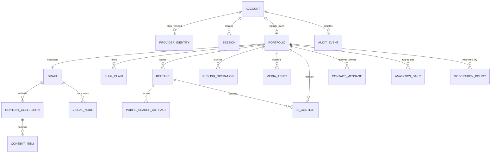

Entity names in this ER view are **logical**. A `CONTENT_ITEM` is embedded inside the bounded draft/release aggregate rather than an unbounded collection shared across all tenants. `RELEASE` and `MEDIA_ASSET` relate through validated media reference IDs; no implicit Mongo join or foreign-key enforcement exists. Explicit application-level validation is required.

### 28.2 Data classification and copy boundaries

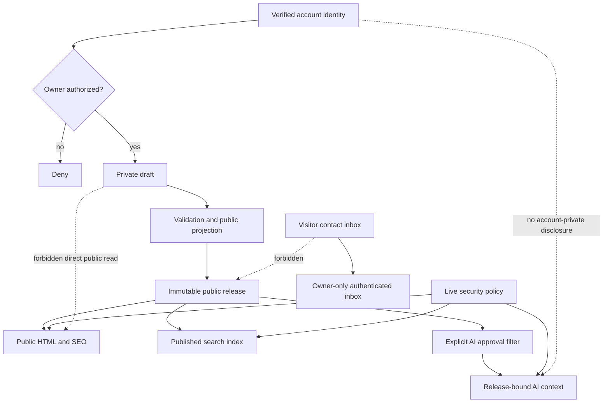

The prohibited dotted edges are explicitly **forbidden**. Approving a whole section for public display does not automatically approve every nested field for Gilden. A live security restriction may block already-compiled artifacts. The contact inbox never becomes part of a published release.

### 28.3 Account creation and portfolio provisioning

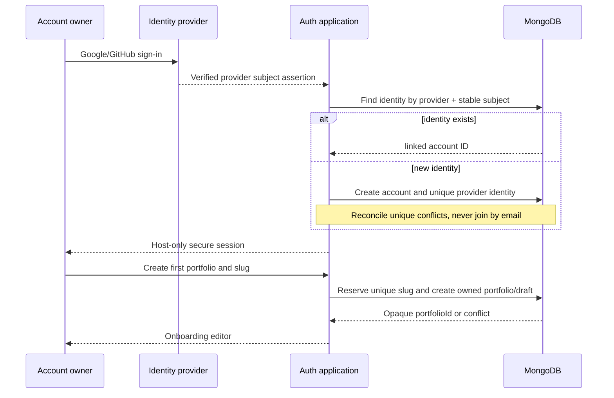

Initial provisioning may use a transaction or a recoverable partial state. Do not hand an owner a supposedly created portfolio when the slug belongs to another account. Any setup operation must be idempotent and can safely complete missing draft creation after a retry.

### 28.4 Draft-to-release activation

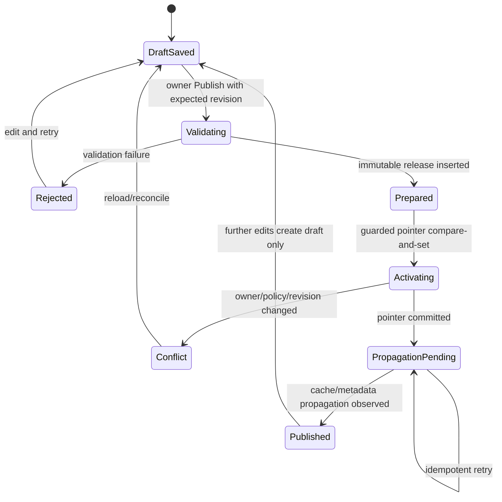

The `Published` state above describes observable propagation completion, not the commit point. The **active pointer write** is the content publication commit; `propagation_pending` is already a durably published release. Neither `Rejected` nor `Conflict` permits changing the public pointer.

### 28.5 Slug claims and redirects

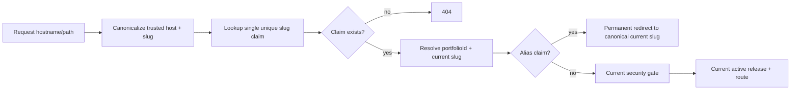

An alias never grants account ownership or dashboard access. Its sole purpose is safe continuity of public links and reserved naming. Reserved platform paths and known service hostnames are resolved before the wildcard portfolio route.

### 28.6 Media upload, reservation and publication references

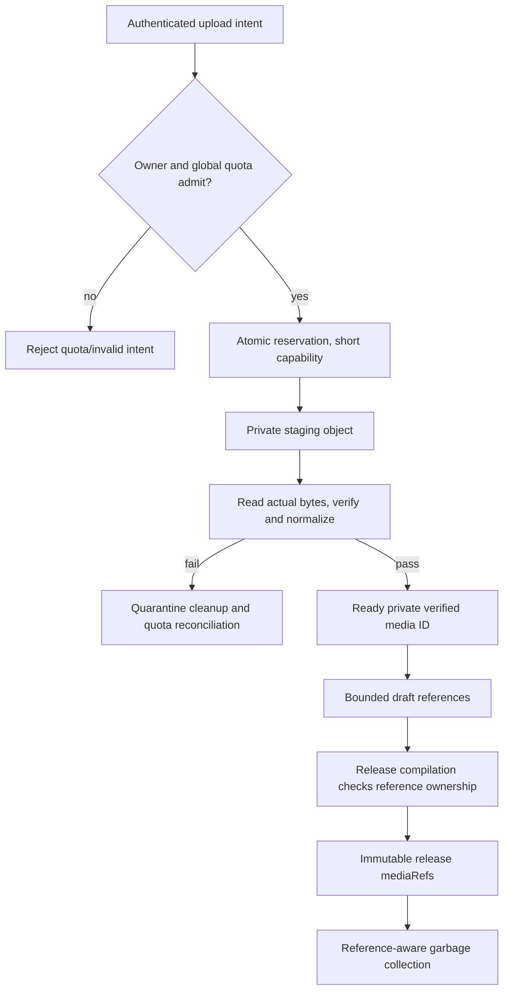

Never allow the public renderer to use an `uploading` or `quarantined` media ID. A valid-looking storage URL does not establish ownership. Reconciliation is required when staging succeeds but MongoDB finalization fails.

### 28.7 AI revocation and matched context

```mermaid
sequenceDiagram
  participant O as Owner
  participant S as Security policy service
  participant DB as MongoDB
  participant V as Visitor
  participant G as Gilden gateway
  O->>S: Revoke field F
  S->>DB: Atomic policyVersion increment + deny F
  DB-->>S: Version 8 committed
  S-->>O: Revocation acknowledged
  V->>G: Ask question
  G->>DB: Read live policy + active release
  G->>DB: Find ready context matching release and version 8
  alt matching approved context ready
    G-->>V: Grounded streaming answer with validated links
  else absent, stale or unavailable
    G-->>V: Assistant unavailable; portfolio still works
  end
```

Revocation prevents new inference after acknowledgement. It cannot recall content already transmitted to a provider or downloaded by a visitor before the policy changed. This is a documented trust limitation.

### 28.8 Deletion and retention workflow

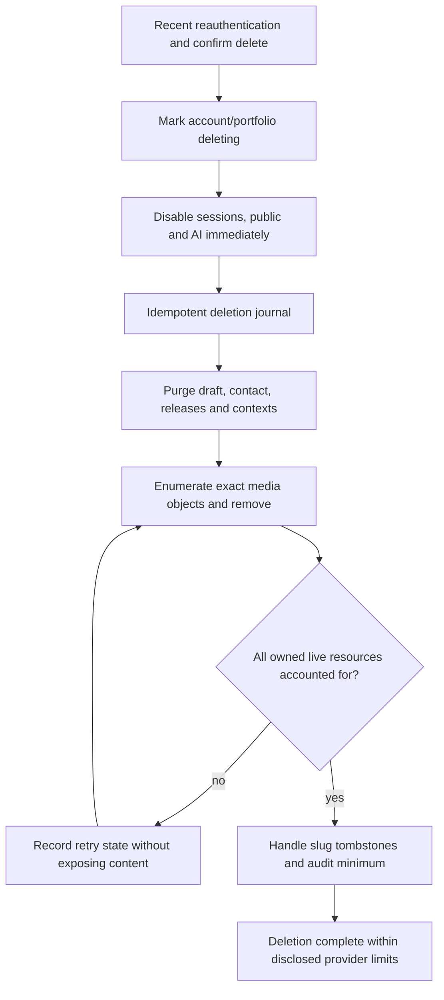

The workflow cannot erase previously downloaded public content or guarantee deletion from third-party provider backups on demand. The final completion status must distinguish observed live-resource deletion from provider-side retention beyond application control.

---

## 29. Verification matrix, property tests and evidence artifacts

The following cases are mandatory _design evidence_ to translate into executable tests under [11](11-testing-strategy.md). A passing unit test does not replace integration tests against the actual selected MongoDB driver and tier. Test fixtures must be synthetic and must never connect to live production data. Quality gates emphasize threats and failure handling, not arbitrary test-count targets.

### 29.1 Identity and tenancy cases

| Test ID  | Setup/action                                      | Required assertion                            |
| -------- | ------------------------------------------------- | --------------------------------------------- |
| DM-T-001 | Two users share same email at providers           | No automatic ownership merge                  |
| DM-T-002 | Two users link same provider subject concurrently | Exactly one account gets link; other denied   |
| DM-T-003 | Link provider without recent auth                 | Denied; existing link unchanged               |
| DM-T-004 | Unlink only remaining login provider              | Denied; account remains recoverable           |
| DM-T-005 | Owner A selects portfolio ID of B                 | No private draft or metadata exposed          |
| DM-T-006 | Owner A modifies B's draft                        | Denied; B revision unchanged                  |
| DM-T-007 | Account suspended while session active            | Subsequent owner mutation denied              |
| DM-T-008 | First registrant tries to become admin            | No privilege escalation                       |
| DM-T-009 | Wrong host and forged forwarded headers           | No cross-tenant resolution                    |
| DM-T-010 | Different capitalization of same slug             | One canonical claim; no duplicate             |
| DM-T-011 | Reserved slug `dashboard`                         | Rejected for path and subdomain model         |
| DM-T-012 | Historic alias claimed by new user                | Rejected while reserved                       |
| DM-T-013 | Crash during slug rename                          | Reconcile to one safe current owner and alias |
| DM-T-014 | Unknown subdomain                                 | Branded 404; no tenant leak                   |

### 29.2 Content, composition and release cases

| Test ID  | Setup/action                                | Required assertion                                                |
| -------- | ------------------------------------------- | ----------------------------------------------------------------- |
| DM-T-015 | Add fourth nested schema level              | `DEPTH_LIMIT` and no partial mutation                             |
| DM-T-016 | Add 21st custom field in section            | `FIELD_LIMIT`                                                     |
| DM-T-017 | Add 21st authored block across pages        | `BLOCK_LIMIT`                                                     |
| DM-T-018 | Repeater shows 20 projects                  | Counts as one authored block                                      |
| DM-T-019 | Add 21st collection item                    | `COLLECTION_LIMIT`                                                |
| DM-T-020 | Submit Mongo `$ne` object as ID             | Validation reject, not query injection                            |
| DM-T-021 | Add relation to tenant B's content item     | Reject cross-tenant reference                                     |
| DM-T-022 | Delete shared content while linked          | Block or require explicit detach confirmation                     |
| DM-T-023 | Longer text overflows absolute box          | Publish warning/block severe clipping; no silent content loss     |
| DM-T-024 | Mobile-hidden button remains in focus order | Reject or correct semantic graph                                  |
| DM-T-025 | Duplicate H1 from custom canvas             | Publish blocked or semantic correction via documented rule        |
| DM-T-026 | Unsupported block version                   | Fail safe, no executable fallback                                 |
| DM-T-027 | Release canonical bytes = 102400            | Allowed if otherwise valid                                        |
| DM-T-028 | Release canonical bytes = 102401            | Rejected; active pointer unchanged                                |
| DM-T-029 | Draft tab A and B edit same revision        | Only one CAS wins; other receives conflict                        |
| DM-T-030 | Compiling invalid media reference           | Reject publish; no active pointer update                          |
| DM-T-031 | Crash after release insert                  | Prepared not public until activation; retry safe                  |
| DM-T-032 | Crash after pointer activation              | Retry observes same release, no duplicate                         |
| DM-T-033 | Same key with different publish request     | Conflict, not duplicate/new release                               |
| DM-T-034 | Competing publish ops on same portfolio     | Fenced winner; no mixed or double activation                      |
| DM-T-035 | Publish while admin suspends                | Policy deny or activation conflict; never exposes blocked content |
| DM-T-036 | Restore release R1                          | Creates new draft revision, does not activate R1                  |
| DM-T-037 | Trim after fourth successful release        | Only three retained, safe media cleanup                           |
| DM-T-038 | Search/SEO references hidden content        | No disclosure in generated artifacts                              |
| DM-T-039 | Path/subdomain equivalent route             | Same release content, correct canonical target                    |
| DM-T-040 | Old project URL removed in new release      | 404 or owner-configured redirect, never stale project leak        |

### 29.3 AI, media, retention and operational cases

| Test ID  | Setup/action                                                | Required assertion                                   |
| -------- | ----------------------------------------------------------- | ---------------------------------------------------- |
| DM-T-041 | Section approved, then new email field added                | New field AI-denied by default                       |
| DM-T-042 | Context R1 ready, release R2 current                        | AI unavailable until R2 context ready                |
| DM-T-043 | Approvals revoked, cached context still exists              | Next new request cannot use old context              |
| DM-T-044 | PDF contains references and phone numbers                   | Extracted text not approved without review/redaction |
| DM-T-045 | AI returns invented citation URL                            | Server discards or replaces with validated source    |
| DM-T-046 | AI provider unavailable                                     | Public page/editor unaffected                        |
| DM-T-047 | Redis quota service unavailable                             | No uncontrolled AI requests                          |
| DM-T-048 | Attempt public chat with transcript logging enabled         | Config/test fails; no transcript stored              |
| DM-T-049 | 31st original asset                                         | Reject; no orphaned storage object                   |
| DM-T-050 | Image >1 MiB or PDF >2 MiB                                  | Reject intent/finalization according to actual bytes |
| DM-T-051 | Image decodes beyond 4096 x 4096                            | Reject before unsafe publication                     |
| DM-T-052 | File declares PNG but contains different signature          | Quarantine/reject                                    |
| DM-T-053 | Two uploads race at global remaining capacity               | At most permitted reservations commit                |
| DM-T-054 | Reservation expires between upload and finalize             | No double allocation or inconsistent ready asset     |
| DM-T-055 | Staged object upload succeeds but DB write fails            | Reconciliation, not publicly visible                 |
| DM-T-056 | Delete asset referenced by retained release                 | Denied until no reference remains                    |
| DM-T-057 | One portfolio tries to reference another's mediaId          | Denied even if object key is known                   |
| DM-T-058 | Expired contact message still physically present before TTL | Read denied by `expiresAt` check                     |
| DM-T-059 | Contact inbox requested anonymously                         | No private data returned                             |
| DM-T-060 | RSS target redirects to loopback/private address            | Fetch blocked; cached preview preserved              |
| DM-T-061 | Suspended portfolio exists in cached directory list         | Denied by live policy at delivery                    |
| DM-T-062 | Request account export for another user                     | Denied, no generated public archive                  |
| DM-T-063 | Deletion crash after public denial                          | Public remains denied; cleanup resumable             |
| DM-T-064 | Deletion uses overlapping storage prefixes                  | Only exact tenant-owned objects considered           |
| DM-T-065 | Unknown migrated visibility field                           | Deny public/AI rather than default allow             |
| DM-T-066 | Local tests configured with production Mongo URI            | Abort before read/write                              |
| DM-T-067 | Database quota exhaustion during draft save                 | Clear failure; last good revision unchanged          |
| DM-T-068 | Provider usage quota exhausted                              | No charge, optional feature unavailable              |
| DM-T-069 | Aggregated metrics public setting off                       | No public analytics payload                          |
| DM-T-070 | Analytics event uses arbitrary target field                 | Reject high-cardinality/untrusted label              |

### 29.4 Model-based and property-testing strategy

Generate combinations of content graphs within and just beyond defined limits. Randomly mutate parent pointers, section IDs, schema cycles, component versions, field visibility, breakpoint overrides, media references, release IDs and source citations. The invariant checker should assert that compilation either rejects the graph with a deterministic validation result or produces a valid, bounded, tenant-isolated, accessible semantic representation. A fuzz input must not trigger unbounded recursion, arbitrary network requests, an unsafe dynamic Mongo update or data returned from a different tenant.

For draft CAS and publication activation, use deterministic concurrency harnesses with barriers to force interleavings; do not rely on sleep timing and hope a race reproduces. Test duplicate request submission, client timeout after database success, runtime termination between each operation step and stale actor authorization. Document the chosen MongoDB read/write concerns and actual effect on the deployed cluster. Not every test can prove a true network partition, but failure injection must at least model ambiguous acknowledgement and retry identity.

### 29.5 Evidence checklist per implementation issue

Every data-model implementation PR should include: linked requirement ID(s); affected collection(s); migration or index change; example valid and invalid payload; authorization path and property allowlist; transaction/saga behavior; idempotency/retry logic; retention impact; privacy/data-flow changes; query-plan evidence where new index is added; negative test results; and rollback limitations. A new data class or new provider integration requires security/privacy review before merging. The **proof** is observable tests and configuration evidence, not a statement that "MongoDB is secure" or "the SDK handles it".

---

## 30. Decision status, unresolved implementation details and launch gates

### 30.1 Product requirements versus engineering selections

The following are fixed product-facing requirements: account/portfolio separation; one owned portfolio initially; path+subdomain public routing; publicly searchable subset and curated examples; typed custom content with stable IDs; free-positioned responsive canvas; hidden/private field safety; three-release retention; explicit publish and restore-to-draft; 20 authored nodes, 20 items/collection, 20 fields/section, depth 3, 102400-byte release; verified bounded media; Gilden opt-in with explicit consent and no stored visitor transcripts; English-only initial release; and $0 new spending. Their detailed IDs and conditions are in [02](02-requirements-and-scope.md).

The following are **implementation choices** subject to validation: UUID v4 versus v7; ODM versus native MongoDB driver; exact Auth.js adapter/session store; quota reservation algorithm; transaction use for slug claim handoff; index names beyond critical unique constraints; source canonicalizer implementation; schema migration runner; object storage provider; cache adapter; media processing library; and eventual external feed transport. Where a choice is marked conditional, document accepted behavior, options, failure mode and a proving test before writing production data.

### 30.2 Must-be-proven gates

| Gate ID  | Proof required                                                                                      | Owner of evidence   | Failure policy                                    |
| -------- | --------------------------------------------------------------------------------------------------- | ------------------- | ------------------------------------------------- |
| DB-01    | Target MongoDB free tier supports required schema validators, unique indexes and conditional writes | Backend/data        | Do not deploy incomplete integrity rules          |
| DB-02    | Transaction or safe saga for slug rename/provisioning/account-linking                               | Backend/security    | Disable risky transition until proven             |
| DB-03    | Publish sequence lease/fencing/recovery algorithm survives races and crash injection                | Backend/data        | No public publish without atomic activation proof |
| MEDIA-01 | Storage is genuinely zero-charge with bounded physical capacity                                     | Deployment/security | Do not enable uploads until proven                |
| MEDIA-02 | Capabilities, quarantine, actual-byte verification and GC work                                      | Backend/media       | Reject uploads/publication                        |
| AI-01    | Approved context + immediate policy version gate                                                    | Backend/security    | Keep Gilden disabled                              |
| AI-02    | Groq usage under configured quotas with no uncontrolled overage                                     | Deployment/AI       | Deny AI requests                                  |
| HOST-01  | Noncommercial hosting eligibility and tenant-content data terms                                     | Deployment/privacy  | Replace host or restrict launch                   |
| HOST-02  | Wildcard TLS, hostname normalization, no apex cookie leakage to subdomains                          | Deployment/security | Do not claim dual-domain completion               |
| HOST-03  | Platform origin safe against user-authored XSS                                                      | Frontend/security   | Block public launch                               |
| COST-01  | Every selected service works without required card/charge risk                                      | Deployment/owner    | Reject service                                    |
| PRIV-01  | Accurate notice, 30-day contact data and provider processing are documented                         | Privacy/owner       | Block sensitive workflow launch                   |
| FONT-01  | Web embedding rights for selected fonts                                                             | Design/legal        | Use permitted fallbacks                           |
| PERF-01  | Public page and release read metrics meet quality targets                                           | Frontend/data       | Tune cache and optional 3D                        |
| A11Y-01  | Canvas/public renderer can satisfy WCAG 2.2 AA requirements                                         | UX/QA               | Restrict unsupported layouts                      |
| TEST-01  | Tests provably cannot reach production data                                                         | Dev/CI              | Abort all tests if uncertain                      |
| CLEAN-01 | Account deletion/media cleanup accurately reports actual completion                                 | Backend/security    | Preserve operation and retry; no false claim      |

### 30.3 Open implementation decisions and recommended defaults

| ID         | Open detail                     | Preferred starting approach                                                          | Deciding evidence                   |
| ---------- | ------------------------------- | ------------------------------------------------------------------------------------ | ----------------------------------- |
| DM-OPEN-01 | ID encoding                     | Opaque UUID strings with branded TS types, Mongo `_id` conversion hidden             | Driver and serializer tests         |
| DM-OPEN-02 | Auth session persistence        | Database-backed revocable session with hashed verifier; Auth.js integration verified | Adapter/security proof              |
| DM-OPEN-03 | Slug rename atomicity           | Transaction if free tier supports it; safe leased saga otherwise                     | Local+provider race tests           |
| DM-OPEN-04 | Release sequence allocation     | Single fenced per-portfolio publication lane                                         | Crash tests and uniqueness proof    |
| DM-OPEN-05 | Quota allocation                | Conservative global admission + owner reservation                                    | Parallel upload tests               |
| DM-OPEN-06 | JSON canonicalization           | JCS-compatible vetted implementation                                                 | Unicode/number/hash vectors         |
| DM-OPEN-07 | Media provider                  | Hard no-charge service with narrow upload capabilities                               | Terms and integration tests         |
| DM-OPEN-08 | Analytics persistence           | Direct atomic daily buckets at low volume                                            | Write-volume/latency telemetry      |
| DM-OPEN-09 | Deletion journal schedule       | On-demand/short scheduled idempotent operation                                       | Free hosting capabilities           |
| DM-OPEN-10 | AI context source layout        | Compact flat approved source chunks with validated IDs                               | Quality/budget and leak tests       |
| DM-OPEN-11 | Public cache authorization gate | Live policy check before serving cached document                                     | Edge/server implementation proof    |
| DM-OPEN-12 | Schema validator rollout        | Strict on new production documents after migration                                   | Test data compatibility and DB tier |

### 30.4 Disallowed shortcuts

The project must not declare "complete" based on mocked tests alone for: cross-tenant queries, provider linking, path/subdomain auth cookie scope, unique slug claims, quota race handling, media safety, data deletion, and AI field revocation. Tests must use the actual selected versions of MongoDB/driver/Auth.js/provider integrations where relevant. No performance claim may ignore the storage/index overhead of the 500-portfolio target. No privacy statement may claim that external AI inference receives no text when messages are necessarily transmitted to the provider for generation.

---

## 31. Research references and source evaluation

The references below are external primary standards, official vendor documentation or OWASP guidance. They support **specific technical claims**, not assertions that the selected services are already configured, secure or legally sufficient for this product. Accessed/reviewed on **2026-11-18** unless otherwise indicated. Version-specific behavior and service pricing must be verified again before deployment, dependency upgrades and migrations. Where guidance is more general than a GildedIn rule, the GildedIn rule is a product-specific design choice and should not be presented as a quotation from the source.

### 31.1 MongoDB storage, consistency and indexing

| Ref       | Primary source                                                                                                                                                                                                                   | Evidence applied to the design                                                                         | Limits of source                                                    |
| --------- | -------------------------------------------------------------------------------------------------------------------------------------------------------------------------------------------------------------------------------- | ------------------------------------------------------------------------------------------------------ | ------------------------------------------------------------------- |
| **[S01]** | [MongoDB: Atomicity and Transactions](https://www.mongodb.com/docs/manual/core/write-operations-atomicity/)                                                                                                                      | Single-document atomicity; multi-document writes need explicit transaction for all-or-nothing behavior | Does not prove target Atlas tier allows every transaction pattern   |
| **[S02]** | [MongoDB: Unique Indexes](https://www.mongodb.com/docs/manual/core/index-unique/)                                                                                                                                                | Unique provider subject/slug/owner constraints; missing-field caveats                                  | Cannot authorize individual user requests                           |
| **[S03]** | [MongoDB: Partial Indexes](https://www.mongodb.com/docs/manual/core/index-partial/)                                                                                                                                              | A partial unique constraint applies only to matched documents                                          | Do not use a partial current-only index for global slug reservation |
| **[S04]** | [MongoDB: Compound Indexes](https://www.mongodb.com/docs/manual/core/indexes/index-types/index-compound/)                                                                                                                        | Compound index prefixes and field order; index design                                                  | Actual plan benefit must be measured                                |
| **[S05]** | [MongoDB: TTL Indexes](https://www.mongodb.com/docs/manual/core/index-ttl/)                                                                                                                                                      | Background TTL deletion is delayed; read-time expiry checks required                                   | TTL is not an exact deletion deadline                               |
| **[S06]** | [MongoDB Node.js Driver: Transactions](https://www.mongodb.com/docs/drivers/node/current/crud/transactions/)                                                                                                                     | API and driver retry behavior for transactions                                                         | Depends on deployed server tier and operation constraints           |
| **[S07]** | [MongoDB: JSON Schema Validation](https://www.mongodb.com/docs/manual/core/schema-validation/specify-json-schema/) and [Validation Levels](https://www.mongodb.com/docs/manual/core/schema-validation/specify-validation-level/) | BSON schema validation, strict/moderate behavior and limits                                            | Mongo validator is not full business authorization                  |
| **[S23]** | [MongoDB: Model Data for Atomic Operations](https://www.mongodb.com/docs/manual/tutorial/model-data-for-atomic-operations/)                                                                                                      | Embedding related fields in one atomic document                                                        | Not a justification for unbounded arrays                            |
| **[S24]** | [MongoDB: Limits and Thresholds](https://www.mongodb.com/docs/manual/reference/limits/)                                                                                                                                          | Maximum BSON document size is 16 MiB                                                                   | GildedIn imposes much smaller own limits                            |
| **[S29]** | [MongoDB Atlas: Pricing](https://www.mongodb.com/pricing) and [Data-model anti-patterns](https://www.mongodb.com/docs/manual/data-modeling/design-antipatterns/)                                                                 | Public M0 512 MB tier and impact of excessive indexes/documents                                        | Current plan/usage accounting requires live verification            |
| **[S32]** | [MongoDB: JSON Schema Validator Tips](https://www.mongodb.com/docs/manual/core/schema-validation/specify-json-schema/json-schema-tips/)                                                                                          | `_id` required in properties when `additionalProperties:false`                                         | Adapt examples to actual stored fields                              |

### 31.2 Security, identity and privacy

| Ref       | Primary source                                                                                                                                                 | Evidence applied to the design                                                  | Limits of source                                               |
| --------- | -------------------------------------------------------------------------------------------------------------------------------------------------------------- | ------------------------------------------------------------------------------- | -------------------------------------------------------------- |
| **[S08]** | [OWASP API1:2023 Broken Object Level Authorization](https://api-security.owasp.org/editions/2023/en/0xa1-broken-object-level-authorization/)                   | Every referenced object needs owner/policy checks                               | An opaque ID is not an authorization mechanism                 |
| **[S09]** | [OWASP API3:2023 Broken Object Property Level Authorization](https://api-security.owasp.org/editions/2023/en/0xa3-broken-object-property-level-authorization/) | Property allowlists; protection from mass assignment and private data exposure  | Schema validation alone is insufficient                        |
| **[S10]** | [OWASP Multi Tenant Security Cheat Sheet](https://cheatsheetseries.owasp.org/cheatsheets/Multi_Tenant_Security_Cheat_Sheet.html)                               | Tenant predicates, storage isolation, scoped cache/async jobs, negative tests   | Does not create Mongo row-level security automatically         |
| **[S11]** | [OWASP Cross Site Scripting Prevention Cheat Sheet](https://cheatsheetseries.owasp.org/cheatsheets/Cross_Site_Scripting_Prevention_Cheat_Sheet.html)           | Output encoding and safe HTML/DOM handling                                      | Context-specific; no single sanitizer covers every surface     |
| **[S12]** | [RFC 9700 OAuth 2.0 Security BCP](https://www.rfc-editor.org/rfc/rfc9700.html)                                                                                 | Authorization-code flow protections, redirect/PKCE/state/mix-up threat handling | Provider/SDK configuration must still be reviewed              |
| **[S14]** | [Auth.js Types: Account and Provider Account ID](https://authjs.dev/reference/core/types) and [Adapter Contracts](https://authjs.dev/reference/core/adapters)  | Provider IDs and account association structure                                  | Exact SDK version and callback behavior need integration proof |
| **[S15]** | [OWASP Session Management Cheat Sheet](https://cheatsheetseries.owasp.org/cheatsheets/Session_Management_Cheat_Sheet.html)                                     | Host-only secure cookies, server-side expiry, token protection and revocation   | Correct session library config remains product responsibility  |
| **[S16]** | [OWASP SSRF Prevention Cheat Sheet](https://cheatsheetseries.owasp.org/cheatsheets/Server_Side_Request_Forgery_Prevention_Cheat_Sheet.html)                    | External feed fetch and URL preview protections                                 | Must be verified against network/runtime capabilities          |
| **[S18]** | [OWASP File Upload Cheat Sheet](https://cheatsheetseries.owasp.org/cheatsheets/File_Upload_Cheat_Sheet.html)                                                   | File type, signature, size and quarantine processing                            | Detection cannot guarantee malware absence                     |
| **[S19]** | [OWASP CSRF Prevention Cheat Sheet](https://cheatsheetseries.owasp.org/cheatsheets/Cross-Site_Request_Forgery_Prevention_Cheat_Sheet.html)                     | CSRF and origin protection for authenticated state-changing requests            | SameSite alone is insufficient                                 |
| **[S20]** | [OWASP Logging Cheat Sheet](https://cheatsheetseries.owasp.org/cheatsheets/Logging_Cheat_Sheet.html)                                                           | Minimum useful audit data; redact secrets and personal information              | Logging is not immutable evidence by default                   |
| **[S21]** | [OWASP ASVS 5.0](https://asvs.owasp.org/) and [OWASP LLM Application Risks](https://owasp.org/projects/top-10-for-large-language-model-applications)           | Security verification baseline; prompt-injection and sensitive-output risks     | ASVS compliance is not claimed by this document                |
| **[S25]** | [NIST Digital Identity Guidelines SP 800-63-4](https://pages.nist.gov/800-63-4/)                                                                               | Risk-informed authentication and session security considerations                | Formal assurance level has not been claimed/selected           |

### 31.3 Data formats, accessibility, caching and provider constraints

| Ref       | Primary source                                                                                                                                                                | Evidence applied to the design                                                                | Limits of source                                                          |
| --------- | ----------------------------------------------------------------------------------------------------------------------------------------------------------------------------- | --------------------------------------------------------------------------------------------- | ------------------------------------------------------------------------- |
| **[S13]** | [RFC 8785 JSON Canonicalization Scheme](https://www.rfc-editor.org/rfc/rfc8785.html)                                                                                          | Deterministic JSON bytes and content digests                                                  | JCS is informational and requires compatible JSON values                  |
| **[S17]** | [JSON Schema Draft 2020-12](https://json-schema.org/draft/2020-12)                                                                                                            | Safe subset as conceptual basis for owner-defined schemas                                     | No arbitrary schema evaluation or code execution authorized               |
| **[S22]** | [W3C WCAG 2.2](https://www.w3.org/TR/WCAG22/)                                                                                                                                 | Accessible reading order, non-drag controls, publish validation                               | Automated checks cannot prove complete conformance                        |
| **[S26]** | [Vercel Blob Docs](https://vercel.com/docs/vercel-blob) and [Pricing](https://vercel.com/pricing)                                                                             | Storage integration feasibility and provider quota checking                                   | Free allowances/terms may change; no storage provider finalized           |
| **[S27]** | [Next.js `revalidateTag`](https://nextjs.org/docs/app/api-reference/functions/revalidateTag) and [`updateTag`](https://nextjs.org/docs/app/api-reference/functions/updateTag) | Targeted public cache behavior versus immediately expiring tags                               | Neither function by itself enforces authorization or external CDN removal |
| **[S28]** | [Google Search Central: Canonical URLs](https://developers.google.com/search/docs/crawling-indexing/consolidate-duplicate-urls)                                               | Duplicate path/subdomain SEO preference                                                       | Canonical tag is a search hint, not access control                        |
| **[S30]** | [Cloudflare R2 Pricing](https://developers.cloudflare.com/r2/pricing/)                                                                                                        | Possible free storage allowance and billable-overage evaluation                               | Not approved under strict $0 without an enforceable charge barrier        |
| **[S31]** | [OWASP LLM Top 10](https://owasp.org/projects/top-10-for-large-language-model-applications/)                                                                                  | Treat published retrieved context as untrusted content; output validation and leak mitigation | Prompts alone cannot enforce field-level privacy                          |

### 31.4 Research-to-decision evaluation

**Selected from requirements, not vendor marketing:** shared MongoDB with strict tenant policies, bounded embedded drafts, immutable releases, a live policy gate, separate owner inbox, explicit AI approvals, and no uncontrolled external code. **Conditional:** provider choice, transaction use, quota implementation, auth adapter and CDN revocation topology. **Not required:** Atlas Search, generic document graph, RAG/vector service, message broker, durable event stream, cross-region replication and per-tenant databases. Introducing one of those requires a measured workload or new requirement, not merely a fashionable architecture diagram.

**No security-by-default assumption:** All selected components must be configured and tested. The actual OAuth callbacks, Mongo index creation, public host parsing, object-storage access, AI-provider retention terms, signed URL expiry, cache routing and CI secret isolation are separate launch proofs. A linked standard describes good practice; it does not certify a GildedIn implementation that does not yet exist.

---

## 32. Implementation-ready appendices and glossary

### 32.1 Data invariant catalogue for code review

```ts
// Suggested domain invariants; pseudocode for shared contracts.
const DATA_LIMITS = {
  MAX_CUSTOM_SCHEMA_DEPTH: 3,
  MAX_CUSTOM_FIELDS_PER_SECTION: 20,
  MAX_AUTHORED_BLOCKS_PER_PORTFOLIO: 20,
  MAX_COLLECTION_ITEMS: 20,
  MAX_PUBLISHED_RELEASE_BYTES: 102_400,
  MAX_RETAINED_RELEASES: 3,
  MAX_ORIGINAL_MEDIA_BYTES_PER_PORTFOLIO: 15 * 1024 * 1024,
  MAX_ORIGINAL_FILES_PER_PORTFOLIO: 30,
  MAX_ORIGINAL_IMAGE_BYTES: 1 * 1024 * 1024,
  MAX_RESUME_PDF_BYTES: 2 * 1024 * 1024,
  MAX_IMAGE_DIMENSION: 4096,
  DEFAULT_AI_VISITOR_MESSAGES_PER_DAY: 15,
} as const;

function assertOwnerIsAuthorized(
  authenticatedAccountId: string,
  persistedPortfolioOwnerId: string,
  accountStatus: string,
  portfolioStatus: string,
): void {
  if (authenticatedAccountId !== persistedPortfolioOwnerId)
    throw new Error("FORBIDDEN");
  if (accountStatus !== "active") throw new Error("ACCOUNT_UNAVAILABLE");
  if (!["onboarding", "active"].includes(portfolioStatus)) {
    throw new Error("PORTFOLIO_UNAVAILABLE");
  }
}
```

This constant object is **one proposed code-level source**, not authorization to increase product limits at runtime. Actual limit enforcement must be connected to every mutation entry point and publish compiler. `assertOwnerIsAuthorized` above is simplified and deliberately not a complete authorization function: real rules also require recent authentication for sensitive operations, session validity, portfolio ownership lookup, policy version, roles, and owner-specific permissions. The contract's role is to illustrate that an API must compare trusted persisted state, never accept an arbitrary request-supplied `ownerAccountId` as proof.

### 32.2 Example Zod-style schema configuration

```ts
import { z } from "zod";

const AccountIdSchema = z.string().uuid();
const PortfolioIdSchema = z.string().uuid();
const SlugSchema = z
  .string()
  .min(3)
  .max(30)
  .regex(/^[a-z0-9](?:[a-z0-9-]{1,28}[a-z0-9])$/)
  .refine((slug) => !slug.includes("--"));

const EditSectionSchema = z
  .object({
    sectionId: z.string().min(1).max(80),
    visible: z.boolean(),
    order: z.number().int().min(0).max(255),
    navigationLabel: z.string().max(80),
  })
  .strict();

const DraftWriteEnvelopeSchema = z
  .object({
    schemaVersion: z.literal(1),
    sections: z.array(EditSectionSchema).max(32),
    contentCollections: z.array(z.unknown()).max(32),
    nodes: z.array(z.unknown()).max(20),
    theme: z.unknown(),
    seo: z.unknown(),
    aiApprovals: z.unknown(),
  })
  .strict();

// This sample is NOT a full production schema. Unknown placeholders need
// recursive, discriminated validators before accepting any incoming draft.
// Actor/account/owner/status/revision MUST remain server-owned fields.
```

The `z.unknown()` placeholders are intentionally **not production-safe acceptance schemas**. They mark modules whose complete definitions belong to typed DTO registries and cannot be deployed without replacement. A shallow envelope is not sufficient to validate imported JSON schemas, visual nodes or user-authored rich text. Configure all nested validators with bounds and unknown-key handling; use total node/size checks after parsing and graph normalization. All public input validation happens before any untrusted data becomes a Mongo filter or update.

### 32.3 Example full draft document - illustrative structure

```json
{
  "schemaVersion": 1,
  "portfolioId": "73a986f0-babb-4bc8-b640-ccad98ab3b80",
  "revision": 12,
  "profile": {
    "displayName": "Alex Morgan",
    "identityLabel": "Software Developer",
    "introduction": "I build accessible developer tools."
  },
  "sections": [
    {
      "sectionId": "hero",
      "type": "hero",
      "order": 0,
      "visible": true,
      "canvasRootId": "root-hero"
    },
    {
      "sectionId": "projects",
      "type": "projects",
      "order": 1,
      "visible": true,
      "canvasRootId": "root-projects"
    }
  ],
  "contentCollections": [
    {
      "collectionId": "project-items",
      "label": "Projects",
      "items": [
        {
          "contentId": "p-alpha",
          "fields": {
            "title": "Keyboard-first editor",
            "summary": "Accessible editing interactions",
            "role": "Engineer"
          }
        }
      ]
    }
  ],
  "nodes": [
    {
      "nodeId": "hero-name",
      "sectionId": "hero",
      "componentType": "heading",
      "componentVersion": 1,
      "contentBinding": { "source": "profile", "fieldId": "displayName" },
      "layout": { "mode": "auto", "flow": "column" },
      "readingOrder": 0,
      "visualOrder": 0,
      "semanticRole": "h1"
    },
    {
      "nodeId": "projects-grid",
      "sectionId": "projects",
      "componentType": "repeater",
      "componentVersion": 1,
      "contentBinding": {
        "source": "collection",
        "collectionId": "project-items"
      },
      "layout": { "mode": "auto", "flow": "grid", "columns": 3 },
      "responsiveOverrides": {
        "mobile": { "columns": 1 },
        "tablet": { "columns": 2 }
      },
      "readingOrder": 1,
      "visualOrder": 1
    }
  ],
  "theme": { "preset": "gildedin-dark", "animationIntensity": "standard" },
  "seo": {
    "title": "Alex Morgan | Developer",
    "description": "Selected work and experience."
  },
  "aiApprovals": {
    "enabled": false,
    "approvedFieldIds": [],
    "approvedSectionIds": []
  }
}
```

This document is an **illustrative shape**, not an importable production draft: it omits registry-owned props, content schema field declarations, media references, dates and internal persistence fields that a strict implementation may require. It uses fictitious portfolio/person names, and makes AI disabled by default. The sample contains two authored blocks and one project collection item; repeater output does not add authored blocks.

### 32.4 Compare-and-set MongoDB draft write - illustrative command

```javascript
const expectedRevision = 12;
const actorAccountId = "verified-account-id-from-session";
const portfolioId = "73a986f0-babb-4bc8-b640-ccad98ab3b80";

// Prior to this call, authorize the account/portfolio and validate
// normalized newDraftFields with the complete versioned domain schema.
const result = await db.collection("drafts").updateOne(
  { portfolioId, revision: expectedRevision },
  {
    $set: {
      sections: newDraftFields.sections,
      contentCollections: newDraftFields.contentCollections,
      nodes: newDraftFields.nodes,
      theme: newDraftFields.theme,
      seo: newDraftFields.seo,
      aiApprovals: newDraftFields.aiApprovals,
      updatedBy: actorAccountId,
      updatedAt: new Date(),
    },
    $inc: { revision: 1 },
  },
);
if (result.matchedCount !== 1) throw new Error("DRAFT_CONFLICT");
```

The saved data must be fully validated **before** this update. Real code must not trust `newDraftFields` as an arbitrary object or allow mutation of internal owner fields. In a strictly embedded aggregate the one-document update provides atomicity [S01]; authorization also needs to check current portfolio status close enough to the update to prevent owner/portfolio disable races. A design that requires a hard atomic status+draft condition across collections needs transaction use or a monotonic control-generation protocol verified in tests.

### 32.5 Access and privacy checklist by field type

| Field type                    | Public allowed?                              | AI default                     | Special storage/validation                         |
| ----------------------------- | -------------------------------------------- | ------------------------------ | -------------------------------------------------- |
| Display name/title            | Owner publication                            | Deny until explicitly approved | Bounded plain text; screen-reader semantics        |
| Biography/rich text           | Owner publication                            | Deny until approved            | Safe AST; no scripts/unsafe HTML                   |
| Project case study            | Owner publication                            | Deny until approved            | Stable IDs, validated route, bounded gallery       |
| Professional contact link     | Owner publication                            | Deny by default                | URL scheme allowlist; no internal network fetching |
| Reference name/testimonial    | Private by default; public only with consent | Deny by default                | Consent and personal data minimization             |
| Reference phone/email         | Private by default                           | Deny                           | Must not be inferred from PDF or draft             |
| Custom number/date/boolean    | Owner publication                            | Deny until approved            | Type validators and bounded formatting             |
| Uploaded image                | Verified/public only                         | No binary AI access by default | Re-encoding, EXIF removal, alt text                |
| PDF resume                    | Owner publication                            | No text extraction by default  | Safe viewing, explicit curated AI text approval    |
| Internal account email        | Never from account record                    | Never                          | Separate from deliberate public contact field      |
| Contact submission email/body | Never                                        | Never                          | Owner-only; 30-day expiry                          |
| OAuth provider ID             | Never                                        | Never                          | IAM-only unique subject                            |
| Session verifier hash         | Never                                        | Never                          | Expiry, revocation, protected access               |
| Admin moderation reason       | Neutral public status only                   | Never                          | Admin-only review and audit                        |
| Security audit event          | Never                                        | Never                          | Minimal, bounded, no raw secrets                   |
| Aggregate view count          | Owner; optional public                       | Not automatically              | No visitor identity records                        |

### 32.6 Glossary

| Term                        | Definition                                                                                     |
| --------------------------- | ---------------------------------------------------------------------------------------------- |
| **Account**                 | Authenticated platform user identity, separate from any portfolio                              |
| **Portfolio**               | Tenant-owned publication and editing unit identified by stable `portfolioId`                   |
| **Tenant**                  | Security/ownership scope for content, media, AI and operations, identified by portfolio ID     |
| **Provider identity**       | Verified Google/GitHub subject linked to one account                                           |
| **Slug claim**              | Exclusive canonical or historical username reservation mapped to a portfolio                   |
| **Draft**                   | Owner-only mutable source of content, schemas and composition with a revision                  |
| **Schema definition**       | Versioned type/validation declaration for custom content fields                                |
| **Content ID**              | Stable identifier for one reusable content item independent of rendering location              |
| **Binding**                 | Declarative reference from a visual block to approved content fields                           |
| **Authored block**          | Owner-configured visual node counted toward the 20-block portfolio limit                       |
| **Repeater**                | One authored component which renders multiple bounded collection items                         |
| **Release**                 | Immutable validated public content and presentation snapshot, not live mutable draft           |
| **Active pointer**          | One authoritative portfolio field selecting the current published release                      |
| **Publication operation**   | Durable idempotency and retry state for a Publish attempt                                      |
| **Live security policy**    | Current owner/admin restriction that may suppress cached published data                        |
| **Unlisted**                | Publicly link-accessible release excluded from directory/sitemap/index preference; not private |
| **AI approval policy**      | Explicit source/field approvals and denials controlling Gilden input                           |
| **AI context**              | Derived release-matched approved knowledge with validated citation targets                     |
| **Media reservation**       | Temporary admission to upload under both owner and global capacity constraints                 |
| **Staging/quarantine**      | Non-public object state prior to content verification and promotion                            |
| **Canonical serialization** | Deterministic bytes used for release size and content hash                                     |
| **Compare-and-set (CAS)**   | Conditional update that succeeds only if the expected current version matches                  |
| **Idempotency key**         | Scoped retry identity that prevents the same operation being applied twice                     |
| **TTL**                     | Background expiration mechanism; delayed cleanup, not authorization or immediate erasure       |
| **GC**                      | Reference-safe garbage collection of unused records and storage objects                        |
| **Fail closed**             | Deny sensitive operation when current permission or quota cannot be verified                   |
| **Source map**              | Server-validated mapping of published content IDs to actual public citation routes             |
| **RPO/RTO**                 | Recovery-point and recovery-time objectives; not guaranteed under the current $0 model         |

### 32.7 Ownership of companion specifications

- [01 - System Overview](01-system-overview.md): product and architectural principles.
- [02 - Requirements and Scope](02-requirements-and-scope.md): feature scope, exact numeric limits, priority and acceptance requirements.
- [03 - UI/UX](03-ui-ux.md): visual canvas behavior, accessibility, screen states and breakpoint controls.
- [04 - C4 Diagrams](04-c4-diagrams.md): module/container deployment and end-to-end architecture maps.
- **This document [05 - Data Model](05-data-model.md):** record contracts, ownership, state, indexes, lifecycle and persistence invariants.
- [06 - API Design](06-api-design.md): validated HTTP representations, authentication and error contracts.
- [07 - Security Design](07-security-design.md): detailed threat register, technical controls and privacy review.
- [08 - Storage and Sync](08-storage-and-sync-strategy.md): autosave/activation/cache/media synchronization algorithms and retries.
- [09 - Error Handling and Logging](09-error-handling-and-logging.md): log policy, operational signals and incident response.
- [10 - Deployment Strategy](10-deployment-strategy.md): provider qualification, DNS, CI, secrets and strict no-cost proof.
- [11 - Testing Strategy](11-testing-strategy.md): executable and manual evidence requirements.
- [12 - Architecture Decision Record](12-architecture-decision-record.md): rationale, alternatives and changes to major design choices.

**End of GI-ARCH-05.** This document is a proposed technical contract for implementation and must be revised if testing changes a fundamental data/authorization assumption. Its existence does not demonstrate a completed deployment, a formal privacy certification or a verified provider allowance.
