# 06 - API Design, HTTP Contracts, Authorization, Validation and Integration Boundaries

> **Product:** GildedIn
> **Document ID:** GI-ARCH-06  
> **Document version:** 2.0.0  
> **Last reviewed:** 2026-11-18  
> **Status:** Proposed normative implementation contract; provider-dependent points explicitly gated  
> **Scope:** HTTP interfaces, server actions, browser/server trust boundaries, commands, queries, streams, administrative operations and third-party adapter contracts  
> **Audience:** frontend, backend, platform, security, QA, and future maintainers  
> **Owner:** Product Architecture / API & Security
>
> **Primary requirement authority:** [02 - Requirements and Scope](02-requirements-and-scope.md)  
> **Companion documents:** [01 - System Overview](01-system-overview.md) · [03 - UI/UX](03-ui-ux.md) · [04 - C4 Diagrams](04-c4-diagrams.md) · [05 - Data Model](05-data-model.md) · [07 - Security Design](07-security-design.md) · [08 - Storage & Sync](08-storage-and-sync-strategy.md) · [09 - Errors & Logging](09-error-handling-and-logging.md) · [10 - Deployment](10-deployment-strategy.md) · [11 - Testing](11-testing-strategy.md) · [12 - ADRs](12-architecture-decision-record.md)

> [!IMPORTANT]
> This is a **design specification**, not a statement that routes already exist or that a provider configuration has passed security review. The paths, body types, error codes and authorization conditions below are proposed first-release contracts. Infrastructure-specific implementation MUST be proven against the chosen runtime, database tier, OAuth providers, object store and deployment topology before a public release.

## Document guide

The word **MUST** means a release-blocking requirement; **MUST NOT** is a prohibition; **SHOULD** is the design default requiring an approved exception; **MAY** is optional. Requirement IDs (e.g., `TEN-002`) belong to [02](02-requirements-and-scope.md); verification IDs (e.g., `T-TEN-02`) belong to [11](11-testing-strategy.md). Source IDs `[S01]` refer to authoritative or primary references in [§36](#36-primary-sources-and-research-notes). Illustrative UUIDs, email addresses and example URLs in this document are fictional. Any code snippets labeled **pseudocode** require adaptation and testing; do not deploy them unreviewed.

### Reading map

1. Purpose and API design principles
2. Requirements, exclusions and architectural boundaries
3. Security-first trust and data-flow model
4. HTTP conventions and resource nomenclature
5. Endpoint taxonomy and complete initial inventory
6. Identity, OAuth/OIDC, session and provider-link contracts
7. Tenant and hostname routing contracts
8. Authorization and property-level access model
9. Input validation, limits and canonical serialization
10. Account and portfolio lifecycle APIs
11. Draft, content, schema and visual composition APIs
12. Preview and responsive modes
13. Publication, idempotency and immutable releases
14. Security visibility and moderation interactions
15. Media upload, verification, delivery and deletion
16. External feed and safe metadata-fetch APIs
17. Gilden owner configuration and knowledge approval
18. Public Gilden streaming/chat API
19. Contact, reporting and owner inbox
20. Aggregated analytics, directory, public search and SEO
21. Administration and operational observability
22. Export, deletion and retention operations
23. Universal response, pagination, concurrency and error contracts
24. Rate limiting, abuse controls and provider budgets
25. Caching, canonical responses, revocation and consistency
26. Threat model and security-control inventory
27. Versioned OpenAPI 3.1 definition and JSON Schema examples
28. Server handler/service reference patterns
29. End-to-end sequence and state diagrams
30. Contract-level integration and security tests
31. Performance budgets, reliability and graceful degradation
32. Deployment-specific API acceptance gates
33. Requirement traceability and change-control policy
34. Design trade-offs and unresolved interoperability issues
35. Glossary and implementation checklists
36. Primary sources and research notes

---

## 1. Purpose and API design principles

The API boundary exists to **enforce policy and preserve invariants**, not merely to expose database collections through convenient CRUD paths. GildedIn's public portfolio UI is primarily server-rendered. The authenticated editor, user-driven operations and Gilden streaming use HTTP endpoints. A modular monolith hosts the HTTP adapters and the domain services; the latter are independent of any Next.js route file, storage driver, provider SDK or UI component.

The design has three independent domain engines:

- **Content engine:** schema definitions, reusable typed content, stable references, content privacy, version conversion and search eligibility.
- **Visual composition engine:** safe block registry, layout constraints, responsive overrides, semantic reading order, safe interactions, and pre-publication validation.
- **Publishing engine:** draft version checks, deterministic compilation, immutable release preparation, atomic pointer activation, propagation, release restoration and background-derived artifacts.

Cross-cutting modules provide identity, tenant authorization, host routing, policy revocation, Gilden, media, integrations, moderation, directory, inbox, analytics and account lifecycle.

### 1.1 Non-negotiable invariants

| ID         | API invariant                                                                                     | Why                                                   | Failure mode to prevent                              |
| ---------- | ------------------------------------------------------------------------------------------------- | ----------------------------------------------------- | ---------------------------------------------------- |
| API-INV-01 | The authenticated actor comes only from a verified server session                                 | Cookies/proof, not `ownerId` JSON, establish identity | Cross-tenant update through forged owner field       |
| API-INV-02 | Every owned-resource query binds actor **and** resource ownership                                 | UUID secrecy is not authorization                     | BOLA/IDOR on drafts, media or releases               |
| API-INV-03 | Public portfolio resolution uses a verified host/slug mapping and live policy                     | Hostname is untrusted input                           | Foreign-tenant routing, inactive content leaks       |
| API-INV-04 | Clients cannot directly update server-controlled fields                                           | Avoid mass assignment                                 | Self-granted admin, published pointer modification   |
| API-INV-05 | Drafts never appear in public HTML, search, metadata, media or AI                                 | Publish is a strict boundary                          | Premature disclosure and mixed releases              |
| API-INV-06 | Publication activates **one** immutable release through one atomic control update                 | Prevent mixed visibility                              | Partial public render                                |
| API-INV-07 | Repeated publish/delete/finalize commands do not repeat side effects                              | Transport can fail after success                      | Duplicate releases, quota corruption, deletion loops |
| API-INV-08 | Owner revocation/moderation can override previously cached release content                        | Cached data is not a permissions database             | Revoked content served from CDN or old AI snapshot   |
| API-INV-09 | Gilden context contains only explicitly approved fields of the active release                     | Model prompts are not authorization                   | Private metadata transmitted to external AI          |
| API-INV-10 | Upload capabilities are scoped, short-lived and verified after bytes arrive                       | Content-Type and filename can lie                     | Malware/content spoofing, quota bypass               |
| API-INV-11 | Arbitrary server-side URLs are never fetched from unvalidated user input                          | Prevent internal/network access                       | SSRF, DNS rebinding, redirect bypass                 |
| API-INV-12 | Private responses, previews, account endpoints and sensitive redirects do not enter shared caches | Prevent secondary disclosure                          | Cross-user cache hits                                |
| API-INV-13 | Every external integration may fail without making unrelated public pages fail                    | Free services have hard limits                        | Coupled outage                                       |
| API-INV-14 | No route can incur an unexpected billable action under approved provider settings                 | Explicit $0 operating constraint                      | Uncontrolled provider costs                          |
| API-INV-15 | Domain errors are stable machine-readable types; details are not diagnostic secrets               | Safe client recovery and redacted troubleshooting     | Information leakage, brittle parsing                 |
| API-INV-16 | All mutations have auditable ownership and bounded inputs                                         | Security by construction                              | Abuse, integrity loss and untraceable modification   |

### 1.2 What the API is **not**

There is no public arbitrary MongoDB query API; GraphQL, general-purpose REST collection endpoints, custom SQL, extensible webhooks, owner-written functions, plugin execution API, user-defined JS, user-controlled HTTP proxies, real-time collaborative editing transport, event-bus API, WebSocket API, payment API, marketing email API, public chat transcript API or public portfolio-owner email directory in the first release. Those exclusions are intentional, not omitted engineering. Adding any of them requires a new risk review, new requirements, authorization evidence and an ADR.

### 1.3 Platform deployment topology

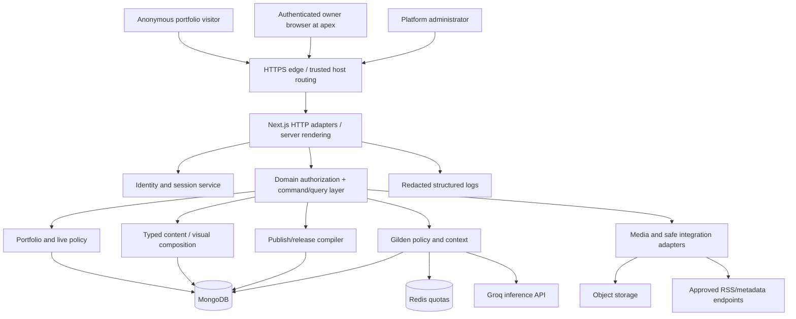

This diagram depicts **logical boundaries**, not separately deployed backend services. The exact edge, storage, Redis and AI vendors are conditional and must meet the no-card/no-overage/no-unapproved-processing constraints. Public paths and subdomains share a product identity but not necessarily cookies; **account sessions must remain host-only on `aaroophan.dev`**. [S02][S03][S06]

---

## 2. Requirements, architectural boundaries and decision authority

### 2.1 Requirement-to-API mapping

| Requirement family        | Relevant API obligations                                                                                            | Primary owning component  |
| ------------------------- | ------------------------------------------------------------------------------------------------------------------- | ------------------------- |
| `IAM-001..009`            | Login, stable provider subject, explicit account linking, last-provider protection, reauth, session revocation      | Identity service          |
| `TEN-001..009`            | Portfolio ID, owner-scope, one active portfolio, slug history, dual host resolution, disabled/suspended suppression | Portfolio routing/policy  |
| `CNT-001..011`            | Typed sections, custom schema subset, reusable content, safe bindings, feed excerpts, generated search              | Content/schema services   |
| `EDT-001..010`            | Draft read/write, revision conflicts, visual-node commands, owner-only preview                                      | Editor/draft service      |
| `PUB-001..008`            | Validate, prepare, activate, idempotent release, retry, retention and restore                                       | Publication service       |
| `AI-001..010`             | Owner opt-in, approved knowledge, immediate revoke, quota, streaming, citations                                     | Gilden service            |
| `MED-001..005`            | Reservation, validation, normalized media, safe PDFs, reference-aware deletion                                      | Media service             |
| `CON-001`, `ANA-001`      | Consent-based contact, TTL, aggregate analytics                                                                     | Contact/analytics         |
| `ADM-001..003`            | Moderation overlay, reports, status and audits                                                                      | Admin service             |
| `ACC-001..002`            | Export, access revocation, idempotent erasure                                                                       | Account lifecycle         |
| `SEC-001..012`            | Server checks, CSRF, bounds, no-secret logs, SSRF, vulnerability gates                                              | Every adapter and service |
| `UX`, `SEO`, `PRF`, `OPS` | Semantic publication, search/sitemap/OG correctness, low-cost streaming, operating limits                           | Public delivery/platform  |

### 2.2 API ownership vs. persistence ownership

A browser submits **intent**: "save this draft revision", "publish this validated revision", "approve these AI sources", or "remove this media item". It does not submit an arbitrary database update operator, collection name, owner ID, release pointer, encrypted token, audit record or backend URL. The route parses and authorizes a command. A domain service evaluates lifecycle invariants and calls repositories through typed methods. A response is a **purpose-specific projection**, not an ORM/Mongo document serialization.

For example, `PUT /portfolios/{id}/draft` is not a license to overwrite `portfolios.activeReleaseId` or account ownership. Those fields live in different aggregates and can only change through explicit domain methods. Even if a UI sends these fields, the API MUST reject them rather than ignore silently where security-sensitive.

### 2.3 Internal integration contracts

- `IdentityPort`: `requireSession`, `requireRecentAuthentication`, `linkIdentity`, `unlinkIdentity`, `revokeSessions`.
- `PortfolioRepository`: `getOwnedPortfolio(actorId, portfolioId)`, `findByVerifiedSlug`, `compareAndUpdateControl`, `claimSlugAtomically`.
- `DraftRepository`: `getOwnedDraft`, `compareAndReplaceDraft`, `restoreToNewRevision`.
- `PublicationPort`: `validateRevision`, `compileRelease`, `prepareOperation`, `compareAndActivate`, `getOperationStatus`, `retryPropagation`.
- `PolicyPort`: `assertPublicAllowed`, `assertAiAllowed`, `denyContentNow`, `getCurrentSecurityVersion`.
- `MediaPort`: `reserveQuota`, `createUploadIntent`, `inspectStagedObject`, `normalize`, `finalize`, `deleteIfUnreferenced`.
- `AiPort`: `compileApprovedContext`, `streamAnswer`, `cancel`, `validateCitations`, `consumeQuota`.
- `IntegrationPort`: `fetchMetadataSafely`, `syncFeed`, `resolveGitHubPublicMetadata`.
- `AuditPort`: `recordSecurityDecision`, `recordSecurityMutation`, `recordFailure` (structured, redacted, bounded).

The interface names are illustrative. **What is fixed is their responsibility boundary and the fact that adapters cannot bypass policy by calling storage directly.**

### 2.4 Decision status and feasibility gates

| Decision                           | Contract status            | Evidence required before production                                                       |
| ---------------------------------- | -------------------------- | ----------------------------------------------------------------------------------------- |
| `/api/v1` URL namespace            | Proposed normative         | OpenAPI validation and route inventory pass                                               |
| Google OIDC + GitHub OAuth         | Required                   | Exact provider callback, linking and verified-subject tests                               |
| Host-only authentication           | Required                   | Browser/network proof on apex vs. subdomain                                               |
| Path + wildcard subdomain delivery | Required                   | DNS/TLS, host canonicalization and forged-host tests                                      |
| MongoDB atomic control update      | Required logical guarantee | CAS tests on chosen tier, database driver and retry behavior                              |
| Browser draft conflict error `409` | Existing requirement       | HTTP standard interoperability decision [§34.1](#341-conditional-requests-409-versus-412) |
| Object storage capability contract | Required logical guarantee | Provider cannot charge and supports staged validation/isolation                           |
| Streaming Gilden                   | Required where feasible    | Cancellation and fallback proven on deployed runtime                                      |
| Same-origin UGC safety             | Release blocker            | CSP, rich-text sanitizer and adversarial stored-XSS review                                |
| Cache revocation                   | Release blocker            | Concrete edge/runtime test that denied content is not served stale                        |

---

## 3. Security-first trust boundaries and request processing

### 3.1 Trust zones

| Zone                               | Trust level                                        | Attacker control                                                | Permitted data                                           |
| ---------------------------------- | -------------------------------------------------- | --------------------------------------------------------------- | -------------------------------------------------------- |
| `Z0` arbitrary Internet            | Untrusted                                          | URLs, headers, query, body, uploads, chat input, link previews  | Public outcomes only                                     |
| `Z1` published portfolio client    | Untrusted, even if same-origin with apex path      | Author-written public rich text/links/metadata, browser runtime | Approved release only                                    |
| `Z2` authenticated apex browser    | User-authenticated, not authorization-trusted      | All request parameters and local state may be manipulated       | Own account and owned portfolio after server checks      |
| `Z3` server HTTP adapter           | Trusted code processing untrusted data             | Can contain bugs; never call DB with unvalidated objects        | Parsed commands and safe projections                     |
| `Z4` domain authorization/services | Privileged only after verified evidence            | Session/host/policy dependencies might fail                     | Scoped domain values                                     |
| `Z5` managed data and media        | Service-to-service trust with explicit credentials | Provider limits, outages, misconfigurations                     | Classified records, private objects, immutable artifacts |
| `Z6` external AI/RSS/GitHub/OAuth  | Independent external processors                    | May respond with untrusted or manipulated data                  | Minimal approved payload for specific purpose            |
| `Z7` administrative operations     | Elevated and audited                               | Compromised admin account remains a risk                        | Minimum scope and recent reauthentication                |

A key risk is that `https://aaroophan.dev/{slug}` shares **web origin** with `https://aaroophan.dev/dashboard`. HttpOnly blocks direct JavaScript access to cookie bytes, but a same-origin injected script could still issue authenticated requests. Therefore public rich text, embedded diagrams, block metadata, document names and externally fetched descriptions MUST be strictly sanitized/encoded; arbitrary scripts or raw HTML are forbidden. The API also requires anti-CSRF, fresh checks, content security policy and response-level caching controls. See [07](07-security-design.md), OWASP [S04][S05][S07].

### 3.2 Standard inbound request pipeline

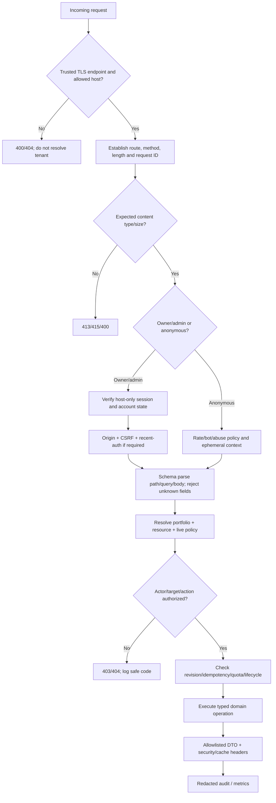

The server MUST NOT use Next.js proxy/middleware alone as an authorization enforcement point. Middleware/Proxy is appropriate for preliminary routing, coarse host checks and redirects; every protected handler and domain service must independently verify scope. Server Actions are callable HTTP endpoints; an exported server function is **not private simply because it is imported only by an authenticated page**. Next.js documents this security property [S02][S03].

### 3.3 Request context

A request context contains only validated, minimal data:

```ts
interface VerifiedRequestContext {
  requestId: string; // opaque, generated at trusted ingress
  traceId?: string; // validated correlation only
  origin: "https://aaroophan.dev" | "verified-portfolio-subdomain";
  actor?: {
    accountId: string;
    roles: ReadonlyArray<"user" | "admin">;
    sessionId: string;
  };
  portfolio?: { portfolioId: string; publicHostKind: "path" | "subdomain" };
  clientAbuseContext?: { quotaKey: string; authenticatedByEdge: boolean };
  deadline?: string;
}
```

The shape above illustrates the separation between **claims** and **authorized objects**. It must not expose provider bearer tokens, raw cookies, client IP addresses, storage credentials or internal request body to UI serializers. A request ID may appear in error responses, while trace internals remain server-only.

### 3.4 Never-trust assertions

- `Host`, `X-Forwarded-Host`, `Forwarded`, `X-Real-IP`, `X-Forwarded-For`, `Referer` and `Origin` are inputs requiring deployment-specific trust treatment. `Origin` supports browser CSRF defense but does not authenticate CLI requests or prove ownership.
- A path's `{portfolioId}` is a target identifier, not a privilege grant.
- A UUID, release ID, media ID, operation ID, preview query, cursor or citation ID is never an authorization token.
- A provider's display name/email is not stable user identity. Google OIDC `issuer + sub` and GitHub stable subject are evaluated through a verified provider exchange.
- A public/AI-approved field still requires a live moderation/visibility check when it is used.
- Media `Content-Type`, file extension, `Content-Length`, client-computed hash and client-side transformations do not establish trusted file type or actual byte count.
- The AI model cannot decide what is allowed to be disclosed; the server selects the approved context **before** inference and validates source links **after** generation.

### 3.5 Threat-control placement

**Ingress** enforces TLS/host/size/method restrictions. **Authentication** verifies sessions and provider state. **Authorization** binds actor to exact portfolio/resource and current policy. **Domain service** enforces lifecycle, limits, optimistic concurrency and idempotency. **Repository** restricts query/update shapes and maintains uniqueness. **Serialization** strips private fields. **Delivery** uses CSP, no-store as appropriate, canonical host headers, no CORS widening and cache-safe policy gates. No layer is presented as infallible; security-critical invariants appear in more than one independently testable layer.

---

## 4. HTTP conventions, API stability and resource nomenclature

### 4.1 Base addresses and routing surfaces

- **Authenticated API base:** `https://aaroophan.dev/api/v1`.
- **Auth provider-managed endpoints:** `/api/auth/*`; exact routes and cookie names depend on the pinned, reviewed Auth.js adapter/version.
- **Public anonymous API:** `/api/v1/public/*` on the portfolio's **current origin** (apex path or allowed subdomain), with tenant derived from a verified route/host context.
- **Public document paths:** `https://aaroophan.dev/{slug}` and `https://{slug}.aaroophan.dev/`, each with mirror detail routes.
- **Owner preview:** on the apex only, authenticated and `Cache-Control: no-store`; no long-lived shareable previews initially.
- **Administration:** apex only, `/api/v1/admin/*`, explicit administrator identity and recent-auth for mutations.
- **Object delivery:** validated delivery URL/capability generated by the media service; never expose raw storage object names as meaningful route security.

**Key public transport design rule:** Do not enable credentialed `Access-Control-Allow-Origin: *`, wildcard `Access-Control-Allow-Credentials`, or tenant-to-apex authenticated CORS. A portfolio subdomain may call its own origin's public endpoints without receiving the apex session cookie. `SameSite` is not a substitute for origin-scoped sessions because sibling subdomains are same-site in browsers.

### 4.2 Accepted methods and semantics

| Method    | Use in GildedIn                                                       | Idempotence / safety                                                                 |
| --------- | --------------------------------------------------------------------- | ------------------------------------------------------------------------------------ |
| `GET`     | Query safe public/owner projections; page rendering                   | No state-changing side effects; server telemetry separate and bounded                |
| `HEAD`    | Optional lightweight resource status; not an authorization bypass     | Same permission checks as GET; no body                                               |
| `POST`    | Create, publish, execute a constrained command, AI stream             | Not inherently idempotent; use scoped keys where retries can duplicate               |
| `PUT`     | Replace a full resource or AI settings object, with conditional check | Semantically idempotent, but revision increments require compare-and-swap discipline |
| `PATCH`   | Partial update of allowlisted settings (not raw JSON Patch over DB)   | Validate exact operation; use precondition for dangerous changes                     |
| `DELETE`  | Safe removal after ownership, references and reauth as needed         | Logically idempotent; repeated deletion should not destroy foreign data              |
| `OPTIONS` | Method negotiation/preflight only as explicitly supported             | No business side effects                                                             |

All mutation handlers must reject unsupported `Content-Type`, unbounded bodies, nonallowlisted HTTP methods and malformed encodings. For method errors return `405` and `Allow`. For content type errors return `415`; oversized payload `413`; unsupported `Accept` where strict negotiation matters `406`.

### 4.3 Media types and encoding

| Interaction                        | Request                                             | Successful response                           | Error response                                                     |
| ---------------------------------- | --------------------------------------------------- | --------------------------------------------- | ------------------------------------------------------------------ |
| Ordinary JSON API                  | `application/json; charset=utf-8`                   | `application/json; charset=utf-8`             | `application/problem+json`                                         |
| Browser form via authenticated API | JSON or framework-managed form with CSRF semantics  | JSON/redirect as explicitly described         | Problem JSON or accessible server-rendered form                    |
| Groq-backed AI stream              | JSON body, `Accept: text/event-stream`              | `text/event-stream; charset=utf-8`            | Problem JSON **before** stream starts; typed error event afterward |
| AI fallback                        | JSON, `Accept: application/json`                    | JSON                                          | Problem JSON                                                       |
| File upload intent/finalize        | JSON metadata, then provider-specific binary upload | Narrow capability, then verified metadata DTO | Problem JSON                                                       |
| Export                             | Standard browser download                           | `application/zip`, no-store, attachment       | Problem JSON / redacted failure page                               |
| Public image                       | Browser GET                                         | Normalized image MIME and controlled caching  | 404/unavailable (do not reveal private asset)                      |
| Approved PDF                       | Browser GET                                         | `application/pdf` with restrictive headers    | 403/404 depending policy                                           |
| Public sitemap/robots              | GET                                                 | XML / `text/plain`                            | Safe 404/503 if policy cannot be evaluated                         |

UTF-8 is normative for JSON, SSE and rendered text. Clients must not send raw credentials via URL parameters, analytics fields or uploaded filenames. ISO timestamps use RFC 3339 UTC `...Z`; user-visible localized dates are a presentation concern. Never parse client-controlled JavaScript numbers into monetary/counter precision without integer bounds.

### 4.4 Status code catalogue

| Status        | Meaning in this API                                                                                                                       |
| ------------- | ----------------------------------------------------------------------------------------------------------------------------------------- |
| `200`         | Successful query, replace or completed/replayed command                                                                                   |
| `201`         | New resource/operation created, `Location` when meaningful                                                                                |
| `202`         | Accepted non-final work or publication activated but propagation pending; operation URL supplied                                          |
| `204`         | Successful operation with no response body                                                                                                |
| `304`         | Freshness check for genuinely cacheable public representation, never private authorization bypass                                         |
| `307` / `308` | Controlled redirects; `308` for stable slug/canonical redirects, avoid authentication open redirects                                      |
| `400`         | Malformed syntax, ambiguous host/path or malformed request envelope                                                                       |
| `401`         | Missing, expired or invalid session for owner/admin endpoint                                                                              |
| `403`         | Authenticated but disallowed operation when disclosure is safe; often 404 to hide foreign target                                          |
| `404`         | Unknown, inaccessible, unlisted private? (unlisted **is** link-accessible), unpublished, disabled or hidden resource as defined per route |
| `405`         | Method unsupported (`Allow` header)                                                                                                       |
| `406`         | Requested response format unavailable where negotiation required                                                                          |
| `409`         | Domain conflict (duplicate slug, stale draft **per product policy**, reference in use, idempotency fingerprint collision)                 |
| `410`         | Permanently deleted public page when safely determinable                                                                                  |
| `412`         | HTTP `If-Match` precondition failure under strict RFC 9110 interpretation; see standards reconciliation §34.1                             |
| `413`         | Input size exceeds route-specific body cap                                                                                                |
| `415`         | Unsupported content type                                                                                                                  |
| `422`         | Structurally parseable but invalid or semantically unsafe content/contract                                                                |
| `428`         | Required precondition absent, if strict conditional HTTP mode adopted                                                                     |
| `429`         | Server-enforced user/tenant/global request or AI quota, with bounded retry hint                                                           |
| `500`         | Internal bug; public detail redacted, request ID supplied                                                                                 |
| `502`         | Bound external service returned unusable response (appropriate only when upstream is actual gateway)                                      |
| `503`         | Dependency, rate-budget authority or live security policy unavailable; fail closed for protected data                                     |
| `504`         | Upstream operation timeout where gateway semantics apply                                                                                  |
| `507`         | Known storage capacity exhaustion (optional; stable `STORAGE_CAPACITY_EXHAUSTED` code primary)                                            |

**Do not use `200` with `{success:false}` for failures**, nor `404` to disguise technical 500s. `404` is intentionally appropriate for non-enumeration of foreign private resources, not for hiding server exceptions. Use explicit `Cache-Control: no-store` for errors carrying sensitive context.

### 4.5 Request and response headers

| Header                                           | Direction | Contract                                                                                                  |
| ------------------------------------------------ | --------- | --------------------------------------------------------------------------------------------------------- |
| `Content-Type`                                   | Both      | Reject wrong JSON/media upload types; correct SSE/PDF/ZIP response MIME                                   |
| `Accept`                                         | Request   | Required on negotiated streaming/fallback endpoints                                                       |
| `Origin`                                         | Request   | Expected apex origin for owner writes; exact public origin for public mutations; null/disallowed rejected |
| `Cookie`                                         | Request   | Host-only session at apex; anonymous ephemeral token where needed                                         |
| `X-CSRF-Token`                                   | Request   | Required for protected browser mutations if CSRF synchronizer design chosen; not browser-session proof    |
| `If-Match`                                       | Request   | Draft revision and high-risk conditional writes; strong ETag format                                       |
| `ETag`                                           | Response  | Draft version, or a public immutable content representation validator; no secret hashes                   |
| `Idempotency-Key`                                | Request   | Required for publish, finalize and destructive workflow start                                             |
| `X-Request-Id`                                   | Response  | New opaque diagnostic handle, not supplied verbatim by untrusted client                                   |
| `Retry-After`                                    | Response  | Numeric seconds/date when meaningful; no unsafe tenant/provider quota details                             |
| `Location`                                       | Response  | Same-origin resource/operation URL, canonical fixed routing only                                          |
| `Cache-Control`                                  | Response  | Explicit private `no-store`, public release cache policy gated by live security                           |
| `Vary`                                           | Response  | Accurate response variant keys without leaking user identity to shared cache                              |
| `Referrer-Policy`, `X-Content-Type-Options`, CSP | Response  | Defense-in-depth per HTML/media response profile                                                          |
| `Access-Control-*`                               | Response  | No credentialed wildcard origin; only narrow explicitly reviewed CORS rules                               |

Never put owner session IDs, refresh tokens, internal storage keys, provider API keys or arbitrary personal details into headers or redirect URLs. HTTP headers and host routing are part of the attack surface [S07][S08][S09].

### 4.6 Request deadlines and cancellation

Each outbound call has explicit connect, read and total deadlines. No route may hold an unbounded open stream or wait forever for RSS, storage, database, Redis or Groq. Propagate `AbortSignal` to supported fetch calls and AI generation. Timeouts of public dependencies must not be confused with authorization failures: a missing live policy is **deny/unavailable**, not a permission grant via cache. Retrying mutations is permitted only through the idempotency/revision discipline described below.

---

## 5. Endpoint taxonomy and initial inventory

The following tables define a **first-release target inventory**, not a blanket commitment to expose every internal domain operation over HTTP. Where a feature can be safely server-rendered or performed by one authorized server action, avoid an extra round trip. Endpoint implementation must have (a) a named handler, (b) a schema, (c) a policy action, (d) success/error models, (e) rate/body limits and (f) tests before being counted complete. `R` means authenticated user, `R+` means recent reauthentication, `A` means admin, `P` means anonymous after public policy checks; `APEX` is only `https://aaroophan.dev`; `HOST` is the validated current portfolio host.

### 5.1 Authentication, current account and identity providers

| Contract ID  | Method and path                                     | Caller                   | Goal / response                                                           | Requirement      |
| ------------ | --------------------------------------------------- | ------------------------ | ------------------------------------------------------------------------- | ---------------- |
| `API-IAM-01` | `GET/POST /api/auth/*`                              | Provider/browser         | Auth.js login, callback, logout; concrete route list pinned later         | IAM-001, SEC-003 |
| `API-IAM-02` | `GET /api/v1/accounts/me`                           | R, APEX                  | Private account summary, login methods, roles safe for own view           | IAM-005          |
| `API-IAM-03` | `PATCH /api/v1/accounts/me`                         | R, APEX                  | Allowlisted profile fields (no role/email verification changes)           | IAM-005, SEC-002 |
| `API-IAM-04` | `GET /api/v1/accounts/me/providers`                 | R, APEX                  | Linked provider labels, linked date, last-used state; no tokens           | IAM-003          |
| `API-IAM-05` | `POST /api/v1/accounts/me/providers/link-intent`    | R+, APEX                 | Start provider proof; single-use state bound to current account/session   | IAM-003          |
| `API-IAM-06` | `DELETE /api/v1/accounts/me/providers/{identityId}` | R+, APEX                 | Unlink after last-provider check and fresh proof                          | IAM-004, IAM-008 |
| `API-IAM-07` | `POST /api/v1/accounts/me/sessions/revoke-all`      | R+, APEX                 | Revoke all sessions / rotate account security version                     | IAM-005, IAM-008 |
| `API-IAM-08` | `GET /api/v1/accounts/me/export`                    | R+, APEX                 | Generate/download authorized portable archive; may use operation flow     | ACC-001          |
| `API-IAM-09` | `POST /api/v1/accounts/me/delete`                   | R+, APEX                 | Start idempotent account deletion, immediately suppress public visibility | ACC-002          |
| `API-IAM-10` | `GET /api/v1/accounts/me/delete/{operationId}`      | R or controlled recovery | Return deletion progress without recoverable private data                 | ACC-002          |

### 5.2 Portfolio, slug, onboarding and settings

| Contract ID  | Method and path                                     | Caller   | Goal / response                                                                       | Requirement               |
| ------------ | --------------------------------------------------- | -------- | ------------------------------------------------------------------------------------- | ------------------------- |
| `API-TEN-01` | `GET /api/v1/portfolios/slug-availability?slug=...` | R, APEX  | Advisory check; not reservation                                                       | TEN-004                   |
| `API-TEN-02` | `POST /api/v1/portfolios`                           | R, APEX  | Atomically create portfolio + slug claim + initial draft; 201                         | TEN-001, TEN-003, TEN-004 |
| `API-TEN-03` | `GET /api/v1/portfolios`                            | R, APEX  | Own one-portfolio summary, future cursor-based list shape                             | TEN-003                   |
| `API-TEN-04` | `GET /api/v1/portfolios/{portfolioId}`              | R, APEX  | Owned control-plane view and safe status                                              | TEN-002                   |
| `API-TEN-05` | `PATCH /api/v1/portfolios/{portfolioId}`            | R, APEX  | Bounded owner-settings update, excludes `ownerAccountId`, release pointer, moderation | SEC-002                   |
| `API-TEN-06` | `POST /api/v1/portfolios/{portfolioId}/rename`      | R, APEX  | Atomically claim new slug and preserve aliases; idempotent                            | TEN-004, TEN-005          |
| `API-TEN-07` | `POST /api/v1/portfolios/{portfolioId}/visibility`  | R, APEX  | Public ↔ unlisted live policy switch; no release mutation                             | PUB-007                   |
| `API-TEN-08` | `POST /api/v1/portfolios/{portfolioId}/disable`     | R, APEX  | Immediately suppress public viewing and AI                                            | PUB-008                   |
| `API-TEN-09` | `POST /api/v1/portfolios/{portfolioId}/enable`      | R, APEX  | Restore eligibility only when not suspended/moderated                                 | PUB-008                   |
| `API-TEN-10` | `POST /api/v1/portfolios/{portfolioId}/delete`      | R+, APEX | Confirm and begin owner portfolio deletion, when supported as separate lifecycle      | ACC-002                   |

### 5.3 Draft, schema and composition authoring

| Contract ID  | Method and path                                               | Caller  | Goal / response                                                                  | Requirement |
| ------------ | ------------------------------------------------------------- | ------- | -------------------------------------------------------------------------------- | ----------- |
| `API-EDT-01` | `GET /api/v1/portfolios/{portfolioId}/draft`                  | R, APEX | Full owner-only draft with revision/ETag                                         | EDT-008     |
| `API-EDT-02` | `PUT /api/v1/portfolios/{portfolioId}/draft`                  | R, APEX | Conditional whole-draft replace; compacted debounced saves                       | EDT-008/009 |
| `API-EDT-03` | `PATCH /api/v1/portfolios/{portfolioId}/draft`                | R, APEX | Bounded **typed domain operations**, not untrusted Mongo or arbitrary JSON Patch | CNT/EDT     |
| `API-EDT-04` | `POST /api/v1/portfolios/{portfolioId}/draft/validate`        | R, APEX | Non-mutating validation report; warnings and blockers                            | PUB-001     |
| `API-EDT-05` | `POST /api/v1/portfolios/{portfolioId}/draft/schema-import`   | R, APEX | Parse constrained JSON Schema subset into **draft candidate**                    | CNT-007     |
| `API-EDT-06` | `GET /api/v1/portfolios/{portfolioId}/editor/bootstrap`       | R, APEX | Owner-allowed catalog, limits, breakpoints and draft metadata                    | EDT-001     |
| `API-EDT-07` | `GET /api/v1/portfolios/{portfolioId}/preview`                | R, APEX | Owner-only preview HTML or bootstrap data; no-store                              | EDT-010     |
| `API-EDT-08` | `GET /api/v1/portfolios/{portfolioId}/draft/conflict-summary` | R, APEX | Safe current-revision comparison metadata (no foreign data)                      | EDT-009     |

Prefer `PATCH` with operations like `setField`, `moveNode`, `reparentNode`, `setLayoutConstraint`, `reorderSection` and `setContentBinding` over a giant untyped JSON Patch protocol. A full `PUT` remains useful for initial editor snapshots and recovery. Both mutate the **same single revisioned draft aggregate** and therefore share the same compare-and-swap rule.

### 5.4 Publication and releases

| Contract ID  | Method and path                                                            | Caller  | Goal / response                                                      | Requirement     |
| ------------ | -------------------------------------------------------------------------- | ------- | -------------------------------------------------------------------- | --------------- |
| `API-PUB-01` | `POST /api/v1/portfolios/{portfolioId}/publish`                            | R, APEX | Idempotent prepare/activate of one draft revision                    | PUB-001/002/003 |
| `API-PUB-02` | `GET /api/v1/portfolios/{portfolioId}/publications/{operationId}`          | R, APEX | Operation stage, active release and propagation state                | PUB-004         |
| `API-PUB-03` | `POST /api/v1/portfolios/{portfolioId}/publications/{operationId}/recheck` | R, APEX | Idempotent propagation/status reconciliation                         | PUB-004         |
| `API-PUB-04` | `GET /api/v1/portfolios/{portfolioId}/releases`                            | R, APEX | Three retained successful release summaries; no raw private contents | PUB-006         |
| `API-PUB-05` | `GET /api/v1/portfolios/{portfolioId}/releases/{releaseId}`                | R, APEX | Authorized restorable summary/previews; no unbounded binary payload  | PUB-005         |
| `API-PUB-06` | `POST /api/v1/portfolios/{portfolioId}/releases/{releaseId}/restore-draft` | R, APEX | Conditional creation of new draft revision from release              | PUB-005         |

### 5.5 Media and integrations

| Contract ID  | Method and path                                                  | Caller  | Goal / response                                                 | Requirement      |
| ------------ | ---------------------------------------------------------------- | ------- | --------------------------------------------------------------- | ---------------- |
| `API-MED-01` | `POST /api/v1/portfolios/{portfolioId}/media/intents`            | R, APEX | Reserve quota, issue narrow temporary staging upload capability | MED-001/003      |
| `API-MED-02` | `POST /api/v1/portfolios/{portfolioId}/media/{mediaId}/finalize` | R, APEX | Inspect staged bytes, normalize, verify then commit             | MED-001/002      |
| `API-MED-03` | `GET /api/v1/portfolios/{portfolioId}/media`                     | R, APEX | Owned assets, processing/reference status, bounded pagination   | MED-004          |
| `API-MED-04` | `PATCH /api/v1/portfolios/{portfolioId}/media/{mediaId}`         | R, APEX | Owner-editable alt text/crop/focal metadata                     | MED-002          |
| `API-MED-05` | `DELETE /api/v1/portfolios/{portfolioId}/media/{mediaId}`        | R, APEX | Refuse referenced media; otherwise safe GC and status           | MED-004          |
| `API-MED-06` | `GET /api/v1/portfolios/{portfolioId}/media/{mediaId}/status`    | R, APEX | Owned staged/processing/ready/rejected lifecycle                | MED-001          |
| `API-EXT-01` | `POST /api/v1/portfolios/{portfolioId}/feeds/sync`               | R, APEX | Safe RSS/Medium preview sync or background operation            | CNT-010, SEC-005 |
| `API-EXT-02` | `GET /api/v1/portfolios/{portfolioId}/feeds`                     | R, APEX | Configured feed/status/cached preview summaries                 | CNT-010          |
| `API-EXT-03` | `POST /api/v1/portfolios/{portfolioId}/links/preview`            | R, APEX | SSRF-defended metadata preview for one URL                      | SEC-005          |

The binary upload transport may be directly to a compatible object store via a narrowly scoped capability or through a limited server proxy if and only if provider constraints permit it. The **domain API** above remains stable regardless of provider transport.

### 5.6 AI and public visitor interactions

| Contract ID   | Method and path                                                                               | Caller  | Goal / response                                                         | Requirement |
| ------------- | --------------------------------------------------------------------------------------------- | ------- | ----------------------------------------------------------------------- | ----------- |
| `API-AI-01`   | `GET /api/v1/portfolios/{portfolioId}/ai-settings`                                            | R, APEX | Owner settings, approved-field summary, context status                  | AI-001/002  |
| `API-AI-02`   | `PUT /api/v1/portfolios/{portfolioId}/ai-settings`                                            | R, APEX | Full bounded settings update with policy version check                  | AI-001/004  |
| `API-AI-03`   | `POST /api/v1/portfolios/{portfolioId}/ai-settings/revoke`                                    | R, APEX | Immediate authoritative source/field revoke; no delayed acknowledgement | AI-004      |
| `API-AI-04`   | `GET /api/v1/portfolios/{portfolioId}/ai-knowledge-preview`                                   | R, APEX | Show exactly what approved release context is eligible, owner-only      | AI-002/003  |
| `API-AI-05`   | `GET /api/v1/portfolios/{portfolioId}/ai-usage`                                               | R, APEX | Aggregate availability/quota, no transcript                             | AI-007/008  |
| `API-AI-06`   | `POST /api/v1/public/{slug}/gilden` (apex) or `/api/v1/public/gilden` (portfolio subdomain)   | P, HOST | Anonymous bounded chat, streaming or JSON fallback                      | AI-001..008 |
| `API-PUBV-01` | `POST /api/v1/public/{slug}/contact` (apex) or `/api/v1/public/contact` (portfolio subdomain) | P, HOST | Consent-based text-only form, bot/rate checked                          | CON-001     |
| `API-PUBV-02` | `POST /api/v1/public/{slug}/report` (apex) or `/api/v1/public/report` (portfolio subdomain)   | P, HOST | Report abusive portfolio/route; no visitor account                      | ADM-002     |
| `API-PUBV-03` | `POST /api/v1/public/interaction`                                                             | P, HOST | Low-sensitivity aggregate view/click event                              | ANA-001     |
| `API-PUBV-04` | `GET /api/v1/public/search?q=...`                                                             | P, HOST | Released filtered client search index/query; no Mongo regex API         | CNT-011     |
| `API-PUBV-05` | `GET /api/v1/public/status`                                                                   | P, HOST | Minimal public AI/content availability only                             | AI-001      |
| `API-PUBV-06` | `GET /api/v1/public/{slug}/directory` (apex marketing directory uses `/api/v1/directory`)     | P, APEX | Safe curated/searchable portfolio directory with consented visibility   | TEN-006     |
| `API-CON-02`  | `GET /api/v1/portfolios/{portfolioId}/inbox`                                                  | R, APEX | Paginated owner-only contact messages, retention enforced               | CON-001     |
| `API-CON-03`  | `DELETE /api/v1/portfolios/{portfolioId}/inbox/{messageId}`                                   | R, APEX | Idempotent owner-only deletion of one message                           | CON-001     |
| `API-ANA-02`  | `GET /api/v1/portfolios/{portfolioId}/analytics`                                              | R, APEX | Bounded aggregate analytics without visitor identifiers                 | ANA-001     |

`/api/v1/public/*` on an apex path should only be routed under a verified portfolio context. The implementation must define **one unambiguous way** to communicate this context, preferably the path `/api/v1/public/{slug}/{operation}` for apex calls or a server-issued, short-lived **public route context token** bound to the active release and host. An untrusted `portfolioId` field by itself is not sufficient. For clean mirroring, the canonical proposal is to support two adapters: `/api/v1/public/{slug}/...` at apex and `/api/v1/public/...` at a verified portfolio subdomain, both dispatching into the **same** policy-checked public service. See §7.

### 5.7 Administration

| Contract ID  | Method and path                                                              | Caller   | Goal / response                                        | Requirement |
| ------------ | ---------------------------------------------------------------------------- | -------- | ------------------------------------------------------ | ----------- |
| `API-ADM-01` | `GET /api/v1/admin/status`                                                   | A, APEX  | Redacted service health, recent failures, quota status | ADM-003     |
| `API-ADM-02` | `GET /api/v1/admin/reports`                                                  | A, APEX  | Bounded report queue with explicit scope               | ADM-002     |
| `API-ADM-03` | `GET /api/v1/admin/reports/{reportId}`                                       | A, APEX  | One report + private reviewer context                  | ADM-002     |
| `API-ADM-04` | `POST /api/v1/admin/reports/{reportId}/resolve`                              | A+, APEX | Audited resolution and reason code                     | ADM-002     |
| `API-ADM-05` | `POST /api/v1/admin/portfolios/{portfolioId}/moderation`                     | A+, APEX | Apply/lift whole-portfolio suppression live            | ADM-001     |
| `API-ADM-06` | `POST /api/v1/admin/portfolios/{portfolioId}/content/{contentId}/moderation` | A+, APEX | Hide named content item in public/search/AI            | ADM-001     |
| `API-ADM-07` | `GET /api/v1/admin/audit`                                                    | A+, APEX | Redacted bounded security audit with filters           | SEC-010     |

An admin is **not** implicitly allowed to edit an owner's biography, adopt a tenant's OAuth session, read contact inbox contents, query raw private drafts, or access AI transcripts. Admin permissions are separate named actions; privileged changes require recent authentication and audit records. If a dispute requires examining private evidence, design a separate legally justified break-glass process and security review; do not reuse owner APIs with a generic `admin || owner` bypass.

### 5.8 Public page routes, distinct from `/api/v1`

| Host                        | Route                                                                 | Expected behavior                                                                |
| --------------------------- | --------------------------------------------------------------------- | -------------------------------------------------------------------------------- |
| `aaroophan.dev`             | `/`                                                                   | GildedIn marketing/onboarding + curated directory interface                      |
| Apex                        | `/{slug}`                                                             | Public or unlisted released portfolio if policy allows                           |
| Apex                        | `/{slug}/projects/{projectSlug}`                                      | Active release's project case study + distinct SEO                               |
| Apex                        | `/{slug}/experience`, `/{slug}/references` and supported typed routes | Versioned released route manifest, no implicit unused routes                     |
| `{slug}.aaroophan.dev`      | `/`, `/projects/{projectSlug}`, `/experience` etc.                    | Same portfolio ID/release, subdomain-preserving navigation                       |
| Apex                        | `/dashboard/*`, `/admin/*`                                            | Host-only authenticated pages with noindex/no-store                              |
| Each verified relevant host | `/robots.txt`, `/sitemap.xml`                                         | Host-aware policy, canonical path-based mapping and no unlisted/private exposure |
| Apex                        | `/privacy`, `/help`, explicitly reserved routes                       | GildedIn pages, never portfolio slugs                                            |
| Unknown host or slug        | Any route                                                             | Safe 404; historical authorized slug may redirect as specified                   |

Do not confuse a private owner preview with a public published route. Search engines, social preview fetchers and anonymous navigation must never be able to get a draft by guessing a URL.

---

## 6. Identity, OAuth/OIDC, sessions and provider linking

### 6.1 Identity model and authentication result

GildedIn uses an internal `accountId` independent of provider identity or email. The identity tuple is `(provider, providerSubject)` and, where applicable, the issuer. Google sign-in uses a verified OpenID Connect identity; GitHub uses a verified stable GitHub account identifier returned through an authenticated provider exchange. Emails are optional verified contact attributes and **not** authorization or automatic linking keys. A new account may exist without a portfolio. Administrators are provisioned through a trusted deployment procedure, never by being the first registrant. [S06][S10]

Authenticate through an established, pinned OAuth/OIDC library with exact registered callbacks, authorization code + PKCE as applicable, OAuth `state`/OIDC `nonce`, issuer validation and mix-up protections when multiple providers are supported. Provider IDs, tokens, roles and recent-auth states must be computed server-side. The OAuth BCP warns against open redirects and insecure callback verification [S06]. Never expose a raw provider access/refresh token to the browser merely to display profile content.

### 6.2 Session contract

1. Successful provider verification resolves or creates an `Account`; a server-controlled session is issued.
2. The cookie is host-only for `aaroophan.dev`, `Secure`, `HttpOnly`, `Path=/`, and uses appropriate SameSite settings. Prefer a correct `__Host-` prefixed cookie if supported by the pinned library. **Do not** set `Domain=.aaroophan.dev`.
3. The server must be able to revoke sessions, check expiry, and reject sessions associated with suspended/deleting accounts or superseded security versions.
4. The browser sends the cookie automatically to apex same-origin API calls. Cookies are not copied to a user-owned subdomain, not placed in URL parameters and not exposed to frontend JavaScript.
5. Private queries use `Cache-Control: no-store` and no shared CDN caching.
6. Logout revokes server-held state, clears the cookie and updates the UI; simple client-side cookie deletion without server revocation is not a sufficient logout design.
7. Session rotation, idle/absolute lifetime, and reauthentication freshness windows are specific configured values that must be set in [07](07-security-design.md); examples must not be mistaken for established decisions.

### 6.3 Account creation and registration sequence

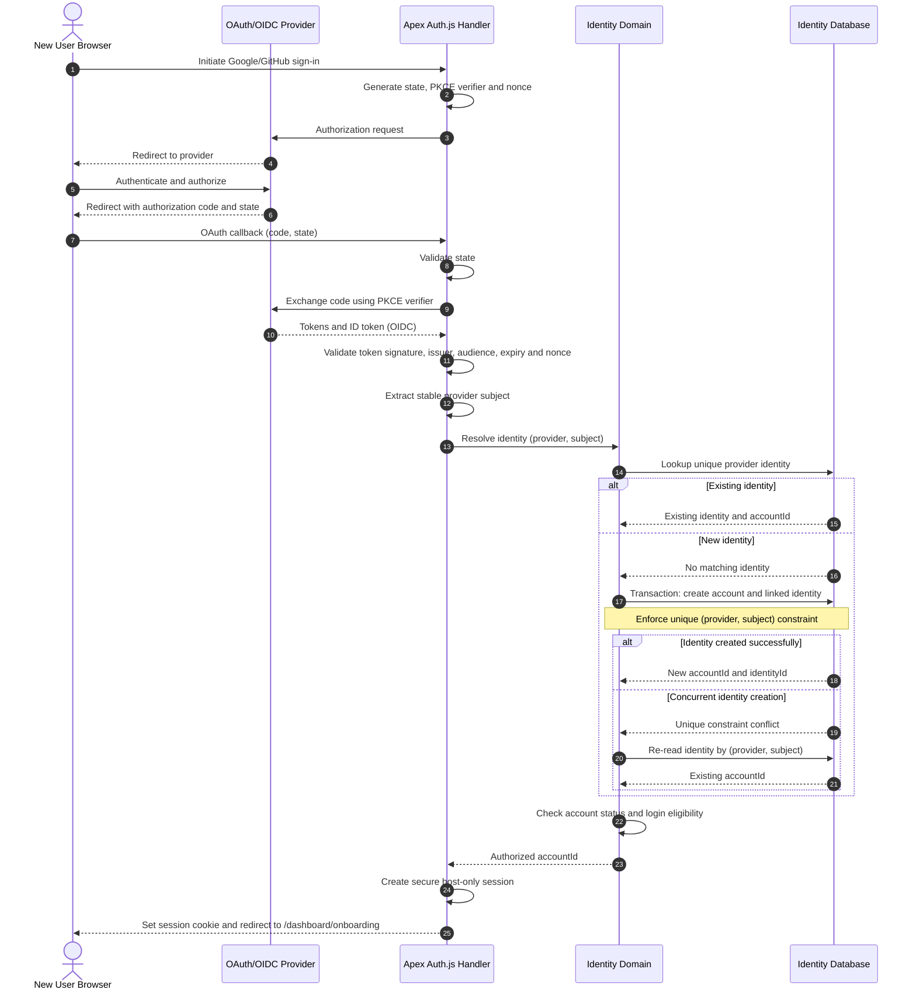

If identity creation partially succeeds across multiple collections, the workflow must either use verified supported transactions or an idempotent compensating/reconciliation protocol as described in [05](05-data-model.md). The unique provider identity index is a hard requirement. Two simultaneous registrations with the same provider subject cannot generate two active owners for one external identity.

### 6.4 Linking a second provider

`POST /accounts/me/providers/link-intent` requires an existing active session and **recent reauthentication**. The response contains a short-lived opaque linking intent tied to `accountId`, `sessionId`, intended provider, single-use state, `createdAt` and expiry. The existing user is sent through the second provider's authenticated authorization flow. On callback, the server validates it is an account-link callback for the same existing account/session and verifies control of the second provider's stable subject. Only then insert the new provider link.

The link result must be independent of matching email addresses. If the target identity is already linked to another GildedIn account, return a bounded conflict and offer a separate deliberate account-resolution procedure; do not quietly move the identity or portfolio. If a stolen/unmatched state or a callback arrives after expiration, discard the attempt with a safe error and audit code. Never reuse an OAuth callback from the normal sign-in flow as permission to merge accounts.

```json
{
  "linkIntentId": "li_example_01",
  "provider": "github",
  "expiresAt": "2026-11-18T16:15:00Z",
  "nextStep": "provider_authorization",
  "authorizationUrl": "/api/auth/signin/github?link_intent=opaque"
}
```

The `authorizationUrl` is **illustrative**: use the actual library's supported account-linking state/callback hooks, not a homemade query parameter that the OAuth library ignores. All `returnTo` destinations must be server-verified relative paths on the apex, never arbitrary URLs. [S06]

### 6.5 Unlink, reauthentication and provider recovery

`DELETE /providers/{identityId}` must:

- Validate current account and fresh-auth proof from an existing linked provider.
- Confirm target identity belongs to that account.
- Atomically prove at least one **usable, verified** provider will remain after the operation, not merely one row with a provider name.
- Handle concurrent unlink requests; the last provider cannot be removed by a race.
- Revoke/rotate sessions when appropriate; log an audit event without recording credentials.
- Return a safe conflict (`LAST_LOGIN_PROVIDER`) and a usable UI remedy when the invariant cannot hold.

If the sole provider is lost, recovery occurs through the provider by default. There is no weak email-only manual takeover, no automatic email match, and no implicit admin ownership transfer. Unverified GitHub profile email is not treated as a trusted identity proof. If verified email is absent, email-dependent features are unavailable rather than accepting a client-provided address as verified.

### 6.6 Authentication and authorization are different operations

A logged-in account can still be denied access to another owner's portfolio. A session can be valid while the account is suspended, the portfolio is disabled, or the target media belongs elsewhere. `GET /accounts/me` returns authenticated account metadata only; it is not a bearer credential for later calls. Every route makes a fresh server decision. Admin access also requires a named allowed action and, for sensitive mutations, recent authentication.

---

## 7. Tenant resolution, hostnames and dual URL models

### 7.1 Public identity contract

A portfolio is addressed by a stable `portfolioId` internally and a canonical lowercase ASCII slug externally, 3–30 characters with reserved names disallowed. Both `https://aaroophan.dev/alex` and `https://alex.aaroophan.dev/` refer to the **same** portfolio, active release and policy. The canonical SEO location is the apex path. Internal links retain the visitor's current subdomain when navigating inside it. Old slugs remain owned alias claims while the portfolio exists and redirect to the current slug. Unknown portfolio subdomains return branded 404; `www.aaroophan.dev` redirects to the apex. [TEN-004..TEN-008]

### 7.2 Host-resolution algorithm

1. Accept traffic only through a deployment-verified proxy/edge and an allowlisted `Host` configuration. Do not trust arbitrary client-written forwarded host/port values.
2. Canonicalize host (lowercase DNS; strip only legal port representation; reject ambiguous dot suffixes, IDN lookalikes, encoded dots, invalid punctuation and multi-value headers).
3. Compare the canonical host exactly to the configured apex and explicitly reserved operational hosts. If it is a supported portfolio subdomain, extract exactly one normalized slug label and validate grammar.
4. For apex paths, resolve the first route segment only after known platform routes (`/api`, `/dashboard`, `/admin`, `/privacy`, `/auth`, etc.) have matched.
5. Query the **single authoritative slug registry**, including currently assigned and historic claims; never independently assume the same slug is free on apex and subdomain.
6. For current slug: derive portfolio ID; for historic claim: emit constrained redirect preserving only supported route paths; reject external redirect destinations.
7. Read the authoritative portfolio control record and live moderation policy before any public representation, search result, media capability, or AI request is permitted.
8. Select the active release and its route manifest; validate that the requested internal resource exists **in that release**.
9. Return a representation with the appropriate path-based canonical SEO URL, host-preserving navigation links and cache headers that do not bypass live revocation.

Never build a provider callback, signed URL, canonical, `Location` or OAuth redirect by blindly concatenating an untrusted host header. Normalized external links are not allowed to select tenant identity.

### 7.3 Public API route ambiguity resolution

The original shorthand `/api/v1/public/gilden` is unambiguous on `alex.aaroophan.dev` because the trusted host identifies the portfolio. On the apex `aaroophan.dev`, the hostname alone does **not** identify which portfolio is being viewed. A public service must not infer it from `Referer` (often absent/mutable) or from a caller-supplied `portfolioId` (untrusted). The initial routing contract therefore specifies:

| Surface                   | Suggested public API endpoint                          | Tenant resolver                                      |
| ------------------------- | ------------------------------------------------------ | ---------------------------------------------------- |
| Subdomain                 | `POST https://alex.aaroophan.dev/api/v1/public/gilden` | Verified `Host` slug claim                           |
| Apex path-based portfolio | `POST https://aaroophan.dev/api/v1/public/alex/gilden` | Strict path slug claim, checked against live control |
| Subdomain contact         | `POST /api/v1/public/contact`                          | Verified host                                        |
| Apex path-based contact   | `POST /api/v1/public/alex/contact`                     | Strict path slug                                     |
| Same pattern              | `/report`, `/interaction`, `/search`, `/status`        | One resolved server context                          |

Both route adapters invoke the same `PublicPortfolioContext` authorization function. The public request body MUST NOT contain a trusted `ownerAccountId` or authoritative `portfolioId`. If the chosen framework routing strategy rewrites subdomain traffic to a shared internal path, that rewrite is an ingress mechanism only; the service must still verify the resolved tenant against current portfolio state.

### 7.4 Host and origin testing matrix

| Request                                                            | Expected                                                          |
| ------------------------------------------------------------------ | ----------------------------------------------------------------- |
| Valid apex public route `/alex`                                    | Resolve `alex` only after platform routes excluded                |
| Valid subdomain `alex.aaroophan.dev`                               | Same `portfolioId` and release as `/alex`                         |
| `www.aaroophan.dev`                                                | Permanent redirect to `aaroophan.dev`                             |
| `unknown.aaroophan.dev`                                            | 404, no fallback to platform home                                 |
| `alex.aaroophan.dev/api/v1/portfolios/{id}/draft`                  | No owner session; protected API unavailable/denied                |
| `Host: alice.aaroophan.dev`, `X-Forwarded-Host: bob.aaroophan.dev` | Reject if forwarded host not an authenticated edge assertion      |
| `evil.aaroophan.dev.attacker.example`                              | Reject; suffix match must be label-boundary checked               |
| Mixed-case route, encoded slash, Unicode confusable or port trick  | Normalize only allowed grammar or reject                          |
| Historical slug used in project detail path                        | Redirect to current portfolio slug using route manifest rules     |
| Subdomain frontend calls same-subdomain public Gilden              | Only published approved context, no apex session or wildcard CORS |

Wildcard DNS/TLS is a **deployment proof**, not an assumption that the framework automatically provisions all arbitrary subdomains. Existing DNS services and reserved subdomains must continue to work. See [10](10-deployment-strategy.md).

---

## 8. Authorization, roles and field-level policy

### 8.1 Actors and allowed actions

| Action                                               |             Public visitor |   Owner of target |     Another owner |                       Administrator |
| ---------------------------------------------------- | -------------------------: | ----------------: | ----------------: | ----------------------------------: |
| View active published portfolio                      |      If live policy allows |    Same as public |    Same as public | Same as public (no hidden backdoor) |
| View/edit unpublished draft                          |                         No |               Yes |                No |                       No by default |
| Rename portfolio / configure theme                   |                         No |               Yes |                No |                       No by default |
| Upload/inspect private media                         |                         No |               Yes |                No |                       No by default |
| Publish and restore release                          |                         No |               Yes |                No |                       No by default |
| View owner inbox / export personal data              |                         No |               Yes |                No |                       No by default |
| View owner AI usage aggregates                       |                         No |               Yes |                No |                       No by default |
| Chat with Gilden                                     |  If approved and available | Same public rules | Same public rules |                   Same public rules |
| Report portfolio                                     | Yes with abuse protections |               Yes |               Yes |                                 Yes |
| Suspend portfolio / suppress content                 |                         No |                No |                No |      Yes with recent-auth and audit |
| Review reports / platform diagnostics                |                         No |                No |                No |        Yes with scope and redaction |
| Give self admin role or change ownership arbitrarily |                         No |                No |                No |                 No via ordinary API |

The administrator role does not grant unrestricted content inspection or impersonation. Special recovery operations require distinct privileges, documentary rationale and a break-glass design. Public AI access is an independent permission check: human-public content does not automatically become model-approved content. Hidden sections excluded from the current public release cannot be reintroduced by a client-supplied content ID or an external link.

### 8.2 Ownership decision procedure

```text
AuthorizeOwnedCommand(actor, targetPortfolioId, action, targetResourceId?):
  1. Require valid, unrevoked apex session and active account.
  2. Parse exact target ID (UUID grammar, no fallback to slug/email).
  3. Load portfolio using the ID and expected owner account ID.
  4. Evaluate portfolio/account status, policy version and action permission.
  5. If child target exists, query by both portfolioId and child ID.
  6. Check field-level write allowlist and referenced content/media ownership.
  7. Apply required recent-auth/CSRF/quota/revision/idempotency gates.
  8. Invoke a typed domain operation whose repository query repeats scope.
  9. Serialize only the caller's allowed fields.
```

The method never trusts `portfolio.ownerAccountId` from request JSON. A 404 for a foreign target is often appropriate to avoid confirming its existence. Constant-time response behavior is not guaranteed by returning 404, so security must not depend on obscurity alone. Logs may record an internal denial code without disclosing the foreign resource in response.

### 8.3 Property-level authorization

Mass assignment can occur even on owner-owned objects. The client cannot write `activeReleaseId`, `publishSequence`, `ownerAccountId`, `securityVersion`, `platformRoles`, `sessionVerifierHash`, `moderationPolicies`, `quotaSummary.usedBytes`, AI `revocationVersion` or raw media `storageKey`. Separate **input command schemas**, internal persistence schemas and public/owner/admin projections. A client input should be `strict`/`additionalProperties:false` at all security-sensitive boundaries. Unknown nested keys and embedded update operators are rejected, not spread into records. OWASP API3 explicitly includes unauthorized object-property access [S04].

### 8.4 Content and reference authorization

Every `contentId`, `sectionId`, `nodeId`, `mediaId`, `collectionId`, `fieldId` and `releaseId` is interpreted under the owner portfolio scope. Content references must be checked against schema/collection definitions; the same content item can be rendered multiple times without copying it. Deleting an item with references is rejected until the owner explicitly detaches or deletes dependent bindings. A list ordering operation cannot reference nodes belonging to another section or a different portfolio. The compiled public renderer cannot read hidden fields because those fields never appear in the public release payload.

### 8.5 Policy composition

Allow public delivery only if all applicable checks pass:

```text
portfolioExists && activeReleaseExists
&& accountActive && portfolioActive
&& !portfolioSuspended && !ownerDisabled && !deleting
&& !matchingModerationDeny
&& requestedRouteExistsInActiveRelease
&& !resourceLevelPolicyDeny
```

For Gilden, additionally require `aiEnabled && approvalReady && context.releaseId == activeReleaseId && context.policyVersion == livePolicyVersion && source not denied && quotas reserved`. A failed policy-store read must not be interpreted as `!deny`. A visibility state of `unlisted` is **not** a deny for someone holding the URL; it changes indexing/discovery, not link access.

---

## 9. Validation, canonicalization, input limits and safe output

### 9.1 Validation layers

| Layer                    | Examples                                                                         | Failure behavior                      |
| ------------------------ | -------------------------------------------------------------------------------- | ------------------------------------- |
| Transport grammar        | HTTP method, UTF-8, content type, accepted encoding, body cap                    | 400/405/413/415 before expensive work |
| Path/query               | UUID, slug, cursor, enum and exact query key set                                 | 400/422; avoid regex injection        |
| Request schema           | Required fields, discriminated unions, unknown-key rejection, bounded arrays     | 422 + sanitized field issues          |
| Domain constraints       | One Hero first, unique node IDs, valid stable references, class-specific privacy | 422 business errors                   |
| Ownership and privileges | Exact owner/resource/role/action check                                           | 401/403/404; zero data changed        |
| Persistence invariants   | Unique slug, identity, one portfolio/account, compare-and-swap revision          | 409 or safe retry                     |
| Publication compiler     | Semantics, accessibility, media readiness, total 102,400 bytes                   | 422 report; active release unchanged  |
| Output projection        | Approved fields, URL/citation allowlist, safe content encoding                   | Never pass raw DB documents           |

Use Zod or equivalent as a **parser**, not an authorization oracle. Runtime validation is required because TypeScript types disappear when code executes. The JSON Schema subset imported by an owner is untrusted **data**, not a JavaScript module. Reject remote `$ref`, unbounded recursion, prototype-sensitive keys, unsupported keywords, JSONPath evaluation scripts, arbitrary class/type names and executable function strings.

### 9.2 Central numerical limits

All fixed product limits are specified by [02](02-requirements-and-scope.md) and [05](05-data-model.md), not overridden by UI defaults:

| Boundary                                 |                               Normative initial limit | Where enforced                               |
| ---------------------------------------- | ----------------------------------------------------: | -------------------------------------------- |
| Custom schema nesting                    |                                              3 levels | Schema parser and compiler                   |
| Custom fields per section                |                                                    20 | Schema mutations/import and publish          |
| Owner-authored visual nodes              |          20 per **portfolio**, including nested nodes | Draft validator/publisher                    |
| Items per collection                     |                                                    20 | Content command + compiler                   |
| Canonical serialized published payload   |                                   102,400 UTF-8 bytes | Server serializer after compilation          |
| Successfully activated retained releases |                                                     3 | Release pruning/reconciliation               |
| Total media per portfolio                | 15 MB quota, exact unit standardized in configuration | Reservation and committed-usage checks       |
| Individual image                         |                                                  1 MB | Intent, staging verification and processing  |
| PDF résumé                               |                                                  2 MB | Intent and verified bytes                    |
| Files per portfolio                      |                                                    30 | Quota admission and asset state              |
| Image dimensions before processing       |                                           4096 × 4096 | Decode/normalization                         |
| Gilden visitor allowance                 |                       15 messages per visitor per day | Atomic counter + short-lived anonymous token |

**Units note:** For product display, `MB` can mean decimal MB while binary systems use MiB. The server configuration must explicitly settle the exact byte counts for the 1/2/15 MB media quotas and tests must use those exact integer constants. Only the published-content ceiling is already explicitly **102,400 bytes**. Avoid pretending that an undefined unit conversion is a completed contract.

**Additional provisional transport ceilings** (review via security/performance tests): JSON draft request raw body <= 512 KiB; operation batch <= 32 operations; single user text field <= 10,000 Unicode scalar values where semantically allowed; initial chat prompt <= 2,000 characters; anonymous report <= 4 KiB; search query 1–100 characters; page size default 20 maximum 50. These are transport engineering caps **not** additional user-facing product limits; adjust centrally with test evidence and an ADR for broad changes.

### 9.3 Canonical text, slugs and URLs

- Slugs: lowercase ASCII `[a-z0-9-]`, length 3–30, no leading/trailing separators and reserved-name validation. When normalization changes representation, canonical URLs use the lowercased slug.
- Display text: preserve human-authored meaning and Unicode; never silently strip letters to match SEO constraints. Normalize line endings only where specified, and enforce maximum logical length.
- URL fields: parse using standard `URL` semantics, block dangerous protocols, credentials, host obfuscation and malformed encodings; allow `http:`/`https:` for public links where supported. Only explicitly designated components may accept `mailto:` or `tel:`; remote fetch permits **HTTPS and approved public network destinations only**.
- Filenames: display label may be normalized; storage key is server-generated. No direct path-derived filesystem operations.
- JSON numeric types: finite, bounded integers where required; no `NaN`, `Infinity`, nonfinite arithmetic, negative counters or silently coerced booleans.
- Object nesting: maximum depth enforced prior to expensive traversal and again after schema-specific validation.
- Cursor: opaque signed/validated token with bounded expiry and exact route/sort/tenant binding; reject forged or reused across-tenant cursors.

### 9.4 Canonical serialization and ETag

Release compilation must use deterministic allowlisted data shapes and a specified canonical UTF-8 JSON encoding; size is measured **after** compilation, not from raw draft bytes. A cryptographic digest may protect against accidental artifact mismatch, but it is not an authentication credential. ETags for draft revision (`"rev-N"`) are strong opaque version validators if exact response representation semantics are defined and tested. `If-Match` values from the client are conditional **claims**, not a request to force a revision number into MongoDB.

Do not use raw JavaScript `JSON.stringify` as a security policy; normalize graph shape first, reject unsupported types and use explicit output DTOs. Any `__proto__`, `constructor`, `$where`, arbitrary `$set`, deep path traversal or incoming `$` operator string that could affect a generic database update must never be forwarded into query/update construction.

### 9.5 Upload checks

File validation is **multi-stage**: approved declared media kind -> reserved upload -> staged byte count -> signature + trusted decode/parser -> malware/active-content policy -> metadata stripping/re-encode -> owned asset state -> release eligibility. A matching extension and MIME header are insufficient; the OWASP upload guidance calls for defense in depth [S11]. A suspicious PDF may need to be rejected rather than sanitized if trustworthy free tooling is not available. No unverified file is publicly downloadable.

### 9.6 Unsafe content and output encoding

The WYSIWYG editor emits a restricted, versioned rich-text AST. No raw HTML, MDX code execution, arbitrary inline CSS, `style` injection, script tags, event handlers, embedded `iframe` from arbitrary hosts, untrusted SVG scripts, `javascript:` URLs or custom plugin JS reach the published DOM. Transform diagrams and code blocks through approved, sanitized renderers. Do not render externally fetched RSS HTML unsanitized. React's auto-escaping does not protect deliberate dangerous HTML APIs or untrusted dynamic URL schemes; review each renderer and data boundary explicitly.

---

## 10. Account and portfolio lifecycle API contracts

### 10.1 `GET /accounts/me`

**Authorization:** active apex session; no explicit portfolio needed. **Response:** `200`, `Cache-Control: no-store`, request ID. **Fields:** `accountId`, `displayName`, `verifiedEmail` only if verified, `linkedProviders` safe summary, `status`, user-visible role (`isAdmin` if authorized), `portfolioSummaries`, `createdAt` and `capabilities` explicitly allowed for the account. Exclude `providerSubject`, refresh/access tokens, internal session verifiers, moderation investigations and privileged operational data.

```json
{
  "accountId": "7e58888a-0e51-47e7-99f5-e5e8c1c6696f",
  "displayName": "Example Engineer",
  "verifiedEmail": null,
  "linkedProviders": [
    {
      "identityId": "e30968d8-5517-4bf6-b9e0-60562b644eb1",
      "provider": "github",
      "linkedAt": "2026-11-18T15:00:00Z"
    }
  ],
  "portfolioSummaries": [],
  "capabilities": { "canCreatePortfolio": true, "canLinkProvider": true },
  "requestId": "req_example"
}
```

### 10.2 `POST /portfolios`

**Inputs:** canonical slug, display name, professional title/identity label, introduction, optionally safe design preset. **Guards:** owner session, account active, initial one-active-portfolio uniqueness, slug normalization and reserved list, body cap, CSRF/Origin, atomic slug claim and portfolio/draft creation. A race in which two accounts request the same slug must yield exactly one successful unique claim. Two parallel creates from one account must yield exactly one active portfolio; the loser sees `409 PORTFOLIO_ALREADY_EXISTS` without leaking the winner's private metadata.

```http
POST /api/v1/portfolios HTTP/1.1
Host: aaroophan.dev
Content-Type: application/json
Origin: https://aaroophan.dev
X-CSRF-Token: example-non-secret-placeholder
Idempotency-Key: 550e8400-e29b-41d4-a716-446655440000

{"slug":"example-engineer","displayName":"Example Engineer","identityLabel":"Software Engineer","introduction":"I build reliable tools for the web.","templatePreset":"signature"}
```

```json
{
  "portfolioId": "e4d94b2b-e083-4a2c-9de4-bd7cb66def0b",
  "slug": "example-engineer",
  "draftRevision": 0,
  "status": "onboarding",
  "activeReleaseId": null,
  "dashboardUrl": "/dashboard/portfolios/e4d94b2b-e083-4a2c-9de4-bd7cb66def0b/editor"
}
```

An API may return `201 Created` and `Location: /api/v1/portfolios/{id}`. A new portfolio is unpublished, so its public route returns 404, not a blank indexed page. `POST /portfolios` should accept an idempotency key even if DB uniqueness independently protects duplicate creation; this provides better behavior after an ambiguous network failure.

### 10.3 Advisory slug availability

`GET /portfolios/slug-availability?slug=...` only means "currently unclaimed under the authoritative slug registry when checked". It is never a reservation or guarantee that `POST /portfolios` will succeed. Public display should avoid revealing private account details, detailed historical claim owners, or registration statistics; an abusive enumeration flow can be throttled. Response: `{"slug":"example-engineer","available":true,"reason":null}`. Reserved or invalid name returns `available:false` with a generic public reason code. A simultaneous claim still resolves via unique index in creation/rename.

### 10.4 Rename contract

`POST /portfolios/{id}/rename` body `{ "newSlug": "new-example" }` is owner-scoped and idempotent. It checks reserved grammar, atomically creates/claims the new slug under the same portfolio, updates current control slug, and preserves the prior alias as an owned claim. A global uniqueness index over **both current and historical claims** ensures old links cannot be hijacked by a new owner. The operation is a saga if the chosen database tier cannot atomically commit multiple records; failure must leave an unambiguous current slug and repairable alias state. Return `200` with canonical URL and aliases, or `409 SLUG_UNAVAILABLE`; never silently redirect to another owner's portfolio.

### 10.5 Visibility and disable commands

- `POST /visibility`: body `{ "visibility": "public" | "unlisted" }`. Validate active release and owner. Update authoritative current policy **before** responding. Changes must affect sitemap, directory, robots/indexing and AI availability as applicable; becoming unlisted does not require a new release and does not make content secret.
- `POST /disable`: owner-confirmed action, increment current security version, deny public and Gilden immediately under the implemented live gate; display a branded 404. Invalidating old caches is necessary but insufficient by itself.
- `POST /enable`: owner action allowed only when account/portfolio is not suspended, deleting or moderated. It does not override administrator restrictions. Must be explicit; a release still exists but should not be recompiled automatically.
- `POST /delete`: protected, recent-auth, idempotent, separates immediate access revocation from deferred deletion of referenced objects and limited audit retention.

Example owner visibility result:

```json
{
  "portfolioId": "e4d94b2b-e083-4a2c-9de4-bd7cb66def0b",
  "visibility": "unlisted",
  "status": "active",
  "activeReleaseId": "dc0d8f99-1860-450a-b805-f373e19bc4d2",
  "securityVersion": 18,
  "robotsIndexing": "noindex",
  "effectiveAt": "2026-11-18T15:20:00Z"
}
```

### 10.6 Portfolio controls that are intentionally not exposed

No owner endpoint accepts `ownerAccountId` replacement, `platformRoles`, `activeReleaseId`, moderation effect, object storage key, provider account ID, `lastSensitiveAuthAt`, quota-use counters, backend adapter URL or raw AI instruction. Ownership transfer and collaborator roles are deferred. Portfolio settings updates accept only explicitly listed appearance, navigation, SEO and public statistics fields under the current schema version. Changes to security-sensitive settings (visibility, disable, AI approvals) use **named commands** rather than a generic settings PATCH, so audit and version control are explicit.

---

## 11. Draft, schema, reusable content and visual-composition APIs

### 11.1 Draft resource contract

A draft is an owner-only versioned aggregate. It contains the profile, sections, type/schema definitions, reusable collection definitions and items, content links, responsive composition graph, appearance tokens, SEO settings and owner-authored AI approvals. It must **not** contain a writable current release pointer, administrator moderation state, provider tokens, raw storage keys or session metadata. Its identity is `(portfolioId, revision)`; all edits are subject to optimistic concurrency.

Recommended read response:

```http
GET /api/v1/portfolios/e4d94b2b-e083-4a2c-9de4-bd7cb66def0b/draft HTTP/1.1
Host: aaroophan.dev
Cookie: <host-only-session>

HTTP/1.1 200 OK
Content-Type: application/json; charset=utf-8
Cache-Control: private, no-store
ETag: "rev-24"
X-Request-Id: req_example
```

```json
{
  "portfolioId": "e4d94b2b-e083-4a2c-9de4-bd7cb66def0b",
  "revision": 24,
  "schemaVersion": 2,
  "rendererVersion": "2.0.0",
  "profile": {
    "displayName": "Example Engineer",
    "identityLabel": "Software Engineer",
    "introduction": "I design reliable software."
  },
  "sections": [
    { "sectionId": "sec_hero", "type": "hero", "visible": true, "order": 0 }
  ],
  "collectionDefinitions": [],
  "contentCollections": [],
  "nodes": [
    {
      "nodeId": "node_hero_title",
      "sectionId": "sec_hero",
      "componentType": "heading",
      "componentVersion": 1,
      "props": {},
      "contentBinding": { "source": "profile", "fieldId": "displayName" },
      "layout": { "mode": "auto", "flow": "column" },
      "visualOrder": 0,
      "readingOrder": 0,
      "interaction": { "kind": "none" }
    }
  ],
  "navigation": { "items": [] },
  "mediaRefs": [],
  "theme": {
    "mode": "dark",
    "scenePreset": "technical-grid",
    "animationIntensity": "standard"
  },
  "seo": { "indexingEnabled": true, "title": null, "description": null },
  "aiApprovals": { "approvedFields": [], "deniedFields": [] },
  "updatedAt": "2026-11-18T15:00:00Z",
  "saveStatus": "saved"
}
```

This JSON is an **abbreviated envelope** showing API fields, not a complete schema-valid publishable draft; the exact `sections`, `nodes`, type registry, field definitions and content binding format are governed by [05](05-data-model.md) and versioned code schemas. All repeated references must resolve within the same portfolio. The owner may see fields that are not publicly eligible; the server must never send this DTO to an anonymous caller.

### 11.2 Whole-draft `PUT` and compare-and-swap

```http
PUT /api/v1/portfolios/e4d94b2b-e083-4a2c-9de4-bd7cb66def0b/draft
Host: aaroophan.dev
Origin: https://aaroophan.dev
Content-Type: application/json
If-Match: "rev-24"
X-CSRF-Token: example

{ "schemaVersion": 2, "rendererVersion": "2.0.0", "profile": {"displayName":"Example Engineer","identityLabel":"Software Engineer","introduction":"I design reliable software."}, "sections": [], "collectionDefinitions": [], "contentCollections": [], "nodes": [], "theme": {}, "navigation": {"items":[]}, "seo": {}, "aiApprovals": {}, "mediaRefs": [] }
```

The example body above is intentionally **not** a publish-ready portfolio because Hero is missing, and may fail even draft structural validation if the chosen draft schema requires initialized core structures. It illustrates only the request envelope. A valid `PUT` uses the complete, strictly validated `DraftEditableInput` DTO. The server must:

1. Verify session, account state, portfolio owner, same-origin/CSRF, content type and body cap.
2. Parse the exact editable fields and enforce draft-level safety without requiring completed publishing fields.
3. Load/compare the stored draft revision **in the write predicate**, not in a separate vulnerable read-then-write.
4. Perform a single-document conditional update or a verified transaction with `expectedRevision`.
5. Increment the revision exactly once on a successful mutation and record server-controlled `updatedAt`.
6. Return new strong `ETag` (`"rev-25"`), a minimal saved status and request ID.
7. Preserve the previous draft unchanged on failed validation, concurrency conflict or denied scope.

**Critical distinction:** the autosave endpoint validates that the draft is a safe, well-formed editable structure; it need not be ready to publish. The publication validator imposes additional required Hero content, active links, accessible layout, approved media and byte ceilings. A partially completed onboarding draft may therefore save without being publishable.

### 11.3 Stale writes and owner recovery

Suppose two tabs both read revision 24. Tab A successfully writes revision 25. Tab B attempts revision 24. Tab B must receive a deterministic conflict response; it **must not** overwrite revision 25, change its own base token silently or be auto-merged by the server. Client choices are: reload current draft; inspect a scoped diff and manually reapply changes; or retain unsaved edits locally and retry with explicit reconciliation.

```json
{
  "type": "https://aaroophan.dev/problems/draft-conflict",
  "title": "Draft has changed",
  "status": 409,
  "code": "DRAFT_REVISION_CONFLICT",
  "detail": "A newer saved draft exists. Review your changes before saving.",
  "currentRevision": 25,
  "requestId": "req_example",
  "issues": [
    {
      "path": "revision",
      "code": "stale_revision",
      "message": "A newer revision is available."
    }
  ]
}
```

**Standards warning:** RFC 9110 specifies **412** when a literal `If-Match` precondition is false. GildedIn's existing requirement defines **409** for the user-visible domain conflict. This document keeps `409 DRAFT_REVISION_CONFLICT` as the current product contract but marks the `If-Match` interaction as an explicit HTTP interoperability issue requiring a coordinated ADR and cross-document update before claiming full conditional-HTTP compliance. Two defensible resolutions are: (A) use `412` for failed HTTP preconditions and `409` for higher-level domain conflicts, updating clients/tests; or (B) use a typed `expectedRevision` command field and reserve `409` for domain version conflicts, removing the literal `If-Match` obligation. **Do not ship an undocumented deviation.** [S12]

`POST /draft/conflict-summary` or `GET /draft/conflict-summary` may provide safe owner-only metadata/diff hints, but must not copy draft content to logs and must never expose any foreign account's documents. In-session undo/redo is a browser editor concern; persistent recovery is stored draft revisions, not server-side keystroke history. Local recovery caches must be scoped to account+portfolio and cleared on sign-out/account switching as far as the browser permits.

### 11.4 Typed partial operations instead of arbitrary JSON Patch

The safe partial `PATCH /draft` accepts a discriminated, versioned operation list. Examples:

```json
{
  "expectedRevision": 24,
  "clientMutationId": "cm_8be2b0",
  "operations": [
    {
      "type": "setProfileField",
      "field": "introduction",
      "value": "I build accessible web platforms."
    },
    {
      "type": "moveNode",
      "nodeId": "node_hero_title",
      "to": { "sectionId": "sec_hero", "parentNodeId": null, "index": 0 }
    },
    {
      "type": "setBreakpointOverride",
      "nodeId": "node_hero_title",
      "breakpoint": "mobile",
      "override": { "maxWidth": "100%", "alignment": "start" }
    }
  ]
}
```

The illustrative operation taxonomy includes: `setProfileField`, `createSection`, `renameSection`, `setSectionVisibility`, `reorderSections`, `createCollection`, `updateCollectionSchema`, `upsertContentItem`, `deleteContentItem`, `attachContentReference`, `detachContentReference`, `createNode`, `updateNodeProps`, `moveNode`, `reparentNode`, `deleteNode`, `setLayoutConstraint`, `setBreakpointOverride`, `setSemanticOrder`, `setThemeToken`, `setSeoField`, and `updateAiApprovalDraft`. The actual registered set is finite and versioned. Each operation has a **different strict schema and a named handler**, not a dynamic `data[path] = value` implementation.

Operations MUST be applied to a bounded in-memory candidate, validated as a coherent batch, and committed as **one revision** or not at all. If any operation fails, return the indexed reason with no partial mutation. The editor is allowed to submit a short operation batch to reduce full-document transfers. Operations are idempotently deduplicated where a `clientMutationId` is recognized within an explicitly scoped, bounded recent window; revision checks remain the authoritative lost-update defense.

### 11.5 Schema import and field definition constraints

`POST /draft/schema-import` validates a **supported subset** of JSON Schema Draft 2020-12 or an explicitly documented internal schema export format. The endpoint is a preview/validation operation that does not execute remote resolution and does not directly publish. It rejects:

- `$ref` to remote schemas, `$dynamicRef` cycles, unsupported metaschemas and unbounded recursion;
- unknown field/widget types, executable expressions, inline code or database query definitions;
- prototype-sensitive keys, overly deep arrays/objects, excessive nesting, duplicate field IDs and malformed defaults;
- attempts to alter protected record ownership or override fixed product limits;
- imported media references whose `mediaId` is not owned and ready;
- unsupported renderer versions without an explicit migration path.

Return `200` with a draft candidate/impact report for valid input, `422` with path-indexed errors otherwise. Destructive schema changes require owner confirmation and a new draft write; compatible transformations may be deterministic. The current active public release remains unchanged throughout schema editing.

### 11.6 Reusable content and binding semantics

A content item has a stable `contentId`, its owning `portfolioId`, typed values and a schema ID. A visual node binds to a content field or an entire reusable collection by stable IDs. A `repeater` references a collection and one card template; generated cards **do not** each consume another user-authored block quota. The server resolves references at publish time under the owner portfolio scope and checks field/public/AI visibility independently.

Deletion of referenced content must return `409 CONTENT_IN_USE` with safe affected reference IDs and a structured remediation list. Deletion must never silently cascade into unrelated layouts. Reordering collection items must obey 20-item limits and stable IDs, not array indices supplied without revision checks. Cross-portfolio bindings are prohibited even if another portfolio's public page is viewable.

### 11.7 Responsive composition constraints

Each node's validated payload includes component registry identifier, parent/section, layout mode (`absolute`, `auto`, `hybrid`), responsive constraints, visual stacking layer, safe interaction configuration, semantic reading order and content binding. Desktop/tablet/mobile overrides are validated independently and together. The server checks no duplicate IDs/cycles, no invalid reparenting, no required semantic element hidden without equivalent, and no provably inaccessible overlap. Runtime measurement/visual detection complements server validation during editor preview and publication testing; the server cannot infer every pixel-level overlap from JSON alone.

A saved draft can contain warnings, but publishing blocks severe violations. The 20-block limit is global across all public pages/sections and counts nested **user-authored nodes**, not dynamically repeated instances. The fixed numeric restriction is intentionally restrictive and must be visible in editor UI before a user exceeds it.

### 11.8 Owner-only preview

`GET /portfolios/{id}/preview?mode=mobile&route=%2Fprojects%2Fexample` is authenticated on the apex, `Cache-Control: no-store`, and `X-Robots-Tag: noindex, nofollow`. It reads **the owner's selected draft revision**, never the active release by accident, and cannot be accessed by a guessed release or preview token. Supported `mode` values are exactly `desktop`, `tablet`, `mobile`, with optional `animations=paused|play` validated. Route selection must come from the draft's prospective route manifest, not arbitrary redirect or filesystem access. HTML rendering and editor layout overlays remain independent. On a failed preview compile, return an accessible owner-only error panel with validation issues, not a public fallback to a prior release.

---

## 12. Preview modes, validation UX and API semantics

A preview should faithfully represent published layout semantics and content without sacrificing editor performance. It may pause expensive Three.js scenes until the owner chooses Play Preview. The API should not send a pre-rendered screenshot; it supplies a validated draft representation or server-rendered HTML under the same approved renderer contract. Owner previews must include responsive configuration, semantic order and the same block registry version that publication will use.

### 12.1 Validation report shape

```json
{
  "portfolioId": "e4d94b2b-e083-4a2c-9de4-bd7cb66def0b",
  "draftRevision": 25,
  "publishable": false,
  "checks": {
    "schema": "passed",
    "ownership": "passed",
    "contentReferences": "passed",
    "media": "passed",
    "accessibility": "failed",
    "seo": "warning",
    "size": "passed"
  },
  "blockingIssues": [
    {
      "code": "CANVAS_FOCUS_OBSCURED",
      "path": "nodes[3]",
      "severity": "error",
      "message": "The interactive control is obscured at the mobile layout."
    }
  ],
  "warnings": [
    {
      "code": "SEO_DESCRIPTION_EMPTY",
      "path": "seo.description",
      "severity": "warning",
      "message": "A default description will be generated."
    }
  ],
  "estimates": {
    "canonicalPayloadBytes": 97642,
    "userAuthoredBlocks": 19,
    "collections": 4
  }
}
```

The report is bound to a **specific draft revision**. It is advisory if a new revision is saved later; publishing always validates again against its exact frozen input and current media/policy state. Do not treat a previously returned validation token as permission to bypass checks. Errors and warning text must not include raw unsafe user HTML. Public render routes never reveal unpublished validation findings.

### 12.2 Preview semantic requirements

- Keep one correct semantic H1 and coherent heading relationships even if the owner visually styles headings differently.
- Preserve source/keyboard reading order independent of absolute visual coordinates.
- Always provide an alternative to drag-only operations and allow keyboard inspection/selection in the editor.
- Ensure generated route links refer to the selected draft manifest, not arbitrary constructed URLs.
- Do not execute any user-supplied JS or unsanitized HTML in preview; preview is not a trusted sandbox merely because only the owner can see it.
- Use content-appropriate alt text and allow explicitly decorative media to be marked as such.
- Ensure reduced-motion mode and no-WebGL fallbacks can be previewed.
- No leakage through social metadata generation, search indexing, or caching while previewing.

### 12.3 Draft failure recovery states

| Server condition                | UX status                       | Safe recovery action                                              |
| ------------------------------- | ------------------------------- | ----------------------------------------------------------------- |
| Debounced save queued           | `Unsaved changes`               | Keep editing locally                                              |
| Save request underway           | `Saving...`                     | Disable conflicting publish if pending writes remain              |
| Save completed                  | `Saved` with revision           | Continue; preview current revision                                |
| Network timeout, unknown commit | `Save status uncertain`         | Re-read current revision before retry; do not blindly overwrite   |
| Version mismatch                | `Another tab has newer changes` | Review diff or reload; preserve local recovery candidate          |
| Schema invalid                  | Field/section errors            | Correct invalid structures; no accidental public change           |
| Session expired                 | `Sign in to continue`           | Preserve bounded local unsaved data and verify owner after reauth |
| Owner suspended/deleting        | Unavailable / access denied     | Do not continue local sync or publish                             |
| Storage limit reached           | Quota banner                    | Remove unused assets or change content; no charges                |

The UI statuses are product behavior contracts. The HTTP API returns machine-readable errors and revisions, not preformatted English UI strings as its only control mechanism.

---

## 13. Publishing and immutable releases

### 13.1 Publication preconditions

`POST /portfolios/{id}/publish` is an owner-only, CSRF-protected, rate-limited, **idempotent** command. The body contains `draftRevision`. The request includes `Idempotency-Key`, and an agreed conditional revision mechanism. A new operation starts only after checking the session, account/portfolio status, pending uploads, reference graph, content limits and concurrent publication rules. The server cannot assume the draft has remained unchanged since an earlier validation preview.

```http
POST /api/v1/portfolios/e4d94b2b-e083-4a2c-9de4-bd7cb66def0b/publish
Host: aaroophan.dev
Origin: https://aaroophan.dev
Content-Type: application/json
Idempotency-Key: 68ff7038-a9b0-4b24-b13c-7e4b5e99ebc0
If-Match: "rev-25"
X-CSRF-Token: example

{"draftRevision":25}
```

**Pre-publish validation gates:** required username/display name/identity label/short introduction; one Hero first; schema bounds; content graph and ownership; safe media processing state; severe WCAG failure detection; valid semantic order; known block component versions; protected fields absent from public output; registered internal routes; validated public canonical URLs; initial SEO/OG assets; search index generated from released public fields; canonicalized payload <= 102,400 bytes; acceptable provider budget; no hard moderation block.

AI context generation **does not block** public publication. External feed refresh **does not block** publication; the compiler uses already validated cached/manual metadata inputs from the selected draft. This avoids a third-party outage preventing a portfolio owner's core publishing workflow.

### 13.2 Publication operation lifecycle

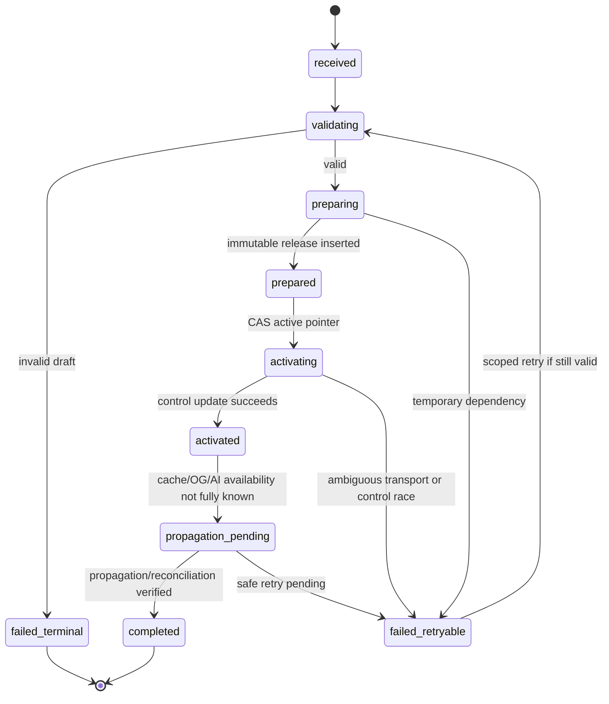

Stages correspond to the data model's `PublishOperation`, but a state string alone does **not** provide multi-document atomicity. The journal provides durable operation identity, crash recovery evidence and idempotency. The only public visibility commit is a **single atomic update** of the portfolio control document's `activeReleaseId` and associated publish sequence after the immutable release is complete. MongoDB single-document conditional writes provide atomicity when used with an expected-value filter [S13]; multi-document preparation still needs a proved transaction or an idempotent repair protocol [S14].

### 13.3 Idempotency and fingerprinting

Scope the external `Idempotency-Key` to `(accountId, portfolioId, commandType)`. Persist only a keyed hash of the key, and a canonical request fingerprint including the selected draft revision and relevant action parameters. A retry with the same key and fingerprint returns the **existing** operation and status, even if its first HTTP response was lost after pointer activation. Reusing the key with a different fingerprint returns `409 IDEMPOTENCY_KEY_REUSED`. A different idempotency key does not automatically authorize republishing an unchanged draft into multiple revisions; check whether the active release already matches the compiled content hash and provide a deliberate no-change result or domain rule.

Use a unique database index on `(portfolioId, idempotencyKeyHash)` and a concurrency-safe operation lease with a **fencing token** if multiple instances may resume work. In-process locks are insufficient in serverless/multi-instance environments. The exact retry window must be long enough for realistic network retries and operation reconciliation; cleanup after expiration must not permit duplicate side effects against an already activated release.

### 13.4 Atomic activation and racing publishers

Prepare one immutable release from exactly the requested saved draft revision. Read the expected current active release and security version. Then compare-and-update the control record with a predicate covering `portfolioId`, allowed operational status, expected prior active release, expected policy/security version where required, and any documented publication serialization guard. If the predicate fails, **do not** blindly install the prepared release. Reload control state and determine whether this operation already activated, another operation won, or a security restriction was applied. Preserve orphaned prepared releases until reference-safe cleanup.

Public requests resolve a single active release ID and retrieve one immutable snapshot; they cannot mix draft and release data. A release prepared while an owner is suspended cannot be activated after suspension by using stale policy values. A recent moderation denial must likewise block activation when policy prohibits publishing.

### 13.5 HTTP success and ambiguity handling

```json
{
  "operationId": "op_example_3",
  "portfolioId": "e4d94b2b-e083-4a2c-9de4-bd7cb66def0b",
  "releaseId": "dc0d8f99-1860-450a-b805-f373e19bc4d2",
  "releaseSequence": 3,
  "draftRevision": 25,
  "publicationState": "propagation_pending",
  "publicUrl": "https://aaroophan.dev/example-engineer",
  "aiKnowledgeStatus": "preparing",
  "retryAllowed": true,
  "statusUrl": "/api/v1/portfolios/e4d94b2b-e083-4a2c-9de4-bd7cb66def0b/publications/op_example_3"
}
```

| Outcome                              | HTTP                                                      | Meaning                                                    |
| ------------------------------------ | --------------------------------------------------------- | ---------------------------------------------------------- |
| Newly activated and fully reconciled | `201` or `200` per final contract                         | Release active and propagation confirmed                   |
| Already processed idempotent retry   | `200`                                                     | Same operation, no duplicate release                       |
| Activated, propagation unfinished    | `202`                                                     | Durable active release exists, external visibility may lag |
| Validation failure                   | `422`                                                     | No active pointer change                                   |
| Draft revision raced                 | `409` domain conflict / `412` standard conditional mode   | No pointer change                                          |
| Different payload with same key      | `409`                                                     | No new operation                                           |
| Provider operation ambiguous         | `202` if operation record available; otherwise safe `503` | Query status before retry with the _same_ key              |
| Publisher lease held elsewhere       | `202` with same operation or `409` controlled overlap     | No duplicate preparation                                   |
| Security policy became deny          | `403/409` safe code                                       | No activation                                              |

Do not claim `publicationState=completed` merely because a storage write succeeded. Status vocabulary must distinguish `prepared`, `activated`, `propagation_pending`, `completed`, and `failed_retryable`. `recheck` may safely retry targeted invalidation and reconciliation without republishing or consuming another release slot.

### 13.6 Snapshot consistency and retained releases

The active release contains a validated public content projection, composition, theme, SEO metadata, search artifact and stable media references. A restorable revision **does not** point at editable current content. Exactly three successfully activated releases are retained logically; cleanup may briefly leave more records until safe reference checks finish. Media referenced by the active draft or any retained release may not be physically deleted. Restoring an earlier release writes a **new draft revision** and requires explicit preview and Publish; it never changes the live pointer immediately.

### 13.7 Publish response during cache or AI delay

A `202` after activation is a **success with incomplete propagation**, not a failed database transaction. The owner UI should say “Published - updates are propagating.” A current portfolio may temporarily serve a previous public release where allowed by the documented cache contract, but a security revocation/disable must still be checked live. The AI context compiler may finish later; Gilden must refuse generation against an outdated `(releaseId, approvalPolicyVersion)` tuple rather than answer from old knowledge.

### 13.8 Realistic failure matrix

| Failure point                                  | Durable state                      | Correct API behavior                       | Recovery                                   |
| ---------------------------------------------- | ---------------------------------- | ------------------------------------------ | ------------------------------------------ |
| Request rejected at auth                       | No operation                       | 401/403/404                                | Reauthenticate or request correct owner    |
| Draft validation fails                         | Old active pointer unchanged       | 422 with issues                            | Owner fixes draft                          |
| Media not ready                                | Old active pointer unchanged       | 422 `MEDIA_NOT_READY`                      | Finalize or remove media                   |
| Release inserted, activation not attempted     | Prepared orphan                    | 202/503 depending status                   | Resume same operation or GC later          |
| Active pointer updated, HTTP response lost     | New release active                 | Replaying key returns same outcome         | Query operation or retry same key          |
| Cache invalidation fails                       | New release active                 | 202 propagation pending                    | Recheck/retry invalidation                 |
| AI compilation fails                           | New release active                 | Public remains visible, Gilden unavailable | Retry AI knowledge preparation             |
| Owner disables during activation               | Control CAS conflicts/denies       | Never restore public eligibility           | Reconcile/abort; owner can re-enable later |
| Old release/media pruning fails                | Extra retained objects temporarily | Publish still effective                    | Idempotent reference-safe cleanup          |
| Database unavailable before live security gate | Authorization unknown              | 503/unavailable, not stale allow           | Retry when authority recovers              |

---

## 14. Live visibility, moderation and cache safety

### 14.1 Separate content from live policy

`visibility`, `portfolio.status`, `securityVersion`, `ai.enabled`, AI source denial and content moderation are **current policy controls**, not fields whose value may be trusted only from an immutable old release. The following states are independent: account operational state, portfolio operational state, active release, public/unlisted discoverability, AI enabled state and moderation overlays. For example, a valid `activeReleaseId` does not make an owner-disabled or suspended portfolio visible.

| Current control state       | Public page                                       | Search/sitemap                              | Gilden                         |
| --------------------------- | ------------------------------------------------- | ------------------------------------------- | ------------------------------ |
| No active release           | Branded 404                                       | Excluded                                    | Off                            |
| Active + public + allowed   | Active released page                              | Eligible where indexing enabled             | Optional if approved and ready |
| Active + unlisted + allowed | Link-accessible page                              | `noindex`, excluded from directory/sitemaps | Optional if approved and ready |
| Owner-disabled              | 404 or unavailable                                | Excluded                                    | Off                            |
| Administrator suspended     | Neutral unavailable response                      | Excluded                                    | Off                            |
| Item-level moderated        | Suppress item/route and links                     | Exclude affected item                       | Deny affected source           |
| Deleting/deleted            | Suppress immediately, eventual 410 if appropriate | Excluded                                    | Off                            |
| Current policy unavailable  | Fail closed                                       | Do not disclose current content             | Off                            |

### 14.2 Safe cache architecture

Content bytes from immutable release `R3` may be cached with keys like `portfolio:{portfolioId}:release:{releaseId}:route:{routeKey}:renderer:{version}`. **Caching those bytes does not cache permission to serve them.** Every public response path must first consult an authoritative live policy or an edge enforcement mechanism with demonstrated revocation behavior. If policy data cannot be reliably consulted, the server must not allow a stale CDN HTML hit to bypass suspension. In a hosting setup unable to enforce this guarantee on every public request, do **not** enable an uncontrolled shared CDN cache for revocable portfolio HTML. Prefer per-request dynamic gating plus cached immutable data projections; accept some performance trade-off.

A `revalidateTag(tag, 'max')` call can mark data stale and serve stale-while-revalidate; that is useful for normal content updates but **not an immediate security revocation method**. Next.js `updateTag` is scoped to Server Actions, not Route Handlers; designs must not suggest using it from an unsupported context. Verify the pinned Next.js release and actual hosting behavior [S01][S15].

### 14.3 Admin suppression operations

Administrative moderation is a named action, not a generic update to a portfolio record. The request must include `scope`, stable `targetId`, predefined `effect`, `reasonCode`, and a bounded audit explanation. Require admin role, recent authentication, anti-CSRF, concurrency-safe current policy update and a durable audit event. The response **may** include an opaque moderation record ID and new policy version but never private identity evidence to a public caller.

Item-level moderation must suppress affected content in HTML rendering, the generated search representation and the AI knowledge filter. An immutable published release may retain the suppressed content for owner restoration/history; the public policy overlay masks it without mutating that release. If safe item-level filtering of an already cached HTML page is not proven, the response route must rerender or fail closed rather than serving a dangerous stale artifact.

### 14.4 Unlisted is not private

Unlisted content remains readable to anyone with its URL. `robots` instructions and `noindex` are indexing directives, not authentication. Neither an unlisted flag, an obscure slug nor a UUID is a confidentiality control. The owner UI must disclose this distinction, and the API must prevent unlisted content from directory/search discovery and sitemaps. If true private sharing is desired, it is a future feature requiring visitor authentication or robust access capabilities.

### 14.5 Propagation observability and incident response

The publication operation records propagation status; policy mutations record an audit event and safe request ID. Metrics may count failures and age of propagation, without publishing internal caches, admin notes or denial reasons. A policy revocation test must verify the **deployed** edge and any content delivery layer, not merely a unit mock of the domain service. An administrator must be able to disable the feature or routing configuration if live suppression cannot be guaranteed.

---

## 15. Media APIs: staged uploads, processing, delivery and deletion

### 15.1 Media states and object ownership

Files live outside MongoDB as private/staged object-store bytes with metadata in tenant-owned records. Media states include `reserved`, `uploading`, `staged`, `verifying`, `ready`, `rejected`, `deleting` and `deleted` (exact state names versioned with [05](05-data-model.md)). A media ID is always associated with a portfolio owner. A short-lived upload capability can authorize only one staged object, expected media kind, narrow content type/size and expiration; it does not authorize reading arbitrary media or replacing a published object.

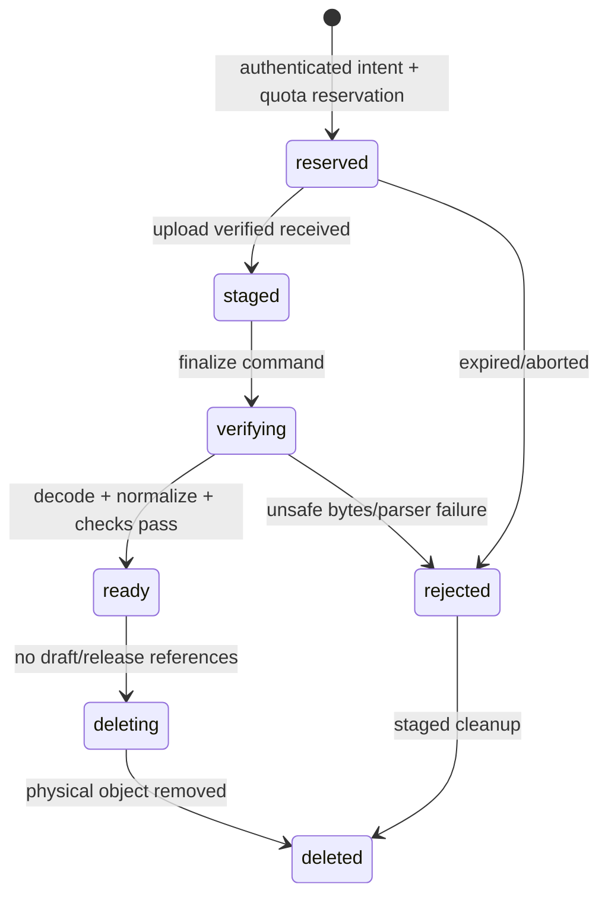

### 15.2 `POST /media/intents`: reservation before bytes

Request example:

```json
{
  "fileName": "portrait.jpg",
  "kind": "image",
  "declaredContentType": "image/jpeg",
  "declaredBytes": 364922,
  "declaredWidth": 1200,
  "declaredHeight": 1200,
  "clientChecksum": "sha256:example-not-authoritative"
}
```

Successful response (illustrative provider-neutral envelope):

```json
{
  "mediaId": "a6fbe96a-7bda-4d6b-a1b8-cc1368a87a74",
  "state": "reserved",
  "reservationId": "reserve_opaque",
  "expiresAt": "2026-11-18T15:35:00Z",
  "upload": {
    "method": "PUT",
    "url": "https://approved-upload-host.example/opaque-capability",
    "requiredHeaders": { "Content-Type": "image/jpeg" },
    "maxBytes": 1000000
  }
}
```

The above external host is illustrative, **not** a selected provider or verified URL. In a real implementation, a signed upload URL must not be exposed in structured logs, analytics, Referer headers or public search output. Server-side bytes are reserved atomically under per-portfolio and global quota limits before issuing the capability. Concurrent requests must not each see the same free capacity and overallocate it. The server may reserve the declared maximum rather than untrusted actual bytes; finalize releases the difference after verified processing.

### 15.3 Upload constraints and content trust

Require approved kinds: image (safe raster formats chosen after decoder evaluation), résumé PDF (single approved PDF kind). Size maxima: individual image 1 MB, PDF 2 MB, total media 15 MB, file count 30, original dimensions <= 4096×4096. The server must verify actual bytes and parsed dimensions, including decompression/bomb protections, irrespective of client claims. Remove EXIF/GPS on normalized images and generate safe responsive variants within quota. Store/serve opaque keys, not attacker-controlled filenames or paths. Do not accept arbitrary SVG, HTML, executables or custom shaders as media just because the browser claims they are images.

### 15.4 `POST /media/{mediaId}/finalize`

Finalize requires current owner, matching reservation, short-lived upload scope, content hash/byte verification against the actual staged object and sufficient quota. A media finalize command must be idempotent. If repeated with the same key and object fingerprint, return existing ready/processing state. If the provider reports upload success but a network response is lost, the client can retry finalize without uploading an additional file. If the staged key does not exist, is too large, decodes unsafely, or fails PDF content policy, reject and quarantine/clean up. **No public URL is created for `staged` or `rejected` media.**

```json
{
  "mediaId": "a6fbe96a-7bda-4d6b-a1b8-cc1368a87a74",
  "state": "ready",
  "kind": "image",
  "verifiedBytes": 342881,
  "width": 1200,
  "height": 1200,
  "variants": [
    { "variant": "responsive-640", "width": 640, "height": 640 },
    { "variant": "responsive-1200", "width": 1200, "height": 1200 }
  ],
  "referenceCount": 0,
  "readyForPublication": true
}
```

The physical storage quota and logical variant quota must be reconciled: each generated asset consumes real storage and possibly provider operation quotas. Do not promise variants that free storage cannot afford. Storage capacity exhaustion returns a clear safe `STORAGE_CAPACITY_EXHAUSTED` code and **does not delete existing published assets**.

### 15.5 Public media delivery and private originals

Only a media reference included in an allowed active release and not subject to a current deny policy is public. Owners may privately preview draft media through a short-lived scoped capability. A media ID cannot be resolved to an object key until the server checks owner/public release context and policy. URLs should avoid predictable raw provider bucket keys; published content references safe delivery URLs tied to allowed variants. PDF resumes support View and Download with `Content-Type: application/pdf`, appropriate `Content-Disposition`, `X-Content-Type-Options: nosniff` and restrictive CSP/sandbox policy when hosted on an origin separate from the dashboard.

**Revocation caveat:** a publicly distributed downloadable file cannot be recalled from visitors who already saved it, nor guaranteed immediately removed from all external CDN caches. Where immediate suppression is security-critical, use a policy-checked delivery gateway or a provider mechanism with tested short-lived authorized access, rather than a permanent public object URL. Any CDN strategy must be documented and verified in deployed form; do not imply a `DELETE` metadata write instantly purges every cached copy.

### 15.6 Media deletion and reference safety

`DELETE /media/{mediaId}` is allowed only after checking live draft references **and all three retained releases** (plus active in-flight publication/restore operations). On conflict return:

```json
{
  "type": "https://aaroophan.dev/problems/media-in-use",
  "title": "File is still used",
  "status": 409,
  "code": "MEDIA_IN_USE",
  "requestId": "req_example",
  "usage": { "draftReferences": 1, "retainedReleaseReferences": 2 },
  "detail": "Remove the file from the draft and retained publications before deleting it."
}
```

Returning counts is safe only to the owner of the same portfolio and should not reveal other tenants. The owner cannot silently remove an image needed for restoring an earlier published release. Physical deletion is asynchronous/best effort under free-tier limitations; metadata moves to deleting/garbage-collection state and retries are idempotent. An account deletion has its own authorized full-erasure workflow and suppression policy.

### 15.7 Failure table

| Failure                                 | HTTP / code                          | Data invariant                        | Owner guidance                                              |
| --------------------------------------- | ------------------------------------ | ------------------------------------- | ----------------------------------------------------------- |
| Staging capability expired              | 409/410 `UPLOAD_INTENT_EXPIRED`      | No permanent storage claimed          | Restart upload                                              |
| File too large                          | 413 `UPLOAD_TOO_LARGE`               | No quota over-commit                  | Compress/select smaller file                                |
| Actual MIME/signature mismatch          | 422 `UNSAFE_FILE_TYPE`               | Not public                            | Select supported file                                       |
| Image parser rejects/decompression bomb | 422 `UNSAFE_IMAGE`                   | No public asset                       | Replace media                                               |
| PDF contains disallowed active content  | 422 `UNSAFE_PDF`                     | No public download                    | Provide safer PDF                                           |
| Object provider outage                  | 503 `MEDIA_STORE_UNAVAILABLE`        | Draft/published content unchanged     | Retry later                                                 |
| Per-portfolio quota full                | 409/507 `MEDIA_QUOTA_EXCEEDED`       | Never silently delete published media | Remove unreferenced assets                                  |
| Global free capacity full               | 503/507 `STORAGE_CAPACITY_EXHAUSTED` | No billing, no partial commit         | Wait for capacity; existing pages unaffected where possible |
| Finalize repeated                       | 200 same status                      | No duplicate asset or counter         | Continue                                                    |
| Referenced file delete                  | 409 `MEDIA_IN_USE`                   | Referenced bytes survive              | Detach/revise then delete                                   |

---

## 16. Safe external metadata and RSS integration APIs

### 16.1 Integration principles

GildedIn allows one primary Medium/RSS feed per portfolio plus manually authored article links, and optional bounded public-link metadata previews. **Public pages never wait on a live RSS call**. Only an owner action or bounded scheduled sync invokes external fetching. The result is untrusted text and media metadata, transformed to a restricted preview DTO and stored as a draft/cached preview. A feed outage retains the previous safe preview or permits manual content; it does not prevent editing, publishing or public navigation. No full external article body is ingested for Gilden by default.

### 16.2 SSRF defense is an enforceable network boundary

A URL string passing a regex or being `https://` is not sufficient. Apply these controls to **every redirect and actual connection**, not merely the first DNS lookup [S16]:

1. Parse using a standards-based URL parser; require permitted HTTPS schemes; block usernames/passwords, `file:`, `ftp:`, `gopher:`, data and local protocols.
2. Limit input length, hostname syntax, port to a minimal supported set and optional provider allowlist where feasible.
3. Reject direct IP literal hosts unless an explicit reviewed case requires them; validate every resolved A/AAAA address against forbidden loopback, private, link-local, multicast, carrier-grade, ULA, metadata and other non-public ranges.
4. Validate **all** resolved addresses, including CNAME chains and IPv4-mapped IPv6; revalidate the actual connection target against the policy to prevent DNS rebinding and time-of-check/time-of-use differences.
5. Disable automatic redirects or process each redirect through the full validation pipeline with a small hop limit; never forward owner cookies, authorization headers or internal service tokens.
6. Restrict response bytes, content type, decompression ratio, redirects, concurrent fetch count and total time. Use outbound network restrictions if hosting supports them.
7. Avoid remote thumbnails served as unfiltered raw HTML; validate and proxy/normalize only when the media pipeline can enforce trusted formats and quotas.
8. Do not return upstream HTML/error bodies to the browser. Record only a safe remote-failure code.

If the chosen serverless runtime cannot guarantee connection-time destination validation for arbitrary HTTPS URLs, **restrict the feature to approved feed providers or manual links** until the SSRF problem is solved. An unsafe automatic preview is not an acceptable shortcut under a strict security-first brief.

### 16.3 Feed sync request and response

```json
{
  "source": { "type": "rss", "url": "https://example.org/blog/feed.xml" },
  "mode": "refresh"
}
```

```json
{
  "feedId": "feed_opaque",
  "status": "updated",
  "lastSuccessfulSyncAt": "2026-11-18T15:22:00Z",
  "itemsReviewed": 12,
  "itemsAccepted": 10,
  "itemsFlagged": 2,
  "nextRecommendedSyncAt": "2026-11-19T15:22:00Z"
}
```

Values above are illustrative and do not prescribe a background schedule. `POST /feeds/sync` is owner-authenticated, rate-limited, CSRF-protected and bound to one configured feed per portfolio. If the upstream feed is unavailable, return safe `502/503` or a `200` cached-status result with `status=stale` according to the final contract; never present a stale result as newly fetched. A linked article's canonical target must remain approved HTTPS. Owner review is required before hiding a previously published manual link merely because an external feed temporarily omitted it.

### 16.4 GitHub metadata

The initial GitHub integration uses publicly available repository/profile information, subject to rate limits and the provider's terms. GitHub OAuth for login does not by itself authorize broad private repository access. If private scopes are considered later, require explicit opt-in, a separate threat model and a new data-retention policy. The default API must not request extra GitHub scopes merely to display a project card.

---

## 17. Gilden owner settings, approved knowledge and live revocation

### 17.1 Scope of the AI API

Gilden is an **optional portfolio-specific AI assistant**. It is disabled by default; an owner must first publish meaningful approved introductory information and enable it. It answers in English from an explicitly approved, active, published knowledge snapshot. It is not a general assistant and must not invent employment history, credentials, projects, achievements, personal details or links. It can describe technical ideas directly tied to approved public project content, but should redirect unrelated requests back to portfolio content. Its name, greeting, safe tone preset, visual theme, suggested questions and location preset are owner-configurable; its platform safety policy and data authorization are not.

### 17.2 `GET /ai-settings`: private owner projection

Response fields should include:

```json
{
  "portfolioId": "e4d94b2b-e083-4a2c-9de4-bd7cb66def0b",
  "enabled": false,
  "displayName": "Gilden",
  "greeting": "I'm this portfolio's AI assistant.",
  "tonePreset": "professional",
  "positionPreset": "bottom-right",
  "suggestedQuestions": ["What projects has this person worked on?"],
  "approvalPolicyVersion": 8,
  "approvals": {
    "approvedSectionIds": ["sec_hero"],
    "approvedFieldIds": ["field_intro"],
    "deniedFieldIds": [],
    "approvedDocumentExtractIds": []
  },
  "context": {
    "status": "not_ready",
    "releaseId": null,
    "approvalPolicyVersion": 8
  },
  "usageSummary": { "monthlyMessagesServed": 0, "available": false }
}
```

This response is available **only** to the owning account. It must never include visitor prompts, provider credentials, raw system prompts, hidden source payloads not necessary for knowledge preview, or account-private reference/contact data. Owner access to the portfolio draft does not imply those fields can be transmitted to AI. The full approval policy is the authority, not a boolean checkbox on an entire section.

### 17.3 `PUT /ai-settings` and policy versioning

An AI settings write requires the current owner session, `Origin`/CSRF, strict request body, and an expected approval-policy version. In addition to presentational settings, allow a bounded positive list of approved source/section/field IDs, explicit denied fields and approved document extractions. The server must validate that every candidate approval refers to a field that belongs to the portfolio and is eligible for public publication in the active release. New fields are denied by default, even when a section was previously approved. An owner cannot approve private account metadata, private reference phone/email data, contact inbox, or an unpublished draft field simply by guessing a field ID.

**Immediate revocation path:** Deactivation or source denial is a security-critical control operation, distinct from new content approval. The server updates the authoritative approval policy version and deny list before confirming success. Existing knowledge snapshots with the old version become ineligible without waiting for background deletion or cache invalidation. A source approval change that adds knowledge may require a new approved context rebuild, and Gilden remains unavailable until a matching `ready` snapshot exists.

### 17.4 `POST /ai-settings/revoke`: fast path

```json
{
  "expectedPolicyVersion": 8,
  "disableAssistant": false,
  "denyFieldIds": ["field_phone"],
  "denySourceIds": ["src_example_private"]
}
```

```json
{
  "enabled": true,
  "approvalPolicyVersion": 9,
  "revokedSourceCount": 1,
  "effectiveForNewRequests": true,
  "contextStatus": "invalidated"
}
```

The `effectiveForNewRequests` claim can be returned only after the authoritative read path is updated. A response timeout after successful revocation should be reconciled by fetching the current owner settings; blindly retrying with a stale version must not remove unrelated newer approvals. Any inference already dispatched to Groq before revocation may have transmitted context and cannot be retroactively erased; stop active streams when possible and disclose this technical limit accurately.

### 17.5 `GET /ai-knowledge-preview`: explicit privacy UX

Owners should be able to inspect **exactly** what would be sent to the model for the current active release: approved source IDs, excerpts, citation targets, status, size estimates and excluded sensitive categories. This endpoint is owner-only and `no-store`, and it must not automatically approve sources. A comparison can show draft-only content as **excluded**, but must never present it as part of the ready public knowledge. The UI can offer field-level controls and an accessible explanation of why a specific field is ineligible. Do not use the preview to log entire extracted resumes or system prompts.

### 17.6 Snapshot compiler eligibility

The knowledge compiler reads one selected immutable release and one authoritative approval policy version. It positive-selects fields, redacts prohibited sensitive data, computes a bounded approved context and source manifest, then writes a snapshot with tuple `(portfolioId, releaseId, policyVersion, contextHash, status)`. The public request verifies the same tuple immediately before inference dispatch. A release change or policy version change invalidates the prior context for future generations; it must never silently fall back to the old release. PDF content may enter only with explicit document-level approval **and** appropriate sensitive information removal. Medium provides title/excerpt/date/link metadata only, not full article ingestion.

### 17.7 Owner AI usage

`GET /ai-usage` returns aggregate messages served, approximate quota window, availability and controlled error counts. No visitor identity, IP address, model raw prompt, response body, contact information or conversation transcript appears. Counters may be approximate for display when eventual consistency is acceptable; **quota admission itself must be atomic or fail closed** to prevent uncontrolled usage. Owner-facing “remaining” numbers are estimates and must not be represented as a billable entitlement.

---

## 18. Public Gilden HTTP, SSE and quota contracts

### 18.1 Public request prerequisites

A Gilden request must originate from a verified, allowed portfolio context, under a live allowed portfolio policy. It must use the matching active release and approved snapshot, check the immediate AI deny policy, validate bot/abuse risk and atomically reserve visitor/portfolio/platform allowance **before** incurring inference. The anonymous client presents a server-issued short-lived random session cookie or token; a client-provided UUID is not sufficient proof of an established quota session. The service never requires GildedIn visitor registration, name or email. The API explicitly instructs visitors **not to share sensitive information**, but cannot guarantee that a visitor will never type it; message text is processed by the external inference provider when a response is generated.

### 18.2 Request body and validation

```http
POST /api/v1/public/alex/gilden HTTP/1.1
Host: aaroophan.dev
Origin: https://aaroophan.dev
Content-Type: application/json
Accept: text/event-stream
Cookie: <short-lived-anonymous-technical-session>

{"message":"Which published projects demonstrate API design?","conversation":[{"role":"user","content":"Tell me about the engineering projects."},{"role":"assistant","content":"I can describe the published projects."}]}
```

This request illustrates an **ephemeral client-supplied conversation** limited by the server; the server may omit the `conversation` array entirely if follow-up continuity can be achieved with a stricter small context. Any client-supplied assistant messages are **untrusted text**, not model system instructions or authorization evidence. Cap the number of turns, per-turn characters and cumulative token estimate. Reject role values other than supported user/assistant, prohibit tool-call payloads, and never trust a client-supplied `system`, `developer`, `function` or `tool` message. Do not persist chat histories in MongoDB, Redis values, request logs or usage analytics. Keep only short-lived technical counters and aggregate metrics.

### 18.3 API authorization pipeline

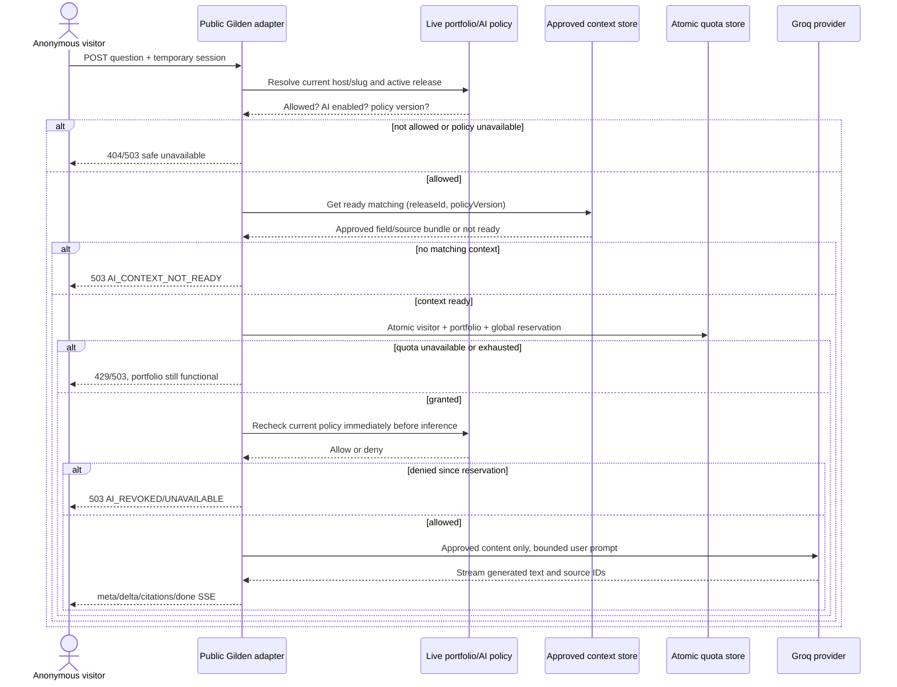

A live policy re-check prevents a long gap between initial eligibility and dispatch. It still cannot prevent the remote provider from having processed a context that was sent **before** a later revocation. Streams should be terminated when a revocation event is observed where feasible; no impossible absolute instantaneous purge promise is made.

### 18.4 SSE event protocol over `fetch(POST)`

SSE uses UTF-8 text frames separated by blank lines. Use `fetch` with a readable response body for a **POST** stream; `EventSource` is a convenient native GET client and does not issue a JSON POST. Keep `Content-Type: text/event-stream; charset=utf-8`, avoid response buffering/compression that delays chunks, mark the response `Cache-Control: no-store, no-transform` where supported, and send bounded keepalive comments only if necessary for the chosen host. [S25]

Event types and sample frames:

```text
event: meta
data: {"requestId":"req_example","assistant":"Gilden","releaseId":"release_public_3"}

event: delta
data: {"text":"The published API projects include "}

event: delta
data: {"text":"a REST service and a metadata-driven editor."}

event: citations
data: {"sources":[{"sourceId":"src_project_1","label":"Project case study","url":"/alex/projects/rest-service"}]}

event: done
data: {"finishReason":"complete","quotaCounted":true}

```

| Event             | Allowed fields                                                 | Consumer handling                     | Security implication                                                         |
| ----------------- | -------------------------------------------------------------- | ------------------------------------- | ---------------------------------------------------------------------------- |
| `meta`            | Request ID, assistant label, safe public release identifier    | Initialize UI state                   | No owner ID, internal policy version or provider key                         |
| `delta`           | Text fragment only                                             | Append safely as text, not HTML       | Model output is untrusted content                                            |
| `citations`       | Server-approved source IDs, labels and validated relative URLs | Render accessible links               | Reject arbitrary model-generated URLs                                        |
| `warning`         | Bounded safe code (e.g. answer interrupted)                    | Inline nontechnical status            | Never reveal provider raw error                                              |
| `error`           | Stable safe error code, request ID                             | Stop/offer retry or manual navigation | Once headers sent HTTP status remains 200; this event carries terminal state |
| `done`            | Finish reason and counted/partial status                       | Close stream                          | No raw token counts if they reveal shared quotas                             |
| keepalive comment | No data                                                        | Ignore                                | Prevent unbounded invisible stream lifetime                                  |

Client rendering MUST be XSS-safe: never `innerHTML` model text, never treat model output as Markdown code execution, and allow only server-validated citation links. The server may perform a final citation validation pass when generation completes; any content relying on an invalid citation must not be presented as grounded factual support. A client disconnect should cancel provider work where supported. Streaming cancellation after generation has started **still counts** toward quota to prevent abuse by repeatedly aborting requests.

### 18.5 Mid-stream failure and fallback

Before sending the first SSE byte, an authorization or quota error returns the proper status and RFC 9457 problem JSON. Once streaming begins, HTTP status and headers are already committed, so return `event: error` with a sanitized code followed by a controlled close. The UI keeps already received text visible but labels it **Interrupted**; it must not silently present a partial answer as complete. A fallback `Accept: application/json` request returns the same semantic answer envelope and citations after complete generation. Provider/network failure leads to a friendly unavailable state with links to Projects, About, Experience and Contact; it must never break the underlying portfolio page.

Example JSON fallback:

```json
{
  "answer": "This portfolio includes the REST service described in its project case study.",
  "citations": [
    {
      "sourceId": "src_project_1",
      "url": "/alex/projects/rest-service",
      "label": "REST service case study"
    }
  ],
  "finishReason": "complete",
  "requestId": "req_example"
}
```

### 18.6 Hallucination, injection and topic safety

- Treat approved portfolio text, external RSS excerpts, PDFs and visitor questions as **untrusted model input**. A sentence inside a project README instructing the bot to reveal tokens does not become an authority.
- Construct the prompt hierarchy server-side from fixed platform rules and explicitly approved content; no owner-edited raw system prompt.
- Do not expose tool-calling privileges, direct database queries, unrestricted web browsing, arbitrary outbound HTTP or contact submission capability to the model.
- Constrain output length, prompt size, wall-clock time and provider max tokens. The exact values are configuration, not a guarantee of zero cost.
- Use model-proposed **source IDs** with deterministic server-side mapping to the active release. A model-proposed URL is discarded unless it exactly maps to a valid approved route.
- If the approved context does not support a claim, the assistant responds that it does not know rather than guessing. This is a product instruction, not a mathematical hallucination guarantee; test representative unsupported questions.
- Do not secretly extract visitor contact details or write chat content to the inbox. Gilden may open the separate form or suggest a local draft only after the visitor requests it.

### 18.7 Anonymous quota algorithm and failure policy

A quota admission operation checks at least three windows: `visitor pseudonymous session/day`, `portfolio/month`, and `platform/global/period`. The visitor limit starts at **15 messages per day**. The portfolio and global ceilings are operator-controlled parameters and must be configured according to observed free provider capacity. The checks must be executed atomically or by a reservation protocol that cannot oversubscribe under concurrency; multiple independent counter increments without rollback are inadequate when the global quota is hard. Use a Redis script/transaction or appropriately guarded equivalent where supported. On Redis/quota authority failure, **do not** issue a provider request. Do not reveal platform-wide quota values to visitors.

The quota session is a short-lived random technical identifier, not a user account or long-term behavioral profile. Implement bounded cookie storage or a temporary header token on the same public origin, with appropriate security attributes. Coarse IP-derived abuse protections may supplement quota enforcement but are not identity verification and must respect shared networks. Never use user-supplied forwarded IP headers without a verified ingress trust chain.

### 18.8 Privacy notice accuracy

Do not claim Gilden does not process _any_ personal information: a visitor can type an email or other personal detail, and the external inference provider must process the submitted message to generate an answer. The actual accurate contract is that GildedIn **does not intentionally solicit or persist visitor identity or chat transcripts**, and sends only the approved context plus current message/ephemeral conversation to the selected provider for processing. Verify the provider's data-use and retention terms before enabling public chat. A separate contact form may collect information with explicit visitor consent; the chat itself may not do so as a hidden workflow.

---

## 19. Public contact, abuse reporting and owner inbox

### 19.1 Contact workflow

A portfolio owner may enable a text-only contact form without exposing their private email address. The form accepts a bounded `name`, `email`, `message` and optional `subject`/`organization`, with explicit voluntary submission and clear privacy notice. It is **not** an AI/chat submission; Gilden has no permission to submit it or copy chat history into it. Protect the endpoint with rate limiting, suspicious-traffic challenges such as appropriately configured Turnstile, size caps, URL/HTML sanitization and owner-specific inbox quotas. Contact forms should not accept binary attachments or executable content.

```json
{
  "name": "Visitor Example",
  "email": "visitor@example.org",
  "subject": "Project collaboration",
  "organization": "Example Research Group",
  "message": "I would like to discuss your published project.",
  "consentAcknowledged": true
}
```

The response should avoid revealing a private owner email or internal delivery status:

```json
{
  "accepted": true,
  "message": "Your message was received.",
  "requestId": "req_example"
}
```

A public response may be a safe generic acknowledgement even when an automated spam filter quarantines a suspicious submission; careful design is needed so it does not misrepresent successful owner delivery as certain. A hard platform outage should return a real unavailable status. Store only the bounded form fields, submission time, owner portfolio ID, expire-at timestamp and minimal spam status. Do not add user tracking cookies to contact forms. Contact retention is **30 days**; the owner may export selected messages before expiration but GildedIn does not offer indefinite in-app retention.

### 19.2 Owner inbox endpoints

`GET /portfolios/{id}/inbox?limit=20&cursor=...` (defined in the inventory via a route family) is authenticated owner-only, returns minimal fields and a bounded cursor. `DELETE /portfolios/{id}/inbox/{messageId}` is owner-scoped and idempotent. If search or filtering is added later, it must use bounded indexed queries and not permit a regex/JSON query injection. Owner contact messages never appear in public release JSON, AI context, analytics exports or administrator status summaries. A suspended owner may lose access according to security policy; retention/deletion continues independently.

### 19.3 Abuse report submission

`POST /api/v1/public/{slug}/report` or the subdomain equivalent accepts an allowed `reasonCode` (phishing, impersonation, malware, harassment, unsafe content, other), the reported canonical route or content ID, optional bounded explanation and minimal anti-spam proof. It does not require a visitor account. Validate the reported URL belongs to the current resolved portfolio and approved route syntax; never treat the reported URL as permission to fetch an arbitrary remote website. An accepted report enters a restricted moderation queue with retention controls. The public response acknowledges receipt without revealing whether the portfolio is already under investigation.

### 19.4 Owner-initiated appeals

Suspended owners can request review through a controlled channel without a new public account. The appeal operation must not automatically restore access or bypass a suspension. The initial release can use an accessible administrative contact mechanism rather than a full case-management platform. Clearly separate moderation control decisions, audit records and visitor-submitted allegations. Do not render private reporter data publicly.

---

## 20. Public analytics, directory, search, SEO and published status

### 20.1 Aggregate analytics ingestion

`POST /public/{slug}/interaction` on apex or `POST /public/interaction` on a verified subdomain accepts only a small allowlist of event types: `page_view`, `project_open`, `outbound_link_click`, and optionally `section_navigation`. The server resolves the active release and confirms the target URL/resource exists in it. It must not accept arbitrary event names, self-reported user identity, raw device fingerprint or oversized arbitrary metadata. Prevent spoofed counters where possible through basic rate limiting/coalescing, but label aggregate analytics as estimates rather than security-grade exact metrics. Do not use analytics as a covert visitor profile.

```json
{
  "event": "project_open",
  "target": { "kind": "project", "contentId": "project_1" },
  "releaseId": "public_active_example"
}
```

The client release ID, if provided, is advisory and checked against current active release; it is not authorization. The dashboard aggregate endpoint returns daily/bounded counts and trends with no visitor breakdown or precise location profiling. Public display of aggregate counts requires an explicit owner setting and release/public policy; never expose the same private dashboard analytics DTO to anonymous visitors.

### 20.2 Directory API

The platform homepage shows curated featured portfolios and a **lightweight searchable directory**. A suggested route `GET /api/v1/directory?query=&tag=&cursor=` returns only portfolios with an active allowed public release and directory opt-in/eligibility. Unlisted, disabled, suspended, owner-deleting and unreleased records must not appear. Querying across portfolios uses a compiled limited public directory projection, not arbitrary raw public release documents. No public `/users` email index or owner-identity provider metadata is permitted. Ranking/recommendation engines, arbitrary cross-tenant filtering and follower systems are excluded.

Example response:

```json
{
  "items": [
    {
      "slug": "example-engineer",
      "displayName": "Example Engineer",
      "identityLabel": "Software Engineer",
      "summary": "Building accessible web tools.",
      "canonicalUrl": "https://aaroophan.dev/example-engineer"
    }
  ],
  "nextCursor": null,
  "resultCountApproximate": 1
}
```

### 20.3 Per-portfolio search

Search operates over a **compact published search artifact** generated at publication time. It can be delivered to the browser for client-side searching at typical portfolio sizes or queried through a bounded endpoint. No dedicated search service is required for the first release. Only owner-approved published text fields that pass current policy/masking rules are indexed. Hidden fields, account metadata, contact messages, reference private details, unpublished edits and moderated content are absent.

`GET /public/{slug}/search?q=api&limit=10` returns validated result IDs, excerpts and route targets from the current allowed release. The query is not translated to arbitrary MongoDB `$regex` against unscoped collections. Use bounded length, fixed matching rules and escape output. A publication that changes the active release also changes search index selection atomically via the release ID. Moderation removes/restricts results through the live gate even if the release's stored index still contains the item.

### 20.4 SEO/metadata APIs

Portfolio public HTML pages are server-rendered and derive metadata from **one active release**. Project detail pages receive independent titles, descriptions, canonical URLs and Open Graph images. The canonical location is `https://aaroophan.dev/{slug}...`, even when visitors browse a portfolio subdomain. Old slug aliases redirect to the current slug. Drafts, private owner routes, unlisted portfolios, disabled/suspended content and deleted pages must never appear in public sitemaps. Unlisted pages are link-accessible but use appropriate noindex and are omitted from directory results.

Host-aware `robots.txt` and `sitemap.xml` must not accidentally expose a multi-tenant sitemap on an arbitrary user subdomain or return private editor URLs. Sitemap generation must evaluate current discoverability and moderation policy, not blindly concatenate all historically published slugs. Social image generation occurs during publication from validated content; public social crawlers do not trigger new expensive per-request GPU rendering. Owners may upload an approved override image.

### 20.5 Public availability/status API

A public status endpoint may return only booleans/enums useful to the UI, such as `assistantAvailable`, `publicContentAvailable`, and a safe `reasonCode` (`temporarily_unavailable`, `not_enabled`) where not sensitive. It must not reveal database hostnames, provider account IDs, Groq quota totals, internal error details or moderation investigation notes. A separate admin status API serves restricted operational information.

---

## 21. Administrative API and operational health

### 21.1 Admin authorization is capability-specific

An internal administrator is provisioned by trusted deployment. Admin permissions are explicit named actions, not unconstrained MongoDB access. Read-only operations include listing bounded abuse reports and sanitized operational aggregates. Destructive/moderation operations require recent reauthentication, Origin/CSRF verification, reason codes, conditional policy update and durable audit event. The UI must not contain hidden client-side-only permission gates; the handler independently enforces `canReviewReports`, `canModeratePortfolio`, `canModerateContent`, `canViewOperationalStatus`, etc.

### 21.2 Report and moderation contracts

```json
{
  "scope": "content_item",
  "targetId": "project_1",
  "effect": "deny_public",
  "reasonCode": "phishing",
  "internalExplanation": "Verified malicious external link in the affected item.",
  "expectedSecurityVersion": 17
}
```

`POST /admin/portfolios/{id}/content/{contentId}/moderation` checks that the target belongs to the portfolio. The server prevents an administrator from passing a broad query like `{ "$ne": null }` or applying an unsafe multi-tenant bulk update. An `effect=deny_public` must also deny AI for the same source and exclude search exposure. Lifting an effect is a separate authorized transition, not a direct arbitrary document delete. Every mutation logs who acted, what action/scope occurred, the safe reason code, request ID, timestamp and affected policy version; avoid duplicating private complaint contents in audit logs.

### 21.3 Administrative status DTO

The admin health panel may show bounded, privacy-safe data such as:

```json
{
  "generatedAt": "2026-11-18T15:30:00Z",
  "components": [
    { "name": "database", "status": "healthy" },
    { "name": "object_storage", "status": "degraded" },
    { "name": "quota_store", "status": "healthy" },
    { "name": "ai_provider", "status": "unavailable" }
  ],
  "publishing": { "pendingPropagation": 2, "recentFailedOperations": 1 },
  "security": { "pendingReviewReports": 3 },
  "requestId": "req_example"
}
```

This is not a promise of active network probing, detailed tracing or permanent metrics storage on a free-tier deployment. Status checks must be bounded and must not call providers excessively merely because an administrator reloads the page. The admin DTO never includes secrets, full environment variables, connection strings, private owner messages or model responses.

### 21.4 Observability endpoints and absence of public diagnostics

Do not expose `/debug`, `/env`, `/metrics` without authorization, raw stack traces, server action IDs, database queries, internal DNS, profiler outputs or test-only routes in production. A basic infrastructure health probe MAY be available under host/provider controls with a minimal readiness result; it must be protected against becoming an expensive public probe or leaking tenant/provider configuration. Logs are redacted by default and use a correlation/request ID. Incident response and audit-retention policy live in [09](09-error-handling-and-logging.md).

---

## 22. Account export, deletion and data-retention workflows

### 22.1 Export contents and authorization

An owner may export structured portfolio data, schema definitions, composition, responsive overrides, SEO configuration, public and unpublished content owned by them, approved media originals where available, and a manifest describing the format. Export must **not** include unrelated tenants' data, private provider tokens, session verifiers, internal admin case notes or another account's contact messages. Contact inbox messages may be included only if the user owns them and the export policy explicitly includes retained messages; disclose that choice in the UI.

`GET /accounts/me/export` requires recent authenticated proof, scoped streaming/size limits and a safe filename. Because building a ZIP may require time/storage, the API may create an idempotent export operation and return a one-time download capability; it must expire and enforce the current session/ownership when downloaded. Never place the complete archive in a public CDN cache. Use `Content-Disposition: attachment`, `Cache-Control: private, no-store`, `X-Content-Type-Options: nosniff` and a safe content type. An export is a high-sensitivity event and must be audited, without logging archive contents.

### 22.2 Account deletion: immediate denial, eventual cleanup

The owner confirms account deletion under a recent reauthentication requirement. The request includes an idempotency key and an explicit destructive confirmation flag or equivalent well-reviewed UI mechanism. A single security control change marks the account `deleting`, revokes sessions and denies all public portfolios immediately. Later phases delete drafts, references, retained releases, staged media, contact inbox, AI context, aliases and approved media in a reference-safe, retriable order. Durable cleanup state is mandatory so a crash does not leave public access restored or untracked private media.

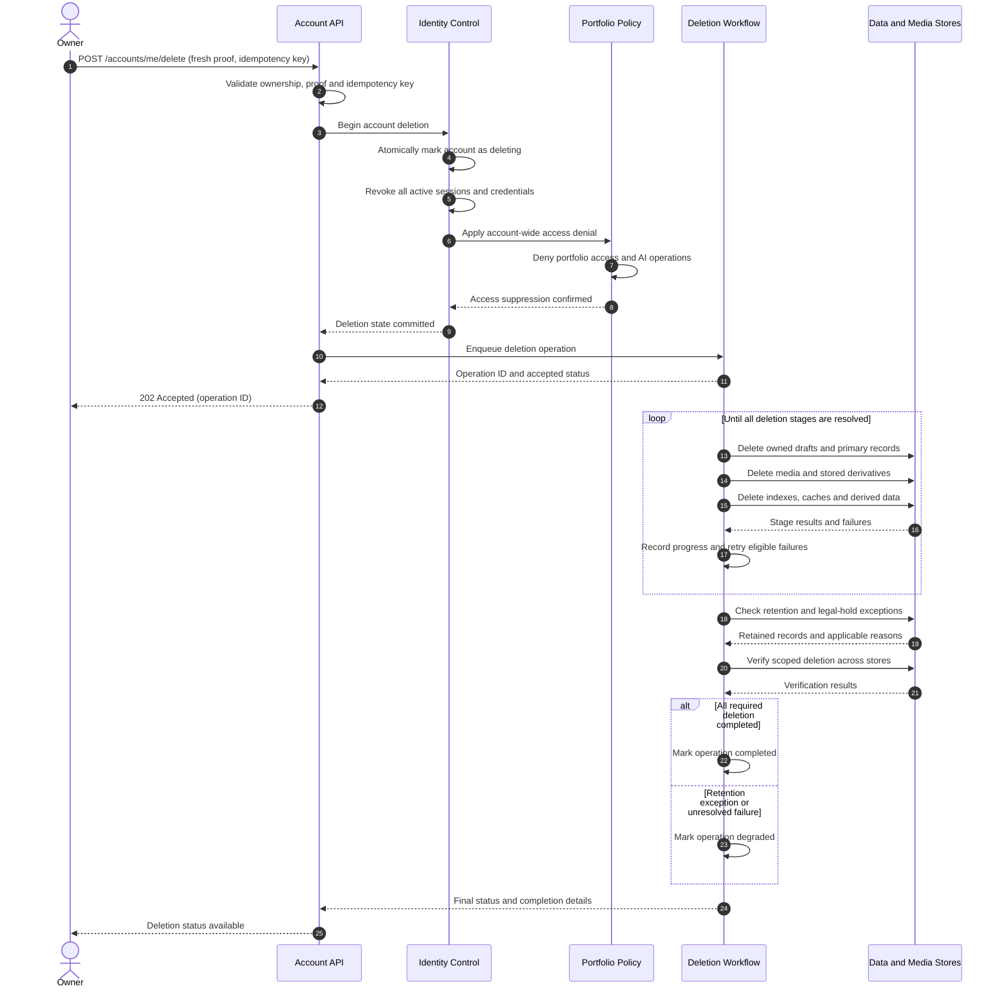

The workflow must never delete another account's records because the client supplied an ID. Use a domain-owned traversal of all records indexed by `accountId`/`portfolioId`, with explicit idempotency and logged safe progress. Managed provider backup retention cannot be shortened beyond contractual/technical ability; the privacy notice should state the actual retention ceiling. GildedIn does not promise guaranteed backup recovery under the strict $0 constraint, and deletion from backups may follow the provider's separate lifecycle.

### 22.3 Retention policy and TTL caveats

| Data                            | Intended retention                                  | Operational notes                                                          |
| ------------------------------- | --------------------------------------------------- | -------------------------------------------------------------------------- |
| Visitor Gilden chat transcripts | Not persisted by GildedIn                           | External provider processing governed separately                           |
| Contact submissions             | 30 days                                             | Owner may export; expiry should be checked at read as well as TTL cleanup  |
| Security/error logs             | 30 days                                             | Redact PII and secrets at source                                           |
| Security audit events           | 90 days                                             | Minimized records; specific legal retention exceptions reviewed separately |
| Quota tokens/counters           | Relevant quota window                               | No long-term visitor identity tracking                                     |
| Published releases              | Most recent three successful releases               | Old media kept while referenced                                            |
| Deleted account live data       | Prompt suppression; asynchronous physical erasure   | Idempotent cleanup and user-facing status                                  |
| Managed backups if any          | Provider-specific, ideally <=30 days where feasible | No guarantee of independent backups                                        |

MongoDB TTL deletion is not immediate or an authorization primitive. An expired inbox message, session or reservation must be treated as expired when read even before background TTL removal has occurred [S18].

---

## 23. Universal response envelopes, pagination, concurrency and errors

### 23.1 Success response rule

Use a purpose-specific DTO with semantically meaningful status. A read may return `200` with data; creation `201` with `Location`; a command that has been accepted but not fully reconciled may return `202` with a status URL; a delete that has safely completed can return `204`. A `200` response MUST NOT hide an actual failed operation in a `success:false` field. Do not wrap every response in generic `{data, status, message}` if it obscures stable types or forces needless allocations; the important consistency is **field naming, error shape, cache headers and security behavior**.

### 23.2 RFC 9457 error envelope

All JSON API failures return `application/problem+json` wherever the transport permits, with stable type URI, human-readable title, actual HTTP status, safe detail, machine-readable GildedIn code, opaque request ID and optional field issues. Problem type URIs are controlled static paths under the platform domain and SHOULD have documentation. Never reflect an attacker URL as `type`. [S09]

```json
{
  "type": "https://aaroophan.dev/problems/content-validation",
  "title": "Some content needs attention",
  "status": 422,
  "detail": "Correct the highlighted fields before publishing.",
  "code": "PUBLICATION_VALIDATION_FAILED",
  "requestId": "req_a1247",
  "issues": [
    {
      "path": "sections[0].profile.identityLabel",
      "code": "required",
      "message": "Add a professional title or identity label."
    },
    {
      "path": "nodes[7]",
      "code": "focus_obscured",
      "message": "This control is not reachable in the mobile layout."
    }
  ]
}
```

The `detail` and `message` strings are for display, not for logic. Clients use `code`, `status` and `issues[].code` to choose recovery. Do not include Mongo exceptions, provider stack traces, secret names, storage object keys, private reference details, submitted form values, raw model prompts or URLs of blocked internal networks. A `requestId` is a diagnostic handle, **not a support authorization token**.

### 23.3 Error code registry

| Code                             |               Status (proposed) | Meaning                                        | Client recovery                      |
| -------------------------------- | ------------------------------: | ---------------------------------------------- | ------------------------------------ |
| `REQUEST_MALFORMED`              |                             400 | Syntax / ambiguous host                        | Fix request or report bug            |
| `CONTENT_TYPE_UNSUPPORTED`       |                             415 | Unsupported media                              | Use supported JSON/media type        |
| `REQUEST_TOO_LARGE`              |                             413 | Transport cap                                  | Reduce request                       |
| `UNAUTHENTICATED`                |                             401 | No valid session                               | Sign in                              |
| `REAUTH_REQUIRED`                |                         401/403 | Fresh proof needed                             | Complete provider reauthentication   |
| `FORBIDDEN`                      |                             403 | Action not allowed                             | Stop / request correct role          |
| `RESOURCE_NOT_FOUND`             |                             404 | Unknown or deliberately obscured resource      | Navigate back                        |
| `PORTFOLIO_UNAVAILABLE`          |                         404/503 | Disabled or policy unavailable                 | Read public status safely            |
| `SLUG_UNAVAILABLE`               |                             409 | Current/historical/reserved slug taken         | Choose another slug                  |
| `PORTFOLIO_ALREADY_EXISTS`       |                             409 | Beta one-active-portfolio invariant            | Open existing dashboard              |
| `LAST_LOGIN_PROVIDER`            |                             409 | Would remove last usable method                | Link another provider                |
| `DRAFT_REVISION_CONFLICT`        |        409 currently; see §34.1 | Saved revision differs                         | Compare and reload                   |
| `HTTP_PRECONDITION_FAILED`       |  412 if strict conditional mode | HTTP validator failed                          | Reload representation                |
| `PRECONDITION_REQUIRED`          |                  428 if adopted | Missing expected version                       | Read state, retry with version       |
| `SCHEMA_INVALID`                 |                             422 | Unsupported or unsafe schema                   | Fix schema                           |
| `CONTENT_REFERENCE_INVALID`      |                             422 | Missing/foreign relationship                   | Repair binding                       |
| `CONTENT_IN_USE`                 |                             409 | Deletion would break references                | Detach first                         |
| `BLOCK_LIMIT_EXCEEDED`           |                             422 | >20 authored nodes                             | Consolidate blocks                   |
| `PUBLISHED_PAYLOAD_TOO_LARGE`    |                             422 | >102,400 canonical bytes                       | Reduce content                       |
| `PUBLICATION_VALIDATION_FAILED`  |                             422 | Publish blockers                               | Correct reported issues              |
| `PUBLICATION_OPERATION_CONFLICT` |                             409 | Concurrent active publication                  | Recheck status                       |
| `IDEMPOTENCY_KEY_REUSED`         |                             409 | Same key with changed fingerprint              | Use original operation or new intent |
| `PUBLISH_PROPAGATION_PENDING`    |     **not an error**: 202 state | Activated but propagation ongoing              | Poll/recheck                         |
| `MEDIA_IN_USE`                   |                             409 | Referenced by draft/releases                   | Detach safely                        |
| `MEDIA_QUOTA_EXCEEDED`           |                         409/507 | Portfolio quota                                | Remove unused media                  |
| `STORAGE_CAPACITY_EXHAUSTED`     |                         503/507 | Global zero-billing capacity                   | Try later; existing media retained   |
| `UNSAFE_FILE_TYPE`               |                             422 | Mismatch or disallowed bytes                   | Upload supported file                |
| `UNSAFE_PDF`                     |                             422 | Untrusted active/invalid PDF                   | Replace file                         |
| `UPLOAD_INTENT_EXPIRED`          |                         409/410 | Staged capability no longer valid              | Start a new intent                   |
| `REMOTE_URL_BLOCKED`             |                             422 | SSRF/redirect policy                           | Enter manual metadata                |
| `REMOTE_FETCH_UNAVAILABLE`       |                         502/503 | Approved feed unavailable                      | Use cached/manual preview            |
| `AI_DISABLED`                    | 503 or 404 safe public response | Owner has not enabled assistant                | Read portfolio manually              |
| `AI_CONTEXT_NOT_READY`           |                             503 | Release/policy mismatch or compilation pending | Try later                            |
| `AI_POLICY_REVOKED`              |                             503 | AI access changed                              | Stop generation                      |
| `AI_QUOTA_EXCEEDED`              |                             429 | Visitor/portfolio/global policy quota          | Try later/read portfolio             |
| `QUOTA_STORE_UNAVAILABLE`        |                             503 | Cannot enforce hard provider budget            | AI unavailable, content unaffected   |
| `CONTACT_RATE_LIMITED`           |                             429 | Abuse/too many submits                         | Retry when allowed                   |
| `ADMIN_RECENT_AUTH_REQUIRED`     |                             403 | Sensitive admin operation needs fresh proof    | Reauthenticate                       |
| `DEPENDENCY_UNAVAILABLE`         |                             503 | Required provider unavailable                  | Retry safely                         |
| `INTERNAL_ERROR`                 |                             500 | Unexpected server defect                       | Show request ID, no internals        |

The status table has a small number of **conditional design choices** marked explicitly. The canonical status for each code must be frozen in the machine-readable OpenAPI artifact and its contract tests before implementation releases. Code strings should be stable after publication; avoid using a single generic error for all unrelated failure modes.

### 23.4 Field issue format and safety

Field paths are JSON Pointer-like or documented dotted indexed paths, using **server-generated paths**, not arbitrary attacker-provided strings. `issues` length and message length are capped to prevent response amplification. A password/token field, if introduced in future, must not have its submitted value reflected in an issue. For unknown fields, return a generic `unexpected_property` code rather than echoing a sensitive value. A nested object validation failure must not return the entire rejected object in an error message.

### 23.5 Cursor pagination

All potentially growing owner/admin collections use opaque seek cursors with strict upper page sizes. A cursor binds to the route, actor/portfolio, sort order, last key and expiry. It must be signed or otherwise tamper-evident, and input validated before translating into a repository predicate. Do not provide unbounded `skip=99999999`, arbitrary sort fields or user-written Mongo query fragments. Cursor errors use a stable code `CURSOR_INVALID`/`CURSOR_EXPIRED`; a cursor from another tenant cannot expose that tenant's results.

### 23.6 Header, cache and content negotiation behavior

`ETag` is returned on versioned drafts and appropriate public release representations; do not use a private ETag as a public identifier if it can reveal information. `Cache-Control: private, no-store` is normative for owner/admin, account, private previews, operation status, contact inbox and export. For public pages, cache behavior is subordinate to current live security policy. A public API 404/403 should not be cached indefinitely, particularly for newly activated portfolios. SSE and JSON fallbacks use exact accepted media types; a caller cannot force cross-origin download of private data via `Accept: text/html`.

---

## 24. Rate limiting, anti-abuse and provider budgets

### 24.1 Risk-based control matrix

| Endpoint class           | Primary risks                                       | Control                                                               | Expected failure            |
| ------------------------ | --------------------------------------------------- | --------------------------------------------------------------------- | --------------------------- |
| OAuth start/callback     | Bot registration, replay, link takeover             | Library protocol checks, edge budget, CSRF/state, provider proof      | Safe auth failure / 429     |
| Username availability    | Enumeration, expensive lookups                      | Length/charset/indexed query, per-origin/IP limits                    | 429 without account details |
| Account/portfolio create | Duplicate account, slug races                       | Unique DB indexes, CSRF, idempotency, bot challenge                   | 409/429                     |
| Draft autosave           | Write amplification, storage fill, stale overwrite  | Client debounce, max body, CAS, per-owner budget                      | 409/413/429                 |
| Schema import            | Parser DoS/recursion, code injection                | Strict subset, nesting and count caps, CPU deadline                   | 422/413/429                 |
| Preview                  | CPU render amplification                            | Auth, no-store, request cap, rate/timeout                             | 429/503                     |
| Publish                  | CPU/write amplification, duplicate release          | Idempotency, active op lease, compiler limits, rate                   | 409/422/429                 |
| Upload intent/finalize   | Byte/storage explosion, malicious content           | Atomic reservations, global cap, signature verification               | 413/422/507                 |
| Feed/metadata            | SSRF, outbound bandwidth/CPU                        | URL network policy, redirect/byte/timeout cap                         | 422/502/503                 |
| Gilden                   | Shared AI quota exhaustion, injection, prompt flood | 15/day visitor + owner/global hard quotas, token caps, short deadline | 429/503                     |
| Contact/report           | Spam, harassment, stored XSS                        | Text caps, rate and optional Turnstile, sanitization                  | 429/422                     |
| Analytics                | Counter spoofing, tracking                          | Fixed event names, coalescing, minimal data                           | Drop safely / 429           |
| Admin actions            | Privilege abuse, mass suppression                   | Role, recent auth, reason, audit, CAS                                 | 403/409                     |
| Account export/delete    | Data exfiltration or destructive replay             | Fresh auth, throttling, scope, idempotency                            | 401/403/409                 |

### 24.2 Quota enforcement rules

Hard quotas require **atomic admission** under concurrent requests. Apply separate limits for actor, portfolio and global platform where relevant. Redis failure cannot result in uncapped AI requests to a metered provider, especially under a $0/no-payment-card policy. Quota counters must have configured windows/TTL and bounded key cardinality; user-supplied identifiers cannot create unbounded keys in Redis. IP-based abuse controls use only trusted ingress network metadata and should be coarse to avoid shared-network unfairness. Rate limiting cannot replace authentication, authorization, input validation or durable uniqueness.

### 24.3 Retry-After and capacity visibility

When a predictable visitor window resets, `429` may include `Retry-After: N`. If a shared provider has a variable recovery window, avoid fabricated precise times. The public UI says the feature is temporarily unavailable and offers static portfolio navigation. Only administrators may see shared quota figures; owners see appropriate per-portfolio aggregates without global sensitive details. The platform must not suggest automatic payment-card upgrade or enabling billable overages to resolve a user error.

---

## 25. Caching, idempotency, consistency and live security decisions

### 25.1 Read classifications

| Read class             | Typical endpoint                                              | Cache policy                                         | Source of authority                      |
| ---------------------- | ------------------------------------------------------------- | ---------------------------------------------------- | ---------------------------------------- |
| Private owner          | `/accounts/me`, `/draft`, `/inbox`, `/ai-settings`            | `no-store`                                           | Current session + owner-scoped DB        |
| Public immutable bytes | Release payload, generated OG asset, prepared search artifact | Content-addressed and versioned cache possible       | One immutable release ID                 |
| Public authorization   | Portfolio enabled/disabled, content moderation, live AI allow | **Never treat stale release cache as allow**         | Current policy/security version          |
| Marketing content      | Platform home features, non-sensitive static assets           | Public caching permitted with invalidation           | Published platform content               |
| Unlisted page          | Active release but not discoverable                           | Content cache only behind current live gate; noindex | Current visibility and release           |
| Public search          | Derived index by active release                               | Cached payload; current suppression filter           | Active release + live policy             |
| Published media        | Approved variant object                                       | May be cached if revocation model proven             | Release reference + current media policy |
| Owner preview          | Selected draft revision                                       | `no-store`                                           | Current owner session and owned draft    |
| SSE/chat               | Public AI response stream                                     | `no-store, no-transform`                             | Live AI policy + quota + provider        |
| Admin status/report    | Operational data                                              | `no-store`                                           | Current administrator authorization      |
| Rate limit counter     | Redis or equivalent                                           | TTL and atomic updates, not a client cache           | Quota authority                          |

A shared content cache should prefer immutable keys with version/release ID rather than mutable keys such as `portfolio:alex:latest`, which risk mixed content and stale-state confusion. The **control-plane read for current eligibility remains independent**. If the selected CDN can return a cached HTML page without invoking the live policy before each response, immediate moderation revocation is not proven; either change the caching architecture or reject that deployment for public owner-generated pages. [S01][S03][S15]

### 25.2 Normal publish and security revoke differ

Normal publication may tolerate a documented short propagation delay. A new active release pointer is durable, but some anonymous visitors may momentarily see prior allowed content; owner dashboard reports `propagation_pending` accurately. In contrast, suspension, malicious content removal, AI disable and field approval revocation are **security decisions** and cannot rely only on stale-while-revalidate. The API must use a live deny authority or a demonstrably equivalent edge enforcement mechanism. If authoritative policy is unavailable, deny the sensitive operation/content rather than serving stale permission.

### 25.3 Scoped cache invalidation

At publication, invalidate only the affected portfolio's routes, metadata, search artifact keys and directory projection. Prefer versioned cache tags such as `portfolio:{id}:release` and `portfolio:{id}:seo`, but do not assume a specific Next.js cache API is available from every handler. `revalidateTag` is usable in appropriate Server Functions and Route Handlers; `updateTag` is Server Action-only in current Next.js documentation [S03][S15]. Invalidating a cache tag is a freshness optimization, not a cryptographic proof that no CDN outside the application's control holds a previous response.

### 25.4 ETag, optimistic concurrency and idempotent side effects

Conditional writes protect against lost updates. `ETag` and `If-Match` are HTTP state validators; MongoDB atomic compare-and-swap must still enforce the revision on the actual write. An `Idempotency-Key` is a transport-retry identity, not permission to bypass revision/ownership checks. These controls solve different problems:

| Mechanism                     | Answers                                         | Does not solve                                 |
| ----------------------------- | ----------------------------------------------- | ---------------------------------------------- |
| Session authentication        | Who is making request?                          | Ownership of target resource                   |
| Object-level authorization    | May this actor access this exact object?        | Concurrent changes                             |
| Draft revision/CAS            | Has this version already changed?               | Duplicate publish retries after timeouts       |
| Publish idempotency           | Have these side effects already been requested? | Data validation, authorization                 |
| Atomic active release pointer | Which immutable release is publicly active?     | Cache invalidation, revocation                 |
| Live security policy          | May this response leave the server now?         | Data durability/backup                         |
| Checksums/canonical hash      | Are artifact bytes consistent?                  | Authenticity unless keyed/signed appropriately |

### 25.5 Idempotency ledger details

Every idempotent sensitive command has: `operationId`, `actorAccountId`, `portfolioId`, `actionType`, keyed hash of client key, canonical fingerprint, current stage, result resource IDs, retry state, timestamps and error code. Database unique constraints prevent two records for the same scoped key. A duplicate concurrent request should get the existing operation/status instead of triggering another physical upload, publication or account deletion. A collision of the same key with a different payload is `409`.

An operation's final state must survive a process restart. When the operation's HTTP response is lost, a client can re-query by operation ID or retry **with the original key and payload**. Randomly creating a new key for every automatic retry defeats idempotency. An idempotency ledger may have retention, but pruning must not make replay of an old completed command create destructive duplicate side effects; use unique content/operation identity and lifecycle state as a second guard.

### 25.6 Cache stampede and write amplification

Public immutable release payloads may be loaded frequently. Cache keys should be tenant-scoped and bounded. Coalesce expensive compile/media/OG work by operation ID; do not compile the same draft on every visitor request. Use lazy rendering and selective media delivery so public pages do not need the entire draft, owner-only schemas or all external feeds. Avoid user-triggered rebuilds on every keystroke. Deploy lightweight limits on expensive preview and publish operations separately from cheap static page requests.

### 25.7 Data read and failure observability

A public response should identify the selected release in internal telemetry and may include a safe `ETag`; it must not expose current admin moderation notes, security policy internals, private owner ID, OAuth subject or hidden field hashes. Logged request IDs can connect a publication operation to its propagation attempts without logging content payloads. Incident response distinguishes a normal propagation delay from an unauthorized stale-content leak; only the latter is a security event.

---

## 26. API threat model and mandatory security controls

The API design is governed by the OWASP API Security Top 10 (2023) and the applicable parts of OWASP ASVS 5.0.0, with protocol guidance from the IETF, rather than assuming framework defaults solve risks [S04][S07]. This register enumerates representative threats; the full product threat model and risk ownership are in [07](07-security-design.md).

| Threat ID  | Risk / concrete exploit                                             | Vulnerable boundary          | Required control                                                      | Proof                              |
| ---------- | ------------------------------------------------------------------- | ---------------------------- | --------------------------------------------------------------------- | ---------------------------------- |
| `T-API-01` | Attacker A reads portfolio B draft by replacing UUID                | `GET /portfolios/{id}/draft` | Session + owner-scoped query + opaque denial                          | Cross-tenant matrix                |
| `T-API-02` | A mediaId from another tenant used in B content binding             | Draft/media compiler         | Owner-scoped media check on mutation and publish                      | Cross-reference fuzz               |
| `T-API-03` | Owner sends `platformRoles:["admin"]` or `ownerAccountId`           | Generic settings/draft input | Strict command DTO, reject unknown server fields                      | Mass-assignment tests              |
| `T-API-04` | Stored XSS in public rich text obtains same-origin dashboard access | Published apex path          | Sanitized AST, safe URLs, CSP, no arbitrary scripts                   | Real browser XSS tests             |
| `T-API-05` | Forged Host or forwarded host resolves wrong tenant                 | Edge/Next resolver           | Explicit trusted-proxy contract + DNS host grammar                    | Forged-host tests                  |
| `T-API-06` | Callback phishing or OAuth code injection                           | `/api/auth/*`                | Exact redirect URI, PKCE/state/nonce/issuer, no open redirect         | Provider simulation                |
| `T-API-07` | Linking accounts by matching email hijacks account                  | OAuth callback/linking       | Stable provider subject, current owner proof, unique index            | Linking negative tests             |
| `T-API-08` | Cross-site POST updates owner draft using cookie                    | Owner mutations              | Origin and anti-CSRF, host-only session, SameSite as defense-in-depth | Cross-origin browser tests         |
| `T-API-09` | Server Action exported without authorization                        | Next.js server function      | Treat as public HTTP; call same policy service                        | Direct action invocation tests     |
| `T-API-10` | Simultaneous stale edits silently overwrite                         | Draft CAS                    | Atomic revision predicate and conflict result                         | Two-tab race                       |
| `T-API-11` | Replayed publish creates multiple releases                          | Publishing                   | Unique idempotency key + operation journal + pointer CAS              | Timeout/retry fault injection      |
| `T-API-12` | A disabled portfolio remains visible via CDN                        | Public delivery              | Per-request current-policy gate or verified edge equivalent           | Deploy-time revocation test        |
| `T-API-13` | Old Gilden context exposes newly denied field                       | AI context                   | Live policy/version matching, fail closed                             | Revoke-with-context-cache test     |
| `T-API-14` | AI is instructed by portfolio text to reveal account data           | AI prompt input              | Approved context only, no DB/tool access, output controls             | Prompt-injection fixture           |
| `T-API-15` | Model fabricates external citation URL                              | Citation output              | Server map approved source ID to release manifest                     | Hallucinated-link test             |
| `T-API-16` | Visitor cancels AI to avoid quota                                   | Streaming/rate               | Count once generation started; cancellation handling                  | Abort/repeat tests                 |
| `T-API-17` | Many bots exhaust paid-equivalent AI free allowance                 | Quota store                  | Atomic session + portfolio + global hard limits, fail closed          | Parallel load                      |
| `T-API-18` | Staged upload with spoofed MIME executes HTML                       | Upload/storage               | Byte inspection, safe decode/re-encode, isolation, no public staging  | Polyglot file tests                |
| `T-API-19` | Upload after cap leaks storage overage                              | Reservation                  | Global and per-tenant atomic quota admissions                         | Parallel upload races              |
| `T-API-20` | Feed URL redirects to metadata/loopback/private IP                  | External fetch               | Validate every redirect, DNS and actual connection                    | SSRF test corpus                   |
| `T-API-21` | Huge XML feed or PDF exhausts CPU/memory                            | Parser                       | Timeout/size/depth/decompression limits                               | Malicious fixture suite            |
| `T-API-22` | Contact message contains script or secret sent to AI                | Inbox/AI separation          | Text-only safe render; no chat transcript connection                  | Inbox and AI tests                 |
| `T-API-23` | Analytics query discovers unlisted owner                            | Directory/index              | Released-only public projection + live visibility filter              | No-index tests                     |
| `T-API-24` | Admin role used to read any inbox without reason                    | Admin resource               | Capability-specific RBAC, default deny                                | Admin negative tests               |
| `T-API-25` | Suspended owner uses stale session after disabling                  | Sessions                     | Server session revoke/security version                                | Replay after revoke                |
| `T-API-26` | API logs session cookie or sensitive prompt                         | Logging                      | Structured redaction, no raw bodies                                   | Secret-canary log tests            |
| `T-API-27` | CI from untrusted PR reaches production secrets                     | Build/deploy                 | Protected secrets/environment, reviewed workflows                     | CI adversarial simulation          |
| `T-API-28` | Export includes another tenant's media                              | Export traversal             | Owner-scoped manifest and asset authorization                         | Mixed-tenant export test           |
| `T-API-29` | Account deletion temporarily restores public visibility             | Deletion workflow            | Immediate deny state, idempotent staged erasure                       | Crash after each stage             |
| `T-API-30` | Response contains OAuth account ID or provider token                | Serializer                   | Explicit projection allowlists; response/schema tests                 | Privacy snapshot fixtures          |
| `T-API-31` | `localhost` admin endpoint reachable via wildcard subdomain         | Routing                      | Reserved host and path rejection; no debug endpoints                  | Host inventory test                |
| `T-API-32` | External web image or embed bypasses sanitization                   | User blocks                  | Supported embed allowlist, CSP, referrer restrictions                 | Browser CSP report tests           |
| `T-API-33` | Unknown content node type invokes arbitrary component               | Composition registry         | Versioned allowlisted block registry and discriminated parser         | Fuzzed block schemas               |
| `T-API-34` | Stored older release contains moderated item                        | Release renderer             | Moderation overlay checked at render/search/AI time                   | Publish/revoke/revert replay       |
| `T-API-35` | Error stack exposes Mongo or Groq credentials                       | Exception handling           | RFC 9457 safe errors; redacted telemetry                              | Fault injection + response scan    |
| `T-API-36` | Middleware-only access check bypassed by direct route               | Next.js adapters             | Policy inside handler/domain                                          | Direct route + Server Action tests |

### 26.1 Security control precedence

1. **Deny** always wins over allow (whole portfolio, item, media, AI field).
2. **Missing information** cannot be converted into permission, including cached stale allow values.
3. A user-controlled **identifier** is not authentication or authorization.
4. **Server-written** audit and security fields cannot be modified via general-purpose public DTOs.
5. **Transport protection** (HTTPS) does not validate request content or provider identity.
6. **CORS** controls some browser interactions but is neither an authorization system nor protection against non-browser clients.
7. **CSP** is defense-in-depth for XSS, not permission to render unrestricted untrusted HTML.
8. **Rate limiting** reduces resource abuse but does not prevent all malicious content or credential compromise.
9. **Encryption at rest** by a managed provider does not excuse excessive data retention, excessive IAM permissions, unsafe queries or secrets in logs.
10. **Provider eligibility and privacy terms** must be confirmed independently of package popularity or claimed security defaults.

### 26.2 Security review by feature

Every new API action requires a short review answering: Who can invoke it? Which account/portfolio is authoritative? Which fields may be read/written? What if a resource ID belongs to another tenant? Can the operation be replayed? What if it partially commits? Can a cached response disclose private/revoked data? Does it call a network service or process bytes? What is its maximum CPU, memory, storage and external cost? What gets logged? What does a visitor see when a dependency is down? Which tests demonstrate these statements? A PR without these answers is incomplete for any security-sensitive endpoint.

---

## 27. OpenAPI 3.1 contract and JSON Schema design

### 27.1 Contract-first tooling rule

Use **OpenAPI 3.1.x** and JSON Schema Draft 2020-12-compatible structures for the HTTP interface. Generate or verify server/client types from one reviewed contract, but never assume generated TypeScript types validate untrusted runtime data. Bind runtime Zod validators to the same normative schema semantics. Use strict DTOs, discriminated unions and explicit version fields. Validate the final OpenAPI document with a compatible parser and ideally an independent linter; parseable YAML alone does not prove schema accuracy or implementation conformance. OpenAPI 3.1 defines an API description format and builds on JSON Schema vocabulary [S08][S17].

The following **representative, mechanically parseable OpenAPI excerpt** includes important security-bearing operations. It is intentionally not a complete generated spec for every route in §5. A complete, tested `openapi.yaml` in the repository is a pre-implementation gate for all implemented endpoints. Changes to schemas, statuses and headers must be synchronized with API handler tests, [05](05-data-model.md) and [11](11-testing-strategy.md).

### 27.2 OpenAPI 3.1.1 excerpt

```yaml
openapi: 3.1.1
jsonSchemaDialect: https://json-schema.org/draft/2020-12/schema
info:
  title: GildedIn API
  version: 2.0.0
  description: >-
    Proposed browser API for owner-scoped editing, immutable publishing,
    approved media and anonymous portfolio-specific Gilden interactions.
    Exact Auth.js endpoints are defined by the pinned adapter version.
servers:
  - url: https://aaroophan.dev/api/v1
    description: Primary platform host; authenticated operations only here
security: []
tags:
  - name: Account
  - name: Portfolio
  - name: Draft
  - name: Publication
  - name: Media
  - name: AI
  - name: Public
  - name: Administration
paths:
  /accounts/me:
    get:
      tags: [Account]
      operationId: getMyAccount
      security:
        - apexSession: []
      responses:
        "200":
          description: Current authenticated account projection
          headers:
            Cache-Control:
              schema: { type: string, const: "private, no-store" }
          content:
            application/json:
              schema: { $ref: "#/components/schemas/AccountSummary" }
        "401": { $ref: "#/components/responses/Problem" }
  /portfolios:
    post:
      tags: [Portfolio]
      operationId: createPortfolio
      security:
        - apexSession: []
          csrfToken: []
      parameters:
        - $ref: "#/components/parameters/IdempotencyKey"
      requestBody:
        required: true
        content:
          application/json:
            schema: { $ref: "#/components/schemas/CreatePortfolio" }
      responses:
        "201":
          description: Created unpublished portfolio and initial draft
          headers:
            Location:
              schema: { type: string, format: uri-reference }
          content:
            application/json:
              schema: { $ref: "#/components/schemas/PortfolioCreated" }
        "401": { $ref: "#/components/responses/Problem" }
        "409": { $ref: "#/components/responses/Problem" }
        "422": { $ref: "#/components/responses/Problem" }
  /portfolios/{portfolioId}/draft:
    parameters:
      - $ref: "#/components/parameters/PortfolioId"
    get:
      tags: [Draft]
      operationId: getPortfolioDraft
      security:
        - apexSession: []
      responses:
        "200":
          description: Current owner-scoped draft, never public
          headers:
            ETag:
              description: Strong draft revision validator
              schema: { type: string, pattern: '^"rev-[0-9]+"$' }
          content:
            application/json:
              schema: { $ref: "#/components/schemas/DraftView" }
        "401": { $ref: "#/components/responses/Problem" }
        "404": { $ref: "#/components/responses/Problem" }
    put:
      tags: [Draft]
      operationId: replacePortfolioDraft
      description: >-
        Product currently specifies domain conflicts as 409. RFC 9110
        would require 412 for a false If-Match precondition; this status
        mapping is a documented compatibility gate pending ADR resolution.
      security:
        - apexSession: []
          csrfToken: []
      parameters:
        - $ref: "#/components/parameters/IfMatch"
      requestBody:
        required: true
        content:
          application/json:
            schema: { $ref: "#/components/schemas/DraftEditableInput" }
      responses:
        "200":
          description: Saved new draft revision
          headers:
            ETag:
              schema: { type: string, pattern: '^"rev-[0-9]+"$' }
          content:
            application/json:
              schema: { $ref: "#/components/schemas/DraftSaved" }
        "409": { $ref: "#/components/responses/Problem" }
        "412": { $ref: "#/components/responses/Problem" }
        "413": { $ref: "#/components/responses/Problem" }
        "422": { $ref: "#/components/responses/Problem" }
  /portfolios/{portfolioId}/draft/validate:
    parameters:
      - $ref: "#/components/parameters/PortfolioId"
    post:
      tags: [Draft]
      operationId: validatePortfolioDraft
      security:
        - apexSession: []
          csrfToken: []
      requestBody:
        required: true
        content:
          application/json:
            schema:
              type: object
              required: [draftRevision]
              additionalProperties: false
              properties:
                draftRevision: { type: integer, minimum: 0 }
      responses:
        "200":
          description: Publish validation report without mutation
          content:
            application/json:
              schema: { $ref: "#/components/schemas/ValidationReport" }
        "409": { $ref: "#/components/responses/Problem" }
        "422": { $ref: "#/components/responses/Problem" }
  /portfolios/{portfolioId}/publish:
    parameters:
      - $ref: "#/components/parameters/PortfolioId"
    post:
      tags: [Publication]
      operationId: publishPortfolio
      security:
        - apexSession: []
          csrfToken: []
      parameters:
        - $ref: "#/components/parameters/IdempotencyKey"
        - $ref: "#/components/parameters/IfMatch"
      requestBody:
        required: true
        content:
          application/json:
            schema:
              type: object
              required: [draftRevision]
              additionalProperties: false
              properties:
                draftRevision: { type: integer, minimum: 0 }
      responses:
        "200":
          description: Existing completed idempotent publication
          content:
            application/json:
              schema: { $ref: "#/components/schemas/PublicationResult" }
        "201":
          description: New fully activated publication
          content:
            application/json:
              schema: { $ref: "#/components/schemas/PublicationResult" }
        "202":
          description: Publication activated; propagation pending
          content:
            application/json:
              schema: { $ref: "#/components/schemas/PublicationResult" }
        "409": { $ref: "#/components/responses/Problem" }
        "412": { $ref: "#/components/responses/Problem" }
        "422": { $ref: "#/components/responses/Problem" }
        "503": { $ref: "#/components/responses/Problem" }
  /portfolios/{portfolioId}/publications/{operationId}:
    parameters:
      - $ref: "#/components/parameters/PortfolioId"
      - name: operationId
        in: path
        required: true
        schema: { type: string, minLength: 8, maxLength: 128 }
    get:
      tags: [Publication]
      operationId: getPublicationStatus
      security:
        - apexSession: []
      responses:
        "200":
          description: Current authorized publication operation state
          content:
            application/json:
              schema: { $ref: "#/components/schemas/PublicationResult" }
        "404": { $ref: "#/components/responses/Problem" }
  /portfolios/{portfolioId}/media/intents:
    parameters:
      - $ref: "#/components/parameters/PortfolioId"
    post:
      tags: [Media]
      operationId: createMediaUploadIntent
      security:
        - apexSession: []
          csrfToken: []
      requestBody:
        required: true
        content:
          application/json:
            schema: { $ref: "#/components/schemas/UploadIntentInput" }
      responses:
        "201":
          description: Private staging upload capability and byte reservation
          content:
            application/json:
              schema: { $ref: "#/components/schemas/UploadIntentResult" }
        "409": { $ref: "#/components/responses/Problem" }
        "413": { $ref: "#/components/responses/Problem" }
        "422": { $ref: "#/components/responses/Problem" }
        "503": { $ref: "#/components/responses/Problem" }
  /portfolios/{portfolioId}/media/{mediaId}/finalize:
    parameters:
      - $ref: "#/components/parameters/PortfolioId"
      - name: mediaId
        in: path
        required: true
        schema: { type: string, format: uuid }
    post:
      tags: [Media]
      operationId: finalizeMediaUpload
      security:
        - apexSession: []
          csrfToken: []
      parameters:
        - $ref: "#/components/parameters/IdempotencyKey"
      requestBody:
        required: true
        content:
          application/json:
            schema:
              type: object
              required: [reservationId]
              additionalProperties: false
              properties:
                reservationId: { type: string, minLength: 8, maxLength: 128 }
      responses:
        "200":
          description: Existing or newly verified normalized media
          content:
            application/json:
              schema: { $ref: "#/components/schemas/MediaStatus" }
        "202":
          description: Processing underway
          content:
            application/json:
              schema: { $ref: "#/components/schemas/MediaStatus" }
        "409": { $ref: "#/components/responses/Problem" }
        "422": { $ref: "#/components/responses/Problem" }
  /portfolios/{portfolioId}/ai-settings:
    parameters:
      - $ref: "#/components/parameters/PortfolioId"
    get:
      tags: [AI]
      operationId: getOwnerAiSettings
      security:
        - apexSession: []
      responses:
        "200":
          description: Owner-approved AI policy and context readiness
          content:
            application/json:
              schema: { $ref: "#/components/schemas/AiSettings" }
        "404": { $ref: "#/components/responses/Problem" }
    put:
      tags: [AI]
      operationId: updateOwnerAiSettings
      security:
        - apexSession: []
          csrfToken: []
      requestBody:
        required: true
        content:
          application/json:
            schema: { $ref: "#/components/schemas/AiSettingsInput" }
      responses:
        "200":
          description: Updated authoritative policy and version
          content:
            application/json:
              schema: { $ref: "#/components/schemas/AiSettings" }
        "409": { $ref: "#/components/responses/Problem" }
        "422": { $ref: "#/components/responses/Problem" }
  /public/{slug}/gilden:
    parameters:
      - $ref: "#/components/parameters/PublicSlug"
    post:
      tags: [Public, AI]
      operationId: chatWithGildenOnApex
      description: >-
        Apex portfolio public route. The verified slug resolves tenant scope;
        no caller-supplied portfolioId grants access. Same service also
        handles the verified subdomain variant /public/gilden.
      security: []
      requestBody:
        required: true
        content:
          application/json:
            schema: { $ref: "#/components/schemas/GildenInput" }
      responses:
        "200":
          description: SSE event sequence or JSON fallback by Accept
          content:
            text/event-stream:
              schema: { type: string, description: UTF-8 SSE frames }
            application/json:
              schema: { $ref: "#/components/schemas/GildenJsonAnswer" }
        "422": { $ref: "#/components/responses/Problem" }
        "429": { $ref: "#/components/responses/Problem" }
        "503": { $ref: "#/components/responses/Problem" }
      x-sse-events: [meta, delta, citations, warning, error, done]
  /public/{slug}/contact:
    parameters:
      - $ref: "#/components/parameters/PublicSlug"
    post:
      tags: [Public]
      operationId: submitPublicContact
      security: []
      requestBody:
        required: true
        content:
          application/json:
            schema: { $ref: "#/components/schemas/ContactInput" }
      responses:
        "202":
          description: Submission accepted for protected owner inbox
          content:
            application/json:
              schema:
                type: object
                required: [accepted, requestId]
                additionalProperties: false
                properties:
                  accepted: { type: boolean, const: true }
                  requestId: { type: string }
        "422": { $ref: "#/components/responses/Problem" }
        "429": { $ref: "#/components/responses/Problem" }
  /admin/portfolios/{portfolioId}/moderation:
    parameters:
      - $ref: "#/components/parameters/PortfolioId"
    post:
      tags: [Administration]
      operationId: moderatePortfolio
      security:
        - apexSession: []
          csrfToken: []
      description: Requires current admin and recent reauthentication in domain policy.
      requestBody:
        required: true
        content:
          application/json:
            schema: { $ref: "#/components/schemas/ModerationInput" }
      responses:
        "200":
          description: Updated authoritative moderation policy
          content:
            application/json:
              schema:
                type: object
                required: [securityVersion, effect, requestId]
                additionalProperties: false
                properties:
                  securityVersion: { type: integer, minimum: 0 }
                  effect: { type: string }
                  requestId: { type: string }
        "403": { $ref: "#/components/responses/Problem" }
        "409": { $ref: "#/components/responses/Problem" }
        "422": { $ref: "#/components/responses/Problem" }
components:
  securitySchemes:
    apexSession:
      type: apiKey
      in: cookie
      name: __Host-gildedin.session-token
      description: >-
        Illustrative name only; actual pinned Auth.js cookie remains host-only.
        Cookie proves a session but not permission on a resource.
    csrfToken:
      type: apiKey
      in: header
      name: X-CSRF-Token
      description: >-
        Illustrative synchronizer token model; Origin/CSRF mechanism must be
        confirmed against the pinned framework and reverse proxy.
  parameters:
    PortfolioId:
      name: portfolioId
      in: path
      required: true
      schema: { type: string, format: uuid }
    PublicSlug:
      name: slug
      in: path
      required: true
      schema:
        type: string
        minLength: 3
        maxLength: 30
        pattern: "^[a-z0-9](?:[a-z0-9-]{1,28}[a-z0-9])$"
    IdempotencyKey:
      name: Idempotency-Key
      in: header
      required: true
      schema: { type: string, minLength: 16, maxLength: 128 }
    IfMatch:
      name: If-Match
      in: header
      required: true
      schema: { type: string, pattern: '^"rev-[0-9]+"$' }
  responses:
    Problem:
      description: A safe RFC 9457 problem response
      content:
        application/problem+json:
          schema: { $ref: "#/components/schemas/Problem" }
  schemas:
    AccountSummary:
      type: object
      required: [accountId, displayName, linkedProviders, portfolioSummaries]
      additionalProperties: false
      properties:
        accountId: { type: string, format: uuid }
        displayName: { type: string }
        verifiedEmail: { type: [string, "null"], format: email }
        linkedProviders:
          type: array
          items:
            type: object
            required: [identityId, provider]
            properties:
              identityId: { type: string, format: uuid }
              provider: { enum: [google, github] }
        portfolioSummaries:
          type: array
          items: { type: object }
    CreatePortfolio:
      type: object
      required: [slug, displayName, identityLabel, introduction]
      additionalProperties: false
      properties:
        slug: { $ref: "#/components/schemas/Slug" }
        displayName: { type: string, minLength: 1, maxLength: 160 }
        identityLabel: { type: string, minLength: 1, maxLength: 160 }
        introduction: { type: string, minLength: 1, maxLength: 1000 }
        templatePreset: { type: string, enum: [signature] }
    PortfolioCreated:
      type: object
      required: [portfolioId, slug, draftRevision, status]
      additionalProperties: false
      properties:
        portfolioId: { type: string, format: uuid }
        slug: { $ref: "#/components/schemas/Slug" }
        draftRevision: { type: integer, minimum: 0 }
        status: { const: onboarding }
        activeReleaseId: { type: ["string", "null"], format: uuid }
        dashboardUrl: { type: string, format: uri-reference }
    Slug:
      type: string
      minLength: 3
      maxLength: 30
      pattern: "^[a-z0-9](?:[a-z0-9-]{1,28}[a-z0-9])$"
    DraftView:
      type: object
      description: Owner-only representation, including non-editable revision metadata.
      additionalProperties: false
      required:
        [
          portfolioId,
          revision,
          schemaVersion,
          rendererVersion,
          profile,
          sections,
          collectionDefinitions,
          contentCollections,
          nodes,
          theme,
          navigation,
          seo,
          aiApprovals,
          mediaRefs,
          updatedAt,
        ]
      properties:
        portfolioId: { type: string, format: uuid }
        revision: { type: integer, minimum: 0 }
        schemaVersion: { type: integer, minimum: 1 }
        rendererVersion: { type: string, minLength: 1 }
        profile: { $ref: "#/components/schemas/DraftProfile" }
        sections: { type: array, items: { type: object } }
        collectionDefinitions: { type: array, items: { type: object } }
        contentCollections: { type: array, items: { type: object } }
        nodes: { type: array, maxItems: 20, items: { type: object } }
        theme: { type: object }
        navigation: { type: object }
        seo: { type: object }
        aiApprovals: { type: object }
        mediaRefs: { type: array, items: { type: string } }
        updatedAt: { type: string, format: date-time }
        saveStatus: { enum: [saved, saving, pending, error] }
    DraftProfile:
      type: object
      additionalProperties: false
      required: [displayName, identityLabel, introduction]
      properties:
        displayName: { type: string, minLength: 1, maxLength: 160 }
        identityLabel: { type: string, minLength: 1, maxLength: 160 }
        introduction: { type: string, maxLength: 10000 }
    DraftEditableInput:
      type: object
      description: >-
        Representative model-aligned envelope only; strict per-version nested
        schemas from 05-data-model.md must replace generic object placeholders.
      required:
        [
          schemaVersion,
          rendererVersion,
          profile,
          sections,
          collectionDefinitions,
          contentCollections,
          nodes,
          theme,
          navigation,
          seo,
          aiApprovals,
          mediaRefs,
        ]
      additionalProperties: false
      properties:
        schemaVersion: { type: integer, minimum: 1 }
        rendererVersion: { type: string, minLength: 1 }
        profile: { $ref: "#/components/schemas/DraftProfile" }
        sections: { type: array, items: { type: object } }
        collectionDefinitions: { type: array, items: { type: object } }
        contentCollections: { type: array, items: { type: object } }
        nodes: { type: array, maxItems: 20, items: { type: object } }
        theme: { type: object }
        navigation: { type: object }
        seo: { type: object }
        aiApprovals: { type: object }
        mediaRefs: { type: array, items: { type: string } }
    DraftSaved:
      type: object
      required: [portfolioId, revision, saveStatus, requestId]
      additionalProperties: false
      properties:
        portfolioId: { type: string, format: uuid }
        revision: { type: integer, minimum: 0 }
        saveStatus: { const: saved }
        requestId: { type: string }
    ValidationIssue:
      type: object
      required: [code, path, severity, message]
      additionalProperties: false
      properties:
        code: { type: string }
        path: { type: string }
        severity: { enum: [error, warning, info] }
        message: { type: string }
    ValidationReport:
      type: object
      required: [draftRevision, publishable, blockingIssues, warnings]
      additionalProperties: true
      properties:
        draftRevision: { type: integer, minimum: 0 }
        publishable: { type: boolean }
        blockingIssues:
          type: array
          items: { $ref: "#/components/schemas/ValidationIssue" }
        warnings:
          type: array
          items: { $ref: "#/components/schemas/ValidationIssue" }
    PublicationResult:
      type: object
      required: [operationId, publicationState, requestId]
      additionalProperties: false
      properties:
        operationId: { type: string }
        releaseId: { type: ["string", "null"], format: uuid }
        releaseSequence: { type: integer, minimum: 0 }
        draftRevision: { type: integer, minimum: 0 }
        publicationState:
          enum:
            [
              received,
              validating,
              preparing,
              prepared,
              activating,
              activated,
              propagation_pending,
              completed,
              failed_retryable,
              failed_terminal,
            ]
        publicUrl: { type: string, format: uri }
        aiKnowledgeStatus:
          { enum: [not_ready, preparing, ready, invalidated, failed] }
        retryAllowed: { type: boolean }
        statusUrl: { type: string, format: uri-reference }
        requestId: { type: string }
    UploadIntentInput:
      type: object
      required: [fileName, kind, declaredContentType, declaredBytes]
      additionalProperties: false
      properties:
        fileName: { type: string, minLength: 1, maxLength: 120 }
        kind: { enum: [image, resume_pdf] }
        declaredContentType: { type: string }
        declaredBytes: { type: integer, minimum: 1, maximum: 2000000 }
        declaredWidth: { type: integer, minimum: 1, maximum: 4096 }
        declaredHeight: { type: integer, minimum: 1, maximum: 4096 }
        clientChecksum: { type: string, maxLength: 200 }
    UploadIntentResult:
      type: object
      required: [mediaId, reservationId, expiresAt, state, upload]
      additionalProperties: false
      properties:
        mediaId: { type: string, format: uuid }
        reservationId: { type: string }
        expiresAt: { type: string, format: date-time }
        state: { const: reserved }
        upload:
          type: object
          required: [method, url, maxBytes]
          properties:
            method: { enum: [PUT, POST] }
            url: { type: string, format: uri }
            requiredHeaders:
              { type: object, additionalProperties: { type: string } }
            maxBytes: { type: integer, minimum: 1 }
    MediaStatus:
      type: object
      required: [mediaId, state]
      additionalProperties: false
      properties:
        mediaId: { type: string, format: uuid }
        state:
          {
            enum:
              [
                reserved,
                uploading,
                staged,
                verifying,
                ready,
                rejected,
                deleting,
                deleted,
              ],
          }
        kind: { enum: [image, resume_pdf] }
        verifiedBytes: { type: integer, minimum: 0 }
        readyForPublication: { type: boolean }
    AiSettings:
      type: object
      required: [enabled, displayName, tonePreset, approvalPolicyVersion]
      additionalProperties: true
      properties:
        enabled: { type: boolean }
        displayName: { type: string }
        tonePreset: { enum: [professional, friendly, concise] }
        approvalPolicyVersion: { type: integer, minimum: 0 }
        context: { type: object }
    AiSettingsInput:
      type: object
      required: [expectedPolicyVersion, enabled, approvals]
      additionalProperties: false
      properties:
        expectedPolicyVersion: { type: integer, minimum: 0 }
        enabled: { type: boolean }
        displayName: { type: string, maxLength: 50 }
        tonePreset: { enum: [professional, friendly, concise] }
        approvals:
          type: object
          additionalProperties: false
          properties:
            approvedSectionIds: { type: array, items: { type: string } }
            approvedFieldIds: { type: array, items: { type: string } }
            deniedFieldIds: { type: array, items: { type: string } }
            approvedDocumentExtractIds: { type: array, items: { type: string } }
    GildenInput:
      type: object
      required: [message]
      additionalProperties: false
      properties:
        message: { type: string, minLength: 1, maxLength: 2000 }
        conversation:
          type: array
          maxItems: 8
          items:
            type: object
            required: [role, content]
            additionalProperties: false
            properties:
              role: { enum: [user, assistant] }
              content: { type: string, maxLength: 2000 }
    GildenJsonAnswer:
      type: object
      required: [answer, citations, finishReason, requestId]
      additionalProperties: false
      properties:
        answer: { type: string }
        finishReason: { enum: [complete, interrupted, unavailable] }
        requestId: { type: string }
        citations:
          type: array
          items:
            type: object
            required: [sourceId, url, label]
            additionalProperties: false
            properties:
              sourceId: { type: string }
              url: { type: string, format: uri-reference }
              label: { type: string }
    ContactInput:
      type: object
      required: [name, email, message, consentAcknowledged]
      additionalProperties: false
      properties:
        name: { type: string, minLength: 1, maxLength: 120 }
        email: { type: string, format: email, maxLength: 254 }
        subject: { type: string, maxLength: 160 }
        organization: { type: string, maxLength: 160 }
        message: { type: string, minLength: 1, maxLength: 2000 }
        consentAcknowledged: { type: boolean, const: true }
    ModerationInput:
      type: object
      required: [scope, effect, reasonCode, expectedSecurityVersion]
      additionalProperties: false
      properties:
        scope: { enum: [portfolio, content_item, route, media, ai] }
        targetId: { type: string, maxLength: 128 }
        effect: { enum: [deny_public, deny_ai, quarantine, suspend, lift] }
        reasonCode:
          {
            enum:
              [
                phishing,
                impersonation,
                malware,
                harassment,
                policy_violation,
                other,
              ],
          }
        internalExplanation: { type: string, maxLength: 2000 }
        expectedSecurityVersion: { type: integer, minimum: 0 }
    Problem:
      type: object
      required: [type, title, status, code, requestId]
      additionalProperties: true
      properties:
        type: { type: string, format: uri-reference }
        title: { type: string, minLength: 1 }
        status: { type: integer, minimum: 400, maximum: 599 }
        detail: { type: string }
        instance: { type: string, format: uri-reference }
        code: { type: string, minLength: 1 }
        requestId: { type: string }
        issues:
          type: array
          items:
            type: object
            required: [code, path, message]
            additionalProperties: false
            properties:
              code: { type: string }
              path: { type: string }
              message: { type: string }
```

### 27.3 Limitations of the embedded excerpt

The `DraftEditableInput` nested `sections`, `collectionDefinitions`, `contentCollections`, `nodes`, `theme`, `navigation`, `seo` and `aiApprovals` fields are intentionally **representative envelope placeholders**. They are not complete approved schemas; implementers MUST supply strict discriminated types from [05](05-data-model.md), and complete the remaining §5 inventory before enabling an endpoint. The `apexSession` cookie name and CSRF mechanism are illustrative until the exact Auth.js/Next.js integration has been reviewed and tested. The `openapi` document models the apex path variant of public Gilden and contact; an implementation must document the equivalent verified subdomain variant, plus its correct `servers`/host resolution semantics. The excerpt's numeric media limits use decimal-byte examples and do not override the unit decision gate in §9.2.

A YAML parser confirming the syntax does **not** prove that all OpenAPI semantic rules are satisfied, that auth rules hold in production, or that the TypeScript/runtime schemas actually match. Run an OpenAPI validator, contract tests and security negative tests as part of CI.

### 27.4 Strict nested schema example for one composition node

The following JSON Schema Draft 2020-12 example captures the **model-aligned envelope of a visual node**, not all of GildedIn's block/component rules. Per-component `props` must be separately restricted by a versioned registry; allowing generic `props` or unconstrained layout subobjects in the schema alone is not sufficient as a published contract.

```json
{
  "$schema": "https://json-schema.org/draft/2020-12/schema",
  "$id": "https://aaroophan.dev/schemas/composition-node-v1.json",
  "type": "object",
  "additionalProperties": false,
  "required": [
    "nodeId",
    "sectionId",
    "componentType",
    "componentVersion",
    "props",
    "layout",
    "visualOrder",
    "readingOrder",
    "interaction"
  ],
  "properties": {
    "nodeId": { "type": "string", "minLength": 1, "maxLength": 128 },
    "sectionId": { "type": "string", "minLength": 1, "maxLength": 128 },
    "parentNodeId": { "type": "string", "minLength": 1, "maxLength": 128 },
    "componentType": {
      "enum": [
        "heading",
        "text",
        "image",
        "button",
        "container",
        "grid",
        "repeater",
        "gallery",
        "timeline",
        "tabs",
        "accordion",
        "carousel",
        "contact-form"
      ]
    },
    "componentVersion": { "type": "integer", "minimum": 1 },
    "props": {
      "type": "object",
      "description": "Restricted by the specific componentType and componentVersion registry schema"
    },
    "contentBinding": {
      "type": "object",
      "additionalProperties": false,
      "required": ["source"],
      "properties": {
        "source": {
          "enum": ["profile", "collectionItem", "collection", "derived"]
        },
        "collectionId": { "type": "string", "maxLength": 128 },
        "contentId": { "type": "string", "maxLength": 128 },
        "fieldId": { "type": "string", "maxLength": 128 },
        "derivedKey": {
          "enum": ["experienceDuration", "projectDuration", "formattedDate"]
        },
        "fallback": { "type": "string", "maxLength": 500 }
      }
    },
    "layout": {
      "oneOf": [
        {
          "type": "object",
          "required": ["mode", "flow"],
          "properties": {
            "mode": { "const": "auto" },
            "flow": { "enum": ["row", "column", "grid"] }
          }
        },
        {
          "type": "object",
          "required": [
            "mode",
            "x",
            "y",
            "width",
            "height",
            "anchorX",
            "anchorY",
            "zIndexToken",
            "overflow"
          ],
          "properties": {
            "mode": { "const": "absolute" },
            "x": { "type": "number" },
            "y": { "type": "number" },
            "width": { "type": "number" },
            "height": { "type": "number" },
            "anchorX": { "enum": ["left", "center", "right"] },
            "anchorY": { "enum": ["top", "center", "bottom"] },
            "zIndexToken": { "type": "string" },
            "overflow": {
              "enum": [
                "visible-decorative",
                "clip-decorative",
                "visible-content"
              ]
            }
          }
        },
        {
          "type": "object",
          "required": ["mode", "placement", "childrenFlow"],
          "properties": {
            "mode": { "const": "hybrid" },
            "placement": { "type": "object" },
            "childrenFlow": { "type": "object" }
          }
        }
      ]
    },
    "responsiveOverrides": {
      "type": "object",
      "additionalProperties": false,
      "properties": {
        "desktop": { "type": "object" },
        "tablet": { "type": "object" },
        "mobile": { "type": "object" }
      }
    },
    "visualOrder": { "type": "integer", "minimum": 0 },
    "readingOrder": { "type": "integer", "minimum": 0 },
    "semanticRole": {
      "enum": [
        "h1",
        "h2",
        "h3",
        "paragraph",
        "article",
        "navigation",
        "decorative"
      ]
    },
    "visibilityByBreakpoint": {
      "type": "object",
      "additionalProperties": false,
      "properties": {
        "desktop": { "type": "boolean" },
        "tablet": { "type": "boolean" },
        "mobile": { "type": "boolean" }
      }
    },
    "interaction": {
      "type": "object",
      "required": ["kind"],
      "properties": {
        "kind": {
          "enum": [
            "none",
            "navigate",
            "scrollToSection",
            "togglePanel",
            "openModal",
            "switchTab",
            "advanceCarousel",
            "openContactForm"
          ]
        }
      }
    },
    "locked": { "type": "boolean", "default": false }
  }
}
```

A production schema must additionally disallow arbitrary CSS, scripts, HTML, shader source and unknown interaction operations; enforce the entire acyclic graph; check parent IDs, reading order, responsive behaviors and per-portfolio 20-node budget; and validate content bindings against the exact owner's collection definitions. JSON Schema alone cannot express every cross-document domain invariant. [S17]

### 27.5 Publication operation result and forward compatibility

Success DTOs should be **additively extensible** where sensible; for public APIs, preserve known fields and introduce new optional fields under a documented version. Security-sensitive input DTOs default to `additionalProperties:false`, so a new accepted input field requires an explicit contract update rather than silent acceptance. Semantic changes to error behavior, route identity, revision handling or authorization need a versioned change/ADR even if the JSON shape has not changed. Keep renderer schema versions separate from `/api/v1` HTTP versioning to avoid upgrading every client whenever a block catalog evolves.

---

## 28. Implementation patterns for a secure modular Next.js API

### 28.1 Suggested repository layout (illustrative)

The following structure is a **recommended responsibility layout**, not a requirement to use these exact folder names. Handler files should be thin, domain logic testable without a Next.js runtime, and infrastructure adapters replaceable:

```text
src/
  app/
    api/
      auth/[...nextauth]/route.ts             # exact path depends on pinned Auth.js
      v1/
        accounts/me/route.ts
        accounts/me/providers/link-intent/route.ts
        portfolios/route.ts
        portfolios/[portfolioId]/draft/route.ts
        portfolios/[portfolioId]/publish/route.ts
        portfolios/[portfolioId]/media/intents/route.ts
        portfolios/[portfolioId]/media/[mediaId]/finalize/route.ts
        public/[slug]/gilden/route.ts
        public/[slug]/contact/route.ts
        public/gilden/route.ts               # validated tenant subdomain only
        admin/portfolios/[portfolioId]/moderation/route.ts
  modules/
    identity/{domain,application,infrastructure}/
    tenancy/{domain,application,infrastructure}/
    content/{domain,application,infrastructure}/
    composition/{domain,application,infrastructure}/
    publishing/{domain,application,infrastructure}/
    media/{domain,application,infrastructure}/
    gilden/{domain,application,infrastructure}/
    integrations/{domain,application,infrastructure}/
    moderation/{domain,application,infrastructure}/
    observability/{domain,application,infrastructure}/
  shared/
    http/{problem,headers,origin,limits,request-id,validation}.ts
    security/{authorize,csrf,host-policy,rate-limit}.ts
    contracts/{types,schemas,openapi}.ts
```

Avoid dependence from domain code back into `app/`, `NextRequest`, cookies, providers, UI stores or JSX. A domain command receives typed values, an authorized actor, and a scoped repository interface. UI services are responsible for rendering/editing, not deciding tenancy or public permission.

### 28.2 Minimal route handler pattern - pseudocode

```ts
// PSEUDOCODE; names and framework APIs are illustrative, not drop-in production code.
export async function PUT(request: Request, context: RouteContext) {
  const requestId = createRequestId();
  try {
    assertAllowedApexHost(request); // trusted deployment host adapter
    assertJsonContentTypeAndSize(request, DRAFT_MAX_BYTES);
    const session = await requireValidApexSession();
    await enforceBrowserMutationOriginAndCsrf(request, session);
    const { portfolioId } = parsePath(context.params);
    const expectedRevision = parseDraftPrecondition(request.headers);
    const raw = await readBoundedJson(request, DRAFT_MAX_BYTES);
    const input = DraftEditableInputSchema.parse(raw); // strict nested registry
    const actor = toVerifiedActor(session);
    const result = await draftCommands.replaceOwnedDraft({
      actor,
      portfolioId,
      expectedRevision,
      input,
      requestId,
    });
    return json(result.safeDto, {
      status: 200,
      headers: {
        "Cache-Control": "private, no-store",
        ETag: `"rev-${result.revision}"`,
        "X-Request-Id": requestId,
      },
    });
  } catch (error) {
    return mapExceptionToSafeProblem(error, requestId);
  }
}
```

The snippet deliberately omits a reusable global `getOwner()` helper that trusts route path or headers. Every command validates the current session and target resource. It also omits unchecked `request.json()` on a potentially unbounded body; the actual implementation must check decoded byte size even when `Content-Length` is missing or forged. A server action used instead of a route handler needs the **same** authorization and validation, not just a UI-only guard. [S02]

### 28.3 Domain service and repository CAS pattern

```ts
// PSEUDOCODE. The selected MongoDB driver API and exact schema may differ.
async function replaceOwnedDraft(
  command: ReplaceDraftCommand,
): Promise<SaveResult> {
  const p = await portfolioRepository.getByIdAndOwner(
    command.portfolioId,
    command.actor.accountId,
  );
  if (!p || !canEditPortfolio(command.actor, p)) throw NotFoundOrDenied;
  const candidate = validateEditableDraft(command.input); // no server-owned fields
  const saved = await draftRepository.compareAndReplace({
    portfolioId: command.portfolioId,
    expectedRevision: command.expectedRevision,
    ownerAccountId: command.actor.accountId,
    nextEditable: candidate,
  });
  if (!saved) throw DraftRevisionConflict;
  return { revision: saved.revision, safeDto: projectSavedDraft(saved) };
}
```

A repository implementation uses an **atomic conditional filter**, not a separate read followed by an unconditional update:

```js
// PSEUDOCODE: MongoDB conditional single-document write pattern.
db.portfolioDrafts.findOneAndUpdate(
  { portfolioId: targetPortfolioId, revision: expectedRevision },
  {
    $set: validatedServerMappedEditableFields,
    $inc: { revision: 1 },
    $currentDate: { updatedAt: true },
  },
  { returnDocument: "after" },
);
```

`validatedServerMappedEditableFields` is **constructed from the approved DTO by server code**; it is not the raw parsed object and never includes untrusted Mongo operators, `$where`, `ownerAccountId`, `revision`, published pointer, session or admin fields. MongoDB documents single-document atomicity and expected-value conditions for race control [S13]. The returned DTO must then be filtered to owner-visible fields.

### 28.4 Public route handler pattern

```text
HandlePublicPage(trustedIngress, requestedPath):
  host = parseAllowedHost(trustedIngress)
  route = matchExactPlatformOrTenantRoute(host, requestedPath)
  if route.tenant missing -> branded 404
  claim = readAuthoritativeSlugClaim(route.slug)
  portfolio = readLivePortfolioControl(claim.portfolioId)
  policy = readLiveModerationAndVisibility(portfolio)
  if policy cannot be verified -> safe unavailable (never stale allow)
  if !policy.allowPublic -> safe 404/unavailable
  release = readImmutableRelease(portfolio.id, portfolio.activeReleaseId)
  if release missing or route not in manifest -> 404
  html = renderApprovedSemanticContent(release, route, policy)
  add host-aware SEO, security, caching headers
  return html
```

Where dynamic rendering is used, expensive data loads may use immutable release caches **behind** this gate. Where static/prerendered HTML is used, the deployment must prove live denial is still enforced on every request. Current framework features do not guarantee this property simply because tags or ISR are configured. Verify the actual CDN and edge behavior using suspension/AI revoke drills.

### 28.5 Thin AI adapter pattern

```text
ChatPublicGilden(request, context):
  tenant = verifyPublicTenant(context.host, context.path)
  message = strictParseChat(request, inputLimits)
  live = requireCurrentAllowedPortfolioAndAiPolicy(tenant)
  snapshot = requireReadyMatchingContext(live.releaseId, live.policyVersion)
  quota = atomicallyReserveVisitorPortfolioGlobalBudget(tenant, request)
  liveAgain = requireCurrentAllowedAiPolicy(tenant)
  if changed: mark quota reservation appropriately; do not dispatch
  providerInput = buildFixedPolicyPrompt(approvedSnapshotOnly, message)
  stream = aiProvider.stream(providerInput, deadline, abortSignal)
  for chunk in stream: output as plain text delta, not executable HTML
  citations = validateSourceIdsAgainstCurrentManifest(stream.proposedSourceIds)
  emit validated citations and done/error outcome
  record aggregate usage only; never persist message/response body
```

No provider adapter should receive a Mongo connection, owner session cookie, arbitrary private content or raw contact inbox. The AI adapter is allowed to stream response text, not execute owner-authenticated actions on behalf of visitors.

### 28.6 Central contract testing and type ownership

- Define input DTO schema and output DTO schema alongside a domain command/query.
- Generate OpenAPI from reviewed schema sources or use a linter to detect drift if maintaining the spec manually.
- Test parsing of expected requests, unknown properties, boundary lengths, nested arrays, malicious keys and nullability.
- Compare representative responses to their OpenAPI schemas; snapshots are not enough to prove tenancy.
- Verify `Cache-Control`, `Content-Type`, `Vary`, request ID and security headers on both success and failure paths.
- Use a mocked but semantically accurate OAuth provider to test linking/issuer/subject behavior.
- Run database integration tests with **local/test-only** configuration and fail fast if an environment looks like production.
- Do not include production session cookies, provider credentials, exported tenant data or contact messages in fixtures.

---

## 29. End-to-end sequence, data-flow and state diagrams

Diagrams in this section define **observable ordering constraints**, not a promise of a background worker, queue or microservice. Each participant can be an internal module inside one application. C4 structural views are maintained in [04](04-c4-diagrams.md), and storage transaction proofs in [05](05-data-model.md)/[08](08-storage-and-sync-strategy.md).

### 29.1 Save conflict and non-destructive recovery

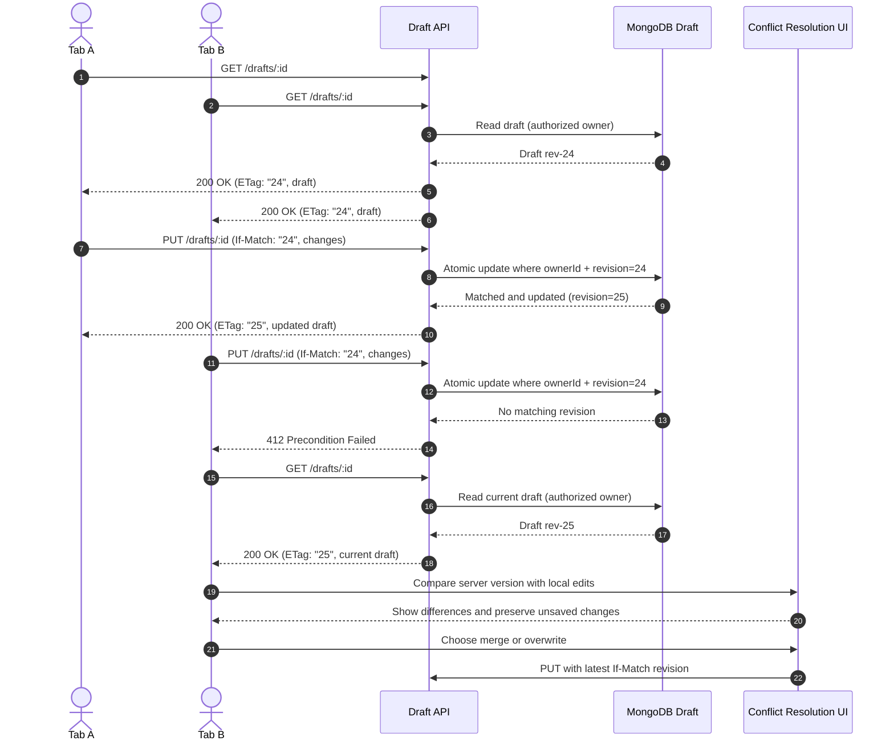

### 29.2 Atomic publish and late cache propagation

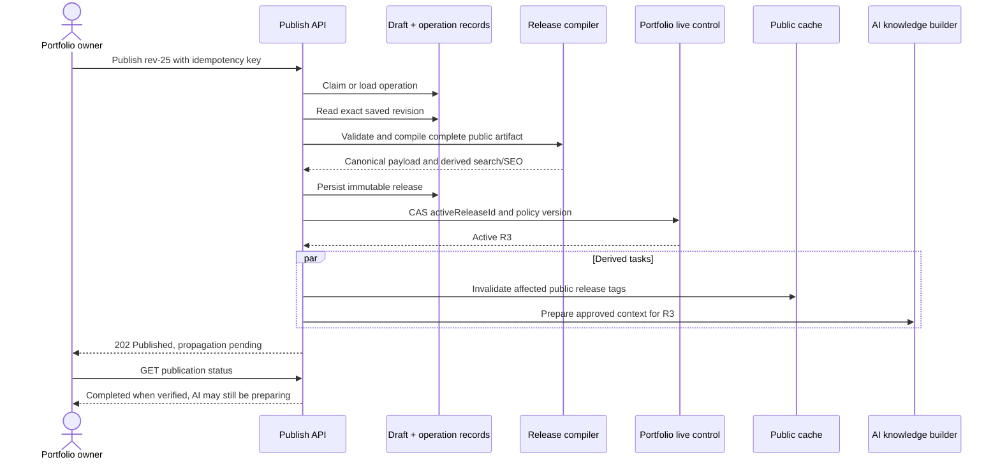

**Important:** the `par` section is logical work; on a serverless environment without a reliable persistent worker, each task must be resumable through idempotent operation status/recheck routes or an approved bounded scheduler. A HTTP response alone does not guarantee that unawaited in-process work will continue after the serverless invocation ends.

### 29.3 Publication retry after lost response

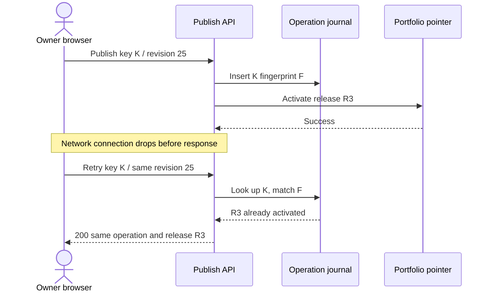

### 29.4 AI context revocation

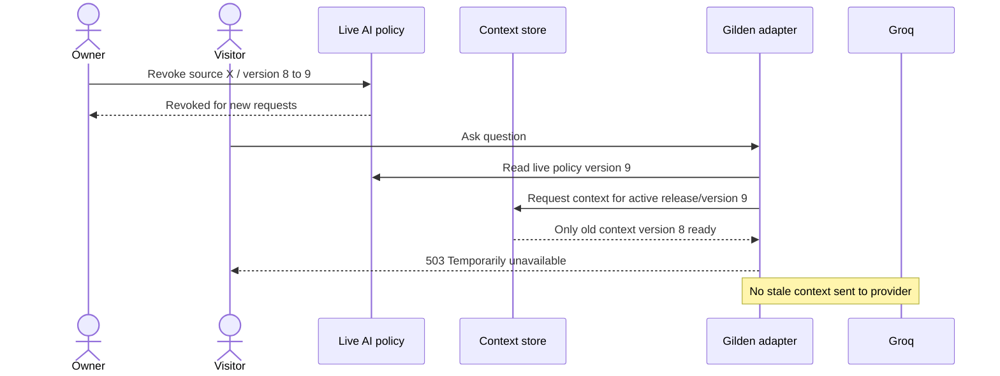

### 29.5 Public report and item moderation

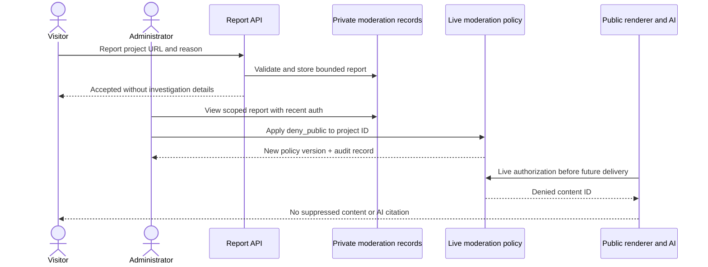

### 29.6 Safe file staging and publication visibility

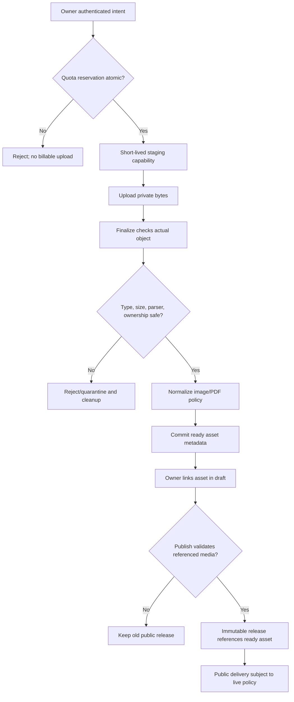

### 29.7 Read consistency and failure degradation

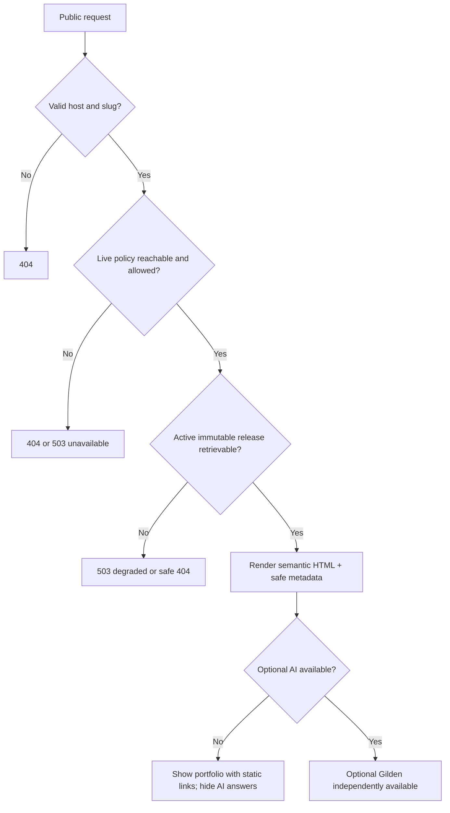

These diagrams should be kept in sync with tests and deployed behavior. They are not a substitute for the physical cloud topology and infrastructure acceptance evidence required in [10](10-deployment-strategy.md).

---

## 30. Contract tests, adversarial tests and verification matrix

### 30.1 Testing layers and proof types

| Layer                | Test technology candidate                           | Purpose                                                                   | Important caveat                                     |
| -------------------- | --------------------------------------------------- | ------------------------------------------------------------------------- | ---------------------------------------------------- |
| Schema unit tests    | Vitest + property/fuzz cases                        | Exact input, output, limits, normalization and cases                      | TS types alone not runtime validation                |
| Domain service tests | Vitest with fake scoped repository                  | Policy and lifecycle invariants                                           | Fakes cannot prove Mongo atomicity                   |
| Mongo integration    | Isolated local/test database                        | CAS, unique indexes, idempotency journal, reference checks                | Never use production secrets/data                    |
| HTTP contract        | App Router test harness + OpenAPI schema validation | Media type, status, DTO and cache header correctness                      | Mocked requests need real-host tests too             |
| Browser E2E          | Playwright                                          | Cookie scope, OAuth callback UI, cross-tab editing, SSE, accessible flows | Provider simulation must preserve protocol semantics |
| Accessibility        | axe + keyboard/VoiceOver/NVDA manual                | WCAG 2.2 AA critical flows                                                | Automated scans incomplete                           |
| Security negative    | OWASP API scenarios and custom fixtures             | BOLA, mass assignment, SSRF, stored XSS, injection, quotas                | Must be authorized local/test deployments            |
| Deployment checks    | Production-like safe smoke & DNS/TLS review         | Wildcard resolution, real CDN gate, provider limits                       | No destructive production tests                      |
| Load/abuse           | Bounded generated traffic                           | Concurrency, quota and rate decisions                                     | Do not exhaust zero-cost providers                   |
| Observability        | Canary values in local test env                     | Verify redaction and request correlation                                  | Never put real secrets in fixtures                   |

### 30.2 Required test cases by route family

| Test ID   | Scenario                                                    | Expected result                                          | Priority |
| --------- | ----------------------------------------------------------- | -------------------------------------------------------- | -------- |
| `API-T01` | Provider callback with mismatched state                     | Reject and do not create/link account                    | P0       |
| `API-T02` | Google/GitHub identities share same email                   | Remain distinct until proven explicit linking            | P0       |
| `API-T03` | Unlink last provider using concurrent requests              | At least one usable login remains                        | P0       |
| `API-T04` | Suspended account reuses still-signed cookie                | Denied on all protected endpoints                        | P0       |
| `API-T05` | Anonymous calls `/accounts/me`                              | 401, no user data                                        | P0       |
| `API-T06` | Owner A requests B's draft/media/inbox by UUID              | Denied and B data unchanged                              | P0       |
| `API-T07` | Owner writes `ownerAccountId` / `platformRoles` in DTO      | Unknown property rejected                                | P0       |
| `API-T08` | Cookie-auth mutation with attacker origin and no CSRF       | Denied; no write                                         | P0       |
| `API-T09` | Path-based origin script injection fixture                  | Text rendered inert; CSP and sanitizer prevent action    | P0       |
| `API-T10` | Unknown subdomain, forged forwarded host                    | 404/deny; no cross-tenant resolution                     | P0       |
| `API-T11` | Parallel signup of same slug                                | One unique winner; conflict for others                   | P0       |
| `API-T12` | Rename with old slug subdomain claim                        | Old aliases redirect only to same portfolio              | P0       |
| `API-T13` | Two editor tabs save rev 24                                 | Exactly one rev 25; other conflict                       | P0       |
| `API-T14` | Draft with unsupported block executable prop                | Reject at save; never publish                            | P0       |
| `API-T15` | Nested imported schema has remote refs/depth 4              | 422; no write                                            | P0       |
| `API-T16` | 21 authored nodes with one repeater                         | Reject node count, not repeated instances                | P0       |
| `API-T17` | Cross-tenant content/reference in one draft                 | Reject                                                   | P0       |
| `API-T18` | Publish canonical payload exactly 102,400 bytes             | Accept if all other checks pass                          | P0       |
| `API-T19` | Publish payload 102,401 bytes                               | 422, old release remains                                 | P0       |
| `API-T20` | Missing required Hero title/intro                           | Block publish, allow safe incomplete draft save          | P0       |
| `API-T21` | Click Publish twice and drop first response                 | One release; same idempotent result                      | P0       |
| `API-T22` | Same idempotency key reused with changed body               | 409; no extra side effect                                | P0       |
| `API-T23` | Suspend during release pointer CAS                          | Active exposure denied; no stale eligibility restoration | P0       |
| `API-T24` | Cache invalidation fails after pointer activation           | 202 propagation pending; recheck safe                    | P0       |
| `API-T25` | Restore release while new draft edits exist                 | Conditional conflict; no silent loss                     | P0       |
| `API-T26` | Public GET with disabled portfolio and warm CDN             | Deny/no stale HTML                                       | P0       |
| `API-T27` | Unlisted portfolio appears in sitemap/directory             | Test fails; no listing/indexing                          | P0       |
| `API-T28` | Fake media MIME and polyglot image                          | Reject/quarantine; no public key                         | P0       |
| `API-T29` | 10 concurrent upload intents near global capacity           | Never overreserve/bill                                   | P0       |
| `API-T30` | Media referenced by old release is deleted                  | 409; reference preserved                                 | P0       |
| `API-T31` | Feed redirects to link-local/private/metadata address       | Block, no network connection                             | P0       |
| `API-T32` | DNS resolves public during check but private during connect | Reject connection                                        | P0       |
| `API-T33` | RSS response is huge/recursive/decompression bomb           | Bounded safe failure                                     | P0       |
| `API-T34` | AI new field added inside approved section                  | Field not transmitted without approval                   | P0       |
| `API-T35` | Revoke source while old context cached                      | AI refuses old context for new requests                  | P0       |
| `API-T36` | Release R2 active, AI context R1 ready                      | 503 AI not ready; no stale fallback                      | P0       |
| `API-T37` | 30 concurrent anonymous questions at near quota             | Strict cap respected; no overflow cost                   | P0       |
| `API-T38` | Redis unavailable                                           | AI denied; public content unaffected                     | P0       |
| `API-T39` | Model sends arbitrary external citation                     | Server drops it                                          | P0       |
| `API-T40` | Disconnect midstream after first token                      | Count request; stop when possible; mark partial UI       | P1       |
| `API-T41` | Model tries `script` tag in SSE delta                       | Safe text rendering                                      | P0       |
| `API-T42` | Contact form submits PII and malicious markup               | Safe text-only inbox; no AI or logs leak                 | P0       |
| `API-T43` | Contact older than 30 days still in DB                      | Not returned; TTL cleanup independent                    | P0       |
| `API-T44` | Admin account with stale reauth attempts suspension         | Require new proof; no effect                             | P0       |
| `API-T45` | Admin moderates one content item                            | Search/HTML/AI suppressed immediately                    | P0       |
| `API-T46` | Export includes mixed-tenant assets                         | Only owned objects in ZIP                                | P0       |
| `API-T47` | Delete response lost after suppression                      | Idempotent retry; no public restoration                  | P0       |
| `API-T48` | DB policy lookup times out with cached release              | Fail closed                                              | P0       |
| `API-T49` | Response to denied request contains private DB stack        | Never; problem JSON with request ID                      | P0       |
| `API-T50` | Untrusted pull request tries to read deploy secrets         | Environment isolation prevents access                    | P0       |
| `API-T51` | AI provider unavailable                                     | Static portfolio fully usable                            | P0       |
| `API-T52` | Medium preview unavailable                                  | Cached/manual article remains usable                     | P1       |
| `API-T53` | No WebGL and reduced motion                                 | Public content/navigation/forms still work               | P0       |
| `API-T54` | No payment card and free quota exhausted                    | Controlled unavailable; no automatic billed tier         | P0       |
| `API-T55` | Contract response schema drift                              | CI fails or requires explicit approved version update    | P0       |
| `API-T56` | Cookie sent to portfolio subdomain                          | Security test fails                                      | P0       |
| `API-T57` | Unknown server action invoked directly                      | Same authorization as route handler                      | P0       |
| `API-T58` | REST body sends unsupported `Accept`/media type             | 406/415 and safe problem details                         | P1       |
| `API-T59` | Gilden chat includes client fake `system` message           | Reject; not forwarded as trusted instructions            | P0       |
| `API-T60` | Public analytics event invents visitor identifier           | Field rejected; aggregate-only collection                | P0       |

### 30.3 Test evidence requirements

Every P0 test must identify the exact requirement ID, commit/release, environment, input fixture, expected result, actual result and supporting redacted logs/screenshot or automated test output. For race/atomicity tests, keep reproducible concurrency controls and inject failures at each important persistence boundary, not merely at start/end. For revocation, run tests at both the application and actual deployed caching/edge layer. For SSRF, verify **no forbidden connection** occurred, not just that the UI displayed an error after the request.

### 30.4 HTTP contract snapshot tests

Record golden successful and failing examples for each API family, and validate response schemas against OpenAPI. Fail the pipeline on accidental addition of `ownerAccountId` to a public DTO, an unredacted session cookie in a log, a missing CSRF check or a changed `Cache-Control` on private data. Snapshot tests alone are insufficient for security, but they can detect property-level response regressions.

### 30.5 Accessibility of API-driven states

A correct server status does not guarantee usable UX. E2E acceptance must verify that errors are announced in accessible form, focus returns to the relevant field, retries are safe, saving state is visible, conflict recovery does not destroy text, upload failures explain supported alternatives, and an AI stream ending with `error` is not announced as a completed answer. The editor must offer click/tap and keyboard alternatives to dragging, consistent with WCAG 2.2 AA [S19].

---

## 31. Performance, scale, reliability and free-tier implications

### 31.1 Workload assumptions

The system is planned for approximately **100–500 actively maintained portfolios** as an engineering capacity target, not a guaranteed free hosting service level. Most traffic is anonymous public reads; writes are owner-driven draft operations, publication, uploads and contact messages. The API must make public rendering cheap enough that normal visitor traffic does not hit nine independent domain APIs for one page, repeatedly serialize draft content, call an external feed or invoke AI automatically.

A public page is ideally one live policy check plus one immutable release lookup/cache read and bounded media responses. The public search index is generated at publication time. Gilden is **opt-in**, invoked only after an explicit visitor action, and controlled by a global request/token budget. This makes the performance architecture match product usage rather than replicating a general-purpose CMS backend.

### 31.2 Concrete budgets and test surfaces

| Quality target                                          | API/design consequence                                                        | Measurement                                         |
| ------------------------------------------------------- | ----------------------------------------------------------------------------- | --------------------------------------------------- |
| Public Lighthouse >=90 in applicable categories         | Avoid render-time API waterfalls; defer noncritical JS/3D                     | Representative mobile/desktop production-like pages |
| p75 LCP <=2.5 s                                         | Server-first text; optimized media; no required Groq/Redis wait               | Real-user or representative field metrics           |
| p75 INP <=200 ms                                        | No heavy synchronous client parser after page load; bounded editor operations | Web Vitals and controlled interaction test          |
| p75 CLS <=0.1                                           | Stable media dimensions; no late large 3D canvas shifts                       | Field/lab metrics                                   |
| Critical initial JS target <=200 KB compressed          | Minimize public API clients; no editor bundles on public pages                | Bundle analysis                                     |
| Deferred Three.js scene code <=350 KB compressed target | Lazy-load; adaptive fallback                                                  | Route/chunk inspection                              |
| Total initial desktop transfer <=2 MB target            | Release projection and CDN media efficiency                                   | Browser transfer waterfall                          |
| Mobile first load aim <=1 MB                            | Progressive animation/image quality                                           | Low-end device/slow-network test                    |
| Draft autosave                                          | Bounded requests per typing burst, one revision per accepted save             | Network instrumentation                             |
| Publish                                                 | Finite CPU/memory and resumable after timeout                                 | Fault-injected operation test                       |
| AI streaming                                            | Prompt/output token caps; no unbounded open stream                            | Provider simulation and real deployment smoke       |

Targets are **acceptance goals**, not claims that the chosen managed providers guarantee them. Some first-load budgets may need adjustment based on measured Three.js effects and user-uploaded content. Changes require evidence and explicit requirement/ADR update; they do not justify security compromises.

### 31.3 Degradation matrix

| External dependency unavailable   | Public portfolio                                                                                       | Editor/publishing                                                    | Optional features                         |
| --------------------------------- | ------------------------------------------------------------------------------------------------------ | -------------------------------------------------------------------- | ----------------------------------------- |
| MongoDB data operations           | Best-effort cached immutable data **only if live policy can still be verified**; otherwise unavailable | Editing/publishing unavailable                                       | AI may be unavailable                     |
| Redis quota authority             | Readable                                                                                               | Most owner operations continue if independent                        | Gilden fails closed to avoid overspending |
| Groq provider                     | Readable                                                                                               | Editor and Publish unaffected                                        | Assistant unavailable with static links   |
| RSS/Medium                        | Cached previews/manual links remain                                                                    | Draft editor can continue; sync status stale                         | Feed refresh unavailable                  |
| GitHub public metadata            | Manually authored projects remain                                                                      | Sign-in may be affected only if GitHub OAuth itself unavailable      | Metadata refresh unavailable              |
| Object storage                    | Text can still render; some images may fail                                                            | New uploads unavailable; block publish if required media unavailable | Existing verified media may remain cached |
| Cache propagation                 | Existing allowed release may temporarily display                                                       | Publish reports propagation pending                                  | Recheck resumes safely                    |
| Live security policy              | **Fail closed**, no stale allow                                                                        | Mutations that require policy cannot proceed                         | Gilden unavailable                        |
| Provider free allowance exhausted | Controlled affected-service unavailability                                                             | No automatic paid upgrade                                            | No unexpected billing                     |

The accepted $0 operating risk does not permit data corruption, tenant leakage or bypassing security controls. Fail-closed may reduce availability and is an explicit product trade-off.

### 31.4 Bounded concurrency and background work

A serverless deployment cannot assume a long-running worker exists. Publication post-commit tasks, upload normalization, object garbage collection, external feed sync and account deletion must be expressible as idempotent operations with observable stages, resumable through approved scheduled triggers or authorized recheck actions. Bounded concurrency prevents 500 portfolios from triggering parallel expensive processing because each visitor loaded a page. Any scheduled mechanism must comply with the provider's free plan and must not run with unreviewed billing risk.

### 31.5 Monitoring without visitor tracking

Emit aggregate counters for handler category/status, response duration buckets, dependency availability, publication propagation age, media quota failures, AI reservation outcomes and security denials. Do not record raw request bodies, visitor messages, authenticated cookies, private content, user-agent fingerprints or exact personal location for analytics. Operational logs have bounded retention, request IDs and redacted event categories. Every externally visible error is traceable through a safe request ID while preserving user privacy.

---

## 32. Deployment and infrastructure acceptance gates for APIs

A design can be internally sound while failing at the hosting boundary. All gates below must be demonstrated on the **actual candidate free deployment**, not assumed from local unit tests.

| Gate                                  | What must be proven                                                                     | Reject deployment if                                         |
| ------------------------------------- | --------------------------------------------------------------------------------------- | ------------------------------------------------------------ |
| `DEP-API-01` Hobby eligibility        | Terms allow this non-monetized public multi-user SaaS                                   | Provider disallows the use without paid tier                 |
| `DEP-API-02` No card/no overages      | Every managed dependency has an enforceable zero-charge arrangement                     | Hidden pay-as-you-go charges can occur                       |
| `DEP-API-03` Wildcard TLS/DNS         | Apex and portfolio wildcard hosts resolve and TLS validates; existing records preserved | Arbitrary subdomains fail TLS or rewrite wrong tenant        |
| `DEP-API-04` Trusted host metadata    | Correct host can be determined without trusting arbitrary client forwarded headers      | Forged Host resolves another portfolio                       |
| `DEP-API-05` Apex cookie scope        | Owner session never reaches `alex.aaroophan.dev`                                        | Cookie `Domain` or proxy changes widen scope                 |
| `DEP-API-06` OAuth callbacks          | Exact callback URI, issuer, state/PKCE, nonce/linking                                   | Provider flow permits open redirect/account merge            |
| `DEP-API-07` Mongo concurrency        | Unique indexes, single-doc CAS, operation journal/crash recovery                        | Parallel requests violate slug/draft/release invariants      |
| `DEP-API-08` Live policy revocation   | Warm CDN response cannot serve suspended/moderated content                              | Stale page bypasses policy gate                              |
| `DEP-API-09` Streaming support        | POST SSE flushes promptly, terminates safely, cancellation works where supported        | Host buffers indefinitely or ignores hard limits             |
| `DEP-API-10` Object storage staging   | Staged objects nonpublic, capability restricted, no-card/free cap                       | Public staging or possible billable use                      |
| `DEP-API-11` SSRF network enforcement | DNS/IP and connection-time checks prevent private targets                               | Runtime cannot pin/validate actual network destination       |
| `DEP-API-12` CSP/XSS                  | Public UGC cannot run same-origin privileged script                                     | Stored XSS or unsafe iframe executes                         |
| `DEP-API-13` Secrets/privacy          | PR deployments cannot see production secrets; provider content-use terms reviewed       | Unapproved model training or insecure secrets boundary       |
| `DEP-API-14` Error redaction          | Faulted APIs return safe problem details; logs contain no bearer tokens                 | Secrets or private content exposed                           |
| `DEP-API-15` Test isolation           | Local/CI test config refuses production DB/media by construction                        | Tests can mutate live tenant data                            |
| `DEP-API-16` Abuse/cost               | Visitor AI + global limits cannot oversubscribe quotas                                  | Shared provider allowance can be exhausted in one burst      |
| `DEP-API-17` Accessibility            | Essential editor and public workflows meet WCAG 2.2 AA target                           | Drag-only controls or inaccessible error handling            |
| `DEP-API-18` Protocol contract        | OpenAPI validated, response fixtures pass, 409/412 decision made                        | Conditional request semantics inconsistent between code/docs |

**Provider-specific caution:** Vercel's Hobby plan is a possible deployment candidate, **not a guaranteed eligibility determination** for a public SaaS. Free usage limits and permitted-use terms can change. Groq limits apply at the organization level. MongoDB TTL expiration is not immediate. These are distinct risks, not tasks that Vercel automatically solves. Verify each against primary documentation and the configured account [S18][S26][S29].

---

## 33. Requirement traceability and document change policy

### 33.1 Traceability matrix

| Contract area         | Requirement IDs           | Evidence / test IDs           | Companion authorities                                              |
| --------------------- | ------------------------- | ----------------------------- | ------------------------------------------------------------------ |
| OAuth and linking     | IAM-001..009, SEC-003     | API-T01..05                   | [05](05-data-model.md), [07](07-security-design.md)                |
| Tenant ID/slug/host   | TEN-001..009              | API-T06, API-T10..12, API-T56 | [04](04-c4-diagrams.md), [05](05-data-model.md)                    |
| Content/schema        | CNT-001..011              | API-T14..17                   | [03](03-ui-ux.md), [05](05-data-model.md)                          |
| Editor/draft          | EDT-001..010              | API-T13..17, API-T20          | [03](03-ui-ux.md), [08](08-storage-and-sync-strategy.md)           |
| Publish/revisions     | PUB-001..008              | API-T18..27                   | [05](05-data-model.md), [08](08-storage-and-sync-strategy.md)      |
| Gilden                | AI-001..010               | API-T34..41, API-T59          | [07](07-security-design.md), [08](08-storage-and-sync-strategy.md) |
| Media                 | MED-001..005              | API-T28..30                   | [05](05-data-model.md), [08](08-storage-and-sync-strategy.md)      |
| Contact and analytics | CON-001, ANA-001          | API-T42, API-T43, API-T60     | [03](03-ui-ux.md), [09](09-error-handling-and-logging.md)          |
| Moderation            | ADM-001..003, SEC-010     | API-T26, API-T44..45          | [07](07-security-design.md)                                        |
| Export/deletion       | ACC-001..002              | API-T46..47                   | [05](05-data-model.md), [09](09-error-handling-and-logging.md)     |
| Security controls     | SEC-001..012              | API-T01..60 as applicable     | [07](07-security-design.md), [11](11-testing-strategy.md)          |
| SEO/public UI         | SEO-001..002, UX-001..004 | API-T09, API-T27, API-T53     | [03](03-ui-ux.md)                                                  |
| Performance           | PRF-001..003              | Public benchmarks             | [03](03-ui-ux.md), [11](11-testing-strategy.md)                    |
| Operations/no cost    | OPS-001..007              | API-T48..54, DEP-API-01..18   | [10](10-deployment-strategy.md)                                    |

### 33.2 Change policy

A change to an endpoint path, authentication requirement, authorization model, status code, response shape, cache policy, idempotency behavior, rate limit, data classification, user-facing hard limit or published renderer contract requires updating the normative API definition and corresponding tests. For a breaking external behavior, create a new version/ADR or a documented migration. Internal library upgrades need not create `/api/v2` if the external contract is unchanged and security tests still pass.

For example, changing the draft conflict status from product `409` to HTTP-standard `412` requires coordinated edits to [02](02-requirements-and-scope.md), [03](03-ui-ux.md), [05](05-data-model.md), the API contract, editor client conflict UI and end-to-end tests. It must not be done silently by one route handler. Changing a storage provider does **not** change the public media intent/finalize contract as long as its capability semantics and security guarantees remain intact.

### 33.3 Contract-review checklist for every new route

A pull request introducing an endpoint should document: verb/path/version; actor and host; request schema; maximum accepted bytes and cardinality; exact owner/tenant lookup; named authorization action; state machine and idempotency; DB indexes/transaction boundary; rate and global cost gates; allowed response fields; public/private caching; audit/logging; failure mapping; external data processors; tests, including attacker-controlled IDs and malformed inputs; and related requirement/ADR. A route with an undocumented bypass or ambiguous trust boundary is not production-ready.

---

## 34. Trade-offs and unresolved protocol/feasibility decisions

The architecture is intentionally detailed, but several points remain **technical verification decisions**. They must not be disguised as settled product facts.

### 34.1 Conditional requests: `409` versus `412`

- **Product source:** [02](02-requirements-and-scope.md) requires `409` for a stale saved draft and recovery experience; related documents demonstrate `If-Match: "rev-N"`.
- **HTTP source:** RFC 9110 specifies `412 Precondition Failed` when the HTTP `If-Match` condition evaluates false, except for specified already-applied cases [S12].
- **Risk:** Using literal `If-Match` with `409` for every false condition deviates from generic HTTP conditional semantics. Using `412` without coordinating requirements creates a different cross-document contract and may break editor clients.
- **Recommended resolution:** Prefer **`412` for a false `If-Match`** and reserve `409` for domain conflicts such as a conflicting publish operation or duplicate slug, _after_ a reviewed change to the requirement and client contract; alternatively replace the HTTP precondition mechanism with a typed expected-revision field and keep `409` for domain conflict. Both preserve safe optimistic concurrency, but only one should be frozen.
- **Current document posture:** Demonstrates `409 DRAFT_REVISION_CONFLICT` to remain recognizable to the existing product requirement, labels the HTTP deviation and accepts both statuses in the **provisional** OpenAPI excerpt. This is a documented release gate, not permission for the implementation to arbitrarily choose either.

### 34.2 Cross-origin/session strategy

Keep authenticated endpoints at the apex and public tenant endpoints on their validated origin. Do not widen `Domain` cookies or enable wildcard credentialed CORS to simplify subdomain chat. The chosen host proxy must prove exact hostname forwarding, otherwise build a trusted host-resolver boundary or reconsider the subdomain deployment approach. This is a deployment concern, not a reason to trust user headers.

### 34.3 Upload provider and virus/PDF policy

No object store is automatically safe or billing-proof. Pick a no-card/no-charge provider only after testing staging, byte reservation, lifecycle deletion, CORS, signed-capability scope and billing configuration. If reliable PDF malware scanning/sanitization is unavailable without spending money, reject suspicious PDFs and restrict delivery; do not claim all uploaded PDFs are harmless. A downloadable public PDF can be copied by visitors, which no API can retroactively prevent.

### 34.4 Immediate revocation versus free CDN performance

Free CDN/ISR caching improves cost and speed but can return stale HTML. If revocation is mandatory, the system must either do policy-checked dynamic rendering for revocable pages or prove a trustworthy edge policy gate before serving cached objects. **Performance targets do not override authorization.** This may lower the maximum practical free-tier throughput, and the documents should acknowledge that limitation.

### 34.5 No durable queue or worker assumption

The single Next.js deployment should not adopt RabbitMQ, Kafka or background worker infrastructure simply for completeness. However, publication propagation, media processing and deletion still require durable operation journals and safe retries. A process-local `setTimeout` or `void asyncFunction()` after a serverless response is not a reliability mechanism. If no free scheduler is available, expose controlled owner/admin reconciliation and truthful propagation state.

### 34.6 Separate APIs versus server rendering

Public home/project pages should use direct server-side domain queries, not call their own `/api/v1` over HTTP nine times. APIs remain useful for owner interactions and anonymous form/chat/search/analytics commands. The same authorization and projection rules apply to direct server rendering so performance improvements do not create a hidden privileged code path.

### 34.7 Admin visibility versus private content

Moderation requires knowing which public material is harmful, but does not imply unrestricted browsing of draft-private, personal inbox or OAuth account information. Default admin views show published reported content and minimal account/portfolio identifiers; private access needs an exceptional reviewed process if introduced. This reduces the consequence of admin compromise.

### 34.8 Client-side JSON schema freedom versus finite renderer

The visual editor may offer unrestricted positioning of **approved primitives** within sections, but the API can only accept block/interaction types supported by the versioned registry. The 20 authored-block and 100-KiB payload limits are deliberate fixed 2.0 product constraints. This means not every imaginable design is publishable; communicate validation and limits clearly rather than claiming unlimited code execution or arbitrary frontend components.

### 34.9 Model provider retention and visitor privacy

GildedIn will not store chat transcripts, but streaming an answer requires sending a message to Groq. Verify the exact provider's processing terms and configure safe retention/privacy options where available. If a visitor includes personal information despite warnings, its transmission is not prevented by a server promise of not storing transcripts. This fact must be disclosed accurately.

### 34.10 Provider eligibility and $0 economics

Vercel Hobby terms and wildcard DNS configuration remain subject to actual provider eligibility. The data/AI/media providers have independent limits. The architecture must be portable and stay within no-card/no-automatic-billing services. If a service exhausts its free allowance, a controlled temporary outage is acceptable; silently enabling a billed plan is not. Guaranteed disaster recovery and availability are explicitly not provided under the approved operating budget.

---

## 35. Glossary, delivery checklists and specification completion

### 35.1 Glossary

| Term                  | Definition                                                                           |
| --------------------- | ------------------------------------------------------------------------------------ |
| **Account**           | Internal platform identity tied to one or more verified OAuth/OIDC provider subjects |
| **Provider identity** | Stable `(provider, subject)` link, not an email address                              |
| **Portfolio**         | Tenant-owned independent digital identity identified by immutable `portfolioId`      |
| **Slug claim**        | Global current/historic unique route label bound to a portfolio                      |
| **Draft**             | Privately editable, revisioned content and composition source                        |
| **Content item**      | Typed reusable data with stable ID, unrelated to visual placement                    |
| **Composition node**  | Allowed renderable block with layout/binding/semantic behavior                       |
| **Release**           | Immutable validated public representation prepared from exactly one draft revision   |
| **Active pointer**    | Atomic portfolio control field selecting one active release                          |
| **Live policy**       | Current visibility, account status, moderation and AI approval/revocation authority  |
| **Unlisted**          | Link-accessible published page excluded from discovery/indexing, not confidential    |
| **Idempotency key**   | Scoped client operation identity preventing duplicate side effects on retry          |
| **CAS**               | Compare-and-swap update checking expected current value before mutation              |
| **ETag**              | HTTP representation validator used for conditional requests                          |
| **Problem Details**   | RFC 9457 structured machine-readable error representation                            |
| **Gilden context**    | Approved, release-versioned subset of published portfolio information for AI         |
| **SSE**               | Server-sent event text stream; used over a POST fetch response here                  |
| **SSRF**              | Server-side request forgery through attacker-controlled outbound destinations        |
| **BOLA/IDOR**         | Broken object-level authorization through unscoped resource IDs                      |
| **Staged asset**      | Private uploaded bytes not yet validated/approved for publication                    |
| **Policy revocation** | Current deny decision that makes old cached artifacts ineligible for delivery        |
| **Renderer registry** | Finite, versioned list of approved visual components and their safe schemas          |
| **Zero-spend gate**   | Proved external-service configuration with no card requirement/unexpected charge     |

### 35.2 API implementation readiness checklist

- [ ] All public and owner operations have exact route/verb and security type.
- [ ] Exact OAuth adapter/version and callback patterns are pinned and tested.
- [ ] Host-only cookie and approved origin/CSRF policy are proven in a browser.
- [ ] Current account and portfolio ownership checks occur in every protected handler and underlying domain service.
- [ ] All input DTOs have strict runtime schemas with nested/component-specific validation.
- [ ] Public/owner/admin projection fields are explicitly allowlisted and tested.
- [ ] Mongo unique indexes, atomic revisions and published pointer CAS pass isolated integration tests.
- [ ] `409` versus `412` precondition semantics are resolved across requirements, API and UI.
- [ ] Publish/create/finalize/delete idempotency is durable and crash-tested.
- [ ] Private draft/preview never enters public cache, search or AI context.
- [ ] Public policy revocation is proven against real deployed caching, not unit mocks only.
- [ ] Media staging is private; actual bytes and parser checks are enforced before ready state.
- [ ] Outbound RSS fetches cannot connect to private/link-local/metadata networks after redirects or DNS rebinding.
- [ ] Gilden only receives release-matched approved data; field revocation is effective for new requests.
- [ ] AI quota reservation is atomic at visitor, portfolio and global levels and fails closed on Redis outage.
- [ ] No visitor chat bodies/identity are written to GildedIn logs or analytics.
- [ ] Contact forms are text-only, consent-based and 30-day retention is enforced at read time.
- [ ] Administrative actions use named privileges, recent authentication and meaningful audit records.
- [ ] Data export/deletion is owner-scoped, idempotent, and does not promise nonexistent backup guarantees.
- [ ] The generated complete OpenAPI spec and response contracts validate in CI.
- [ ] Security negative tests pass for all P0 endpoints.
- [ ] Provider terms, DNS/TLS, privacy settings and no-charge settings are reviewed for the actual account.

### 35.3 Documentation handoff and source-of-truth order

The authoritative order is: product requirements and constraints in [02](02-requirements-and-scope.md) → this API contract for external behavior → [05](05-data-model.md) for persistence and typed content → [07](07-security-design.md) for threat/policy controls → [08](08-storage-and-sync-strategy.md) for operational sequencing → [03](03-ui-ux.md) for accessible owner/visitor interaction → [11](11-testing-strategy.md) for acceptance evidence. If a genuine conflict exists, document it and obtain a coordinated decision, rather than silently picking whichever file is easiest to implement.

---

## 36. Primary sources and research notes

The following references support the stated **technical principles**, not claims that any service is already configured securely. Prefer stable primary standards, official vendor documentation and OWASP/W3C guidance. Review dated or commercial provider statements again before deployment. The link IDs provide traceability through this document.

| ID        | Source and URL                                                                                                                              | What it supports / limitation                                                                  |
| --------- | ------------------------------------------------------------------------------------------------------------------------------------------- | ---------------------------------------------------------------------------------------------- |
| **[S01]** | [Next.js Route Handlers](https://nextjs.org/docs/app/getting-started/route-handlers)                                                        | App Router HTTP methods and route-handler behavior; pinned-version differences must be tested  |
| **[S02]** | [Next.js Data Security](https://nextjs.org/docs/app/guides/data-security)                                                                   | Treat server actions as public endpoints; server-side authorization and input trust            |
| **[S03]** | [Next.js `revalidateTag`](https://nextjs.org/docs/app/api-reference/functions/revalidateTag)                                                | Cache revalidation semantics, not immediate security revocation                                |
| **[S04]** | [OWASP API Security Top 10 (2023)](https://api-security.owasp.org/editions/2023/en/0x11-t10/)                                               | BOLA, broken property authorization, abuse/resource cost, SSRF and unsafe APIs                 |
| **[S05]** | [OWASP CSRF Prevention Cheat Sheet](https://cheatsheetseries.owasp.org/cheatsheets/Cross-Site_Request_Forgery_Prevention_Cheat_Sheet.html)  | CSRF tokens, Origin/source-target verification; SameSite alone not universal defense           |
| **[S06]** | [RFC 9700 - OAuth 2.0 Security BCP](https://www.rfc-editor.org/rfc/rfc9700.html)                                                            | Redirect URI, PKCE, state/nonce, mix-up and open redirect defenses                             |
| **[S07]** | [OWASP ASVS 5.0.0](https://asvs.owasp.org/)                                                                                                 | Verification framework for authenticated and anonymous web/API controls                        |
| **[S08]** | [OpenAPI Specification 3.1.1](https://spec.openapis.org/oas/v3.1.1.html)                                                                    | OpenAPI schema, status/security descriptions and tooling contract                              |
| **[S09]** | [RFC 9457 - Problem Details for HTTP APIs](https://www.rfc-editor.org/rfc/rfc9457.html)                                                     | `application/problem+json`, type, status, detail, safe extension values                        |
| **[S10]** | [Auth.js core reference](https://authjs.dev/reference/core)                                                                                 | Framework OAuth/session integration; exact route/cookie details version dependent              |
| **[S11]** | [OWASP File Upload Cheat Sheet](https://cheatsheetseries.owasp.org/cheatsheets/File_Upload_Cheat_Sheet.html)                                | Content-type skepticism, size, naming, isolation and multi-layer file checks                   |
| **[S12]** | [RFC 9110 - HTTP Semantics](https://www.rfc-editor.org/rfc/rfc9110.html)                                                                    | `If-Match`, `412`, conditional requests, methods, error status behavior                        |
| **[S13]** | [MongoDB Single Document Atomicity](https://www.mongodb.com/docs/manual/core/write-operations-atomicity/)                                   | Atomic conditional writes for revisions/pointers; does not ensure multiple-document atomicity  |
| **[S14]** | [MongoDB Transactions](https://www.mongodb.com/docs/manual/core/transactions/)                                                              | Multi-document transaction semantics; tier/driver feasibility must be tested                   |
| **[S15]** | [Next.js `updateTag`](https://nextjs.org/docs/app/api-reference/functions/updateTag)                                                        | Server Action-only immediate expiration; not allowed from Route Handlers                       |
| **[S16]** | [OWASP SSRF Prevention Cheat Sheet](https://cheatsheetseries.owasp.org/cheatsheets/Server_Side_Request_Forgery_Prevention_Cheat_Sheet.html) | URL validation, redirects, DNS and connection-time network checks                              |
| **[S17]** | [JSON Schema Draft 2020-12](https://json-schema.org/draft/2020-12)                                                                          | Versioned JSON validation vocabulary; cross-document invariants remain application logic       |
| **[S18]** | [MongoDB TTL Indexes](https://www.mongodb.com/docs/manual/core/index-ttl/)                                                                  | TTL expiry is eventual; check `expiresAt` when reading sessions/inbox/reservations             |
| **[S19]** | [W3C WCAG 2.2](https://www.w3.org/TR/WCAG22/)                                                                                               | Accessibility target and dragging alternatives (SC 2.5.7 AA)                                   |
| **[S20]** | [OWASP Input Validation Cheat Sheet](https://cheatsheetseries.owasp.org/cheatsheets/Input_Validation_Cheat_Sheet.html)                      | Type/range/allowlist checks, semantic validation                                               |
| **[S21]** | [OWASP XSS Prevention Cheat Sheet](https://cheatsheetseries.owasp.org/cheatsheets/Cross_Site_Scripting_Prevention_Cheat_Sheet.html)         | Safe DOM rendering, encoding, framework escape caveats                                         |
| **[S22]** | [MDN `Set-Cookie` header](https://developer.mozilla.org/en-US/docs/Web/HTTP/Reference/Headers/Set-Cookie)                                   | Host-only, `Secure`, `HttpOnly`, `SameSite` and `__Host-` cookie semantics                     |
| **[S23]** | [MongoDB Unique Indexes](https://www.mongodb.com/docs/manual/core/index-unique/)                                                            | Global slug, provider subject and idempotency claim uniqueness                                 |
| **[S24]** | [OWASP Logging Cheat Sheet](https://cheatsheetseries.owasp.org/cheatsheets/Logging_Cheat_Sheet.html)                                        | Redaction, event classification, avoiding secrets and sensitive data in logs                   |
| **[S25]** | [MDN Server-Sent Events](https://developer.mozilla.org/en-US/docs/Web/API/Server-sent_events/Using_server-sent_events)                      | SSE wire format and connection behavior; POST streaming via Fetch is distinct from EventSource |
| **[S26]** | [Vercel Hobby Plan](https://vercel.com/docs/plans/hobby)                                                                                    | Free-plan eligibility/usage conditions; not individual SaaS eligibility approval               |
| **[S27]** | [GitHub REST API: Emails](https://docs.github.com/en/rest/users/emails)                                                                     | Verified provider email access may require explicit authorized scopes                          |
| **[S28]** | [Google OpenID Connect](https://developers.google.com/identity/openid-connect/openid-connect)                                               | Google stable subject, issuer and ID token validation                                          |
| **[S29]** | [Groq API Rate Limits](https://console.groq.com/docs/rate-limits)                                                                           | Organization-level request/token limits; actual account-specific thresholds vary               |
| **[S30]** | [Upstash pricing](https://upstash.com/pricing/redis)                                                                                        | Candidate free quota store and its limits; selected account terms must be verified             |
| **[S31]** | [Next.js CSP Guide](https://nextjs.org/docs/app/guides/content-security-policy)                                                             | CSP techniques and runtime/streaming implications                                              |
| **[S32]** | [RFC 8785 JSON Canonicalization Scheme](https://www.rfc-editor.org/rfc/rfc8785.html)                                                        | Deterministic JSON representation when compatible input restrictions are enforced              |
| **[S33]** | [OWASP Authentication Cheat Sheet](https://cheatsheetseries.owasp.org/cheatsheets/Authentication_Cheat_Sheet.html)                          | Authentication lifecycle and reauthentication controls                                         |
| **[S34]** | [OWASP XML Security Cheat Sheet](https://cheatsheetseries.owasp.org/cheatsheets/XML_Security_Cheat_Sheet.html)                              | Safe parsing of external XML/RSS feeds, entity expansion risk                                  |
| **[S35]** | [Cloudflare Turnstile documentation](https://developers.cloudflare.com/turnstile/)                                                          | Optional bot challenge verification and deployment/hostname constraints                        |

### 36.1 Evidence hierarchy

For HTTP and OAuth semantics, follow normative RFC text over informal implementation articles. For Next.js/driver API availability, consult **the exact pinned installed version**, official docs and integration tests. For security verification, OWASP describes failure classes and recommended mitigations, but a recommendation only becomes evidence when the application and real deployment test it. For provider pricing/eligibility, official terms and the configured account outrank general public articles. No future benefit/limit is guaranteed by this document.

### 36.2 Final architectural position

GildedIn's APIs are **guarded command/query interfaces around stable portfolio identity, typed content, responsive composition and immutable publication**. They deliberately do not expose raw database CRUD or arbitrary execution. Public rendering and optional AI use the same approved release identity but separate permissions. Success depends on enforceable tenant isolation, atomic revision and publication controls, explicit AI/media/privacy boundaries, accurate errors, zero-cost failure behavior and deployed security verification-not on choosing a fashionable API framework or adding infrastructure that the product does not require.
