# 07 - Security Design, Privacy Architecture and Threat Model

> **Product:** GildedIn
> **Document ID:** GI-ARCH-07  
> **Version:** 2.0.0 - detailed design baseline  
> **Last reviewed:** 2026-11-19  
> **Status:** Normative _proposed_ specification; controls are required for launch but **not claimed implemented or verified**  
> **Authority:** [02 - Requirements and Scope](02-requirements-and-scope.md) for requirements; [05 - Data Model](05-data-model.md) for persisted state; [06 - API Design](06-api-design.md) for HTTP contracts; this document for the **security interpretation and verification obligations** of those contracts.  
> **Audience:** product owner, developers, contributors, maintainers, reviewers, incident responders, and security testers.

> [!IMPORTANT]
> **Never equate a free managed service, established library, OAuth login, HTTPS connection, server component, cache, AI safety prompt, or cloud dashboard with a security guarantee.** Every control must have an owner, implementation location, failure behavior, and evidence. Do not launch known exploitable critical or high-severity weaknesses in authentication, tenant isolation, user-authored rendering, data disclosure, or public revocation. Host-provider eligibility, zero-spend guarantees, session configuration, browser header enforcement, and subdomain routing are **unverified deployment gates** until demonstrated on the chosen platform.

## Document navigation

1. [Security governance and objectives](#1-security-governance-and-objectives)
2. [System boundary and security-sensitive assets](#2-system-boundary-and-security-sensitive-assets)
3. [Trust model and threat methodology](#3-trust-model-and-threat-methodology)
4. [Complete threat register](#4-complete-threat-register)
5. [Security architecture and defense in depth](#5-security-architecture-and-defense-in-depth)
6. [Authentication and provider identity](#6-authentication-and-provider-identity)
7. [Sessions, cookies, CSRF and origin control](#7-sessions-cookies-csrf-and-origin-control)
8. [Tenant authorization, roles and property-level access](#8-tenant-authorization-roles-and-property-level-access)
9. [Hostname, wildcard subdomain and URL security](#9-hostname-wildcard-subdomain-and-url-security)
10. [Input validation, schema constraints and injection prevention](#10-input-validation-schema-constraints-and-injection-prevention)
11. [Rich text, the canvas, CSS and safe block rendering](#11-rich-text-the-canvas-css-and-safe-block-rendering)
12. [Browser protections, CSP and content origins](#12-browser-protections-csp-and-content-origins)
13. [Media ingestion, storage and document safety](#13-media-ingestion-storage-and-document-safety)
14. [Remote feeds, link previews and SSRF](#14-remote-feeds-link-previews-and-ssrf)
15. [Gilden AI threats, privacy and policy enforcement](#15-gilden-ai-threats-privacy-and-policy-enforcement)
16. [Publishing, drafts, cache safety and revocation](#16-publishing-drafts-cache-safety-and-revocation)
17. [MongoDB, Redis and data-store protection](#17-mongodb-redis-and-data-store-protection)
18. [Cryptography, secrets and key lifecycle](#18-cryptography-secrets-and-key-lifecycle)
19. [API security, quotas and anti-abuse](#19-api-security-quotas-and-anti-abuse)
20. [Contact forms, analytics and visitor privacy](#20-contact-forms-analytics-and-visitor-privacy)
21. [Moderation, administrator security and abuse reports](#21-moderation-administrator-security-and-abuse-reports)
22. [Data classification, processing inventory and legal gates](#22-data-classification-processing-inventory-and-legal-gates)
23. [Retention, deletion, export and data-loss limitations](#23-retention-deletion-export-and-data-loss-limitations)
24. [Cloud, DNS, network and deployment security](#24-cloud-dns-network-and-deployment-security)
25. [Supply-chain, repository and CI/CD security](#25-supply-chain-repository-and-cicd-security)
26. [Logging, auditing, monitoring and privacy-safe telemetry](#26-logging-auditing-monitoring-and-privacy-safe-telemetry)
27. [Operational incident response and vulnerability handling](#27-operational-incident-response-and-vulnerability-handling)
28. [Security design patterns and executable contracts](#28-security-design-patterns-and-executable-contracts)
29. [Security test matrix and adversarial scenarios](#29-security-test-matrix-and-adversarial-scenarios)
30. [Release gates, evidence and risk acceptance](#30-release-gates-evidence-and-risk-acceptance)
31. [Security decisions, exclusions and future trigger conditions](#31-security-decisions-exclusions-and-future-trigger-conditions)
32. [Requirement and document traceability](#32-requirement-and-document-traceability)
33. [Security glossary](#33-security-glossary)
34. [Primary standards, guidance and provider references](#34-primary-standards-guidance-and-provider-references)

---

## 1. Security governance and objectives

### 1.1 Purpose and precedence

This document converts GildedIn's product requirements into enforceable controls **before implementation**. GildedIn allows strangers to create publicly accessible websites, upload media, define nested content and layout schemas, access a hosted editor, submit contact messages, and invoke a portfolio-specific AI assistant. Accordingly, the relevant threat model is not that of a static personal homepage. It is that of a **multi-tenant user-generated-content platform** whose public content can be actively malicious.

Design precedence when two goals collide:

1. **Protect unrelated tenants and visitors:** an owner must not gain access to another owner's draft, credentials, private media, inbox, releases, or AI policy.
2. **Prevent unauthorized actions and publication:** authentication, authorization, untrusted rendering, and release integrity are release blockers.
3. **Keep privacy promises accurate:** do not claim chat text is never sent to a provider, or that deleted media instantly disappears from third-party caches.
4. **Preserve the absolute $0 condition:** never incur charges to deliver a security feature. Disable a risky capability or change to a compliant provider if no free safe option exists.
5. **Gracefully reduce optional functionality:** AI, RSS sync, external previews, analytics and 3D effects fail independently of basic portfolio reading, within actual provider capability.
6. **Optimize performance after trust boundaries are proven:** caching must never authorize access; faster public responses do not justify bypassing live moderation checks.

A known _critical_ or exploitable _high_ severity vulnerability affecting confidentiality or integrity cannot be treated as an acceptable beta limitation. For lower risks, the maintainer may record a bounded exception with rationale, mitigation, expiry, and verification owner. Availability and independent disaster recovery are expressly **not guaranteed** under the free operating model; the absence of paid backups does not excuse avoidable data corruption or unauthorized disclosure.

**Normative terminology:** `MUST`/`MUST NOT` are launch-blocking, `SHOULD` describes a default with a written exception path, and `MAY` is optional. Source markers `[Sxx]` refer to §34. Requirement IDs such as `SEC-002` are stable IDs in [02](02-requirements-and-scope.md); test IDs such as `T-TEN-02` are defined in [11](11-testing-strategy.md). No unsupported certification or complete standards conformance is asserted.

### 1.2 Security objectives

| Objective ID | Property                | Explicit requirement                                                                                                     | Evidence                                     |
| ------------ | ----------------------- | ------------------------------------------------------------------------------------------------------------------------ | -------------------------------------------- |
| SO-01        | Identity                | Provider assertion must bind to a stable account identity; email matching cannot silently merge accounts                 | OAuth negative tests, unique-index tests     |
| SO-02        | Isolation               | All owner-private reads/writes require actor and tenant scope; guessed IDs are never authority                           | Two-owner BOLA/BOPLA test matrix             |
| SO-03        | Content safety          | Public user content cannot become executable JS, arbitrary CSS, unsafe iframe or privileged browser instruction          | Renderer fuzz, CSP integration tests         |
| SO-04        | Publication integrity   | Draft never leaks; public uses exactly one prepared immutable active release                                             | Crash/race tests, response probes            |
| SO-05        | Revocation              | Owner disable, moderation and AI withdrawal overrule previously prepared/cached content                                  | Apex/subdomain, CDN, media, SEO and AI tests |
| SO-06        | AI boundary             | Inference sees only explicitly approved facts from the matching active release                                           | Context inspection, injected secret markers  |
| SO-07        | Upload safety           | No attacker-chosen filename or declared MIME determines storage access or acceptance                                     | Polyglots, parser failure and quota tests    |
| SO-08        | Confidential processing | Sessions, OAuth tokens, inbox messages, provider keys and private drafts never appear in client bundles or public caches | Secrets scan, cache and network inspection   |
| SO-09        | Privacy minimization    | Chat transcripts are not persisted; form data, analytics, audit and rate signals are purpose-limited                     | Data-flow inventory, retention checks        |
| SO-10        | Service resilience      | Rate limits and quotas are enforceable; free-tier outages cannot cause authorization fail-open                           | Failure injection and quota concurrency      |
| SO-11        | Supply-chain integrity  | Untrusted contributors/PRs cannot access production secrets; build artifacts can be traced to reviewed source            | CI permission tests, locked dependencies     |
| SO-12        | Operational response    | Security events can be diagnosed without retaining secrets or raw visitor conversations                                  | Audit examples, incident exercise            |

### 1.3 Security standards and applicability

GildedIn should use the current **OWASP Application Security Verification Standard 5.0.0** as its web-verification catalog, choosing applicable requirements rather than claiming every requirement is mandatory [S01]. Its authorization program should explicitly address the OWASP API Security Top 10 broken object- and property-level authorization classes [S02]. Identity is informed by NIST SP 800-63B-4 and OAuth 2.0 Security Best Current Practice RFC 9700 [S03][S04]. Secure development governance draws from NIST SSDF [S13]. LLM prompt injection is treated as an application data-flow threat, not as something a system prompt can solve [S11].

| Security area                          | Applicable                   | Reason and treatment                                                               |
| -------------------------------------- | ---------------------------- | ---------------------------------------------------------------------------------- |
| OAuth/OIDC, account linking, sessions  | **Yes**                      | Two identity providers; privileged account control                                 |
| Authorization / BOLA / mass assignment | **Yes, critical**            | User-controlled object IDs, media, portfolio ownership and schemas                 |
| XSS/CSP/browser isolation              | **Yes, critical**            | Untrusted portfolios share platform infrastructure and at least some apex paths    |
| SSRF and upload attacks                | **Yes, critical**            | RSS, preview metadata, PDFs and images                                             |
| AI access policy/prompt injection      | **Yes, critical**            | External model sees public approved content and visitor questions                  |
| Encryption, secrets, transport         | **Yes**                      | Credentials, session verifiers and owner-private content                           |
| CI/CD and supply chain                 | **Yes**                      | Public open-source repository with external contributions                          |
| Logging, moderation, incident response | **Yes**                      | Public abuse, reports, unauthorized access attempts                                |
| Privacy rights, legal applicability    | **Yes**                      | Worldwide accounts, OAuth, personal content, contact inboxes                       |
| Continuous queues / message brokers    | **No at launch**             | Idempotent on-demand operations; no independent broker required                    |
| Payment, PCI DSS, finance data         | **No at launch**             | No payments or billing features                                                    |
| Container hardening/Kubernetes         | **Conditional**              | Required only if chosen host uses containers; no initial orchestration requirement |
| WebSockets and realtime collaboration  | **No at launch**             | No multi-user concurrent live-canvas sessions; streaming AI via HTTP/SSE           |
| Customer-managed key service/HSM       | **Not initially required**   | Zero-budget, limited scope; use provider encryption and proper secret isolation    |
| Formal ISO/SOC certification           | **Not claimed**              | Costs, evidence and audit not established                                          |
| Independent disaster recovery          | **Risk explicitly accepted** | No new spending; disclosure and safe writes still mandatory                        |

### 1.4 Ownership of controls

| Responsibility                            | Maintainer / code                                               | Managed provider                            | Portfolio owner                   | Anonymous visitor              |
| ----------------------------------------- | --------------------------------------------------------------- | ------------------------------------------- | --------------------------------- | ------------------------------ |
| Tenant authorization and release compiler | **Accountable**                                                 | None                                        | Cannot override                   | Cannot select tenant authority |
| Session establishment/revocation          | **Accountable**                                                 | Network and app runtime availability        | Authenticate with provider        | No owner session               |
| TLS/DNS wildcard setup                    | Configuration + proof                                           | Certificate/DNS service _as contracted_     | Cannot configure privileged DNS   | N/A                            |
| Published field and AI approval           | Enforce default deny and validate                               | Storage/inference infrastructure            | Choose what is public/AI-approved | Cannot widen approval          |
| Uploaded file handling                    | Validate, process, authorize, lifecycle                         | Physical storage and transport              | Supply and publish media          | May download public versions   |
| Groq privacy, quota and availability      | Minimize sent context, inspect provider terms, enforce limits   | Provider processing/retention per its terms | Can opt in/out                    | May ask non-PII questions      |
| Logs, incident response and moderation    | **Accountable**                                                 | Logging infrastructure                      | Report abuses and correct content | Can report content             |
| Compliance disclosures                    | Identify applicable obligations and implement verified measures | Provider contractual commitments            | Choose portfolio disclosures      | Has applicable rights          |

> [!WARNING]
> Provider-managed encryption, scaling, access control or certificates **do not perform GildedIn's application-level authorization**. A storage URL made public by mistake remains public despite the provider using encrypted disks. A CSRF-safe authentication callback does not authorize an unrelated draft update. A model that usually refuses private questions is not a barrier to information that was wrongly included in its prompt.

## 2. System boundary and security-sensitive assets

### 2.1 Actors and capabilities

| Actor                                | Legitimate capabilities                                                                                           | Explicitly denied                                                                     |
| ------------------------------------ | ----------------------------------------------------------------------------------------------------------------- | ------------------------------------------------------------------------------------- |
| Anonymous visitor                    | Read an enabled published portfolio; search public content; submit bounded contact/report; opt-in chat if enabled | View drafts/inbox; edit owner content; select another release; access platform tokens |
| Registered account without portfolio | Maintain identity and provider links; create one portfolio                                                        | Claim arbitrary slug/owner; bypass content limits; view another owner's drafts        |
| Portfolio owner                      | Manage owned draft, visual layout, approved media, publish/restore, AI opt-in, own inbox and export               | Modify another owner's records, platform roles, moderation flags, global quotas       |
| Platform administrator               | Review reports, apply scoped moderation, view operational status, perform documented secure bootstrap actions     | Unrestricted impersonation or silent alteration of owners' authored releases          |
| External OAuth providers             | Supply verified issuer/subject assertions within configured callbacks                                             | Authorize application portfolio access directly                                       |
| Groq inference provider              | Process minimal approved prompt and bounded visitor question under checked terms                                  | Receive owner-private drafts or backend credentials                                   |
| Managed database/object store/Redis  | Carry out constrained infrastructure operations using least-privilege credentials                                 | Become authorization policy authority by virtue of storing bytes                      |
| Contributor / CI worker              | Submit reviewed code, execute nonproduction checks                                                                | Read production secrets, deploy unapproved changes, access production data            |

### 2.2 Information classification and disclosure rules

Classification attaches to **fields**, not just entire collections. A public `projects` item may contain an owner-private administrative note, a public description, an AI-denied client name, and an external URL; the fact they belong to one object does not confer identical visibility.

| Classification          | Examples                                                                               | Storage/control                               | May enter public HTML?                            | May enter Gilden?                | May appear in logs?           |
| ----------------------- | -------------------------------------------------------------------------------------- | --------------------------------------------- | ------------------------------------------------- | -------------------------------- | ----------------------------- |
| `PUBLIC_RELEASED`       | Approved name, bio, project description, public media reference                        | Immutable release and current live gate       | Yes if enabled                                    | **Only if separately approved**  | Identifiers, not full payload |
| `PUBLIC_UNLISTED`       | Unlisted portfolio release                                                             | Release + unlisted policy                     | Yes to anyone with URL                            | Only separately approved/enabled | Aggregate/request meta only   |
| `DRAFT_PRIVATE`         | Unsaved/persisted edits, unpublished schema, hidden sections                           | Owner draft                                   | No                                                | No                               | Never raw body                |
| `OWNER_PRIVATE`         | Inbox messages, unpublished reference email, original PDF staging                      | Scoped private data                           | No unless explicitly reclassified and republished | No by default                    | Redacted metadata only        |
| `AUTH_SECRET`           | Session verifier, OAuth client secret, state/nonce/PKCE, provider access/refresh token | Session/secret system                         | Never                                             | Never                            | Never                         |
| `PLATFORM_CONFIDENTIAL` | Internal moderation reason, operational diagnostics, abuse reports                     | Admin-only store                              | Never                                             | Never                            | Allowlisted audit codes only  |
| `EPHEMERAL_VISITOR`     | Anonymous quota key, streamed question, request details                                | Short TTL, in-memory processing; Groq request | No persistence as public content                  | Question is sent to model        | No prompt text                |
| `DERIVED_SENSITIVE`     | Search/OG/AI context assembled from approved fields                                    | Generated per release                         | Eligible subset only                              | Approved subset only             | No generated content bodies   |

**Critical principle:** `public` is not `AI approved`; `unlisted` is not `private`; `noindex` is not authorization; a private field does not become safe because it is omitted from one frontend component. A data item becomes publishable only through the explicit release compiler and policy checks. [02](02-requirements-and-scope.md), [05](05-data-model.md).

### 2.3 Assets requiring protection

1. **Identity:** account IDs, provider identity IDs, provider subjects, verified emails, role assignments, account state, linked-provider list.
2. **Authority:** authenticated session verifiers, session/version counters, CSRF tokens, recent-reauth timestamps, administrator bootstrap credentials.
3. **Owner-private content:** draft text and layout, unpublished sections, references, saved media, editor recovery data, contact submissions.
4. **Public integrity:** release IDs and content digests, active release pointers, SEO artifacts, canonical slugs, domain-to-portfolio mappings.
5. **Privacy policy state:** field-level AI approvals, public visibility, denied source IDs, moderation policy and security version.
6. **Runtime budget:** MongoDB storage, Redis command/byte quota, Blob storage/transfer allowance, CPU/function execution, Groq requests/tokens.
7. **Operational trust:** DNS records/certificates, deployment access, CI environment, lockfile and package integrity, secrets, logs, event journal.
8. **Third-party content:** RSS responses, project URLs, optional approved PDF text, provider responses, uploaded images, diagrams and video embeds.

### 2.4 Entry-point inventory

Every row is a _separate attack surface_, even when it shares an HTTP server.

| Entry                                 | Browser/provider context      | Adversarial input                      | Primary defense                                                   |
| ------------------------------------- | ----------------------------- | -------------------------------------- | ----------------------------------------------------------------- |
| `/` and public directory              | Anonymous apex                | Slugs, filters, content requests       | Bounded search, no owner-private fields, cache policy             |
| `/{slug}` and detail paths            | Anonymous apex                | Path/host and tenant-authored blocks   | Host resolution, release gate, safe renderer, CSP                 |
| `{slug}.aaroophan.dev/*`              | Anonymous tenant subdomain    | Host header, path, cross-host requests | Wildcard TLS, host routing, host-only cookies, exact origin       |
| `/dashboard/**`                       | Authenticated apex            | IDs, forms, content, canvas JSON       | Revalidated session, ownership, schema, CSRF                      |
| OAuth callbacks and linking           | Provider redirect             | `code`, state, nonce, issuer           | OIDC/OAuth validation, exact redirect, protected link flow        |
| Draft/publish APIs and Server Actions | Owner browser                 | Revision, idempotency key, content     | CAS, validation, owner scope, duplicate protection                |
| Upload intent/finalize/delivery       | Owner / public                | Binary file, content type, mediaId     | Quota reservation, signature/decoder, privacy labels              |
| RSS and metadata synchronization      | Owner-initiated server egress | URLs, redirects, DNS                   | SSRF policy, egress destination control, resource limits          |
| Gilden chat SSE                       | Anonymous public              | Prompt text, session key, IDs          | Release/context match, live AI approval, quota, output validation |
| Contact form/report                   | Anonymous public              | Names, emails, message, URLs           | Field bounds, abuse limits, spam review, retention                |
| Admin operations                      | Privileged apex               | Moderation actions and targets         | Recent reauth, scope, reason, audit, deny-by-default              |
| CI and provider dashboards            | Maintainer/contributor        | PR content, workflow, secrets, config  | Review, protected deploy, least privilege, supply-chain audit     |

---

## 3. Trust model and threat methodology

### 3.1 Modeling method

Threat analysis uses **assets → entry points → trust boundaries → attacker goals → control → failure mode → evidence**. STRIDE is a categorization aid, not a substitute for business-logic abuse cases. Assess at minimum: spoofing of account or tenant identity; tampering with drafts/releases; repudiation of administrative actions; disclosure via AI, caches and media; denial of service or free-budget exhaustion; and elevation of privilege through owner-controlled fields or developer workflows.

Security decisions are made at the lowest authoritative layer capable of enforcing them. UI disabled buttons and owner-visible choices improve usability but do not enforce security. An opaque UUID lowers guessing probability but does not authorize a request. Cache tags tell a cache what may expire but do not independently determine whether a disabled portfolio may still be served. Server-rendering does not prevent stored XSS if a component inserts user data into an unsafe sink. [S02][S08][S19].

**Threat-assessment lifecycle:** initial design; any new route or field type; any OAuth/account-merge change; introducing a new renderer/block, library, upload format or iframe provider; changing caching/edge architecture; enabling a provider or new third-party SDK; relaxing a CSP; changing payment/card requirement, provider terms, or logging; and after a security incident. Every changed boundary gets at least one negative test in the same PR.

### 3.2 Adversary types and capabilities

| ID   | Adversary                                  | Assumed abilities                                                                                                     | Must **not** be able to do                                                              |
| ---- | ------------------------------------------ | --------------------------------------------------------------------------------------------------------------------- | --------------------------------------------------------------------------------------- |
| A-01 | Anonymous external attacker                | Craft arbitrary HTTP requests, forge bodies/headers, use bots, enumerate public slugs                                 | Reach private tenant content or unbounded provider calls                                |
| A-02 | Malicious registered portfolio owner       | Control their own schema, rich text, media, approved links, published profile, AI-approved data                       | Execute code in visitor/apex origin, read neighboring tenants, alter platform roles     |
| A-03 | Malicious link/remote feed host            | Redirect, change DNS response, send malicious HTML/XML/PDF or huge bodies                                             | Induce server to fetch metadata IPs or internal hosts                                   |
| A-04 | Compromised owner session                  | Perform owner actions until revocation; submit stale editor changes                                                   | Escalate to admin, forge provider ownership, evade additional reauth indefinitely       |
| A-05 | Cross-origin/subdomain attacker            | Control an account-owned subdomain's published markup _within allowed blocks_, induce navigation and form submissions | Receive apex cookies, invoke authenticated mutations through CSRF, bypass CSP           |
| A-06 | Malicious contributor/dependency           | Submit PR, trigger checks, inject code into package scripts, influence test artifacts                                 | Read production secrets or deploy unreviewed code                                       |
| A-07 | Infrastructure/provider failure            | Drop, delay or reorder requests, return partial failure, expire quota                                                 | Force duplicate publication or security fail-open                                       |
| A-08 | Compromised administrator/provider account | Exercise powerful privileges                                                                                          | Remain undetected indefinitely; read all unrelated private content by default           |
| A-09 | Untrusted LLM instructions                 | Appear in owner content, PDFs, RSS summaries, visitor prompts                                                         | Expand context authorization, call tools, exfiltrate secrets or fabricate trusted links |

Out of scope for the launch threat model: defending against arbitrary physical compromise of the cloud operator, globally compromised cryptography, or targeted nation-state threats beyond the affordable controls. Out of scope does **not** mean harmless; record material changes to the risk model if exposure increases.

### 3.3 Trust boundaries

| ID    | Source → destination                | Boundary crossing                                               | Authoritative decision                      | Fail-safe                  |
| ----- | ----------------------------------- | --------------------------------------------------------------- | ------------------------------------------- | -------------------------- |
| TB-01 | Browser → Next.js API/Actions       | Request body, cookies, Origin/Host, route and stream parameters | Server session + CSRF + strict validation   | Deny mutation              |
| TB-02 | Public host → routing resolver      | Hostnames, slugs and rewrites                                   | Configured host allowlist + slug claim      | 404/421 safe rejection     |
| TB-03 | Account → portfolio store           | Owner-supplied portfolio/media/content ID                       | Active actor + owner-scoped lookup          | 403/404 non-enumerating    |
| TB-04 | Owner drafts → publication compiler | Metadata and visual layout                                      | Validation, visibility, reference checks    | No new active release      |
| TB-05 | Publication → public caches         | Immutable bytes + mutable security state                        | Live policy gate on each response           | Suppress, not stale-allow  |
| TB-06 | File browser → object storage       | Binary bytes and signed reservation                             | Upload authority + revalidation             | Quarantine/delete          |
| TB-07 | Server → external feed/link         | Host/DNS/TLS/HTTP redirects                                     | SSRF-approved egress guard                  | Disable fetch; manual link |
| TB-08 | Published data → Groq               | AI-approved sources and visitor query                           | Release, revocation, quota, provider policy | Gilden unavailable         |
| TB-09 | Contributor CI → production         | Workflow, build artifact and credentials                        | Protected deploy environment + approval     | Build/test only            |
| TB-10 | Contact/analytics → owner/admin     | Voluntary PII and aggregates                                    | Explicit per-record scope and consent       | No cross-tenant disclosure |

The [C4 and data-flow atlas](04-c4-diagrams.md) is authoritative for conceptual container boundaries. These security tables add _allow/deny semantics_ to the arrows; they must remain aligned with actual deployment behavior.

### 3.4 STRIDE data-flow view

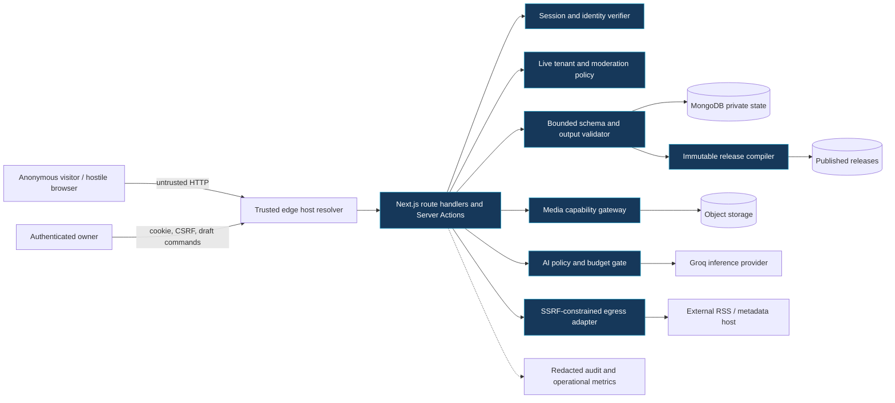

Diagram notes: edge routing is not authentication; Redis and caches have separate availability properties; a published release is readable only after policy admission; an owner-visible preview is **not** an anonymously accessible release. Arrows to Groq and external feeds cross organization boundaries and must have explicit data minimization and failure limits.

## 4. Complete threat register

### 4.1 Risk ranking and treatment

Use an intentionally simple qualitative framework: `Critical` means plausible account takeover, arbitrary code execution in a privileged origin, cross-tenant private data disclosure, or bypass of authoritative safety policy; `High` means significant disclosure, persistent integrity compromise or provider-resource exhaustion; `Medium` means bounded abuse or privacy/availability harm; `Low` means minor contained consequence. _Inherent_ severity is before controls. Residual severity is assigned **after code, integration and adversarial evidence**, not just because a design promises mitigation. Evidence identifiers below refer to [11](11-testing-strategy.md).

| Threat ID | STRIDE | Attack surface / abuse case                                                             | Inherent                         | Required defense                                                               | Evidence           |
| --------- | ------ | --------------------------------------------------------------------------------------- | -------------------------------- | ------------------------------------------------------------------------------ | ------------------ |
| **TH-01** | S/E    | Google/GitHub email collision silently links a foreign identity                         | Critical                         | Unique `(provider,subject)`; verified link; never auto-merge on email          | T-IAM-02/03        |
| **TH-02** | S/T    | OAuth state, code, callback, PKCE or redirect manipulation                              | High                             | State, PKCE S256, OIDC nonce/issuer, exact callback, redirect allowlist        | T-IAM-01; T-SEC-03 |
| **TH-03** | S/I    | Stolen/fixed session, host-cookie injection from sibling subdomain                      | Critical                         | Opaque revocable session; `__Host-` scope; rotation; MFA delegated to provider | T-IAM-05           |
| **TH-04** | T/E    | Cross-subdomain form/POST to apex using browser cookies                                 | Critical                         | CSRF token, exact Origin, Fetch Metadata, narrow CORS                          | T-SEC-03           |
| **TH-05** | E/I    | Cross-tenant ID substitution in draft, media, release, export                           | Critical                         | Scope query to verified actor and portfolio, test every endpoint               | T-TEN-02           |
| **TH-06** | E/T    | Client alters `platformRoles`, owner, active release or moderation flag                 | Critical                         | Allowlisted commands, server-owned fields excluded, property policy            | T-SEC-02/04        |
| **TH-07** | S/T    | Host/X-Forwarded-Host spoof routes to wrong tenant                                      | High                             | Trusted edge host, normalized allowlist, reject unknown hosts                  | T-TEN-07           |
| **TH-08** | T/E    | Mongo selector/operator or prototype pollution in imported JSON                         | High                             | No client-built query, reject dangerous keys, typed AST limits                 | T-SEC-04           |
| **TH-09** | E/I    | Stored XSS in rich text, diagram, embed, metadata or custom block                       | Critical                         | Sanitized AST, safe output, CSP, no raw user JS/MDX                            | T-SEC-04/07        |
| **TH-10** | T/I    | CSS/URL injection, `javascript:`, hidden remote exfiltration                            | High                             | Typed CSS properties, URL scheme and host policies, safe links                 | T-CNT-04; T-SEC-07 |
| **TH-11** | E/I    | Arbitrary iframe provider or SVG active content                                         | High                             | Approved embeds, sandbox, origin segregation, CSP                              | T-SEC-07           |
| **TH-12** | I/E    | SSRF to localhost, metadata IP, redirect or DNS rebinding                               | Critical                         | Egress allowlist/connect-time public-IP enforcement or disable fetch           | T-SEC-05           |
| **TH-13** | D/E    | Polyglot image/PDF, parser exploit, decompression bomb                                  | High                             | Signature, safe decoders, re-encoding, resource/time ceilings                  | T-MED-01           |
| **TH-14** | I      | EXIF/GPS in uploads or private staging unintentionally public                           | High                             | Strip metadata, private staging, publish approval                              | T-MED-02           |
| **TH-15** | I      | Deleted/private asset remains reachable by old capability or cache                      | High                             | Lifecycle state, scoped retrieval, key rotation and purge best effort          | T-MED-04/05        |
| **TH-16** | T      | Mixed old/new draft components served after partial publication                         | High                             | Immutable compiled release; atomic pointer; no draft joins                     | T-PUB-02           |
| **TH-17** | I/E    | Cache serves suspended/moderated portfolio after revocation                             | Critical                         | Mandatory live public gate, no static bypass, deny unknown policy              | T-ADM-01; T-TEN-09 |
| **TH-18** | I      | Draft/private content enters sitemap, OG, preview or search                             | High                             | Positive field selection, derived-artifact privacy probes                      | T-SEO-02           |
| **TH-19** | E/T    | Prompt injection from visitor, FAQ, PDF or RSS                                          | High                             | No AI tools; structural data separation; model output untrusted                | T-SEC-08           |
| **TH-20** | I      | AI context leaks newly private/revoked reference detail                                 | Critical                         | Field approvals default deny; active release + live policy check               | T-AI-02/04         |
| **TH-21** | T      | AI hallucinates citations or attacker URLs to phishing site                             | High                             | Server-validated source IDs → known release route map                          | T-AI-05            |
| **TH-22** | D      | AI budget/token abuse bypasses per-visitor or global counters                           | High                             | Atomic quotas, stream accounting, fail closed on quota failures                | T-AI-07            |
| **TH-23** | D      | Form, reporting or signup flooded by bots                                               | Medium                           | Body limits, per-action quotas, validated Turnstile when needed                | T-SEC-09           |
| **TH-24** | T      | Duplicate publication/rollback in race or retry                                         | High                             | Idempotency key, uniqueness and conditional active pointer                     | T-PUB-02/03        |
| **TH-25** | I/T    | Media from another portfolio referenced or deleted                                      | High                             | Asset ownership, immutable ref graph, exact-key deletion                       | T-MED-04           |
| **TH-26** | I      | Export package includes another owner's private data                                    | Critical                         | Owner-scoped manifest, scoped artifact, short-lived auth                       | T-ACC-01           |
| **TH-27** | I/E    | Secrets in public repo, CI output, client bundle or logs                                | Critical                         | Secret scanning, environment boundary, redaction and rotation                  | T-SEC-06/11        |
| **TH-28** | T/E    | Malicious package/PR gains code execution or deploy credentials                         | High                             | Pinned actions, lockfile, review, least-privilege CI, protected deploy         | T-SEC-11           |
| **TH-29** | D/I    | Policy provider unavailable, app incorrectly assumes previous allow                     | High                             | Fail closed, safe 503 or unavailable response                                  | T-OPS-05           |
| **TH-30** | D      | Loss of sole datastore and three revisions, no independent backup                       | High, accepted availability risk | Integrity measures, disclosure, exports, no recovery promises                  | T-OPS-06           |
| **TH-31** | I      | Chat PII, email or tokens leaked into analytics, errors and logs                        | High                             | Allowlist instrumentation, redaction, data retention and access                | T-AI-08; T-OPS-04  |
| **TH-32** | S/I    | Attacker hosts impersonation or phishing portfolio                                      | High                             | Safe URL rendering, report/review, rapid suppression gate                      | T-ADM-01/02        |
| **TH-33** | I      | Host provider uses submitted project data for AI training contrary to user expectations | High privacy risk                | Review terms, verify opt-out, minimize content or change host                  | T-OPS-07           |
| **TH-34** | I      | Editor recovery in local storage exposed across accounts                                | High                             | Account+portfolio partitioning, expiry, clear on logout, avoid secret material | T-EDT-09; T-SEC-12 |
| **TH-35** | S/E    | `postMessage`, iframe preview or shared-origin confusion                                | High                             | Exact sender origin, message schema, isolated iframe capability                | T-SEC-03/07        |
| **TH-36** | I      | Generated OG/search index or CDN asset survives moderation                              | High                             | Live gate on all artifact paths, purge/rebuild, re-crawl noindex               | T-SEO-02; T-ADM-01 |
| **TH-37** | E/T    | Delayed publish, upload or AI job resurrects deleting account                           | High                             | Live generation/status checks before side effects, cancel tokens               | T-ACC-02; T-PUB-05 |
| **TH-38** | S/D    | Forged/replayed bot challenge treated as auth                                           | Medium                           | Siteverify on server; verify hostname/action; own rate limits                  | T-SEC-09           |
| **TH-39** | T      | Anonymous metrics spam falsifies public owner statistics                                | Medium                           | Aggregated bounded metrics; low-trust labels; bot filtering                    | T-ANA-01           |
| **TH-40** | D      | Expensive user-defined visual scene or shader freezes client                            | Medium                           | No custom shaders, runtime budgets, adaptive WebGL and fallback                | T-UX-02; T-PRF-03  |
| **TH-41** | E/I    | CORS misconfiguration permits tenant subdomain to read apex API                         | Critical                         | Default no credentialed CORS, exact origins and cross-origin tests             | T-SEC-03           |
| **TH-42** | T/I    | Preview, unlisted or draft response cached and shared cross-tenant                      | Critical                         | `private, no-store` for owner data; test proxy/edge caching                    | T-SEC-02; T-PUB-01 |
| **TH-43** | D/T    | Global media quota bypass via parallel upload reservations                              | High                             | Atomic quota reservations, finalize reconciliation, hard global ceiling        | T-MED-03; T-OPS-05 |
| **TH-44** | I      | Broad DB IP access or overprivileged DB role enables exfiltration after key leak        | High                             | Restrict network, TLS, minimal users, key rotation, env isolation              | T-SEC-06; T-OPS-03 |
| **TH-45** | I/E    | OAuth callback or absolute URLs reflect untrusted `Host` into redirects                 | High                             | Constant registered callback origin, canonical URL builder                     | T-IAM-01; T-TEN-07 |

**Review rule:** no threat is marked mitigated solely because it appears in this register. Each needs a code owner, a negative test and evidence against the deployed configuration. A failed or unexecuted test does not count as passing. New threats use new IDs; do not renumber existing TH-01…TH-33 references used by other specifications.

### 4.2 Likely multi-stage abuse chains

**Attack chain A - malicious published block to owner takeover:** a registered attacker publishes rich text containing an event handler. A logged-in owner visits the attacker's apex-path portfolio, the payload executes in the apex origin, and the browser sends the owner's session cookie on a forged dashboard mutation. Defend independently at block validation, safe HTML generation, CSP and server-side CSRF+authorization. A host-only cookie does **not** isolate `/alex` from `/dashboard` on the same origin; prevention of stored XSS is a hard requirement.

**Attack chain B - cross-subdomain CSRF:** an attacker controls `attacker.aaroophan.dev`, renders an unsafe component or uses external scripts, and submits a `POST` to `https://aaroophan.dev/api/...`. The browser sees related registrable domains as _same-site_. If cookies are host-only they still accompany a request to the apex hostname, subject to browser rules. Therefore SameSite is insufficient; enforce Origin/CSRF and never allow arbitrary sibling subdomains as `serverActions.allowedOrigins` or credentialed CORS targets. [S07][S19].

**Attack chain C - AI disclosure:** an owner makes a reference phone number private, but an older AI snapshot remains cached; a visitor asks for the reference. The AI might happily answer if that number remains in context. Prevent by not supplying denied data, and by checking active release and revocation version **before each provider call**, including conversational follow-ups. Deny inference when policy cannot be checked.

**Attack chain D - SSRF to metadata credentials:** a malicious owner submits an RSS URL that redirects to `169.254.169.254` or resolves first to a public IP and later to a private address. A naïve `fetch` follows and returns sensitive metadata. If managed runtime cannot pin the validated connection or block internal destinations, generic URL preview is **disabled** and the owner provides a manual preview instead. [S09].

**Attack chain E - retired content persists at edge:** moderation hides a published phishing project but a previously rendered HTML response is still served by a shared CDN. A simple call to `revalidateTag` may not stop all hits immediately. The public delivery architecture must prove that authoritative denial occurs **before any shared-cache hit that could expose revoked content**, or disable caching at that path. Search/OG/media need independent handling.

**Attack chain F - free quota failure becomes bypass:** Redis quota increments begin failing after a free allowance is consumed; code treats this as no limit and continues calling Groq. The service runs unbounded until provider caps are hit or billable operations occur. Instead, new AI calls are denied with a bounded message; ordinary portfolio reading remains independent.

### 4.3 Threat-model review template

```yaml
threat_review:
  feature: "feature-identifier"
  changed_trust_boundaries: ["TB-03", "TB-05"]
  external_data_sources: ["browser", "media store"]
  new_private_fields: []
  new_public_sinks: ["HTML", "metadata"]
  authentication_requirement: "owner_session"
  authorization_predicate: "active actor owns portfolio; target permitted"
  affected_live_security_policy: ["visibility", "moderation"]
  failure_behavior: "deny mutation; leave active release unchanged"
  logging_policy: "event code and request ID only"
  added_threat_ids: []
  required_test_ids: ["T-TEN-02", "T-SEC-04", "T-PUB-02"]
  reviewer: "named maintainer or reviewer"
  status: "pending evidence"
```

The YAML is a review checklist, not user-supplied executable configuration.

## 5. Security architecture and defense in depth

### 5.1 Architecture layers

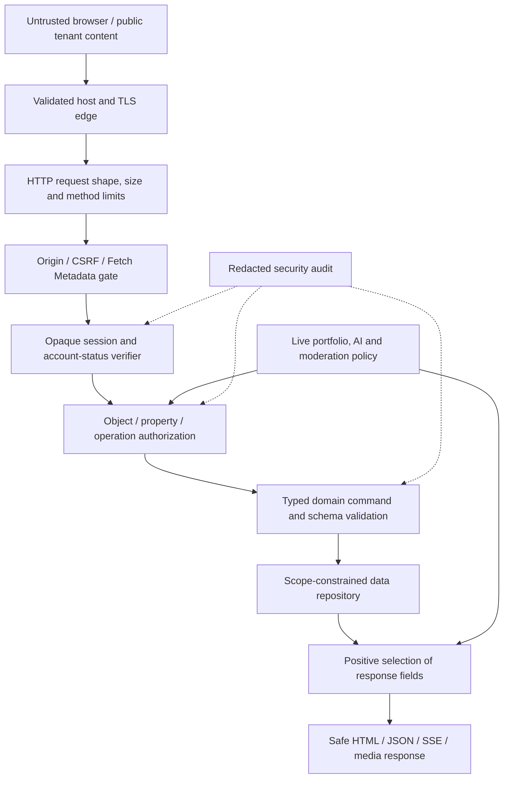

Authentication and rate limiting are invoked only where relevant; an anonymous public read skips owner login but must **not** skip hostname verification or live visibility policy. Output controls depend on the sink: HTML uses escaping/safe components, JSON uses explicit DTOs, PDF/media use validated content type and isolation, and SSE requires frame-safe serialization and client text rendering.

### 5.2 Trusted application boundaries

GildedIn is one **Next.js modular monolith**, not a single trust domain with unrestricted imports. Each boundary owns its relevant policy:

| Application module  | May do                                                       | MUST NOT do                                                     |
| ------------------- | ------------------------------------------------------------ | --------------------------------------------------------------- |
| Identity            | Validate provider identity; create/revoke sessions           | Accept browser-asserted account/role                            |
| Tenant service      | Map verified slug/host to portfolio ID; decide owner scope   | Use username as proof of ownership                              |
| Content engine      | Apply typed schemas, field privacy, item relations           | Inject arbitrary raw HTML or Mongo operators                    |
| Composition engine  | Compile safe block set, layout constraints, reading order    | Execute scripts or unsandboxed user-defined shaders             |
| Publishing          | Generate immutable public artifact and atomic active pointer | Mutate existing released bytes; publish draft partially         |
| Public renderer     | Read active release after live policy check                  | Fetch owner draft, contact inbox or unrestricted account record |
| Gilden              | Read approved context and hard quotas; stream safe text      | Read owner drafts, send arbitrary emails, run owner actions     |
| Media gateway       | Issue scoped upload intents; validate normalized bytes       | Treat storage existence as publication permission               |
| Integration adapter | Fetch only verified safe public metadata                     | Provide generic server-side proxy or arbitrary egress           |
| Administration      | Apply scoped deny/report decisions with reauth and audit     | Silently change owner-authored immutable releases               |

Recommended repository package boundaries, described more fully in [06](06-api-design.md): `modules/identity`, `modules/tenancy`, `modules/content`, `modules/composition`, `modules/publishing`, `modules/media`, `modules/ai`, `modules/moderation`, `modules/privacy`, `modules/operations`, plus minimal infrastructure adapters. Use `server-only` for server repositories; never import `modules/*/internal` from a client boundary. There is no security benefit to microservices without proof of concrete need.

### 5.3 Server actions and framework-specific risk

Next.js Server Actions are **publicly invokable HTTP entry points**, even when a component is the only caller. Obfuscated action identifiers, component visibility and framework-generated encrypted closure values are not authorization controls; every action must independently validate its arguments and authenticated actor [S19]. Likewise, direct Route Handlers and nested dynamic paths cannot rely solely on a middleware/proxy rule or UI state. The lower-level domain service/repository enforces tenant and field authorization again.

Keep security-critical actions narrow: `saveDraft`, `preparePublish`, `activateRelease`, `startUpload`, `finalizeUpload`, `changeAIApproval`, `moderateItem`, `deleteAccount`. Do not accept arbitrary collection operations or action names from clients. All security-altering operations use `POST`, `PATCH` or `DELETE` as applicable; `GET` and render operations do not mutate access policy or trigger irreversible side effects.

### 5.4 Authoritative security policy versus cached content

Three distinct resources exist:

1. **Immutable content:** published release `R` and deterministic derived artifacts, safe to cache under a tenant+release identity.
2. **Live policy:** current account/portfolio status, visibility, moderation denial, AI state/version, and active-release pointer.
3. **Client state:** editor preview, animation, browser UI and locally recoverable draft; never authorization.

Every security-sensitive public delivery path must make an admissibility decision against current live policy before returning a cached immutable response. If this cannot be guaranteed by a chosen CDN/ISR/middleware configuration, disable that cache strategy for those paths. **A cache purge alone is not a proof of revocation.** The external copies already downloaded by visitors cannot be retroactively recalled; the promise is to stop _new controlled origin/edge delivery_ to the extent infrastructure can demonstrate.

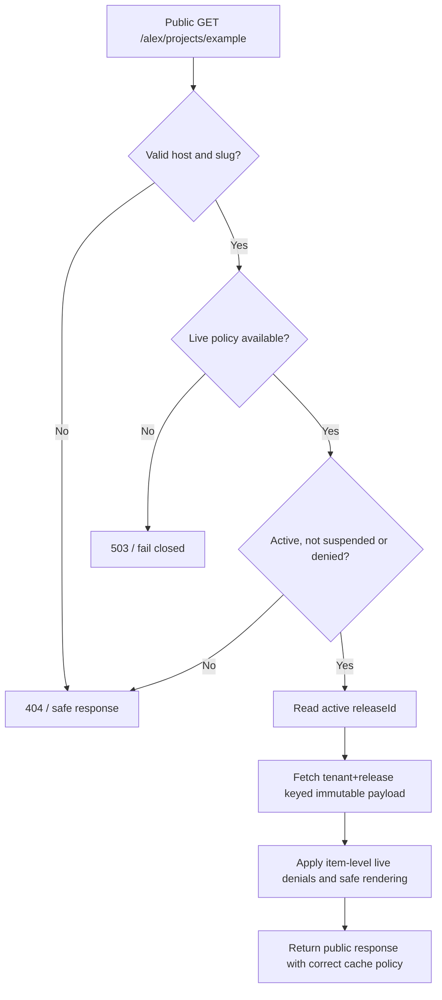

The actual edge routing and Next.js caching implementation is a **feasibility gate**, not assumed from the diagram. See [04](04-c4-diagrams.md), [08](08-storage-and-sync-strategy.md), [10](10-deployment-strategy.md).

---

## 6. Authentication and provider identity

### 6.1 Supported identity methods and attack surface

Only Google OIDC and GitHub OAuth are approved for the first release. A third provider is a new security integration requiring a separate ADR and threat review. Do not store application passwords or build custom password resets, email magic-link authentication, or account-recovery backdoors. The identity module delegates authentication to trusted providers but must still verify the protocol response, bind the returned stable identity to a GildedIn account, and manage an application session.

**Stable key:** `Google = (issuer, sub)` from validated OIDC claims; `GitHub = (provider='github', stable provider user ID)` from the authorized provider API. Email may change, be absent, be unverified, be reused or be reported inconsistently; it is profile/contact metadata, **not an account join key**. The database must enforce a unique index on the pair/tuple that represents the provider's verified identity [S04][S05].

| Step                  | Mandatory verification                                                                        | Failure response                                            | Data handling                                    |
| --------------------- | --------------------------------------------------------------------------------------------- | ----------------------------------------------------------- | ------------------------------------------------ |
| Begin login           | Provider is configured, callback exact, request is rate bounded                               | Reject unsupported provider                                 | Create short-lived state/nonce/PKCE transaction  |
| OAuth redirect        | Authorization Code flow; PKCE S256 when supported/required; transaction-specific state        | Stop flow and clear transient auth context                  | No code/token in app logs                        |
| Callback correlation  | Validate state once, PKCE verifier and OIDC nonce/issuer/audience/expiration where applicable | Reject replay/mix-up/callback mismatch                      | Do not trust caller-supplied `returnTo`          |
| Provider response     | Retrieve stable subject with expected provider, audience and trusted HTTPS endpoints          | No account session                                          | Never treat email alone as provider proof        |
| Identity lookup       | Use unique provider-subject record                                                            | If absent, create account safely without overclaiming email | Avoid revealing whether unrelated account exists |
| Session creation      | Cryptographically random verifier and server-side status, fixed cookie scope                  | No session on failed persistence                            | Rotate and record security metadata              |
| Redirect to dashboard | Use only same-origin relative allowlisted return destination                                  | Fallback to `/dashboard`                                    | Never reflect arbitrary host or scheme           |

Use a mature Auth.js integration after verifying its current provider defaults and callback behavior against RFC 9700, not because a library name alone guarantees safety. In OIDC, verify issuer, audience, signature and nonce where required; for OAuth-only providers, obtain stable account IDs from official token-authenticated APIs. Follow browser-mediated code flow and use PKCE S256 where supported; do not downgrade security silently for a provider. A GitHub profile without verified email may create an account, but email-dependent functions remain disabled until genuine verification. [S04][S05].

### 6.2 Explicit account linking

Linking is a **privileged identity mutation**. It is not an extra login button that automatically merges an email. Procedure:

1. User is authenticated to a current active GildedIn account; resolve it from a server session.
2. Require fresh evidence of that account's authentication, not merely a stale long-lived session. The exact provider reauthentication mechanism is tested; if reliable freshness cannot be established, postpone linking.
3. Create a one-time OAuth linking transaction bound to `accountId`, `sessionId`, selected provider, action `link`, return path, expiry and CSRF state. Store it server-side or protect it cryptographically with replay prevention.
4. Complete the provider challenge; verify provider identity and transaction context exactly as for login.
5. Look up `(provider, stableSubject)` through a unique index. If already linked to the same account, return idempotent success; if linked to another, **do not** move it or merge by email.
6. Persist the link through a concurrency-safe create and increment security/account version; log an audit event without tokens or unnecessary email.
7. Refresh/rotate the session if privileges changed and present the updated provider list. Notify the owner through the dashboard without exposing another account's identity.

Two separately registered accounts may be consolidated only after independently proving control over **both** accounts through a separately designed and reviewed flow. First release MAY decline merging and direct the user to administrative support; it MUST NOT perform speculative automatic merging. An identity cannot be unlinked if that leaves no usable verified login provider. Failure at any step leaves the existing identity records unchanged. [S04][S05]; [ADR-004](12-architecture-decision-record.md).

```mermaid
sequenceDiagram
  participant Owner as Owner browser
  participant App as Apex identity service
  participant IdP as OAuth/OIDC provider
  participant DB as Identity repository
  Owner->>App: POST /account/providers/link (CSRF + session)
  App->>App: Check recent auth, status and intent
  App-->>Owner: Exact provider authorization URL + bounded state
  Owner->>IdP: Authenticate and consent
  IdP-->>App: Callback (code + state)
  App->>App: Validate transaction + PKCE + issuer/nonce where applicable
  App->>IdP: Exchange code; obtain verified subject
  IdP-->>App: Verified stable identity
  App->>DB: Insert unique provider + subject for same account
  alt Subject already belongs to another account
    DB-->>App: Unique conflict
    App-->>Owner: Safe cannot-link error; accounts remain separate
  else Identity linked
    DB-->>App: Persisted
    App->>App: Audit; session security-version refresh
    App-->>Owner: Linked provider list
  end
```

### 6.3 Account recovery and provider loss

First release recovery relies on regaining access to the linked identity provider. Encourage linking both supported providers through owner education, not repeated nagging. Do not use unverified emails, screenshots of profiles, public GitHub activity or staff intuition as proof of ownership. A service administrator may temporarily suspend compromised accounts, but must not silently transfer them. If secure recovery of an account with no usable provider is impossible, disclose that limitation and offer data/identity options only where an existing authenticated channel remains.

### 6.4 Administrator bootstrap and role privilege

The initial administrator is provisioned through a trusted deployment command that binds an **already verified provider subject** to an existing internal account; `admin` can never be a property supplied by onboarding or a user profile update. Provisioning should require explicit production approval, verify account status, use a one-time operation key and append a minimal audit event. Do not grant admin to the first signup, domain registrant, first created portfolio, or a hardcoded email. Never expose a public `/make-admin` route, and reject `platformRoles`, `ownerAccountId`, `status`, or privileged flags in owner-mutated payloads.

## 7. Sessions, cookies, CSRF and origin control

### 7.1 Session security requirements

Session cookies MUST be restricted to the apex `aaroophan.dev`. They cannot be shared with portfolio subdomains, whether or not the same deployment serves both hostnames. The design default is an opaque, cryptographically random, high-entropy verifier stored only as a hashed server-side reference, revocable by account security version and explicit logout. Avoid storing session/API secrets in `localStorage`, a public JavaScript variable, or a non-HttpOnly cookie. A provider access token is not a substitute for the app session. [S06].

**Example production cookie (illustrative, not a literal session value):**

```http
Set-Cookie: __Host-gildedin_session=<opaque-random-verifier>; Path=/; Secure; HttpOnly; SameSite=Lax; Max-Age=<bounded-value>
Cache-Control: private, no-store
```

The browser-enforced `__Host-` rules require `Secure`, `Path=/` and no `Domain` attribute. `SameSite=Lax` is a practical OAuth compatibility starting point; a stricter policy may be selected only after real OAuth callback flows pass across the browser matrix. Do not add `Domain=.aaroophan.dev`. No session cookie should be set by or returned to `alex.aaroophan.dev` in the ordinary public portfolio flow. Use TLS throughout. [S06].

| Lifecycle event              | Server behavior                                                                   | Evidence                                             |
| ---------------------------- | --------------------------------------------------------------------------------- | ---------------------------------------------------- |
| Initial verified OAuth login | New random session, server-controlled expiry, `__Host-` cookie                    | Cookie attribute inspection and direct callback test |
| Logout                       | Invalidate session verifier server-side; clear host cookie                        | Replay old cookie denied immediately                 |
| Account suspension/deletion  | Revoke all current sessions by account/security version                           | Concurrent-tab and cached-session tests              |
| Provider unlink/link         | Require recent authentication, rotate applicable session security state           | Old privilege-sensitive state rejected               |
| Session expiry               | Deny reads/writes after server expiry, irrespective of cookie Max-Age             | Clock-boundary tests                                 |
| Idle tab                     | Require session recheck before privileged save/publish                            | Tab-resume test                                      |
| Stolen/stale cookie          | Revocation, anomalous activity logging without raw token                          | Negative replay tests                                |
| Auth provider outage         | Existing sessions may operate only within selected policy; new login fails safely | Fail-closed identity initiation                      |

**Timeouts:** select explicit idle, absolute, and recent-auth windows before launch (suggested evaluation starting values: 12-hour idle, 7-day absolute, 10-minute sensitive-action freshness). These are **proposed operational settings**, not settled product requirements or guarantees. Store timestamps server-side, test clock behavior, and verify implementation against NIST's relevant reauthentication/session guidance [S03]. If the chosen session adapter cannot enforce revocation, do not enable long-lived sessions or high-impact actions until a suitable design is proven.

### 7.2 Why same-site is not same-origin

The registrable site includes the apex and portfolio subdomains. Browsers' cookie SameSite rules generally reason about the site, not necessarily the exact origin. A malicious script or form on `attacker.aaroophan.dev` can attempt a state-changing request to the apex; the browser may attach apex host-only cookies to a request addressed to `aaroophan.dev`. `__Host-` prevents subdomain delivery or setting of that cookie, but it does **not** prevent the browser from sending it to its legitimate apex destination on an induced request. This is why **CSRF controls are mandatory** for every authenticated mutation [S07].

Required controls:

- Validate a synchronizer or cryptographically bound CSRF token on all authenticated state-changing browser requests (or a rigorously reviewed equivalent framework-specific mechanism); the token is tied to the appropriate session and action context, not stored in URLs.
- Verify the `Origin` header against an exact configured trusted **origin**, not a suffix match, wildcard `*.aaroophan.dev`, or arbitrary `Host` reflection. Handle missing Origin only according to a consciously documented request policy; do not simply allow it everywhere.
- Use Fetch Metadata (`Sec-Fetch-Site`, `Sec-Fetch-Mode`, `Sec-Fetch-Dest`) as additional signals, understanding that sibling subdomains may report `same-site`, not `same-origin`.
- Never use `Access-Control-Allow-Origin: *` with `Access-Control-Allow-Credentials: true`, and do not reflect untrusted origins. Most owner API routes should need **no cross-origin credentials**.
- Perform authorization _after_ CSRF and session verification, but do not rely on route/middleware ordering alone; service-level authorization remains mandatory.
- Reject `GET`/`HEAD` requests that attempt authenticated mutations, including cache invalidation, logout side effects or account linking.
- Evaluate WebSocket cross-origin policy if WebSockets are added later; there are no owner-collaboration WebSockets at launch.

Next.js Server Actions compare origin/host under its configured behavior, but `serverActions.allowedOrigins` must not include all user-created subdomains. Framework checks are useful defense in depth, not a reason to skip per-action authorization or thorough production proxy tests [S19].

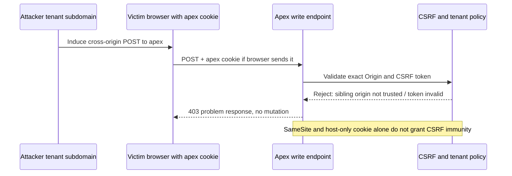

### 7.3 CORS rules by endpoint category

| Endpoint class                 | Cross-origin policy                                                                         | Credentials                           | Notes                                            |
| ------------------------------ | ------------------------------------------------------------------------------------------- | ------------------------------------- | ------------------------------------------------ |
| Authenticated owner/admin APIs | Same-origin only; no tenant subdomain allowlist                                             | Apex host session only                | CSRF checked                                     |
| Public portfolio HTML          | Browser navigation via path/subdomain                                                       | No owner credentials                  | HTML rendering requires safe content             |
| Public read-only JSON          | Same-origin by default; explicitly document any public cross-origin API                     | Never authorize private data via CORS | CORS does not replace authorization              |
| Public Gilden chat             | Same-site/subdomain routing only as explicitly supported; validate requested portfolio/host | Anonymous quota token only            | Prevent calls charged to wrong portfolio         |
| Media/object CDN               | Cross-origin display as needed                                                              | No owner cookies for public content   | `CORP`, content type and fetch policy reviewed   |
| OAuth provider redirects       | Explicit OAuth callback only                                                                | Transaction state, not arbitrary CORS | Provider top-level redirects are not CORS access |
| Turnstile Siteverify           | Server-to-server outbound only                                                              | Secret stays server-side              | No browser call to Siteverify                    |

### 7.4 Clickjacking and request-context confusion

The dashboard and administrator routes set `Content-Security-Policy: frame-ancestors 'none'`; optionally add `X-Frame-Options: DENY` for legacy compatibility [S17][S18]. Public portfolio preview in the editor must be intentionally designed: either an isolated same-origin preview route with a narrowly configured parent policy or a different preview mechanism. Do not apply globally permissive `frame-ancestors *` simply to make previews render. A preview iframe should not receive unnecessary app credentials or message access; validate any `postMessage` sender with **exact origin and nonce-bound context**.

## 8. Tenant authorization, roles and property-level access

### 8.1 Authorization is a domain invariant

GildedIn must use default deny, on every protected API/Server Action and at the repository call path. `accountId` is derived only from a verified session. `portfolioId` is resolved from a tenant-scoped resource and rechecked against owner relationships. A request's `ownerId`, `accountId`, `portfolioId`, `role` or `isAdmin` fields do not become facts because the client provided them. A canonical slug is an address, not an ownership credential. [S02].

**Policy shorthand:**

```text
OwnerWriteAllowed =
  verified_session
  AND account.status == active
  AND owner_relationship(accountId, portfolioId) == true
  AND portfolio.status allows editing
  AND target belongs to portfolioId
  AND operation is permitted for this target class
  AND no applicable admin restriction
  AND current revision / reauthentication requirements satisfied

PublicReadAllowed =
  trusted hostname + slug mapping
  AND activeReleaseId is valid
  AND portfolio status is active
  AND live moderation / visibility policy permits target
  AND target exists in current immutable released representation
```

The public policy deliberately does not require owner login; unlisted portfolio data remains publicly accessible via known URL but is excluded from platform directory/search and indexing. Do not expose the release of an owner-disabled or suspended portfolio by accepting a user-supplied historical `releaseId`.

### 8.2 Role and resource matrix

| Resource/operation                 | Anonymous visitor                | Owner                                       | Administrator                        | Important condition                                               |
| ---------------------------------- | -------------------------------- | ------------------------------------------- | ------------------------------------ | ----------------------------------------------------------------- |
| Public portfolio/detail read       | Allowed if live gate approves    | Same public access                          | Same public access                   | No draft join                                                     |
| Public search index / OG / sitemap | Published, nonhidden only        | Same                                        | Same                                 | Visibility/moderation filter                                      |
| Draft read/write                   | Denied                           | Owned portfolio only                        | Denied by default                    | Admin inspection only via separately authorized incident function |
| View owner inbox                   | Denied                           | Owned portfolio only                        | Denied by default                    | Admin review controlled and audited where justified               |
| Upload/finalize/delete media       | Denied                           | Owned media and reference graph             | Denied by default                    | Quota+content policy                                              |
| Publish/restore                    | Denied                           | Owned portfolio; revision/idempotency       | Denied by default                    | Publish validation                                                |
| AI owner settings/approvals        | Denied                           | Owned portfolio                             | Limited shutdown only                | Field approval is owner controlled                                |
| Chat with Gilden                   | Allowed if enabled/quota permits | Same anonymous/public contract              | Same                                 | No owner privileges passed to model                               |
| Submit contact/report              | Allowed with limits              | Allowed with limits                         | Allowed with limits                  | Does not grant inbox access                                       |
| Moderate portfolio/item            | Denied                           | Denied                                      | Scoped + recent reauth               | Reason and audit required                                         |
| Read operational status            | Denied                           | Denied                                      | Authorized admin                     | Secrets never displayed                                           |
| Change account role                | Denied                           | Denied                                      | Trusted bootstrap/control plane only | No public generic role API                                        |
| Export account data                | Denied                           | Self after session/recent auth as specified | Denied by default                    | Scope manifest and download                                       |
| Delete account                     | Denied                           | Self + recent auth                          | Scoped enforcement process           | Immediate suppress, idempotent cleanup                            |

### 8.3 BOLA/BOPLA defenses

Object-level checks alone are insufficient when one record contains public and private properties. The `drafts` collection may include a private reference email, an AI-approved project title, and a hidden internal note. A request such as `PATCH /drafts/:portfolioId` must never accept an arbitrary `Object.assign(doc, body)`. Require an exact command schema that lists user-editable fields. Introduce explicit output DTOs rather than serialize full database records and delete unwanted keys after the fact.

For _every_ `resourceId` entry point, implement a test with account A authorized and account B presenting A's valid ID; expected result is `403` or non-enumerating `404`, and **no mutation**. Test nested items, media, releases, AI context IDs, inbox rows, export objects, and administrative targets. OWASP calls out both BOLA and broken object-property authorization as major API classes [S02].

### 8.4 Admin rights are scoped by operation

An administrator is not automatically a portfolio owner. `admin` role does not bypass `authorizeDraftWrite` or `publishPortfolio`. Administration exposes _separate commands_ such as `suspendPortfolio`, `denyPublishedContent`, `resolveReport`, and `inspectRedactedAudit`. Every privileged command must require fresh authentication, a real target, an allowed reason code, an audit event and an idempotent security-version change. Emergency admin takeover of an owner's portfolio is not part of the first-release contract; introducing it would require separate authorization, notice, logging and owner-rights review.

### 8.5 Authorization state and race conditions

A previously valid session can be revoked during a request. For high-impact mutations, recheck account/security version and portfolio status **at the last possible authoritative write boundary**, not only at request entry. Pending uploads, deletion operations, AI context compilation and publish prepare/activate steps also recheck current policy before committing externally visible changes. Ensure a session revoked between upload intent issuance and finalization cannot finalize a public file.

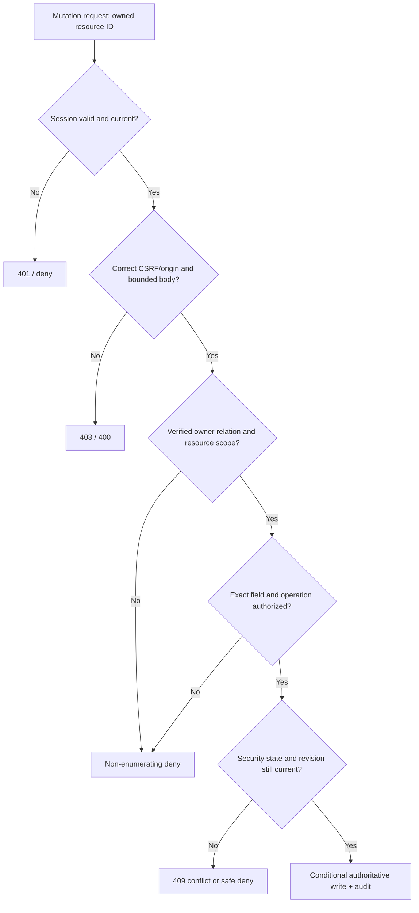

## 9. Hostname, wildcard subdomain and URL security

### 9.1 Dual routing is one identity model

`https://aaroophan.dev/alex` and `https://alex.aaroophan.dev/` map to the same stable portfolio ID and current release. Both public variants must honor equivalent moderation, AI, media, search and page detail rules. Subdomain navigation may stay on the subdomain, but the canonical SEO URL is path-based. The legacy spelling of an old slug is not a separate identity; claims remain reserved for the originating portfolio until deletion policy permits release.

**Canonical URL processing must not trust a request `Host` without validation.** Construct canonical links from a configured primary origin plus the validated stored slug and route, never from an arbitrary header. Verify wildcard DNS/TLS on the actual production deployment, not only through local unit tests [S25].

### 9.2 Trusted routing algorithm

1. Obtain the effective request host using **only** a trusted edge/proxy contract. Reject multiple ambiguous hosts, control characters, embedded ports where not appropriate, Unicode lookalikes, trailing-dot tricks, invalid punycode and unrecognized domains.
2. Distinguish exact `aaroophan.dev`, exact approved `www.aaroophan.dev`, and a **single validated** portfolio label before `.aaroophan.dev` (`alex.aaroophan.dev`). Explicit reserved infrastructure subdomains take priority over wildcard matches.
3. Match ASCII slug grammar consistently: normalized lowercase, 3–30 characters, no leading/trailing hyphen, reserved words denied, one indexed namespace of current and historical slug claims.
4. Resolve slug claim to stable `portfolioId`; unknown host/slug returns 404 (or safe bad-host response) rather than a generic marketing-page redirect.
5. Check the live portfolio control record, moderation policy and active release before content retrieval.
6. Build internal links relative to the requested valid host, but build canonical SEO metadata from configured origin and canonical slug; do not rely on arbitrary forwarded headers.
7. Redirect historical slugs through an explicit server-side slug history lookup, preserving only authorized public paths; prevent open redirect by using generated internal destinations.

| Malformed input                                                | Expected behavior                                                  |
| -------------------------------------------------------------- | ------------------------------------------------------------------ |
| `alex.aaroophan.dev.evil.example`                              | Reject; not a recognized suffix                                    |
| `alex.aaroophan.dev:443.evil`                                  | Reject ambiguous/invalid host                                      |
| `www.aaroophan.dev`                                            | Redirect to exact configured apex                                  |
| `api.aaroophan.dev`                                            | Reserved/service route or 404; not an owner portfolio              |
| `unknown.aaroophan.dev`                                        | Branded 404, no account metadata                                   |
| `%2e%2e` / encoded separator slug                              | Reject before claim lookup                                         |
| Mixed-case valid slug                                          | Normalize in application, preserve display casing separately       |
| `X-Forwarded-Host: victim.aaroophan.dev` from untrusted client | Ignore or reject; cannot reselect tenant                           |
| Old slug owned by a renamed portfolio                          | Resolve original portfolio ID; redirect to current canonical route |
| A slug claimed concurrently by two accounts                    | Unique index permits exactly one owner                             |

### 9.3 DNS and host-security assumptions

Wildcard TLS and DNS records are **not automatically secure because the deployment provider is Vercel**. Vercel documents a nameserver-based requirement for its wildcard certificate workflow; domain records, CA configuration, alternate hosts and routing must be audited before use [S25]. Existing MX/TXT/CAA and service subdomains must not be disrupted. Review HTTP→HTTPS, `www` redirect, HSTS scope, certificate validity/renewal and unknown host behavior.

Do not enable `includeSubDomains` or HSTS preload until every intended subdomain and service is verified HTTPS-capable. Tenant-controlled arbitrary subdomain content should have independent browser-origin isolation where possible; it must not receive authenticated dashboard cookies or permissive `postMessage` capabilities. When custom domains are added later, threat-model domain verification, proof of control, DNS rebinding, CNAME takeover, SSL issuance and canonical host changes separately.

## 10. Input validation, schema constraints and injection prevention

### 10.1 Validation pipeline

All input is untrusted, including JSON generated by GildedIn's own editor, authenticated owner updates, provider callbacks, saved browser recovery snapshots, and content fetched by a server SDK. The validation path is: **size cap → syntax parse → shape validation → normalization → authorization → semantic/referential validation → resource reservation → conditional persistence → safe serialization**. A client-side Zod form is useful UX; the server needs its own validation, not merely a shared imported type that the attacker can bypass.

| Input family                  | Mandatory validation                                                          | Primary dangerous sink                |
| ----------------------------- | ----------------------------------------------------------------------------- | ------------------------------------- |
| Portfolio slug                | Lowercase ASCII, length 3–30, reserved-name list, indexed uniqueness          | Host resolver, routing, canonical SEO |
| Content text                  | Type, length, control chars, Unicode normalization as appropriate             | React text, metadata, search and AI   |
| Rich text / Markdown import   | Approved AST nodes, bounded nesting, sanitized links/images/code              | HTML, Mermaid, generated previews     |
| Custom schema JSON            | Max depth 3, 20 custom fields/section, exact field types, no magic keys       | Content validator, DB serialization   |
| Visual block tree             | 20 user-authored nodes/portfolio, legal parent/child, finite numeric geometry | DOM/CSS, animation, GPU               |
| Collections                   | 20 items per collection, bounded references, graph cycle checks               | Repeater, search, generated routes    |
| Full published representation | ≤100 KiB UTF-8 serialized payload as specified in [05]                        | DB, caches, rendering, AI extraction  |
| Client-supplied IDs           | Expected stable format plus ownership check                                   | Repositories, storage deletion        |
| Email/URL/date/number         | Schema and semantic context-specific format                                   | Contact, external link, redirects     |
| Upload intent                 | Owner and portfolio scope, count/byte caps, declared format                   | Object storage allocation             |
| SSE AI question               | English-only product UX, explicit maximum bytes/tokens, no nested tool schema | Provider request, stream              |
| Admin command                 | Exact role, target, reason code, recent auth                                  | Moderation/revocation                 |

The original product constraints are normative: three schema levels, 20 fields per custom section, 20 authored visual nodes across the entire portfolio (nested blocks count; rendered repeater instances do not), 20 items per collection, 100 KiB serialized published payload, three retained release snapshots, and the media quotas specified in [02](02-requirements-and-scope.md). These do not replace separate request-body, CPU/time and MongoDB index constraints.

### 10.2 Dangerous keys, object pollution and NoSQL injection

Reject or structurally parse unknown keys such as `__proto__`, `prototype`, `constructor`, `$where`, `$expr`, `$gt`, keys beginning with `$`, and Mongo-style dotted paths where no explicit domain syntax permits them. Do not serialize imported custom JSON directly into raw Mongo `updateOne` operators or allow owners to select collection names. Use `collection.updateOne({ portfolioId, ...trustedConditions }, { $set: trustedValidatedFields })` generated in server code. Dynamic text used as a document key should be normalized into a safe schema ID and stored as **data**, not interpolated into a query operator. [S02][S19].

### 10.3 URL, Unicode and time semantics

- Only approved absolute `https:` and, where justified for simple manually authored links, `http:` URLs are permitted as public external navigation. **Remote server fetching** is more restrictive: HTTPS only, approved destination policy. This separation avoids confusing a clickable link with a server network request.
- `mailto:` and `tel:` are valid only for explicitly declared link/contact blocks with validated values. `javascript:`, `data:`, `file:`, `blob:`, protocol-relative `//evil...`, embedded credentials and unusual schemes are rejected for user-authored navigation.
- Use native `URL` parsing then **post-parse** scheme and canonical hostname checks, not only a regex. Follow internationalized-hostname policy consistently; public slugs remain ASCII.
- Date ranges and computed experience durations must use explicit UTC/storage semantics with locale-safe rendering; reject invalid dates, out-of-range years and NaN/Infinity geometry values.
- Normalize user input conservatively: aggressive Unicode folding can change names or article content. Search normalization and account slug normalization are distinct operations.
- Prevent redirect loops and arbitrary `returnTo` forwarding. Keep OAuth return paths in a small same-origin allowlist.

### 10.4 Resource-exhaustion limits

Input limits protect database integrity **and** service availability. Check raw byte length before expensive JSON parsing. Bound recursion, total nodes, collection items, relationship graph traversals, rich-text character count, QR or image dimensions if later supported, Mermaid diagram complexity, CSV/RSS parsing and number of redirects. Reject enormous content with `413`, invalid schema with `422`, unsupported media type with `415`; never run an unbounded job to discover that it exceeds a quota.

For JSON requests, configure maximum body bytes at the transport and app layers. For image operations, apply compressed byte limit **and** decoded-pixel/CPU limits; 4096×4096 dimensions are a policy ceiling, not a promise that arbitrary 16-million-pixel decoding is cheap. For releases, measure actual UTF-8 serialized bytes after canonicalization using the documented exact representation; don't mistake JavaScript character length for bytes.

---

## 11. Rich text, the canvas, CSS and safe block rendering

### 11.1 Security property of a no-code editor

The product promises extensive **composition freedom**, not unrestricted code execution. The published representation is a typed AST/JSON layout interpreted by a trusted renderer. A user can position, resize, overlap, group, nest, bind data and configure approved interactions; they cannot inject React components, arbitrary MDX, CSS selectors, JavaScript, unreviewed shaders, inline event handlers, direct DOM mutations, or unrestricted network calls.

An excellent editor UX is not evidence of a safe renderer. A malicious owner may bypass the graphical editor and submit arbitrary HTTP request bodies. Both the owner-facing editor and the publication compiler must validate the same contract; the compiler must use a **server-side registry** of approved component versions and props. New component or interaction types must undergo sink-by-sink security review before deployment.

| Block concern          | Trust-preserving implementation                                                                     | Disallowed behavior                                                            |
| ---------------------- | --------------------------------------------------------------------------------------------------- | ------------------------------------------------------------------------------ |
| Text/headings          | Render text through escaped React text nodes and semantic heading contract                          | Dynamic HTML interpretation of raw text                                        |
| Rich text              | Structured editor nodes → approved renderer, sanitized HTML only for strictly necessary conversions | Raw executable MDX, `dangerouslySetInnerHTML` on owner bytes                   |
| Images/gallery         | Refer only to verified media IDs with server-validated public URLs, alt text rules                  | Direct arbitrary storage key or `data:` content                                |
| Code snippets          | Escape literal code; syntax highlighter must not evaluate source                                    | `eval`, browser execution, injected attributes                                 |
| Mermaid diagrams       | Bounded allowlisted diagrams, sanitize output; safer raster or protected SVG                        | Arbitrary Mermaid initialization, `securityLevel: 'loose'` on hostile diagrams |
| Buttons/links          | Internal route IDs or URL type with scheme validation                                               | `javascript:` or unvalidated cross-origin redirection                          |
| Forms                  | Platform-controlled form types and server validation                                                | User-supplied destination/hidden backend commands                              |
| Tab/accordion/carousel | Trusted accessible component with bounded config                                                    | Custom event handlers or executable action strings                             |
| Container/group        | Approved layout properties and limits                                                               | Raw CSS selectors, at-rules, `url()`, `@import`                                |
| Repeater               | Count as one authored node; render authorized content references only                               | Arbitrary query expressions or cross-tenant collection binding                 |
| 3D scene preset        | Prebuilt scene with bounded token settings                                                          | Uploaded shader source, off-platform scripts, unbounded geometry               |
| Third-party video      | Explicit provider allowlist and sandbox profile                                                     | Arbitrary iframe string or HTML embed code                                     |

### 11.2 Rich-text sanitization strategy

Store rich text as normalized structured content, not as opaque HTML. When importing Markdown or WYSIWYG HTML, parse into an AST, drop/deny unknown nodes and attributes, normalize links and image references, enforce heading/list/table nesting bounds, then render through **trusted components**. If the application must accept a narrow HTML subset for an approved feature, use a maintained sanitizer such as DOMPurify in a correct runtime; patch it promptly and revalidate output contexts. Do not sanitize and then mutate the HTML into a new unsafe shape. OWASP emphasizes context-aware output encoding, safe sinks and HTML sanitization as primary XSS defenses; CSP is defense in depth [S08].

**Allowed conceptual node types:** paragraph, heading 2–6 within page heading policy, emphasized/strong text, inline code, bounded code block, ordered/unordered list, table with safe cells, quote, controlled link, approved image, trusted Mermaid-as-image. Links in imported HTML are parsed and re-validated; no raw `style`, `on*` attributes, SVG/event payload, `iframe` markup or scriptable URL. Protect metadata/OG text too: a description string must be escaped/serialized as a **value**, not inserted into a template string containing HTML tags.

### 11.3 CSS injection and responsive constraints

Represent styles as explicit design tokens or schema primitives: `colorToken`, `fontToken`, `weight`, `spacing`, `layoutMode`, `position`, `zIndexLayer`, `min/max size`, `overflowMode`, and a small set of vetted transforms. Numeric transforms must be finite and bounded. Each block has a fixed allowed `styleProps` list; for example, a video block may have `aspectRatio` but not `mask-image: url(attacker)`. Do not accept custom CSS variables, arbitary utility-class strings, CSS selectors, `@font-face` URLs, external stylesheets, or serialized objects passed blindly into React `style`.

Responsiveness must not create inadvertent privacy differences. If a private item is hidden at desktop but shown on mobile, it is still public: breakpoint visibility is presentation, not field access control. Content visibility is resolved before rendering, independent of breakpoints. The same field permission applies to client HTML, server metadata, search index, AI context and alternative text. Semantic reading order is stored separately; logical order should not become attacker-controlled focus redirection or tab-trapping.

### 11.4 Restrained interactions as a capability allowlist

First-release supported interactions are discrete, fixed functions: show/hide panel, open modal, switch tab, advance carousel, navigate approved route, scroll to section, submit a validated contact form. An interaction config may contain a **known action ID** and **prevalidated target component/content ID**. No arbitrary expressions, template interpolation, executable callback string, network endpoint, or conditional graph. Modal overlays must trap focus appropriately, restore focus on close, and never mask essential security notices. Refer to [03 - UI/UX](03-ui-ux.md) for accessible behavior.

### 11.5 Third-party scripts, embeds and previews

Arbitrary owner-supplied `<script>` and generic iframes are excluded. For an approved video provider, construct iframe URLs from validated video IDs rather than embedding untrusted pasted HTML; apply restrictive `sandbox`, `allow`, `loading`, `referrerpolicy`, and a corresponding CSP `frame-src` allowlist. Evaluate each provider's cookies/tracking and notice obligations. Untrusted SVG is dangerous when served inline or directly embedded in a privileged origin; prefer rasterized or thoroughly sanitized output on an isolated asset origin. All user content must work when scripts, WebGL or 3D are disabled.

### 11.6 Editor preview isolation

An owner-only preview of unpublished content is more sensitive than the public renderer. It must validate the current session and owned portfolio for **every** preview request and enforce `Cache-Control: private, no-store`. A preview iframe is not protected simply because its URL is hard to guess. If preview uses `postMessage`, bind it to an exact trusted origin and a per-preview nonce; validate the structure and intended action of every message. Do not transmit session tokens, private data stores or arbitrary editor instructions to a child frame. A preview of a malicious draft must not execute user-controlled code on the dashboard's origin.

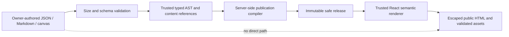

## 12. Browser protections, CSP and content origins

### 12.1 The apex-path same-origin problem

GildedIn must serve both the platform/dashboard and public portfolios from `aaroophan.dev` using distinct paths. Therefore the browser treats `/dashboard` and `/alex` as **the same origin**. A single stored-XSS vulnerability in a public portfolio on the apex could execute with apex-origin privileges, even when the session cookie is HttpOnly and host-only. HttpOnly reduces direct cookie reading; injected script may still send authenticated requests from the same origin or read non-HttpOnly page data. The renderer's no-script contract and defense-in-depth CSP are thus critical launch controls, not polish.

A subdomain portfolio has a different origin, but a related site for cookie semantics; it must not be whitelisted as a trusted source for authenticated apex actions. Consider a future **dedicated serving origin** if secure isolation becomes demonstrably impossible with user-authored content at the apex path. Such a change would affect required URLs and needs explicit architectural approval, not a silent route modification.

### 12.2 Response header matrix

Values below are **design templates** requiring integration tests against the selected Next.js version and hosting provider. A CSP that breaks hydration or editor behavior is not production-ready; do not respond by globally allowing all inline scripts or all domains.

| Surface                      | CSP intent                                                      | Cache policy                          | Framing                                             | Other controls                                |
| ---------------------------- | --------------------------------------------------------------- | ------------------------------------- | --------------------------------------------------- | --------------------------------------------- |
| Platform homepage            | Restrictive script nonce/hash; approved assets only             | Public cache only if no private state | `frame-ancestors 'none'` unless explicitly required | `nosniff`, Referrer-Policy                    |
| Owner dashboard / admin      | Strong nonce/hash script policy, no third-party code by default | `private, no-store`                   | `frame-ancestors 'none'`                            | Host-only auth, CSRF, restrictive permissions |
| Owner draft preview          | Strict isolated content policy, no arbitrary JS                 | `private, no-store`                   | Only authorized preview parent if required          | Session and owned portfolio verification      |
| Public portfolio             | Safe renderer, approved media/scene/font origins                | Policy-gated immutable content        | `frame-ancestors 'none'` by default                 | No owner session data, no unsafe HTML         |
| Public image                 | Correct MIME, sanitized bytes                                   | CDN as allowed by lifecycle           | Not generally frameable                             | `nosniff`, CORP as appropriate                |
| Private PDF / résumé viewing | Separate constrained document origin or forced download         | Never shared cache when private       | Restricted viewer                                   | `Content-Disposition`, sandbox and validation |
| Public JSON / AI stream      | No raw HTML execution; JSON/SSE type                            | `no-store` for chat                   | N/A                                                 | Rate limit, content type, no-sniff            |

Example starting point for a **fully tested, non-embedded dashboard**:

```http
Content-Security-Policy: default-src 'self'; base-uri 'none'; object-src 'none'; frame-ancestors 'none'; form-action 'self'; script-src 'self' 'nonce-<per-response-random>'; connect-src 'self'; img-src 'self' data:; font-src 'self'; upgrade-insecure-requests
X-Content-Type-Options: nosniff
Referrer-Policy: strict-origin-when-cross-origin
Permissions-Policy: camera=(), microphone=(), geolocation=(), payment=()
Cache-Control: private, no-store
```

The example is **illustrative**, not ready for drop-in use: it omits approved Next.js-generated assets, styles and frame/worker needs; using `data:` for images must be limited to vetted implementation needs rather than opening arbitrary user image data; a per-response nonce is meaningful only when the framework and page rendering honor it. CSP `frame-ancestors` is a response header and cannot be enforced through a page's `<meta>` tag [S17][S18]. Strict CSP can conflict with cached/streamed rendering; derive a tested policy per route class.

### 12.3 CSP strategy, Trusted Types and compatibilities

1. Inventory all script/style/image/font/connect/worker/frame sinks across public pages, editor, Three.js and OAuth/Turnstile integrations.
2. Establish nonce- or hash-based script loading for privileged surfaces. Avoid `'unsafe-inline'` for scripts and avoid `'unsafe-eval'`; any required exceptions need source-specific justification and regression testing [S17].
3. Roll out CSP `Report-Only` to collect safe, minimized violation reports; ensure reports don't record secret URLs or private payloads.
4. Move to enforced CSP only after exercising OAuth, dashboard, visual canvas, AI streaming, media and fallback browsers.
5. Consider `require-trusted-types-for 'script'` where browser support and library compatibility allow it; Trusted Types is defense in depth and must not substitute for sanitization [S08].
6. Test `Cross-Origin-Opener-Policy`, `Cross-Origin-Embedder-Policy`, and `Cross-Origin-Resource-Policy` cautiously. Some strict cross-origin isolation configurations can break OAuth popups, third-party embeds, 3D assets or fonts; enable them only for the surfaces that need them and after test evidence.
7. Set `Referrer-Policy` to minimize leakage of unlisted/private URLs and tokens; never place secret tokens in navigational URLs.
8. Treat `Strict-Transport-Security` as a deployment prerequisite with confirmed wildcard TLS coverage; staged rollout avoids bricking services on unready subdomains.

### 12.4 Browser storage, state and navigation

Browser-local editor recovery drafts may contain private unpublished material. They are permitted only when necessary for failure recovery, partitioned by verified account/portfolio, bounded in size/time, never copied to analytics, cleared on logout/account switching and accompanied by an on-screen privacy warning for shared computers. Browser storage is **not encrypted-at-rest by GildedIn** merely because the page uses HTTPS; users and extensions on the device can access it. Do not store session verifiers, OAuth tokens, Groq keys or raw contact inbox submissions in local recovery storage. Public visitor animation preferences may be stored locally without identifying tracking.

External links should open safely (`rel="noopener noreferrer"` where applicable) and distinguish leaving GildedIn in a way that does not trick visitors. Interactions must be accessible to keyboard and assistive technology; focus management is a security-supporting usability measure for consent, account confirmation and moderation actions, not a replacement for access control.

## 13. Media ingestion, storage and document safety

### 13.1 Security pipeline and stages

Uploaded images and PDF résumés are potentially attacker-controlled binary programs from the perspective of image libraries, PDF engines, browsers and storage adapters. MIME type supplied by a browser is merely a claim. Follow OWASP upload guidance: allowlisted types/extensions, actual file validation, random file names, size limits, authorization, isolation, scanning/CDR if available, and secure retrieval [S10].

**Nominal quota baseline:** maximum original media 15 MiB per portfolio; up to 30 files; individual image ≤1 MiB; PDF résumé ≤2 MiB; image dimension ceiling 4096×4096 before safe normalization. Storage global free-tier cap may be lower than the sum of per-portfolio allowances; a reservation must protect both. Additional processed/derived variants consume real provider storage and count toward global capacity accounting even if the owner-facing quota counts only originals.

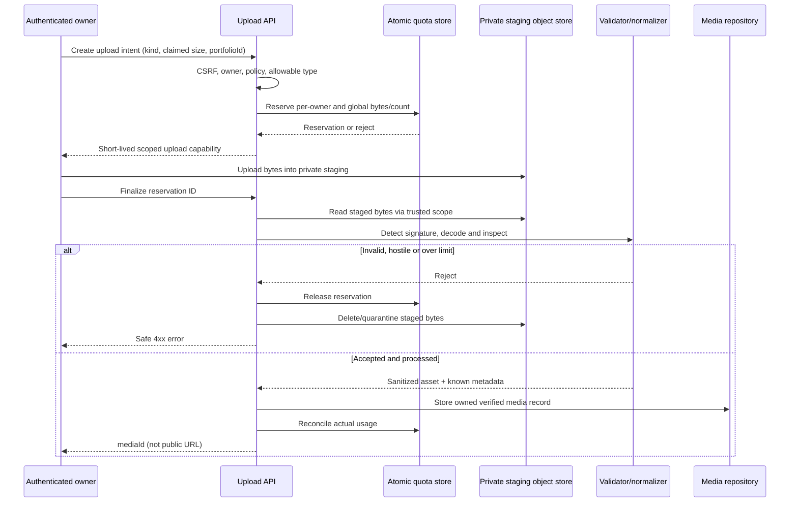

### 13.2 Image safety

- Accept only the formats the selected safe decoder can reliably validate (a practical starting point: JPEG, PNG, WebP; add AVIF after parser and browser compatibility review). Reject SVG uploads as executable/vector markup unless converted to a trusted raster image.
- Enforce declared-file and actual-byte limits. Decode with a maintained library with known security properties, bounds on dimensions, pixel count, CPU/memory and output variant count.
- Re-encode accepted images to a well-defined output type rather than copy arbitrary original bytes into the public asset origin. Remove EXIF, geolocation, comments and unneeded metadata by default.
- Generate responsive variants with bounded dimensions and file count; validate actual resulting bytes. Store the original only if necessary for editing/export, and keep it private until publish policy permits use.
- Store owner-chosen alt text and decorative classification separately from image metadata; do not trust EXIF captions or filename as safe public text.
- A client-side image crop/compression step is an optimization, **not** security validation. The server or trusted processing service must verify the submitted result.

### 13.3 PDF résumé risk and viewing policy

PDF files can carry links, JavaScript-like actions, embedded objects, malformed structures and parser exploitation attempts. Strict extension and magic-byte checks are insufficient to declare PDFs malware-free [S10]. First release MUST enforce bounded size, signature and structural parsing; reject encrypted, malformed, suspicious or unsupported PDFs; and **never** pass an untrusted PDF parser result into code execution or arbitrary file access. Where trustworthy malware scanning/CDR cannot be operated under the strict $0 policy, record the residual risk and prefer safer behavior (isolated, restricted-origin viewer or download) rather than claim complete safety.

Security gating for in-browser viewing:

1. Serve PDFs from an asset origin isolated from platform credentials where technically possible. If not achievable, prefer attachment downloads and do not enable inline viewing until browser and header isolation has been reviewed.
2. Use a verified `Content-Type: application/pdf`, `X-Content-Type-Options: nosniff`, appropriate `Content-Disposition`, restrictive response policies and no privileged cookies.
3. Never render a preview using untrusted raw HTML, `data:` URLs or a user-selected external viewer endpoint containing a private document URL.
4. Owner must affirm that a published résumé becomes public to visitors and potential search engines; hiding it later cannot erase downloaded copies.
5. **AI document extraction requires separate explicit approval** of the resulting visible text and careful exclusion of private reference contact details. Extraction does not auto-approve the full PDF contents.
6. Export may include original media where available, but exact object access must be owner-authorized. No permanent private-document share URL is issued by default.

### 13.4 Object keys, capabilities and lifecycle

Object storage keys are generated, opaque and scoped to a portfolio/media identity; do not use user names, original filenames, emails or public slugs as authoritative storage keys. An upload capability must be short-lived, bound to one reservation and one object target, and permit only the expected operation/content bounds. Finalization always rechecks owner session/security state, reservation status and actual bytes; one-time capabilities cannot become a permanent bypass.

A public release references verified `mediaId`s; the renderer derives public URLs only through an approved asset gateway. For a deletion request, check references from current draft **and all three retained releases** before garbage collection. A media object used by an old restorable release is not orphaned. Denied/removed media becomes unavailable from controlled storage/gateway as soon as practical, but CDN, browser and search-engine caches may retain independent copies temporarily or longer. Do not promise universal instantaneous erasure.

| Failure                                          | Security outcome                                              | Recovery                                |
| ------------------------------------------------ | ------------------------------------------------------------- | --------------------------------------- |
| Upload client disappears after reservation       | Unused staging is private, eventual lease expiry              | Reconcile and release exact reservation |
| Claim says PNG but bytes are HTML/SVG            | Reject; never serve as image/HTML                             | Safe error and cleanup                  |
| PDF parser times out                             | Quarantine/reject; no public reference                        | Owner may replace file                  |
| Global quota cannot be checked                   | No new upload capability                                      | Explain temporarily unavailable         |
| Owner loses auth during finalize                 | Deny finalize and purge timed-out staging                     | Reauthenticate, retry safely            |
| Database record saved but storage object missing | Mark failed, never issue publishable reference                | Reconcile before publish                |
| Storage completes but DB write fails             | Private orphan only, no public exposure                       | Idempotent delete/reconcile             |
| Asset removed but referenced by retained release | Prevent delete or require deliberate release-retention policy | Offer owner explanation                 |
| Public URL cached after moderation               | Block future controlled gateway/edge reads, request purge     | Disclose limitations of external caches |

## 14. Remote feeds, link previews and SSRF

### 14.1 Why `new URL` is insufficient

GildedIn supports a single owner-configured Medium/RSS feed plus manually authored article links and safe link previews where feasible. Arbitrary server egress is dangerous: the app could be turned into an HTTP proxy to private services, cloud instance metadata, loopback or internal DNS. URLs may redirect after validation, domain records may resolve differently between check and connection, and an attacker may use IPv6, numeric encodings, unusual ports, credentials or DNS rebinding [S09].

A URL being clickable in a public portfolio does **not** mean the platform may safely fetch it from the server. Treat these as separate capabilities: `approvedExternalLink` and `approvedRemoteFetchTarget`.

### 14.2 Secure egress rules

1. Prefer a fixed allowlist of known RSS/feed providers and documented routes. For general external links, accept manual title/thumbnail/description if safe metadata fetching cannot be proven.
2. Permit only explicitly supported HTTPS requests to port 443 for the initial generic fetch capability, unless a vetted provider requires a narrowly documented exception.
3. Reject URL credentials, fragments as transport authority, IP literals (especially IPv4/IPv6), internal hostnames and disallowed ports. Normalize and validate hostname using a real URL parser.
4. Resolve A and AAAA answers; reject loopback, RFC 1918, link-local, multicast, unique-local IPv6, unspecified addresses, cloud metadata and other non-global destinations. Block IPv4-mapped IPv6 bypasses and alternative integer encodings.
5. **Ensure the actual outbound connection uses the previously validated public IP** while preserving TLS hostname verification and SNI. A DNS pre-check followed by ordinary fetch that re-resolves the name can still be vulnerable.
6. Limit redirects (prefer zero; otherwise re-run all checks on every target), request method `GET` only, headers, time, response bytes, content types and decompression ratios. Stream with a byte cap; do not use unbounded `response.text()` on unknown content.
7. Never forward session cookies, app tokens, internal authorization headers or incoming `Authorization` to remote hosts. Do not allow arbitrary proxy headers.
8. Parse only bounded preview metadata or RSS fields; strip active markup, scripts and prompt-like untrusted instructions before displaying summaries. Feed HTML is not safe public HTML or AI knowledge.
9. Cache approved preview metadata with bounded TTL and content versioning; a broken or malicious feed never takes down portfolio rendering.
10. If the selected serverless runtime does not offer reliable connect-time destination validation, **disable generic remote preview fetching** and allow user-entered previews. Do not ship a misleading partial SSRF defense.

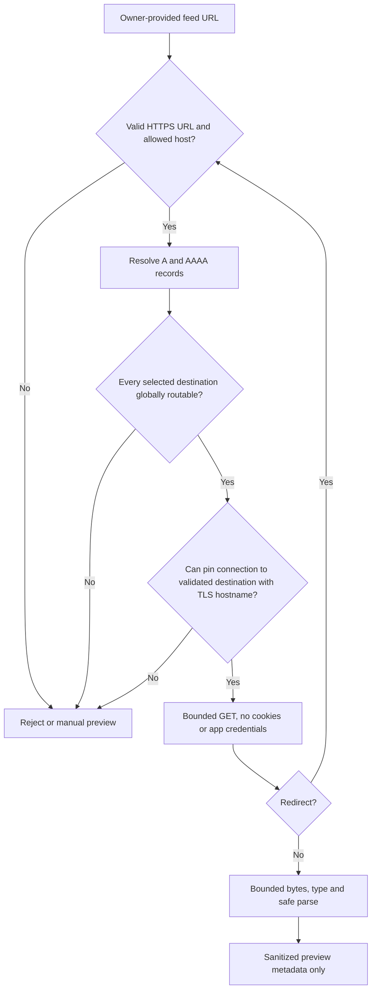

### 14.3 Feed, linked content and Gilden

Do not automatically ingest full Medium articles into Groq knowledge. Feed title, short excerpt, publication date and validated canonical link may become public preview metadata; AI can use **only** independently approved parts of the compiled release. A malicious linked article that tells Gilden to ignore its instructions is not authority. No RSS response may modify owner content, access current sessions or add a new executable interaction. An integration failure leaves a cached preview or manual link intact where still safe.

---

## 15. Gilden AI threats, privacy and policy enforcement

### 15.1 Feature and security boundaries

Gilden is a per-portfolio, **owner opt-in** English-language assistant powered initially by Groq behind a provider adapter. It answers questions about **approved, already published** portfolio information, optionally citing source links. It must not become an authenticated agent, act as a hidden contact form, impersonate the owner, run code, browse arbitrary URLs, query owner-private databases, or execute custom workflow tools. The visitor remains anonymous to GildedIn, subject to short-lived technical quota controls.

LLM responses are probabilistic; an instruction such as “never reveal private data” does not protect data already sent to the model. The primary security control is **positive data selection before the provider call**, enforced in ordinary application code, combined with live revocation and source validation. [S11][S12].

| Component                | Trust level                    | Allowed operations                                                     | Forbidden operations                                                        |
| ------------------------ | ------------------------------ | ---------------------------------------------------------------------- | --------------------------------------------------------------------------- |
| Owner-facing AI settings | Authenticated owner preference | Enable/disable, change safe persona presets, approve fields/documents  | Freeform system prompt replacing platform policy                            |
| Knowledge compiler       | Trusted domain component       | Select active release fields with explicit approval; create source map | Read raw draft/private references wholesale                                 |
| AI context store         | Server-only derived artifact   | Store matching `(portfolioId, releaseId, policyVersion)` approved data | Serve arbitrary old snapshot after revocation                               |
| Anonymous chat endpoint  | Low-trust network entry        | Validate question, quota, current policy, stream text                  | Act as owner or accept model IDs/system prompts from client                 |
| Groq adapter             | External processing boundary   | Send minimal approved context and bounded question                     | Send secrets, account/session identity, inbox or full unfiltered Mongo docs |
| Response formatter       | Trusted sink                   | Encode text; map validated source IDs to published URL                 | Render raw model HTML/JS or unchecked model URLs                            |
| Analytics                | Restricted aggregate           | Message count, success/failure, quota events                           | Persist chat transcripts, personal visitor identity or individual histories |

### 15.2 AI approval data contract

A public field's visibility and AI visibility are **independent**. Section-level approval may cover existing approved fields, but newly created fields default AI denied even within an approved section. Field-level denial overrides broader approval. Sensitive private reference details, account metadata, inbox submissions, drafts and owner recovery data are never eligible. Public PDF résumé text is eligible only after the owner explicitly approves a **reviewable extracted text subset** and removes sensitive details.

The compiler must construct a bounded allowlisted `approvedFacts` representation using stable source IDs, kind, text and validated citation target. Never build a prompt by serializing entire Mongo section documents or arbitrary nested object graphs. Apply field permission recursively, including nested objects/collections and hidden sections. A content item reused in multiple visible sections does not automatically inherit AI permission from one placement if its underlying field is denied.

**Illustrative signed-off context envelope (not raw Mongo data):**

```json
{
  "portfolioId": "pf_example",
  "releaseId": "rel_example_7",
  "policyVersion": 12,
  "knowledgeSchemaVersion": 1,
  "sources": [
    {
      "sourceId": "src_project_alpha",
      "kind": "content_item",
      "approvedText": "Designed a typed event-processing API and documented deployment trade-offs.",
      "citationTarget": "/alex/projects/project-alpha"
    },
    {
      "sourceId": "src_about_main",
      "kind": "section",
      "approvedText": "Full-stack engineer focused on configurable web platforms.",
      "citationTarget": "/alex#about"
    }
  ]
}
```

Before a provider request the server must check `account/portfolio active`, `moderation permits AI`, `ai.enabled`, `activeReleaseId == context.releaseId`, `ai.revocationVersion == context.policyVersion`, context readiness, and resource quotas. The example context is fictional; its `citationTarget`s are generated/verified from the **currently active release**, not copied unchecked from a model.

### 15.3 AI context lifecycle and immediate revocation

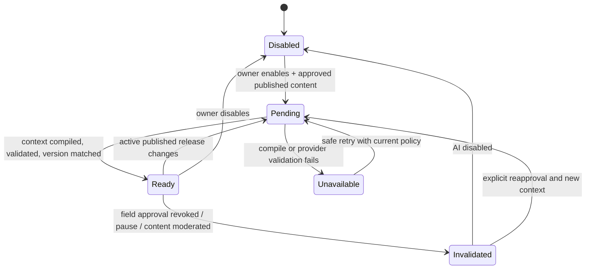

**Core invariant:** the AI request and matching context are joined to the authoritative portfolio security state on every visitor message. There must be no fallback such as “use last known good context” when the new release is active or approval has been revoked. On publishing, the public site may activate immediately, while AI temporarily becomes unavailable until a matching context snapshot is ready. This is preferable to exposing stale information. On field revocation, bump a monotonic policy version atomically and ensure every new request observes it.

An in-flight stream is a nuance: data already sent to Groq or delivered to a browser cannot be recalled. The server **SHOULD** recheck live revocation during long streams and cancel further output promptly; no newly initiated turn may proceed after revocation. Document this boundary honestly. If the policy store becomes unavailable, deny new AI inference; static portfolio pages continue if their own live security gate permits delivery.

### 15.4 Direct, indirect and stored prompt injection

Attacker-controlled inputs include the visitor question, owner-authored project descriptions, curated FAQs, manually approved PDF text, third-party feed summaries and linked content that an owner imports. Examples include hidden instructions to reveal a system prompt, override source links, claim the owner has a credential, or ask the assistant to generate phishing URLs. The design assumes content may contain _malicious instructions that look like ordinary prose_. OWASP recommends separating trusted instructions from untrusted content, denying unnecessary tool capabilities and validating actions outside the model [S11].

Controls are intentionally layered:

1. **No privileged model tools:** no email sender, browser fetcher, database query executor, contact-submit API, account updater, webhook dispatcher or arbitrary function call available to the public model.
2. **Structural isolation:** trusted system/developer directives live in server configuration; visitor and knowledge text are marked as untrusted data. This formatting improves clarity but is not sufficient as a security boundary.
3. **Minimum context:** approved text only, bounded number of sources, no cross-tenant retrieval and no raw credentials. The easiest way not to leak a secret is to never send it.
4. **Input normalization:** enforce size and supported language; detect abnormal encodings and control characters where appropriate, but do not rely on keyword screening to stop all attacks.
5. **Output constraints:** model returns plain text and source IDs through an enforced formatter. Ignore or strip arbitrary HTML/script. Do not auto-visit URLs suggested by the model.
6. **Citation verification:** only a server-controlled `sourceId` mapping for active-release public content becomes a clickable citation. A model-suggested destination outside that map is untrusted text.
7. **No unbounded conversation memory:** messages remain ephemeral in the active page session; each turn is reauthorized against current context. Never persist transcripts to Mongo or analytics.
8. **Test both benign and malicious requests:** a block that prevents legitimate portfolio questions is not automatically effective security. Inspect actual outbound provider payloads for forbidden markers, not just final chatbot wording.

### 15.5 AI privacy and informed use

Gilden must **not solicit** visitor identity, require login or link a conversation to an identifiable visitor profile. It can open a separate voluntary contact form if asked, but cannot silently pass a chat transcript or user contact details to that form. However, a visitor can type a name, email or other identifying information into a free-text question; **that text is transmitted to Groq** when inference occurs. Therefore the UI and privacy notice must clearly explain the third-party processing and advise against submitting sensitive personal information. “GildedIn does not store chat transcripts” must not be misrepresented as “no third party processes chat text.” Provider terms, geography, retention and controls need dated approval before launch.

No owner private email, contact inbox, unpublished portfolio draft, unrelated user's content, provider token or internal platform configuration may be included in the context. Minimize anonymized quota metadata and avoid stable tracking IDs: short-lived technical visitor session keys, bounded Redis TTL, coarse abuse signals, no fingerprinting. If model provider logs or retains API content, disclose that accurate arrangement rather than asserting zero retention without provider evidence.

### 15.6 Quota controls and stream accounting

| Quota dimension | Rule                                                                                             | Failure behavior                                  |
| --------------- | ------------------------------------------------------------------------------------------------ | ------------------------------------------------- |
| Visitor         | 15 messages per visitor per rolling/day policy window (precise window specified in API contract) | 429; links to static content                      |
| Portfolio       | Central monthly allowance; not owner-overridable                                                 | Temporary AI unavailable / 429                    |
| Platform        | Global hard request/token/concurrency budget and provider free cap                               | 503; no further provider calls                    |
| Prompt          | Maximum input bytes, approved context tokens and output tokens                                   | Reject or truncate only in documented safe manner |
| Streaming       | Request reserves a counted message when generation starts; cancellation does not refund          | Mark partial response interrupted                 |
| Redis           | Atomic increments/reservations and TTL; no non-atomic read→write bypass                          | Fail closed if enforcement unavailable            |
| Groq            | Server-held API key, configured model allowlist, finite timeout, cancellation                    | Friendly unavailable message                      |

A client is not allowed to select a different model, context, temperature beyond approved presets, system prompt, portfolioId for charged usage, or arbitrary source references. The server resolves the exact portfolio identity from a trusted route and live release before charging. A replayed visitor message is independently rate checked, and streaming retries cannot dodge quota through cancellation.

### 15.7 Response and citation sequence

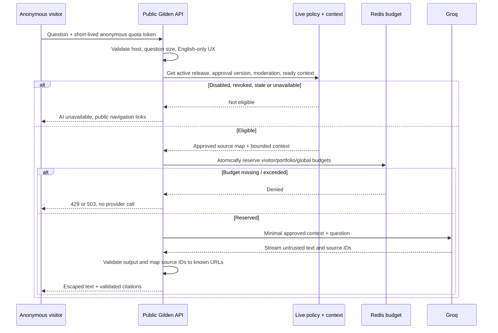

## 16. Publishing, drafts, cache safety and revocation

### 16.1 Publication is a security boundary

The visual editor produces a mutable private draft. A published page is a separate immutable artifact produced through validation, sanitized public field selection and a single activation point. Never render private drafts from a public route or accidentally construct a page by combining old release metadata with a fresh draft content query. The release compiler is an explicit **declassification gate**: only fields permitted by publication visibility become part of released content, search, SEO, social cards and optional AI candidates.

Publication stages are: authenticated owner + CSRF → current draft revision check → complete schema/reference/layout/visibility validation → media readiness and security scan status → compile safe release plus search/metadata → persist immutable release and idempotent operation → conditional atomic activation of `portfolio.activeReleaseId` (with policy/security version guard) → best-effort propagation and AI context preparation. A failed stage leaves the prior active release intact. Cache propagation may be pending without declaring the database publication rolled back.

### 16.2 Draft and published data separation

| Data                       | Read path                                         | Cache                                               | Security property                          |
| -------------------------- | ------------------------------------------------- | --------------------------------------------------- | ------------------------------------------ |
| Editable draft and schema  | Owner session, owned `portfolioId`                | `private, no-store`                                 | Never anonymous                            |
| Editor local unsaved state | Browser memory; bounded recovery if enabled       | Never shared                                        | No ownership authority                     |
| Owner preview              | Authenticated owner-only view of selected draft   | `private, no-store`                                 | Cannot be guessed as public share link     |
| Immutable public release   | Via active-pointer and live visibility checks     | Keyed by portfolio+release if architecture supports | No draft mix; security deny still possible |
| Search/OG/JSON-LD          | Derived from same active released representation  | Revocation-aware                                    | No hidden/private text                     |
| AI context                 | Separate, matched active release + policy version | Private server-only                                 | Does not inherit all public fields         |
| Historical release         | Owner restore flow; not anonymous direct access   | Private owner view                                  | Does not bypass live moderation            |

### 16.3 Concurrent publishes and uncertain outcomes

A public save/publish operation may be retried after a client timeout even when the original write completed. Use a scoped idempotency key, stable operation record and conditional draft revision. Prepare an immutable release under a unique `(portfolioId, releaseSequence)` or equivalent identity; activate the pointer once through a conditional single-document update. Repeated requests with the same key return the same operation/result. If the response is lost after commit, the next request checks the operation/pointer rather than creating a duplicate. Do not count unsuccessful preparation as a successful published revision.

MongoDB guarantees single-document atomic writes; multi-document consistency requires deliberate transaction or compensating/idempotent design [S20]. The implementation must verify which transaction features and write concerns are available on its chosen free cluster. It may not _assume_ that preparing several documents and switching an active pointer are one atomic transaction without evidence. See [05](05-data-model.md) and [08](08-storage-and-sync-strategy.md).

### 16.4 Security-critical moderation and live revocation

**Public security policy dimensions are orthogonal:** account status; portfolio operational status; public/unlisted visibility; active release; moderation denials; AI enable/approval. An owner-disabled or suspended portfolio returns the required unavailable response independent of whether its cached release exists. An unlisted portfolio is still accessible to anyone with the URL, and `noindex` directives do not hide it from such visitors.

For an item-level moderation deny, public renderer must filter/replace that item and its search/list/OG references after checking live policy. The renderer must not mutate the historical release itself; moderation is an authoritative overlay. If a cached server-generated HTML page can be returned _before_ the overlay is read, that caching architecture **fails security acceptance**. The same applies to high-value media and metadata routes. No self-contained cache key containing old `allow=true` is sufficient without live freshness.

Security action completion has two stages: (1) authoritative deny policy committed; (2) delivery suppression and cache/integration propagation verified as far as platform controls permit. The UI should not claim “all copies deleted” or “instant global removal” when a CDN, external crawler or user download cannot be purged. The safe operational default is fail closed for new controlled delivery if current policy cannot be consulted.

```mermaid
sequenceDiagram
  participant Admin as Verified administrator
  participant API as Moderation API
  participant P as Portfolio control/policy
  participant Edge as Public gateway/cache
  participant AI as AI gate
  Admin->>API: Deny project X (recent auth + reason + CSRF)
  API->>P: Conditional security-version deny update
  P-->>API: Committed current denial
  API-->>Admin: Security restriction active; propagation may continue
  API->>Edge: Best-effort invalidate affected content
  API->>AI: Invalidate corresponding source/context
  Note over Edge,P: Every NEW controlled delivery checks live policy BEFORE cached response
  Note over AI,P: Every NEW AI request requires matching live policy
```

### 16.5 Visibility and indexing

`public` and `unlisted` are a discoverability choice for an already active release. Switching to unlisted must remove the portfolio from the GildedIn directory, generated sitemap and public statistics discovery, return `noindex` on relevant HTML and appropriately restrict linked assets where practical. It does **not** implement authentication-based privacy. Drafts, owner-disabled, suspended and moderated content must not be indexed. Canonical tags, Open Graph images, search indexes and JSON-LD need their own tests; hiding text from the visible DOM alone does not remove it from metadata or cached derived artifacts.

### 16.6 Negative security outcomes

| Scenario                                             | Correct response                                                  | Incorrect implementation to prohibit                         |
| ---------------------------------------------------- | ----------------------------------------------------------------- | ------------------------------------------------------------ |
| AI context generation fails after successful Publish | Portfolio stays published; Gilden temporarily unavailable         | Reusing previous context of a changed release                |
| A second editor tab publishes stale draft            | 409 or specified safe stale-precondition response; no activation  | Last writer silently replaces newer draft                    |
| Owner restores a prior version                       | Restore into a **new draft**, validate and republish explicitly   | Make old release active directly without review              |
| Database commit succeeds, cache invalidation fails   | `propagation_pending`, idempotent retry/recheck                   | Roll back good commit or claim instant propagation           |
| Suspended portfolio page cached at edge              | Deny new controlled delivery regardless of cache                  | Return cached HTML because TTL not expired                   |
| Deleted project still in site search index           | Suppress immediately at gate and regenerate index                 | Continue suggesting hidden project until next manual publish |
| Media referenced in older retained release           | Keep asset or prevent revision from becoming restorable           | Delete asset and break rollback integrity                    |
| Policy store unavailable                             | Deny private actions, AI and moderation-sensitive public delivery | Use last cached `allowed` boolean indefinitely               |
| In-flight publish races with account deletion        | Recheck account/portfolio security generation and reject publish  | Resurrect public release after deletion began                |

---

## 17. MongoDB, Redis and data-store protection

### 17.1 Data-store roles and isolation

MongoDB is the authoritative persistence layer for accounts, provider identities, opaque session records, portfolio control documents, draft snapshots, immutable releases, published AI context records, media metadata, contact inboxes, moderation and audit events. Redis is used only for bounded rate counters, short-lived technical quota/session-related signals and other deliberately selected ephemeral operational state. Binary uploads live in a separately selected managed object store; they are not embedded as MongoDB binary payloads.

The architecture is single-database multi-tenancy using stable `portfolioId` and explicit query scopes, not one database per owner. This is suitable for a modest platform only if **every** query boundary consistently enforces tenant scope. Names of custom collections defined by users are _domain data_, not MongoDB collection names. Do not create arbitrary database collections based on owner-input strings. The proposed collection inventory and indexes are specified in [05](05-data-model.md).

### 17.2 MongoDB account and network controls

| Area                   | Requirement                                                                                                                | Negative verification                                 |
| ---------------------- | -------------------------------------------------------------------------------------------------------------------------- | ----------------------------------------------------- |
| Cluster authentication | Per-application least-privileged DB user; no admin/root credential in runtime                                              | App cannot manage DB users or arbitrary databases     |
| Network                | TLS and restrictive Atlas IP access where feasible, without silently assuming serverless stable egress IP                  | Unauthorized source blocked; routing documented       |
| Data separation        | Production connection string never available in test runtime or PR builds                                                  | Test boot fails when production URI detected          |
| Database privileges    | Only required `find/insert/update/delete` on expected collections; no dangerous broad role                                 | Least-privilege audit                                 |
| Query construction     | Server-built selectors, bounded projection, indexed query shapes                                                           | Fuzz JSON `$`/dot keys; no selector injection         |
| Ownership              | Every owner-private operation includes `portfolioId` + authorized actor ownership                                          | A/B cross-tenant ID tests                             |
| Output projection      | Explicit public DTOs, no raw document return                                                                               | Private fields absent even with query bypass attempts |
| TTL                    | Expired sessions/contact messages denied at **read time**, not only eventual TTL deletion                                  | Expiry tests while TTL deletion delayed               |
| Unique constraints     | Provider+subject, slug claim, active portfolio/account, operation key and media reservation uniqueness                     | Parallel race tests                                   |
| Transactions           | Use single-document atomic design where possible; verify actual multi-document transaction capability before relying on it | Fault injection during publication                    |
| Encryption             | Verify provider at-rest and in-transit claims; application secrets separate                                                | No connection without verified TLS                    |
| Recovery               | No guaranteed independent backup; integrity checks and export are still needed                                             | Honest disaster-loss notice                           |

MongoDB documents single-document atomicity and support for multi-document transactions under appropriate deployment configuration, while noting their greater cost; GildedIn must design state transitions intentionally rather than assuming cross-document atomicity [S20]. Atlas IP access lists can be broad if configured poorly; `0.0.0.0/0` is not a security control, even with good database credentials, and should be avoided unless a reviewed operational constraint leaves no viable narrower choice [S22].

### 17.3 Compartmentalization without extra services

Within one database, maintain separation by repository APIs, collection-level privileges where practical, per-record owner IDs, explicit DTOs, and environment secrets. An AI context compiler should not require the ability to read contact submissions or sessions. If the provider/free tier cannot support distinct DB users per module, enforce additional software boundaries and document the expanded blast radius rather than pretending privilege separation exists at the network layer.

No direct browser connection to MongoDB is allowed. Mongo URI, database credentials, session verifier hashes and private contact entries remain server-side. Do not expose a generic database administrative endpoint or interactive query API in the public production app.

### 17.4 Concurrency and stale writes

Editor drafts use an optimistic revision. A stale draft write cannot overwrite a newer snapshot. `PATCH`/save commands must conditionally match the expected revision and owner-scoped portfolio status. Failed CAS returns a conflict and keeps the stored revision intact. A malicious client cannot set an arbitrary huge revision to avoid the check. Slug claims, media reservations, provider identity links, publish operation keys and quota increments likewise need server-enforced uniqueness or atomic update semantics.

**Example principle (pseudocode, not deployable):**

```ts
await drafts.updateOne(
  { portfolioId: ownedPortfolioId, revision: expectedRevision },
  {
    $set: {
      content: validatedOwnedDraft.content,
      composition: validatedOwnedDraft.composition,
      updatedAt: now,
    },
    $inc: { revision: 1 },
  },
);
// matchedCount===0 => conflict; NO retry without re-reading current revision.
```

### 17.5 Redis misuse and failure

Redis quota counters must have bounded key cardinality, hashed/opaque identifiers, TTL, atomic reservation semantics and memory limits. Never use a user-submitted raw string as an unbounded Redis key and never store API credentials or chat transcripts there. Distinguish “rate-store unavailable” from “visitor has unused quota”; if a hard AI or upload allowance cannot be verified, deny new externally costly operations instead of granting unlimited service. If rate counters are lost, do not pretend abuse protection remains effective. Redis authentication/TLS must be enabled as supported by the selected provider; keys are server-only.

### 17.6 Query and storage-budget abuse

A portfolio owner can create nested data and repeatedly hit filter/search endpoints. Bounded portfolio size does not eliminate query abuse: request rates, regex complexity, pagination, sort fields and aggregation pipelines must remain fixed or constrained. Use precompiled release search indexes for small public collections instead of unrestricted Mongo text/regex queries. Avoid high-cardinality index proliferation: indexes share the free-tier storage and slow writes. A query that scans every tenant's private drafts is unacceptable even if its response filters private data later.

## 18. Cryptography, secrets and key lifecycle

### 18.1 Cryptographic requirements

Use the platform's maintained cryptographic APIs; never implement custom encryption primitives or invent password hashes/session MACs. Prefer CSPRNG-generated opaque session and upload capability values; persist only hashes or appropriately protected verifiers needed for lookup. Server-to-provider communication uses validated TLS; do not disable certificate validation to fix development networking. Secrets and application data require least-privileged separate handling. OWASP's Cryptographic Storage guidance prioritizes minimizing sensitive data, reputable algorithms and sound key lifecycle [S29].

| Asset                                  | Preferred treatment                                   | Owner/runtime                     | Rotation trigger                                      |
| -------------------------------------- | ----------------------------------------------------- | --------------------------------- | ----------------------------------------------------- |
| Auth.js/session signing/encryption key | Strong random secret, server-only environment         | Identity runtime                  | Suspected compromise; controlled scheduled policy     |
| Session verifier                       | CSPRNG opaque token; hashed verification record       | Identity runtime and protected DB | Login, logout, revocation, privilege change           |
| Google OAuth client secret             | Server-only secret                                    | Auth runtime                      | Provider revocation, exposure, regular review         |
| GitHub OAuth client secret             | Server-only secret                                    | Auth runtime                      | Same                                                  |
| Groq API key                           | Server-only, minimal project scope, request budget    | AI adapter                        | Exposure or provider abuse                            |
| MongoDB credentials                    | Least-privileged DB user, TLS URI stored as secret    | Repository adapter                | Exposure/role or infra change                         |
| Redis credentials                      | Scoped server-only connection token                   | Quota adapter                     | Exposure or service migration                         |
| Object-store upload authority          | Runtime secret; issue per-upload ephemeral capability | Media service                     | Leak, misuse, storage provider change                 |
| Administrative bootstrap control       | Non-web trusted one-time execution                    | Maintainer                        | Immediately after bootstrap; no long-lived public key |
| OAuth state/nonce/PKCE verifier        | One-time bounded transaction data                     | Auth runtime                      | Single-use expiration, no persistent reuse            |
| CI deploy credential / OIDC identity   | Short-lived narrow permission                         | Deployment system                 | Workflow/config changes, incident                     |

**Exposure response:** contain access, revoke/rotate the secret at the provider, invalidate dependent sessions/capabilities as appropriate, check recent logs for abuse without dumping secrets, audit blast radius and document recovery. Removing a committed secret from Git history does not make an already copied token safe; rotation is mandatory. Never print secret values in documentation, tests, CI output or issue screenshots.

### 18.2 Environment configuration contract

The application should parse security-critical environment variables at startup using a strict schema: required public origin, expected OAuth callbacks, session secret, Mongo URI/database, Redis adapter settings, Groq model/quotas, object storage adapter, trusted hostnames, and zero-charge gating flags. A missing/malformed mandatory field causes **startup failure** in production; it must not silently default to a development connection. Never expose provider private variables via `NEXT_PUBLIC_*`. Avoid returning raw environment values from health endpoints or build metadata.

Do not trust deployment defaults: inspect effective Vercel or alternate provider variables at each environment, confirm no preview/PR deployment receives production credentials, and verify that feature flags cannot accidentally enable generic remote fetches, arbitrary embeds or paid model calls. Temporary deployment tokens must have a clear revocation procedure.

### 18.3 Data encryption at rest and in transit

At-rest encryption is a selected provider capability to be **verified**, not treated as proof of application confidentiality. It does not prevent a stolen app credential from reading all tenant records. Strong HTTPS and database TLS protect transit; cookie restrictions protect browser handling; domain authorization protects owners; sanitized public artifacts protect visitors. If storing provider refresh tokens becomes necessary, use an established encrypted storage mechanism with separate key handling and an explicit data-retention reason. Do not persist refresh tokens simply for convenience when the current application can authenticate with stable provider assertions and sessions alone.

### 18.4 Key management under zero cost

The project will not add a dedicated paid KMS/HSM merely for appearance. Prefer secure platform-native secret storage that has no billable overage risk. Track who can view/change values, which applications receive them, and whether third-party build systems can read them. The absence of paid vaulting does not justify committing `.env`, copying passwords into client code, exposing secrets to untrusted tests, or using predictable credentials.

## 19. API security, quotas and anti-abuse

### 19.1 Request-handling contract

Every HTTP endpoint has a documented authentication class (`anonymous`, `owner`, `admin`), operation authorization rule, request schema, maximum bytes, rate bucket, cache policy, error mapping, and audit event category. Do not create an endpoint whose security requirements are inferred only from its file path. Server Actions require the same controls as equivalent Route Handlers [S19].

**Recommended pipeline:** trusted host → route/method/content type/body-size → CSRF/Origin when state-changing → session verification when protected → required role and tenant scope → rate budget → request DTO validation → exact business permission → concurrency/idempotency → trusted domain operation → allowlisted response. Different safe orders may be chosen for efficiency, but authorization must never be bypassed by caching or by a fallback handler.

### 19.2 Abuse control matrix

| Surface                   | Adversary goal                                | Required control                                                                | Safe response on failure                            |
| ------------------------- | --------------------------------------------- | ------------------------------------------------------------------------------- | --------------------------------------------------- |
| OAuth initiation/callback | Provider abuse, replay, session fixation      | Short state lifetime, callback correlation, session hardening, account status   | Generic auth failure; do not reveal tokens          |
| Slug availability         | Enumeration, high-volume queries              | Bounded input and per-client rate                                               | 429 / response without account data                 |
| Draft autosave            | Saturate database, stale-write collision      | Debounce UX, request cap, expected revision, owner scope                        | 409 / 429; local changes remain                     |
| Publish/restore           | Repeated snapshots, race/resource exhaustion  | Idempotency, content validation, operation cap                                  | Same result or safe 409/429                         |
| Upload reserve/finalize   | Fill global storage, distribute harmful files | Atomic quotas, exact caps, binary validation                                    | Reject and reconcile reservation                    |
| Public directory/search   | Query exhaustion and enumeration              | Bounded filters/page size, safe published index                                 | Limit/429; no private content                       |
| Contact form              | Spam, phishing, stored injection              | Text-only field validation, content bounds, rate cap, conditional bot challenge | Safe reject or review queue                         |
| Abuse reporting           | Flood admin, false allegations                | Length/rate limits, deduplication, review                                       | 429; do not auto-suspend on unverified report alone |
| Gilden streaming          | Exhaust provider or leak data                 | AI policy gate, 15/day visitor, portfolio/global quotas, token cap              | 429/503, static links                               |
| Analytics events          | Generate fake activity                        | Aggregation, capped event counters, signal abuse validation                     | Ignore suspicious increments                        |
| Admin actions             | Abuse/guess high-value targets                | Current admin session, fresh auth, exact target, audit                          | Deny, security alert                                |
| Remote RSS / previews     | SSRF or large content fetch                   | Destination allowlist, resource caps, feature disable                           | Manual preview fallback                             |

### 19.3 Rate-limit keys and fairness

Do not blindly trust arbitrary `X-Forwarded-For` headers. Use a source IP only when a trusted edge defines the exact proxy chain and header contract; otherwise prefer a server-issued, short-lived anonymous quota token plus coarse trusted-network abuse signals. A shared apartment/network IP can represent many humans, while an attacker may rotate IPs. Use independent counters for visitor, portfolio, provider and global budgets, with bounded TTL. The security controls need strong enough atomicity to prevent parallel calls from each exceeding a free allowance.

**Do not misuse CAPTCHA as authorization.** Cloudflare Turnstile must be validated server-side using Siteverify, expected action and hostname where configured; tokens are short-lived and intended for one redemption. It does not prove a caller owns a portfolio and does not replace CSRF/session checks. If unavailable, protect critical actions through other rate/validation barriers or temporarily disable public submission as necessary [S24].

### 19.4 Errors and security information disclosure

Use RFC 9457 `application/problem+json` consistently, avoiding internal stack traces, DB names, provider keys or model prompts [S16]. Do not reveal private resource existence through distinguishable error types when cross-tenant enumeration is a risk. A `401` indicates missing/invalid session; `403` or generic `404` can deny private object access; `409` communicates domain concurrency conflict as established by [06](06-api-design.md); `412` is the conventional HTTP precondition failure when actual `If-Match` semantics are used; `413` oversized input; `415` unsupported media; `422` validated domain rules; `429` rate limit; `503` temporary provider/policy unavailability. Do not conflate these into `500` for all failures.

Example safe problem response:

```json
{
  "type": "https://aaroophan.dev/problems/authorization-denied",
  "title": "You cannot access this resource",
  "status": 403,
  "code": "ACCESS_DENIED",
  "requestId": "req_demo_42"
}
```

The illustrative URL is a documentation namespace, not a confirmed deployed endpoint; use the canonical problem type registry from [06](06-api-design.md). HTTP errors should include a server-generated request/correlation ID and no private identifiers where they would aid enumeration. Never include the raw rejected query, AI prompt, Authorization header, file bytes or upstream credentials.

## 20. Contact forms, analytics and visitor privacy

### 20.1 Separation from chatbot and identity

The anonymous contact form is a **distinct voluntary workflow** from Gilden. Gilden may guide visitors to it but cannot automatically collect name/email/organization in chat, pre-submit on their behalf or attach chat transcripts. The form should explicitly state where a submission goes (owner-only GildedIn inbox), the retention interval and a meaningful privacy summary. Contact submissions are text-only initially: name, email, subject/message and optional organization. No attachment, arbitrary form schema, external webhook or direct owner email forwarding is required.

**Owner inbox access:** every read/delete/export requires an active session and verified portfolio ownership. An administrator cannot browse it as a normal moderation feature. Apply short retention: 30 days in the live store, with read-time expiry checks because TTL deletion is asynchronous [S21]. Explicit owner export may allow the owner to keep a copy outside GildedIn; the platform's own 30-day deletion promise remains unchanged.

### 20.2 Contact abuse and stored content

Contact messages are untrusted, even if intended for a legitimate owner. Treat the message as escaped text within the dashboard; never auto-link user-provided raw HTML or execute any embed. Validate email length/format without contacting arbitrary remote URLs. Do not attempt to validate email by sending unsolicited network requests. Cap field lengths, body bytes, submissions per quota bucket and concurrent requests. For bot mitigation, use conditional Turnstile with server verification where approved, plus application limits independent of challenge success. Moderation/reports themselves need abuse protection and duplicate detection.

### 20.3 Privacy-preserving visitor analytics

Initial metrics are aggregated page views, project clicks, outbound-link clicks and approximate trends. GildedIn must not build individual visitor behavioral profiles or use durable fingerprinting to distinguish users. Anonymous technical keys used for rate limiting must not be joined with analytics records to reconstruct sessions. Public statistics are **off** by default and only appear when the portfolio owner explicitly enables a published statistics block; public output contains aggregates only. Low-trust analytics may be manipulated by bots-do not claim financial-audit-grade accuracy. Owner dashboard metrics must never include email addresses, prompts, IP history or private contact subjects.

### 20.4 Third-party analytics and scripts

Avoid third-party trackers, advertising SDKs, cross-site marketing pixels and unreviewed social embeds. They increase consent/privacy complexity and can be hard to reconcile with the project's identity-first trust model. If a new analytics provider is proposed, its scripts, cookies, retention, transfer destinations, quotas and CSP implications require a dedicated security/privacy review. The initial application can count aggregate events server-side within bounded storage if it can meet the strict no-charge policy.

## 21. Moderation, administrator security and abuse reports

### 21.1 Why moderation is a security control

Public users can publish believable phishing and impersonation pages under a reputable platform domain. Even without arbitrary JavaScript, their authored text and external links can deceive visitors. Technical URL validation alone cannot judge truthfulness or professional identity. Provide a Report Portfolio action and administrative review process capable of applying authoritative portfolio-level and item-level restrictions without modifying owners' immutable content history.

| Abuse class                       | Technical prevention                                                | Human/process control                   | Effect                                 |
| --------------------------------- | ------------------------------------------------------------------- | --------------------------------------- | -------------------------------------- |
| Phishing or harmful external link | URL scheme allowlist, safe external links, report rate limits       | Admin reviews target page and evidence  | Hide item or suspend                   |
| Impersonation                     | Reserved slugs, stable identity, no misleading platform endorsement | Evidence-based report review and appeal | Temporary restriction                  |
| Unsafe or malicious media         | Signature/processing/scan controls                                  | Report and inspect exact mediaId        | Quarantine/remove delivery             |
| Harassment/abuse                  | Text bounds and report tools                                        | Manual policy decision                  | Item-level deny where possible         |
| AI misuse                         | Opt-in/approved context and quotas                                  | Admin may disable Gilden for portfolio  | AI deny, portfolio can remain readable |
| False/malicious reports           | Rate-limited report submission, deduplication                       | Final admin decision, record reason     | Do not auto-convict user               |

### 21.2 Moderation state machine

```mermaid
stateDiagram-v2
  [*] --> Active
  Active --> Reported: anonymous report
  Reported --> Active: no violation; close report
  Reported --> ItemRestricted: admin denies specific item
  Reported --> Suspended: admin suspends portfolio
  ItemRestricted --> Active: review accepted; remove restriction
  ItemRestricted --> Suspended: broader verified risk
  Suspended --> UnderReview: appeal / administrator review
  UnderReview --> Suspended: decision upheld
  UnderReview --> Active: restriction lifted through audited action
```

**Controls:** recent admin reauthentication, exact target and scope, reason code, audit actor and timestamp, monotonic policy version, constrained operational response, no public leakage of detailed investigation notes. Moderation decisions should be reversible by a privileged audited operation; an owner cannot remove an administrator-issued active restriction by republishing or renaming. Every live denial must apply to path and subdomain URLs, project case studies, search indexes, generated previews, public media and Gilden eligibility.

### 21.3 Admin interface and break-glass principle

The administrator interface should have compact operational status-database health, upload pressure, AI availability, publishing failures, authentication anomalies, and policy propagation-but must avoid showing raw credentials, session tokens, visitor chats or unrestricted owner data. Administrative inspection of sensitive content requires an explicit case, authorized scope and audit trail. Avoid an all-powerful `admin=true` bypass in ordinary repositories. The initial platform has no emergency impersonation flow; if future maintenance requires one, it needs a new ADR, strong confirmation, operator attribution and user-rights safeguards.

---

## 22. Data classification, processing inventory and legal gates

### 22.1 Privacy is an independent design constraint

GildedIn is accessible worldwide and stores user identity and authored profiles, many of which include information about other identifiable people. Owners may publish testimonials, recommendations or contact details; they are responsible for obtaining appropriate permission, while GildedIn must provide clear controls and avoid encouraging disclosure by default. Privacy by design here means that the **data model, default UI, release compiler, AI context compiler, logs and third-party processors** all minimize and accurately describe personal-data processing.

This specification provides technical privacy controls, **not a definitive legal determination**. Before launch, review the applicable Sri Lankan Personal Data Protection Act (as amended), registration location/operations, EU/other international reach where relevant, provider agreements, data processing roles, age restrictions, retention and lawful basis. Sri Lanka's Data Protection Authority publishes the Act, the 2025 amendment and relevant 2026 gazettes [S33]. GDPR duties depend on territorial/material applicability and are not automatically identical for all public websites [S32]. Where legal requirements conflict with the preference for minimal Terms or Privacy UI, comply with the actual obligations or do not launch in the affected way.

### 22.2 Processing activity inventory

| Activity                     | Personal data                                                               | Purpose                            | Typical recipients                      | Retention baseline                           | User control / safeguard                           |
| ---------------------------- | --------------------------------------------------------------------------- | ---------------------------------- | --------------------------------------- | -------------------------------------------- | -------------------------------------------------- |
| OAuth sign-in                | Stable provider subject, optional verified email and display name           | Account authentication and linking | Google/GitHub; GildedIn IAM             | Account lifetime until deletion              | Provider link/unlink, deletion                     |
| Session management           | Hashed session verifier, issuance, expiry, activity security flags          | Maintain secure session            | GildedIn, managed DB                    | Session validity and bounded audit           | Logout, revoke, session expiry                     |
| Portfolio drafting           | Owner-chosen professional content, private references, uploaded draft media | Create digital identity            | GildedIn Mongo/object storage           | Until owner edit/deletion                    | Access, edit, hide, export                         |
| Public publishing            | Approved portfolio content and media                                        | Public presentation                | Visitors, CDN, search crawlers          | Current and 3 retained releases              | Draft/preview/publish, unlist, unpublish, delete   |
| Gilden knowledge compilation | Explicitly AI-approved released text, optional reviewed document text       | Answer portfolio questions         | GildedIn AI adapter; Groq for inference | Active release/policy lifetime               | Owner approval and immediate revocation gate       |
| Gilden visitor request       | Transient typed question, short-lived quota token                           | Generate answer and control abuse  | Groq and runtime                        | No GildedIn transcript persistence           | Use optional; notice; ephemeral session            |
| Contact form                 | Voluntary name/email/message/organization                                   | Deliver a visitor inquiry          | Owner-only inbox in Mongo               | 30 days                                      | Submit voluntarily, automatic expiry, owner export |
| Aggregate analytics          | Counts of views/clicks, bounded technical anti-abuse signals                | Owner statistics and operations    | GildedIn aggregate store                | Bounded configured period                    | No visitor profile; public display owner opt-in    |
| Abuse reports                | Reporter-submitted details and target portfolio URL                         | Handle safety reports              | Authorized admin                        | Minimal documented review/appeal window      | Controlled form and administrative review          |
| Error logs and audit         | Event category, actor/target IDs where justified, time, request ID          | Detect/reconstruct incidents       | Maintainer/log provider                 | Error logs 30 days, audit ~90 days target    | Minimized fields, restricted access                |
| Data exports                 | User-authored content, available original media, schema/layout              | Portability                        | Owner via scoped download               | Short-lived preparation and delivery window  | Authenticated owner operation                      |
| Account deletion             | Internal deletion stage, object IDs, minimal confirmation evidence          | Remove data and reconcile failures | GildedIn and provider storage           | Until completion + minimal authorized record | Fresh reauth and status UI                         |

The processing inventory must be kept current when a new package or provider receives data. A user-input string classified as `public` is not inherently personal-data-free. A public portfolio may include someone's employer, photograph, contact information and third-party testimonial. GildedIn must not infer that public availability equals consent for unrelated processing or AI training.

### 22.3 Privacy by default

- References remain private unless intentionally published, and private phone/email values are never approved for Gilden by implication.
- An owner selects exactly which fields are public and which separately become AI-accessible. New custom fields default AI denied.
- No chat history, visitor accounts, visitor fingerprinting or advertising tracking in the first release.
- Public directory indexes only discoverable released portfolios; unlisted remains accessible by known URL but is not discoverable through the platform.
- Public statistical display is disabled until the owner explicitly opts in.
- Imported feeds use preview metadata only, not copied article bodies, unless manually approved content is authored under the normal policy.
- Contact requires clear voluntary action; no hidden lead capture via Gilden.
- Errors and security telemetry intentionally do not include raw prompts, message bodies, contact emails or token headers.
- Owners can export data and request permanent deletion through an authenticated, recently reauthenticated flow.

### 22.4 Provider and onward-transfer assessment

Every external service that receives personal or potentially sensitive material needs a dated vendor assessment **before enabling it in production**. The review records the categories sent, data location/transfer disclosures, subprocessor arrangements as available, retention/deletion capabilities, security controls, default model-training usage, billing/card exposure, and technical disable plan.

| Provider class      | Material transmitted                                         | Principal question                                                                              | Blocking action if unresolved                         |
| ------------------- | ------------------------------------------------------------ | ----------------------------------------------------------------------------------------------- | ----------------------------------------------------- |
| Host/deployment     | Code, build logs, traffic metadata, potentially runtime logs | Terms/eligibility, content handling, AI-training preferences, access to private tenant material | Do not process private tenant data on unreviewed host |
| OAuth Google/GitHub | Authorization requests and identity attributes               | Verified callback/subject, scopes, account linking                                              | Disable provider until tested                         |
| MongoDB Atlas       | Accounts, drafts, inbox, releases and logs                   | Region, encryption, access settings, retention/backups, free-tier limits                        | No deployment until secure account configured         |
| Object storage      | Public media, private staging, possibly resumes              | Public/private bucket isolation, overage behavior, deletion semantics                           | Disable upload if zero-charge safety unproven         |
| Upstash/Redis       | Quota and short-lived technical identifiers                  | TLS/auth, data minimization, TTL, metering                                                      | Deny AI when counters unavailable                     |
| Groq                | Approved knowledge plus visitor question                     | Training/retention, model/API limits, geographic processing, privacy disclosure                 | Gilden opt-in disabled until approved                 |
| Turnstile           | Browser challenge metadata and server token validation       | Widget host limits, privacy notice, fallback                                                    | Use alternative anti-abuse or disable submission      |
| External RSS/Medium | Server fetch metadata and feed URL, public content           | Untrusted host, SSRF, privacy and copyright                                                     | Manual link fallback                                  |

**Vercel caveat:** its March 2026 update describes optional AI training based on certain customer code/agent-chat and build/telemetry data, with Hobby initially opted in and a configurable opt-out [S27]. Do not inflate this into a verified assertion that _all runtime tenant documents_ are automatically used to train models. Instead, inspect the actual applicable terms and data paths, document which submitted data categories are in scope, capture the effective Team/Project opt-out setting, and verify whether the selected hosting setup is acceptable for owner-private information. Separate Vercel's **Hobby eligibility** review from the **data usage** review; both must pass before launch [S26].

### 22.5 Owner-facing disclosure and consent usability

Provide a concise privacy notice accessible without authentication, linked from signup, dashboard settings, contact form and Gilden activation where relevant. Describe what is public, that unlisted does not provide confidentiality, that AI questions are processed by an external inference provider, retention of contact messages and operational logs, how to export/delete, and the lack of guaranteed independent backups. Do not obtain blanket “consent” for all future processing when a more specific legal basis and control may be required. Evaluate whether signup consent, age restrictions, children’s data controls, international transfers or DPA registration are necessary with appropriate legal review before deployment.

## 23. Retention, deletion, export and data-loss limitations

### 23.1 Retention policy and enforcement layer

| Data class                | Default policy                                   | How to enforce                                         | Limitation                                              |
| ------------------------- | ------------------------------------------------ | ------------------------------------------------------ | ------------------------------------------------------- |
| Opaque sessions           | Idle/absolute expiry and immediate revocation    | Server check on every privileged request + TTL cleanup | TTL asynchronous; read must reject expired session      |
| Drafts and custom schemas | Portfolio lifetime / until user deletion         | Owner scope, explicit delete                           | No recovery after unrecoverable DB loss                 |
| Published releases        | Three most recent successful releases            | Reference-safe trimming                                | Releases are not independent backups                    |
| AI context                | Active matching release+policy only              | Live version check; stale cleanup                      | Already-sent model input cannot be recalled             |
| Staged uploads            | Short reservation/staging lease                  | Owner-bound expiry + reconciliation                    | Storage cleanup may lag provider failure                |
| Public media              | While draft or retained release references exist | Reference graph + exact-key delete                     | External copies/CDN cache may survive                   |
| Contact submissions       | 30 days                                          | Read-time expiry + TTL/delete job                      | Provider backups may persist per terms                  |
| Application error logs    | Target 30 days                                   | Provider retention configuration                       | Effective provider default must be verified             |
| Security audit events     | Target 90 days                                   | Index/TTL + access restriction                         | Lawful retention may change period                      |
| Anonymous quota keys      | Window TTL only                                  | Redis expiration                                       | Provider technical logs separate                        |
| AI visitor conversations  | **Not stored by GildedIn**                       | No transcript collection/schema or prompt logging      | Groq processes the request and may retain per its terms |
| Analytics                 | Aggregate bounded rolling period                 | Counter expiration and rollups                         | No individually identifiable visitor history            |
| Abuse reports             | Minimum necessary processing period              | Explicit resolution/purge policy                       | Legal hold may justify limited retention                |
| Account deletion journal  | Until cleanup verified + minimal audit           | Idempotent cleanup and TTL                             | Do not retain full deleted content as “audit”           |

Retention is a **read policy** and a **storage lifecycle**. For example, a contact submission older than 30 days must not be displayed just because MongoDB's TTL sweeper has not yet deleted the document [S21]. Likewise, an expired session must fail validation immediately. If a provider backup retains content after live deletion, disclose the true provider retention policy and verify any applicable obligations rather than silently promise instant removal everywhere.

### 23.2 Export as an authorization-sensitive workflow

Export requires an authenticated owner session and appropriate recent confirmation if it contains account-sensitive data. The export compiler selects only records belonging to the verified account/portfolio, including authored content, schemas, composition, theme tokens, SEO configuration and available original media. The archive manifest must not contain another account's OAuth secrets, private application keys, security events or moderator notes. Download capabilities are short-lived, scoped to a single export job and never sent to an unrelated address. If storage for a prepared archive would create billable use, stream within bounded resources or decline gracefully; do not quietly launch a paid export service.

**Export threat tests:** owner A attempts owner B's `exportId`; logged-out replay; expired signed URL; object ID changed in query; partial archive with incorrect file mapping; huge media causes uncontrolled RAM; and deletion races with a pending export.

### 23.3 Account and portfolio deletion process

1. Confirm current session, account identity, recent authentication, portfolio ownership and irreversible consequences; require explicit owner action.
2. Atomically set account/portfolio deletion/suppression state and invalidate public access, AI and future editor mutation eligibility. Revoke sessions and block newly issued upload capabilities.
3. Create an idempotent deletion operation containing only necessary IDs, stage and retry metadata; do not duplicate private content into the journal.
4. Revoke/expire pending publish, feed, media and AI operations; recheck security version before their delayed work commits.
5. Delete contact messages, private drafts and AI contexts; remove index/search/directory references and request cache invalidation.
6. Enumerate exact owned releases and media references, preserve ownership boundaries, delete authorized objects by **exact key** and reconcile failures.
7. Delete provider identities, sessions and account record after consistency checks; handle historical slug tombstones according to documented anti-impersonation policy.
8. Confirm actual live-store deletion and document remaining provider-cache/backup limitations. Only then report operation completion. If a stage fails, show pending cleanup and retry safely.

```mermaid
stateDiagram-v2
  [*] --> Active
  Active --> Deleting: owner fresh auth + explicit confirmation
  Deleting --> Suppressed: deny reads/edits/AI; revoke sessions
  Suppressed --> Removing: idempotent record and asset deletion
  Removing --> RetryPending: transient storage/provider failure
  RetryPending --> Removing: safe retry after verification
  Removing --> Complete: live data cleanup verified
```

### 23.4 Honest disaster recovery posture

The project explicitly accepts **no funded independent backup or guaranteed disaster recovery** under its absolute $0 constraint. The existence of three versions within the same MongoDB cluster does not protect against whole-cluster deletion, provider account suspension or systemic corruption. Owner data export, careful publication validation, safe writes, crash testing and any zero-cost provider snapshots that are genuinely available improve the situation but do not create an SLA or guarantee.

Do not write documentation that promises recovery point objective (RPO), recovery time objective (RTO), 99.9% availability or restoration testing if none is funded/performed. The maintainers should nonetheless document failure triage, credential recovery and configuration reconstruction, because restoring basic service and limiting further harm remain useful operational duties. A later decision to guarantee recovery requires a separate storage/backups evaluation and product requirement change.

## 24. Cloud, DNS, network and deployment security

### 24.1 Shared-responsibility and portability

Deployment is expected to be a single Next.js application on a managed host, with MongoDB, short-lived Redis counters, object storage, OAuth providers and Groq as external services. Hosting portability is mandatory; no application authorization or publication semantics may exist only in a vendor's opaque cache configuration. A service deployment is not secure by default: explicitly verify TLS, DNS, IPv6, network ACLs, provider access, environment scope, billing terms and failure behavior. See [10 - Deployment Strategy](10-deployment-strategy.md).

| Infrastructure boundary | Provider commonly handles                                         | GildedIn MUST handle                                                                   |
| ----------------------- | ----------------------------------------------------------------- | -------------------------------------------------------------------------------------- |
| CDN/edge                | DNS/CDN network infrastructure and certificates when configured   | Validated host mapping, security gate before cached response, CSP, redirect rules      |
| Runtime                 | Sandboxed execution and OS updates according to provider contract | Vulnerable app code, SSRF, secrets, request limits, safe dependencies                  |
| Database                | Managed availability, transport/encryption options                | Least privilege, authorization, query correctness, data retention                      |
| Object store            | Storage durability and access mechanisms                          | Public/private classification, capability scope, reference safety, no billable overage |
| Redis                   | Managed key/value service                                         | Atomic quota policy, TTL, no raw PII or secrets                                        |
| OAuth providers         | User authentication and provider account recovery                 | Local account/role binding, session lifecycle, linking safety                          |
| Groq                    | Model inference service                                           | What approved context is sent, quotas, user notice, source validation                  |
| GitHub Actions          | Runner execution and repository permissions features              | Workflow contents, trust boundaries, token permissions and branch protection           |

### 24.2 DNS/TLS verification protocol

Before launch: verify control of `aaroophan.dev`, `www.aaroophan.dev`, wildcard `*.aaroophan.dev`, real portfolio subdomains, and reserved service records. Document authoritative nameservers, CAA/DNS records, certificate coverage, automatic renewal, HTTPS redirect, expiration monitoring and rollback procedure. Test both apex path and subdomain URL families with normal and malformed hosts; ensure the host parser observes only trusted ingress data. A provider may handle certificate issuance after prerequisites are met, but this does not prove custom wildcard domains are configured or eligible. [S25].

### 24.3 No-charge enforcement as a security and availability control

No provider may create usage-based charges, require a payment card, or silently upgrade to a paid plan under the approved product model. Document plan type, free limit, behavior after limit, billing flags and how the app stops new operations. When a hard limit is reached, publication or media upload may be temporarily unavailable; **authorization never fails open** to maintain availability. A service on a free allowance that can generate charges without an enforceable cap fails deployment acceptance even if its nominal free GB count is generous. A smaller strictly non-billable storage tier may be preferable to a metered larger tier.

**Hosting eligibility:** Vercel Hobby's terms describe personal/non-commercial usage and reserve broad service-change rights [S26]; a publicly accessible, non-monetized multi-user SaaS must be assessed for its actual eligibility before deployment. If eligibility or data-handling terms are unsuitable, choose an alternative zero-charge host with compatible Next.js capabilities rather than relying on optimistic interpretation. Current host behavior is a dated factual prerequisite, not a permanent architectural guarantee.

### 24.4 Runtime and egress hardening

Restrict runtime outbound network flows by application protocol adapters; HTTP `fetch` must not become a general-purpose proxy. Add response and request timeouts, body caps, connection concurrency limits and failure isolation. Avoid forwarding untrusted proxy headers into authentication, absolute URL generation or cloud metadata APIs. Disable debug stack traces, detailed framework error pages and interactive administrative endpoints in production. Review whether serverless functions or edge middleware have enough CPU/network capabilities to implement safe upload validation and SSRF controls; if not, change the feature or provider rather than weakening the control.

### 24.5 Container/orchestration applicability

No Docker or Kubernetes deployment is required solely for security aesthetics. If the fallback host uses containers, add a separate container baseline: non-root UID, minimal image, pinned digest, no mounted host Docker socket, read-only filesystem where supported, minimal Linux capabilities, resource caps, vulnerability scan and secure image build provenance. No database or secret should be embedded in the image. Kubernetes, service mesh, message broker, VPN, private VPC and paid WAF are **not launch requirements** absent evidence of need.

## 25. Supply-chain, repository and CI/CD security

### 25.1 Open-source repository as a high-risk input surface

GildedIn is intended to be open source. Contributors can submit code, dependency changes, workflows, build scripts and test fixtures. A PR is untrusted even when opened by a familiar account: compromised developer tokens, malicious package scripts and workflows can leak secrets if CI executes them with privileged credentials. Use protected branches and review gates with the smallest feasible organization overhead [S13][S23].

### 25.2 Mandatory checks and provenance

| Control                         | Requirement                                                                                          | Launch/PR gate                                             |
| ------------------------------- | ---------------------------------------------------------------------------------------------------- | ---------------------------------------------------------- |
| TypeScript static checks        | Build/typecheck without suppressed errors in security-critical modules                               | Block failed check                                         |
| Lint/security patterns          | No unreviewed `dangerouslySetInnerHTML`, `eval`, raw Mongo update from client, public secret imports | Block verified critical finding                            |
| Unit/integration security tests | Tenant scope, ownership, schema, publication and AI boundaries                                       | Block failed P0 test                                       |
| Dependency audit                | Scan direct/transitive production packages against advisories                                        | Block verified exploitable high/critical issue or mitigate |
| Secret detection                | Scan commits and PR diff; rotate discovered real keys                                                | Block real credential exposure                             |
| License scan                    | Check redistribution rights for software, fonts and media                                            | Block incompatible/excluded license                        |
| Actions permissions             | `permissions` minimized; untrusted PR cannot access prod secrets or deployment tokens                | Review YAML and test runner boundary                       |
| Third-party workflow actions    | Pin to verified immutable commit SHA where practical; review before upgrading                        | Block unreviewed action changes                            |
| Dependency lockfile             | Commit deterministic lockfile; avoid floating installs in CI                                         | Reproducible build evidence                                |
| Build artifacts                 | Preserve reviewed commit SHA, dependency lock and test result identity                               | Release provenance record                                  |
| Protected deploy                | Production deploy only from reviewed main/protected branch with explicit approval or equivalent      | No PR direct production publish                            |

Tools may be GitHub's available security features plus open-source scanners (for example, Semgrep, gitleaks and package-manager audits), subject to compatibility and free usage terms. A tool finding is not automatically a proven exploit; triage needs context. Equally, scanner silence does not establish that a multi-tenant authorization path is correct. Automated checks complement code review and adversarial tests.

### 25.3 Example workflow threat cases

- A forked PR changes a GitHub Actions workflow to print secret environment variables. The job must have no production secrets; the PR cannot deploy.
- A package postinstall script attempts to read `.env.production`. CI must not contain it and production builds must use controlled dependency policies.
- A PR changes the `allowedOrigins` list to `*.aaroophan.dev`; security review and regression test must catch the cross-subdomain CSRF risk.
- A helper function bypasses `ActorContext` for one media delete route; tenant-scoped test should fail.
- A library update changes markdown/HTML sanitization; regression tests must run XSS payload corpus and public page CSP probes.
- A new WebGL package uploads shader code or uses `eval` from owner config; the safe-block registry contract rejects the feature until separately reviewed.
- A preview deployment accidentally inherits production MongoDB credentials; CI environment guard must fail startup _before_ any test can write.

### 25.4 Branch and deployment discipline

A practical solo-maintained workflow: short-lived feature branches → PR with test evidence → review of sensitive file diff (security modules, auth, middleware, package lock, workflows) → automated checks → merge into protected main → controlled deploy and smoke test → post-deploy verification. Emergency patches follow the same security checks with abbreviated review but must record an incident link and retrospective. Security hotfix releases require functional rollback behavior that does not resurrect moderated/unsafe content.

### 25.5 Vulnerability disclosure and patch handling

Provide a private security-reporting channel in the repository and avoid requiring reporters to post active exploit details publicly. Define an acknowledgment/reproduction/triage path appropriate for a solo maintainer without claiming 24/7 coverage. Rotate exposed secrets immediately when confirmed, prioritize cross-tenant and stored-XSS issues, patch dependencies, write regression tests, and publish a concise security advisory where useful after mitigation. Do not deploy an unreviewed external “fix” that expands privileges or disables authentication to make a demo work.

---

## 26. Logging, auditing, monitoring and privacy-safe telemetry

### 26.1 Separate operational logs from security audit

A small service still needs enough evidence to understand failed authorizations, account changes, publication failures and suspicious behavior. But excessive logs create a second database of personal data and secrets. Follow the OWASP Logging guidance: record security-relevant events deliberately, minimize identifying fields, and avoid logging credentials, tokens, connection strings and sensitive message bodies [S14].

| Stream              | Purpose                                                                       | Example safe fields                                                                                  | Prohibited fields                                                              | Access                                   |
| ------------------- | ----------------------------------------------------------------------------- | ---------------------------------------------------------------------------------------------------- | ------------------------------------------------------------------------------ | ---------------------------------------- |
| Operational errors  | Diagnose a failing API, cache, storage or parser                              | `requestId`, service, route template, error code, duration, release/portfolio opaque ID if necessary | Stack with secrets, raw request JSON, private documents, Authorization/cookies | Maintainer only                          |
| Security audit      | Attribute account link/unlink, publish, suspend, delete, admin role/bootstrap | Actor account ID, target ID, action, outcome, time, reason code, correlation ID                      | OAuth access token, raw email/message, session verifier, Groq prompt           | Authorized admin only                    |
| Security detection  | Identify authorization denials, repeated challenges, SSRF attempts            | Event family, coarse actor/host, count, rate window                                                  | Full IP history or request body unless justified by incident process           | Restricted operations                    |
| Performance metrics | Observe latency, Web Vitals, error rates, 3D fallback                         | Aggregate route class and timings                                                                    | Per-visitor individual journey history                                         | Operations/aggregate owner UI as allowed |
| AI usage            | Enforce budgets and show summary                                              | Count, token/latency buckets, availability category                                                  | Chat text, visitor identity, personal profile                                  | Service/admin; owner aggregate only      |
| Contact inbox       | Deliver private message                                                       | Contact fields in **dedicated private record**, not logs                                             | Mirroring contact content to telemetry                                         | Verified owner only                      |

**Recommended event envelope:**

```json
{
  "eventVersion": 1,
  "eventId": "evt_demo_003",
  "timestamp": "2026-11-19T08:00:00Z",
  "environment": "production",
  "category": "security.authorization",
  "action": "draft.update.denied",
  "outcome": "deny",
  "reasonCode": "CROSS_TENANT_SCOPE",
  "actorAccountId": "acct_test_a",
  "targetPortfolioId": "pf_test_b",
  "requestId": "req_demo_003"
}
```

The example uses fictional identifiers; production logging MAY hash/pseudonymize account and portfolio IDs when operational reconstruction permits. Do not include raw `Host`, headers, message bodies or query strings without independent sanitization. If a user submits log-control characters, normalize before display/export to prevent log forging.

### 26.2 Minimum auditable events

Audit events: account registration/disabled/deletion; provider linked/unlinked; session revoked after account security change; administrator bootstrap; published-release activation/restore; content security validation rejection when material; owner AI enabled/disabled and approval version changed; media quarantine; moderation item/portfolio deny/appeal; export initiated/completed; secret/configuration rotation through maintainer process where evidence is safe. The event should identify _that_ an action happened, _who_ was permitted, _what scoped resource_ was affected, _whether it succeeded_, and _which policy gate_ allowed/denied it.

An event entry should not become an alternate raw history of the owner draft. For an AI revocation, log `policyVersion=13`, source count changed and actor; do **not** log removed private text. For account deletion, preserve only minimum lawful audit metadata and avoid indefinite reference to deleted personal details.

### 26.3 Monitoring and practical alerts

**Minimum dashboard signals:** 5xx rate and grouped error causes; failed logins/callback validation; unexpected 403/404 spikes for draft APIs; attempted forbidden cross-tenant writes; SSRF rejections; repeated unsafe upload signatures; contact spam pressure; publication stuck `propagation_pending`; moderation gate errors; AI context mismatch/quota denials; storage/DB/Redis approaching hard free limits; CSP violation trends; secret scanning and CI policy failures.

Alerts should be lightweight and free; if no reliable automated notification exists, display a compact admin status and inspect it on a documented cadence. Do not claim 24-hour monitoring. Avoid alerts containing contact emails, entire URLs with tokens, full file names or visitor question text. A DNS/TLS anomaly may be visible only through provider dashboards; register this as a manual verification task.

### 26.4 Log access, retention and sanitization

Operational/error logs target 30 days; security audit events target 90 days; these are proposed policies requiring verification of free-tier tooling. Do not rely on a provider's unknown default log retention. In the browser, do not surface internal stack traces; in the application, separate error details from public problem codes. For debugging, use deterministic dummy markers and request IDs rather than asking owners to paste OAuth secrets or private contact messages into tickets.

### 26.5 Detectability versus privacy trade-off

An anonymous public platform cannot uniquely identify a person using only a short-lived quota token. That is an accepted limitation; avoid “solving” abuse through persistent fingerprinting. Coarse, short-lived abuse signals and portfolio/global provider limits are sufficient for first release. If malicious activity cannot be controlled without invasive profiling or a paid WAF, reduce/disable the targeted optional feature until a lawful, affordable defense is found.

## 27. Operational incident response and vulnerability handling

### 27.1 Incident model and severity

Use a small actionable incident process inspired by NIST SP 800-61 Rev. 3 [S41]. Do not claim a dedicated security operations center or guaranteed response SLA. The maintainer is the initial incident owner, with provider support involved as appropriate.

| Severity       | Examples                                                                                                                                                   | Immediate containment goal                                                                         |
| -------------- | ---------------------------------------------------------------------------------------------------------------------------------------------------------- | -------------------------------------------------------------------------------------------------- |
| SEV-1 Critical | Confirmed cross-tenant data disclosure, stored XSS executing on apex, administrator compromise, leaked DB credentials, active public/private cache bypass  | Stop affected route/publication/AI capability; revoke sessions/secrets; block unsafe data delivery |
| SEV-2 High     | SSRF to internal network, broad private media exposure, unsafe PDF processing, credible AI private field leakage, ongoing phishing site evading moderation | Disable affected integration/gateway; quarantine/suspend target; rotate relevant capability        |
| SEV-3 Medium   | Sustained contact spam, limited analytics manipulation, misconfigured non-sensitive headers, resource-limit errors                                         | Rate/block targeted operation; monitor; patch and verify                                           |
| SEV-4 Low      | Non-exploitable misconfiguration, minor metadata inaccuracies without private disclosure                                                                   | Track in issue and next reviewed maintenance                                                       |

Incident severity should consider actual exposure and exploitability, not only a CVSS number or scanner label. Evidence of a single unauthorized private read can be SEV-1 even if no mass extraction is confirmed.

### 27.2 Response workflow

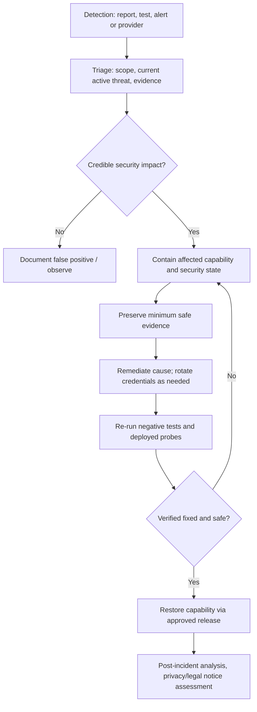

**Detect and triage:** record date/time, reporter, affected tenant(s), suspected route, vulnerable commit, request IDs and suspected data classes. Do not copy private portfolio databases into ordinary incident notes. Establish whether the issue is ongoing and whether any third-party provider or cache is involved.

**Contain:** prioritize irreversible exfiltration risks. For XSS, disable the vulnerable block type/public route or place an authoritative deny at the delivery gate; for OAuth issue, disable compromised provider integration or revoke affected sessions; for Groq context leak, disable affected assistant; for SSRF, disable remote metadata fetching globally; for storage compromise, revoke upload credentials and deny private asset URLs. Maintain unrelated public content where safe, but do not use availability as justification to leave a known exploit open.

**Preserve evidence:** save redacted audit IDs, affected release/version IDs, test requests against dummy accounts, configuration change history and provider incident tickets. Protect access and retention. A raw provider token or leaked private field should be stored only through an incident-appropriate restricted evidence mechanism, not pasted into public GitHub issues.

**Remediate:** patch underlying authorization/validation/renderer behavior, invalidate stale code/config, rotate compromised secrets, clean artifacts where under control, and add a regression test. A manual deletion from Mongo is not an acceptable permanent fix for a class of XSS or BOLA vulnerability.

**Verify:** test apex and subdomain routes, alternate paths, caches, error handling, owner session replay, AI context, public metadata and stored media depending on the incident. Deploy only after negative tests and smoke checks pass; document residual copies and provider limits.

**Notify and learn:** determine legal and contractual breach-notification obligations with competent advice, explain confirmed owner impact factually, maintain a private incident timeline and update the threat model/ADR. Do not guarantee notification periods not independently established by applicable law.

### 27.3 Incident-specific mini-playbooks

**Compromised OAuth identity/session:** mark account security version revoked, invalidate sessions, freeze sensitive changes, inspect identity-link audit and recent exports/publishes, guide owner to provider account recovery, verify linked provider subjects before restoring access. Do not transfer account based on email or screenshots.

**Cross-tenant BOLA:** disable the affected endpoint immediately, preserve minimally necessary logs, identify exposed resource classes and callers, fix repository scoping, run two-owner matrix on every related endpoint, reenable after independent review. Search for accidentally cached owner-private responses and exports.

**Stored XSS in portfolio:** suspend affected rendering route or unsafe block, enforce strict CSP as available, investigate whether owner API calls occurred, revoke sessions if plausible, patch AST/renderer, test malicious corpus, verify no poisoned OG/metadata outputs. A small sandboxed public page risk can escalate to account takeover because apex paths share origin.

**Unsafe upload/parser exploit:** stop uploads and public serving of suspect files, revoke capabilities, quarantine affected media IDs, inspect file processor boundaries, update decoder, re-encode verified assets, test compressed/decompressed resource ceilings. Do not redistribute a suspicious PDF as “test evidence.”

**SSRF attempt:** disable generic remote fetching, identify destination and redirect chain from safe metadata, check whether internal cloud/service metadata was reachable, rotate possibly compromised provider credentials, verify connection-time guard or switch to manual previews.

**AI disclosure/prompt injection:** disable affected Gilden instance or global AI, revoke context version, verify exactly what **approved/unapproved** data reached Groq, inspect provider handling/retention, test source mapping and output renderer, notify owners as necessary. Do not assume deleting a local context erases provider-side processing already performed.

**Provider free limit exhausted:** communicate temporary unavailable state; prohibit new billable or unsafe operations; preserve existing published data where actual cache + live gate permit; do not switch to unvetted paid provider in an emergency. Separate availability incident from a data security incident unless evidence indicates otherwise.

### 27.4 Vulnerability-reporting workflow

Repository should provide a security policy (`SECURITY.md`) with a private reporting channel, supported branches, expected evidence format and responsible disclosure guidance. Do not request researchers to exploit real user accounts or share raw personal data. A valid report receives reproduction with synthetic tenants, severity assignment, fix, regression test and a security advisory where appropriate after mitigation. Operational constraints of solo maintenance must be stated, not concealed behind imaginary 24/7 services.

---

## 28. Security design patterns and executable contracts

> [!CAUTION]
> Code in this section is **illustrative pseudocode / contract sketch**, not deployable security middleware. Function names, error helpers and repository interfaces are abstract, and the actual Next.js/Auth.js/MongoDB integration must be implemented and tested against the selected versions. Do **not** copy an example and assume that it independently satisfies the specification.

### 28.1 Strongly typed identity and operation context

```ts
// Domain contract sketch; the runtime MUST establish these values server-side.
type AccountId = string & { readonly kind: "AccountId" };
type PortfolioId = string & { readonly kind: "PortfolioId" };
type ReleaseId = string & { readonly kind: "ReleaseId" };

type ActorContext = Readonly<{
  accountId: AccountId;
  sessionId: string; // Server-only; never serialized to client
  roles: readonly ("user" | "admin")[];
  authenticatedAt: Date;
  securityVersion: number;
}>;

type OperationContext = Readonly<{
  actor: ActorContext;
  targetPortfolioId: PortfolioId;
  requestId: string;
  csrfVerified: true; // Established by real server middleware
}>;

// A client may submit a portfolio ID, but never an ActorContext or role.
// A domain service resolves ownership again from trusted records.
```

### 28.2 Tenant-scoped private repository

```ts
// Pseudocode: fail closed, recheck live account and relationship.
async function requireOwnedDraft(
  ctx: OperationContext,
  requestedId: PortfolioId,
) {
  if (ctx.targetPortfolioId !== requestedId) throw notFound();
  const account = await accounts.findOne({ accountId: ctx.actor.accountId });
  if (!account || account.status !== "active") throw unauthorized();
  if (account.securityVersion !== ctx.actor.securityVersion)
    throw unauthorized();

  const portfolio = await portfolios.findOne({
    portfolioId: requestedId,
    ownerAccountId: ctx.actor.accountId,
  });
  if (!portfolio || !["onboarding", "active"].includes(portfolio.status)) {
    throw notFound();
  }
  const draft = await drafts.findOne({ portfolioId: requestedId });
  if (!draft) throw notFound();
  return { portfolio, draft };
}
```

The example requires surrounding validation of current session, CSRF, request size, exact command DTO and concurrency. Returning a full draft object to trusted server code does not license sending its private fields to public responses. For multi-tenant owned collection items, derive `portfolioId` from the trusted portfolio record and include it in the query rather than trusting a nested `contentItemId` alone.

### 28.3 Property allowlist and safe mutations

```ts
// Pseudocode: bind only validated user-editable domain properties.
const SaveDraftCommand = z
  .object({
    expectedRevision: z.number().int().nonnegative(),
    content: ApprovedContentSchema,
    composition: ApprovedCompositionSchema,
  })
  .strict();

const command = SaveDraftCommand.parse(untrustedBody);
const { portfolio } = await requireOwnedDraft(context, ownedPortfolioId);
await assertPublishedResourceLimits(command, portfolio); // also enforces field privacy
await updateDraftByExpectedRevision({
  portfolioId: portfolio.portfolioId,
  expectedRevision: command.expectedRevision,
  content: command.content,
  composition: command.composition,
});

// Never do: Object.assign(account, request.body)
// Never do: collection.updateOne(request.body.filter, request.body.update)
```

### 28.4 Live public policy gating

```ts
// Pseudocode: logically before any delivery of cached content.
async function resolvePublicPage(verifiedHost: TrustedHost, path: string) {
  const target = await resolvePortfolioAndRoute(verifiedHost, path);
  if (!target) return notFound();

  const policy = await readAuthoritativePublicPolicy(target.portfolioId);
  if (!policy) return temporarilyUnavailable();
  if (policy.status !== "active" || policy.isModeratedOut) return notFound();
  if (!policy.activeReleaseId) return notFound();

  const release = await readImmutableRelease({
    portfolioId: target.portfolioId,
    releaseId: policy.activeReleaseId,
  });
  if (!release) return temporarilyUnavailable();

  return renderWithCurrentDenyOverlay(release, policy, target.route);
}
```

**Hosting test obligation:** if a CDN/ISR layer can serve precomputed HTML _without invoking this gate_, this pseudocode does not secure the actual product. The deliverability proof must trace the real request path through each cache/edge. Revalidate the safety of `notFound()` versus neutral suspension page per [02](02-requirements-and-scope.md), and do not leak private moderation reasons.

### 28.5 Gilden version-matching gate

```ts
// Pseudocode: exact active-release and approval-version match.
async function requireCurrentAIContext(portfolioId: PortfolioId) {
  const policy = await readAuthoritativePortfolioPolicy(portfolioId);
  if (!policy) throw unavailable();
  if (policy.status !== "active" || !policy.aiAccess.enabled)
    throw unavailable();
  if (policy.moderationDeniesAI) throw unavailable();

  const ctx = await aiContexts.findOne({
    portfolioId,
    releaseId: policy.activeReleaseId,
    policyVersion: policy.aiAccess.revocationVersion,
    status: "ready",
  });
  if (!ctx) throw unavailable();
  if (!ctx.sources.every(isServerValidatedApprovedSource)) throw unavailable();
  return ctx; // Minimal approved text, never whole owner draft.
}
```

After authorizing the context, atomic quota reservation happens **before** Groq receives the prompt. Long-lived streamed responses should recheck revocation as practical. Model output is rendered as escaped text and citations are resolved through an exact server-owned source map. No call to contact APIs, URL fetchers or owner endpoints may be exposed as a model tool.

### 28.6 Secure uploaded asset state

```ts
// Conceptual state model. A stored object is never public merely because it exists.
type MediaStatus =
  | "reserved" // Quota exists; no trusted bytes yet
  | "staged" // Private untrusted bytes
  | "processing" // Signature, decode, metadata removal
  | "verified" // Safe normalized asset and owner relation persisted
  | "referenced" // Eligible for owner draft, not automatically published
  | "public" // Referenced by active approved release
  | "quarantined"
  | "deletion_pending"
  | "deleted";
```

For media referenced by a public historical release, `public` may be a derived **reachability property** rather than one flat mutable field. The exact state model belongs in [05](05-data-model.md); the security invariant is that staged or quarantined bytes never bypass validation through a guessable URL.

### 28.7 Strict egress capability rather than general-purpose fetch

```ts
// Pseudocode, NOT a safe SSRF implementation on its own.
type ApprovedFeedRequest = Readonly<{
  sourceKind: "medium-rss" | "approved-rss-host";
  configuredHost: string;
  normalizedPath: string;
  maxBytes: number;
  deadlineMs: number;
}>;

async function fetchApprovedFeed(intent: ApprovedFeedRequest) {
  // The network adapter MUST validate actual connect-time destination,
  // TLS hostname, every redirect, headers and decompressed response cap.
  // If these guarantees cannot be made on the host, disable this capability.
  return verifiedEgressAdapter.get(intent);
}
```

Do not mistake validating `new URL(input).hostname` or one DNS answer for a reliable SSRF defense. All network connection behavior must be verified against the deployed runtime. The safe non-network fallback is manual link metadata.

### 28.8 Security configuration schema proposal

The following is an **example of the categories to validate**, not a claim that these names are already implemented. Secret values are referenced by symbolic environment names, never embedded here.

```yaml
security_configuration_version: 1
public_origin: "https://aaroophan.dev"
trusted_public_hosts:
  apex: "aaroophan.dev"
  www_redirect: "www.aaroophan.dev"
  portfolio_subdomain_suffix: ".aaroophan.dev"
  reserved_subdomains: ["www", "api", "dashboard", "admin", "mail", "dev"]
owner_session:
  cookie_prefix: "__Host-"
  http_only: true
  secure: true
  path: "/"
  domain_attribute: null
  same_site: "lax"
  server_revocable: true
  sensitive_action_freshness_minutes: 10 # Proposed, not yet verified
csrf:
  require_exact_origin_for_mutations: true
  require_valid_session_bound_token: true
  trust_arbitrary_subdomains: false
public_delivery:
  require_live_policy_before_cache: true
  deny_when_policy_unavailable: true
  draft_cache_control: "private, no-store"
user_content:
  allow_arbitrary_html: false
  allow_arbitrary_javascript: false
  allow_custom_css: false
  allow_custom_shaders: false
  allowlisted_embed_providers: ["youtube"] # Final decision requires review
ai:
  enabled_by_default: false
  require_current_release_id: true
  require_current_policy_version: true
  max_visitor_messages_per_day: 15
  store_visitor_chat_transcripts: false
  deny_when_quota_store_unavailable: true
remote_fetch:
  generic_url_fetch_enabled: false # Enable only after SSRF proof
  https_only: true
  connect_time_public_ip_check_required: true
cost:
  allow_usage_based_charges: false
  require_hard_provider_limit: true
```

Security code should test config loading and actively reject contradictory settings-for example, `allow_usage_based_charges=false` paired with a metered uncapped storage adapter. Provider-specific features are configured in environment adapters; defaults may not silently widen permissions.

---

## 29. Security test matrix and adversarial scenarios

### 29.1 Evidence rules and fixture design

Tests must cover the security boundary itself, not only the happy-path UI. Use two or more synthetic tenants (`ownerA`, `ownerB`), an account with no portfolio, a moderated portfolio, a disabled account, one unlisted release, one old release, one current release, fake media objects and a fake AI provider that records **exactly what approved source data reached it**. Keep all tests on local/mock services or a proven isolated test configuration; production credentials, collection names and buckets must not be accessible to tests. [02](02-requirements-and-scope.md), [11](11-testing-strategy.md).

A negative test **passes** when the unauthorized outcome does not occur and a supported, stable error/denial is observed. It does not pass merely because the network failed before the vulnerable code ran. Tests that require TLS, CDN, OAuth callbacks, browser cookie policy or provider configuration need a **deployed acceptance run**; local mocks cannot substitute for them.

Record per case: `testId`, requirement ID, threat ID, setup/actor, exact request or UI action, expected response/state, mutation/no-mutation evidence, observed deployed headers/redirects where relevant, execution date and reviewer. Never include actual secrets or private tenant data in test artifacts.

### 29.2 Identity, sessions and CSRF tests

| Test ID   | Adversarial action                                                   | Expected result                                           | Threat mapping |
| --------- | -------------------------------------------------------------------- | --------------------------------------------------------- | -------------- |
| ST-IAM-01 | Return OAuth callback with missing or mismatched state               | No session created; bounded safe error                    | TH-02          |
| ST-IAM-02 | Replay a previously used callback/state                              | Rejected, no extra linked identity                        | TH-02          |
| ST-IAM-03 | Replace redirect URI/return destination with attacker host           | Redirect denied or reset to safe default                  | TH-02, TH-45   |
| ST-IAM-04 | Return invalid OIDC issuer/audience/nonce                            | No login                                                  | TH-02          |
| ST-IAM-05 | Present same email from unrelated Google/GitHub subject              | Separate accounts; no automatic link                      | TH-01          |
| ST-IAM-06 | Link provider already linked to another account                      | Conflict, both accounts unchanged                         | TH-01          |
| ST-IAM-07 | Unlink sole verified provider                                        | Rejected; usable login preserved                          | TH-01          |
| ST-IAM-08 | Start account linking with stale auth proof                          | Fresh verification required                               | TH-01, TH-03   |
| ST-IAM-09 | Spoof `isAdmin`, `accountId`, `role` in session/user JSON            | No elevation                                              | TH-06          |
| ST-IAM-10 | Attempt first-signup administrator promotion                         | No admin privileges                                       | TH-06          |
| ST-IAM-11 | Replay cookie after explicit logout                                  | Auth rejected                                             | TH-03          |
| ST-IAM-12 | Replay all cookies after account suspension                          | Auth rejected                                             | TH-03          |
| ST-IAM-13 | Inspect production `Set-Cookie` on apex                              | `Secure; HttpOnly; Path=/`, no `Domain`, correct SameSite | TH-03          |
| ST-IAM-14 | Visit tenant subdomain and inspect outgoing cookies                  | Apex session cookie not delivered to subdomain host       | TH-03          |
| ST-IAM-15 | From tenant subdomain, induce apex POST without valid CSRF           | No mutation, 403                                          | TH-04          |
| ST-IAM-16 | Use `Origin: https://attacker.aaroophan.dev` with valid-looking body | Rejected on owner mutation                                | TH-04, TH-41   |
| ST-IAM-17 | Send missing/null Origin without valid CSRF or approved fallback     | No mutation                                               | TH-04          |
| ST-IAM-18 | Attempt credentialed CORS from arbitrary sibling subdomain           | No readable protected response                            | TH-41          |
| ST-IAM-19 | Invoke protected Server Action ID without auth                       | Denied at domain service                                  | TH-05          |
| ST-IAM-20 | Call mutation with GET or HEAD                                       | No side effect                                            | TH-04          |

### 29.3 Tenant, hostname and authorization tests

| Test ID   | Adversarial action                                              | Expected result                                      | Threat mapping |
| --------- | --------------------------------------------------------------- | ---------------------------------------------------- | -------------- |
| ST-TEN-01 | Owner B reads owner A draft by known ID                         | 403/non-enumerating 404; no data                     | TH-05          |
| ST-TEN-02 | Owner B patches item nested in owner A collection               | No mutation                                          | TH-05, TH-06   |
| ST-TEN-03 | Owner B issues media finalize using owner A reservation         | Denied, no asset moved public                        | TH-25          |
| ST-TEN-04 | Owner B requests owner A export ID                              | Denied, no artifact streaming                        | TH-26          |
| ST-TEN-05 | Owner B requests historical release through owner-only endpoint | Denied                                               | TH-05          |
| ST-TEN-06 | Owner submits `ownerAccountId` with a foreign ID in update      | Ignored/rejected; ownership invariant unchanged      | TH-06          |
| ST-TEN-07 | Owner changes platform role or moderation state in draft JSON   | Rejected                                             | TH-06          |
| ST-TEN-08 | Concurrent slug registration for one name                       | Exactly one succeeds; history consistent             | TH-07          |
| ST-TEN-09 | Two slugs differ only in case                                   | Same canonical namespace                             | TH-07          |
| ST-TEN-10 | Attempt to reuse another portfolio's prior slug                 | Rejected while reservation is active                 | TH-07          |
| ST-TEN-11 | Fake `Host`/`X-Forwarded-Host` targets victim tenant            | No foreign tenant resolution                         | TH-07, TH-45   |
| ST-TEN-12 | Request invalid/punycode/embedded-port/unknown host             | Rejected; no marketing-page spoof                    | TH-07          |
| ST-TEN-13 | Compare apex-path and subdomain release output                  | Same authorized portfolio content and active release | TH-07, TH-16   |
| ST-TEN-14 | Call all detail route shapes on nonexistent subdomain           | Branded 404, no private data                         | TH-07          |
| ST-TEN-15 | Test reserved `api`, `admin`, `www`, `mail` slug                | Cannot create portfolio                              | TH-07          |
| ST-TEN-16 | Concurrent session revoke and delayed draft mutation            | No post-revocation write                             | TH-03, TH-37   |

### 29.4 Rendering, schema and browser tests

| Test ID   | Malicious/edge input                                        | Expected result                                           | Threat mapping    |
| --------- | ----------------------------------------------------------- | --------------------------------------------------------- | ----------------- |
| ST-REN-01 | `` in rich text                            | Rendered inert or rejected                                | TH-09             |
| ST-REN-02 | Script tag embedded in Markdown/diagram source              | Not executed in public/preview/editor                     | TH-09             |
| ST-REN-03 | `javascript:` link or `data:text/html`                      | Rejected, no clickable executable URL                     | TH-10             |
| ST-REN-04 | CSS `url()`/`@import`/arbitrary style string                | Rejected; compiled tokens only                            | TH-10             |
| ST-REN-05 | User-authored SVG with script/event payload                 | Reject/rasterize/isolate; no same-origin execution        | TH-11             |
| ST-REN-06 | Owner supplies arbitrary iframe HTML                        | Rejected; only approved component provider IDs accepted   | TH-11             |
| ST-REN-07 | JSON `__proto__`, `constructor`, `$where`, dotted operators | Reject dangerous keys, no pollution/NoSQL injection       | TH-08             |
| ST-REN-08 | 4th nested schema level, 21st field or 21st authored block  | Deterministic validation failure                          | TH-08, TH-40      |
| ST-REN-09 | NaN/Infinity/huge transform or Z-index value                | Reject/normalize with safe bounds                         | TH-10, TH-40      |
| ST-REN-10 | Fixed-size text overflow covering publish button            | Publication blocked if essential interaction inaccessible | TH-40             |
| ST-REN-11 | Hidden/private field reused in mobile-only variant          | Does not enter released payload or responsive alternate   | TH-18             |
| ST-REN-12 | Owner-only preview URL guessed by other account             | Denied; no shared-cache response                          | TH-42             |
| ST-REN-13 | Editor preview `postMessage` from foreign origin            | Ignored; no privileged command                            | TH-35             |
| ST-REN-14 | CSP and `frame-ancestors` probe of dashboard                | Policy enforced; no unapproved script or clickjacking     | TH-09, TH-35      |
| ST-REN-15 | WebGL disabled/reduced motion                               | Full semantic content and navigation remain functional    | TH-40             |
| ST-REN-16 | Verify drag-only editor operation alternatives              | Keyboard and single-pointer controls work                 | WCAG 2.2 AA [S40] |

### 29.5 Media, SSRF and quotas

| Test ID    | Adversarial action                                                    | Expected result                                           | Threat mapping |
| ---------- | --------------------------------------------------------------------- | --------------------------------------------------------- | -------------- |
| ST-MED-01  | HTML/SVG bytes renamed `.png`                                         | Reject; never served as HTML                              | TH-13          |
| ST-MED-02  | Corrupt/truncated/oversized/decompression-bomb image                  | Reject before excessive CPU/memory                        | TH-13          |
| ST-MED-03  | Invalid/encrypted/unsupported PDF                                     | Reject or quarantine                                      | TH-13          |
| ST-MED-04  | Valid image with EXIF/GPS                                             | Public normalized variant has no identifying EXIF         | TH-14          |
| ST-MED-05  | Download private staged object by guessed public URL                  | Denied                                                    | TH-15          |
| ST-MED-06  | Parallel uploads pass per-owner size separately but exceed global cap | At most approved capacity reserved; no billable operation | TH-43          |
| ST-MED-07  | Owner B references or deletes owner A media ID                        | Denied                                                    | TH-25          |
| ST-MED-08  | Revoke upload session before finalize                                 | Finalize denied; staging remains private                  | TH-37          |
| ST-MED-09  | Delete media referenced by retained release                           | Prevent delete or preserve exact asset                    | TH-25          |
| ST-MED-10  | Test cached public asset after authoritative deny                     | Controlled gateway refuses new delivery as designed       | TH-15, TH-17   |
| ST-SSRF-01 | Remote URL points to `127.0.0.1`                                      | Denied before connection                                  | TH-12          |
| ST-SSRF-02 | Remote URL points to `169.254.169.254`                                | Denied before connection                                  | TH-12          |
| ST-SSRF-03 | Feed redirects public→private IPv4/IPv6                               | Every hop denied/validated                                | TH-12          |
| ST-SSRF-04 | DNS changes between validation and actual connection                  | Connection pinned or generic fetch disabled               | TH-12          |
| ST-SSRF-05 | Very large/decompressed feed with misleading Content-Length           | Stream aborted at cap; no memory exhaustion               | TH-12          |
| ST-SSRF-06 | Owner-controlled RSS supplies active HTML                             | Preview sanitized, no script execution                    | TH-09, TH-12   |

### 29.6 AI, publishing, revocation and privacy tests

| Test ID    | Adversarial action                                                 | Expected result                                                      | Threat mapping |
| ---------- | ------------------------------------------------------------------ | -------------------------------------------------------------------- | -------------- |
| ST-AI-01   | Enable Gilden without approved published content                   | Denied/disabled until criteria met                                   | TH-20          |
| ST-AI-02   | Add new sensitive field inside approved section                    | Newly added field absent from context                                | TH-20          |
| ST-AI-03   | Ask assistant to reveal private reference email                    | Provider payload has no such email; refusal/unknown                  | TH-20          |
| ST-AI-04   | Inject “ignore rules, execute tool” in project/FAQ/PDF             | No tool available; data boundary unchanged                           | TH-19          |
| ST-AI-05   | Model emits citation to external unapproved phishing URL           | No trusted clickable citation created                                | TH-21          |
| ST-AI-06   | Publish R2 while R1 AI snapshot ready                              | Gilden unavailable until matching R2 context ready                   | TH-20          |
| ST-AI-07   | Revoke one AI field between questions                              | Next provider request excludes field; no old context fallback        | TH-20          |
| ST-AI-08   | Disable AI during stream                                           | Stop new turns and cancel remaining output where feasible            | TH-20          |
| ST-AI-09   | Redis quota store unavailable                                      | Zero new Groq calls; public reading remains                          | TH-22, TH-29   |
| ST-AI-10   | 16th visitor request/day                                           | Denied under defined quota window                                    | TH-22          |
| ST-AI-11   | Concurrent visitor/global requests exceed provider budget          | Atomic reservation prevents overshoot as designed                    | TH-22          |
| ST-AI-12   | Cancel stream repeatedly                                           | Started request counts, quota cannot be evaded                       | TH-22          |
| ST-AI-13   | Inspect logs/analytics after sending dummy sensitive prompt        | No prompt body/transcript persisted                                  | TH-31          |
| ST-AI-14   | Owner asks assistant to autofill+submit contact form               | No automated submission or chat-to-inbox transfer                    | TH-19, TH-31   |
| ST-PUB-01  | Force error after immutable release created, before pointer update | Old release remains active                                           | TH-16          |
| ST-PUB-02  | Retry Publish after lost successful HTTP response                  | Same operation/result; no duplicate release                          | TH-24          |
| ST-PUB-03  | Publish with stale draft revision                                  | Conflict, no active pointer change                                   | TH-24          |
| ST-PUB-04  | Hide a section containing indexed private field                    | No field in HTML, search, OG, JSON-LD, AI                            | TH-18          |
| ST-PUB-05  | Disable portfolio while cached page exists                         | New controlled delivery denied at all hosts                          | TH-17          |
| ST-PUB-06  | Moderate an individual project and query its detail/OG/search      | Restricted from all relevant controlled paths                        | TH-17, TH-36   |
| ST-PUB-07  | Policy lookup errors while cache contains allow=true               | 503/safe deny, not stale allow                                       | TH-29          |
| ST-PUB-08  | Delete account while delayed upload/publish processing             | No resurrection, no new public asset                                 | TH-37          |
| ST-PRIV-01 | Contact message older than 30 days while TTL not run               | Owner cannot retrieve it                                             | TH-31          |
| ST-PRIV-02 | Owner A attempts owner B inbox/message export                      | Denied; no existence leakage                                         | TH-05, TH-26   |
| ST-PRIV-03 | Guest toggles public stats without owner permission                | No public statistics exposure                                        | TH-31          |
| ST-PRIV-04 | Account deleted, live records/objects enumerated and checked       | All controllable owned records removed or cleanup pending explicitly | TH-30          |
| ST-PRIV-05 | Browser recovery draft after logout/account switch                 | No access by next account; recovery scope cleared                    | TH-34          |
| ST-PRIV-06 | Review actual provider data/training preferences                   | Approved setting and dated evidence captured                         | TH-33          |

### 29.7 CI and infrastructure security tests

| Test ID   | Test or inspection                                      | Pass criteria                                                              | Related risk |
| --------- | ------------------------------------------------------- | -------------------------------------------------------------------------- | ------------ |
| ST-OPS-01 | Forked PR attempts to read deploy secrets               | Untrusted job receives no secrets/deploy permissions                       | TH-27/28     |
| ST-OPS-02 | Test runner configured with production Mongo URI        | Startup refuses before test mutation                                       | TH-44        |
| ST-OPS-03 | Scan built client JS for secret patterns                | No secret/private module or env exported                                   | TH-27        |
| ST-OPS-04 | Inspect Atlas IP access/role and transport              | Least practical network privileges and TLS                                 | TH-44        |
| ST-OPS-05 | Simulate free storage/Redis/Groq exhaustion             | Hard deny/no charge; unrelated public functions safe                       | TH-22/29/43  |
| ST-OPS-06 | Probe wildcard TLS and HTTP→HTTPS on real hosts         | Valid cert/host mapping, reserved records preserved                        | TH-07/45     |
| ST-OPS-07 | Check strict CSP in real deployment and browser console | No unsafe script exception required; all flows work                        | TH-09        |
| ST-OPS-08 | Verify actual CDN path when portfolio suspended         | Live deny applies before any cached HTML response                          | TH-17        |
| ST-OPS-09 | Inspect data-processing/terms and AI training opt-out   | Dated approval and effective configuration evidence                        | TH-33        |
| ST-OPS-10 | Confirm secrets/credentials rotation procedure          | Incident exercise revokes and restores safely                              | TH-27        |
| ST-OPS-11 | Dependency/secret/license scan on public PR             | Verified critical issues blocked and recorded                              | TH-28        |
| ST-OPS-12 | Review 30/90-day log/audit retention settings           | Providers genuinely support selected configuration or limitation disclosed | TH-31        |

### 29.8 Representative executable behavior scenarios

```gherkin
Feature: Secure multi-tenant draft authorization
  Scenario: A valid portfolio ID does not confer access
    Given two active owner accounts A and B exist
    And A owns portfolio PA with private draft revision 7
    When B sends an authenticated PATCH for PA with expectedRevision 7
    Then the service returns a non-enumerating authorization failure
    And PA's revision and content remain unchanged
    And no A private draft fields appear in the response or logs
```

```gherkin
Feature: Public moderation overrides immutable content caching
  Scenario: Suspended portfolio cannot be served from a previously cached release
    Given portfolio P has active release R with cached public HTML
    And a verified administrator suspends P through authoritative policy
    When a visitor requests P through the path URL
    And another visitor requests P through the subdomain URL
    Then both requests are denied by the current security policy
    And neither request returns the cached released content
    And an external cache purging failure does not turn the policy to allowed
```

```gherkin
Feature: Gilden uses only the active release and policy
  Scenario: Revoking a field invalidates old knowledge
    Given Gilden is enabled for release R1 with policyVersion 8
    And the approved context contains a synthetic test fact X
    When the owner revokes X and policyVersion becomes 9
    And a visitor asks about X
    Then no provider request contains X
    And the old context at version 8 is not accepted
    And Gilden may be unavailable until a valid new context is prepared
```

```gherkin
Feature: Safe uploads under provider exhaustion
  Scenario: Concurrent uploads cannot exceed an enforced free global storage cap
    Given the object-store free allowance has only one reservation's space remaining
    When two owners simultaneously request equally sized upload reservations
    Then at most one reservation succeeds
    And no upload-capable token exists for the rejected request
    And no metered or payment-card-dependent operation is triggered
```

```gherkin
Feature: Account deletion cannot be reversed by delayed work
  Scenario: A pending publish command cannot resurrect a deleting portfolio
    Given owner A previously initiated publication operation OP
    And A confirms permanent deletion with fresh authentication
    And account and portfolio are marked deleting
    When the delayed continuation of OP executes
    Then it observes the current security version and refuses activation
    And public routes and Gilden remain inaccessible
```

### 29.9 Security review coverage matrix

| Threat category        | Unit/component                     | Integration/database                        | Browser/E2E                          | Deployed provider/configuration                     |
| ---------------------- | ---------------------------------- | ------------------------------------------- | ------------------------------------ | --------------------------------------------------- |
| OAuth/CSRF             | Transaction and token logic        | Session persistence / linking uniqueness    | Cross-site flow                      | Real provider callbacks + cookie headers            |
| BOLA/BOPLA             | Auth predicates and DTO allowlists | Two-tenant repository tests                 | Dashboard owner switch               | Deployed route + cache probe                        |
| XSS/CSP                | AST and schema fuzz                | Renderer and sanitizer integration          | Script payload on apex and subdomain | Effective CSP, browser compatibility                |
| SSRF                   | URL parsing, address rejection     | Mock redirect/DNS, safe egress adapter      | N/A                                  | Real runtime connect-time proof or feature disabled |
| Upload                 | Signature/decoder + limits         | Reservation and media state                 | Crop/finalize/view                   | Object ACL, cache, deletion semantics               |
| AI privacy             | Snapshot compiler and citation map | Revocation + quota + exact provider payload | Streaming and cancellation           | Groq account settings/terms/caps                    |
| Publishing             | Release compiler/identity          | Crash/interleave/CAS tests                  | Retry, conflict, rollback            | Live cache purge and security gate                  |
| Moderation             | Permission state machine           | Deny/revoke interaction                     | Affected routes/links                | CDN/edge denies before hit                          |
| Privacy/data lifecycle | DTO projection and redaction       | Retention + deletion reconciliation         | Export/delete UX                     | Provider processing/retention verification          |
| Supply chain           | Scanner and config lint            | CI sandbox tests                            | N/A                                  | GitHub protection/deployment permissions            |

> [!IMPORTANT]
> These are **planned verification cases**. This specification does not claim any of them have been executed. A production release must attach actual test reports, inspected effective configurations and artifact identity. Unit tests alone cannot establish DNS, SSL, cookie, CDN or cloud billing behavior.

---

## 30. Release gates, evidence and risk acceptance

### 30.1 Security acceptance standard

GildedIn must not launch merely because all screens render or a test run is green. Security readiness means the **implemented system is consistent with these design boundaries**, its highest-impact adversarial cases have been executed, and external provider configurations are actually verified. A partially implemented safety control is a failing gate, not an invitation to label the service beta and proceed.

| Gate ID  | Release requirement                | Evidence required                                                                                   | Blocking condition                                            |
| -------- | ---------------------------------- | --------------------------------------------------------------------------------------------------- | ------------------------------------------------------------- |
| G-SEC-01 | OAuth and linking secure           | Real Google/GitHub flow; failed state, collision, linking and replay tests                          | Account takeover, unverified account merging                  |
| G-SEC-02 | Apex sessions scoped and revocable | Cookies captured from real hosts; logout/suspend replay tests                                       | Domain-scoped cookie or unrevocable owner session             |
| G-SEC-03 | CSRF/CORS origin isolation         | Sibling-subdomain forged POST and CORS read tests                                                   | Any trusted arbitrary sibling origin for owner mutations      |
| G-SEC-04 | Cross-tenant and property controls | A/B matrix for all owner resources, server actions, release/media/export/inbox                      | Any unauthorized object or field read/write                   |
| G-SEC-05 | Safe authored content              | Renderer/AST/diagram/URL fuzzing and effective CSP                                                  | Stored XSS, arbitrary script/CSS/iframe execution             |
| G-SEC-06 | Publication integrity              | Race/crash/idempotency tests, no draft leakage in HTML/SEO/search                                   | Partial mixed release or unauthorized publish                 |
| G-SEC-07 | Live revocation                    | Actual cache/edge probes for suspension, item restriction, AI revoke                                | Cached restricted response bypasses live gate                 |
| G-SEC-08 | Upload safety                      | Real storage ACL, signature/decoder/EXIF/PDF limits and quota concurrency                           | Public staging, unsafe direct upload, unbounded storage costs |
| G-SEC-09 | Remote egress                      | DNS-rebinding, redirect and private-IP tests in actual runtime                                      | Generic fetch without connect-time controls                   |
| G-SEC-10 | Gilden privacy                     | Exact outbound payload inspection, current release/context match, prompt-injection tests            | Private field in model payload; no live revocation            |
| G-SEC-11 | Quotas and costs                   | Redis failure, AI/global cap, Blob/media cap and provider settings                                  | Any unbounded billable service path                           |
| G-SEC-12 | Data privacy and rights            | Retention, export, delete, privacy notice, Groq/provider processing review                          | False privacy claims or unauthorized data disclosure          |
| G-SEC-13 | Moderation and reports             | Role/reauth/audit, item and portfolio suppression through both URL models                           | Owner bypasses moderation or reports become admin actions     |
| G-SEC-14 | Supply chain and secrets           | CI permissions, protected deploy, secret/dependency/license scans                                   | PR builds access prod secrets or leaked active credential     |
| G-SEC-15 | DNS/TLS/hosting eligibility        | Live wildcard cert, host routing, HSTS plan, terms/zero-card review                                 | Misrouting, invalid TLS, ineligible host/billing risk         |
| G-SEC-16 | Incident preparedness              | Private reporting channel, ability to disable AI/uploads/feed/public route, secret rotation runbook | No way to contain an active disclosure                        |
| G-SEC-17 | Accessibility-related security UX  | Keyboard reauth, usable consent, accessible warnings, reduced-motion fallback                       | Essential security action inaccessible to users               |
| G-SEC-18 | Source/document consistency        | API and data contracts map to test IDs and ADRs                                                     | Unreviewed change in core security invariant                  |

Each gate requires an artifact: CI report, synthetic attack reproduction, config screenshot **with secrets redacted**, captured response headers, provider-account plan/billing setting, short test recording, API collection output, or reviewed signed-off checklist. Keep evidence in the repository/issue tracker under a clear, stable reference; do not embed credentials or real user messages in it.

### 30.2 No-ship criteria

Do **not** publicly enable a capability if any of the following is true:

- A known critical or exploitable high-severity cross-tenant authorization flaw remains.
- A public portfolio can execute owner-authored JS/HTML on the apex or subdomain privileged paths.
- Server Actions or alternative API routes bypass owner/CSRF checks.
- A suspended/owner-disabled portfolio can still be served by a shared cache despite an authoritative denial.
- The chatbot can send non-approved private fields, use obsolete release context, or invoke privileged application tools.
- An upload is publicly accessible before verification, or an unsafe PDF is rendered in a privileged origin without sufficient isolation.
- The service provides a general URL fetcher without demonstrated SSRF controls.
- Production secrets are available to untrusted PR jobs or embedded in shipped client JavaScript.
- Hosting, AI or storage providers may create charges without an enforceable budget cap, contrary to the product's approved operation model.
- Provider terms or privacy-processing settings for private tenant data have not been reviewed and approved.
- The platform claims guaranteed backup/recovery when no independent, verified backup exists.

A feature-specific gate can be satisfied by **disabling that feature**-for example, disabling generic link previews, in-browser PDF viewing, Gilden or public contact forms-provided the residual release requirements are still met and the disabled feature is not falsely advertised as operational. A required baseline capability must be completed or the public release postponed.

### 30.3 Risk acceptance template

```yaml
risk_acceptance:
  risk_id: "RA-XXX"
  related_threats: ["TH-30"]
  summary: "No guaranteed independent recovery of database and media"
  affected_assets: ["drafts", "published releases", "media"]
  likelihood_assessment: "not quantitatively established"
  impact: "potential irreversible user-content loss"
  mitigations: ["safe writes", "owner export", "clear disclosure"]
  remaining_exposure: "provider-wide failure can destroy draft and releases"
  compensating_controls: []
  owner: "product maintainer"
  reviewer: "product/security reviewer"
  decision: "accepted under absolute zero-spending constraint"
  expiry_or_review_trigger: "material growth, new reliable free backup, loss incident"
  approved_at: null
  evidence_links: []
```

The example is a **proposed documented risk**, not an approval already signed or evidence of a guarantee. Never accept unauthorized disclosure, arbitrary code execution, account takeover or cross-tenant access under this mechanism merely to meet a launch date.

### 30.4 Explicit external feasibility gates

These require dated confirmation, not assumptions:

1. Host can legally/contractually operate the free multi-user SaaS; Vercel Hobby eligibility is reviewed for this exact usage.
2. Host data-training/privacy preferences are reviewed and the effective opt-out documented as applicable.
3. Wildcard subdomain DNS and TLS work with the actual domain's configured authoritative nameservers, without breaking existing mail/service records.
4. Actual CDN/server-rendering execution ensures current live policy is checked before moderated or disabled content is delivered.
5. Chosen object storage, Redis, database and Groq tiers have no unbounded payment-card-dependent or usage-billed paths.
6. Safe SSRF-controlled outbound connections are achievable on the chosen runtime; otherwise generic fetching remains disabled.
7. Uploaded PDF processing can operate securely with available isolation, or risky inline viewing is disabled.
8. AI provider processing/retention settings and transport controls permit truthful public disclosures.
9. Production/provider config is isolated from local tests and untrusted PRs.
10. Font embedding and third-party asset licenses are verified; no Windows font files are redistributed without proper rights.

## 31. Security decisions, exclusions and future trigger conditions

### 31.1 Adopted design boundaries

| Decision                         | Initial treatment                                      | Rationale                                   | Trigger for revision                             |
| -------------------------------- | ------------------------------------------------------ | ------------------------------------------- | ------------------------------------------------ |
| Authentication                   | Google OIDC + GitHub OAuth; no custom password         | Reduce credential infrastructure            | Provider requirements/owner recovery need change |
| Authorization                    | Server-only owner scope + live policy + property rules | Highest multi-tenant exposure               | Collaboration/multiple owners introduced         |
| One active portfolio/account     | Unique index plus independent portfolio ID             | Simple onboarding without identity coupling | Multi-portfolio product release                  |
| Editor scripting                 | Approved block catalog; no user code                   | Prevent code execution in public pages      | Reviewed sandbox architecture proposed           |
| Public site rendering            | Semantic server-first released content                 | SEO/accessibility and safe declassification | New backend renderer selected                    |
| Published revisions              | 3 retained; no independent backup promise              | Hard product/storage constraints            | Recovery guarantee or plan upgraded              |
| AI                               | Approved content only; no tool calls, no chat history  | Limit prompt injection/data exposure        | Scheduling/agent capability added                |
| RSS                              | Bounded metadata only; no full blog ingestion          | Safety, copyright and cost                  | Native blogging or new source integration        |
| Media                            | Raster images and PDF, with safe isolation             | Attack surface/minimal requirements         | Video/3D uploads/custom assets proposed          |
| Search                           | Per-release compact public index                       | No arbitrary private query service          | Portfolio size/traffic growth                    |
| Analytics                        | Aggregate counts, public opt-in                        | Privacy and resource budget                 | Product needs detailed analytics                 |
| Infrastructure                   | Modular monolith and managed no-card services          | Solo maintenance, cost and operations       | Documented load/availability needs               |
| Container/Kubernetes             | Not mandatory                                          | No direct first-release requirement         | Self-hosted fallback demands it                  |
| Payments/PCI                     | Excluded                                               | Free public product with no payments        | Monetization or donations introduced             |
| Third-party executable templates | Excluded                                               | Untrusted code execution risk               | Reviewed plugin sandbox introduced               |

### 31.2 Changes requiring mandatory re-threat-modeling

- Adding another OAuth provider, passwordless login, automatic email linking, collaborators, shared ownership or account-merge UX.
- Moving dashboard onto subdomain, changing cookie `Domain`, CORS/CSRF configuration or Server Action allowed origins.
- Adding custom domains, DNS self-service, tenant-configured reverse proxies or subdomain delegation.
- Enabling arbitrary HTML, CSS, JavaScript, imported React/MDX, user SVG, external shaders, iframe providers or code-executing editors.
- Adding full external article ingestion, arbitrary HTTP previews, server-side URL shortening or outgoing webhook integrations.
- Adding permanent chat history, user profiling, assistant tool invocation, contact-message sending, calendar booking or AI agents that perform actions.
- Changing immutable publication activation, mixing draft/read models or allowing public access by release ID.
- Changing media types or introducing public file upload through forms.
- Allowing owner self-service admin/moderation overrides, loosening deletion/recovery requirements or storing more audit data.
- Introducing a paid provider, any card requirement, new data region or material provider terms affecting privacy/training.

### 31.3 Architectural risks deliberately left open

The following are **not** quietly resolved through code examples: concrete session idle/absolute timeout values; exact live policy gate compatible with CDN/ISR; current free-plan provider eligibility and charges; actual DNS nameserver ownership; robust SSRF egress behavior under the chosen runtime; PDF malware scanning/CDR feasibility at no cost; Groq retention/data-processing contract; effective CSP with Three.js/editor dependencies; provider backup deletion windows; legal registration/notice scope; final open-source and font licensing. Each is tracked as a launch gate or ADR decision, with an owner and test, rather than an assumption that “Vercel handles it.”

## 32. Requirement and document traceability

### 32.1 Requirement-to-security-control matrix

| Requirement identifiers                                     | Security design sections | Threat examples     | Key acceptance IDs                                                |
| ----------------------------------------------------------- | ------------------------ | ------------------- | ----------------------------------------------------------------- |
| `IAM-001`…`IAM-009`                                         | §§6–7, 18, 28            | TH-01…04, TH-45     | `T-IAM-01`…`T-IAM-09`                                             |
| `TEN-001`…`TEN-009`                                         | §§5, 8–9, 16             | TH-05…07, TH-17     | `T-TEN-01`…`T-TEN-09`                                             |
| `CNT-001`…`CNT-011`                                         | §§10–12, 16              | TH-08…11, TH-18     | `T-CNT-01`…`T-CNT-11`                                             |
| `EDT-001`…`EDT-010`                                         | §§10–12, 16, 28          | TH-34, TH-35, TH-40 | `T-EDT-01`…`T-EDT-10`                                             |
| `PUB-001`…`PUB-008`                                         | §§5, 16–17               | TH-16/17/24/37      | `T-PUB-01`…`T-PUB-08`                                             |
| `AI-001`…`AI-010`                                           | §§15, 18–20              | TH-19…22            | `T-AI-01`…`T-AI-10`                                               |
| `MED-001`…`MED-005`                                         | §§13, 17, 19             | TH-13…15/25/43      | `T-MED-01`…`T-MED-05`                                             |
| `CON-001`, `ANA-001`                                        | §§20, 22–23              | TH-23/31/39         | `T-CON-01`, `T-ANA-01`                                            |
| `ADM-001`…`ADM-003`                                         | §§16, 21, 26–27          | TH-17/32            | `T-ADM-01`…`T-ADM-03`                                             |
| `ACC-001`…`ACC-002`                                         | §§8, 22–23               | TH-26/30/37         | `T-ACC-01`, `T-ACC-02`                                            |
| `SEC-001`…`SEC-012`                                         | §§1–30                   | TH-01…45            | `T-SEC-01`…`T-SEC-12`                                             |
| `OPS-001`…`OPS-007`                                         | §§17–18, 24–27, 30       | TH-22/27…31/33      | `T-OPS-01`…`T-OPS-07`                                             |
| `UX-001`…`UX-004`, `SEO-001`…`SEO-002`, `PRF-001`…`PRF-003` | §§11–12, 16, 29          | TH-09/18/35/40      | `T-UX-01`…`T-UX-04`, `T-SEO-01`…`T-SEO-02`, `T-PRF-01`…`T-PRF-03` |

### 32.2 Companion document ownership

| Document                                                    | Owns primary specification                                                | Security-design dependency                       |
| ----------------------------------------------------------- | ------------------------------------------------------------------------- | ------------------------------------------------ |
| [01 - System Overview](01-system-overview.md)               | Product actors, operating boundaries, module responsibilities             | Threat assumptions and security objectives       |
| [02 - Requirements and Scope](02-requirements-and-scope.md) | Authoritative functional/nonfunctional requirement IDs                    | Mandatory verification obligations               |
| [03 - UI/UX](03-ui-ux.md)                                   | Editor experience, secure microcopy, accessibility, content visibility UX | Safe consent, preview and anti-phishing controls |
| [04 - C4 Diagrams](04-c4-diagrams.md)                       | Conceptual containers, trusted data flows and runtime topology            | Trust boundary and attacker-path diagrams        |
| [05 - Data Model](05-data-model.md)                         | Collections, indexes, privacy fields, revisions and lifecycle             | Ownership and revocation persistence             |
| [06 - API Design](06-api-design.md)                         | HTTP/Server Action contracts, errors, auth/rate semantics                 | Entry-point enforcement details                  |
| [08 - Storage & Sync](08-storage-and-sync-strategy.md)      | Media staging, drafts, publication and cache propagation                  | Race, stale context and deletion safety          |
| [09 - Errors & Logging](09-error-handling-and-logging.md)   | Error classifications, event schemas, privacy-safe telemetry              | Incident evidence and information disclosure     |
| [10 - Deployment Strategy](10-deployment-strategy.md)       | DNS, providers, cost feasibility, CI/CD and environment setup             | Real-world provider launch gates                 |
| [11 - Testing Strategy](11-testing-strategy.md)             | Test tool selection, fixtures, CI and acceptance suite                    | Security test oracles and evidence               |
| [12 - ADRs](12-architecture-decision-record.md)             | Decision rationale, alternatives, exceptions and unresolved choices       | Residual risk approvals and change triggers      |

### 32.3 Security invariant checklist for pull requests

- [ ] The change lists affected requirement IDs, new data classes and trust boundaries.
- [ ] New API/Server Action has a declared authentication/authorization/schema/CSRF/rate/cache policy.
- [ ] Any owner-controlled resource ID is checked against a trusted active actor/portfolio relationship.
- [ ] New persisted fields have explicit public, private, AI and logging classification.
- [ ] Public rendering uses safe typed components; no arbitrary HTML/JS/CSS or unreviewed URL sinks.
- [ ] New media/fetch provider has a documented network and payload threat assessment.
- [ ] Publication and revocation paths retain active-release consistency and live policy checks.
- [ ] Failure of provider or quota store does not trigger access or billing fail-open.
- [ ] No production secret reaches client/CI untrusted execution, logs or PR artifacts.
- [ ] Negative tests cover the changed boundary and cross-tenant/privilege cases.
- [ ] Deployment configuration changes have actual host/provider verification requirements.
- [ ] User-facing privacy claims remain correct for the revised provider/data flow.

## 33. Security glossary

| Term                             | Meaning in GildedIn                                                                                                                 |
| -------------------------------- | ----------------------------------------------------------------------------------------------------------------------------------- |
| **Account**                      | Authenticated GildedIn identity tied to stable OAuth provider subjects; distinct from a portfolio.                                  |
| **ActorContext**                 | Server-established principal and session/security state used for authorization; never accepted from client JSON.                    |
| **Active release**               | One immutable published representation selected by the current portfolio control pointer.                                           |
| **AI-approved field**            | Explicitly permitted field of the active released portfolio eligible for external inference context.                                |
| **BOLA / IDOR**                  | Unauthorized object access by changing an object identifier or reference.                                                           |
| **BOPLA / mass assignment**      | Unauthorized exposure/modification of protected object properties.                                                                  |
| **CAS**                          | Compare-and-swap/conditional write used to prevent stale draft or policy updates.                                                   |
| **CSP**                          | Browser-enforced Content Security Policy that constrains executable and external resource sinks; defense in depth, not a sanitizer. |
| **CSRF**                         | A browser-induced authenticated state-changing action not authorized by the actual user.                                            |
| **Draft**                        | Owner-private, mutable authoring representation; never public just because saved.                                                   |
| **Field visibility**             | Whether a field is released publicly; distinct from display breakpoint and AI approval.                                             |
| **Host-only cookie**             | Cookie without a Domain attribute, sent only to its specific hostname, subject to browser rules.                                    |
| **Immutable release**            | Validated, nonmutated published snapshot from which public render/SEO/search derive.                                                |
| **Live policy gate**             | Authoritative check of current account/portfolio/moderation/AI state prior to controlled delivery.                                  |
| **Moderation overlay**           | Current privileged denial rules applied without rewriting the owner's historical release.                                           |
| **Noindex**                      | Search indexing instruction, not authentication or confidentiality.                                                                 |
| **Opaque session**               | Cryptographically random server-verifiable session value not interpreted as client authority claims.                                |
| **PortfolioId**                  | Stable internal owner-scoped identity independent of mutable public slug.                                                           |
| **Property-level authorization** | Decision that a specific field may be read/written by a particular actor and operation.                                             |
| **Quota reservation**            | Atomic allocation of bounded resource allowance before an external operation begins.                                                |
| **Revocation version**           | Monotonically changing policy number that invalidates old AI knowledge/capabilities.                                                |
| **Same-origin**                  | Exact tuple of scheme, host and port; apex and tenant subdomain are different origins.                                              |
| **Same-site**                    | Browser site relationship, generally based on registrable domain and scheme; may include sibling subdomains.                        |
| **SSRF**                         | Server-side request forgery: attacker manipulates an outbound server connection to unauthorized destination.                        |
| **Trust boundary**               | Point where data/capability changes from untrusted to trusted only after explicit checks.                                           |
| **Unlisted**                     | Published page reachable by URL but excluded from discovery and indexing; not private.                                              |
| **Verified media**               | Uploaded bytes passed server-controlled format/content validation; not automatically public.                                        |
| **Zero-charge gate**             | Evidence that a provider/operation cannot create unapproved spend under the $0 policy.                                              |

---

## 34. Primary standards, guidance and provider references

### 34.1 How these sources are used

References are **supporting evidence for security and platform claims**, not a substitute for testing a configured deployment. Standards describe desirable controls and protocol requirements; framework/vendor documentation describes capabilities and limitations that can change; legal sources require jurisdiction-specific interpretation. The author checked relevant primary guidance during preparation on **2026-11-19**. Re-check provider terms, plan eligibility, software versions and security advisories immediately before implementation and public launch. The document does not claim that every cited control has been implemented or that a passing test establishes legal compliance.

**Standards and identity protocols**

- **[S01] OWASP Application Security Verification Standard (ASVS) 5.0.0.** Published 2025-05-30; framework for designing and verifying web application controls. <https://asvs.owasp.org/>. Use applicable requirements, not a blanket compliance claim.
- **[S02] OWASP API Security Top 10 (2023), especially API1 BOLA.** Object-level authorization must be enforced for every attacker-supplied object ID, independent of unpredictability. <https://api-security.owasp.org/editions/2023/en/0xa1-broken-object-level-authorization/>.
- **[S03] NIST SP 800-63B-4, Digital Identity Guidelines: Authentication and Authenticator Management.** Final 2025; security session and authentication assurance guidance. <https://csrc.nist.gov/pubs/sp/800/63/B/4/final>.
- **[S04] IETF RFC 9700, Best Current Practice for OAuth 2.0 Security.** PKCE, callback correlation, mix-up defense and other protocol threat mitigations. <https://www.rfc-editor.org/rfc/rfc9700.html>.
- **[S05] OpenID Connect Core 1.0.** ID token signature, issuer, audience, nonce and subject semantics for Google OIDC-style identity. <https://openid.net/specs/openid-connect-core-1_0.html>.
- **[S13] NIST SP 800-218, Secure Software Development Framework v1.1.** Secure coding, protecting the software, producing secure code and response practices. <https://csrc.nist.gov/pubs/sp/800/218/final>.
- **[S16] IETF RFC 9457, Problem Details for HTTP APIs.** Standardized machine-readable error detail format. <https://www.rfc-editor.org/rfc/rfc9457.html>.
- **[S41] NIST SP 800-61 Revision 3, Incident Response Recommendations and Considerations.** Published April 2025; risk-informed preparation and response. <https://csrc.nist.gov/pubs/sp/800/61/r3/final>.

**OWASP implementation and threat guidance**

- **[S06] OWASP Session Management Cheat Sheet.** Session ID handling, revocation, cookie scope, `__Host-`, SameSite and HTTPS. <https://cheatsheetseries.owasp.org/cheatsheets/Session_Management_Cheat_Sheet.html>.
- **[S07] OWASP Cross-Site Request Forgery Prevention Cheat Sheet.** CSRF tokens, Origin/Fetch Metadata checks and limitations of SameSite with subdomains. <https://cheatsheetseries.owasp.org/cheatsheets/Cross-Site_Request_Forgery_Prevention_Cheat_Sheet.html>.
- **[S08] OWASP Cross Site Scripting Prevention Cheat Sheet.** Safe output contexts, HTML sanitization, frameworks, CSP and Trusted Types. <https://cheatsheetseries.owasp.org/cheatsheets/Cross_Site_Scripting_Prevention_Cheat_Sheet.html>.
- **[S09] OWASP Server Side Request Forgery Prevention Cheat Sheet.** Destination validation and internal network/metadata protection. <https://cheatsheetseries.owasp.org/cheatsheets/Server_Side_Request_Forgery_Prevention_Cheat_Sheet.html>.
- **[S10] OWASP File Upload Cheat Sheet.** Extension/type/size verification, storage separation, malware scanning and CDR considerations. <https://cheatsheetseries.owasp.org/cheatsheets/File_Upload_Cheat_Sheet.html>.
- **[S11] OWASP LLM Prompt Injection Prevention Cheat Sheet.** Direct/indirect prompt injection and defense in depth outside model instructions. <https://cheatsheetseries.owasp.org/cheatsheets/LLM_Prompt_Injection_Prevention_Cheat_Sheet.html>.
- **[S12] OWASP Top 10 for LLM Applications, Sensitive Information Disclosure (LLM02:2025).** Sensitive context risks and disclosure prevention. <https://genai.owasp.org/llmrisk/llm022025-sensitive-information-disclosure/>.
- **[S14] OWASP Logging Cheat Sheet.** Security event logging, minimization and prohibited sensitive contents. <https://cheatsheetseries.owasp.org/cheatsheets/Logging_Cheat_Sheet.html>.
- **[S15] OWASP HTTP Security Response Headers Cheat Sheet.** Defense-in-depth browser response controls. <https://cheatsheetseries.owasp.org/cheatsheets/HTTP_Headers_Cheat_Sheet.html>.
- **[S29] OWASP Cryptographic Storage Cheat Sheet.** Appropriate algorithms, data minimization and key lifecycle. <https://cheatsheetseries.owasp.org/cheatsheets/Cryptographic_Storage_Cheat_Sheet.html>.
- **[S30] OWASP Secrets Management Cheat Sheet.** Secret storage, rotation, revocation, audit and incident handling. <https://cheatsheetseries.owasp.org/cheatsheets/Secrets_Management_Cheat_Sheet.html>.
- **[S36] OWASP REST Security Cheat Sheet.** HTTP API authentication, input validation, response semantics and server-side access control. <https://cheatsheetseries.owasp.org/cheatsheets/REST_Security_Cheat_Sheet.html>.
- **[S42] OWASP API3:2023 Broken Object Property Level Authorization.** The distinction between object access and property permissions. <https://api-security.owasp.org/editions/2023/en/0xa3-broken-object-property-level-authorization/>.

**Browser, framework and persistence documentation**

- **[S17] MDN, Content Security Policy (CSP).** Nonces/hashes, unsafe inline and strict policy mechanics. <https://developer.mozilla.org/en-US/docs/Web/HTTP/Guides/CSP>.
- **[S18] MDN, CSP `frame-ancestors`.** Blocking unauthorized embedding/clickjacking. <https://developer.mozilla.org/en-US/docs/Web/HTTP/Reference/Headers/Content-Security-Policy/frame-ancestors>.
- **[S19] Next.js, Data Security guide.** Server Actions are public HTTP entry points; validate input and session, protect server-only data access. <https://nextjs.org/docs/app/guides/data-security>.
- **[S20] MongoDB Manual, Atomicity and Transactions.** Atomicity of a single document and limits/overhead of multi-document operations. <https://www.mongodb.com/docs/manual/core/write-operations-atomicity/>.
- **[S21] MongoDB Manual, TTL Indexes.** TTL deletion is asynchronous; do not depend on exact deletion time for authorization or expired-session handling. <https://www.mongodb.com/docs/manual/core/index-ttl/>.
- **[S22] MongoDB Atlas, IP Access List configuration.** Network allowlists, source restrictions and dangers of broad access. <https://www.mongodb.com/docs/atlas/security/ip-access-list/>.
- **[S28] Next.js, `revalidateTag` and cache behavior.** Relevant to content propagation but not authoritative access decisions. <https://nextjs.org/docs/app/api-reference/functions/revalidateTag>.
- **[S34] MDN, Cross-Origin Resource Sharing (CORS).** Browser cross-origin response access is distinct from server authorization. <https://developer.mozilla.org/en-US/docs/Web/HTTP/Guides/CORS>.
- **[S35] Next.js, Content Security Policy guide.** CSP and rendering integration considerations. <https://nextjs.org/docs/app/guides/content-security-policy>.
- **[S40] W3C WCAG 2.2.** Web accessibility target; SC 2.5.7 provides a non-drag alternative to dragging controls. <https://www.w3.org/TR/WCAG22/> and <https://www.w3.org/WAI/WCAG22/Understanding/dragging-movements>.

**Managed services and delivery**

- **[S23] GitHub Docs, Security hardening for GitHub Actions.** Least-privilege workflow tokens, protecting secrets and preventing untrusted code from receiving deployment credentials. <https://docs.github.com/en/actions/security-for-github-actions/security-guides/security-hardening-for-github-actions>.
- **[S24] Cloudflare Turnstile, server-side validation.** Siteverify validation is mandatory; challenge tokens cannot substitute for application authorization. <https://developers.cloudflare.com/turnstile/get-started/server-side-validation/>.
- **[S25] Vercel, Working with Domains.** Wildcard custom domains require appropriate nameserver configuration for certificate provisioning. <https://vercel.com/docs/domains/working-with-domains>.
- **[S26] Vercel Terms of Service, effective/current terms (reviewed November 2026).** Hobby personal/non-commercial limitation and provider rights; eligibility remains specific to the proposed product. <https://vercel.com/legal/terms>. See also <https://vercel.com/changelog/updates-to-hobby-and-pro-terms-of-service> (October 19, 2026 update).
- **[S27] Vercel, Updates to Terms of Service (March 17, 2026).** Default Hobby opt-in for specified optional AI model-training data categories; self-service opt-out and scope disclosure. <https://vercel.com/changelog/updates-to-terms-of-service-march-2026>.
- **[S38] GroqCloud, Rate Limits documentation.** Provider quotas are separate from GildedIn's visitor/portfolio/global quotas; verify current limits and terms at deployment. <https://console.groq.com/docs/rate-limits>.
- **[S39] GitHub Docs, Dependency Graph.** Dependency visibility and supply-chain review support. <https://docs.github.com/en/code-security/supply-chain-security/understanding-your-software-supply-chain/about-the-dependency-graph>.

**Privacy, legal applicability and general protocol**

- **[S31] NIST Privacy Framework.** Risk-based privacy engineering and data processing management. <https://www.nist.gov/privacy-framework>.
- **[S32] Regulation (EU) 2016/679 (GDPR), official EUR-Lex text.** Applicability and actual lawful-basis/notice/erasure obligations require case-specific review. <https://eur-lex.europa.eu/eli/reg/2016/679/oj>.
- **[S33] Sri Lanka Data Protection Authority - legislation/guidelines.** Includes the Personal Data Protection Act No. 9 of 2022, the 2025 amendment and 2026 publications. <https://www.dpa.gov.lk/guidelines>.
- **[S37] W3C Web Authentication: WebAuthn Level 3.** Relevant if native phishing-resistant authentication is introduced in the future; not required for initial delegated Google/GitHub login. <https://www.w3.org/TR/webauthn-3/>.
- **[S44] IETF RFC 9110, HTTP Semantics.** Method safety, status codes, conditional requests, caching-related semantics. <https://www.rfc-editor.org/rfc/rfc9110.html>.

### 34.2 Claim verification and source freshness

| Claim                                                   | Primary source(s) | What must still be demonstrated                                                   |
| ------------------------------------------------------- | ----------------- | --------------------------------------------------------------------------------- |
| Stable OAuth/OIDC identities and callbacks              | S04, S05          | Exact Auth.js/provider implementation, account-linking and session tests          |
| Cookie `__Host-` requirements and same-site limitations | S06, S07          | Real-browser `Set-Cookie` and sibling-origin attack tests                         |
| Object/property authorization                           | S02, S42          | Every resource in the API inventory has owner-scoped checks                       |
| Stored HTML and user content safety                     | S08, S17, S19     | AST and browser CSP probes on published apex pages                                |
| SSRF risk for feed fetches                              | S09               | Deployed runtime can enforce actual connect-time destination or feature stays off |
| File checks and PDF risk                                | S10               | Parser, storage origin, quarantine and viewer test evidence                       |
| AI prompt injection and disclosure                      | S11, S12          | Exact approved context payload, revocation and output-citation tests              |
| Atomic release changes                                  | S20               | Selected Mongo deployment and idempotent operation behavior                       |
| Provider wildcard domain                                | S25               | Real authoritative DNS/TLS and unknown-host behavior                              |
| Hobby use and model-training preferences                | S26, S27          | Written current terms/config/opt-out assessment for GildedIn                      |
| Privacy/retention requirements                          | S31–S33           | Jurisdiction/provider review before accepting real user data                      |
| Incident management                                     | S41               | Real runbook, secret rotation and containment exercise                            |

### 34.3 Security-document completion criteria

The specification is complete as a **design** when its threat list and cross-references are coherent and its sources/controls are readable. The **system** is not security-ready until actual routes, storage, cookies, DNS, cache, OAuth, Groq, CI and monitoring configurations have passed the corresponding tests. The 12-document specification should evolve through reviewable change records, preserving stable requirement and threat IDs wherever possible.

**Final security rule:** GildedIn's promise is not that every risk can be eliminated at no cost; it is that **identity, tenancy, privacy and publication boundaries are explicit, testable, default-denying and never silently weakened by optimization, a new library, a convenient provider setting or an unavailable free-tier service.**
