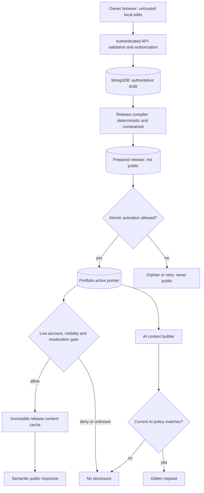
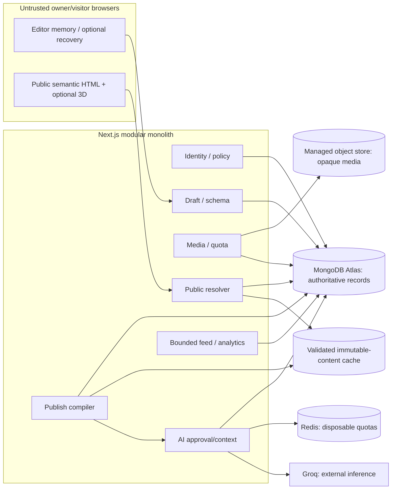
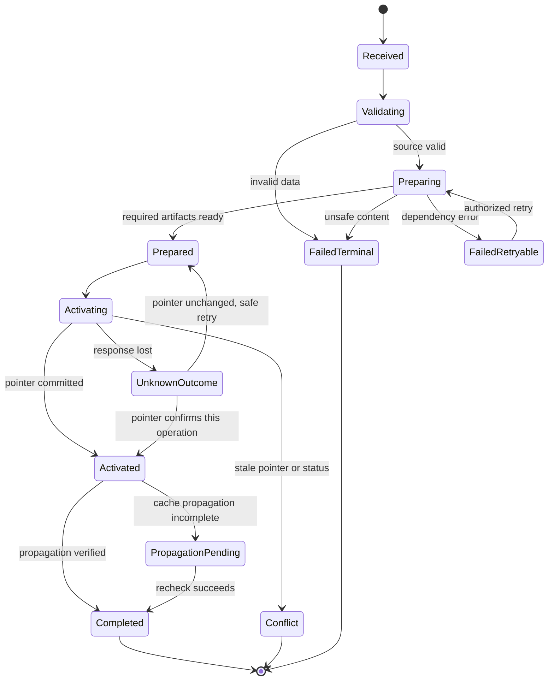
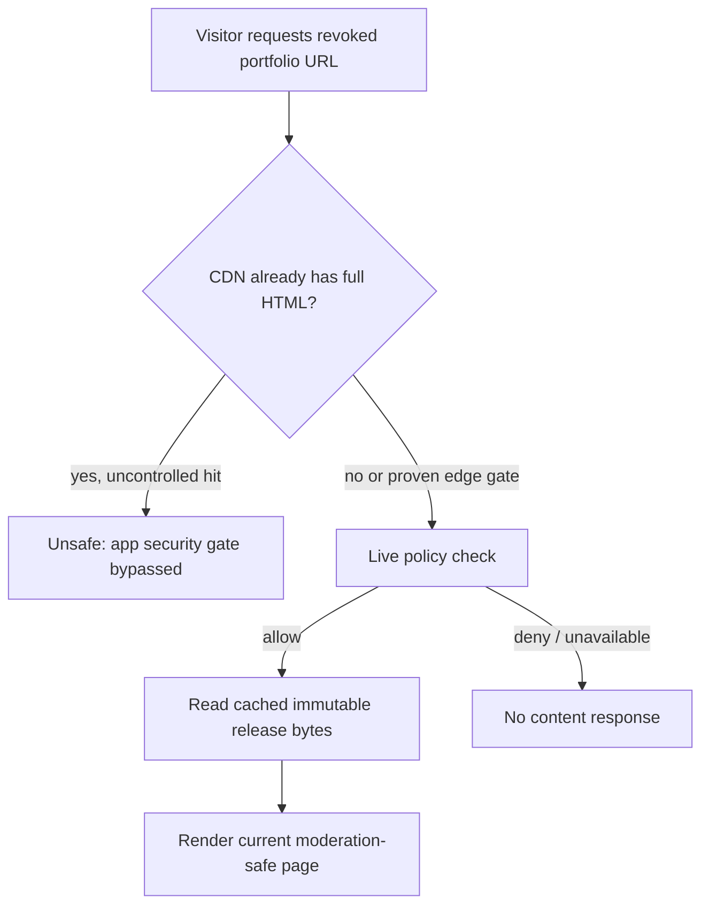
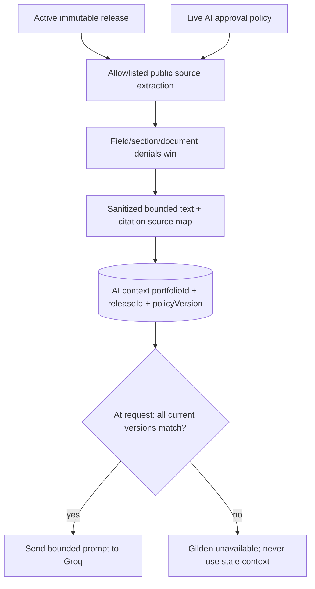
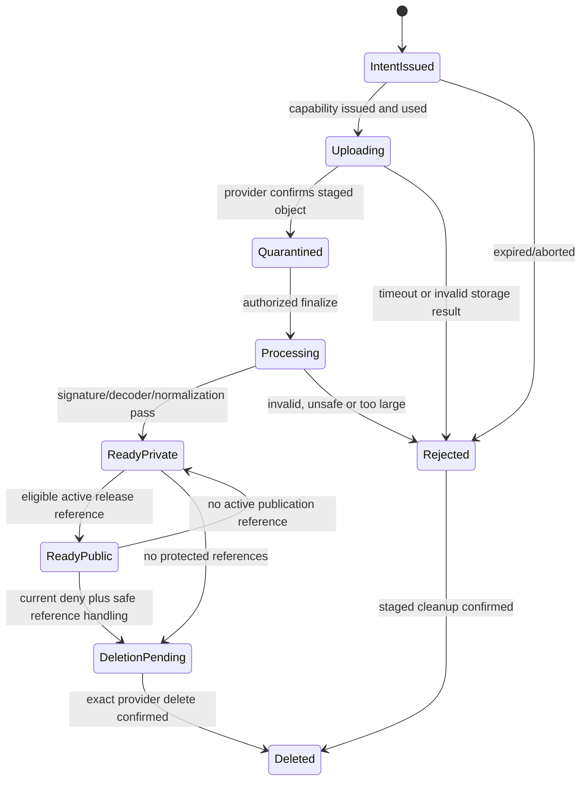
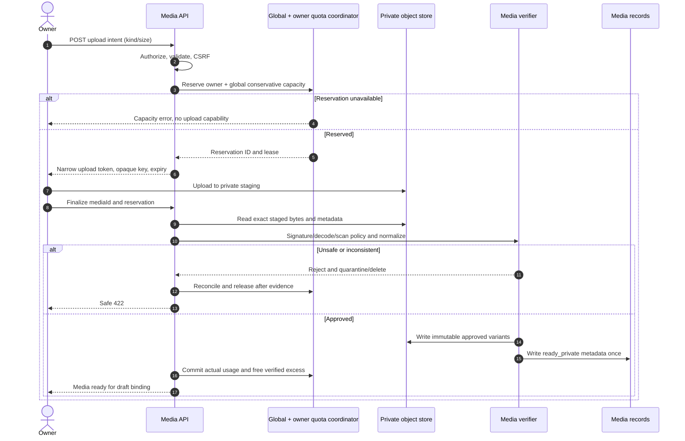
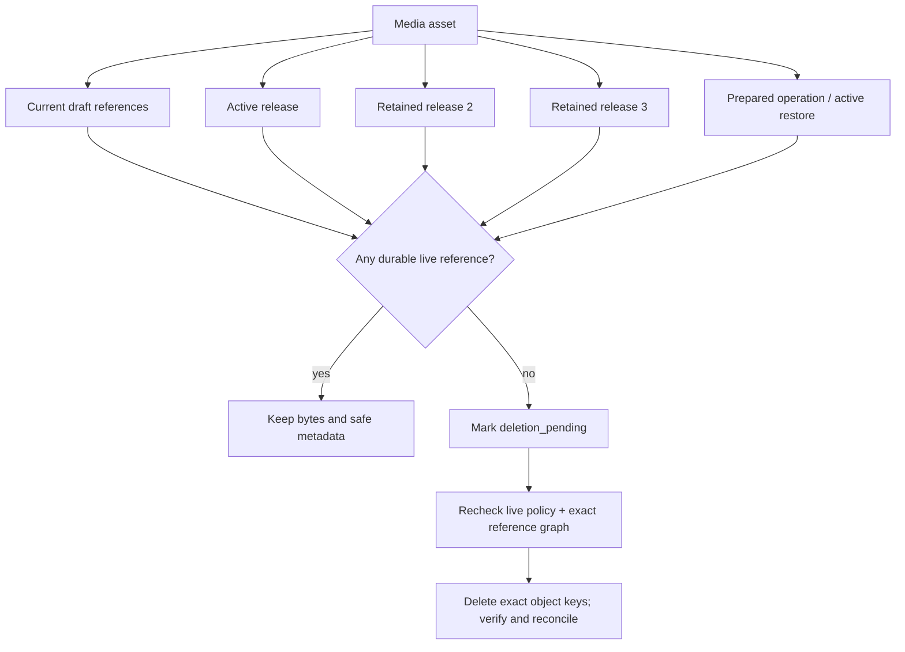
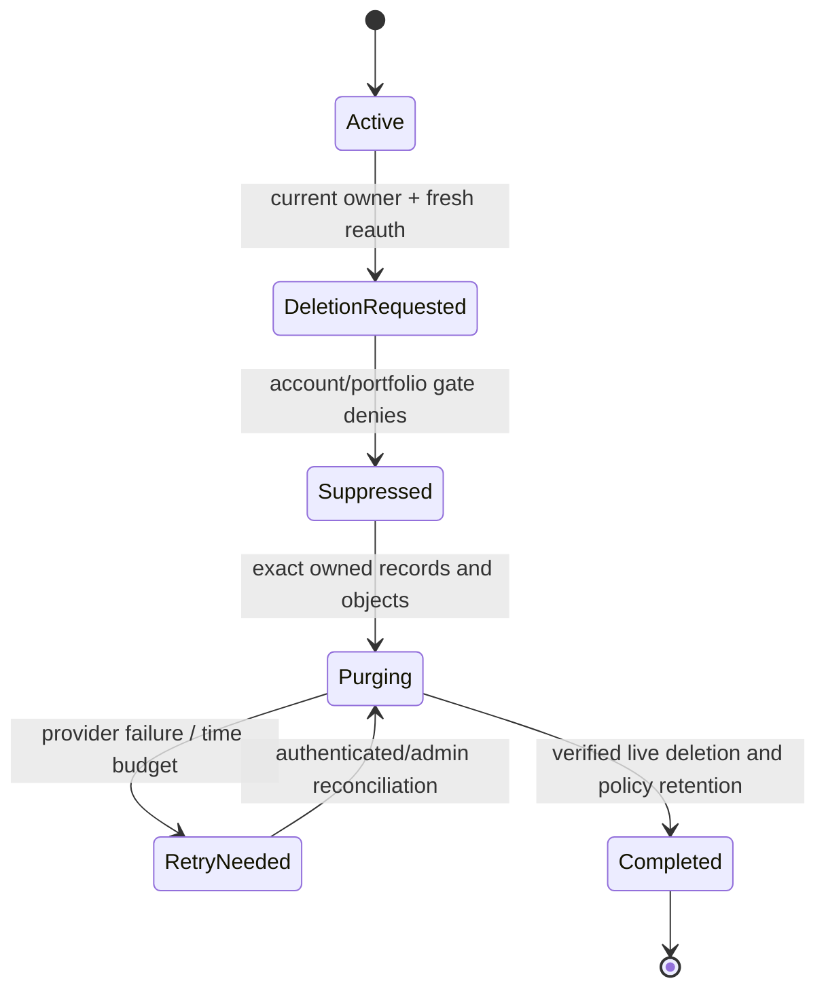

# 08 - Storage, Synchronization, Publication, Caching, and Data Lifecycle Strategy

> **Product:** GildedIn
> **Document ID:** GILD-ARC-08  
> **Version:** 2.0.0-draft  
> **Status:** Normative engineering specification; external provider compatibility gates remain open  
> **Updated:** 2026-11-19  
> **Audience:** Platform engineer, full-stack implementer, security reviewer, product owner, release reviewer  
> **Owner:** GildedIn architecture  
> **Review trigger:** Any change to tenant ownership, data representation, persistence provider, public caching, AI approval, media delivery, pricing/billing, or retention

**Companion specifications:** [01 System Overview](01-system-overview.md) | [02 Requirements and Scope](02-requirements-and-scope.md) | [03 UI/UX](03-ui-ux.md) | [04 C4 Diagrams](04-c4-diagrams.md) | [05 Data Model](05-data-model.md) | [06 API Design](06-api-design.md) | [07 Security Design](07-security-design.md) | [09 Errors and Logging](09-error-handling-and-logging.md) | [10 Deployment](10-deployment-strategy.md) | [11 Testing](11-testing-strategy.md) | [12 ADRs](12-architecture-decision-record.md).

> **Security rule:** Content storage, public visibility, tenant authorization, published release selection, and AI access permission are distinct decisions. A cached document, a guessed media URL, possession of an identifier, a valid draft, or a successful upload MUST NOT itself confer access.

> **Operations rule:** Zero new spending, no payment card, and no usage-based charges are hard constraints. Free-service exhaustion may make a capability temporarily unavailable. The system MUST NOT silently enable a paid plan, assume unverified free-tier limits, or imply guaranteed availability or backups.

> **Evidence rule:** Examples and pseudocode are implementation contracts, not proof that a provider implements them. Providers, capabilities, retention mechanisms, backups, and CDN behavior must be verified in the deployed configuration. A technical claim sourced from external guidance carries an `[Sxx]` reference, defined in Section 35.

---

## 1. Purpose, authority, and reading guide

### 1.1 Purpose

This document defines **where every durable and derived byte belongs, when it becomes authoritative, how it changes, how concurrent writers are reconciled, what may be cached, how a public release is safely activated, and how data is deleted**. It describes a verifiable path from an owner's keystroke to a visitor's rendered portfolio without allowing an unreviewed draft, tenant-crossing read, stale approval policy, corrupted upload, or half-committed release into a public response.

The document makes deliberate distinctions between: **local edits** and **server-acknowledged drafts**; **owner-authored inputs** and **compiled public outputs**; **prepared releases** and **activated releases**; **cached bytes** and **live permission**; **AI-ready context** and **AI-allowed context**; **logical media assets** and **physical storage objects**; **retention policy** and **verified physical deletion**; **revision history** and **independent backup**.

It is not a substitute for [05](05-data-model.md)'s complete collection and index definitions, [06](06-api-design.md)'s HTTP endpoint catalog, or [07](07-security-design.md)'s threat model. Where those documents already define a normative identity, status, limit, or security rule, this document **applies** that definition to storage and synchronization. Where a proposed solution remains conditional on an integration proof, the condition is recorded instead of quietly inventing a guarantee.

### 1.2 Normative language and conflict handling

- **MUST / MUST NOT:** acceptance requirements; violation is a release blocker for affected critical functionality.
- **SHOULD / SHOULD NOT:** strong engineering default, exception requires documented justification and test evidence.
- **MAY:** permitted bounded design choice, not a mandatory launch feature.
- **Authoritative:** the subsystem that owns the truth for a given decision; another cache or projection cannot overrule it.
- **Fail closed:** deny the affected sensitive operation when required authorization, consent, moderation, or quota state cannot be proved.
- **Idempotent:** replaying an operation under the same validated identity/fingerprint cannot produce a second logical effect.
- **Eventually consistent:** an observation may lag a committed state, but the lag must not broaden access or mix incompatible release versions.

Priority of interpretation: security and privacy requirements, fixed product invariants, canonical data model, published API contract, implementation preferences, vendor examples. A documented `409` draft-domain conflict and a literal HTTP `If-Match` precondition's `412` semantics must be reconciled before shipping the wire contract; see Section 8.6 and [06](06-api-design.md).

### 1.3 Scope / non-scope

**Within scope:** MongoDB documents and indexes used by synchronization; validation and canonical serialization; optimistic concurrency; browser recovery; local preview; immutable release compilation and pointer activation; object uploads, media variants and quota reservations; public read caching; SEO, directory and portfolio search materialization; AI knowledge versioning and revocation; bounded external RSS metadata; contact inbox and aggregate analytics retention; exports and account deletion; reconciliation; performance/cost accounting; failure injection and verification.

**Not required:** a dedicated API service, Kafka/RabbitMQ, distributed event bus, CRDT or multi-writer real-time collaboration, WebSocket synchronization, offline-first publication, distributed locks as a separate service, vector database, full RAG pipeline, multi-region writes, Kubernetes, Redis as a source of truth, a permanent background worker, automatic paid overflow, guaranteed backup/recovery, long-term visitor tracking, or unbounded version history.

**Conditional future scope:** multiple portfolios per owner, multiple collaborators, shareable private preview links, custom domains, user-defined formulas, complex scheduled job orchestration, durable history for every keystroke, and fully offline editing. Each requires a new threat review and explicit ADR.

### 1.4 System objectives

1. All protected reads and writes are bound to an authenticated account and an explicitly resolved, server-authorized `portfolioId`.
2. A draft save changes one coherent owner draft at most once; a stale writer cannot silently overwrite it.
3. A public response renders **one activated immutable release** plus current policy overlays; it never reads an editable draft to fill gaps.
4. Publication commits only through an atomic active-pointer transition after required inputs and artifacts are ready.
5. The public site, owner preview, AI knowledge, SEO and search do not accidentally traverse different or unauthorized content versions.
6. Live revocation and moderation beat caches, old releases and stale AI snapshots.
7. Media bytes are not public merely because a provider received them. Quotas, ownership, validation and reference safety apply before public delivery.
8. Optional dependencies fail independently; none may create hidden charges or erase the previously valid published release.
9. Privacy defaults prevent draft leakage, unauthorized document extraction, excessive analytics and accidental disclosure through logs, archives or backups.
10. Tests prove actual concurrency, crash recovery, quota and deployed-cache behavior, not just mock-level success.

## 2. System constraints and constants

### 2.1 Product limits

| Limit                                  |                  Normative value | Counting and enforcement                                                                                                         |
| -------------------------------------- | -------------------------------: | -------------------------------------------------------------------------------------------------------------------------------- |
| Custom nesting depth                   |                                3 | Validated for authored schema and bindings on save and publish                                                                   |
| Custom fields per section              |                               20 | Entire user-defined schema scope for one section; explicit server count                                                          |
| User-authored visual blocks            |                 20 per portfolio | Nested authored nodes count; repeated rendered collection items do not                                                           |
| Items per collection                   |                               20 | Enforced against typed collection definition                                                                                     |
| Canonical published payload            |                    102,400 bytes | Count canonical UTF-8 bytes including serialized public content, layout, theme, public metadata references; exclude binary media |
| Successful published releases retained |                                3 | Keep the active version plus at most two prior successful versions after reconciliation                                          |
| Per-portfolio original media           |                           15 MiB | Actual verified originals, not variants; owner admission and reconciliation                                                      |
| Media originals per portfolio          |                               30 | Count live committed originals and outstanding file reservations                                                                 |
| Individual image input                 |                            1 MiB | Hard upper bound based on **verified** uploaded bytes                                                                            |
| Individual PDF resume input            |                            2 MiB | Hard upper bound based on verified bytes                                                                                         |
| Image dimensions                       |                      4096 x 4096 | Decode-time bound, not a client assertion                                                                                        |
| Contact inbox retention                |                          30 days | Read-time filtering plus explicit purge; Mongo TTL is best effort                                                                |
| Operational logs                       |                 30 days proposed | Provider-configured and verified retention                                                                                       |
| Security audit events                  |                 90 days proposed | Protected access and scheduled/best-effort purge                                                                                 |
| Anonymous AI messages                  | 15 per visitor per day initially | Plus independent portfolio and platform quotas; configurable server-side                                                         |
| Main release capacity target           |  About 100-500 active portfolios | Planning input, not guaranteed provider capacity or an account-registration cap                                                  |

`MiB` means 1,048,576 bytes; `MB` may mean 1,000,000 provider bytes. Provider free allowances are specified by the provider's current units, and storage projections must not silently mix them. **15 MiB x 500 = 7,864,320,000 bytes (about 7.32 GiB) of nominal originals alone**, excluding variants, retries, indexes and network traffic. This exceeds a 1 GB object-storage allowance. Therefore individual quota grants **cannot** imply global physical entitlement. For current provider evidence see [S08], [S09], [S10].

### 2.2 Version and identity vocabulary

| Identifier / version | Meaning                                                      | Authority              | Reusable across tenants?        |
| -------------------- | ------------------------------------------------------------ | ---------------------- | ------------------------------- |
| `accountId`          | Stable account identity                                      | Identity module        | No                              |
| `portfolioId`        | Stable tenant identity                                       | Portfolio module       | No                              |
| `slug`               | Current case-insensitive public locator                      | `slugClaims`           | Must be globally unique         |
| `revision`           | Monotonic acknowledged owner draft version                   | `drafts`               | Only within portfolio           |
| `clientMutationId`   | Unique client mutation retry token                           | Editor + draft service | Scoped to account/portfolio     |
| `operationId`        | Durable publish/delete/export/processing operation reference | Operation service      | Scoped and opaque               |
| `idempotencyKeyHash` | Keyed digest of client's publish key                         | Publish service        | Scoped to owner and portfolio   |
| `releaseId`          | Globally opaque, immutable release identity                  | Publisher              | No                              |
| `publishSequence`    | Monotonic successful activation generation                   | Portfolio control      | Only within portfolio           |
| `securityVersion`    | Security-relevant account/portfolio policy generation        | Auth/policy module     | Only within actor/tenant        |
| `policyVersion`      | Authoritative Gilden approval generation                     | AI policy              | Only within portfolio           |
| `mediaId`            | Owner-scoped logical asset identity                          | Media module           | No                              |
| `reservationId`      | One bounded upload admission                                 | Quota module           | No                              |
| `sourceId`           | Published content unit that may be cited/indexed             | Release compiler       | Scoped to release and portfolio |
| `schemaVersion`      | Data-structure compatibility                                 | Domain schema registry | Versioned contract              |
| `rendererVersion`    | Public composition compatibility                             | Renderer registry      | Versioned contract              |
| `serializerVersion`  | Canonical byte representation                                | Publisher              | Versioned contract              |

`updatedAt` alone is never a concurrency token. Client-supplied `portfolioId`, slug, username, storage key and policy version are never accepted as authorization evidence. Unique indices are a defense against duplicate keys, **not** a substitute for authorization.

## 3. Storage principles and non-negotiable invariants

### 3.1 Core invariants

| ID       | Invariant                                                                                              | Enforcement point                     | Primary verification                |
| -------- | ------------------------------------------------------------------------------------------------------ | ------------------------------------- | ----------------------------------- |
| STOR-I01 | One server-authorized owner context for every draft/media/export mutation                              | API entry + repository predicate      | Cross-tenant ID tampering           |
| STOR-I02 | Draft save checks expected revision within atomic write                                                | `drafts` conditional update           | Two-tab conflict                    |
| STOR-I03 | Acknowledgment identifies exactly the saved client mutation                                            | API response + client snapshot ledger | Lost response / late response       |
| STOR-I04 | Public render never reads mutable draft                                                                | Public repository boundary            | Instrumented query deny             |
| STOR-I05 | All content for one HTTP public response derives from one `releaseId`                                  | Release compiler/read model           | Concurrent publish under load       |
| STOR-I06 | A prepared release is invisible until pointer activation                                               | Portfolio active pointer              | Crash before activation             |
| STOR-I07 | Active release pointer is modified only by authorized CAS/transactional activation                     | Publisher domain operation            | Racing publishers                   |
| STOR-I08 | Same idempotency key and input cannot create two activations                                           | `publishOperations` unique scoped key | Retried POST / lost reply           |
| STOR-I09 | Current account/portfolio/moderation policy is checked before serving revocable content                | Live public entry gate                | Warm-cache suspension               |
| STOR-I10 | Cached bytes confer no authorization                                                                   | Cache/read route                      | Direct CDN URL bypass               |
| STOR-I11 | AI uses only the active release plus currently valid approval generation                               | AI context gate                       | Revoke during streaming             |
| STOR-I12 | New fields default to AI-denied until approved                                                         | Approval model + compiler             | Publish new field                   |
| STOR-I13 | Media storage admission respects both owner and global hard-stop limits                                | Atomic quota admission                | Concurrent near-cap uploads         |
| STOR-I14 | Staged/unverified media has no public response route                                                   | Media gateway                         | Raw object URL access               |
| STOR-I15 | An asset used by a draft or any retained release cannot be reclaimed                                   | GC reference scan                     | Replace + rollback                  |
| STOR-I16 | Expired contact messages are not returned even before physical TTL deletion                            | Inbox repository                      | Expiry boundary                     |
| STOR-I17 | Unlisted is excluded from discovery, not treated as private                                            | Directory/sitemap compiler            | Unlisted crawling                   |
| STOR-I18 | No optional integration can modify active content on failure                                           | Integration adapter                   | Feed/AI/Redis outage                |
| STOR-I19 | Deletion/suspension immediately changes live access eligibility                                        | Account + portfolio policy            | Concurrent deleted publish          |
| STOR-I20 | Private drafts, sessions, credentials, contact messages and uploads are never part of shared caches    | Cache and header policy               | Cache key and body audit            |
| STOR-I21 | User-facing 'Saved' and 'Published' are backed by server-confirmed durable state                       | UI contract                           | Drop request / DB outage            |
| STOR-I22 | Object deletion only follows exact-key, reference-safe decision; provider confirmation may lag         | Media GC                              | Failed provider DELETE              |
| STOR-I23 | No expected free-tier entitlement is treated as billing authority                                      | Deployment validation                 | Provider billing feature audit      |
| STOR-I24 | Export is owner-scoped, bounded and nonpublic                                                          | Export gateway                        | Guess URL / cross-tenant archive    |
| STOR-I25 | Provider backup availability, RTO and RPO are not represented as guarantees                            | Deployment docs/privacy notice        | Provider evidence gate              |
| STOR-I26 | Security overrides preserve integrity of immutable release records without exposing suppressed content | Policy overlay                        | Item quarantine across all surfaces |
| STOR-I27 | Every derived artifact has source release, compiler and policy provenance                              | Metadata and tests                    | Search/OG/AI mismatch               |
| STOR-I28 | All async/on-demand jobs recheck current operation/tenant status before commit                         | Lease/fencing protocol                | Delete while job delayed            |
| STOR-I29 | External URLs, redirects and connected IPs are restricted before fetching feed metadata                | Egress adapter                        | DNS rebinding/metadata endpoint     |
| STOR-I30 | At-rest or in-transit protection cannot substitute for owner authorization                             | Store/read boundary                   | Credential or key misuse            |

### 3.2 Consistency taxonomy

| Data                           | Write consistency                                         | Read consistency                                       | Recovery rule                                              |
| ------------------------------ | --------------------------------------------------------- | ------------------------------------------------------ | ---------------------------------------------------------- |
| Account/session/security state | Current, server-authoritative; revoke without stale allow | Live/authenticated; deny on uncertainty                | Retry internal service; not stale permit                   |
| Portfolio public policy        | Atomic current policy generation                          | Live gate before every revocable public response       | Fail closed if unknown                                     |
| Draft                          | Single-doc conditional save (CAS)                         | Owner reads latest acknowledged revision               | Keep local unsaved edits; conflict UI                      |
| Prepared release               | Write-once compiler artifact                              | Publisher/admin only; never public                     | Resume or safe orphan GC                                   |
| Active release pointer         | Single authoritative commit point                         | Resolve pointer once per response                      | Reconcile lost result by authoritative pointer             |
| Public payload                 | Immutable content cache keyed by release ID               | May reuse bytes only behind live gate                  | Revalidate normal updates, fail closed security revocation |
| Public SEO/search              | Prepared from same release                                | May lag publication; never include forbidden content   | Recompute from active release, invalidate correct tag      |
| AI context                     | Published, policy-specific derived snapshot               | Exact `(portfolioId,releaseId,policyVersion)` equality | Unavailable until ready; never stale fallback              |
| Media originals                | Immutable verified bytes, owner-bound                     | Private; verified by storage capability/gateway        | Retry exact key reconciliation                             |
| Published variants             | Immutable processed bytes                                 | Public only through allowed delivery policy            | Cache purge/deny, not guaranteed recall                    |
| Quota reservations             | Atomic/bounded admission; idempotent finalize             | Authoritative owner/global remaining capacity          | Reject if ledger uncertain                                 |
| RSS previews                   | Bounded cached external metadata                          | Stale last-good permitted                              | Warn owner, never poison public content                    |
| Contact inbox                  | Bounded TTL and owner-only                                | Expired hidden even before TTL sweep                   | Purge/deny; no resurrection                                |
| Anonymous analytics            | Atomic or sampled aggregate counter                       | Eventually consistent                                  | Drop noncritical events under stress                       |

### 3.3 Storage trust hierarchy



**Important:** a production CDN may deliver a cached response without invoking application code. The diagram's live gate is therefore a _deployment requirement_, not a claim that every ordinary caching configuration automatically enforces it.

## 4. Storage architecture and logical ownership

### 4.1 Physical and logical components



The drawing depicts **logical services within one deployable application**, not separately operated microservices or guaranteed network isolation. External providers must have least-privilege credentials and verified acceptable privacy/billing terms.

### 4.2 Collection ownership and lifecycle matrix

| Collection           | Authoritative for                                        | Never used as                          | Expiration/deletion trigger                   |
| -------------------- | -------------------------------------------------------- | -------------------------------------- | --------------------------------------------- |
| `accounts`           | Account status, roles and security generation            | Public profile authorization by email  | Account deletion workflow                     |
| `providerIdentities` | Verified OAuth provider subjects                         | Automatic same-email merge             | Unlink / account delete                       |
| `sessions`           | Live session status                                      | Public cache or JavaScript token store | Expiry, revoke, delete                        |
| `portfolios`         | Owner link, active release, visibility/policy generation | Long-form content body                 | Delete/suspend lifecycle                      |
| `slugClaims`         | Unique current and historical routing aliases            | Authentication                         | Rename/delete according to policy             |
| `drafts`             | Complete owner-editable aggregate                        | Public HTML/AI content source          | Account/portfolio delete                      |
| `releases`           | Write-once public representation                         | Mutable editing store                  | Safe pruning after three successful releases  |
| `publishOperations`  | Idempotency and recovery journal                         | Public authorization                   | Bounded postcompletion retention              |
| `mediaAssets`        | Asset ownership, processing status and safe keys         | Unchecked public URL directory         | Unreferenced and confirmed delete             |
| `uploadReservations` | Temporary admitted upload                                | Proof that uploaded file is safe       | Commit/release/expiry and reconciliation      |
| `quotaBuckets`       | Logical owner/global quota accounting                    | Billing-provider single source         | Versioned reconciliation                      |
| `aiContexts`         | Approved derived text and citation source map            | General-purpose public search cache    | New policy/release, revoke, delete            |
| `contactMessages`    | Voluntary owner inbox submissions                        | AI context / analytics content         | 30-day expiry and deletion                    |
| `analyticsDaily`     | Aggregated counters only                                 | Individual visitor tracking            | Configured bounded retention                  |
| `moderationPolicies` | Item/account/portfolio denial overlays                   | Editable release content               | Admin resolution / retention                  |
| `abuseReports`       | Administrator case context                               | Public comments or content             | Reviewed bounded case retention               |
| `auditEvents`        | Security-relevant evidence                               | Full private payload log               | 90-day proposed expiry                        |
| `externalFeeds`      | Last verified RSS preview and sync metadata              | Trustable arbitrary URL fetch cache    | Owner removal / bounded refresh               |
| `deletionOperations` | Idempotent deletion stages                               | Authorization for suppressed tenant    | Verified completion / minimal audit retention |

One tenant's custom `Research Papers` is a **domain collection within its draft**, not an actual MongoDB collection. This avoids a namespace per user and reduces index, storage, and operational overhead. `mediaId`, `releaseId`, and `portfolioId` must be opaque. **Every public or private query binds the portfolio context before the result is evaluated.**

### 4.3 Data classification and derived-copy controls

| Data class                               | Source                       | Possible permitted destinations                               | Forbidden destinations                            |
| ---------------------------------------- | ---------------------------- | ------------------------------------------------------------- | ------------------------------------------------- |
| Authentication secrets/session verifiers | IAM                          | Protected server storage, secure host-only cookie             | Browser JS storage, logs, public release, AI      |
| Unpublished draft/personal details       | Owner editor                 | `drafts`, owner preview, optional scoped local recovery       | Public caches, RSS previews, AI, public analytics |
| Approved public content                  | Validated draft              | Immutable release, HTML, route/search/SEO artifacts           | Another tenant's portfolio                        |
| AI-approved published excerpts           | Explicit owner approvals     | Matching `aiContexts`, bounded Groq request                   | Unapproved field, transcript archive              |
| Original private media                   | Staged verified bytes        | Private storage, owner download, processor                    | CDN-public raw bucket, unreviewed AI extraction   |
| Published normalized media variant       | Verified media               | Controlled public media delivery                              | Unauthorized suppressed route                     |
| Contact visitor identity/message         | Separate voluntary form      | Owner inbox, necessary processing                             | Gilden prompt, public stats, cross-tenant export  |
| Anonymous telemetry counts               | Minimal event data           | `analyticsDaily`, authorized owner stats, opt-in public block | IP-level profiling or raw message logs            |
| Provider-billing usage metrics           | Provider + quota reconcilers | Restricted admin operational panel                            | User-accessible secret-bearing diagnostics        |

Derived data inherits the **most restrictive applicable** source classification until a deliberate public or AI declassification occurs. Declassifying a field for the public page does not authorize it for AI. Hashes, IDs, cache keys and normalized paths may remain personal data or sensitive linkable metadata; do not assume they are anonymous merely because they contain no names.

### 4.4 Index requirements affecting synchronization

- Unique `drafts.portfolioId` and unique `portfolios.portfolioId` prevent more than one authoritative aggregate/control record per portfolio.
- Unique provider subject, normalized slug claim, publish `(portfolioId,idempotencyKeyHash)`, media ID and reservation ID protect collision and idempotency boundaries.
- Release lookup by `(portfolioId,releaseId)` must be indexed; successful release history by `(portfolioId, sequence)` must have stable order and distinguish prepared/orphaned records.
- Contact expiry and audit TTL indexes are **supplementary**; repository reads also filter `expiresAt` and current deletion state.
- Do not build arbitrary indexes per owner-defined schema field or accept Mongo operators from client JSON. A Free cluster has limited storage and query throughput [S09].
- Exact index shape and partial/unique index deployment are owned by [05](05-data-model.md); this document's examples are illustrations, not an independent competing migration plan.

## 5. Owner edit state and client/server synchronization

### 5.1 Why the editor has two states

The browser must update the visual canvas at typing/dragging speed. MongoDB must only accept bounded, authenticated, validated writes. These timelines are different. **Immediate visual feedback is not evidence of persistence.** Each local edit increments a browser-local logical sequence; each successful server save increments the server draft revision. The UI renders the latest local state, never waits for a network round trip to reflect a keystroke, and must expose a truthful persistence status.

The client maintains a small explicit state machine rather than inferring correctness from a `loading` boolean:

| State                      | Meaning                                             | UI action                                       | Publish eligibility                                         |
| -------------------------- | --------------------------------------------------- | ----------------------------------------------- | ----------------------------------------------------------- |
| `clean`                    | Local state matches last server-confirmed snapshot  | Display Saved                                   | May publish if validation passes                            |
| `dirty`                    | Local changes newer than last confirmed snapshot    | Display Unsaved changes                         | Do not publish the unsaved state                            |
| `saving`                   | One bounded request is in flight                    | Display Saving...                               | Hold or explicitly publish an earlier acknowledged revision |
| `save_retryable_error`     | Cannot confirm write outcome                        | Retain local snapshot, Retry                    | Block until authoritative revision resolved                 |
| `conflict`                 | Stored draft differs from expected revision         | Compare, reload or recover                      | Block without resolution                                    |
| `validation_rejected`      | The server rejected the submitted structure         | Show field/node errors without discarding edits | Block invalid data                                          |
| `reauth_required`          | Session no longer authorized                        | Secure sign-in recovery flow                    | Block                                                       |
| `local_recovery_available` | Browser-local copy found, not verified              | Offer explicit restore/comparison               | Block until saved                                           |
| `read_only`                | Account suspended, deleting or provider unavailable | Explain limitation                              | Block                                                       |

`Saved` requires receipt of an acknowledged server revision **and** no newer unsaved local edits. A 2xx response to an older in-flight snapshot is not an acknowledgment of later keystrokes. A generic network error is not proof that the server rejected a write: the server might have committed and the response might have been lost.

### 5.2 Local edit ledger

Suggested client state (conceptual, not library-specific):

```ts
interface EditorSyncState {
  portfolioId: string;
  accountId: string;
  baseServerRevision: number;
  baseServerSnapshotHash: string;
  localEditSequence: number;
  acknowledgedEditSequence: number;
  pendingMutation?: {
    clientMutationId: string;
    baseRevision: number;
    sentEditSequence: number;
    contentHash: string;
    startedAt: number;
  };
  status:
    | "clean"
    | "dirty"
    | "saving"
    | "save_retryable_error"
    | "conflict"
    | "validation_rejected"
    | "reauth_required"
    | "local_recovery_available"
    | "read_only";
  lastSavedAt?: string;
}
```

Do not derive `accountId` from the route slug. Do not place session secrets, OAuth tokens, storage credentials, or provider keys in editor persistence. Use opaque client mutation IDs with enough entropy to prevent accidental collision across tabs; they are reconciliation hints, **not** authorization credentials.

### 5.3 Save scheduling and backpressure

Recommended provisional behavior (tunable after measurement): debounce idle text/input saves by 600-1,000 ms, immediately queue a bounded save after a discrete high-value operation (reorder, node deletion, schema change), and provide an explicit Save/Retry action. In every case limit to **one outstanding mutation per editor instance**. Rapid edits coalesce into the next snapshot rather than creating a queue of hundreds of network calls. A timeout must not automatically fire five duplicate mutations in parallel.

When an upload or image crop is incomplete, the editor may save an incomplete _safe draft reference_ only if schema validation permits it; it must not declare the media publishable. When switching sections, keep the same saved draft aggregate and flush pending operations without creating a new source of truth for each section.

Throttle drag-transform saves: pointer movement updates local positions; pointer release commits one logical operation. Autosaving every animation frame is prohibited. Record undo/redo actions locally as structured commands or bounded snapshots; server revision history is not a replacement for undo/redo, and there is no server-side event sourcing of keystrokes.

### 5.4 The draft atomicity boundary

A portfolio's persisted editable draft is one bounded `drafts` document with `revision`, `profile`, `sections`, `collectionDefinitions`, `contentCollections`, `nodes`, `theme`, `navigation`, `seo`, `aiApprovals`, `mediaRefs` and version metadata, as specified in [05, Section 9](05-data-model.md). The service MUST only accept a strictly validated editable DTO, not the complete database record. Server-controlled fields such as `revision`, `portfolioId`, owner, audit fields, moderation and active pointer are ignored/rejected when supplied by clients.

MongoDB documents support atomic updates with comparison predicates [S01]. An accepted write checks the expected revision **within the same MongoDB operation**; a separate `findOne` then unconditional update can lose competing changes.

```ts
// Illustrative MongoDB driver-level CAS. NOT a complete authenticated route.
async function persistDraft(
  repository: DraftCollection,
  command: ValidatedOwnerDraftCommand,
) {
  // command.portfolioId came from verified owner context, not arbitrary JSON.
  const next = await repository.findOneAndUpdate(
    { portfolioId: command.portfolioId, revision: command.expectedRevision },
    {
      $set: {
        profile: command.dto.profile,
        sections: command.dto.sections,
        collectionDefinitions: command.dto.collectionDefinitions,
        contentCollections: command.dto.contentCollections,
        nodes: command.dto.nodes,
        theme: command.dto.theme,
        navigation: command.dto.navigation,
        seo: command.dto.seo,
        aiApprovals: command.dto.aiApprovals,
        mediaRefs: command.dto.mediaRefs,
        draftMutationId: command.clientMutationId,
        updatedBy: command.actor.accountId,
        updatedAt: command.serverNow,
      },
      $inc: { revision: 1 },
    },
    { returnDocument: "after" },
  );
  if (!next) return { kind: "conflict" as const };
  return {
    kind: "saved" as const,
    revision: next.revision,
    clientMutationId: command.clientMutationId,
  };
}
```

**Safety caveats:** real code must protect the schema version fields, handle document size and Mongo errors, validate all node references and allowed property names, authorize account/portfolio state, and prevent writes after account deletion. If `portfolio.status` lives in a different document, a separate authorization read plus draft CAS is **not** an atomic cross-document status check. Choose an integration-tested transaction or a properly fenced write protocol for security-sensitive state transitions; do not claim single-document atomicity covers two collections. In every case, current deletion/suspension policy must be enforced at the applicable access gate.

### 5.5 Acknowledgments and races

```mermaid
sequenceDiagram
  autonumber
  actor O as Owner
  participant UI as Editor
  participant API as Draft API
  participant DB as MongoDB
  O->>UI: Edit A (seq 41)
  UI->>UI: Local render; dirty
  UI->>API: PUT snapshot A; expected rev 24; mutation M1
  O->>UI: Edit B (seq 42) while save in flight
  API->>DB: CAS rev 24 -> 25 for A
  DB-->>API: Committed revision 25
  API-->>UI: M1 accepted, rev 25
  UI->>UI: Ack through seq 41, still dirty because seq 42 exists
  UI->>API: PUT snapshot B; expected rev 25; mutation M2
  API->>DB: CAS rev 25 -> 26
  DB-->>UI: Through API: M2 accepted rev 26
  UI->>UI: Ack seq 42, show Saved
```

If a late response from M1 arrives after M2's response due to client bug or network scheduling, it must **never** replace the current `baseServerRevision=26` with 25. The browser accepts only an acknowledgment for the currently pending mutation or a known earlier mutation that does not regress its latest confirmed revision. Reject stale socket/fetch result handlers using mutation identity, not arrival time.

### 5.6 Duplicate or lost acknowledgment protocol

A client may lose the response after MongoDB committed a CAS. Because the request was legitimately applied, retrying the _same body_ with the _old revision_ normally fails its revision predicate. That is not sufficient evidence that another tab edited the draft.

Required reconciliation procedure:

1. Preserve the immutable exact local snapshot sent, its `clientMutationId`, expected revision and content fingerprint.
2. Fetch the current authorized draft metadata (and full current snapshot only if needed), bypassing shared caches.
3. If current `draftMutationId` matches the lost mutation ID and the content hash is equal, treat that mutation as acknowledged, update the base revision and preserve any newer local edits.
4. If the current revision differs and the last mutation ID cannot explain it, enter `conflict`. Never blindly resubmit current local state against the new revision.
5. If the metadata matches but current draft payload differs, treat as integrity/security anomaly and stop; mutation IDs alone are insufficient proof.
6. If the database is unavailable, keep the local copy unsaved and show uncertainty. A successful POST is not inferred from elapsed time.

**Consecutive-save caveat:** a second tab can overwrite the previous tab's `draftMutationId`, so a single last-mutator field cannot always prove earlier success. A small, bounded mutation-ack journal tied to the draft, or a conditional idempotency record, may be used if required by tests. The conservative default is manual conflict review when historical proof is unavailable; do not invent acknowledgement from a guessed hash match across arbitrary operations.

### 5.7 Two-tab conflict handling

```mermaid
sequenceDiagram
  autonumber
  participant A as Tab A
  participant B as Tab B
  participant API as Draft API
  participant DB as Draft rev 24
  A->>API: PUT expected 24, M_A
  API->>DB: Conditional update succeeds
  DB-->>A: rev 25
  B->>API: PUT expected 24, M_B
  API->>DB: Conditional update matches 0
  API-->>B: Domain conflict 409, current revision 25
  B->>B: Retain edits; offer Compare / Reload / Recover
```

There is **no automatic last-write-wins** and no hidden merge. If both tabs independently modify different fields, the initial implementation still reports a conflict; manual review is acceptable. If a future field-wise merge is introduced, it must validate relationships, permissions, file refs and semantic ordering, and must not silently override a teammate or stale tab.

### 5.8 Safe browser-local recovery

Optional recovery may use IndexedDB or session-local storage, **never** authentication cookies or an unsandboxed public cache. Browser storage can be evicted by the browser or read by malicious same-origin script in an XSS incident [S13]. Therefore it is a convenience, not private durable storage, trusted evidence, or a backup.

A local recovery envelope may contain `formatVersion`, `accountScopeHash`, `portfolioId`, `savedFromServerRevision`, `localEditSequence`, a redacted/bounded draft snapshot, `createdAt`, `expiresAt` and a checksum for accidental corruption. The scope hash must not expose raw OAuth provider identity as a URL or storage key. Default expiry: **no longer than 24 hours**; local retention may be shorter on shared devices. Never persist API keys, OAuth access tokens, session verifiers, contact inbox content, private administrative notes or full PDF file bytes.

Recovery UX must offer _Restore and review_ rather than silently overwrite the server. On account switch, logout, sensitive account deletion, or security event, attempt to erase recovery records for the previous identity. A user can manually clear recovery data. `BroadcastChannel` or other local tab notifications may reduce conflict frequency but are **not** a lock or authority; every server write still needs a revision CAS.

**Shared-origin caveat:** all paths on `aaroophan.dev` share a browser origin. The public renderer's strict content sanitization and CSP are therefore prerequisites for any owner-side browser persistence; a single public XSS vulnerability could read same-origin IndexedDB and invoke authenticated dashboard APIs. Prefer full recovery in memory where product requirements allow, and never label browser storage as encrypted or secure without proving key custody and threat assumptions.

### 5.9 Navigating, reloading and sign-out

- Navigation within the editor can preserve local editing session and undo/redo; an explicit route exit prompts if there are unsaved edits.
- `beforeunload` is a best-effort warning. Never claim that `sendBeacon`, pagehide events or background sync make a final save durable.
- When offline, local editing may remain interactive, but publishing and remote save are disabled. The product does not promise offline-first synchronization.
- If the login session expires, retain unsaved state in browser memory and require reauthentication before sending any write. Do not send the content to another account inadvertently.
- If an account is suspended/deleting, prohibit save attempts; do not retain accessible local recovery indefinitely against owner policy.
- A new session loading a stored server draft must not automatically apply an unrelated browser backup based solely on slug equality.

## 6. Draft validation and safety during editing

### 6.1 Two validation layers

**Save validation** enforces security and bounded structural validity: known fields, schema versions, allowed block types, owner-scoped IDs, safe URLs, maximum nesting, node count, collection count, stored data size, safe text/rich-text AST, and disallowed executable configuration. It **allows** ordinary incomplete drafts such as missing optional biography or project case study details.

**Publish validation** additionally enforces mandatory Hero and minimum public identity, required media readiness, accessible section/read order, stable routes, SEO/canonical consistency, public disclosure flags, approved embeds, no severe text overflow or occluded critical controls, and the exact canonical payload byte limit.

The server is authoritative. The visual editor should show errors early, but local UI flags are not publication permission. Any imported JSON schema is parsed and checked against GildedIn's supported safe schema subset; remote `$ref`, recursive expansion, arbitrary prototypes, dynamic functions and executable event handlers are denied.

### 6.2 Bounded patch operations

The API may accept a complete strict `PUT /draft` or a discriminated list of typed `PATCH /draft` operations defined in [06, Section 11](06-api-design.md). A generic free-form path patch is not allowed. Each patch operation must resolve references against the _same_ draft snapshot and return a newly validated whole aggregate before persistence. Unsupported operation types and properties fail before reaching the database.

Suggested allowed operations include `setProfileField`, `updateCollectionItem`, `moveNode`, `setBreakpointOverride`, `setVisibility`, `reorderSection`, `addSafeBlock`, and `updateSeoField`. No operation may modify `portfolioId`, `ownerAccountId`, published release state, approval policy generation, security version or moderation state.

### 6.3 Reference safety

- Reusable content uses stable IDs. Editing one item updates all **draft** bindings to it, not independent copies.
- Deleting a referenced item is blocked until references are detached or explicitly removed with validated impact review.
- Media reference IDs must belong to the same owner portfolio; raw storage URL string substitution is not a valid media binding.
- Cross-section block moves reparent nodes; a node cannot escape its allowed section or cross tenant boundaries.
- Duplicate Hero or non-Hero-first ordering is a publish-blocking error; draft editing may temporarily be incomplete only where its save-level schema permits.

## 7. Preview and local rendering consistency

### 7.1 Preview contract

Owner preview is an _authorization-sensitive draft projection_. It should use the same versioned rendering primitives and validation pipeline as publication where possible, but it must not create an active release or write public SEO artifacts. Preview must be owner-only, `Cache-Control: private, no-store`, and protected by current session/tenant checks. A guessed `previewId`, fragment, or route must never expose someone else's draft.

The preview UI may display a locally edited but not yet persisted snapshot, clearly labeled `Unsaved preview`. A server-backed preview should bind to an explicit draft revision and flag whether the client has newer unsaved changes. Preview of an older published revision for restoration must be labeled `Historical release`, not confused with the live portfolio.

### 7.2 Multiple responsive views

Desktop, tablet and mobile preview modes are _different interpretations of one draft graph_ with selected breakpoint overrides. They must share content IDs and semantic reading order, while displaying supported layout changes. A preview may simulate motion in a `Play Preview` mode; ordinary editing should pause or simplify expensive Three.js activity.

### 7.3 Preventing cache or crawler leaks

Owner preview must neither emit indexable public routes nor be included in the public sitemap. Use `noindex` on preview responses as a supplemental signal, not an access control. Disable shared cache; avoid embedding private draft data in Open Graph images, publicly accessible `/_next` static resources, analytics events, or error pages. Server components must not accidentally serialize raw protected Mongo records into client hydration props.

## 8. HTTP concurrency and state observability

### 8.1 Read and write endpoints

The normative endpoint catalog is in [06](06-api-design.md). Relevant patterns include:

| Operation                                     | HTTP behavior                                        | Consistency requirement                        |
| --------------------------------------------- | ---------------------------------------------------- | ---------------------------------------------- |
| `GET /api/v1/portfolios/{id}/draft`           | Authenticated owner; no-store; current revision/ETag | Strong current draft view                      |
| `PUT /api/v1/portfolios/{id}/draft`           | Validated complete owner draft, expected revision    | One successful CAS per accepted mutation       |
| `PATCH /api/v1/portfolios/{id}/draft`         | Typed validated operations, expected revision        | One atomic aggregate transition                |
| `POST /api/v1/portfolios/{id}/publications`   | Idempotency key + expected draft revision            | Prepared artifact + one activation             |
| `GET .../publications/{operationId}`          | Owner-only status                                    | Reconciles uncertain result                    |
| `POST .../publications/{operationId}/recheck` | Idempotent propagation verification                  | Does not generate new release                  |
| `POST .../releases/{releaseId}/restore-draft` | Owner authorized, expected draft version             | Creates a new draft revision, does not publish |
| `POST .../media/intents`                      | Owner authenticated, admission reserved              | One scoped capability                          |
| `POST .../media/{mediaId}/finalize`           | Verify bytes and ownership                           | Repeatable without duplicate media             |
| `POST .../account/export`                     | Recent owner authorization                           | Private bounded archive                        |
| `POST .../account/delete`                     | Fresh reauthentication                               | Immediate suppression, eventual cleanup        |

**Path spelling:** these are explanatory patterns. The exact route names, versions, and response envelopes come from [06](06-api-design.md) and must not be independently changed by implementation of this document.

### 8.2 Status vocabulary

- `draft.saved`: server has acknowledged a particular edit snapshot and revision.
- `draft.dirty`: browser holds newer changes than acknowledged.
- `publication.preparing`: release is not active; public remains prior version.
- `publication.activated`: durable active pointer updated.
- `publication.propagation_pending`: active release is durable; public delivery or metadata may lag.
- `publication.completed`: required propagation checks completed, not a guarantee every third-party cache has refreshed.
- `ai_context.preparing`: active release exists but no matching approved AI knowledge ready.
- `ai_context.unavailable`: deny inference due to quota, provider failure or policy mismatch.
- `media.quarantined`: bytes exist but cannot be delivered publicly.
- `deletion.pending`: public access suppressed, physical cleanup incomplete.

### 8.3 Status may not expose protected information

The client sees safe message codes, revisions, operation IDs and generalized status. It must not receive internal object keys, credentials, other tenants' IDs, database query text, provider quota tokens, raw exceptions or unredacted content from a failed upload. Logs may record request IDs and sanitized reason codes, not entire draft bodies.

### 8.4 Empty, failed and ambiguous results

`404` versus `403` behavior is deliberate where disclosing a resource's existence is sensitive. An empty matched-row result from a draft CAS can mean stale revision, unknown portfolio or revoked ownership; the service must determine a safe response without leaking existence. Ambiguous provider result returns status/query instructions rather than declaring success or failure without evidence.

### 8.5 Idempotency scope

For stateful operations, deduplication keys are bounded and scoped to a specific authenticated actor/portfolio and the canonical request fingerprint. They are not valid across accounts. Stable fingerprints include normalized request input and expected version. Duplicate key/same fingerprint returns original outcome; duplicate key/different fingerprint returns conflict.

### 8.6 HTTP `If-Match`: an explicit interoperability gate

RFC 9110 specifies `If-Match` as a conditional request field and normally signals a false precondition using **412 Precondition Failed** [S14]. The current requirements and API design use `409 DRAFT_REVISION_CONFLICT` for the domain-level editor conflict. These are not identical semantics. Before final API freeze, adopt one and update all schemas and tests: **(A)** send 412 when literal `If-Match` fails, reserving 409 for domain conflicts; or **(B)** use a typed `expectedRevision` field and 409 for the product's domain conflict, without promising HTTP conditional behavior. The UI may show the same Compare/Reload/Recover experience in either case. This document must not be used to justify a silent mismatch.

## 9. Publishing architecture and scope of atomicity

### 9.1 Publication is not a database copy operation

Publishing is a **controlled transformation and activation protocol**. It produces one canonical, privacy-filtered, renderer-compatible public representation; validates its routes, metadata and dependencies; stores it immutably; and switches one authoritative portfolio pointer to the new release. It must not update nine section documents independently and then hope a public request reads all nine at the same moment. It must also not expose a prepared release before it becomes the active version.

The publication compiler is deterministic for pinned inputs: an authorized, complete `drafts` revision; explicit schema/renderer/block registry versions; a verified owner media manifest; approved cached external preview metadata; a stable compilation configuration; and the server-owned locale/normalization rules. It must never call a remote feed opportunistically halfway through canonicalization or read newly edited content while building the same release.

### 9.2 Release compiler inputs, outputs, and exact boundaries

```ts
interface CompileRequest {
  portfolioId: string;
  draftRevision: number;
  frozenDraft: DraftRecord; // exact server-read snapshot, not browser supplied
  mediaManifest: VerifiedMediaManifest;
  approvedExternalPreviewSnapshot: BoundedPreviewSnapshot;
  schemaVersion: number;
  rendererVersion: string;
  blockRegistryVersion: string;
  serializerVersion: string;
  compilationPolicyVersion: number;
}

interface PreparedPublicArtifact {
  publicPayload: PublicReleasePayload;
  canonicalPayloadBytes: Uint8Array;
  contentHash: string; // SHA-256 of exact canonical bytes
  mediaRefs: string[];
  routeManifest: Array<{ routeKey: string; contentId?: string }>;
  searchArtifact: PublicSearchArtifact;
  seoArtifact: PublicSEOArtifact;
  publicSourceMap: SafeSourceMap;
  warnings: Array<{ code: string; safeTargetId?: string }>;
}
```

The compiler must not accept untrusted arbitrary field paths or JS code as executable behavior. It compiles from approved primitives: semantic HTML block types, responsive CSS constraints, typed content bindings and safe interactions. The public output intentionally omits raw draft-only metadata and any field denied by the chosen public visibility policy. Private references, contact submissions, authentication data and owner-only documents never enter the compiler inputs.

### 9.3 Normative compilation order

1. Fetch the exact authorized saved `draftRevision` and verify that the request intends that revision.
2. Freeze or pin a complete immutable in-memory snapshot. Bind all content lookups, reused IDs and external feed preview values to that snapshot.
3. Validate source `schemaVersion`, `rendererVersion`, block registry compatibility and required Hero data.
4. Validate all content IDs, collection relationships, schema nesting, field counts, visual node counts, and ownership of referenced media.
5. Resolve reuse/bindings without copying hidden data into public nodes; reject cycles and dangling references.
6. Apply current publication-visibility intent and per-surface classifications, then moderation policy filters as required for eligibility. Live moderation still applies at delivery time.
7. Validate safe rich text/diagram AST, non-executable interactions, heading hierarchy, reading order, responsive breakpoints, keyboard access and accessibility-critical collisions.
8. Validate release route slugs, known reserved route conflicts, internal link targets, canonical host/path rules, image accessibility metadata and SEO field constraints.
9. Require every selected public media ID to be owner-bound, verified, in a publishable state, and physically present or in a provider-verified ready state.
10. Construct a **single** normalized public payload from the approved content graph.
11. Generate deterministic per-release route manifest, search artifact, SEO metadata/JSON-LD model and Open Graph descriptors. If derived OG image generation is mandatory for the route, prove asset readiness before activation; never embed unreviewed private media in OG content.
12. Serialize only allowlisted public fields under the chosen canonicalization algorithm and version; encode UTF-8 and measure **actual bytes**.
13. Reject if payload bytes exceed 102,400 or another hard product constraint. Do not truncate.
14. Compute SHA-256 of those exact bytes, bind compiler and source version metadata, and create an immutable prepared release record.
15. Record validation evidence and an operation checkpoint. Only now proceed to activation.

A pure compiler must be runnable without network access and produce the same result from the same frozen input fixtures. Any external-media existence check should complete **before** pure compilation and be recorded in its input manifest.

### 9.4 Canonical JSON and hash correctness

The project needs a documented canonical serialization algorithm. RFC 8785 (JCS) provides a useful candidate with deterministic property sorting and I-JSON constraints [S12]. It is not enough to write `JSON.stringify(object)` and assume object insertion order, Unicode differences and numeric representations can never change the content hash. The output format must reject unsupported values (`NaN`, infinities, functions, binary objects, duplicate keys, non-JSON types) and normalize permitted rich-text structures before hashing.

The content hash is an integrity and idempotency aid, **not** a cryptographic signature or authorization grant. Hashing without a secret does not stop an attacker who can modify both payload and hash. Every release read still verifies its owner association and authorization context; optional hash verification detects accidental inconsistent bytes.

Canonical payload bytes include public content, custom schemas required for rendering, layout/composition, themes, navigation, animation settings and public references. Binary images/PDFs are outside the 102,400-byte cap but their media descriptors within the payload count. Search and SEO artifacts are derived from the same bounded source: splitting them into other records cannot be used to bypass the user's authored-content limits.

### 9.5 Publication operation as a durable journal

`publishOperations` is a small bounded recovery journal with a unique `(portfolioId, idempotencyKeyHash)`, request fingerprint, expected saved revision, expected previous active release, operation stage, prepared release ID, lease/fencing token if needed, attempt count, safe error code and timestamps. It is **not** an event-sourced record of every edit and **not** the public source of truth.

An operation states exactly what is known:

| Stage                 | Durable evidence                                             | Public effect                              | Permitted action                         |
| --------------------- | ------------------------------------------------------------ | ------------------------------------------ | ---------------------------------------- |
| `received`            | Unique request registered                                    | None                                       | Validate or recover existing operation   |
| `validating`          | Selected draft revision and validation in progress           | None                                       | Resume/retry bounded work                |
| `preparing`           | Deterministic compiler or media checks running               | None                                       | Resume with pinned inputs                |
| `prepared`            | Immutable prepared release and required artifacts exist      | None                                       | Activation only after fresh policy check |
| `activating`          | Commit attempted; outcome may be uncertain                   | Unknown until pointer examined             | Re-read authoritative control            |
| `activated`           | Active pointer references operation release                  | New public version is authoritative        | Propagate caches / AI                    |
| `propagation_pending` | Pointer committed; one or more derived views lag             | Public may observe previous cached bytes   | Recheck/retry, not republish             |
| `completed`           | Defined propagation evidence succeeded                       | No guarantee against external saved copies | Report stable completion                 |
| `failed_retryable`    | Known incomplete step; pointer may or may not have committed | Must reconcile                             | Retry same operation safely              |
| `failed_terminal`     | Rejected before activation, or terminal conflict             | Previous active release unchanged          | Owner fixes cause or creates new request |

Any retry begins by checking whether the pointer **already references the same operation's release**. A journal write can fail after activation; the pointer remains authoritative. A lost HTTP response cannot justify creating another release.

### 9.6 Sequence allocation and concurrent publishers

Do not assume `sequence = current sequence + 1` may be inserted independently by two requests without a conflict. A practical design uses an atomic server-owned allocation field on the portfolio control record, e.g. `nextReleaseSequence`, to reserve a unique monotonically increasing sequence for the operation **before** inserting its immutable release. Each allocation is bound to `operationId`; retries reuse it. Gaps are permitted for failed or abandoned preparations. The separately maintained `publishSequence` counts successful activations and is updated only by the activation CAS.

The release's immutable `sequence` is the assigned reservation/activation-order identifier, not a promise that sequence values are contiguous. Ordering the latest three successfully activated releases must use authoritative activation order/sequence rather than assuming the three largest prepared numbers are successful releases. Any implementation choosing a different sequence design must prove crash-safe uniqueness, concurrent publish ordering and release immutability before shipping.

### 9.7 Atomic activation: the necessary proof

**Commit point:** one authenticated conditional update of the portfolio control state changes `activeReleaseId` from the expected previous release to the prepared release ID and advances `publishSequence`, recording the operation ID/generation. This update checks current account/portfolio eligibility, owner, moderation/policy constraints and expected previous pointer. It must never be executable from a client-supplied generic update.

There is an additional cross-document question: the draft's `revision` and the portfolio's active pointer are stored in separate MongoDB documents. A read of draft revision followed by a pointer CAS is not atomic with another tab saving a new revision. The product can implement one of **two deliberately distinct** semantics:

- **Strict latest-revision activation (preferred):** Use an integration-proven MongoDB transaction that conditionally writes/touches the draft document under `revision == expectedRevision` and conditionally updates the portfolio active pointer in the same transaction. This makes concurrent draft edits conflict with activation when they race across the transaction boundary. Read and write concerns, transaction retries and provider support must be verified [S01][S02]. Do not simply _read_ the draft in a transaction and assume a concurrent writer will necessarily conflict; intentionally write a versioned publish marker in the draft as part of the same transaction.
- **Explicit pinned-revision publication (conditional fallback):** Owner explicitly publishes saved draft revision N; subsequent edits to N+1 may coexist and remain unpublished. The UI clearly identifies the chosen snapshot. A publisher still uses portfolio CAS for activation. This **changes the stale-draft contract** and requires a coordinated update to [02], [05], [06], [11] and [12] before adoption. It is not silently substituted if the intended provider lacks transactions.

A strict implementation must not claim that single-document atomicity alone keeps draft and portfolio control synchronized. MongoDB supports multi-document transactions, but the target free-tier account's actual feature availability and performance must be tested rather than assumed [S02][S09]. If the required consistency semantics cannot be achieved on an approved no-cost provider, publishing is a **no-ship condition**, not a reason to remove the safety check.

### 9.8 Security check at activation

Immediately before and within the activation's authoritative write, validate: operation is owned by actor/portfolio; account not suspended/deleting; portfolio not suspended/disabled/deleting; current moderator policy permits publication; pinned draft revision rule passes; expected previous pointer matches; operation owns the prepared release; schema/renderer versions still permitted; currently allowed media still eligible; idempotency marker has not already activated. If a policy changes during compilation, the activation must fail or be recomputed under the new policy. A stale publisher must not re-enable a suspended or deleted portfolio.

### 9.9 Reference activation sketch

```ts
// Illustrative transaction-based outline, NOT copy/paste production code.
async function activatePublication(ctx: AuthorizedOwner, op: PublishOperation) {
  const prepared = await preparedRepo.requireComplete(ctx.portfolioId, op);
  if (await controlRepo.isAlreadyActive(ctx.portfolioId, op.operationId)) {
    return await publicationStatus(ctx, op.operationId);
  }

  // Integration gate: selected MongoDB tier must support required transactions.
  // Retry conflicts only after re-reading operation, pointer and auth policy.
  await mongo.withTransaction(async (session) => {
    const draft = await drafts.findOneAndUpdate(
      { portfolioId: ctx.portfolioId, revision: op.draftRevision },
      { $set: { lastPublishCommitOperationId: op.operationId } },
      { session, returnDocument: "after" },
    );
    if (!draft) throw domainConflict("DRAFT_CHANGED");

    const updated = await portfolios.updateOne(
      {
        portfolioId: ctx.portfolioId,
        ownerAccountId: ctx.accountId,
        activeReleaseId: op.expectedPreviousReleaseId,
        publishSequence: op.expectedPublishSequence,
        status: "active",
        securityVersion: op.expectedSecurityVersion,
      },
      {
        $set: {
          activeReleaseId: prepared.releaseId,
          lastActivatedOperationId: op.operationId,
        },
        $inc: { publishSequence: 1 },
      },
      { session },
    );
    if (updated.matchedCount !== 1) throw domainConflict("PUBLISH_CONFLICT");
  });
  // Transaction/commit can return an ambiguous result; reconcile by pointer.
  return publicationStatus(ctx, op.operationId);
}
```

This sketch intentionally omits real session creation, transaction retry classification, liveness checks, publication lease management, write concern and in-transaction account/moderation policy read/write. **Before implementation it MUST be strengthened** so a concurrent account/portfolio security transition participates in the same serializable policy guard or in an independently enforced live denial. An account status in `accounts` cannot be guaranteed current solely by matching `portfolios.securityVersion` unless a defined propagation/fencing protocol ties them together. This is a transaction/authorization design review item, not a detail the application may wave away.

### 9.10 Prepare/activate sequence

```mermaid
sequenceDiagram
  autonumber
  actor O as Owner
  participant API as Publish API
  participant OP as Operation ledger
  participant C as Compiler
  participant R as Release store
  participant DB as Portfolio control + draft
  participant CE as Cache propagation
  participant AI as Knowledge compiler
  O->>API: POST publish, key K, draft revision 25
  API->>OP: Get/create scoped K + request fingerprint
  OP-->>API: Existing status or new operation
  API->>DB: Authorize, read pinned revision and expected pointer
  API->>C: Validate/compile pinned snapshot and artifacts
  alt Required validation fails
    C-->>API: Rejection list
    API-->>O: 422; active release unchanged
  else Prepared
    C->>R: Insert immutable release once
    R-->>API: Prepared release ID
    API->>DB: Transactional activation / CAS against current policy
    alt Lost race or security denied
      DB-->>API: Conflict/denial, no activation
      API-->>O: 409 or safe denial
    else Activated
      DB-->>API: Active pointer now new release
      API->>CE: Targeted revalidation (best effort)
      API->>AI: Prepare approved knowledge (nonblocking)
      alt Revalidation unavailable
        API-->>O: 202, propagation_pending, recheck available
      else Revalidation acknowledged
        API-->>O: 200/201, publication activated
      end
    end
  end
```

### 9.11 Publication state machine



### 9.12 Crash/retry and partial state matrix

| Crash point                              | What may already be durable | Safe next action                            | Never do                            |
| ---------------------------------------- | --------------------------- | ------------------------------------------- | ----------------------------------- |
| Before journal creation                  | Nothing                     | New operation with submitted key            | Pretend publish succeeded           |
| After journal insert                     | Operation only              | Resume validation under same fingerprint    | Allocate another operation on retry |
| During compiler                          | Partial in-memory artifact  | Re-run pure compile                         | Write partial public release        |
| Required media disappears                | Prepared input not valid    | Fail before activation and reconcile media  | Fall back to unsafe original        |
| After sequence reservation               | Unused sequence number      | Reuse for same op or leave gap              | Reassign to different op            |
| After prepared release insert            | Invisible orphan release    | Resume conditional activation or safe GC    | Expose by release ID publicly       |
| During transaction, outcome unknown      | Could be committed          | Read pointer and op marker                  | Blindly run different publication   |
| Pointer commit, journal update fails     | New active release          | Repair journal idempotently                 | Roll back public implicitly         |
| Cache revalidation fails                 | New active release          | `propagation_pending`; retry targeted cache | Report DB commit failed             |
| AI build fails                           | Valid new public release    | AI temporarily unavailable                  | Use stale prior release's context   |
| History prune fails                      | Extra older records         | Keep data; retry GC later                   | Delete referenced images blindly    |
| Owner deletion starts mid-task           | Live deny policy            | Stop/abort and reconcile suppressed state   | Resurrect archived tenant content   |
| Provider unavailable during status query | Unknown outcome             | Retain operation key; show uncertain state  | Issue new key automatically         |

### 9.13 Exactly three retained successful releases

Retention applies to the **last three successfully activated** releases and their still-needed referenced media. During cleanup a fourth record can briefly remain for safety, but completed reconciliation must leave the specified count. Prepared or aborted orphans do not consume one of the three historical user-visible slots. Prune only after verifying the active pointer, any in-progress restore/export/AI compile references and media dependency graph. If safe pruning cannot finish, prioritize correctness over immediate storage reclamation and surface an operational warning.

### 9.14 Revision restoration

Restoring a release is a new authenticated draft mutation. It must: require owner and current draft revision; load the retained release by **portfolioId and releaseId**; verify renderer/schema compatibility; reconstruct permitted editable fields (never hidden private data that was deliberately excluded); present warnings for unavailable source media or retired blocks; write a **new draft revision** through CAS; leave `activeReleaseId` untouched; and require an explicit Publish after the owner reviews the result.

Restoration cannot resurrect removed/suspended content into public space bypassing current moderation or AI approval. Historical release content may lack later-added editor-only fields; the migration/reconstruction process must surface limitations rather than invent missing private values. The owner can still choose whether to publish the restored draft after validation.

## 10. Public read model: one release, live policy, safe delivery

### 10.1 Public request protocol

A public route is a composed operation of **host resolution + current security decision + immutable release lookup + render**. The public route never loads an owner draft. An eligible visitor remains anonymous. A subdomain and its path-based equivalent resolve to the same `portfolioId` and `activeReleaseId` and share the same published content and moderation behavior.

```mermaid
sequenceDiagram
  autonumber
  actor V as Visitor
  participant H as Trusted host/slug resolver
  participant P as Live portfolio/policy store
  participant R as Immutable release reader/cache
  participant M as Live moderation overlay
  participant HTML as Server renderer
  V->>H: GET /alex/projects/example or alex subdomain
  H->>H: Normalize host and route; reject forged/reserved host
  H->>P: Resolve portfolioId, current status/visibility, activeReleaseId
  alt Missing, disabled, suspended, deleting or policy unknown
    P-->>V: Safe 404/410/503 or neutral unavailable
  else Eligible
    P-->>H: Active release ID + policy generation
    H->>R: Read EXACT (portfolioId, releaseId)
    R-->>H: Immutable release + route manifest
    H->>M: Apply current per-item deny policy
    M-->>H: Filtered permitted content or deny
    H->>HTML: Render semantic HTML + matching metadata
    HTML-->>V: One released response, no draft material
  end
```

The example `404/410/503` choices vary by deletion/privacy policy and do not disclose internal moderation evidence. The important invariant is **no unauthorized content body** on a deny or unavailable outcome. The route must not quietly serve last-known cached content when the security store cannot confirm allow.

### 10.2 Same release across page structure

The release includes the normalized public profile, ordered sections, allowed reusable collection content, composition graph, theme, media IDs, route manifest, SEO artifacts and a compact search artifact. A request to `/alex/projects/slug` selects that project's details only from the same active release that supplies the portfolio's navigation and canonical metadata. It must not load the project detail from a newer editable collection or from an older release due to independently cached service methods.

If a publication changes midway through a single request, the server pins the initially selected `releaseId`. Within that response all derived fragments use that ID. A subsequent request may observe a newer release after propagation; a _single_ request may not contain both. Where streaming RSC rendering issues multiple awaits, propagate an immutable scoped render context rather than requerying the active pointer per component.

```ts
interface PublicRenderContext {
  portfolioId: string; // resolved from trusted hostname/slug
  releaseId: string; // pinned once per request
  visibility: "public" | "unlisted";
  policyVersion: number;
  moderationVersion: number;
  routeKey: string;
  canonicalHost: "aaroophan.dev";
}
```

### 10.3 Visibility dimensions

A portfolio may have an active release while being unlisted; may be disabled without deleting its content; or may have an item-specific moderator denial. These are **orthogonal controls**, not a single `published` flag. An active pointer is content selection, not permission. `noindex`, obscure slugs and unlisted are not access controls.

| Control                        | Public page                 | Search within linked portfolio               | Directory/sitemap     | AI                        |
| ------------------------------ | --------------------------- | -------------------------------------------- | --------------------- | ------------------------- |
| No active release              | Branded 404                 | None                                         | Excluded              | Disabled                  |
| Active public, policy allows   | Release content             | Allowed visible fields                       | May be listed/indexed | Optional only if approved |
| Active unlisted, policy allows | Readable by anyone with URL | May search visible content in that portfolio | Excluded, `noindex`   | Optional only if approved |
| Owner disabled                 | Branded 404                 | Disabled                                     | Excluded              | Disabled                  |
| Admin suspension               | Neutral unavailable         | Disabled                                     | Excluded              | Disabled                  |
| Moderated content item         | Hide/deny that item         | Filter source                                | Filter source         | Filter source             |
| Deleting account/portfolio     | Deny                        | Disabled                                     | Excluded              | Disabled                  |
| Live policy unavailable        | Deny new response           | Fail closed                                  | Do not emit content   | Disabled                  |

A route that previously existed but no longer exists in the active release returns 404; optional explicit redirects may handle renamed projects. Account deletion can return 410 once authorized physical/logical lifecycle rules allow it. Do not redirect every missing project to a generic projects page, which hides broken links and creates misleading SEO.

## 11. Caching model and its security boundary

### 11.1 Cache categories and policy

| Cache class                     | Key design                                           | Can be shared?                         | TTL/invalidations                                       | Critical warning                              |
| ------------------------------- | ---------------------------------------------------- | -------------------------------------- | ------------------------------------------------------- | --------------------------------------------- |
| Authenticated draft response    | Account + portfolio + current session/revision       | **No**                                 | `Cache-Control: private, no-store`                      | Never populate CDN cache                      |
| Owner preview                   | Account, portfolio, exact draft revision             | **No**                                 | `no-store`, not indexable                               | `noindex` is not auth                         |
| Immutable release **data**      | `portfolioId:releaseId:rendererVersion:artifactHash` | Internally, after declassification     | Long TTL acceptable for immutable bytes                 | Cached bytes do not grant public access       |
| Public HTML for revocable route | Host/route/release/policy + current gate             | Only with proven gate on every request | Default dynamic/no-store until proof                    | CDN may bypass app code                       |
| Public static normalized media  | Opaque media ID, variant digest, version             | Conditional by media privacy policy    | Long immutable cache only if revocation semantics allow | Deleted media may remain downloaded/cached    |
| Public OG image                 | Portfolio/release/route or asset digest              | Conditional, policy gated              | Recompute on publish; invalidate                        | Social networks cache independently           |
| Public client-side search index | Exact release + public filter version                | Only if no private content             | Published-version keyed                                 | Unlisted index must not enter directory cache |
| SEO sitemap/directory           | Host, discovery policy generation, eligibility       | Yes after live/public filter           | Short/revalidatable                                     | Exclude hidden/unlisted/moderated             |
| External RSS previews           | Portfolio, normalized feed config and validator      | Server-only intermediate               | Last-good metadata with bounded age                     | Never arbitrary fetch into cache              |
| AI knowledge                    | Portfolio, release and AI policy version             | **No public cache**                    | Invalidated on any approval change                      | Exact version match before inference          |
| Rate-limit counters             | Random short-lived key and scope                     | Server-managed Redis only              | TTL                                                     | Redis cannot determine account ownership      |
| Contact inbox                   | Owner session and portfolio                          | **No**                                 | `no-store`                                              | Expired rows filtered on read                 |
| Aggregate analytics             | Portfolio, day, public-opt-in version                | Private by default                     | Bounded aggregate refresh                               | No raw visitor IDs                            |

**Launch-safe default:** Cache immutable _internal data_, while serving authenticated routes and revocable portfolio HTML through an application path that performs the live policy check. Do not claim that `revalidatePath`, stale tags or Next.js route configuration alone can revoke an already cached CDN document if the CDN can respond without reaching the policy gate. If the final hosting stack cannot guarantee that every relevant public response traverses a current gate (or a separately proven edge policy gate), disable uncontrolled shared HTML caching for those routes. See [07](07-security-design.md).

### 11.2 Version-based content caching

A key containing `releaseId` avoids accidental collisions between releases. Its cache entry can be treated as immutable from an application-content perspective; it can still be evicted, invalidated by deployment, or forbidden by live moderation. Never reuse a mutable key like `portfolio:alex:current` as a safe authorization result. Using the username in cache keys is insufficient because usernames can change while the stable `portfolioId` remains.

An implementation may internally cache `renderableRelease(portfolioId, releaseId, rendererVersion)` without public access. The public request first checks account and portfolio state and current moderation, then consults that cached immutable snapshot. The cache is an optimization for parsing and serialization, **not** a safe place to store `allowed=true` indefinitely.

### 11.3 Next.js 16 cache APIs and exact applicability

Current Next.js 16 guidance distinguishes `revalidateTag(tag, 'max')` stale-while-revalidate behavior from `updateTag` immediate expiration; `updateTag` is usable in **Server Actions only**, not route handlers [S03][S04]. GildedIn's HTTP publish APIs are route handlers under [06](06-api-design.md), so they can use supported revalidation paths, not call unsupported Server Action-only APIs from the handler. A proxy or background task cannot assume it may invoke all Next.js cache functions in any context.

Normal publication propagation may use targeted `revalidateTag(tag, 'max')` or `revalidatePath` after durable commit, accepting short-lived stale public views. **Security revocation may not use this stale-while-revalidate policy as its only enforcement mechanism**. The exact cache implementation must be tested on the pinned Next.js release with the selected `cacheComponents` configuration. Avoid copying snippets from a different major caching model.

### 11.4 Tag and key proposal

```ts
// Names are bounded, internally generated, and not authorization evidence.
const tags = {
  immutableRelease: (portfolioId: string, releaseId: string) =>
    `release:${portfolioId}:${releaseId}`,
  publicRoutes: (portfolioId: string) => `portfolio-routes:${portfolioId}`,
  directory: () => "public-directory",
  sitemap: (host: string) => `public-sitemap:${host}`,
  seo: (portfolioId: string) => `portfolio-seo:${portfolioId}`,
};
```

Do not put a raw untrusted hostname, storage URI, secret, client-generated slug or long arbitrary string in cache-tag construction. Account for Next.js tag-length limits and implementation-specific cache behavior [S03]. A release-tagged cache entry may remain stored even after a release becomes inactive; it must not be publicly addressable without explicit authorized route selection and live policy.

### 11.5 Public CDN bypass threat



Mitigations, in order of preference: (1) ensure the public HTML response runs a live server/edge gate on every new request; (2) cache only release data inside the trusted renderer and generate the final response dynamically; (3) use a host/provider feature with demonstrably strict edge-side gate and versioned denial; (4) if none are viable, do not promise immediate revocation, and **do not launch** a requirement that depends on that promise. Purging on policy change is useful defense in depth but cannot replace the gate where immediate denial is required.

There is no way to retract a document already downloaded by a visitor or stored in a search-engine/social crawler's cache. Here "immediate" means **no new application-authorized disclosure after authoritative revocation acknowledgment**, subject to the deployed response-path guarantee. This must be accurately stated in privacy documentation.

### 11.6 Browser, service worker, RSC and prefetch caches

The browser may retain a previously fetched page in navigation, BFCache, or history; application control cannot guarantee erasure of material already sent. Avoid service-worker caching of private editor/draft/contact routes. Do not opt public gated routes into a generic offline document cache without a separate security review. Restrict Next.js prefetch for sensitive owner-only views, avoid storing raw release JSON as public assets, and verify that route prefetch/RSC responses do not bypass policy after suspension.

A newly requested navigation must consult current access policy where enforced. An already open tab may continue displaying previously transmitted content until the owner navigates or the application detects revocation; do not present that as a revocation failure if no new server disclosure occurs, but consider optional client notification for user experience rather than security authority.

### 11.7 Cache propagation versus active release truth

After pointer activation, targeted invalidation may fail. The public site may legitimately show an older already published version briefly **only if** current policy still allows that older content. A new release that removes or redacts a sensitive public field is effectively a **revocation**, not merely a routine content edit; for that class of change, stale old HTML is not permissible and may require explicit live policy bump or strict cache invalidation before acknowledgment. Classify publication changes accordingly.

| Change                                    | Default cache strategy              | May serve stale content?                              |
| ----------------------------------------- | ----------------------------------- | ----------------------------------------------------- |
| Add an optional new project               | Release-tagged SWR                  | Briefly yes                                           |
| Change ordinary displayed theme color     | Targeted revalidation               | Briefly yes                                           |
| Update title/description for SEO          | Targeted metadata revalidation      | Briefly yes, with awareness of crawler caches         |
| Remove personal email or reference detail | Live policy deny and/or strict gate | **No** new unauthorized disclosure                    |
| Disable portfolio                         | Live deny                           | **No**                                                |
| Administrator suppresses content          | Live moderation overlay/deny        | **No**                                                |
| Revoke Gilden field access                | Live AI version rejection           | **No** new inference                                  |
| Delete private media                      | Policy-gated asset access           | **No** new authorized download, best-effort CDN purge |

An architecture that treats _all_ content changes as harmless eventual consistency would contradict the security/privacy commitments. Define policy-affecting change detection explicitly in the compiler and publish operation.

### 11.8 Invalidation failure tracking

Record per-operation propagation status for the affected portfolio routes, directory, sitemap and SEO/OG data. `propagation_pending` is a durable, owner-visible state if the database pointer is committed but some required invalidation/visibility checks cannot be confirmed. Recheck retries are idempotent and may be triggered by subsequent authorized requests, owner action or a verified free scheduled mechanism. A retry **must not** compile or activate a new release and must not use new user permissions to bypass a currently suspended portfolio.

## 12. Public search, directory and SEO synchronization

### 12.1 Search is a derived release artifact

A search index is generated **before activation** from the release's eligible published data with stable source IDs and route anchors. Hidden sections, unpublished drafts, private fields, moderation-denied content and references without permission do not enter it. Tokenization and ranking may run in the visitor's browser for typical small portfolios; a separate full-text search service is not warranted at launch. The index must have matching `{portfolioId, releaseId, contentHash, compilerVersion}` provenance.

### 12.2 Reader behavior for the embedded search index

A search control on `alex.aaroophan.dev` or `/alex` loads only that portfolio's current release search projection, not a cross-tenant index. A result's route target is generated from the active release route manifest. The result must never permit a model/client to create arbitrary external links without validation. Filter item-level moderation again at serve time even if the index was built before the moderation action.

Search within an unlisted portfolio is allowed to a visitor already holding its URL, because the unlisted portfolio itself remains link-accessible. The same unlisted portfolio must not appear in the global directory or its sitemap entries.

### 12.3 Directory index and featured examples

The lightweight public directory uses **only eligible public, actively visible** portfolios whose owners have not opted out of discovery. It may expose bounded display name, public title, approved preview and route. It must not include unpublished, unlisted, suspended or deleting tenants, and it must not use private account email as a search key. On a new publication, directory metadata may refresh after normal propagation; on suspension or privacy change, authoritative policy must suppress immediately.

A featured portfolio is selected by a platform administrator and remains subject to the same live visibility gate. A featured row is not a permanent grant to republish an owner-disabled portfolio.

### 12.4 SEO metadata, social previews and routes

- Generate canonical path URLs `https://aaroophan.dev/{normalizedSlug}` and detail paths; equivalent subdomains retain subdomain navigation but emit path-based canonical metadata.
- Every published project detail page has its own permitted SEO title/description and optional OG image, derived from the matching release.
- Only published and index-eligible portfolios appear in sitemap outputs. Unlisted responses carry `noindex` and never appear in the directory.
- A deleted project detail route must not keep serving its old project data because the old route was cached under slug alone.
- OG image generation is bounded and cannot fetch arbitrary user URLs or expose private document content. An owner-uploaded override still follows media publication and moderation policies.
- Structured data is generated from validated public fields and encoded safely; never interpolate raw owner-supplied HTML into executable scripts.
- Revalidation of sitemap/robots/OG pages depends on both host-based routing and current live policy. Avoid uncontrolled static file generation for rapidly revocable identities.

### 12.5 SEO compilation matrix

| Artifact                    | Derived from                                     | Preparation prerequisite              | Normal invalidation trigger        |
| --------------------------- | ------------------------------------------------ | ------------------------------------- | ---------------------------------- |
| Portfolio title/description | Approved public profile + SEO overrides          | Validated text limits                 | New active release                 |
| Project metadata            | Published project case study                     | Route exists in same release          | New active release or route rename |
| Canonical URL               | Current normalized slug and declared host policy | Slug claim uniqueness                 | Rename, route change               |
| Sitemap                     | Current public visibility and eligible routes    | Live discovery policy                 | Publish, unlist, disable, delete   |
| Robots directives           | Public/unlisted host policy                      | Current host and visibility           | Visibility/host change             |
| OG image                    | Release title, media refs, theme                 | Approved media ready                  | New release or override change     |
| JSON-LD                     | Public fact list                                 | Strict schema and output sanitization | New release                        |
| Portfolio-local search      | Release source map                               | No private/hidden content             | New release, moderation overlay    |

If a required artifact cannot be created safely and validation classifies it as publication-blocking, keep the previous active release. Optional external RSS refresh, social crawler cache behavior, and Gilden inference availability do not block publication.

## 13. Gilden knowledge synchronization and revocation

### 13.1 AI content is a separately authorized derivative

Gilden's knowledge is built from explicit approvals over **published** content, not the MongoDB draft or entire section documents. The knowledge snapshot includes a release ID, approval policy version, bounded text/excerpts, content IDs and a validated source-link map. Private references, session/account data, hidden fields, contact inbox messages and unpublished PDFs are never inputs. Public publication of a document does not itself authorize its full extracted text for AI use.

### 13.2 Two independent gates

1. **Content coherence gate:** `aiContext.releaseId === portfolio.activeReleaseId`, source metadata matches the release, and the approved compiler version is valid.
2. **Live consent/security gate:** `aiContext.policyVersion === currentAiPolicy.policyVersion`, AI enabled, account/portfolio allowed, relevant fields still approved, moderation policy permits the sources, and quotas can be enforced.

Both must pass **at request time**. If a new release is active but its context is still being prepared, Gilden is temporarily unavailable. It must not fall back to the previous release's knowledge simply to maintain conversational continuity. If current policy cannot be read, it fails closed. Context deletion is housekeeping; **policy version mismatch is the immediate denial mechanism**.

### 13.3 Knowledge build and provenance



AI-approved PDF extraction: owner selects an uploaded public document, explicitly approves extracted material and reviews/redacts sensitive sections. The generated extraction is private until approved. If the system cannot prove reliable redaction, default to curated owner-entered excerpts. RSS-derived external article preview metadata only is allowed; full off-platform article ingestion is excluded. Links are resolved from valid `sourceId` and route manifest, not model-composed arbitrary URLs.

### 13.4 Immediate consent revocation and streaming

An owner changing AI permission causes a live monotonically increasing `policyVersion` update. On acknowledgment:

- No **new** Gilden request may use a context bearing the previous version.
- New fields added to an approved section are denied until explicitly approved.
- Previously built contexts may remain physically stored briefly, but are unusable.
- Active streams should check current policy during controlled emission stages or be cancelled by a matching revocation notification when practical. Do not promise to retract tokens already delivered.
- Any newly assembled prompt must exclude currently denied fields, even if the underlying release still contains them for public readers.
- If Redis, Groq or policy store is down, only AI becomes unavailable; public navigation and publishing continue subject to their own dependencies.

```mermaid
sequenceDiagram
  autonumber
  actor Owner
  participant Policy as AI policy store
  participant Context as Context builder/store
  participant API as Gilden API
  participant Groq as Inference provider
  Owner->>Policy: Revoke field F; advance policyVersion 7 -> 8
  Policy-->>Owner: Revocation acknowledged
  API->>Policy: Read active release + policyVersion=8
  API->>Context: Request context release R3, policyVersion 8
  alt Old context only (version 7)
    Context-->>API: No valid context
    API-->>Owner: No new inference; unavailable until rebuild
  else New context ready
    Context-->>API: Approved context R3/V8
    API->>Groq: Bounded sanitized prompt (no F)
  end
```

### 13.5 Quotas and visitor anonymity

Use short-lived anonymous random session identifiers for 15 messages/visitor/day, along with portfolio and platform-wide limits. Redis counters are disposable and expire with the quota window. Atomic quota operations are required if concurrent requests can overspend shared tokens. The system must not store visitor message bodies or per-visitor conversation histories in MongoDB, logs or analytics. A visitor might still type personal information into an ephemeral prompt and that text will be processed by Groq; privacy disclosures must accurately describe this external processing.

A message that starts inference consumes its quota even if the visitor cancels output. Provider 429, quota exhaustion or unsafe prompt conditions produce a friendly AI-unavailable response and links to approved portfolio sections. Do not expose provider API keys, prompt templates, token limits or secret application configuration in errors.

### 13.6 AI context lifecycle table

| Trigger                          | Current release        | AI policy                                             | Context result                                     |
| -------------------------------- | ---------------------- | ----------------------------------------------------- | -------------------------------------------------- |
| First publication                | New release active     | Off by default                                        | No public AI until owner opts in                   |
| Owner enables Gilden             | Same release           | Version increments                                    | Build and verify approved snapshot                 |
| Normal new publication           | New release active     | Existing approvals subject to default-deny new fields | Rebuild after commit; old context unusable         |
| Approve an existing public field | Same release           | Version increments                                    | Rebuild approved context                           |
| Revoke a field                   | Same release           | Version increments                                    | Immediate gate deny until new context ready        |
| Remove project by moderation     | Same immutable release | Moderator denial                                      | Deny source even if old AI context contains it     |
| Owner disables AI                | Same release           | `enabled=false` immediately                           | All requests denied                                |
| AI provider quota expires        | Same release           | Unchanged                                             | Temporarily unavailable; no effect on public pages |
| Account deleted                  | Suppressed             | Denied                                                | Context ineligible and cleanup scheduled           |

## 14. Work scheduling, on-demand synchronization, and queues

### 14.1 No permanent worker is required

At the proposed scale, a full distributed job system is not justified. Publication compilation occurs within bounded request/operation limits where feasible. Work that cannot be performed synchronously (AI context build, media processing, quota reconciliation, cache retries, RSS refresh, deletion) may be resumed on **subsequent authorized requests**, an owner-initiated Recheck, or a provider-confirmed free scheduled capability. A durable small operation journal is used when side effects must survive a timeout. This is **not** a claim that a serverless response can reliably finish background work after it has been returned.

### 14.2 Job design rules

Every resumable job has: stable operation ID, tenant scope, current stage, source input fingerprint, bounded attempt count, last safe error code, next eligible time, lease/fencing token if concurrent handlers may run, version compatibility and cancellation on deletion/suspension. Jobs never carry raw credentials or private draft payload in queues and logs. Their handlers repeat current authorization and resource state checks immediately before a permanent side effect.

A job cannot hold a global single-process mutex as its only safety mechanism; serverless invocations may run concurrently on different instances. Logical timeouts are not authorization. If a lease expires, a stale worker must be prevented from committing a side effect through a **fencing token or conditional state predicate**.

### 14.3 Example durable operation envelope

```json
{
  "operationId": "op_example",
  "portfolioId": "portfolio_example",
  "kind": "ai-context-build",
  "sourceReleaseId": "release_example",
  "sourcePolicyVersion": 8,
  "status": "retryable",
  "attemptCount": 2,
  "nextAttemptAt": "2026-11-19T12:00:00Z",
  "lease": { "fencingToken": 17, "expiresAt": "2026-11-19T12:05:00Z" },
  "lastErrorCode": "PROVIDER_TEMPORARILY_UNAVAILABLE"
}
```

This is an **illustration**, not an additional mandatory MongoDB collection. Existing operation records may hold the needed state. Never enqueue unbounded work or retry indefinitely on a provider with no spare free allowance. The retry policy must be cost-aware and idempotent.

### 14.4 Retry/backoff classes

| Operation                              | Retry allowed?           | Rule                                                  |
| -------------------------------------- | ------------------------ | ----------------------------------------------------- |
| Autosave, response lost                | Reconcile before retry   | Same mutation ID; no blind overwrite                  |
| Prepared publish, pointer unknown      | Yes, after pointer check | Same idempotency key; bounded attempt                 |
| Cache revalidation                     | Yes                      | Targeted idempotent retry; visible pending status     |
| AI context build                       | Yes                      | Confirm current release/policy first; backoff on 429  |
| Media finalize                         | Yes                      | Verify same staged object fingerprint and reservation |
| Media delete                           | Yes                      | Same exact object key and reference scan              |
| RSS feed timeout                       | Yes                      | Bounded retry, retain last-good preview               |
| Invalid content/schema or unsafe media | No automatic retry       | Owner must change input                               |
| Owner or platform suspension           | No                       | Deny until authorized policy change                   |
| Storage/global quota exhausted         | No aggressive retry      | Wait for actual allowance / owner remediation         |

## 15. Managed object storage and media lifecycle

### 15.1 Separate physical bytes from logical media records

MongoDB stores media ownership, lifecycle and safe metadata. The object provider stores immutable binary bytes; no image/PDF is embedded as Base64 in a draft, release or audit log. The application does not trust a raw provider response as permission to publish; it only trusts a verified `mediaAssets` record bound to the requesting portfolio and ready state.

A media record has `mediaId`, `portfolioId`, `uploadedByAccountId`, state, kind, declared/verified type and size, content digest, private staging key, normalized variant keys/digests, derived image/PDF details, verification timestamps, and server-issued lifecycle metadata as specified in [05, Section 15](05-data-model.md). The provider key is secret internal metadata. An object prefix that includes a portfolio ID is a helpful organizational convention but does not prevent unauthorized reads if the provider bucket itself is public.

### 15.2 Storage choice is conditional, not a default security guarantee

| Candidate arrangement                                      | Benefits                                                                                    | Major constraints / security questions                                                                                                                   | Decision                                                                           |
| ---------------------------------------------------------- | ------------------------------------------------------------------------------------------- | -------------------------------------------------------------------------------------------------------------------------------------------------------- | ---------------------------------------------------------------------------------- |
| Vercel Blob Hobby, **private** store for staging/originals | Integrates with chosen platform; private reads require authorized function or signed access | Verify free eligibility, limits, request/transfer costs, private capability, and lifecycle access; streaming through Functions may consume more transfer | Preferred evaluation candidate, **not approved by name alone** [S08][S16]          |
| Vercel Blob **public** store for verified immutable media  | Simple CDN access and cache efficiency                                                      | Anyone with URL can read; URL randomness is not authorization; difficult immediate revocation                                                            | Only for deliberately public, low-risk variants whose exposure is acceptable [S16] |
| Another zero-charge managed object store                   | Potentially larger free storage                                                             | Must verify no payment card, no automatic metered billing, private staging, supported signed upload/expiry and deletion                                  | Alternative only after proof                                                       |
| MongoDB documents/GridFS for images                        | One provider to operate                                                                     | Shared Free DB 0.5 GB for all documents/indexes, expensive media reads, wrong data separation                                                            | Not initial strategy [S09]                                                         |
| Application filesystem/ephemeral runtime                   | Simple local tests                                                                          | Serverless files not durable or portable between invocations/deployments                                                                                 | Local fixtures only                                                                |
| Cloudflare R2                                              | Advertised free storage/egress benefits in some configurations                              | Billing setup, overage possibility and authorization/cross-provider workflow must meet zero-charge rule                                                  | Not automatically eligible for $0 hard constraint                                  |

As of 2026-06-30, Vercel announced general availability of Private Blob on all plans [S16]. That is product capability evidence, not confirmation of the project's specific allowed use, no-charge capacity or revocation performance. A public blob **cannot** be made private merely by obscuring its pathname; its access mode and delivery semantics must be selected at storage design time.

### 15.3 Asset states and legal transitions

The data model's normalized states are:

`intent_issued -> uploading -> quarantined -> processing -> ready_private -> ready_public -> deletion_pending -> deleted` with `rejected` as a terminal/reconcilable failure state. `ready_public` is metadata indicating eligibility and current published usage; the **live public gate** still decides actual delivery. All transitions are server-controlled and checked with the current tenant/operation generation.



Illegal transitions must be rejected. `uploading -> ready_public` without normalization is forbidden. A revoked account cannot finalize a pending upload even if a previously signed capability remains technically usable; published eligibility is denied by live policy. Storage-provider expiration behavior must be tested, and staging must never be a publicly readable path.

### 15.4 Upload admission and capability issuance

1. Authenticate current owner and portfolio; verify account/portfolio state, anti-CSRF, request length, kind, allowed extension and declared size.
2. Reserve **conservative physical capacity** and owner quota before any upload capability is issued (Section 16).
3. Generate random opaque reservation/media IDs and staging keys. Never use attacker-supplied filename as object key or URL path.
4. Issue a short-lived upload capability bound as tightly as provider supports to key, method, allowed content type/length and expiration; store the exact allowed scope. Where the provider cannot enforce length/key restrictions, proxy the bounded upload through the server and validate before storage.
5. Client uploads to a private staging location. Provider callbacks/webhooks are authenticated/verified and treated as evidence of object arrival only, **not** final content approval. A callback is never an authorization bypass.
6. Owner calls finalize or a verified callback schedules it. Finalizer reads the exact object, checks declared vs actual bytes, MIME signature, complete decoder/parser result and ownership.
7. Normalize accepted image, strip EXIF/GPS, generate only affordable variants and store immutable digests. For PDF, perform bounded structural validation and safe delivery restrictions. Do not call an untrusted online AV scanner with private user material without a privacy review.
8. Record verified metadata and commit actual quota usage idempotently; release reserved excess only after verifying that all provider-side objects are accounted for.
9. Make media available to the owner draft under `mediaId`. It becomes public only through an eligible active release and current public policy.



### 15.5 Short-lived capability replay and lost provider responses

An upload token is a temporary right to write **one specifically bounded staging object**, not a right to write to an entire bucket. If the provider cannot guarantee one-use semantics, finalize and record transitions must detect duplicate actual writes for the same intended media ID. Never overwrite a verified public object in place.

If upload succeeds but the client loses the response, querying the exact staging object and checking size/content fingerprint can resolve the ambiguity. If the provider returns no trustworthy object readback, keep the media in quarantined/uncertain state. Do not issue a new token with a new reservation automatically while the old reservation may still be spendable; first reconcile or wait for the old capability to expire safely.

A provider callback may be duplicated, delayed or reordered. It must be authenticated independently, bound to the original media reservation and exact key, and processed idempotently. Callback success is **not** equivalent to successful publication. Verify that the chosen provider's callback environment and token-signature semantics are supported [S17].

### 15.6 Validation of uploaded images

Accepted inputs should be a tightly defined subset of JPEG, PNG and WebP after decoder review; GIF/HEIC/AVIF input may be deferred until a specific safe decoder/test strategy is approved. Reject SVG as an upload class initially: SVG can carry active content/links and has different threat characteristics. Do not allow arbitrary HTML, MDX, executable files, fonts, shaders, JavaScript, scripts or embedded browser documents under an image MIME label.

Required checks in addition to declared MIME: file signature, complete decoder parse, dimensions <= 4096 x 4096, frame/animation policy, decompression pixel/memory budget, file length, processing timeout, metadata removal, color profile handling, alpha/transparent conversion and output re-encode. Deny malformed/truncated/polyglot files when the processor cannot prove a safe output. Test image-processing library vulnerability updates and CPU consumption.

Generate only a bounded number of immutable variants; choose widths from actual need and storage budget rather than always producing many sizes. The browser can perform preliminary cropping/compression to reduce transfer cost, but the server must **independently** verify final bytes and metadata. Preserve an original privately only if allowed by quota/privacy settings; if optimized input is the accepted original, label it accurately in export documentation.

### 15.7 PDF resume security and viewing

PDFs are not safe merely because their magic bytes match. Validate structure with resource bounds, page count, embedded file/active action policy, file size and parser errors. PDF processing should be isolated as much as the free platform supports. If secure, separate-origin viewing cannot be established, **download-only is the safe fallback until the View requirement is met**, rather than exposing an unsafe inline PDF on the authenticated dashboard origin.

For safe viewing use a restricted delivery origin/iframe or equivalent proven containment. Ensure `Content-Type: application/pdf`, `X-Content-Type-Options: nosniff`, conservative `Content-Disposition` and document-specific CSP sandbox/permissions as applicable. No arbitrary PDF bytes should be served as HTML, and raw unverified PDFs are never embedded in public pages. Do not claim signature verification, ordinary parsing or sandboxing is equivalent to comprehensive malware scanning [S18].

### 15.8 Private originals versus public variants

An original image or resume may be private while a normalized variant is intentionally published. Public variants have immutable opaque object keys/digests and explicit media IDs. The release stores `mediaId`/approved variant references, **not** user-controlled provider URLs or arbitrary object keys. A media service resolves delivery after checking current policy and the active release's allowed references.

If public variants are served through permanent public Blob URLs, they are **public to anyone with the URL** and can remain in browser/provider caches even after deletion. If strict immediate revocation is required for a sensitive asset, use private storage and a live policy-checked delivery gateway, accepting that this consumes more function/transfer resources and may become unavailable under free limits [S16]. Do not promise both unrestricted immutable public CDN caching and immediate deletion/revocation for the same file.

### 15.9 Content disposition, caching and direct-link safety

Store a safe display filename separately from the internal key. For downloadable PDFs, derive a sanitized bounded filename; never reflect arbitrary CR/LF or path traversal data into `Content-Disposition`. Public media must be served with correct type, `nosniff`, conservative CORS and permissions; private media with `Cache-Control: private, no-store` or appropriately verified short-lived capability delivery. Never forward an unvalidated external `Location` or provider URL into a redirect.

### 15.10 Media lifecycle failure matrix

| Failure                                             | Authoritative result                                      | Required response                    | Follow-up                                |
| --------------------------------------------------- | --------------------------------------------------------- | ------------------------------------ | ---------------------------------------- |
| User exceeds 1 MiB image / 2 MiB PDF                | Deny before/after upload                                  | 413/422 safe code                    | No public bytes                          |
| Upload token expires                                | Reservation still may have staging object                 | New intent only after reconciliation | Exact-key cleanup                        |
| Wrong MIME/polylgot signature                       | Quarantine/reject                                         | 422 `UNSUPPORTED_MEDIA`              | Delete only known key                    |
| Processor times out                                 | Not ready                                                 | Retryable safe failure               | Bounded retries; no unsafe fallback      |
| Provider says uploaded but object missing           | Uncertain                                                 | Do not finalize                      | Recheck exact key                        |
| Size lower than reserved                            | Verified smaller usage                                    | Commit actual; release excess        | Audit counter correction                 |
| Size larger than reservation                        | Reject unless safe new authorization/reservation possible | No overage                           | Delete staging after safe proof          |
| Variant generation exceeds remaining global storage | Do not publish variant                                    | Capacity error                       | Use smaller approved preset or deny      |
| Media referenced by historical release              | Protected from normal GC                                  | Explain reference                    | Retire reference/revision explicitly     |
| Owner requests privacy erasure                      | Live deny first                                           | Suppress new delivery                | Follow erasure exception in Section 17.7 |
| Delete API times out                                | Metadata remains pending                                  | Do not claim freed storage           | Read provider state and retry            |
| Provider storage exhausted                          | Existing content best effort                              | Stop new uploads                     | No automatic paid upgrade                |

## 16. Quota admission, accounting, and hard no-spend controls

### 16.1 Three different capacity categories

**Logical owner quota:** 15 MiB original media and 30 originals per portfolio. This constrains owner behavior even if the provider has spare capacity. **Physical provider quota:** includes original plus staged bytes, derived variants, request overhead and provider-reported storage usage. **Operations/transfer budgets:** provider requests, uploaded/downloaded bytes, function duration and bandwidth can be exhausted before storage space. These require independent attention.

A successful _owner_ reservation does not prove physical _provider_ capacity. A provider's dashboard may update usage asynchronously. Therefore an internal conservative estimate plus headroom is necessary; it is not sufficient proof of exact provider billing. The external service must have an enforceable hard stop or an approved no-billing-risk plan.

### 16.2 Proposed accounting fields

```ts
interface GlobalMediaBudget {
  budgetId: "global:media";
  capacityPhysicalBytes: number; // config below provider hard limit
  committedPhysicalBytes: number;
  reservedPhysicalBytes: number;
  safetyHeadroomBytes: number;
  revision: number;
  reconciledAt: string;
}
interface PortfolioMediaBudget {
  portfolioId: string;
  committedOriginalBytes: number;
  reservedOriginalBytes: number;
  committedOriginalFiles: number;
  reservedOriginalFiles: number;
  revision: number;
}
interface MediaReservationBudget {
  reservationId: string;
  portfolioId: string;
  maxInputBytes: number;
  maxPhysicalBytes: number; // stages + bounded variants + buffer
  ownerOriginalBytesReserved: number;
  fileSlotsReserved: 1;
  expiresAt: string;
  state:
    | "requested"
    | "global_reserved"
    | "fully_reserved"
    | "issued"
    | "finalizing"
    | "committed"
    | "release_pending"
    | "released";
}
```

This is an operational accounting view over the existing `quotaBuckets` and `uploadReservations` collections in [05](05-data-model.md), not a mandate for three new collection names. Capacity constants must be configured centrally and validated against a provider-specific hard stop, _not_ populated from a stale read of provider usage alone.

### 16.3 Race-safe admission with transactional support

Preferred if the chosen free MongoDB plan supports and passes integration tests for multi-document transactions:

1. Inside one transaction read/create the reservation ledger and both authoritative quota buckets.
2. Conditionally reserve `maxPhysicalBytes` in global budget where `committed + reserved + new <= capacity - headroom`.
3. Conditionally reserve owner bytes and file slot where owner hard limits remain satisfied.
4. Insert/update one reservation bound to owner, portfolio, media and idempotency key.
5. Commit. Only after confirmed durable commit, issue upload capability.
6. On ambiguous transaction outcome, query reservation and buckets by scoped operation ID before retrying.
7. Finalize verified bytes and release exact unused physical/owner reservations in a transaction or proven compensating sequence; never double-commit.

Transactions are an implementation tool, not a license to omit checks for provider capacity, upload callback replay or already-issued token expiration [S02].

### 16.4 Safe admission without multi-document transactions

If transactions are unavailable or impractical, a conservative **global-first ordered reservation protocol** may be feasible if formally proven:

1. Create an idempotent reservation intent. It cannot yet grant an upload token.
2. Atomically CAS-reserve physical headroom in the **single global quota bucket**. Never overallocate this bucket.
3. Atomically CAS-reserve the owner's original-byte and file-count allowance in the **single portfolio bucket**.
4. Only after both reservations are durable and owned by this intent may the server change the intent to `issued` and grant the upload capability.
5. If step 3 fails, the global reservation remains held until a proven idempotent compensation releases it. This causes temporary underutilization rather than overuse.
6. If a process crashes after step 4 or a provider callback is delayed, the reservation remains held until its capability is no longer usable, staged objects are reconciled, and finalization or cleanup is known.
7. A reconciler repairs incompletely reserved intents and abandoned staging objects; it cannot infer safety from TTL elapsed alone.

This protocol may leave **conservative capacity stranded** after crashes but does not grant capacity that was never reserved globally. It requires a careful immutable ownership link between each quota adjustment and its reservation ID, and concurrency tests proving no double-release. A simple global increment then owner increment **without operation ownership, lease handling and reconciliation** is not sufficient. If this cannot be proved on the selected free database, block upload issuance rather than relax quota controls.

### 16.5 Physical reservation estimate

For each new input, reserve enough for the **maximum provider bytes that the workflow is allowed to create**, not only its declared input size. Example policy (tunable through data-backed measurements):

```text
maxPhysicalReserved = maxInputBytes
                    + maximumAllowedDerivedVariantBytes
                    + temporaryProcessingAndRetryHeadroom
```

Variant generation must operate inside that reservation or require a new authorized capacity grant **before** writing additional bytes. Existing objects are not deleted just to satisfy a new upload. If a provider stores separate temporary and final objects during promotion, account for both simultaneously until deletion is confirmed. Unreleased staging bytes after a failed request must remain charged against internal physical capacity until reconciled.

### 16.6 Reservation expiration and reconciliation

A lease expiration time is not proof that the object provider has stopped accepting the issued capability. Correct release order: revoke/expire capability to the extent supported; query exact staging key and final state; account for any provider object created; reconcile any callback still possible; delete rejected/unused bytes; verify absence where possible; then update buckets idempotently. Never free a reservation while a concurrent finalize may still commit the same object. Use fencing tokens or compare-and-set operation state to ensure only one finalizer owns the transition.

MongoDB TTL may remove a stale reservation record eventually, but a TTL deletion alone must **not erase the accounting evidence needed to prevent capacity reuse**. Keep a small durable operation marker or reconciled state until physically safe. Periodic provider usage comparison detects drift; it does not authorize accepting new uploads while internal capacity is uncertain.

### 16.7 Zero-cost enforcement gate

Before launch the deployer must prove: no payment card requirement; no paid team/project allocation; no automatic overage billing; service-specific hard stops; current included limits for storage, operations, bandwidth and compute; no hidden dependency that switches to metered mode; service privacy and data handling; ability to suspend uploads before actual provider cap. If any proof fails, that provider is rejected for a strict $0 production deployment.

Vercel documents that Blob on Hobby is free within its included allowances and becomes unavailable rather than charging additional usage when Hobby limits are exceeded [S08]. The system still must conservatively allocate within the allowance and treat upload/store failure as normal. Provider terms can change; reconfirm immediately before deployment and after plan updates.

### 16.8 Sizing example (illustrative, not a quota guarantee)

| Scenario                                 |                 Logical owner originals | Physical implications                                               |
| ---------------------------------------- | --------------------------------------: | ------------------------------------------------------------------- |
| 1 owner uploads 10 images at 0.5 MiB     |                                   5 MiB | Staging and resized variants can exceed 5 MiB while processing      |
| 100 owners each use 5 MiB                |                                 500 MiB | Could approach a 1 GB provider cap after variants and overhead      |
| 500 owners each use full 15 MiB          |                                7.32 GiB | Far beyond a 1 GB included Blob allowance even before variants      |
| Public portfolio with 20 images per page |          No additional stored originals | Repeated views consume delivery requests/transfer capacity          |
| Media replacement                        |             Old + new temporary overlap | Need enough headroom; old objects retained for up to three releases |
| Four source changes within a week        | Three latest successful release records | Search/SEO/AI derived copies also consume DB capacity               |

Capacity tests should include realistic draft sizes, many small files, cold-cache media reads, AI calls, and CDN transfers. The number of registered users alone does not predict provider cost.

## 17. Media reference safety, garbage collection, and erasure

### 17.1 Reference graph

A media asset may be retained by: currently saved draft, any of the latest three successful releases, a pending prepared release still eligible for activation, an authorized export being streamed, or a verified in-progress transformation. A derived cached thumbnail is not itself a durable owner reference. Public visibility may disappear before a record is physically deleted, and an old release can remain a protected reference even after the current Hero no longer uses its image.



### 17.2 Why a stored reference count is not authority

A stored `referenceCount` can lag a concurrent edit, release activation or restore. It is an optimization, not proof. Before physical deletion, query authoritative draft mediaRefs, retained releases, activation/preparation journals and any ongoing transformation using the exact portfolio+media ID. Reference scans and final deletion transitions need a write barrier or fencing rule to prevent a new reference being created after the scan but before delete. A practical approach is to atomically mark media `deletion_pending`, prohibit new bindings to that media ID, then re-evaluate references before deleting keys. CAS-protected metadata prevents resurrection after deletion.

### 17.3 Idempotent garbage collection steps

1. Select only media with an approved eligible state and no known references; never enumerate by loose filename prefix as a deletion instruction.
2. Mark `deletion_pending` via CAS with current generation and freeze new references.
3. Re-read owner, draft, all retained releases and operations; if any reference remains, revert pending or hold for review.
4. Enumerate **exact provider keys from verified metadata**; canonicalize before passing to storage API. Do not use client-provided key lists.
5. Delete private original and each known variant idempotently. Handle provider 404 as potentially already deleted, but validate that the key genuinely belongs to this media record.
6. Verify deletion where possible; wait for documented provider cache delay where relevant. Do not treat a successful DELETE request as proof that third-party cached copies are recalled.
7. Update quota buckets only after physical bytes are accounted for, mark `deleted`/tombstone and purge private metadata on the retention schedule.
8. Record minimal audit without original image/PDF contents, then reconcile stray objects by exact inventory.

### 17.4 Replacement flow

Replacing a portfolio image is **add new asset -> verify -> change draft reference -> publish -> expire retained references -> reclaim old asset**. Do not overwrite the old object key. This makes existing release URLs and historical rollback deterministic and avoids stale CDN file replacement issues. Vercel recommends immutable Blob paths due to caching behavior [S16].

### 17.5 File quota when historical versions retain assets

The 30-originals limit and 15 MiB owner allowance must specify whether a recently removed but revision-protected original is still charged. **This specification counts all still-stored owner originals that remain referenced by active draft or retained published releases**, including historical-only assets. Hiding a media card does not free capacity. The UI should show the actual used/reserved amount and which retained releases prevent deletion, rather than promising immediate quota recovery.

### 17.6 Quarantine lifecycle

Rejected/quarantined bytes should be removed as soon as safely possible within configured storage rules. Their state is private, no public access, no AI processing, no thumbnails in directory results. Failures during cleanup preserve a minimal pending record and occupy physical budget until confirmed. An unbounded accumulation of rejected files is a denial-of-service risk and must be observable by the administrator.

### 17.7 Privacy-erasure exception versus historical rollback

There is an unavoidable conflict between **keeping an older revision fully restorable** and **permanently erasing material that an owner or moderator has determined must no longer be retained**. The default reference-safe GC rule preserves media for three releases, but a legitimate privacy/security erasure request must override ordinary restoration convenience.

Required exceptional process: immediately suppress public/media/AI access through live policy, identify every historical release and draft reference, require explicit authorized erasure workflow, delete the sensitive media from provider storage where permitted, and mark affected revisions as **not fully restorable** or retire affected historical releases according to a separately logged data-deletion decision. Never rewrite an immutable release silently, and never claim its media will still exist after erasure. Inform the owner clearly before irreversible deletion. If legal retention obligations apply, obtain appropriate legal review rather than assuming always-delete or always-retain.

### 17.8 Anti-orphan and orphan-repair scanning

A reconciler compares metadata to provider object inventory where API operation costs allow. Missing object referenced by a release is a severe integrity incident: do not substitute another tenant's file, guess a public URL or remove the reference without owner knowledge. Orphaned provider objects lacking metadata are quarantined for review and deleted only after proving ownership and nonreference. Provider listing must be bounded and must not exceed free operation quota just to run maintenance.

## 18. External RSS/Medium import and safe synchronization

### 18.1 Supported integration behavior

A portfolio can configure **one primary Medium/RSS feed** and manually authored article links. The importer retrieves only safe preview metadata: title, excerpt, publication date, image/thumbnail when verified, canonical article URL and source/refresh status. It does not ingest the full article text into Gilden or promote external feed content directly into an owner's private schema. If a feed is unavailable, the last previously verified metadata may remain as a stale preview, labeled in the editor, without blocking publication.

The feed is a **bounded cache of external assertions**, not an authority for owner identity, professional accomplishments, AI consent, authorization or persistent links. Manually authored links remain independently editable and subject to the same public URL validation and link safety controls.

### 18.2 SSRF and outbound network boundary

The importer accepts only approved `https:` public URLs or derives a feed URL from a validated Medium username using a known safe construction. It rejects credentials embedded in URLs, fragments where inappropriate, forbidden ports, local hostnames, link-local/private/loopback/multicast addresses (IPv4 and IPv6), cloud metadata endpoints, malformed IP encodings, and overly long inputs. It limits redirects and applies the same validation to **every redirect**. DNS resolution and actual network connection must be bound so DNS rebinding or an unchecked second resolution cannot reach private infrastructure; domain allowlisting alone is insufficient [S19].

Because host networking on serverless environments can complicate DNS pinning/connection control, the chosen HTTP client and runtime must pass live SSRF tests. If a safe fetch implementation cannot be proven, **disable automatic remote fetching** and retain manual article links. Never create a configurable arbitrary proxy/fetch endpoint just for link previews.

### 18.3 Fetch limits and sanitization

Engineering defaults to be calibrated: at most 3 redirects, a short total timeout (e.g. 5 seconds), bounded response bytes (e.g. 256 KiB), bounded XML depth and item count (no more than the applicable 20-item collection limit for imported display entries), known content types, no external entity resolution, no embedded script, no remote Markdown/HTML execution. Stream no more than the maximum before terminating the connection; a `Content-Length` header alone is untrusted.

Parse into a strongly typed **preview-only DTO**. Sanitize HTML to plain text or a narrow approved AST, limit excerpt length, validate date and canonical URLs, and remove tracking query parameters only under an explicitly defined policy that does not break valid links. Third-party images should not be blindly fetched; a remote thumbnail is either an approved external image URL with privacy/caching implications or a safely imported and verified media variant within quota. The latter may be too expensive for the zero-budget beta; use an owner-supplied image fallback when needed.

### 18.4 Conditional fetch, cache and failures

Cache verified `ETag`/`Last-Modified` values where supplied; send conditional HTTP requests only to the **same validated feed destination**. A 304 preserves the prior metadata, while an invalid 200 payload does not replace the last-good preview. A 404/410, repeated timeouts or feed removal should create an owner-visible warning; hide an inaccessible item only after the defined review/verification policy rather than quietly deleting an owner's manual link.

A feed synchronization operation uses a stable feed configuration revision and idempotency key. If a user changes the feed URL during a slow request, discard the old result by comparing the current config revision before commit. Do not allow an old importer response to overwrite a newer owner selection.

```mermaid
sequenceDiagram
  autonumber
  actor Owner
  participant F as Feed service
  participant E as Restricted egress client
  participant DB as External feed metadata
  Owner->>F: Sync configured feed revision 4
  F->>F: Validate owner/config, bounded URL, policy
  F->>E: Fetch (validated address, time/byte/redirect bounds)
  alt Response safe and parseable
    E-->>F: Verified preview DTO
    F->>DB: CAS feed config revision still 4
    DB-->>Owner: New last-good previews
  else Fetch blocked or failed
    E-->>F: Safe failure code
    F->>DB: Retain prior verified previews + warning
    F-->>Owner: Sync unavailable; existing preview preserved
  end
```

### 18.5 Release coupling

Publication freezes the **currently accepted verified preview snapshot** rather than incorporating a feed fetch result that might change during compilation. A later feed refresh updates an editable or accepted preview source; if the public release should change, the owner should explicitly publish, or a narrowly defined automated-publication feature would require a new ADR. Initial GildedIn avoids silent auto-publishing of external feed changes.

### 18.6 Integration security tests

Include: `127.0.0.1`, `::1`, private IPv4/IPv6, `localhost`, provider metadata addresses, decimal/octal IP confusion, DNS rebinding across connect, redirect to private host, compressed bomb, oversized XML, invalid UTF-8, XXE/entity expansion, cyclic redirects, slow response, oversized excerpt, malicious `<script>` in feed item, wrong content type, stale config revision and repeated fetch after service outage. Passing tests must demonstrate actual connection prevention, not only an initial regex rejection.

## 19. Contact inbox and aggregate analytics synchronization

### 19.1 Separate workflows and privacy boundaries

Visitors do not log in. Gilden does not collect visitor identity as a chat feature. A **separate voluntary contact form** may collect name, email, message/subject and optional organization after clear consent and validation. These records belong to a private owner inbox with 30-day retention and appropriate bot/rate protection. Gilden may suggest opening the form but may not silently transfer chat content, prepopulate personal data without a user action, or submit the form.

No visitor message is part of a release, AI context, public search index, generic public analytics or operational error body. A public aggregate counter cannot identify a particular visitor or reproduce a message body.

### 19.2 Contact submission lifecycle

1. Validate portfolio is eligible for contact submissions and current owner inbox capability is enabled.
2. Require same-origin anti-abuse protections and server-side validation of text/email lengths; optional Turnstile verification is bound to a primary-domain submission flow where hostname constraints are manageable [S20].
3. Persist only allowed fields, `portfolioId`, safe timestamp, expiry and delivery state. Sanitize display rendering to prevent stored XSS in the dashboard.
4. Respond with a bounded success/receipt; do not disclose owner email, whether a given address exists, or other inbox messages.
5. Owner reads with current session/tenant authorization, stable pagination, `Cache-Control: private, no-store` and read-time expiry filter.
6. At `expiresAt`, hide from reads immediately. Delete on bounded cleanup; do not rely only on Mongo TTL's eventual background sweep [S07].
7. On account deletion, suppress inbox access and purge messages as part of the deletion journal. If a provider retains backups longer, disclose the verified period.

**No permanent retention flag** is available for individual messages. Owners may export messages they intentionally wish to retain externally before expiry. Public message attachment uploads are excluded. This reduces spam/malware risk and media-budget pressure.

### 19.3 Contact failure behavior

If database write outcome is ambiguous, do not encourage blind repeated submissions without considering duplicate messages. Use a bounded anonymous submission idempotency token where practical, scoped to portfolio and short lifetime. If duplicate suppression state is unavailable, clearly say that delivery could not be confirmed rather than guaranteeing failure. Never email a visitor's message through an unverified third-party transactional email account merely to avoid inbox storage.

### 19.4 Aggregate analytics only

Initial analytics may count page views, project clicks and outbound-link activations, with bounded day/time buckets. The default dashboard view is owner-private; owners may explicitly publish a **selected aggregate statistics block**. Do not collect visitor message bodies, identifiers, invasive fingerprints, cross-site IDs, precise location history or persistent IP-based profiles for this feature. Prefer simple application counters over a third-party tracking script. Separate short-lived anti-abuse IP processing from public analytics.

Example aggregate storage:

```json
{
  "portfolioId": "portfolio_example",
  "utcDate": "2026-11-19",
  "metric": "project_click",
  "contentId": "project_example",
  "count": 37,
  "schemaVersion": 1,
  "updatedAt": "2026-11-19T17:32:00Z"
}
```

These counts are illustrative and are **not verified real-world metrics**. Counts must be server-derived and bounded; never trust an arbitrary `count=500000` sent by a browser. Bot filtering may be approximate without persistent identities. Public counts can lag and should be labeled as estimates when appropriate. A client should not block portfolio content or navigation while sending telemetry.

### 19.5 Analytics consistency trade-offs

Analytics is noncritical and may drop events when storage or Redis is unavailable. The system should not make public navigation wait on analytics writes or create a separate analytics message broker. A MongoDB atomic `$inc` on bounded aggregate keys can be sufficient at small scale, but high traffic may generate write amplification; optional sampling/batching and eventually consistent aggregation are acceptable. Do not claim that a counter is exactly equivalent to human visitors; repeat visits, bots, shared devices and network errors make that interpretation false.

### 19.6 Public statistics synchronization

A `publicStats.enabled` owner preference is an explicit publication/discovery policy. When disabled, a public statistics block must not reveal aggregate counts, including through stale client endpoints or cached JSON. Publishing a stats block should only expose allowed aggregated metric types, not raw event histories. Moderation or owner disable remains authoritative over the block even if a cached release still includes its layout.

## 20. Owner export, portability, and data integrity

### 20.1 Export purpose and boundaries

Owner export supports independence from GildedIn. It must include a human-readable format manifest, structured content, custom field schemas, reusable collections, visual composition/constraints, navigation, design tokens, owner-controlled SEO settings, permitted published release representations and available original media (when exportable). An export is a **snapshot**, not a disaster-recovery guarantee or a new platform integration API.

Exports require current owner authorization and, where risk warrants, recent reauthentication; never allow a guessed operation ID to expose an archive. An export must never include provider identity secrets, OAuth tokens, session verifiers, object storage keys, raw moderation evidence about other users, another tenant's files, or private account-internal credentials.

### 20.2 Export snapshot consistency

Select a consistent saved draft revision and set of retained release IDs at export preparation. Capture a stable manifest of included media IDs and content hashes. If the owner continues editing while the export is assembled, the archive may represent the pinned earlier revision but must not silently mix revisions. Optionally use a server-owned export operation ID with a source revision and release-generation marker, then revalidate owner status at streaming time.

If export requires multiple provider reads and the runtime cannot assemble an archive within a safe execution bound, use a streamed archive, several authenticated chunk downloads or an explicit capacity limitation. Do not stage a private export in a public object store or write it to a permanent world-readable URL. Avoid unbounded in-memory ZIP assembly; bound archive file count, size, compression and execution time.

### 20.3 Suggested archive manifest

```json
{
  "format": "gildedin-portfolio-export",
  "formatVersion": 1,
  "exportedAt": "2026-11-19T10:30:00Z",
  "portfolio": {
    "portfolioId": "portfolio_example",
    "slug": "alex",
    "draftRevision": 42,
    "activeReleaseId": "release_example"
  },
  "versions": {
    "contentSchemaVersion": 1,
    "rendererVersion": "2.0.0",
    "serializerVersion": "1"
  },
  "files": [
    { "path": "content/draft.json", "sha256": "illustrative-not-a-hash" },
    { "path": "content/schemas.json", "sha256": "illustrative-not-a-hash" },
    { "path": "content/layout.json", "sha256": "illustrative-not-a-hash" },
    { "path": "media/profile.webp", "sha256": "illustrative-not-a-hash" }
  ],
  "limitations": ["Provider-managed backups are not included in this export"]
}
```

The example hashes are placeholders. Real manifest generation must compute a digest of each actual byte stream, specify the manifest canonicalization rule, escape archive paths and prohibit `../`, absolute paths or duplicate names. Exported private data must not be accidentally indexed or retained by analytics. A ZIP archive can be unsigned yet internally checksum-verified; a SHA-256 checksum alone does not prove provenance or authenticity.

### 20.4 Export media behavior

Include the verified owner original when available and authorized, not automatically a publicly hosted variant substituted without disclosure. If an original was permanently deleted by a privacy-erasure request, omit it and accurately record that absence. An export must never resurrect an erased object through a cached old release. Verify that media bytes belong to the exporting portfolio by `mediaId` and metadata owner, not by substring matching a provider pathname.

### 20.5 Export delivery and expiry

The download route is authenticated and `no-store`; if an archive is staged for a short time, use private storage and scoped short-lived access. The server must recheck account/portfolio state **when downloading**, not only when the archive was created. Deleting the account or revoking access invalidates export delivery immediately at the application gate. Staged export objects are deleted after completion/expiry and recorded as part of physical capacity accounting if they consume billed provider bytes.

### 20.6 Import is not implied by export

The first version may export schema/configuration JSON even if it does not support one-click import of an entire archive. Do not make a misleading feature promise. A future import must explicitly define schema migrations, safe path extraction, archive-bomb limits, ownership replacement, duplicate content IDs, media scanning and whether import overwrites a saved draft. Do not implement archive import by simply unpacking user-controlled paths into a filesystem.

## 21. Account deletion, portfolio deletion, and decommissioning

### 21.1 Immediate access suppression precedes cleanup

Deletion is a security-sensitive **multi-step workflow**. The product cannot delete every remote object and database record atomically in one request. It must make content unavailable first, then perform idempotent physical cleanup without reconstructing a deleted portfolio. A pending deletion record is not an authorization token that grants future access to the owner, media or AI services.

### 21.2 Deletion lifecycle



1. Require recent authentication, active account, portfolio owner proof and explicit irreversible confirmation.
2. Create or load one idempotent deletion operation. A repeated request must return its existing result rather than invent a second unrelated deletion.
3. Mark the account/portfolio `deleting`/suppressed, increment security generations and revoke session eligibility. If cross-document state changes are not one transaction, **every public/authenticated gate must deny based on the first authoritative suppression marker** until the other records are updated.
4. Stop new draft saves, publications, upload capabilities, Gilden requests, export issuance and feed sync. Any existing job checks current deletion generation before applying side effects.
5. Immediately suppress public pages, directory entries, sitemaps, search and relevant media-gateway responses. Record best-effort cache invalidation but do not rely on it as the only block.
6. Delete or tombstone draft, releases, context, contact messages, analytics, reservations, media assets and exact provider objects using bounded batches with progress checkpoints.
7. Resolve previously issued upload tokens: prevent any staged object from becoming publishable; after capability expiry, clean up any provider object and reconcile reserved capacity.
8. Remove provider links, sessions and account data only after no pending operation needs a confidential lookup. Keep minimal audit metadata for the specified lawful/security retention period, without unnecessary private fields.
9. Apply the anti-impersonation slug-release/tombstone policy documented in [05](05-data-model.md). Do not let a fresh user silently inherit a previously deleted owner's trusted public identity where anti-impersonation policy prohibits it.
10. Mark `completed` only after live provider objects and database records have been reconciled as far as supported. Show an honest pending state while deletion is incomplete.

### 21.3 Deletion versus in-flight operations

```mermaid
sequenceDiagram
  autonumber
  actor Owner
  participant ACC as Account policy
  participant PUB as Pending publisher
  participant UP as Pending upload
  participant DB as MongoDB
  Owner->>ACC: Confirm deletion with recent proof
  ACC->>DB: Commit suppress/deleting generation
  DB-->>ACC: Authoritative deny now active
  ACC-->>Owner: Public access stopped; cleanup pending
  PUB->>ACC: Verify policy before pointer activation
  ACC-->>PUB: DENY: account deleting
  UP->>ACC: Verify policy before finalize
  ACC-->>UP: DENY: media may not publish
  ACC->>DB: Reconcile/delete exact owned records
```

### 21.4 Physical deletion and provider copies

A successful database delete does not prove object bytes have disappeared from storage, browser caches, social media crawlers or provider backups. The platform may request removal and verify provider live state, but cannot recall copies already obtained by third parties. Provider-managed backup retention is independent of application TTL. The privacy notice should distinguish **access revocation**, **live primary deletion**, and **provider-managed copy retention**. Do not state "permanently deleted everywhere" without evidence.

### 21.5 Suspensions are not deletions

A moderation suspension disables public and owner operations according to policy but preserves records for review/appeal within defined retention. It should not trigger automatic physical media GC or permanent slug release. A wrongly suspended owner may regain access following an authorized administrator decision. Retained content still cannot be served publicly while a suspension is active.

### 21.6 Decommissioning the entire platform

With a $0 service, the platform may eventually be shut down. A responsible decommission plan includes owner notice where feasible, a time-bounded export window, disabling new registrations and writes, clear handling of public URLs and DNS, revoking OAuth credentials and service tokens, removing storage objects and database records under provider rules, retaining only minimal required audit evidence, and publishing the limitations of data recovery. Do not promise perpetual hosting or archival availability.

## 22. Retention, TTL, backup, recovery, and privacy disclosure

### 22.1 Retention policy must be enforced at read time

| Record                    | Proposed retention                             | Denial/expiry point              | Cleanup mechanism                             |
| ------------------------- | ---------------------------------------------- | -------------------------------- | --------------------------------------------- |
| Sessions                  | Session expiration or explicit revocation      | Every authenticated request      | Token/session revoke, DB TTL where applicable |
| Owner drafts              | Portfolio lifetime                             | On account/portfolio deletion    | Authorized deletion operation                 |
| Successful releases       | Three latest activated                         | Older not selected publicly      | Reference-safe pruning                        |
| Prepared orphan releases  | Short bounded reconciliation period            | Never public                     | Operation reconciliation + GC                 |
| AI contexts               | Only matching active release and policy usable | Every Gilden request             | Version gate; later physical cleanup          |
| Contact messages          | 30 days                                        | Query filter at expiry           | Mongo TTL + explicit delete                   |
| Rate-limit counters       | Quota-window TTL                               | Every AI/contact quota decision  | Redis TTL                                     |
| Operational logs          | 30 days proposed                               | Admin access only                | Provider retention policy                     |
| Audit events              | 90 days proposed                               | Admin only                       | Provider/DB retention and purge               |
| Anonymous analytics       | Configured bounded history                     | Owner/private by default         | Aggregate rollover/purge                      |
| Feed metadata             | Last verified until refresh/removal            | Owner setting and public release | Bounded cache replacement                     |
| Rejected uploads          | Short cleanup interval                         | Always denied public             | Exact-key orphan cleanup                      |
| Pending deletion journals | Until verified completion + minimal evidence   | Administrative only              | Idempotent purge                              |

MongoDB TTL deletion happens asynchronously and does not guarantee a document is removed exactly at its expiry timestamp [S07]. Owner inbox reads must include an explicit `expiresAt > now` predicate; session validation must enforce `expiresAt` and revoked state even if the physical record remains. This distinction also matters for audit retention and provider-managed archival copies.

### 22.2 Backups and data-loss posture

GildedIn does **not** promise independent automated backups, an RPO, an RTO, regional disaster recovery, or guaranteed continuous availability under the current $0/no-payment-card requirement. Three published releases are held within the same primary data/storage dependencies and therefore are **not backups**. An owner export is useful but does not provide a reliable always-current independent recovery mechanism.

**Documentation verification issue:** current MongoDB Atlas pages have presented inconsistent statements about Free-cluster snapshot capability: the Free-cluster limits page describes optional snapshot behavior, while a separate backup overview has stated that Atlas backups are unavailable on Free clusters [S09][S21]. Do not pick the more favorable statement by assumption. Verify the selected account's console, region, plan, billing terms, snapshot availability, retention and restoration behavior before including any backup claims or accepting the feature as a control. No premium backup may be activated without satisfying the strict zero-charge policy.

### 22.3 Data integrity without guaranteed backup

Even without disaster recovery guarantees, the system must maintain safe write discipline: schema validation, conditional draft updates, immutable release payloads, canonical byte hashes, media ownership checks, reference-safe deletion, idempotent operations, bounded error logs, and operational notices when data-store health is degraded. These reduce avoidable application-caused loss but cannot replace independently tested restoration capability after provider failure.

### 22.4 What an incident can and cannot promise

| Event                                     | Possible mitigation                                      | Cannot promise                                |
| ----------------------------------------- | -------------------------------------------------------- | --------------------------------------------- |
| Owner mistakenly edits published text     | Restore from retained release into new draft             | Unlimited historical revisions                |
| Draft autosave lost response              | Resolve by mutation ID/hash or conflict review           | No user-visible uncertainty                   |
| Atlas unavailable                         | Preserve browser unsaved edits; deny sensitive reads     | Public pages always remain online             |
| Object store quota exhausted              | Reject new uploads; keep existing references best effort | Existing media delivery unaffected forever    |
| Account/portfolio deleted                 | Suppress, initiate cleanup and provider deletion         | Instant removal from every cache or backup    |
| Database destroyed without usable backups | Owner previously exported data may aid manual recovery   | Automatic restoration to latest state         |
| AI snapshot stale/revoked                 | Deny new inference                                       | Erase text already sent to a provider         |
| CDN stale page contains sensitive detail  | Gate new requests; purge supported caches                | Recall previously saved screenshots/downloads |

### 22.5 Privacy and legal review gate

Before accepting real users, confirm data inventory, purposes, retention, user-facing notice, data subject rights workflows, lawful-processing and cross-border provider considerations for relevant jurisdictions. This architecture does not claim formal compliance or substitute for legal review. Provider model-training/data-use terms and opt-out settings require verification before private tenant data or prompts are processed. The project should collect only what its product features actually require; avoid creating transcripts or full traffic logs just because infrastructure makes collection easy.

## 23. Performance, scaling, and physical resource economics

### 23.1 Core performance objective

The system should serve public portfolio content with few database operations, modest response sizes and minimal server-side assembly. Public rendering reads the compact live control/policy view and one immutable release payload, rather than nine mutable per-section HTTP services. The release includes ready-to-render content, composition, SEO and search information that can be reused without repeating complex authoring-time validation on every page view.

The performance goals from [02](02-requirements-and-scope.md) and [03](03-ui-ux.md) are **acceptance measurements**: representative Lighthouse category scores of at least 90 where applicable, real-user LCP <= 2.5 seconds, INP <= 200 ms and CLS <= 0.1 at the 75th percentile, with performance sampling designed around low-end devices and adverse networks. Fast database reads alone cannot guarantee these metrics when Three.js or oversized images dominate the page. Storage, cache and media delivery must not force unnecessary JavaScript hydration or GPU work.

### 23.2 Public read count and query planning

A typical allowed page should require a bounded number of indexed server-side operations: resolve slug/host and current policy, load the active release by stable ID, and optionally evaluate a bounded moderation overlay. Use compound unique indexes and measured `explain` plans. Do not embed all account/sensitive policy data into the public payload to save a lookup. The policy gate lookup is a deliberate security cost. Cache immutable release data after authorization, but don't cache long-lived authorization results without a provable invalidation mechanism.

A page component must not independently refetch current `activeReleaseId` after the request has already pinned one; that introduces mixed-generation rendering. Use server-side scoped dependencies or an immutable request context. Profile, sections, project detail and metadata generation all take the same pinned `releaseId`.

### 23.3 Draft write amplification

If every keystroke writes a full draft, one user's editing session can generate many MongoDB writes. The chosen 600-1,000 ms debounce and batching are a performance safeguard; a strongly typed partial mutation may reduce transport bytes but must still preserve atomic aggregate validity. Limit concurrent saves per tab, field-specific validation cost, and unnecessary temporary image serialization. Do not store uploaded binary bytes or large Base64 strings in the draft.

Measure draft write requests per minute, average serialized draft byte size and document update latency. Large nested object diffs may be more expensive to validate than full replacement at the user limit. Choose based on benchmarks, not a generic assumption that PATCH is always cheaper. A 20-block / 20-item limit still permits complex nested text and repeated previews, so bound rich-text and structured JSON sizes separately.

### 23.4 Release write amplification and historical storage

At steady state with three successful releases, one portfolio consumes the mutable draft plus up to three immutable release documents, separate search/SEO derivatives, media metadata, AI context and operation journals. The 100 KiB published payload ceiling is **not** an account's total DB storage ceiling. MongoDB Free-cluster storage includes indexes and documents in its quota [S09].

Illustrative release payload only, ignoring BSON/index overhead:

| Active portfolios | Three 100 KiB release payloads each | Approximate payload bytes |
| ----------------: | ----------------------------------: | ------------------------: |
|               100 |                     300 x 102,400 B |                  30.72 MB |
|               250 |                     750 x 102,400 B |                  76.80 MB |
|               500 |                   1,500 x 102,400 B |                 153.60 MB |

Add drafts, indexes, sessions, slug claims, AI contexts, analytics and publication journals before concluding a 0.5 GB Free cluster can support the target. The numbers above deliberately exclude content compression and provider storage accounting specifics; no capacity promise follows from this table.

### 23.5 Network and media read economics

A 1 MiB Hero image viewed 1,000 times can cause approximately 1,000 MiB of application-level transfer **before** accounting for compression, CDN hits, browser caching and other assets. Cache hit rate materially affects transfer cost but must not bypass live policy. Prefer responsive images, immutable processed variants, lazy loading below the fold, automatic quality adaptation and appropriate cache-control. Avoid embedding images into JSON or force-fetching every project thumbnail on initial page load.

Consider the additional costs of private media delivery through Functions, thumbnail generation, object operations and social preview images. A provider may constrain operations and transfer even when storage is below its free allowance. The system must stop **new optional work** rather than cross a spend boundary.

### 23.6 MongoDB workload caps

The Atlas Free-cluster documentation specifies 0.5 GB storage and other operational constraints, including request throughput/connection limitations [S09]. These limits are subject to change and must be verified in the actual region/plan. Avoid querying unbounded arrays, enabling `allowDiskUse` as a hidden dependency, or installing excessive indexes. Use stable cursor pagination and a single bounded portfolio aggregate. Enforce server-side maximum request body sizes regardless of the database's larger 16 MiB BSON document maximum [S06].

### 23.7 Adaptive service behavior

| Resource pressure          | First response                                        | Optional degradation                                              | Never degrade                                              |
| -------------------------- | ----------------------------------------------------- | ----------------------------------------------------------------- | ---------------------------------------------------------- |
| High DB latency            | Bounded retry, telemetry, warning                     | Pause feed sync and analytics writes                              | Owner/tenant authorization                                 |
| DB storage nearing cap     | Stop optional writes, surface admin status            | Reduce retained nonessential operational aggregates within policy | Three protected releases without an explicit policy change |
| Object storage nearing cap | Deny new upload intents                               | Fewer generated variants within approved choices                  | Existing media access checks                               |
| Transfer quota limited     | Optimize images, reduce background polling            | Disable optional feed refresh or public analytics                 | Security revocation gate                                   |
| Redis unavailable          | AI and some abusive-action paths unavailable          | Delay noncritical metrics                                         | Shared AI quota hard enforcement                           |
| Groq limited               | Friendly assistant unavailable state                  | Delay context rebuild                                             | Published portfolio readability                            |
| Slow device/network        | Static/simplified Three.js and lower media resolution | Suspend nonessential animation                                    | Accessible semantic content                                |
| CDN propagation delayed    | `propagation_pending`, targeted retry                 | Owner recheck                                                     | Live suppression of forbidden content                      |

### 23.8 No unnecessary complexity

Do not introduce a generic change-data-capture platform, Kafka, RabbitMQ, Kubernetes, cloud object replication, scheduled per-user fetch workers, real-time shared editing service or vector database solely to meet nominal 500-user planning. All such additions would consume operational budget and introduce new security/privacy boundaries. Reconsider them only when measured demand, specific failure evidence, or new product requirements justify them.

## 24. Integrity monitoring, reconciliation, and repair

### 24.1 Integrity is a continuous condition, not a launch-only check

Key invariants can break due to partial network failures, out-of-order callbacks, provider cleanup or programming mistakes. Lightweight reconciliation should be built into the owned domain modules, using bounded scans and on-demand triggers rather than assuming an always-running background daemon. Reconciliation must be safe to retry, must not expose private payloads in logs, and must be cost-aware.

### 24.2 Reconciliation jobs and their evidence

| Check                                      | Source of truth                                | Inconsistency                   | Safe action                                       |
| ------------------------------------------ | ---------------------------------------------- | ------------------------------- | ------------------------------------------------- |
| Active release points to missing record    | `portfolios.activeReleaseId` and release store | Broken publication              | Fail closed / incident, do not guess next release |
| Prepared release not referenced            | Operation journal and release record           | Orphan                          | Resume operation or prune after lease proof       |
| Journal says preparing but pointer changed | Portfolio control                              | Lost journal update             | Repair journal to activated, don't republish      |
| Release hash mismatches canonical bytes    | Immutable release bytes                        | Corruption or serialization bug | Quarantine response and alert                     |
| AI context release/policy mismatch         | Active release + AI live policy                | Stale knowledge                 | Deny AI, rebuild                                  |
| Media marked ready but object missing      | `mediaAssets` and object provider              | Broken reference                | Mark incident, deny unsafe fallback               |
| Old staging after capability expiry        | Reservation and provider exact key             | Orphaned cost                   | Delete/reconcile safely                           |
| Quota committed bytes drift                | Reservation ledger and provider reports        | Under/over-accounting           | Conservative freeze new uploads until repaired    |
| Contact message expired but still present  | `expiresAt`                                    | Retention lag                   | Deny in query, then purge                         |
| Directory contains unlisted owner          | Live visibility policy                         | Discovery leakage               | Filter/deny and invalidate directory              |
| Object exists with no media record         | Provider inventory                             | Unowned storage                 | Investigate exact key, no broad delete            |
| Audit log exceeds retention                | Configured retention policy                    | Privacy issue                   | Restricted cleanup/verification                   |

### 24.3 Anti-corruption checks around publish

Before activating a release, the publisher confirms the inserted record is readable by `(portfolioId,releaseId)`, passes schema/renderer compatibility, has verified `canonicalPayloadBytes`, hash, route manifest and required media references. Prepared artifacts should not be silently reconstructed from mutable draft after the active pointer is committed; any repair builds a new release or revalidates the exact immutable source. If a runtime renderer version no longer supports a retained release, the deployment must preserve compatible rendering or block unsafe use with an explicit migration plan.

### 24.4 Hash and checksum scope

Hash the canonical public payload bytes, source manifest and verified media variants separately. Hashes detect accidental mismatches and provide change identity; they are not signatures. A public content hash may itself reveal whether two identical payloads exist across tenants; avoid publishing internal identifiers/hashes when not needed. Media deduplication across tenants is **not** an initial capability; a shared physical object would complicate deletion and ownership and would require separate isolation guarantees.

### 24.5 Clock and TTL assumptions

Server timestamps are authoritative for expiry and logging. Use explicit monotonically increasing revisions/generations for concurrency rather than timestamps as ordering proof. Distributed clocks, provider callback times and browser local times may differ. An expired lease cannot by itself authorize destructive cleanup. Redis TTL and MongoDB TTL have different semantics and failure modes; only current live policy/ownership checks authorize sensitive operations.

### 24.6 Reconciliation without a permanent scheduler

An administrator can run bounded maintenance from an authenticated operational page; a user may trigger safe Recheck of their publication; authorized stateful requests may reconcile one stale operation before attempting a new one; a free scheduled task can be enabled only after verifying provider eligibility and quotas. Each reconciler needs a bounded maximum work count and explicit continuation cursor. Do not perform a full bucket listing on every ordinary portfolio page view.

## 25. Failure semantics, status codes, and operational playbooks

### 25.1 Failure classification

| Class                     | Examples                                        | Retry?                                        | Owner-visible behavior                           | Logging                                         |
| ------------------------- | ----------------------------------------------- | --------------------------------------------- | ------------------------------------------------ | ----------------------------------------------- |
| Validation                | Oversized draft, invalid schema, missing media  | Only after input change                       | Precise safe field/node issue                    | Code/path only, no raw payload                  |
| Authorization             | Cross-tenant ID, stale session, suspended owner | Never as same actor without reauth/permission | Safe denied/reauth screen                        | Request ID, actor/tenant IDs in restricted logs |
| Concurrency               | Draft CAS mismatch, racing publication          | Reconcile then user decision                  | Compare/reload or controlled publish conflict    | Revision and operation IDs                      |
| Provider transient        | Mongo timeout, Blob read fail, feed 503         | Bounded, idempotent                           | Unavailable/retry pending                        | Provider category, no secret URL                |
| Capacity                  | Storage or transfer allowance exhausted         | After capacity becomes available              | Stop new work, preserve old release best effort  | Budget id and safe counters                     |
| Corruption                | Release hash mismatch, dangling media           | No blind retry                                | Disable affected output or show safe unavailable | Severity high, incident ID                      |
| Security revocation       | AI field revoked, portfolio suspended           | No until explicitly reenabled                 | Denied/neutral unavailable                       | Audit policy version                            |
| Unknown outcome           | Response lost after DB commit                   | Query operation/pointer                       | Honest uncertain/pending state                   | Idempotency operation ID                        |
| Permanent dependency loss | Provider data loss                              | No guaranteed restoration                     | Explain limitation and any owner export          | Incident review, no invented ETA                |

### 25.2 Recommended structured event fields

```json
{
  "timestamp": "2026-11-19T13:00:00Z",
  "level": "WARN",
  "component": "publishing",
  "event": "publication_propagation_pending",
  "requestId": "req_example",
  "operationId": "op_example",
  "portfolioId": "portfolio_example",
  "releaseId": "release_example",
  "stage": "propagation_pending",
  "retryable": true,
  "reasonCode": "CACHE_INVALIDATION_UNCONFIRMED",
  "durationMs": 210,
  "schemaVersion": 1
}
```

No raw draft contents, visitor chat messages, contact inbox text, session tokens, provider keys, upload capability URLs, private object paths, full IP addresses or password-equivalent data in application logs. Follow OWASP logging guidance [S22]. Mask unexpected exception strings; a provider error may contain connection URI or headers. Audit events are separately access-controlled and can have longer bounded retention than general operational traces.

### 25.3 Core dashboards and counters

Minimal restricted operations view: recent publication failure rate and age of pending propagation; last successful database access; unmatched operation IDs; current media committed/reserved bytes versus safe headroom; orphan staging count; AI ready/unavailable counts by reason; data-integrity alerts; recent security denial spikes; contact retention backlog; and estimated external provider quotas. Aggregate these without storing sensitive request bodies.

Metrics should be low-cardinality: count by operation type, stage and safe error category. Do not label metrics with arbitrary usernames, unbounded request IDs, raw content, URLs, message texts or provider tokens. For single-tenant diagnostics use restricted operation records, not a metrics time series with thousands of identity labels.

### 25.4 Playbook: draft conflict

**Trigger:** draft save fails with stale revision or network ambiguity. **Actions:** stop automatic retries; preserve local snapshot; read authorized latest revision; reconcile last mutation ID/hash; if unprovable, show explicit compare/recover; never move the base revision forward without owner review; do not publish unsaved state. **Evidence:** conflict UI screenshot, current revision, local sequence, safe operation ID, test reproduction.

### 25.5 Playbook: publication activation ambiguity

**Trigger:** server reports timeout while activating release. **Actions:** query portfolio active pointer by stable ID; compare `lastActivatedOperationId` and prepared release ID; repair journal if already active; if still old and expected conditions remain, retry same operation/idempotency key; if another publisher won, return controlled conflict; never make a second release automatically. **Evidence:** before/after pointer, operation stage, unique index, trace timestamps and successful repeat-call result.

### 25.6 Playbook: stale public content after sensitive removal

**Trigger:** owner removes a sensitive field, disables portfolio or admin suppresses content, yet a URL continues serving it. **Actions:** immediately stop shared cached HTML for the affected route; ensure live security gate denies or filtered response is generated; verify path and subdomain, direct metadata/media URLs, search/AI, prefetched RSC and third-party cache limitations; purge provider caches where possible; raise a security incident if new unauthorized server disclosures occurred. **Evidence:** controlled warm-cache replay, request headers, policy generation, server deny trace. Never claim recall of previously copied content.

### 25.7 Playbook: media quota drift

**Trigger:** provider usage exceeds internal committed+reserved ledger or a staging object is missing. **Actions:** disable new upload token issuance; preserve existing media; reconcile exact metadata and provider key inventory within rate/operation budget; identify double-finalization, expired capability or orphan variant; repair accounting only after evidence; rerun concurrent-capacity tests. **Evidence:** provider usage export, reservation ledger diffs, before/after counters, absence of cross-tenant deletion.

### 25.8 Playbook: AI consent mismatch

**Trigger:** an active AI context has stale release ID or policy version, or uses revoked source ID. **Actions:** deny new inference; cancel in-progress streams as practical; invalidate context use; rebuild from currently allowed release; test source IDs and citations; inform owner of temporary unavailability without exposing underlying private text. **Evidence:** old/new tuples, denied request tests, no provider call for revoked field after acknowledgment.

### 25.9 Playbook: provider hard stop or account-term issue

**Trigger:** service disables free plan, hosting becomes ineligible or billing setting changes. **Actions:** stop billable-capable work before charge; confirm no payment method/auto-upgrade; keep current content best effort if service permits; notify owner/admin honestly; use portable adapters to evaluate a compliant free alternative; do not promise uninterrupted migration or erase data under time pressure. **Evidence:** terms and account settings, cost-control screenshots, config and API behavior.

### 25.10 Playbook: unexpected primary data loss

**Trigger:** Mongo or object store data irrecoverably lost. **Actions:** stop writes to avoid further corruption; verify provider incident scope and any actually available snapshot/export (never assume); assess owner exports, security of any restore source and schema version; notify affected owners consistent with legal requirements; rebuild only from verified data; do not state an unsupported recovery time. **Evidence:** provider status, safe log timeline, verification of recovered records and media, honest incident outcome.

## 26. Storage and synchronization threat model

### 26.1 Threat assessment method

Risks are evaluated by attacker control, reachable trust boundary, confidentiality/integrity/availability impact, exploit prerequisites, and required security evidence. The list below is specific to this document; the complete platform threat register is in [07](07-security-design.md). Severity labels indicate design priority, **not** an observed vulnerability in deployed code.

| ID       | Threat / fault chain                                            | Effect                               | Design control                                                  | Test evidence  |
| -------- | --------------------------------------------------------------- | ------------------------------------ | --------------------------------------------------------------- | -------------- |
| STOR-R01 | Attacker changes `portfolioId` on draft save                    | Cross-tenant modification            | Authenticated owner context and repo-scoped predicate           | T08-01, T08-02 |
| STOR-R02 | Two tabs race on same revision                                  | Lost updates                         | Single-document CAS and explicit 409/412 behavior               | T08-07, T08-08 |
| STOR-R03 | Lost HTTP response after committed save                         | Duplicate/corrupted edit state       | Mutation ID and authoritative reconciliation                    | T08-09         |
| STOR-R04 | Client includes `activeReleaseId` in editable DTO               | Unauthorized publication             | Strict input allowlist, publication-only pointer mutation       | T08-03         |
| STOR-R05 | Publisher activates prepared release before media validated     | Unsafe public file                   | Required artifact readiness and release gate                    | T08-20         |
| STOR-R06 | Two publishers allocate same release sequence                   | Collision/wrong history              | Atomic reservation and scoped idempotency                       | T08-17         |
| STOR-R07 | Server crashes after pointer CAS but before journal write       | Duplicate publication                | Pointer/operation reconciliation                                | T08-18         |
| STOR-R08 | Public page reads mixed release sections                        | Inconsistent/cross-version claims    | Pin `releaseId` for entire response                             | T08-25         |
| STOR-R09 | CDN serves cached full HTML after suspension                    | Unauthorized disclosure              | Live gate on every new request or no full HTML shared cache     | T08-28         |
| STOR-R10 | Old release search artifact contains hidden reference           | Private data discovery               | Public projection and current moderator filter                  | T08-30         |
| STOR-R11 | Old Gilden context remains after AI revoke                      | Sensitive disclosure to Groq/visitor | Live approval version matching, fail closed                     | T08-36         |
| STOR-R12 | User adds new field to approved section                         | AI access bypass                     | Newly added fields default denied                               | T08-37         |
| STOR-R13 | Browser recovery from another account                           | Cross-user draft leak                | Account+portfolio-scoped local recovery, clear on logout        | T08-13         |
| STOR-R14 | Staged upload URL guessed or forwarded                          | Unauthorized raw file access         | Private staging and narrow capabilities                         | T08-43         |
| STOR-R15 | User uploads SVG/HTML labeled as image                          | Stored XSS                           | Signature+decoder allowlist, normalization, deny active formats | T08-44         |
| STOR-R16 | PDF served in authenticated app origin                          | Browser active content risk          | Isolated viewer / fail to download only                         | T08-47         |
| STOR-R17 | Two upload intents overspend global allowance                   | Cost/outage                          | Atomic global-first admission and owner reservation             | T08-49         |
| STOR-R18 | Expired reservation freed while upload token remains valid      | Double physical allocation           | Capability expiry proof, exact object reconciliation            | T08-51         |
| STOR-R19 | Garbage collector deletes file from old release                 | Broken rollback/data loss            | Draft + three releases reference scan; binding freeze           | T08-56         |
| STOR-R20 | Deletion job uses attacker-controlled path/prefix               | Cross-tenant data destruction        | Exact server-owned object keys and owner match                  | T08-58         |
| STOR-R21 | Malicious RSS redirects to metadata service                     | Credential exfiltration/SSRF         | URL, DNS and connect-time private IP deny per hop               | T08-61         |
| STOR-R22 | Old feed response overwrites new configured URL                 | Stale/unexpected content             | Feed configuration revision CAS                                 | T08-63         |
| STOR-R23 | Contact message remains queryable after retention expiry        | Privacy violation                    | Read-time expiry predicate, then TTL cleanup                    | T08-68         |
| STOR-R24 | Export archive is public or contains session fields             | Credential/private content breach    | Owner recheck, private no-store stream, field allowlist         | T08-72         |
| STOR-R25 | Account deletion races pending publish/upload                   | Deleted data resurrection            | Live deletion generation and operation fencing                  | T08-75         |
| STOR-R26 | Provider backup availability assumed without proof              | Unrecoverable data loss/false claim  | Feasibility gate, no RPO/RTO promise, owner export              | T08-78         |
| STOR-R27 | Provider operation charges despite logical owner quota          | Violates $0 requirement              | Provider hard-stop evidence and physical/transfer budget        | T08-79         |
| STOR-R28 | Logging raw provider exception/URL leaks key                    | Secret disclosure                    | Structured, redacted logging and audit isolation                | T08-80         |
| STOR-R29 | Search/OG response caches new private content                   | Public leak                          | Published-only compiler, policy at delivery                     | T08-31         |
| STOR-R30 | Compromised user-controlled block writes to same-origin storage | Draft/privacy compromise             | Strict renderer sandbox/CSP, no executable blocks               | T08-15         |

### 26.2 Risk acceptance boundaries

An approved architecture may accept slow propagation of **ordinary, already-public, non-sensitive** content changes; occasional AI unavailability; lower upload capacity than individual nominal quotas; temporary free-service exhaustion; manual conflict resolution; no guaranteed independent backups; and incomplete recovery if a provider permanently loses data. It may **not** accept cross-tenant writes, serving drafts to anonymous visitors, stale permission as authorization, silent billable overages, unverified executable uploads, AI access to newly private information after revocation, or a mixed-generation release response.

### 26.3 Security assumptions to challenge before implementation

- A host-only cookie prevents it being sent to sibling subdomains, but sibling subdomains may still be same-site for some CSRF considerations; state-changing endpoints need CSRF/origin defenses beyond cookie scope.
- A CDN cache hit may bypass application code entirely. Do not label `middleware`, route handlers or server component checks universally reliable without testing actual deployment topology.
- MongoDB single-document atomic updates do not make separate `drafts` and `portfolios` documents one transaction.
- Redis counters can help with abuse, but a missing Redis response must not be treated as an AI quota allowance.
- Guess-resistant asset URLs are not private authorization, and object-store ACLs must be verified at the actual provider boundary.
- Hashes and ETags do not make malicious content trustworthy or guarantee proof of provenance.
- Object storage deletion, MongoDB TTL and browser cache eviction are different clocks with different guarantees.
- One account's GitHub/Google provider email is not a permanent portfolio ownership key.
- A file's MIME or magic signature alone is not a malware-free certification.
- Inference provider failure and temporary unavailable AI are acceptable; disclosure of private fields is not.

## 27. Test strategy and executable acceptance matrix

### 27.1 Test evidence principles

The acceptance suite should include unit/property tests, MongoDB integration tests against isolated nonproduction fixtures, browser E2E flows, provider adapter tests with fault injection, and carefully controlled deployed-cache tests. Never connect automated test runners to production MongoDB, object store or OAuth credentials. Destructive test code must fail at startup when connection/host settings resemble production, and tests must use ephemeral test IDs and a dedicated local database.

A result is a **pass** only when the asserted durable database/media state, user-visible status, and security effect all match. "No exception thrown" is not enough. Capture safe request/operation IDs and before/after hashes, not real private data.

### 27.2 Identity, draft and browser synchronization (T08-01 to T08-16)

| Test   | Setup/action                                                         | Expected proof                                              |
| ------ | -------------------------------------------------------------------- | ----------------------------------------------------------- |
| T08-01 | Owner A requests owner B's draft                                     | No body/data, safe deny, no B revision change               |
| T08-02 | Owner A modifies B's `portfolioId` or media refs in JSON             | Cannot update, cross-tenant ID ignored/denied               |
| T08-03 | Client submits `activeReleaseId`, `securityVersion` in draft payload | Rejected/stripped before DB write; control unchanged        |
| T08-04 | Draft contains only partial onboarding data                          | Safe incomplete draft saves; publish remains blocked        |
| T08-05 | Draft includes executable script in block metadata                   | Save rejected before persistence                            |
| T08-06 | Import JSON schema with remote `$ref`/prototype keys                 | Rejected without external fetch/evaluation                  |
| T08-07 | Two tabs start at rev 24; both save                                  | Exactly one succeeds; other receives conflict               |
| T08-08 | Drag generates 200 pointermove events                                | One bounded logical save, not 200 DB writes                 |
| T08-09 | DB save succeeds but response is dropped                             | Client detects/reconciles exact mutation or honest conflict |
| T08-10 | Old save response arrives after newer acknowledgment                 | UI base revision never decreases                            |
| T08-11 | Change draft while request in flight                                 | Saved indicator stays dirty for newer edits                 |
| T08-12 | Mongo unavailable during save                                        | Local edits remain, no false Saved status                   |
| T08-13 | Logout/account switch with recovery record                           | Other account cannot open previous user's recovery draft    |
| T08-14 | Browser evicts IndexedDB                                             | Recovery treated best effort, no data-loss guarantee        |
| T08-15 | Public malicious content tries to access dashboard origin            | Renderer/CSP test proves no executable attacker block       |
| T08-16 | Owner preview URL guessed anonymously                                | No draft exposure, no shared cache                          |

### 27.3 Compiler, publishing and release consistency (T08-17 to T08-35)

| Test   | Setup/action                                                  | Expected proof                                                                   |
| ------ | ------------------------------------------------------------- | -------------------------------------------------------------------------------- |
| T08-17 | Two publishers race for sequence/active pointer               | Unique sequences, at most one winner for expected state                          |
| T08-18 | Crash after active pointer commit before operation journal    | Replay same key returns existing activated release                               |
| T08-19 | Same idempotency key with changed request body                | Conflict, no additional release                                                  |
| T08-20 | Media still quarantined when owner clicks Publish             | 422/validation failure, old release active                                       |
| T08-21 | Compile same pinned snapshot twice                            | Identical canonical bytes/hash for same versions                                 |
| T08-22 | Change Unicode/property order/number fixtures                 | Canonicalization matches chosen serializer spec                                  |
| T08-23 | Payload exactly 102,400 bytes and one byte over               | Boundary accepted; over-limit rejected                                           |
| T08-24 | Draft revision changes during strict transactional activation | Activation conflicts or obeys documented pinned-rev policy, never silently stale |
| T08-25 | Publish mid-render with many components                       | Response uses one `releaseId` for all visible sections/SEO                       |
| T08-26 | Publish loses cache invalidation                              | Active pointer new, status propagation_pending, safe retry                       |
| T08-27 | Publish validation fails midway                               | No new active pointer; prepared orphans inaccessible                             |
| T08-28 | Warm CDN page then suspend portfolio                          | New request shows no prohibited body on path + subdomain                         |
| T08-29 | Unlisted enabled without republish                            | Page link works; no directory/sitemap entries                                    |
| T08-30 | Moderate one published project                                | Project hidden from page/search/AI and direct detail URL                         |
| T08-31 | Private or hidden draft string used as search/OG sentinel     | Sentinel absent from all public artifacts                                        |
| T08-32 | Restore release with saved newer draft                        | Restore creates new draft revision; live unchanged                               |
| T08-33 | Prune after fourth activation                                 | Only 3 successfully activated releases retained logically                        |
| T08-34 | Renderer version no longer supports historical release        | Safe incompatibility/migration, no silent data destruction                       |
| T08-35 | Remove sensitive public field during SWR cache lifetime       | Live policy/removal path prevents new unsafe disclosure                          |

### 27.4 Gilden and publication-derived knowledge (T08-36 to T08-42)

| Test   | Setup/action                              | Expected proof                                                   |
| ------ | ----------------------------------------- | ---------------------------------------------------------------- |
| T08-36 | Revoke AI field while old context exists  | No new Groq call containing revoked field                        |
| T08-37 | Add field to previously approved section  | Field AI-denied until explicit approval                          |
| T08-38 | Activate new release, delay context build | Gilden unavailable rather than prior-release fallback            |
| T08-39 | Pause owner assistant                     | Public page unaffected; AI fails closed immediately              |
| T08-40 | AI policy store/Redis unavailable         | No inference or quota bypass                                     |
| T08-41 | Model invents source URL                  | Server accepts only validated source IDs/routes                  |
| T08-42 | Cancel streaming response mid-generation  | Partial marked interrupted; quota consumed; no transcript stored |

### 27.5 Uploads, quotas, file processing and GC (T08-43 to T08-60)

| Test   | Setup/action                                            | Expected proof                                               |
| ------ | ------------------------------------------------------- | ------------------------------------------------------------ |
| T08-43 | Read staged object using public URL/other tenant        | Denied; no direct public raw access                          |
| T08-44 | Upload SVG/HTML/JS disguised as JPEG                    | Rejected before ready/public state                           |
| T08-45 | Upload malformed/truncated image and decompression bomb | Resource-bounded reject, no process exhaustion               |
| T08-46 | Valid photo contains GPS/EXIF                           | Normalized output contains no unnecessary location metadata  |
| T08-47 | PDF embeds active/script/unsafe content                 | View safely isolated or disabled; no same-origin execution   |
| T08-48 | Submit 1 MiB image limit +1 byte                        | Hard reject on verified bytes                                |
| T08-49 | Parallel owners reserve near global limit               | Total reservation never exceeds safe global cap              |
| T08-50 | Same owner opens two tabs and reserves last file slot   | At most one token issued; 30-file cap protected              |
| T08-51 | Capability still valid when lease expires               | Quota not released prematurely                               |
| T08-52 | Callback duplicated/out of order                        | One finalized media record and one quota commit              |
| T08-53 | Upload response lost but provider has staged object     | Reconciles exact object; no duplicate reserved asset         |
| T08-54 | Processor writes variant then crashes                   | Retry/accounting cannot create uncontrolled extra bytes      |
| T08-55 | Provider usage differs from local budget                | New uploads paused until bounded reconciliation              |
| T08-56 | Old media referenced by retained release                | Normal GC refuses deletion                                   |
| T08-57 | Replace image with new immutable variant                | Old published release still renders until retired            |
| T08-58 | Attacker injects storage key/path into delete request   | No arbitrary delete, exact owned metadata keys only          |
| T08-59 | Physical DELETE times out                               | Metadata stays pending; quota not falsely freed              |
| T08-60 | Privacy erasure on file in older release                | Live deny, explicit exceptional cleanup and revision warning |

### 27.6 Feeds, contact, analytics, export and deletion (T08-61 to T08-78)

| Test   | Setup/action                                           | Expected proof                                               |
| ------ | ------------------------------------------------------ | ------------------------------------------------------------ |
| T08-61 | RSS redirects to private/metadata IP                   | Connection blocked before request to forbidden IP            |
| T08-62 | Feed response malicious XML or huge compressed payload | Safe bounded parser failure, last-good preserved             |
| T08-63 | Change feed config while old sync in flight            | Old revision result discarded                                |
| T08-64 | Feed provider offline during Publish                   | Publication uses verified cached preview or safe omission    |
| T08-65 | Manual Medium article link remains after feed removal  | Manually authored content preserved unless owner changes it  |
| T08-66 | Contact submit without valid portfolio                 | No message stored for foreign/missing portfolio              |
| T08-67 | Malicious HTML in contact text                         | Stored as text, never executable in owner dashboard          |
| T08-68 | Message expired but TTL has not run                    | Inbox query refuses to return it                             |
| T08-69 | Chat prompt contains an email address                  | Gilden does not write visitor identity to analytics/DB logs  |
| T08-70 | Public analytics disabled after previously enabled     | Public block and endpoint stop disclosing counts             |
| T08-71 | Telemetry store offline                                | Public page still navigable                                  |
| T08-72 | Guess private export URL/operation ID                  | No archive or metadata leak                                  |
| T08-73 | Export while owner edits same portfolio                | Archive pins one draft revision and manifest; no mixed state |
| T08-74 | Archive generated with path `../../secret`             | Sanitized output, no traversal or duplicate member collision |
| T08-75 | Start deletion while publish/upload in flight          | No new public data, AI response or upload finalization       |
| T08-76 | Object delete fails during account deletion            | Remains pending; no false Completed claim                    |
| T08-77 | Restore of deleted owner using stale task              | Impossible without new authorized account creation           |
| T08-78 | Data loss incident without verified snapshot           | UI and operations do not claim guaranteed restore            |

### 27.7 Provider, billing, logging and deployment (T08-79 to T08-90)

| Test   | Setup/action                                              | Expected proof                                               |
| ------ | --------------------------------------------------------- | ------------------------------------------------------------ |
| T08-79 | Free provider reaches hard allowance                      | No charges; affected feature unavailable without corruption  |
| T08-80 | Force provider exception containing token and signed URL  | Logs/error pages redact secrets and private URLs             |
| T08-81 | Test runner configured with production Mongo URI          | Fails closed before any fixture write                        |
| T08-82 | Production web renderer boots without provider secrets    | Startup/feature fails safely, no secret in client bundle     |
| T08-83 | Cross-origin CDN cache warmed under another tenant        | No tenant-crossing public body or private header leak        |
| T08-84 | Browser prefetches gated route then moderation denies     | New navigations do not bypass server policy                  |
| T08-85 | Case-insensitive slug and historical alias                | One tenant resolves, no route collision or mixed cache key   |
| T08-86 | Atlas down during public request                          | Fail closed when required policy cannot be checked           |
| T08-87 | Object store unavailable while existing release is active | Controlled broken-media state, no alternative foreign object |
| T08-88 | AI monthly provider quota exhausted                       | Gilden unavailable, rest of portfolio unchanged              |
| T08-89 | 500 portfolios under representative data/traffic          | Query/physical-capacity evidence, no unmeasured guarantee    |
| T08-90 | Host provider opt-out/terms change                        | Deployment gate fails pending review; no silent waiver       |

### 27.8 Test harness requirements

The test harness should include:

- A deterministic fixture generator for 0, 1 and 3 releases; exact 102,400-byte boundaries; 20 block and 20 collection-item limits; image file counts 29/30/31; media at 1 MiB/2 MiB boundaries; and owner A/B isolation.
- A fake clock for token expiry, TTL read-time checks, lease expiration and rate-limit windows. Tests must not rely on waiting for real TTL background threads.
- Failure injection at **every** point before and after DB CAS/transaction commit, provider upload, object delete, cache revalidation and AI knowledge generation.
- A synthetic object provider capable of out-of-order callbacks, eventual consistency and hard-stop responses.
- A simulated CDN that can answer from a warmed HTML cache without calling application code; test should prove the chosen policy gate prevents unsafe direct responses.
- A process-restart test in the middle of each durable operation (publish, finalize, account delete, export); replay from journal with the original idempotency key.
- Source-content sentinels with labels such as `PRIVATE_DO_NOT_PUBLISH` and `AI_DENIED`, then assertions against generated HTML, OG, search, RSS cache, context and network payloads.
- Negative tests for public direct provider URLs, private keys, PDF active content, CSRF, SSRF, dependency outages and response-header caching.

### 27.9 Release-blocking security and consistency failures

Any reproducible cross-tenant access, public draft leak, stale AI approval disclosure, same-origin executable uploaded content, uncontrolled quota overage/billing, mixed public release content, failed fail-closed moderation, unsafe arbitrary outbound fetch, or incorrect deletion authorization **blocks release**. A normal publication with delayed cache propagation can ship only when the delay is clearly reported and sensitive removal cannot continue exposing content. Tests that rely solely on mocks must be supported by actual provider integration and deployed-route evidence for high-risk boundaries.

## 28. Configuration schema and operational validation

### 28.1 Configuration is code, not free-form runtime input

Store provider-neutral limits in an explicitly typed server-only configuration. Do not expose service credentials or hard capacity budget values as writable portfolio settings. Owners may choose visual presets and opt into AI, but they cannot alter global quota enforcement or approve their own unsafe file types.

```ts
interface StorageSyncConfig {
  productLimits: {
    maxSchemaDepth: 3;
    maxFieldsPerSection: 20;
    maxVisualBlocksPerPortfolio: 20;
    maxItemsPerCollection: 20;
    maxPublishedPayloadBytes: 102400;
    maxRetainedSuccessfulReleases: 3;
    maxOriginalFilesPerPortfolio: 30;
    maxOriginalMediaBytesPerPortfolio: 15728640;
    maxImageInputBytes: 1048576;
    maxPdfInputBytes: 2097152;
    maxImageDimension: 4096;
  };
  editor: {
    autosaveDebounceMinMs: number;
    autosaveDebounceMaxMs: number;
    localRecoveryMaxHours: number;
  };
  publication: {
    maxRetryAttempts: number;
    propagationRecheckAfterMs: number;
    requireStrictLatestDraft: boolean;
    serializerVersion: string;
  };
  objectStorage: {
    provider: "approved-provider";
    maxPhysicalBytes: number;
    safetyHeadroomBytes: number;
    reservationLifetimeSeconds: number;
    allowPublicImmutableVariants: boolean;
    enforcePrivateOriginals: true;
  };
  retention: {
    contactDays: 30;
    operationalLogDays: 30;
    securityAuditDays: 90;
  };
  ai: {
    visitorMessagesPerDay: 15;
    ownerMonthlyLimit: number;
    platformMonthlyLimit: number;
    failClosedOnQuotaStoreError: true;
  };
}
```

The literal union `'approved-provider'` is intentionally a placeholder requiring a deployment-selected adapter; this is **not** an actual provider ID. Do not copy the example into a build without selecting, validating and testing the adapter. The owner and global limits are cross-checked at startup; impossible or zero headroom configurations disable new upload issuance rather than silently ignoring the limits.

### 28.2 Example safe settings (illustrative only)

```json
{
  "productLimits": {
    "maxSchemaDepth": 3,
    "maxFieldsPerSection": 20,
    "maxVisualBlocksPerPortfolio": 20,
    "maxItemsPerCollection": 20,
    "maxPublishedPayloadBytes": 102400,
    "maxRetainedSuccessfulReleases": 3,
    "maxOriginalFilesPerPortfolio": 30,
    "maxOriginalMediaBytesPerPortfolio": 15728640,
    "maxImageInputBytes": 1048576,
    "maxPdfInputBytes": 2097152,
    "maxImageDimension": 4096
  },
  "editor": {
    "autosaveDebounceMinMs": 600,
    "autosaveDebounceMaxMs": 1000,
    "localRecoveryMaxHours": 24
  },
  "publication": {
    "maxRetryAttempts": 3,
    "propagationRecheckAfterMs": 10000,
    "requireStrictLatestDraft": true,
    "serializerVersion": "1"
  },
  "objectStorage": {
    "provider": "approved-provider",
    "maxPhysicalBytes": 0,
    "safetyHeadroomBytes": 0,
    "reservationLifetimeSeconds": 300,
    "allowPublicImmutableVariants": false,
    "enforcePrivateOriginals": true
  },
  "retention": {
    "contactDays": 30,
    "operationalLogDays": 30,
    "securityAuditDays": 90
  },
  "ai": {
    "visitorMessagesPerDay": 15,
    "ownerMonthlyLimit": 0,
    "platformMonthlyLimit": 0,
    "failClosedOnQuotaStoreError": true
  }
}
```

**Intentional fail-closed sample:** `maxPhysicalBytes=0` and AI monthly limits 0 mean **storage admission and AI are disabled** until validated zero-charge provider budgets are configured. This prevents a pasted example from accidentally authorizing unbounded free-tier usage. All values must be validated by a server-only schema at startup and deployed provider gates must match the approved configuration. Do not copy values into a `NEXT_PUBLIC_` variable.

### 28.3 Configuration validation rules

- Fail startup or disable the dependent feature when critical credentials are absent; never render secrets in error output.
- Reject negative, NaN, noninteger or implausibly large quota values.
- Reject a media physical budget that is greater than provider-verified hard stop minus headroom.
- Reject `requireStrictLatestDraft=true` when the selected database deployment has not passed required transactional/concurrency integration tests.
- Reject public direct media delivery for private originals or revoked/sensitive files.
- Disable AI if provider token/account budget hard-stop cannot be proved.
- Ensure contact read-time expiry is enforced regardless of TTL index health.
- Confirm the public route is dynamic/policy-gated before allowing shared HTML caching.
- Validate configuration version compatibility in CI and at startup.

## 29. Implementation blueprint and incremental proof strategy

### 29.1 Module boundaries

The following are **logical TypeScript module responsibilities inside one Next.js application**. They are illustrative package names, not a demand to split repositories or create microservices.

| Module                     | Responsibilities                                       | Dependencies permitted                            | Forbidden dependencies                       |
| -------------------------- | ------------------------------------------------------ | ------------------------------------------------- | -------------------------------------------- |
| `domain/identity`          | Account state, provider identity, session policy       | Trusted IAM repository                            | Client trust of arbitrary email              |
| `domain/portfolios`        | Owner mapping, slug claim, live policy, active pointer | Mongo repository / host resolver                  | Public current payload writes                |
| `domain/content`           | Typed content, schema validation, bindings             | Pure schema/registry logic                        | Remote services during validation            |
| `domain/editor-sync`       | Draft CAS, mutation idempotency, conflict response     | Domain content + Mongo draft repository           | Direct CDN caching of drafts                 |
| `domain/composition`       | Responsive visual graph, semantic order                | Typed supported block registry                    | Arbitrary user JavaScript execution          |
| `domain/publication`       | Compiler, release journal, idempotent activation       | Content/composition, verified media, repositories | Client update of active release              |
| `domain/public-render`     | Pinned release selection, safe HTML/metadata           | Live policy + release reader                      | Draft reads from anonymous route             |
| `domain/media`             | Admission, signed capability, normalization, GC        | Owner policy, quota and object adapters           | Raw provider URL as owner credential         |
| `domain/gilden`            | AI policy version, context, quotas                     | Published release, Redis, Groq adapter            | Contact/private draft by default             |
| `domain/external-content`  | Safe RSS previews                                      | Restricted egress client and cache                | General-purpose unrestricted `fetch`         |
| `domain/retention`         | Expiry, exports and deletion                           | Authorized repositories + exact media keys        | Broad prefix deletion                        |
| `infrastructure/providers` | Mongo/Blob/Redis/Groq implementations                  | Typed domain port interfaces                      | Import of domain policy from provider config |

Use a clear dependency direction: route handlers call authorized application services; domain logic depends on explicit interfaces; infrastructure adapters implement interfaces; public rendering consumes approved release DTOs. The browser editor should not import database models containing private fields. Admin actions use privileged named methods, never a generic `updateAnyCollection` endpoint.

### 29.2 Internal ports (illustrative)

```ts
interface DraftStore {
  getAuthorized(portfolioId: string, actor: ActorContext): Promise<DraftRecord>;
  compareAndSave(command: ValidatedDraftMutation): Promise<DraftSaveResult>;
}

interface ReleaseStore {
  insertPreparedOnce(
    operation: PublishOperation,
    artifact: PreparedPublicArtifact,
  ): Promise<string>;
  readPinned(
    portfolioId: string,
    releaseId: string,
  ): Promise<PublishedReleaseRecord>;
  listRetained(portfolioId: string): Promise<PublishedReleaseRecord[]>;
}

interface PublicationCommitter {
  activateStrict(
    operation: PublishOperation,
    preparedReleaseId: string,
    policy: CurrentAuthorizedPolicy,
  ): Promise<ActivatedOrConflict>;
}

interface StorageAdapter {
  issueBoundedUpload(intent: ApprovedUploadIntent): Promise<UploadCapability>;
  headExactPrivate(key: InternalObjectKey): Promise<VerifiedObjectHead | null>;
  readPrivate(
    key: InternalObjectKey,
    bounds: ReadBounds,
  ): Promise<AsyncIterable<Uint8Array>>;
  putImmutablePrivate(
    key: InternalObjectKey,
    bytes: AsyncIterable<Uint8Array>,
  ): Promise<ObjectReceipt>;
  deleteExact(key: InternalObjectKey): Promise<DeleteReceipt>;
}

interface AiKnowledgeStore {
  getMatching(
    portfolioId: string,
    releaseId: string,
    policyVersion: number,
  ): Promise<ApprovedContext | null>;
  invalidateUsage(portfolioId: string, newPolicyVersion: number): Promise<void>;
}
```

Interfaces are **not automatically security boundaries**. The route that invokes them must create the authorized actor/tenant context; the implementation must use owner-scoped predicates and enforce current policy before side effects. An `InternalObjectKey` should be a branded server-side type, not a raw string accepted from HTTP JSON.

### 29.3 Recommended implementation order

1. Define shared identifiers, schema version types, product limits, and error codes; build pure validation and canonical serialization tests.
2. Implement account/portfolio ownership and current live security-policy repository, including host/slug routing and delete/suspend gates.
3. Implement the single bounded draft aggregate and CAS save; prove lost-response and multi-tab behavior in isolated MongoDB integration tests.
4. Build the public-release compiler as a pure transformation: content -> safe graph -> routes/search/SEO -> canonical bytes/hash.
5. Implement publish operation journal and prepared release insertion, then the proven strict cross-document activation protocol, retry and orphan reconciliation.
6. Implement live public resolver with pinned release ID; prove warm-cache moderation and both host models before enabling shared full HTML caching.
7. Integrate private object staging, quota admission, verifier/normalizer, immutable variants and reference-safe deletion.
8. Add owner preview, local recovery and revision restore UI, with no direct public draft path.
9. Build the owner-controlled AI policy and release-matched context compiler; add Redis quotas and Groq behind an isolated adapter.
10. Add bounded feed metadata, portfolio-local search/directory, SEO and OG artifact generation, then contact/aggregate analytics.
11. Add exports, retention/deletion journals, reconciliation/status page, secure CI checks and release acceptance evidence.
12. Evaluate deployment/provider feasibility continuously; no final public launch until all named no-ship gates pass.

This order is a dependency plan, not approval to implement any feature or a promise of release date. The editor can be visually prototyped alongside these steps with synthetic content as long as its schema contract is controlled.

### 29.4 Proof-of-concept acceptance gates

Before building a large visual editor, prototype the following high-risk cases in the actual target environment:

| Proof                           | What must be demonstrated                                                         | If not proven                                                     |
| ------------------------------- | --------------------------------------------------------------------------------- | ----------------------------------------------------------------- |
| POC-A: Mongo strict publication | Concurrent draft write and pointer commit do not both succeed under wrong version | Revisit transaction protocol or formally revise product semantics |
| POC-B: live public gate         | Warmed CDN/Next.js cache cannot serve suspended portfolio on either URL model     | Do not enable uncontrolled shared HTML caching                    |
| POC-C: AI revocation            | Context from previous policy/release is unavailable for every new request         | Disable Gilden                                                    |
| POC-D: private uploads          | Unauthorized direct staging/provider URL cannot expose raw file                   | Reject storage adapter                                            |
| POC-E: quota race               | Two simultaneous token issuances cannot overallocate remaining global budget      | Disable uploads                                                   |
| POC-F: PDF isolation            | Inline PDF cannot gain dashboard-origin privileges                                | Disable inline View pending secure delivery                       |
| POC-G: cost/billing             | Free-provider config cannot generate unexpected charges                           | Reject provider                                                   |
| POC-H: source byte determinism  | Cross-run compiler emits identical canonical hashes for frozen inputs             | Block publish feature                                             |
| POC-I: tenant isolation         | Cross-tenant IDs cannot read/write drafts, media, exports or AI                   | No public beta                                                    |
| POC-J: provider data handling   | Permitted platform use, required privacy controls and opt-outs are documented     | Block sensitive processing on provider                            |

## 30. ADR alignment and change governance

### 30.1 Existing architecture decisions that govern this document

| ADR     | Decision applied                                                  |
| ------- | ----------------------------------------------------------------- |
| ADR-001 | One modular monolith, provider-neutral application boundaries     |
| ADR-002 | Server-first semantic published rendering                         |
| ADR-003 | MongoDB authoritative tenant-scoped records                       |
| ADR-005 | Owner drafts distinct from published releases                     |
| ADR-006 | Immutable publication and one active release pointer              |
| ADR-008 | Fixed product limits for GildedIn                                 |
| ADR-009 | Typed safe blocks and versioned schema contracts                  |
| ADR-012 | Current visibility and moderation deny overrides old caches       |
| ADR-013 | Cache immutable bytes, not authorization                          |
| ADR-014 | Gilden accesses approved release-matched knowledge                |
| ADR-016 | Redis quotas and independent AI degradation                       |
| ADR-017 | Zero-charge object storage and atomic reservations                |
| ADR-018 | Media normalization and private PDF handling                      |
| ADR-019 | Restricted SSRF-resistant remote metadata fetching                |
| ADR-021 | No independently guaranteed disaster recovery                     |
| ADR-022 | Absolute zero-new-spend provider selection                        |
| ADR-023 | Vercel Hobby conditional, never assumed eligible                  |
| ADR-028 | Text-only owner inbox and bounded retention                       |
| ADR-029 | Local-only testing and production guardrails                      |
| ADR-034 | Optional integration failures do not take down the public product |
| ADR-036 | Public/unlisted/draft/moderated are independent state concepts    |

### 30.2 Mandatory change-review triggers

Any of the following requires updates to [05], [06], [07], [08], [10], [11] and the relevant ADR where applicable: change to DB provider or transaction semantics; change to number/size of drafts or releases; accepting arbitrary JavaScript/CSS/MDX; allowing public direct storage URLs for sensitive assets; automatic publication from external feed changes; multiple simultaneous editing collaborators; custom domains with different cookie/site boundaries; additional AI provider or transcript retention; upload of new file formats; changes to deletion retention and backups; media deduplication across tenants; adoption of CDN full HTML caching; use of paid provider or billing instrument; or owner-controlled AI system prompts.

Changes require a threat-model update, consistent requirements/API/data/UX edits, migration plan, negative tests and a recorded decision with rollback strategy. No provider SDK upgrade should quietly change public/private store access mode or event timing.

## 31. Requirements and specification traceability

### 31.1 Requirement-to-storage mapping

| Requirement IDs from [02](02-requirements-and-scope.md)       | Storage/sync sections            | Core proof                                                         |
| ------------------------------------------------------------- | -------------------------------- | ------------------------------------------------------------------ |
| TEN-001 through TEN-009                                       | 2, 3, 4, 10, 11, 21, 26          | Stable ownership, host routes and fail-closed public gate          |
| CNT-001, CNT-002, CNT-003, CNT-005, CNT-006, CNT-007, CNT-011 | 5-9, 12, 24                      | Typed bounded data, stable source IDs, published search            |
| EDT-001 through EDT-010                                       | 5-8                              | Instant local preview, CAS, recovery, owner-only preview           |
| PUB-001 through PUB-008                                       | 9-12, 14, 17                     | Immutable releases, idempotent activation, restore, current policy |
| AI-001 through AI-010                                         | 13, 14, 24                       | Approved exact-version knowledge, anonymous quotas, revocation     |
| MED-001 through MED-005                                       | 15-17                            | Private staging, normalization, safe delivery and GC               |
| CON-001                                                       | 19, 22                           | Owner-only inbox, 30-day expiry                                    |
| ANA-001                                                       | 19, 23                           | Anonymous bounded aggregates and owner control                     |
| ADM-001 through ADM-003                                       | 10-11, 24-26                     | Moderate with live policy, operational status                      |
| ACC-001, ACC-002                                              | 20-22                            | Private export and irreversible deletion workflow                  |
| SEC-001 through SEC-012                                       | 3-4, 10-11, 13, 15-17, 18, 21-28 | Threat modeling, data limits, egress, audit and adversarial tests  |
| UX-001 through UX-004                                         | 6-7, 10, 12, 15, 23              | Accessible responsive output and nonblocking rendering             |

These IDs exist in [02](02-requirements-and-scope.md); the mapped ranges here are a navigation aid. Requirement status, priority and complete acceptance language remain owned by [02](02-requirements-and-scope.md).

### 31.2 Companion document authority

| Specification                                             | Canonical owner of detail                                                    |
| --------------------------------------------------------- | ---------------------------------------------------------------------------- |
| [01 System Overview](01-system-overview.md)               | Product purpose, actors, context and major architecture boundaries           |
| [02 Requirements and Scope](02-requirements-and-scope.md) | Requirement IDs, fixed limits, launch criteria and explicit exclusions       |
| [03 UI/UX](03-ui-ux.md)                                   | Editor state labels, preview behavior, responsive canvas and microcopy       |
| [04 C4 Diagrams](04-c4-diagrams.md)                       | Context/container/component/deployment interaction maps                      |
| [05 Data Model](05-data-model.md)                         | Collection fields, unique indexes, schema versions, primary record structure |
| [06 API Design](06-api-design.md)                         | Endpoint paths, request/response DTOs, wire HTTP semantics, error envelopes  |
| [07 Security Design](07-security-design.md)               | Cross-cutting threats, security policy and privacy authorization controls    |
| **08 Storage and Sync**                                   | Concurrency, lifecycle, cache, media and synchronization protocol            |
| [09 Errors and Logging](09-error-handling-and-logging.md) | Safe structured logs, incident classification and monitoring behavior        |
| [10 Deployment Strategy](10-deployment-strategy.md)       | Provider account, DNS/TLS, billing feasibility, environment and rollout      |
| [11 Testing Strategy](11-testing-strategy.md)             | Project-wide test tooling, required evidence and release QA gates            |
| [12 ADR](12-architecture-decision-record.md)              | Decision rationales, alternatives and changed assumptions                    |

### 31.3 Review checklist for pull requests

A PR affecting this architecture should answer: Does this code use stable tenant IDs and current authorization? Which document is authoritative for the changed field? Are source and derived copies appropriately classified? Does the change create/modify a public cache key? Does a stale response remain possible after revocation? Is the save/publish operation idempotent after a lost response? Does cleanup account for three retained releases and in-flight work? Can new uploaded objects overrun global or owner quota? Are private bytes or signed capabilities logged? Can a background task run after account deletion? Are required source links/citations available only from approved content? Are costs bounded by an enforced provider hard stop? Are tests genuinely isolated from production?

An unanswered security-critical question is an implementation blocker, not an instruction for reviewers to assume the best-case behavior.

## 32. Glossary

| Term                     | Meaning in this architecture                                                                    |
| ------------------------ | ----------------------------------------------------------------------------------------------- |
| **Account**              | Authenticated human identity with one active owned portfolio in the initial UI                  |
| **Portfolio / tenant**   | Stable ID representing one isolated professional identity and its content/control records       |
| **Draft**                | Server-stored complete editable source document, never anonymous-public or AI knowledge         |
| **Local edit**           | Browser-only newer state that may not be persisted                                              |
| **CAS**                  | Compare-and-set; conditional update requiring expected stored values                            |
| **ETag**                 | HTTP representation validator; not an identity proof or permission token                        |
| **Idempotency key**      | Client-generated retry token scoped to an operation fingerprint and actor/tenant                |
| **Prepared release**     | Validated immutable output not yet selected by active pointer                                   |
| **Active pointer**       | Single authoritative `activeReleaseId` stored on portfolio control record                       |
| **Published release**    | Immutable public projection chosen by an authorized active pointer                              |
| **Publication sequence** | Monotonic activation generation, not a user draft revision                                      |
| **Policy overlay**       | Current deny/visibility/moderation rules applied on top of a release                            |
| **Live gate**            | Authoritative policy check before revocable content is disclosed                                |
| **Cache tag**            | Dependency/invalidation identifier, not authorization                                           |
| **SWR**                  | Stale-while-revalidate; may temporarily serve older cached content                              |
| **Source map**           | Release-generated IDs-to-valid-routes mapping for search and Gilden citations                   |
| **AI policy version**    | Monotonic consent/approval generation used to deny stale contexts                               |
| **Media original**       | Verified owner-supplied input bytes retained privately where allowed                            |
| **Media variant**        | Processed normalized immutable derivative intended for approved rendering                       |
| **Staging**              | Quarantined uploaded bytes before final verification                                            |
| **Upload reservation**   | Time-bounded accounted claim against global and owner capacity                                  |
| **Physical quota**       | Storage provider bytes plus associated operational/transfer budget constraints                  |
| **Reference-safe GC**    | Only reclaim bytes after authoritative owners/drafts/releases/operations no longer require them |
| **Retention**            | Policy dictating how long usable data should remain, distinct from backup retention             |
| **Tombstone**            | Minimal marker indicating deletion/retirement so stale operations cannot resurrect data         |
| **TTL**                  | Time-to-live index or counter expiration mechanism; may be asynchronous                         |
| **RPO/RTO**              | Recovery point / recovery time objectives; neither is guaranteed in current deployment          |
| **Fencing token**        | Monotonic operation generation preventing stale lease holders from committing                   |
| **SSRF**                 | Server-side request forgery through untrusted outbound destinations                             |
| **Client recovery**      | Optional browser-local unsaved draft protection; not reliable backup                            |
| **Declassification**     | Explicit promotion of approved private data to public or AI-readable surface                    |
| **No-spend gate**        | Evidence that a provider cannot create new unexpected charges under approved settings           |

## 33. Explicit feasibility gates and remaining implementation choices

### 33.1 Security and correctness gates (must prove)

| Gate                                     | Required prelaunch evidence                                                                                                 | Status in this document                  |
| ---------------------------------------- | --------------------------------------------------------------------------------------------------------------------------- | ---------------------------------------- |
| Mongo transaction/activation consistency | Actual target Atlas deployment supports the chosen strict draft-version/portfolio-pointer commit; race and crash tests pass | **Open: requires integration proof**     |
| Hosted live revocation                   | A warmed path page, subdomain page, project URL, sitemap and media response cannot bypass current deny policy               | **Open: requires deployed-route proof**  |
| Private media storage                    | Chosen free provider supports narrow private capabilities or equivalent protected upload/delivery; staging is not public    | **Open: account and SDK verification**   |
| Hard no-charge provider configuration    | No payment card, paid auto-upgrade or metered overages; current hard stop is documented and observed                        | **Open: provider review**                |
| AI privacy and consent                   | Owner approval diff, live policy increment and provider data-use notice are validated                                       | **Open: provider and E2E proof**         |
| Storage admission                        | Global + owner quota cannot be overallocated by concurrent/failed upload operations                                         | **Open: adversarial integration proof**  |
| PDF safe View                            | Proven isolated/restricted delivery that cannot execute in dashboard's origin                                               | **Open: render/browser proof**           |
| Public compile and hashes                | Deterministic canonical serialization at exact 102,400-byte cap, stable route/search/SEO source map                         | **Open: property tests**                 |
| Provider backup claims                   | Confirm actual Atlas account/region backup/snapshot capabilities and billing, or describe no recovery                       | **Open: docs conflict must be resolved** |
| Privacy/billing terms                    | Verify Vercel use eligibility and data-training opt-out, Groq processing and provider retention                             | **Open: account and legal review**       |

### 33.2 Architectural choices already settled

- One Next.js modular monolith, hosted portably, with MongoDB as record authority and server-first public rendering.
- One active owner portfolio in the initial UI; the data model uses stable independent IDs for future expansion.
- One draft aggregate with optimistic revision, one immutable public release per successful publication, three successful releases retained.
- Visual canvas and content schema remain separate; public payloads are compiled semantic HTML/CSS interpretations.
- Public data caches may improve speed, but policy decisions must remain current and server-side.
- Gilden derives knowledge from explicit approved active releases, with per-visitor and global quota failure handling.
- Media lives outside MongoDB and requires verified staging, safe variants, reference-aware retention, privacy-sensitive delivery and quota admission.
- External feed synchronization imports only preview metadata under SSRF protection and has last-good failure behavior.
- The product does not promise backups, availability or cost overages beyond strict free-tier hard stops.

### 33.3 Choices that must not be silently fixed by guessing

- The exact MongoDB transaction write concern, retry limit and proof mechanism at the selected free cluster.
- Whether a privacy-sensitive removal uses a live field-deny overlay, forced strict cache expiration or both in a given deployed route.
- The final object-store provider, its private upload callback guarantees, safe max original/variant storage and provider-mapped errors.
- The final `If-Match` versus typed `expectedRevision` wire contract and status semantics.
- Whether any given uploaded PDF can be safely viewed inline across supported browsers without origin privilege exposure.
- Which optional RSS thumbnails can be safely retrieved and hosted without violating transfer/storage budgets.
- Exact provider account privacy opt-outs, billing methods, and available backup features; these depend on live configuration and may change over time.

Each choice must have a documented decision and evidence. Do not ask end users to understand Mongo consistency to edit a portfolio, but the implementation may not hide unresolved architectural uncertainty behind a reassuring Saved/Published label.

## 34. Delivery checklist and final acceptance summary

The storage and synchronization implementation is ready for public beta only when all of the following have **recorded evidence**:

- [ ] All persistent records and derived copies have classified ownership and retention rules.
- [ ] Draft owner authorization and CAS save behavior pass cross-tenant and two-tab tests.
- [ ] Lost-save responses cannot silently lose/duplicate edits; UI status is truthful.
- [ ] Public preview never exposes drafts, and local recovery is scoped/cleared as specified.
- [ ] Publication compiler is deterministic, bounded and uses one frozen draft snapshot.
- [ ] A prepared release cannot be served publicly until one authorized atomic activation.
- [ ] Strict latest-draft transaction or a formally approved revised semantics is integration-tested.
- [ ] Idempotency keys, unique release identities and crash reconciliation prevent duplicate publish.
- [ ] The last three successful releases restore safely, including their authorized media dependencies.
- [ ] Every public route pins a single active release and checks live account/portfolio/moderation policy.
- [ ] Warm-cache and direct subdomain/path access cannot bypass a security revocation.
- [ ] SEO, OG and search artifacts are release-matched and omit private/hidden/moderated sources.
- [ ] Gilden uses only consented published knowledge, exact versions and validated citation IDs.
- [ ] AI can fail independently of public content; quota and provider errors fail safely.
- [ ] Private staging and normalized media are protected from unauthorized direct access.
- [ ] Both owner/global media reservations survive concurrent near-cap and lost-response races.
- [ ] Rejected files, old versions and abandoned provider objects have idempotent safe cleanup.
- [ ] RSS fetches reject private-network redirects and DNS rebinding; parser limits pass.
- [ ] Contact messages expire from reads at 30 days even before physical TTL cleanup.
- [ ] Aggregated analytics cannot identify visitors or reveal hidden portfolio content.
- [ ] Exports are owner-only, snapshot-consistent and omit credentials/private cross-tenant data.
- [ ] Account deletion blocks all new operations before asynchronous physical cleanup.
- [ ] Required runtime/CI configuration does not access production from tests.
- [ ] Current provider limits, billing behavior, privacy terms, hosting eligibility and DNS/TLS are verified.
- [ ] No unsupported backup, retention, availability, data-deletion or cost guarantee is claimed.
- [ ] The threat register and 90 tests have results, exceptions and reviewer sign-off.

**Final principle:** A correct storage strategy is measured by **which byte may become visible to which actor at which moment, under which current policy and committed version**, not just by how quickly the database responds. Performance optimizations are welcome only when they preserve that statement.

## 35. Research sources and claim evaluation

**Research date:** 2026-11-19. Primary specifications, vendor documentation and OWASP/MDN guidance are preferred. Provider quotas, product availability and contract terms can change; treat them as verification inputs, not perpetual promises. The sources below support _specific mechanisms_ and risks, not a blanket assertion that any product is secure by default.

### 35.1 MongoDB: atomicity, transactions, schema and lifecycle

| Ref     | Primary source                                                                                                  | Relevant claim and how used                                                                                                                         |
| ------- | --------------------------------------------------------------------------------------------------------------- | --------------------------------------------------------------------------------------------------------------------------------------------------- |
| **S01** | [MongoDB - Atomicity and Transactions](https://www.mongodb.com/docs/manual/core/write-operations-atomicity/)    | Single-document writes are atomic; expected values belong in conditional predicates. Used for draft CAS and quota-bucket CAS.                       |
| **S02** | [MongoDB - Transactions](https://www.mongodb.com/docs/manual/core/transactions/)                                | Multi-document transaction mechanisms; used as an evaluated option, with provider integration verification required.                                |
| **S05** | [MongoDB - Retryable Writes](https://www.mongodb.com/docs/manual/core/retryable-writes/)                        | Driver write retry behavior and ambiguity; supports the requirement to reconcile operation effects rather than blindly replay different operations. |
| **S06** | [MongoDB - Documents and BSON limits](https://www.mongodb.com/docs/manual/core/document/)                       | 16 MiB BSON maximum is not GildedIn's allowed release size. Enforce much smaller domain limits.                                                     |
| **S07** | [MongoDB - TTL Indexes](https://www.mongodb.com/docs/manual/core/index-ttl/)                                    | TTL deletion is asynchronous; read-time expiration remains necessary.                                                                               |
| **S09** | [MongoDB Atlas - Free Cluster Limits](https://www.mongodb.com/docs/atlas/reference/free-shared-limitations/)    | Cluster storage, indexing, throughput/feature constraints and free-cluster descriptions. Must verify actual plan.                                   |
| **S21** | [MongoDB Atlas - Back Up, Restore and Archive Data](https://www.mongodb.com/docs/atlas/backup-restore-cluster/) | Backup statements must be reconciled with S09; no automatic backup guarantee is assumed.                                                            |
| **S25** | [MongoDB Node.js Driver - Transactions](https://www.mongodb.com/docs/drivers/node/current/crud/transactions/)   | `withTransaction` semantics, transaction retry considerations, and prohibition of parallel operations in one transaction.                           |

### 35.2 Next.js, HTTP cache and canonical serialization

| Ref     | Primary source                                                                                               | Relevant claim and how used                                                                             |
| ------- | ------------------------------------------------------------------------------------------------------------ | ------------------------------------------------------------------------------------------------------- |
| **S03** | [Next.js - Revalidating](https://nextjs.org/docs/app/getting-started/revalidating)                           | Cache-tag and path revalidation with the current Cache Components model.                                |
| **S04** | [Next.js - updateTag](https://nextjs.org/docs/app/api-reference/functions/updateTag)                         | Immediate expiration only from Server Actions; not available directly in Route Handlers.                |
| **S12** | [RFC 8785 - JSON Canonicalization Scheme](https://www.rfc-editor.org/rfc/rfc8785.html)                       | Normative deterministic byte formatting candidate and I-JSON constraints.                               |
| **S14** | [RFC 9110 - HTTP Semantics](https://www.rfc-editor.org/rfc/rfc9110.html)                                     | `If-Match` request preconditions and 412; records API interoperability issue with 409 domain conflicts. |
| **S15** | [Next.js - cacheComponents](https://nextjs.org/docs/app/api-reference/config/next-config-js/cacheComponents) | Current cache opt-in and dynamic rendering considerations.                                              |
| **S23** | [MDN - Cache-Control](https://developer.mozilla.org/en-US/docs/Web/HTTP/Reference/Headers/Cache-Control)     | `private` and `no-store` semantics for authenticated/private responses.                                 |
| **S26** | [Next.js - Upgrading to Version 16](https://nextjs.org/docs/app/guides/upgrading/version-16)                 | Version-aware tag behavior and migration caveats.                                                       |
| **S29** | [MDN - HTTP Caching](https://developer.mozilla.org/en-US/docs/Web/HTTP/Guides/Caching)                       | Shared/private browser caching limits and cache-control trade-offs.                                     |

### 35.3 Object storage, managed free tiers and provider terms

| Ref     | Primary source                                                                                                                                                                                                                                              | Relevant claim and how used                                                                                                               |
| ------- | ----------------------------------------------------------------------------------------------------------------------------------------------------------------------------------------------------------------------------------------------------------- | ----------------------------------------------------------------------------------------------------------------------------------------- |
| **S08** | [Vercel Blob - Usage and Pricing](https://vercel.com/docs/vercel-blob/usage-and-pricing)                                                                                                                                                                    | Hobby included allowances, operation/transfer accounting and documented hard-stop/no-overage behavior; current account must be confirmed. |
| **S10** | [Upstash Redis - Pricing](https://upstash.com/pricing/redis)                                                                                                                                                                                                | Free plan limits and non-free alternatives; counters are disposable and cannot assume unlimited commands.                                 |
| **S11** | [Vercel - Terms of Service](https://vercel.com/legal/terms)                                                                                                                                                                                                 | Hobby personal/non-commercial eligibility and model-training/data-use clauses; deployment and privacy review required.                    |
| **S16** | [Vercel Blob - Security](https://vercel.com/docs/vercel-blob/security), [Private Storage](https://vercel.com/docs/vercel-blob/private-storage), [Private Blob GA announcement](https://vercel.com/changelog/vercel-private-blob-is-now-generally-available) | Private versus public access modes and private Blob availability; does not substitute for app authorization, quotas or proof.             |
| **S17** | [Vercel Blob - Client Uploads](https://vercel.com/docs/vercel-blob/client-upload)                                                                                                                                                                           | Token exchange and callback example; actual credentials, callback verification and private staging must be tested.                        |
| **S24** | [Vercel - Terms update and AI training opt-out](https://vercel.com/changelog/updates-to-terms-of-service-march-2026)                                                                                                                                        | Provider account data-preferences review before processing tenant content.                                                                |
| **S28** | [Vercel - Limits](https://vercel.com/docs/limits), [Hobby Plan](https://vercel.com/docs/plans/hobby)                                                                                                                                                        | Compute, invocation and scheduled work allowances. Not an uptime or capacity guarantee.                                                   |

### 35.4 Security, privacy and browser guidance

| Ref     | Primary source                                                                                                                                  | Relevant claim and how used                                                                                     |
| ------- | ----------------------------------------------------------------------------------------------------------------------------------------------- | --------------------------------------------------------------------------------------------------------------- |
| **S13** | [MDN - Storage quotas and eviction criteria](https://developer.mozilla.org/en-US/docs/Web/API/Storage_API/Storage_quotas_and_eviction_criteria) | Browser local recovery can be evicted; IndexedDB is not a durable authoritative backup.                         |
| **S18** | [OWASP - File Upload Cheat Sheet](https://cheatsheetseries.owasp.org/cheatsheets/File_Upload_Cheat_Sheet.html)                                  | File type/size checks, safe names, decoding/sandboxing, media-host isolation and the limits of MIME validation. |
| **S19** | [OWASP - SSRF Prevention Cheat Sheet](https://cheatsheetseries.owasp.org/cheatsheets/Server_Side_Request_Forgery_Prevention_Cheat_Sheet.html)   | Validate URL, redirects and actual connected IP; DNS rebinding is a threat.                                     |
| **S20** | [Cloudflare Turnstile - Hostname Management](https://developers.cloudflare.com/turnstile/additional-configuration/hostname-management/)         | Free widget hostname constraints matter for wildcard subdomains; protected submissions can be centralized.      |
| **S22** | [OWASP - Logging Cheat Sheet](https://cheatsheetseries.owasp.org/cheatsheets/Logging_Cheat_Sheet.html)                                          | Security events, sensitive field redaction and log integrity/access controls.                                   |

### 35.5 Research-derived decisions and limitations

| Evidence                                             | Decision                                                                       | Explicit limitation                                                             |
| ---------------------------------------------------- | ------------------------------------------------------------------------------ | ------------------------------------------------------------------------------- |
| Single MongoDB document atomicity [S01]              | One coherent draft CAS, conditional quota bucket writes                        | Does not make unrelated documents atomic                                        |
| Multi-document transactions [S02][S25]               | Preferred strict latest-revision publish protocol                              | Must verify actual Atlas tier, read/write concern, conflicts and retry behavior |
| Next.js cache behavior [S03][S04][S15]               | Cache immutable release data, propagate routine updates through supported APIs | An app-side cache tag cannot revoke HTML served by CDN before policy check      |
| RFC 8785 [S12]                                       | Specify canonical byte serialization and version it                            | A hash proves neither authenticity nor ownership                                |
| Blob private/public semantics [S16]                  | Private staging/originals, conditional immutable public variants               | Public URLs cannot guarantee erasure after download/caching                     |
| OWASP upload and SSRF [S18][S19]                     | Restrictive media pipeline and bounded egress                                  | Parsers and DNS resolution still require real adversarial tests                 |
| Atlas free-cluster limits and backup docs [S09][S21] | No assumed capacity or recovery promise                                        | Docs and actual account features require verification                           |
| Provider terms [S11][S24]                            | Verify eligibility and disable inappropriate AI training data use              | Provider rules may change; platform policies alone do not alter vendor terms    |
| Browser storage behavior [S13]                       | Optional recovery with clear expiry and scope                                  | A shared computer or XSS could expose locally stored drafts                     |
| OWASP logging [S22]                                  | Store minimal safe operation evidence                                          | Logs are not guaranteed tamper-proof without a tested provider design           |

**End of `08-storage-and-sync-strategy.md`.**
