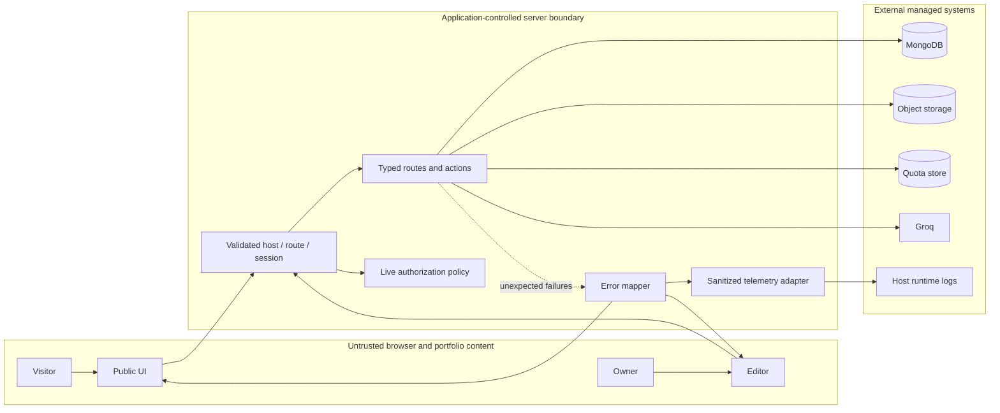
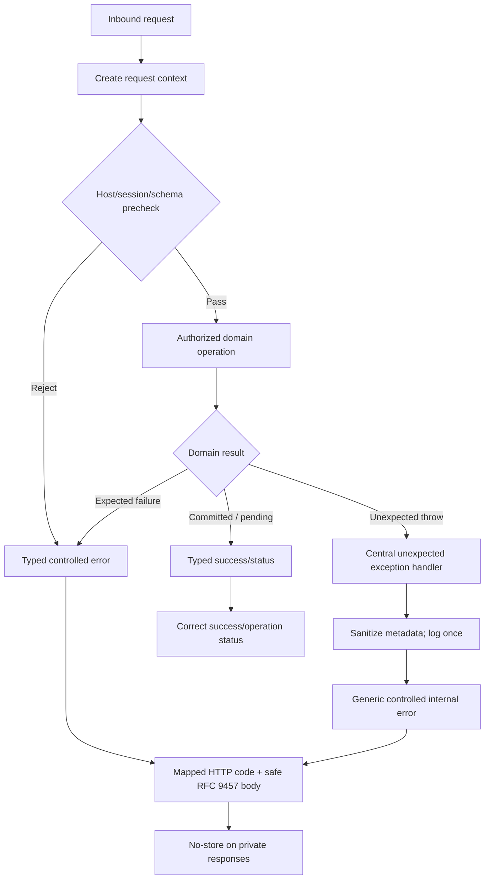
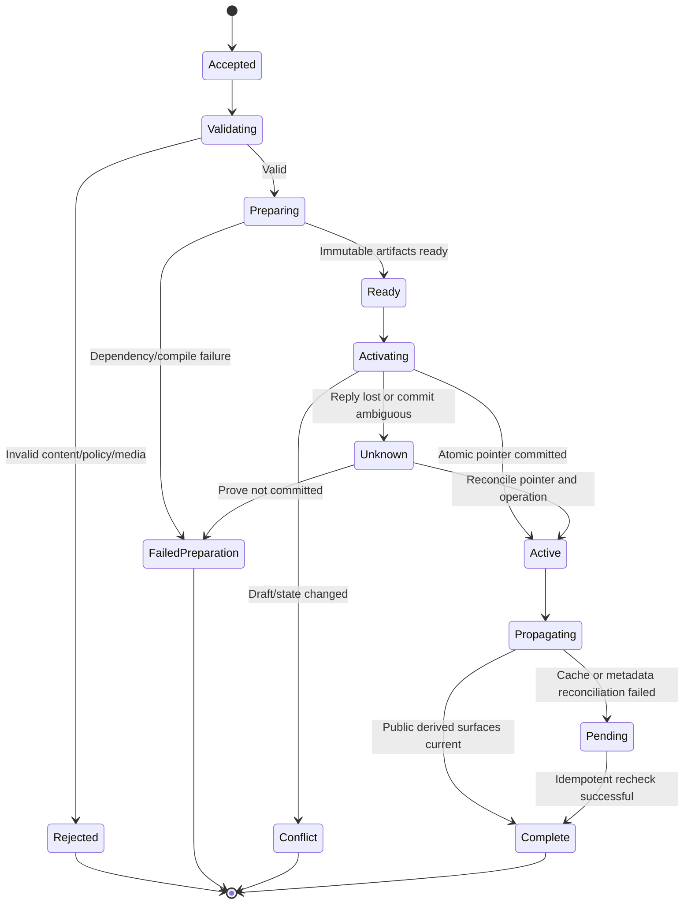
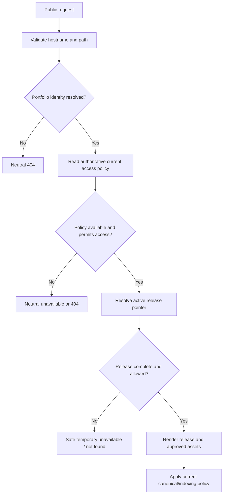
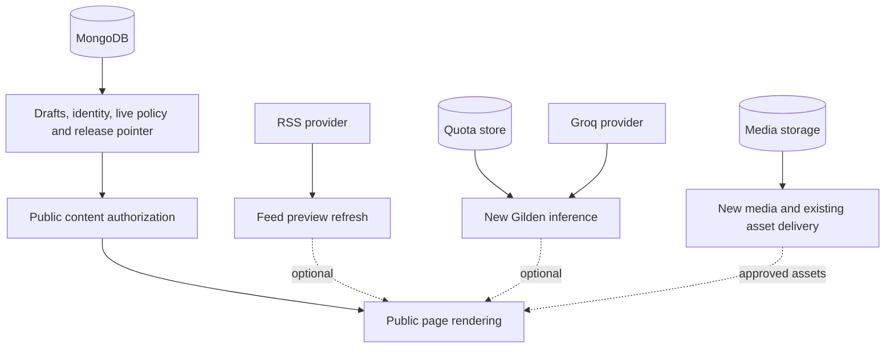
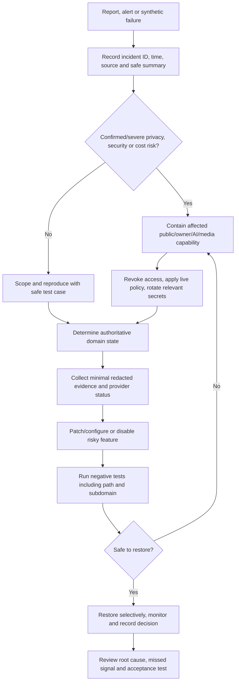

# 09 - Error Handling, Logging, Observability, Incident Response and Operational Support

> **Product:** GildedIn
> **Document ID:** GILD-ARCH-09  
> **Document version:** 2.0.0 (proposed normative baseline)  
> **Date:** 2026-11-19  
> **Status:** Implementation specification; provider-dependent controls remain launch verification gates  
> **Maintainer:** Product architecture / security and operations  
> **Scope:** Public portfolio platform, owner editor, administration, published-content delivery, Gilden, media, external integrations, development and deployment  
> **Authority:** [02 Requirements](02-requirements-and-scope.md) and [07 Security](07-security-design.md) establish product/security obligations; this document defines their error and operational behavior. Interface details must match [06 API](06-api-design.md), lifecycle behavior must match [08 Storage and Sync](08-storage-and-sync-strategy.md), and test evidence must match [11 Testing](11-testing-strategy.md).

> [!IMPORTANT]
> This is a design and acceptance specification, not an assertion that an implementation, monitor, free provider, backup, audit retention period, or incident response program already exists. GildedIn's $0 model does not guarantee uninterrupted availability, 24/7 support, forensic log retention, or independent disaster recovery. It **does** require fail-closed access decisions, honest status reporting, bounded resource use, correct data integrity semantics, and no unexpected charge.

## Document map

1. [Purpose and normative rules](#1-purpose-and-normative-rules)
2. [System context and failure surfaces](#2-system-context-and-failure-surfaces)
3. [Reliability and security invariants](#3-reliability-and-security-invariants)
4. [Error classification and severity](#4-error-classification-and-severity)
5. [HTTP and API problem contract](#5-http-and-api-problem-contract)
6. [Error code registry and interoperability](#6-error-code-registry-and-interoperability)
7. [Request context, error mapping, and safe implementation](#7-request-context-error-mapping-and-safe-implementation)
8. [Web rendering, client boundaries, and accessible feedback](#8-web-rendering-client-boundaries-and-accessible-feedback)
9. [Identity, authorization, and hostile hostnames](#9-identity-authorization-and-hostile-hostnames)
10. [Editor autosave, concurrency, and ambiguous outcomes](#10-editor-autosave-concurrency-and-ambiguous-outcomes)
11. [Publication, revision restoration, and cache propagation](#11-publication-revision-restoration-and-cache-propagation)
12. [Public delivery, moderation, and security revocation](#12-public-delivery-moderation-and-security-revocation)
13. [Gilden AI streaming, quotas, and context failures](#13-gilden-ai-streaming-quotas-and-context-failures)
14. [Media, PDF, object storage, and quotas](#14-media-pdf-object-storage-and-quotas)
15. [External URLs, RSS, GitHub and optional services](#15-external-urls-rss-github-and-optional-services)
16. [Contact inbox, analytics, deletion and exports](#16-contact-inbox-analytics-deletion-and-exports)
17. [Timeouts, retry budgets, circuit breakers, and load shedding](#17-timeouts-retry-budgets-circuit-breakers-and-load-shedding)
18. [Structured logging architecture](#18-structured-logging-architecture)
19. [Sensitive-data minimization and injection prevention](#19-sensitive-data-minimization-and-injection-prevention)
20. [Security audit trail](#20-security-audit-trail)
21. [Metrics, Web Vitals, and event aggregation](#21-metrics-web-vitals-and-event-aggregation)
22. [Tracing and distributed request correlation](#22-tracing-and-distributed-request-correlation)
23. [Retention, telemetry privacy, and storage economics](#23-retention-telemetry-privacy-and-storage-economics)
24. [Administrative operational status and alerting](#24-administrative-operational-status-and-alerting)
25. [Incident classification, response and evidence handling](#25-incident-classification-response-and-evidence-handling)
26. [Operational runbooks](#26-operational-runbooks)
27. [Threat model for the observability system](#27-threat-model-for-the-observability-system)
28. [Implementation boundaries and reference contracts](#28-implementation-boundaries-and-reference-contracts)
29. [Testing and fault-injection catalog](#29-testing-and-fault-injection-catalog)
30. [Requirement traceability and deployment gates](#30-requirement-traceability-and-deployment-gates)
31. [Configuration, operations checklist and change control](#31-configuration-operations-checklist-and-change-control)
32. [Evidence, standards and references](#32-evidence-standards-and-references)
33. [Glossary](#33-glossary)

---

## 1. Purpose and normative rules

### 1.1 Intended outcomes

GildedIn must make failure states predictable for three very different audiences: a visitor reading a public portfolio; a portfolio owner making potentially irreversible edits; and a solo maintainer diagnosing security, data consistency and free-tier capacity problems. A fourth audience, the platform administrator, needs limited and auditable access to moderation and operational state without acquiring read access to user-private portfolio drafts, contact inboxes, AI transcripts or credentials.

The error and observability architecture must answer, without ambiguity:

- **What failed?** Identify an operation, a controlled error code, a bounded failure phase and its dependency class.
- **What remains committed?** Distinguish operations not started, rejected before commit, committed but not acknowledged, and committed with incomplete propagation.
- **Can the caller retry?** Describe whether retry is safe, requires an idempotency key, requires refresh/reconciliation, or is prohibited.
- **Which data is safe to show?** Never reveal private fields, internal identifiers, provider secrets or unapproved AI context in an error.
- **Who should act next?** Give a visitor safe navigation, an owner recovery choices, an administrator incident triage, and a maintainer evidence without secrets.
- **What can degrade?** Optional AI, RSS refreshes and analytics may become unavailable while public content remains usable. Authoritative authorization and content-safety gates never fail open.
- **What happens at $0?** Resource exhaustion may cause denial of operations or temporary unavailability; no automatic paid fallback, billing upgrade or unbounded retry loop is acceptable.

### 1.2 Normative language and precedence

`MUST` and `MUST NOT` are release-blocking; `SHOULD` describes the recommended default unless an approved ADR records a justified alternative; `MAY` is optional. Explicit product limits and data-access guarantees in [02](02-requirements-and-scope.md), [05](05-data-model.md), [06](06-api-design.md), [07](07-security-design.md) and [08](08-storage-and-sync-strategy.md) take precedence over illustrative examples here. A conflicting example is not permission to change the source contract silently.

**Binding principles:** no cross-tenant leakage; no unauthorized public/AI exposure; no promotion of draft changes into public state without Publish; publication must be idempotent; no trusted claim from a browser or arbitrary hostname; no raw AI transcripts in persistent logs; no accidental billable usage; no misleading success message; no user-facing stack trace; no use of logging as a substitute for durable domain state.

### 1.3 Architecture choice

A single Next.js App Router modular monolith hosts API route handlers, owner administration, content logic and the public renderer. MongoDB stores authoritative domain records and narrowly scoped operational/audit records. Object storage holds validated images and PDFs. Redis-like managed counters may regulate quotas. Groq handles optional AI inference. Hosting and telemetry adapters are replaceable. No initial Elasticsearch, Kafka, RabbitMQ, full APM deployment, always-on worker, SIEM, tracing cluster, or self-hosted log aggregation server is justified merely to implement observability [ADR-001, ADR-016, ADR-022, ADR-030, ADR-032 in 12](12-architecture-decision-record.md).

### 1.4 Sources and derived decisions

The selected technical standards are [RFC 9457 Problem Details][R01], [RFC 9110 HTTP semantics][R02], [OWASP Error Handling][R04], [OWASP Logging][R05], [OpenTelemetry HTTP conventions][R08], [W3C Trace Context][R10], [NIST SP 800-61 Rev. 3][R12] and framework/provider documentation. They provide interoperability and security guidance; GildedIn's exact error codes, alert thresholds, privacy policies, and operational runbooks below are project design decisions, not mandates claimed to be imposed by those standards.

## 2. System context and failure surfaces

### 2.1 Surfaces and owners

| Surface               | Caller or actor           | Dependency or failure origin                               | User-visible outcome                                     | Authoritative state                                   |
| --------------------- | ------------------------- | ---------------------------------------------------------- | -------------------------------------------------------- | ----------------------------------------------------- |
| Public portfolio      | Anonymous visitor/crawler | Host resolution, policy, release lookup, renderer, CDN     | Working semantic HTML, 404, or bounded unavailable state | Portfolio active release + current live policy        |
| Marketing / directory | Anonymous visitor         | Public listing projection, server rendering                | Useful fallback, empty state or temporary unavailable    | Curated/eligible published portfolio projection       |
| Owner dashboard       | Authenticated account     | Session, ownership, draft model, API                       | Saved/pending/conflict/error status                      | Owner-scoped portfolio + draft revision               |
| Visual canvas         | Authenticated editor      | Validation, responsive transforms, local state             | Preserve work and show actionable issue                  | Client working state; server-validated draft          |
| Publish control       | Owner                     | Compiler, media readiness, commit, revalidation            | Rejected, preparing, activated or propagation pending    | Idempotent publish operation + active release pointer |
| Gilden                | Anonymous visitor         | Active release, AI policy, quota, context generation, Groq | Chat, partial response, or standalone unavailable state  | Live AI policy + matching approved release            |
| Media upload          | Owner                     | Validation, staging, quotas, conversion, storage           | No partial publish or leaked invalid file                | Server reservation + validated asset record           |
| Contact form          | Anonymous visitor         | Abuse check, inbox write, retention                        | Confirmed received or clear failure                      | Owner-scoped inbox record                             |
| External feed import  | Owner-approved input      | URL, DNS, TLS, redirects, remote response                  | Retain safe cached metadata / manual fallback            | Last validated feed snapshot                          |
| Admin moderation      | Authorized admin          | Recent auth, named privilege, CAS, policy commit           | Audited operation state and confirmed suppression        | Live moderation policy                                |
| Export/deletion       | Owner                     | Sensitive auth, data enumeration, media operations         | Confirmed completion or resumable operation              | Deletion/export operation ledger                      |
| Infrastructure        | Host/provider             | DNS, TLS, DB, storage, Redis, AI, quotas                   | Degrade safely; never add paid capacity automatically    | Deployment configuration and provider state           |

### 2.2 Trust zones



Arrows describe **possible authorized interactions**, not blanket permission. A request cannot bypass host validation, ownership, current policy or content safety because a downstream service is temporarily unavailable. The browser is untrusted, including apparently same-site portfolio subdomains, malformed headers, and data placed into public content by portfolio owners.

### 2.3 Distinguish infrastructure errors from domain errors

The platform must not infer that any upstream `500`, CDN cache miss, timeout, TLS failure, or network disconnect means no domain transaction happened. In particular, after a write is sent, a lost response is an **unknown outcome**, not an automatic failure. The idempotency/status ledger is the evidence for publish, uploads, sensitive actions and deletion. Conversely, a successful HTTP response from a third party does not prove application validation or authorization succeeded.

### 2.4 No additional service by default

The following remain excluded unless demonstrated necessary: always-on error aggregation, paid remote tracing, independent standby database, managed message broker, cross-region disaster recovery, realtime WebSocket dashboards, push-based paging, 24/7 staffed response, raw end-user session recordings, and collection of AI conversation histories. An optional free alerting or monitoring integration must undergo the same security/privacy, no-payment-card and no-overage checks as other providers.

## 3. Reliability and security invariants

### 3.1 Release-blocking invariants

| ID           | Invariant                                                                                                                | Observable proof                                                |
| ------------ | ------------------------------------------------------------------------------------------------------------------------ | --------------------------------------------------------------- |
| `ERR-INV-01` | A denial or unavailable policy never reveals another tenant's content                                                    | Cross-tenant and policy-outage negative tests, response scan    |
| `ERR-INV-02` | Public responses use exactly one active immutable release, subject to live suppression                                   | Concurrent publish/suspend tests and release identity assertion |
| `ERR-INV-03` | Failed or unacknowledged draft save never displays a false Saved state                                                   | Network-drop, competing-tab tests                               |
| `ERR-INV-04` | Publish pointer activation occurs at most once per idempotent intent                                                     | Lost-response and simultaneous-retry tests                      |
| `ERR-INV-05` | Post-commit cache propagation failure never rolls back or duplicates a committed release by accident                     | Inject failed revalidation; inspect operation ledger            |
| `ERR-INV-06` | A cached page cannot be treated as proof that visitor access remains authorized                                          | Change live policy, fetch from both URL models and cache paths  |
| `ERR-INV-07` | AI cannot run when matching knowledge/approval/quota state cannot be verified                                            | Stale context, policy store and counter outages                 |
| `ERR-INV-08` | Failed uploads do not yield public files or permanently consume quota reservations                                       | Stage, validator, processor and commit faults                   |
| `ERR-INV-09` | Logging never publishes secret/raw-private content; log failures cannot cause access bypass                              | Canary, hostile strings and sink-failure tests                  |
| `ERR-INV-10` | Sensitive domain actions produce minimum durable, authorized audit metadata                                              | Identity, publish, moderation and deletion assertions           |
| `ERR-INV-11` | No retry or failover path initiates billable requests                                                                    | Provider-cap simulations and configuration review               |
| `ERR-INV-12` | Error code/HTTP semantics are stable, documented and schema validated                                                    | OpenAPI and consumer contract tests                             |
| `ERR-INV-13` | Expired records remain inaccessible at read time even if background TTL deletion lags                                    | Artificially delay MongoDB TTL sweeper                          |
| `ERR-INV-14` | Owner/admin telemetry access does not grant access to visitor chat or private inbox content                              | Authorization and projection tests                              |
| `ERR-INV-15` | Incident containment can disable affected risky functionality without inadvertently granting access to older cached data | Security kill-switch and rollback drills                        |
| `ERR-INV-16` | Debug mode and telemetry expansion do not silently override production privacy constraints                               | Production env schema / CI configuration tests                  |

### 3.2 Availability and durability are not guaranteed

Use the vocabulary **best-effort availability** and **bounded graceful degradation**, not high availability or RTO/RPO guarantees. The product accepts that catastrophic provider failure can result in unrecoverable data loss. Three retained releases, cache copies and a log stream are not independently protected backups. A fallback cache that was not authorized for security-sensitive decisions cannot be used to simulate availability during a policy outage.

### 3.3 UX honesty

- `Saved`: the server has acknowledged the current draft mutation/revision, not merely that the keystrokes reached memory.
- `Saving`: mutation still pending; leave the current working draft visible.
- `Unsaved`: local changes differ from confirmed saved revision.
- `Conflict`: another revision exists; local edits preserved until the owner resolves it.
- `Published`: atomic active release commit is verified.
- `Published - propagation pending`: commit verified; not all caches/search/metadata propagation complete.
- `Unavailable`: the operation cannot be completed; show useful alternatives, not fabricated success.
- `Deleted`: claim only when the documented deletion scope has been completed; separately disclose provider backup retention limitations.

### 3.4 Testable evidence, not general assertions

The CI pipeline must exercise intentionally failed dependencies, stale versions, malformed payloads and adversarial input. A unit test that only asserts a mocked logger was called does not prove safe logging. A simulated failed authentication check must show that no protected content is returned. A dashboard toast is not evidence that a publication committed. Evidence should include a deterministic operation ID, expected state transition, and safe server-side records.

## 4. Error classification and severity

### 4.1 Three independent axes

1. **Error type**: validation, authentication, authorization, concurrency, dependency, quota, security policy, internal defect, cancellation, or expected absent resource.
2. **State certainty**: not attempted, rejected before write, transaction aborted, committed and confirmed, committed but propagation incomplete, or unknown outcome requiring reconciliation.
3. **Impact**: local operation, single portfolio, multiple portfolios, shared platform, active security/privacy exposure.

Never map all 5xx events to a single generic retry policy. A client timeout with a committed publication needs status reconciliation, not another publish with a new key. A private authorization denial should be a normal controlled branch, not a fatal infrastructure exception. A policy availability outage is a critical security decision even if it impacts only one route.

### 4.2 Taxonomy

| Class                     | Example                              | Typical state                 | Retry decision             | Required observation                            |
| ------------------------- | ------------------------------------ | ----------------------------- | -------------------------- | ----------------------------------------------- |
| `CLIENT_SYNTAX`           | Invalid JSON, unsupported media type | No mutation                   | Caller fix                 | Route, status, bounded parse reason             |
| `DOMAIN_VALIDATION`       | More than 20 authored blocks         | Rejected                      | After edit                 | Error code and path, no body                    |
| `AUTHENTICATION`          | Expired/invalid session              | Rejected                      | Reauthenticate             | Outcome and provider category                   |
| `AUTHORIZATION`           | Cross-tenant portfolio ID            | Rejected                      | Never with same identity   | Redacted denial reason and scope                |
| `SECURITY_POLICY`         | Moderator suppression, AI revocation | Denied                        | Only if policy changes     | Policy version and enforcement outcome          |
| `CONCURRENCY`             | Draft version stale                  | No write                      | Compare/reload             | Expected vs current revision (server-side only) |
| `IDEMPOTENCY`             | Same key different fingerprint       | No new write                  | New intent after review    | Existing operation ID, conflict                 |
| `PUBLISH_PREPARATION`     | Invalid release compilation          | Old release active            | After fix/retry            | Preparation stage, pointer unchanged            |
| `PUBLISH_POSTCOMMIT`      | Cache revalidation failed            | New release active            | Reconcile only             | Active release and propagation stage            |
| `DEPENDENCY_TRANSIENT`    | RSS timeout                          | No change or last valid cache | Bounded retry              | Dependency, stage, timeout bucket               |
| `DEPENDENCY_HARD`         | Unsupported provider plan            | Feature off                   | No automated retry         | Configuration/capacity gate                     |
| `CAPACITY`                | Global media full                    | No upload                     | When capacity available    | Global safe threshold, admission result         |
| `ABUSE`                   | Rate/size limit triggered            | Rejected                      | Per policy                 | Aggregated reason, no payload                   |
| `AI_STREAM`               | Groq stream interrupted              | Partial answer                | New turn only, count quota | Stream stage and finish class                   |
| `EXTERNAL_DATA_UNTRUSTED` | Redirect to private IP               | Rejected                      | Manual metadata            | Policy rule triggered, no raw URL log           |
| `DATA_INTEGRITY`          | Dangling content reference           | Rejected or quarantined       | After repair               | Resource class, invariant failed                |
| `CANCELLATION`            | Visitor closes Gilden                | Aborted output                | No blind resend            | Cancellation category, not necessarily error    |
| `UNEXPECTED_DEFECT`       | Null dereference                     | Unknown                       | Only if safe               | Error class, digest, request ID                 |

### 4.3 Operational severity differs from HTTP severity

A `404` can be an expected, harmless unknown subdomain; the same status returned because a moderation bypass leaked stale content is a SEV-1 security incident. A 500 from one optional feed is usually low impact, while a series of 200 responses containing unauthorized private data is high severity. Incident severity depends on the **actual confidentiality, integrity, availability and cost impact**, not only HTTP status codes.

### 4.4 Internal typed error model

```ts
// Illustrative domain contract. No business logic should depend on text messages.
type ErrorClass =
  | "validation"
  | "authentication"
  | "authorization"
  | "conflict"
  | "security_policy"
  | "capacity"
  | "dependency"
  | "unavailable"
  | "internal";

type CommitCertainty =
  | "not_started"
  | "rejected"
  | "aborted"
  | "committed"
  | "propagation_pending"
  | "unknown";

type PublicError = Readonly<{
  code: string; // controlled registry value
  status: number; // HTTP semantics
  title: string; // safe static text
  detail: string; // approved display text
  retryability:
    | "never"
    | "after_input"
    | "after_reauth"
    | "after_refresh"
    | "after_delay"
    | "reconcile_operation";
}>;

type InternalFailure = Readonly<{
  public: PublicError;
  class: ErrorClass;
  certainty: CommitCertainty;
  causeCategory?: string; // finite allowlist, never raw error
  phase?: string; // finite workflow stage enum
  operationId?: string; // opaque, validated
}>;
```

The public response must not include the internal `certainty`, cause or operation stage unless that information is intentionally authorized for the caller. Provider exception objects are never serialized directly.

## 5. HTTP and API problem contract

### 5.1 Canonical representation

Every JSON API failure under application control MUST use `Content-Type: application/problem+json` with a [RFC 9457][R01] problem object. Framework-generated responses before the handler, host/CDN failures, redirect responses, streaming bodies already in flight, and HTML navigation responses may not use this media type; client code must handle these transport distinctions safely.

Required application fields: `type` (first-party registered URI), `title` (short stable title), `status` (actual HTTP status), `detail` (bounded safe advice), `code` (GildedIn-owned machine code), and `requestId` (opaque correlation identifier). Optional: an allowlisted `issues` array of `{path,code,message}` for validation, a safe `retryAfterSeconds` when reliable, and an operation/status URL only after verifying caller authorization. The standard `instance` member is optional: if used, it should be an opaque occurrence URI, never a private record URL, raw request target or authorization capability.

```http
HTTP/1.1 422 Unprocessable Content
Content-Type: application/problem+json
Cache-Control: private, no-store
X-Request-ID: req_8gZrR6sX4NqZ

{
  "type": "https://aaroophan.dev/problems/content-validation",
  "title": "Some content needs attention",
  "status": 422,
  "detail": "Correct the highlighted fields before publishing.",
  "code": "PUBLICATION_VALIDATION_FAILED",
  "requestId": "req_8gZrR6sX4NqZ",
  "issues": [
    {"path": "sections[0].profile.identityLabel", "code": "required", "message": "Add a professional title or identity label."},
    {"path": "nodes[7]", "code": "focus_obscured", "message": "This control is unreachable in the mobile layout."}
  ]
}
```

**Field hygiene:** Server-generated issue paths must come from the validated schema and be bounded in length/count; they cannot echo arbitrary submitted keys without escaping/normalization. `detail` must not contain raw exception messages, submitted content, hidden field names, authorization state for another tenant, database query strings, untrusted RSS URLs, prompt fragments, or data returned from providers. A token or request ID embedded in an error must never grant access to the resource it describes.

### 5.2 Response header contract

| Surface                             | Headers or semantics                                                                 | Security reason                                     |
| ----------------------------------- | ------------------------------------------------------------------------------------ | --------------------------------------------------- |
| Authenticated JSON API              | `Cache-Control: private, no-store`; correct `Content-Type`; narrow cookie scope      | No CDN/browser cache of private data                |
| Public error from secured route     | Restrictive caching; no request/owner data in body                                   | Avoid revealing resource existence and stale denial |
| `429` with predictable policy reset | Optional `Retry-After` with integer seconds or HTTP-date                             | Client backoff; avoid false precision               |
| `503` temporary overload            | Optional `Retry-After` only if known                                                 | Avoid thundering herd                               |
| Read with draft validator           | `ETag` on authorized resource                                                        | Compare revision/precondition safely                |
| Conditional write                   | `If-Match`/version as defined by API contract                                        | Prevent lost updates                                |
| Rejected upload                     | Safe error and no public location                                                    | Avoid serving untrusted bytes                       |
| SSE                                 | `Content-Type: text/event-stream`, `Cache-Control: no-store`, correct stream cleanup | Protect streaming metadata and cancel work          |
| Owner/admin export                  | `private, no-store`, `nosniff`, safe disposition                                     | Keep sensitive archives off public caches           |

Do not interpret a cache header as an authorization mechanism. Public content also needs a live availability/moderation policy at the route and media boundary. [RFC 9110][R02] and [RFC 6585][R03] govern response semantics; the platform-specific rules are in [06](06-api-design.md).

### 5.3 Stable errors versus internal exceptions

For expected validation/auth/conflict outcomes, construct typed domain results rather than throwing arbitrary Exceptions simply to reach a shared catch block. A thrown unexpected exception is treated as `INTERNAL_ERROR` and logged once at the boundary; the response never uses exception.message. Retain the safe cause classification in server-only logs. A domain library may expose error codes but must not choose the outgoing host, disclose resource existence or inspect browser headers by itself.

For security denials that could reveal the existence of another owner's record, a policy-approved `404` is preferable to a descriptive `403`. Owner-accessible operations may use `403` where the permission failure is not sensitive. This is an authorization policy choice, not merely an aesthetic error-page choice.

### 5.4 4xx/5xx status decision table

|  HTTP | When to use                                                                        | Not appropriate for                                                                       |
| ----: | ---------------------------------------------------------------------------------- | ----------------------------------------------------------------------------------------- |
| `400` | Bad syntax, impossible request shape, invalid/ambiguous host within handler        | Valid schema with domain-specific failed constraint                                       |
| `401` | Authentication required or no current session                                      | Authorization denied with valid identity                                                  |
| `403` | Valid identity/request but policy disallows                                        | Unknown private object existence leak                                                     |
| `404` | Not found or deliberately undisclosed/private/suppressed target                    | Operational DNS/TLS errors masquerading as application not found                          |
| `409` | Application revision, state or unique-name conflict                                | Failed standard `If-Match` precondition if strict HTTP conditional semantics are selected |
| `410` | Permanently retired resource when safe to disclose                                 | An unlisted portfolio merely excluded from search                                         |
| `412` | HTTP `If-Match` precondition false when standards-compliant validator mode is used | Domain workflow conflict unrelated to a request header                                    |
| `413` | Input exceeds transport/media size ceiling                                         | Global provider quota exhaustion                                                          |
| `415` | Unsupported content type                                                           | Allowed type with unsafe contents (422)                                                   |
| `422` | Parsed request violates domain/schema safety                                       | Unavailable provider, timeout or authentication problem                                   |
| `428` | Endpoint requires conditional header (if adopted)                                  | Ordinary resource absence                                                                 |
| `429` | Known caller quota/rate limit exceeded                                             | Groq unavailable without a client-specific quota cause                                    |
| `500` | Unexpected application defect                                                      | Known validation, policy or quota rejection                                               |
| `502` | Application acts as upstream gateway and receives invalid upstream response        | Internal DB write rejected by schema                                                      |
| `503` | Required service/policy/AI/integration unavailable or global capacity hard stop    | Validation/ownership denial                                                               |
| `504` | Application gateway times out waiting for upstream when applicable                 | Cancelled browser rendering                                                               |
| `507` | Storage exhaustion if deliberately supported/understood by clients                 | General media validation; not automatically the only quota code                           |
| `202` | Operation accepted or committed with reconciliation pending                        | **Not an error**; must give operation status and honest state                             |

**Specific interoperability issue:** The requirements and current API design use `409 DRAFT_REVISION_CONFLICT` for the draft's application revision. HTTP `If-Match` failed preconditions ordinarily map to **412** under RFC 9110. GildedIn must freeze one transport behavior in the OpenAPI/contract tests: use the domain revision in request body with `409`, or use true HTTP validators with `412` (and map both to the same owner recovery UX if both are supported). Do not emit `409` for a failed `If-Match` while claiming strict RFC 9110 compliance; do not change the already-specified product `409` handling without updating [06](06-api-design.md) and the ADR [R02].

### 5.5 Protocol edge cases

- `HEAD` responses have no body; status and safe headers suffice.
- `204` must not include a response body, including a problem document.
- Network errors, TLS failures and hosting limits may prevent any HTTP response. The client must show an offline/unknown-state recovery rather than assume `500`.
- A browser may receive an HTML error page from hosting infrastructure instead of JSON. The client must verify content type and safely fall back to `DEPENDENCY_UNAVAILABLE`/`INTERNAL_ERROR` UX without rendering raw HTML.
- A started SSE response cannot retroactively change status to 500 or emit an RFC 9457 HTTP response; it must use a controlled in-stream terminal error and close.
- Non-JSON form posts should return a safe accessible HTML state or redirect only after success; they must not dump raw handler exceptions into the page.
- Cache `Vary`, no-store and canonical logic must be verified for both path and subdomain routes to avoid cross-host cached confusion.
- Unknown `Host` and unexpected forwarded headers must be rejected according to ingress trust policy before selecting a tenant or recording operational dimensions.

## 6. Error code registry and interoperability

### 6.1 Canonical codes aligned with API design

The following mirrors the active [06 API registry](06-api-design.md). A code is stable across external transport variants and must have a stable public title, bounded detail, documented remediation and explicit security classification. Legacy-free, internal-only taxonomy may use more specific component codes but must map to one approved public registry entry.

| Code                             | HTTP / state       | Recoverability     | Surface / owner action                     | Logging class                    |
| -------------------------------- | ------------------ | ------------------ | ------------------------------------------ | -------------------------------- |
| `REQUEST_MALFORMED`              | 400                | Fix request        | Request rejected; no mutation              | warn, aggregated                 |
| `CONTENT_TYPE_UNSUPPORTED`       | 415                | Fix type           | Show allowed content                       | info                             |
| `REQUEST_TOO_LARGE`              | 413                | Reduce input       | Reject before parse/storage                | warn                             |
| `UNAUTHENTICATED`                | 401                | Sign in            | Return to intended action after auth       | info (no token)                  |
| `REAUTH_REQUIRED`                | 401/403            | Fresh auth         | Do not carry out sensitive action          | security info                    |
| `FORBIDDEN`                      | 403                | Not with same role | Generic denial; no target details          | security warn if suspicious      |
| `RESOURCE_NOT_FOUND`             | 404                | Navigation         | Safe not-found page                        | info; sample noisy bots          |
| `PORTFOLIO_UNAVAILABLE`          | 404/503            | Depends on cause   | Neutral public unavailable view            | warn/error; no moderation reason |
| `SLUG_UNAVAILABLE`               | 409                | Rename input       | Suggest another slug                       | info                             |
| `PORTFOLIO_ALREADY_EXISTS`       | 409                | Open existing      | One-portfolio owner constraint             | info                             |
| `LAST_LOGIN_PROVIDER`            | 409                | Link alternate     | Keep existing provider linked              | security info                    |
| `DRAFT_REVISION_CONFLICT`        | 409                | Compare/reload     | Preserve unsaved local work                | warn, revision metadata          |
| `HTTP_PRECONDITION_FAILED`       | 412                | Reload             | Conditional HTTP contract variant          | info                             |
| `PRECONDITION_REQUIRED`          | 428                | Read/version       | Client must supply precondition            | info                             |
| `SCHEMA_INVALID`                 | 422                | Edit schema        | Field/section issue list                   | info                             |
| `CONTENT_REFERENCE_INVALID`      | 422                | Repair relation    | No dangling published reference            | warn                             |
| `CONTENT_IN_USE`                 | 409                | Detach references  | Reject unsafe deletion                     | info                             |
| `BLOCK_LIMIT_EXCEEDED`           | 422                | Consolidate        | 20 authored blocks, not repeated instances | info                             |
| `PUBLISHED_PAYLOAD_TOO_LARGE`    | 422                | Reduce payload     | 102,400 UTF-8 bytes canonical release      | info                             |
| `PUBLICATION_VALIDATION_FAILED`  | 422                | Fix issues         | No pointer activation                      | warn                             |
| `PUBLICATION_OPERATION_CONFLICT` | 409                | Recheck            | Another publication or state transition    | warn                             |
| `IDEMPOTENCY_KEY_REUSED`         | 409                | Reconcile intent   | Reject different fingerprint               | security warn when suspicious    |
| `PUBLISH_PROPAGATION_PENDING`    | **202, not error** | Recheck            | Committed release; cached surfaces pending | warn event, not 5xx              |
| `MEDIA_IN_USE`                   | 409                | Detach safely      | Retained release/media references          | info                             |
| `MEDIA_QUOTA_EXCEEDED`           | 409/507            | Free capacity      | Per-owner quota denied; no dangling intent | warn                             |
| `STORAGE_CAPACITY_EXHAUSTED`     | 503/507            | Try later          | Global hard-free storage cap               | error operational                |
| `UNSAFE_FILE_TYPE`               | 422                | Replace file       | Quarantine/delete staged bytes             | security warn                    |
| `UNSAFE_PDF`                     | 422                | Replace PDF        | No unsafe public preview                   | security warn                    |
| `UPLOAD_INTENT_EXPIRED`          | 409/410            | New intent         | Release reservation safely                 | info                             |
| `REMOTE_URL_BLOCKED`             | 422                | Manual metadata    | SSRF policy; do not retry                  | security warn                    |
| `REMOTE_FETCH_UNAVAILABLE`       | 502/503            | Manual/cached      | Optional integration failure               | warn                             |
| `AI_DISABLED`                    | 503/404            | Owner enable       | Static portfolio available                 | info                             |
| `AI_CONTEXT_NOT_READY`           | 503                | Wait/recheck       | Never use previous release context         | warn                             |
| `AI_POLICY_REVOKED`              | 503                | Stop               | Fail closed, halt in-flight stream         | security warn                    |
| `AI_QUOTA_EXCEEDED`              | 429                | Later              | Static links, bounded `Retry-After`        | info                             |
| `QUOTA_STORE_UNAVAILABLE`        | 503                | Later              | No unmetered AI fallback                   | error                            |
| `CONTACT_RATE_LIMITED`           | 429                | Later              | Text-only form remains unsent              | info                             |
| `ADMIN_RECENT_AUTH_REQUIRED`     | 403                | Fresh auth         | No moderation mutation                     | security info                    |
| `DEPENDENCY_UNAVAILABLE`         | 503                | Later              | Required provider unavailable              | error                            |
| `INTERNAL_ERROR`                 | 500                | Report request ID  | Controlled error view                      | error                            |

Other related internal names from the earlier operational baseline, such as `CSRF_VALIDATION_FAILED`, `PUBLISH_CONFLICT`, `BLOCK_LIMIT`, `FIELD_LIMIT`, `PUBLISHED_SIZE_LIMIT`, `AI_UNAVAILABLE`, and `SECURITY_POLICY_UNAVAILABLE`, are **not independent public API contracts** unless added through a versioned registry change. Map them to approved public codes (e.g., `FORBIDDEN`, `PUBLICATION_OPERATION_CONFLICT`, `BLOCK_LIMIT_EXCEEDED`, `PUBLISHED_PAYLOAD_TOO_LARGE`, `AI_CONTEXT_NOT_READY`, `PORTFOLIO_UNAVAILABLE`), while retaining safe internal diagnostic classification. This prevents drift with [06](06-api-design.md).

### 6.2 Domain-specific UI recovery matrix

| Recovery class               | UI action                                           | Must preserve                             | Must not do                                      |
| ---------------------------- | --------------------------------------------------- | ----------------------------------------- | ------------------------------------------------ |
| Input correction             | Focus first invalid field; show summary             | All valid editor inputs                   | Clear whole form                                 |
| Reauthentication             | Explain expired session and start secure OAuth flow | Protected local recovery draft if allowed | Retry authenticated mutation anonymously         |
| Authorization denied         | Neutral explanation, safe navigation                | No protected response data                | Reveal another owner's resource title            |
| Revision conflict            | Compare, reload, copy local changes                 | Unsaved local edits                       | Silently force overwrite                         |
| Operation reconciliation     | Open status/recheck using prior idempotency key     | Operation identity                        | Generate a new key for same intent automatically |
| Temporary provider issue     | Retry after bounded delay or manual action          | Existing published/read-only data         | Infinite retry or use billable fallback          |
| Privacy/security suppression | Block access and remove local derived copies        | Only safe incident metadata               | Serve cached content from old release            |
| Client render exception      | Segment fallback and accessible retry               | Context if state safe                     | Display sensitive framework exception            |

### 6.3 Validation issue contract

An issue is `path`, `code` and safe `message`. Paths must be derived from the server schema, not arbitrary selector strings. Examples include `required`, `invalid_url`, `unsafe_reference`, `duplicate_hero`, `focus_obscured`, `nested_depth_exceeded`, `custom_field_limit`, `collection_limit`, `missing_alt_text`, and `unsafe_color_contrast`. The server may cap issue count (proposed maximum 50) and append a generic `additional_issues` marker; that cap is an operational response budget and does not relax the underlying validation. Never include rejected rich-text markup, actual contact email, file bytes or prompt in `message`.

### 6.4 Unknown code behavior

The client must handle future/unknown codes gracefully, using the HTTP status for broad recovery and a safe generic message. Unknown codes must not trigger unsafe automated retries or expose a debug panel. The code registry is reviewed as part of any API-compatible change, and stale client code must remain safe when the server adds a new problem type.

## 7. Request context, error mapping, and safe implementation

### 7.1 Correlation IDs

Each inbound application-controlled operation receives a server-generated, cryptographically random opaque `requestId`. A caller-provided `X-Request-ID` is untrusted: validate a strict syntax/length if retaining it as a separate `clientCorrelationId`, or ignore it and generate a new authoritative ID. Never let a client choose the canonical ID used by support search, audit correlation or authorization. An existing trusted ingress header may be used only after explicit deployment verification that untrusted callers cannot spoof it.

Distinct identifiers have different roles:

| Identifier           | Scope                                  | Source                                               | Safe to show publicly?                              |
| -------------------- | -------------------------------------- | ---------------------------------------------------- | --------------------------------------------------- |
| `requestId`          | One application operation/request      | App/trusted ingress                                  | Yes, opaque; no privilege                           |
| `operationId`        | Publish/upload/delete/export lifecycle | Server-created durable record                        | Owner/admin after authorization only                |
| `clientMutationId`   | Draft edit/retry                       | Client-generated then validated/bound to owner       | Not a proof of identity                             |
| `idempotencyKey`     | One sensitive intent                   | Client generated; HMAC/hashed and scoped server-side | Never use as public lookup capability               |
| `traceId` / `spanId` | Optional diagnostic chain              | Instrumentation                                      | Not an auth factor; minimize cross-origin exposure  |
| `errorDigest`        | Next.js framework render error         | Framework                                            | May help support; not a stable user account key     |
| `portfolioId`        | Stable tenant resource                 | Server-owned record                                  | Avoid public problem bodies and metrics labels      |
| `releaseId`          | Immutable publication                  | Server-owned record                                  | Safe only when intentionally public; otherwise omit |

### 7.2 Error conversion order



**Order of enforcement:** Verify trusted host and route, parse body under size limit, authenticate as required, authorize action against resource and current policy, validate domain payload, execute idempotent operation, serialize allowlisted response. Some checks can be rearranged safely for efficiency; no rearrangement may leak cross-tenant resource existence or allow a provider error to turn into an authorization bypass.

### 7.3 TypeScript example: safe problem creation

```ts
// Illustration only. Wiring to framework, schemas and log adapter is mandatory.
import { NextResponse } from "next/server";

type Code =
  | "UNAUTHENTICATED"
  | "FORBIDDEN"
  | "RESOURCE_NOT_FOUND"
  | "DRAFT_REVISION_CONFLICT"
  | "PUBLICATION_VALIDATION_FAILED"
  | "DEPENDENCY_UNAVAILABLE"
  | "INTERNAL_ERROR";

type Def = { status: number; type: string; title: string; detail: string };
const DEFINITIONS = {
  UNAUTHENTICATED: {
    status: 401,
    type: "auth-required",
    title: "Sign in required",
    detail: "Sign in to continue.",
  },
  FORBIDDEN: {
    status: 403,
    type: "not-authorized",
    title: "Action not available",
    detail: "You cannot perform this action.",
  },
  RESOURCE_NOT_FOUND: {
    status: 404,
    type: "not-found",
    title: "Resource not found",
    detail: "The requested resource is unavailable.",
  },
  DRAFT_REVISION_CONFLICT: {
    status: 409,
    type: "draft-conflict",
    title: "Draft has changed",
    detail: "Review the latest saved changes before retrying.",
  },
  PUBLICATION_VALIDATION_FAILED: {
    status: 422,
    type: "content-validation",
    title: "Some content needs attention",
    detail: "Correct the highlighted fields before publishing.",
  },
  DEPENDENCY_UNAVAILABLE: {
    status: 503,
    type: "temporarily-unavailable",
    title: "Temporarily unavailable",
    detail: "This operation is unavailable right now.",
  },
  INTERNAL_ERROR: {
    status: 500,
    type: "internal-error",
    title: "Unexpected error",
    detail: "The operation could not be completed.",
  },
} satisfies Record<Code, Def>;

export function toProblem(code: Code, requestId: string) {
  const d = DEFINITIONS[code];
  const res = NextResponse.json(
    {
      type: `https://aaroophan.dev/problems/${d.type}`,
      title: d.title,
      status: d.status,
      detail: d.detail,
      code,
      requestId,
    },
    {
      status: d.status,
      headers: {
        "Cache-Control": "private, no-store",
        "X-Request-ID": requestId,
      },
    },
  );
  res.headers.set("Content-Type", "application/problem+json");
  return res;
}
```

The example is deliberately small; production definitions must come from one complete registry shared with [06](06-api-design.md), not multiple hardcoded lists. `X-Request-ID` is not an authorization capability. Sanitization happens **before** logging (and while deriving public problem details), not by hoping a downstream provider hides secrets.

### 7.4 Catch boundaries and exception chaining

A centralized entrypoint logs unexpected errors exactly once with a bounded cause class and stack fingerprint. Nested layers return typed outcomes or rethrow with safe context; they do not each log an identical stack. Avoid `console.error(error)` when error includes `config`, headers, request bodies, URLs, or provider payloads. A custom logger may record allowlisted `name`, a safe stack in restricted local/dev contexts, and an opaque `fingerprint`; production stack contents need explicit redaction and provider review before retention. No general logger should serialize the entire Request, Response, Mongo document, user session, Axios error or LLM provider object.

### 7.5 SSR and framework-specific boundaries

Next.js distinguishes expected errors from uncaught exceptions; segment-level `error.tsx`/`global-error.tsx` and instrumentation provide appropriate boundaries [R11, R13]. An error boundary is not a security authorization layer, nor does it normally catch all event handlers or asynchronous operations. Business rules should return expected typed results and the action UI should render them. Error boundary props may include framework digests; do not leak original server error messages to public pages. `notFound()` should only reflect a validated public availability decision, not be used as a broad catch-all for all unexpected exceptions.

## 8. Web rendering, client boundaries, and accessible feedback

### 8.1 State contract by experience

| Experience        | Loading/pending                                                         | Safe failure                                                             | Recovery and accessible behavior            |
| ----------------- | ----------------------------------------------------------------------- | ------------------------------------------------------------------------ | ------------------------------------------- |
| Marketing page    | Initial static content visible; optional directory delayed              | Directory unavailable, core value proposition still rendered             | Retry directory; avoid page crash           |
| Public portfolio  | Semantic identity/text first; 3D deferred                               | 3D fails silently to static theme; actual content failure shown honestly | Navigation and no-WebGL content always work |
| Search            | Fast client index lookup                                                | Invalid/missing index: limited static links, not private fallback        | Search retry, no cross-release results      |
| Dashboard         | Skeleton for private data load; never expose other owner's cached state | Generic unavailable or sign-in prompt                                    | Retry when safe; route remains private      |
| Autosave          | `Unsaved` then `Saving` then `Saved` only on ack                        | `Couldn't save changes`                                                  | Retry; preserve local work, announce status |
| Canvas validation | Inline markers and summary                                              | Do not throw due to malformed user node                                  | Select failing block; inspector correction  |
| Publish           | Preparing/validating/activating/propagating                             | Validation summary or unknown-status recheck                             | Keep old live release; never duplicate      |
| Gilden            | Accessible open/close and streaming indicator                           | Temporarily unavailable, static links remain                             | Close widget and navigate manually          |
| Upload            | Local preview marked pending                                            | Failed scan/conversion, staging discarded                                | Replace/select supported file               |
| Contact           | Submit button shows pending once                                        | Error without retaining server-side extra copies                         | Preserve browser inputs where safe          |
| Admin             | Restricted status view                                                  | Generic diagnostic unavailable                                           | No secrets or private records in DOM        |

### 8.2 Accessibility requirements

- Errors use text, icon/shape or location in addition to color; do not rely only on red borders.
- Inputs use `aria-invalid` and `aria-describedby` bound to their own error messages. A summary links to the first invalid field.
- Autosave status updates use a polite live region with debounce; avoid announcing every keystroke or repeated spinner updates.
- Serious blocking errors use a focused alert or dialog with meaningful action and keyboard-operable controls. Do not trap focus indefinitely.
- Publish status should be readable without motion; the progress sequence is textual and not an animation-only checklist.
- Screen-reader users can inspect validation errors and content even when all Three.js, Anime.js or Motion effects are disabled.
- Retry buttons are disabled while an identical request is pending; keep idempotency key stable and provide clear completed/status states.
- Draft conflicts must offer keyboard-accessible compare, copy/recovery and reload choices; do not force drag-and-drop interactions.
- If a public portfolio is unavailable, a branded semantic 404 or temporary page uses correct status, `<main>` and a heading, and never embeds a private reason in HTML/metadata.

### 8.3 Copybook examples

| Situation                   | Preferred message                                                                                      | Avoid                                                  |
| --------------------------- | ------------------------------------------------------------------------------------------------------ | ------------------------------------------------------ |
| Save network failure        | "Changes aren't saved yet. Retry when your connection is available."                                   | "Saved" before server acknowledgment                   |
| Second tab conflict         | "A newer saved draft exists. Compare changes before continuing."                                       | "Something went wrong" with overwrite button           |
| Invalid project link        | "This project link is invalid. Enter a complete HTTPS address."                                        | Echoing the full submitted URL in a log                |
| Publish validation          | "Correct 3 issues before publishing."                                                                  | "Publish failed" with no fields                        |
| Publish pending propagation | "Published. Some public pages are still updating."                                                     | "Publication failed" or "Visible everywhere"           |
| AI context preparing        | "Gilden is temporarily unavailable. Explore this portfolio directly."                                  | Using knowledge from a prior release                   |
| Unlisted notice             | "Anyone with this link can view the portfolio. It is excluded from GildedIn's directory and sitemaps." | Calling it password-protected                          |
| No database                 | "Editing is temporarily unavailable. Published pages may remain accessible where already cached."      | Guaranteeing availability from cache                   |
| Suspended public profile    | "This portfolio is unavailable."                                                                       | "Suspended for impersonation" to anonymous users       |
| Account deletion            | "Deletion is in progress. Access is disabled; remaining cleanup is being checked."                     | Claiming full deletion before cleanup                  |
| Unknown error               | "The operation could not be completed. Reference: req\_..."                                            | Exposing stack, SQL, model name or connection endpoint |

### 8.4 Browser offline/local recovery

A client-side navigator offline signal is only a hint; HTTPS request failures also occur for DNS, service outages and security blocking. Preserve unsaved editor work in memory and (where explicitly enabled and feasible) a tightly scoped local recovery draft. Local recovery must be scoped to account/portfolio, cleared on logout and account switching, and not include OAuth tokens, credentials or AI chat transcripts. Browser persistence cannot be promised under private browsing, storage eviction or device loss. The owner must see an honest warning when unsaved changes cannot be preserved; do not suggest that optimistic UI state guarantees server persistence.

### 8.5 Error boundary UX and component examples

```tsx
"use client";

export default function EditorError({
  error,
  reset,
}: {
  error: Error & { digest?: string };
  reset: () => void;
}) {
  // Rendering-only fallback. Record diagnostic metadata server-side through
  // validated instrumentation, not this component's raw error.message.
  return (
    <main role="main" aria-labelledby="editor-error-title">
      <h1 id="editor-error-title">The editor couldn't load this view.</h1>
      <p>Your saved draft has not been intentionally modified.</p>
      <button type="button" onClick={reset}>
        Try opening the editor again
      </button>
    </main>
  );
}
```

The sentence about saved drafts is about **no intentional writes during rendering**, not a guarantee that all previous operations committed. Do not display an unsaved state as saved after a boundary reset. Production error telemetry may use framework `digest` but must not pass arbitrary user data into `console.error` from the component.

## 9. Identity, authorization, and hostile hostnames

### 9.1 Authentication failures

Google OIDC and GitHub OAuth are external trust boundaries. Handle provider denial, invalid callback state, missing PKCE nonce, expired session, provider service outage, link collision, unverified provider identity and attempted last-provider unlink distinctly. Never blindly replay a code or token after an OAuth failure; start a fresh protocol flow when appropriate. Avoid email-based identity merge. Store no provider secret in a browser-side error or analytics event. [IAM-001..009, SEC-002, SEC-003]

### 9.2 Authorization failures

The repository query for a private resource must be scoped to the authenticated account and the requested tenant. On denial, no partial private DTO should have been serialized, cached or placed in an error cause. An attacker substituting another portfolio ID must not learn whether its content exists. For moderators and administrators, named permission checks and recent authentication apply even if the UI hides the action. A denied action that looks abusive may produce a bounded audit event; expected casual 404 traffic is aggregated rather than storing every visitor identifier.

### 9.3 Public subdomain threats

The platform uses an apex dashboard and tenant subdomains on the same registrable domain. **Same-site does not mean same-origin**; a malicious portfolio owner can cause interactions from their subdomain that the browser might consider same-site. Host-only cookies, Origin/CSRF verification, strict CORS, exact callback URL checks and untrusted-content sanitization must be tested with sibling subdomains [07](07-security-design.md). On invalid Host/forwarded-host combinations, reject before tenant lookup. Log normalized route class (`tenant-subdomain`, `apex-path`, `unknown-host`) rather than raw attacker-controlled hostnames or X-Forwarded-Host strings.

### 9.4 Revocation and denied availability

A missing or unreachable live policy is never interpreted as "allow the latest cached public release." Fail closed at the authoritative request boundary, then present a neutral error. If a CDN or already-issued static artifact cannot enforce revocation, the corresponding public delivery design is insufficient and must be changed before launch. Error reporting and logging cannot repair that architectural flaw. Use endpoint-level deny decisions and storage/asset suppression, not a diagnostic log as proof that content is no longer visible.

### 9.5 Audit without user enumeration

Store actor ID and target ID in restricted security audits where appropriate. General operational logs should prefer enum-denial categories, route template and safe opaque correlation. Public problem bodies never include `accountExists`, identity-provider subject, owner email, moderation notes, matched slug history, or details of a denied target. A support request ID is not permission for a third party to view the associated event.

## 10. Editor autosave, concurrency, and ambiguous outcomes

### 10.1 Local and persisted state separation

The editor has a local working model and a server-approved saved draft revision. Debounced autosave applies bounded mutations. The user must always see which state is authoritative and whether current local changes are pending. An optimistic canvas update is not equivalent to a database commit.

### 10.2 Draft save failure matrix

| Point of failure                    | Durable outcome                          | Required client behavior                             | Safe retry                                    |
| ----------------------------------- | ---------------------------------------- | ---------------------------------------------------- | --------------------------------------------- |
| Local validation rejects            | No network call                          | Show field-specific errors                           | After owner correction                        |
| Network unavailable before request  | Not attempted                            | Keep local work, show Unsaved                        | Same validated mutation when connected        |
| Server rejects 422                  | No write                                 | Show bounded issue list                              | After correction                              |
| Server rejects 401/403              | No authorized write                      | Stop; reauthenticate if applicable                   | New authenticated request after authorization |
| Revision check rejects 409/412      | No write                                 | Compare or reload; do not erase local changes        | With fresh revision after reconciliation      |
| Mongo write error before commit     | Rejected/aborted if proved               | Show Retry, keep mutation ID                         | Same ID/version, bounded                      |
| Mongo commits, response lost        | Unknown to client; committed server-side | Query current revision/mutation result               | Reconcile first; no blind duplicate           |
| Acknowledgment arrives out of order | Newer mutation may already be committed  | Ignore stale acknowledgment for display              | No stale overwrite                            |
| Browser refreshes mid-save          | Unknown                                  | Restore available local draft, fetch remote revision | Reconcile and display differences             |
| Local recovery quota full           | Not a server save error                  | Warn that local recovery isn't available             | Manual copy/export if safe                    |

### 10.3 Two-tab sequence

```mermaid
sequenceDiagram
  participant A as Editor tab A
  participant B as Editor tab B
  participant API as Draft API
  participant DB as Draft store
  A->>API: Save revision 10, mutation A1
  API->>DB: CAS revision=10 -> 11
  DB-->>API: Saved revision 11
  API-->>A: 200 revision 11
  B->>API: Save revision 10, mutation B1
  API->>DB: CAS revision=10
  DB-->>API: Conflict, current 11
  API-->>B: 409 DRAFT_REVISION_CONFLICT
  Note over B: Preserve local work; compare/reload
  B->>API: Fetch authorized latest revision
  API-->>B: Draft revision 11
```

A client mutation ID is an identification mechanism for retries, not proof of authorization. The operation must still validate owner, tenant, allowed patch, current revision and current session. A conflicting tab cannot "force" changes through a lower-level endpoint without going through the same authorization and CAS contract.

### 10.4 Diagnostic fields

Allowed log fields: draft revision before/after (numbers), operation type (`add_block`,`update_text`,`reorder_section`), mutation ID fingerprint (not raw if user-controlled), schema version, response class, attempt number, elapsed milliseconds, and error code. Disallowed: whole draft JSON, portfolio biography, private link, selected image file, array content, or local recovery data.

### 10.5 Warning against automatic merge

Do not infer that a 409 is a transient network error. Merging independently changed complex JSON trees, custom content bindings and responsive coordinates risks data loss. The initial UX provides compare/reload/copy and explicit owner choice. Automated safe merging may be added only with proven field-level semantics and tests.

## 11. Publication, revision restoration, and cache propagation

### 11.1 Publication lifecycle is observable domain state

The active public portfolio is selected by an authoritative active release pointer after an immutable release has been fully validated and prepared. The owner may have unpublished changes and old restorable releases simultaneously. Publication outcomes must explicitly distinguish **preparation**, **activation**, **propagation**, and **AI knowledge preparation**. [PUB-001..008] and [08](08-storage-and-sync-strategy.md) are binding.



**Important:** `Published - propagation pending` is a success state with incomplete derived delivery, not a failure to commit. A content validation failure must leave the active pointer unchanged. A failed attempt must not silently consume one of the three retained successful revisions. The operation's durable state, not only its response or transient log lines, resolves ambiguous outcomes.

### 11.2 Critical failure matrix

| Failure location                                          | Possible durable state                         | Server response / owner message            | Next step                                                  |
| --------------------------------------------------------- | ---------------------------------------------- | ------------------------------------------ | ---------------------------------------------------------- |
| Invalid required Hero or accessible reading order         | Draft still saved; old release active          | 422 issue list                             | Correct draft; no activation                               |
| Media still staging                                       | Old release active                             | 422 validation / bounded wait              | Finish verified upload or detach                           |
| Search index generation fails                             | Old release active                             | 422/503 preparation failure                | Retry same operation after cause resolved                  |
| Release insert fails before activation                    | Old release active                             | 503/500 according to cause                 | Reconcile failed/preparing operation                       |
| App crashes after release prepared but before pointer CAS | Possibly prepared artifact only                | Unknown/temporary                          | Read durable operation + pointer; no new intent            |
| Competing draft update during activation                  | CAS prevents stale publication                 | 409 `PUBLICATION_OPERATION_CONFLICT`       | Compare current draft state                                |
| Pointer commits but client request times out              | New release active, response missing           | Client "Checking publication status"       | Query same idempotency key; do not re-publish              |
| Pointer commits; cache invalidation fails                 | New release active, some stale public replicas | 202 `PUBLISH_PROPAGATION_PENDING`          | Idempotent revalidation and owner Recheck                  |
| Pointer commits; AI projection not yet compiled           | New public release active                      | Success with Gilden `AI_CONTEXT_NOT_READY` | AI isolated; compile matching snapshot                     |
| Moderator suspends during propagation                     | Public visibility overridden by live denial    | Neutral unavailable page                   | Enforce live suppression; invalidate old derived artifacts |
| Owner restores an older release                           | New draft created; current release unchanged   | Successful draft restoration               | Preview and explicit new Publish                           |
| Provider free allowance exhausted                         | Write/propagation may remain pending           | Honest temporarily unavailable             | No paid fallback, no infinite retries                      |

### 11.3 Idempotency as user safety

Publication requests carry a client-generated idempotency key bound to a verified owner account, portfolio, action and canonical payload fingerprint. The server records an operation status and enforces uniqueness. Concurrent identical requests return the same operation; the same key used with different payload returns `IDEMPOTENCY_KEY_REUSED` without modifying content. The key never grants authority by itself and must not be exposed in public URLs or logs. A failure to find an operation does not automatically prove a write never occurred; reconcile against committed release pointer and immutable release metadata where necessary.

### 11.4 Publish transaction observability

Recommended state transitions (finite allowlist): `accepted`, `validating`, `preparing_release`, `waiting_media`, `ready`, `activating`, `activated`, `propagating`, `propagation_pending`, `complete`, `failed`, `conflicted`, `superseded`. Store stage timestamps, revision, release pointer, status code and sanitized failure reason; do **not** embed draft JSON or copied portfolio text in an operation ledger. The precise fields follow [05](05-data-model.md) and [08](08-storage-and-sync-strategy.md). If a different state vocabulary is selected, update the shared model and tests, not only this logging document.

### 11.5 Post-commit reconciliation

A recheck must verify which release is **currently** active. If a newer release superseded the one whose cache invalidation was delayed, a repair operation must not invalidate the newer release incorrectly, reset the pointer, reenable revoked content, or change a moderation decision. Revalidation may run again safely, but every reconciliation action must be scoped to its release and live visibility policy. A repair attempt should record outcome, bounded attempt count, and next permitted action. A manual button requires owner authentication and can only recheck that owner's portfolio.

### 11.6 Revision restoration

Restoring version N produces a new draft based on N. The active version remains unchanged until a separately validated Publish command. If the old release references media erased for privacy or held under moderation, restoration must report those assets as unavailable and require repair; it cannot rehydrate or redistribute them from a cached backup. The three-release retention window is a recovery-of-edits feature, not independent backup. [PUB-005/006] [08](08-storage-and-sync-strategy.md).

### 11.7 Evidence for incident triage

For a publication incident, record at minimum: operation ID; portfolio ID in restricted scope; authenticated actor ID in audit; draft revision; release ID; stage; pointer before/after as opaque references; commit result; cache revalidation outcome; knowledge snapshot status; content policy version; time and elapsed duration. Avoid logging release payload, image URLs containing upload capabilities, SEO body text, or AI knowledge chunks. A stack trace without operation state is insufficient evidence for a publish consistency bug.

## 12. Public delivery, moderation, and security revocation

### 12.1 Availability and disclosure are separate

A public portfolio may be `public` or `unlisted` while published. Independent live policies can disable, suspend, or hide content. An unlisted portfolio remains viewable with its link; `noindex` is not confidentiality. Moderation and AI revocation may occur without publishing a new content release. The delivery path must check the current policy before serving any protected object, including path-based pages, subdomain pages, project details, PDFs and derived search/AI representations. Metadata, Open Graph previews and cached media must not become exception channels.

### 12.2 Fail-closed access algorithm



If a public CDN serves immutable content without consulting the current policy, **that is a deployment design deficiency**. It must be solved with a request-time authoritative gate, uncacheable access control or suitable revocation-capable delivery mechanism before promising immediate suppression. Do not claim that clearing a framework cache alone revokes globally cached copies or external crawlers.

### 12.3 Response policy matrix

| State                       | Portfolio HTML                                           | Detail URL             | Sitemap/indexing                     | Gilden                                     | Logs                                   |
| --------------------------- | -------------------------------------------------------- | ---------------------- | ------------------------------------ | ------------------------------------------ | -------------------------------------- |
| Published/public/allowed    | 200 released content                                     | 200 if published item  | Canonical path/indexable if opted in | If opt-in and policy/context valid         | Route status/aggregate, no content     |
| Published/unlisted          | 200 to anyone with URL                                   | 200 to anyone with URL | Excluded; `noindex`                  | Only if owner opted in and approved        | No leaking visitor identity            |
| Owner-disabled              | Branded 404                                              | 404                    | Excluded                             | Disabled                                   | Owner event; public reason hidden      |
| Suspended                   | Neutral unavailable (often 404)                          | Neutral unavailable    | Excluded                             | Disabled                                   | Restricted admin audit                 |
| Item moderated              | Page without item or safe unavailability                 | 404 for item           | Remove item                          | Source excluded; revoke affected knowledge | Admin action and policy version        |
| No active release           | Branded 404                                              | 404                    | Excluded                             | Disabled                                   | Normal availability metric             |
| Policy unavailable          | 503/neutral unavailable, fail closed                     | Same                   | No unsafe sitemap disclosure         | Disabled                                   | High-priority operational error        |
| Publish propagation pending | May briefly show prior allowed release if policy permits | Same caveat            | Revalidation in progress             | Wait for matching active knowledge         | Propagation event, not security denial |
| Permanently deleted         | 410 where safe/feasible                                  | 410/404                | Excluded                             | Disabled                                   | Deletion audit minimal                 |

### 12.4 Client and cache failures

A cached client-side React tree may already contain information displayed before revocation. GildedIn can prevent **future** authorized requests, invalidate its own caches and signal clients; it cannot retract a screenshot, text already downloaded or content copied into search engines. Operational messaging must distinguish prevention of new disclosure from impossible retroactive erasure. For security-critical suppression, block before rendering/public API/object access even if ordinary cache invalidation has not finished. Retained diagnostics cannot include the suppressed content simply to ease investigation.

### 12.5 SEO propagation and false security status

A sitemap failing to update may cause search engines to continue crawling previously published links; this is an SEO/propagation problem, not itself authorization. An explicit owner opt-out of indexing needs correct `noindex`/sitemap behavior; a content suspension requires actual delivery suppression regardless of indexing. Search metadata, OG images and article thumbnails must be generated from the active release and current policy rather than stale draft. Log stage and outcome only; never log the actual page title if user-supplied content might be personal or malicious.

### 12.6 Routing incident checklist

For any suspected unauthorized exposure, test the apex path and subdomain, explicit `www`, uppercase and historical slug variants, unknown subdomains, deep links, robots/sitemaps, Open Graph assets, PDFs, direct media URLs, browser cache, CDN cache, and AI citations. An access decision that works only on the homepage is not sufficient. Record safe request samples without session cookies or private HTML bodies.

## 13. Gilden AI streaming, quotas, and context failures

### 13.1 Independent failure boundary

Gilden is opt-in and must never be required to read a portfolio. Owner controls determine whether the assistant is enabled, which sections/fields/documents are AI-approved, and whether the currently active release's derived knowledge snapshot is ready. Chat inputs are transmitted to the inference provider for processing; "GildedIn does not store transcripts" does **not** mean the provider never receives or processes visitor-supplied text. Privacy notices and provider contracts must accurately describe processing. [AI-001..010, SEC-008]

### 13.2 Request phases

1. Verify public portfolio identity and live publish/moderation/AI policy.
2. Verify English-only request constraints and bounded input, context-window settings, and request size.
3. Confirm AI knowledge snapshot matches **current active release** and current approval policy version.
4. Check visitor-day, portfolio-month and global allowance; atomically admit before expensive inference.
5. Construct prompt solely from approved, published context and safe platform instructions; avoid private draft or whole Mongo section serialization.
6. Send bounded request to Groq via provider adapter, with secret kept on the server.
7. Validate outputs/citation targets and stream only approved public response content, subject to policy checking/revocation controls.
8. On success, interruption or failure, settle usage accounting and send only aggregate outcome metrics.

An exception in any phase must not silently remove a quota or policy check. The provider's rate limits are shared at the organization level and can change; the actual plan must be verified [R16].

### 13.3 Failure table

| Stage                          | Failure                                                     | Behavior                                        | Log metadata permitted                           |
| ------------------------------ | ----------------------------------------------------------- | ----------------------------------------------- | ------------------------------------------------ |
| Disabled owner feature         | `AI_DISABLED`                                               | Hide or show unavailable with static navigation | AI enabled=false enum; no owner biography        |
| Missing active release         | `AI_CONTEXT_NOT_READY`                                      | No inference                                    | Release status enum                              |
| Knowledge from older release   | `AI_CONTEXT_NOT_READY`                                      | Reject; do not use stale context                | Expected/observed version IDs in restricted logs |
| Live approval revoked          | `AI_POLICY_REVOKED`                                         | Stop before output, cancel stream if active     | Policy version, revocation event ID              |
| Policy store unreadable        | `AI_POLICY_REVOKED`/`DEPENDENCY_UNAVAILABLE` mapped per API | Fail closed                                     | Provider class, no prompt                        |
| Visitor/day quota              | `AI_QUOTA_EXCEEDED` (429)                                   | Static portfolio and next-window guidance       | Scope=visitor, no identifying token              |
| Shared platform quota          | 429/503                                                     | Gilden only unavailable, no global detail       | Scope=global, safe aggregate                     |
| Redis quota state unavailable  | `QUOTA_STORE_UNAVAILABLE` (503)                             | No unchecked provider calls                     | Store availability boolean                       |
| Groq 429                       | `DEPENDENCY_UNAVAILABLE`/AI unavailable                     | Bounded retry only where safe                   | Provider=groq, status class, retry category      |
| Groq 5xx/timeout before stream | `DEPENDENCY_UNAVAILABLE`                                    | Display Gilden unavailable                      | Time bucket, bounded attempt                     |
| Stream fails mid-answer        | Controlled SSE terminal event                               | Keep partial content marked interrupted         | Output byte count only, never text               |
| Visitor cancels stream         | Abort provider if supported, count started request          | Partial output preserved and clearly marked     | Cancellation outcome                             |
| Citation validation fails      | Suppress unverified citation/unsupported claim              | Do not fabricate source URL                     | Citation-invalid count and class                 |
| Non-English question           | Safe language feedback per policy                           | No inference if rejected                        | Language-not-supported class only                |
| Suspicious prompt injection    | Treat as untrusted input                                    | Safe refusal/grounding                          | Injection class; no prompt or answer             |

### 13.4 Streaming terminal contract

A successful `text/event-stream` request uses documented events such as `start`, `delta`, `citation`, `done`, and `error`/`interrupted`. Once headers/body have begun, an error must be represented inside the stream rather than pretending the HTTP status can be changed. Tokens and content deltas must never be logged. Only allowed source URLs from the currently released portfolio may appear in validated citations; a model-generated arbitrary URL is not trusted.

```text
// Illustrative protocol text, not a captured visitor conversation.
event: start
data: {"requestId":"req_X7m","releaseVersion":7}

event: error
data: {"code":"AI_POLICY_REVOKED","message":"Gilden is temporarily unavailable."}

```

Any public `releaseVersion` should be a safe non-sensitive number; if release identifiers are private, omit them. In-stream errors must be short, bounded and typed. The client should preserve an already-received partial answer labeled "Interrupted"; it must not imply an incomplete sentence was a verified final answer. If a stream is interrupted after the provider generated text, GildedIn cannot guarantee the provider did not process the entire question.

### 13.5 Quota settlement and cancellation

Reserve before inference. Once a provider request begins, count the attempt under the 15-messages-per-visitor-day policy, even when the visitor cancels; otherwise rapid cancellation becomes a way to bypass limits. An unstarted request rejected by app validation need not consume a message allowance, subject to the frozen quota policy. Model usage and tokens should use provider-reported counts when available, else conservative estimates, and must not be interpreted as exact billing data. Do not automatically retry after output starts, because that can duplicate content, repeat provider cost, and confuse quota accounting.

### 13.6 No chat transcript persistence

Do not add chat question/answer fields to audit events, log attributes, analytics rows, tracing spans, exception contexts or support requests. A dev tool that prints entire prompt payloads must be disabled in production. Prefer transient in-memory conversation state in the current page session. Short-lived anonymous quota sessions may exist as technical abuse controls but must not become visitor profiles; their direct values are never logged. Do not log a hash of each prompt as a workaround: it can still enable linking or guessing.

### 13.7 AI availability metrics

Aggregate: number of admitted requests, completed responses, rate rejections, provider failures, time to first output, terminal cancellation, invalid citation detections, context-not-ready instances, policy revocations, and total provider tokens when available. Dimensions: model class/preset and outcome; avoid owner-created assistant names, raw model response, chat text, full path or per-visitor token. Restrict individual portfolio usage totals to the authenticated owner; global provider and spending/capacity configuration belongs to administrators.

## 14. Media, PDF, object storage, and quotas

### 14.1 Two-stage asset admission

Uploads enter private/unpublished staging under a server-controlled intent. Validate authenticated ownership, file count and per-owner/global quotas _before_ accepting bytes. Validate actual content type/signature, PDF safety, image dimensions, file size and post-processing output before marking an asset public-ready. Strip EXIF/GPS and use controlled conversions for images. Upload URLs or object keys cannot be trusted merely because a client knows them. [MED-001..005] [08](08-storage-and-sync-strategy.md).

### 14.2 Failure cases

| Case                                             | Admission/commit result                             | Cleanup                                           | UX                                    |
| ------------------------------------------------ | --------------------------------------------------- | ------------------------------------------------- | ------------------------------------- |
| Declared media type inconsistent with bytes      | Reject, no public object                            | Delete quarantined staging                        | Choose supported image/PDF            |
| Image dimensions >4096 by 4096                   | Reject                                              | Release intent                                    | Explain limit                         |
| Individual image >1 MiB, PDF >2 MiB              | Reject                                              | No retained bytes or reservation                  | Explain supported limits              |
| Owner has 30 files or 15 MiB                     | Reject before write                                 | Leave existing assets unchanged                   | Identify quota                        |
| Shared provider hard-free cap reached            | Stop new upload                                     | Do not delete existing release media              | Temporarily unavailable               |
| Server-side re-encoding fails                    | Remain private/failed                               | Safely discard intermediate                       | Reupload, no public URL               |
| PDF parser/validation unavailable                | Reject or quarantine                                | Do not mark ready                                 | Upload temporarily unavailable        |
| Upload response lost after object stored         | Outcome unknown to client                           | Reconcile intent/object state                     | Recheck status, not duplicate         |
| Object exists but Mongo asset commit fails       | No published reference                              | Resumable reconciliation / GC                     | Retry same intent                     |
| Draft deletes file used by older release         | Reject physical deletion                            | Retain until unreferenced                         | Explain references                    |
| Privacy-mandated erasure conflicts with revision | Erasure takes priority                              | Mark older revision non-restorable until repaired | Disclose impact clearly               |
| CDN caches deleted object                        | Physical deletion not instantly globally guaranteed | Invalidate where controllable                     | Avoid false instant-removal guarantee |

### 14.3 Capacity details and zero-charge requirement

Initial limits in [02](02-requirements-and-scope.md): owner total 15 MiB; 30 original files; image 1 MiB; PDF 2 MiB; input dimensions up to 4096 x 4096. Derived image variants count toward physical provider storage even if not toward the authored-file count. The global hard-free allowance always overrides owner allowances. If a provider cannot enforce no charging over its free tier, it is ineligible irrespective of a favorable advertised monthly allowance. Provider health, quota and admission failures should be visible to the owner without revealing other tenants' storage usage or billing configuration.

### 14.4 Media error logging

Allowed: `assetId`, opaque intent/operation ID, portfolio ID in restricted audit only, MIME class, size bucket, dimension bucket, upload stage, result, validation rule, elapsed milliseconds and safe storage provider label. Forbidden: original filename (may contain PII), media contents, embedded EXIF, raw SVG/PDF text, uploaded URL/query capability, storage bucket secret, signed URL, private path or complete provider exception. A random opaque object key is not necessarily harmless if it is part of a capability URL; avoid logging it by default.

### 14.5 Reference safety and idempotent garbage collection

Media cleanup must check draft and **all three retained releases** plus legal/privacy deletion state. Stale GC attempts cannot delete a newly referenced asset. If a privacy erase requires removal despite older revisions, first revoke publication/access, remove physical bytes as far as provider guarantees permit, then mark affected releases unrestorable or requiring repair. Periodic GC is a best-effort bounded operation; no always-on worker is assumed. A failed GC step is not allowed to delete a different tenant's object through a broad prefix. [08](08-storage-and-sync-strategy.md).

## 15. External URLs, RSS, GitHub and optional services

### 15.1 Untrusted remote fetches are high risk

A URL submitted for RSS, Medium, link metadata or an approved embed must be validated for scheme, hostname and redirects; DNS results and actual connected network endpoints must be checked against private/link-local/metadata/address policy, including IPv6 and DNS rebinding cases. Enforce connection and read timeouts, response size, content type and redirect depth. Never fetch arbitrary user URLs in the browser with privileged credentials. An SSRF policy failure is terminal for that URL until owner correction, not a transient error to retry with looser checks. [SEC-005] [R18].

### 15.2 Failure modes and safe degradation

| Dependency                | Failure                        | Safe behavior                                        | Prevented failure                             |
| ------------------------- | ------------------------------ | ---------------------------------------------------- | --------------------------------------------- |
| Medium/RSS                | DNS/TLS/HTTP unavailable       | Keep last validated cached preview, or hide it       | Broken public portfolio                       |
| Remote metadata           | URL blocked for SSRF           | Owner enters manual title/thumbnail                  | Internal network probes                       |
| RSS parser                | Invalid XML/unsafe markup      | Reject update; preserve previous snapshot            | XSS/parse resource exhaustion                 |
| Remote redirect           | Target becomes private address | Stop request; do not follow                          | DNS rebinding/metadata access                 |
| GitHub public API         | Quota/timeout                  | Keep manually authored project data                  | Required public page dependence               |
| YouTube embed             | CSP/third-party blocked        | Show accessible approved link                        | Broken content navigation                     |
| Avatar/external thumbnail | Invalid image URL              | Show fallback media/alt text                         | Mixed content/privacy leak                    |
| Turnstile                 | Challenge fails or unavailable | Reject protected submission, allow ordinary browsing | Spam bypass from failure                      |
| OAuth provider            | Login callback outage          | Existing public pages continue                       | Authentication outage becomes platform outage |

Remote feed import is not a platform-wide scheduled crawler by default. In a zero-budget app, owner-triggered or bounded refresh is preferable to aggressively refreshing every feed on every public request. A failed optional external fetch must not block the deployment or invalidate already safe published releases.

### 15.3 Retry policies and HTTP codes

Retry only timeouts and suitable transient upstream failures with short bounded backoff, never unsafe URL rejections or validation errors. If the remote service provides a reliable `Retry-After`, honor it within a configured maximum and without blocking an interactive request for extended time. Use cached data or manual fallback when a remote service remains unavailable. A provider 403 may mean authentication scope is missing; do not automatically request broader scopes to solve it. Error responses do not include the remote error body or full requested URL.

### 15.4 External source privacy

Remote URLs and metadata can contain personally identifying usernames, tracking query parameters, signed credentials and private documents. Keep only required, user-approved preview fields (title, bounded excerpt, date, approved thumbnail, canonical link). Log only domain/service category and status class; if domain-level debugging is required, use a restricted, time-bounded incident mechanism reviewed for SSRF/privacy risk. Do not store the complete feed or embed script. Respect owner content visibility controls before showing external previews publicly or to Gilden.

## 16. Contact inbox, analytics, deletion and exports

### 16.1 Contact submissions

A visitor may voluntarily send text-only name, email, message and optional organization to a portfolio owner. This is distinct from anonymous Gilden: no chatbot prompt, transcript or identity data is silently transferred to the contact system. Contact submissions require validated form fields, per-source/portfolio abuse controls and a clearly presented consent/privacy notice. Only the owning account can read its inbox. An administrator's moderation powers do not automatically grant permission to read private contact messages. [CON-001] [07](07-security-design.md).

Error states: input invalid (422), challenge invalid/expired (403/422 per API), rate limited (429), owner inbox temporarily unavailable (503), ambiguous submission after lost acknowledgment (idempotent request ID / status where supported). Avoid client re-submission loops that duplicate visitor contact requests. Show confirmation only after the server has persisted the message; do not send a contact email as a side effect unless a separately approved integration exists.

### 16.2 Retention and data deletion

Owner inbox messages target 30 days of retention with read-time expiry checks. MongoDB TTL indexes perform background deletion and do not guarantee instantaneous removal [R17]. The API must not return expired records even if the TTL worker has not physically removed them. Contact content must never be copied into operational logs, audit events, metrics or error responses. Owners can export their messages outside the platform; those independent copies are not covered by GildedIn's application retention promises.

### 16.3 Analytics

Aggregate, privacy-minimized public views and interactions; owner-only by default, optionally published by owner preference. No IP-derived visitor profiles, raw referrer with personal query strings, device fingerprint, arbitrary event names, or individual visitor transcript. Analytics submission failures must never block public page rendering. Cumulative counters are **estimates** susceptible to bots and caching. If the analytics store fails, serve the portfolio, annotate the statistics unavailable/stale, and avoid claiming exact counts. [ANA-001].

### 16.4 Account export and deletion

Sensitive export and deletion actions require recent authentication, tenant scope, CSRF/Origin checks, idempotent operation IDs and durable audit status. The export archive must be private, bounded in size and content, protected with short-lived authorization and non-cacheable; a failed archive assembly must not expose partly generated content. Deletion immediately disables owner access and public/AI visibility, then performs resumable data/media cleanup. The UI must distinguish initiated, in progress, completed and residual provider-backup retention. Do not claim that deleting live records removes every managed snapshot immediately. [ACC-001/002], [08](08-storage-and-sync-strategy.md).

### 16.5 Moderation and reports

Public report submissions can include a bounded URL/item reference and category, not arbitrary executable markup or unbounded file attachments. Admin reviews are privileged and audited; moderators may suppress one item or a whole portfolio. Audit status must distinguish requested, committed, policy-propagated and verified suppression. The public reporter must not learn internal moderation notes or user account details. If the review queue cannot accept a report, show a safe retryable error; do not automatically reveal the accused portfolio owner's contact details.

## 17. Timeouts, retry budgets, circuit breakers, and load shedding

### 17.1 Reliability must be bounded

Every external call needs an explicit deadline, a maximum attempt count, response/stream size restrictions and a rule for stopping. A serverless function cannot rely on an always-running recovery thread. A retry is permitted only if it is safe under the **actual operation's idempotency and commit semantics**. Do not blindly retry POST operations that may have committed, parse failures, policy denials, credentials, unsafe URLs, or work that already started streaming output.

### 17.2 Proposed timeout and retry budgets

These are **initial engineering budgets**, not guarantees that each provider will complete within them. Validate against actual host function limits and measure production-like behavior before accepting them. When a provider's free tier or policy requires a smaller limit, use the smaller limit. Upstream timeouts must leave a margin for response serialization, recording operation state and cleaning up reservations.

| Operation                      |           Initial total deadline | Automatic retry                                    | Safety requirement                                 | Fallback                                               |
| ------------------------------ | -------------------------------: | -------------------------------------------------- | -------------------------------------------------- | ------------------------------------------------------ |
| Public release read            |           3 s server work target | At most 1 read retry for transient network failure | Must recheck live policy; no stale access fallback | Safe unavailable page                                  |
| Authorized draft fetch         |                              5 s | One bounded read retry                             | Tenant-scoped                                      | Keep owner in editor shell                             |
| Draft save                     |                              8 s | 0-1 after reconciliation                           | Mutation ID + CAS/version                          | Preserve local unsaved work                            |
| Publish validation/compiler    | 15 s budget per interactive step | No blind restart                                   | Durable operation status                           | Owner recheck/resume                                   |
| Publish pointer CAS            |               Short DB operation | Reconcile unknown outcome before retry             | Idempotency key, exact expected state              | Existing release unchanged or committed                |
| Cache invalidation             |                      3 s attempt | Bounded later/manual recheck                       | Release-scoped and policy-safe                     | Propagation pending                                    |
| AI initial availability checks |                              2 s | No bypass                                          | Policy and quota authoritative                     | Disable Gilden only                                    |
| AI provider request            |         20 s example request cap | 0/1 before streaming when safe                     | Quota reserved, cancellation                       | Non-streaming fallback only if no output and permitted |
| Remote RSS/link metadata       |            5 s per bounded fetch | 0-1 for approved transient failures                | SSRF checks on each redirect/network connect       | Cached metadata / manual data                          |
| Upload processing              |     Host-admissible bounded step | Reconcile/resume by intent                         | Private staging, quota reservation                 | Fail/quarantine and retry                              |
| Contact submission             |                              5 s | Reconcile by submission intent if supported        | No duplicate message; abuse check                  | Retain local input                                     |
| Owner export                   |    Operation-based bounded steps | Resume by ID                                       | Auth, private output, no-store                     | Report pending/unavailable                             |
| Deletion/GC                    |              Small bounded batch | Reentrant via operation checkpoint                 | Data/tenant/retention checks                       | Remain disabled, finish later                          |

The deadlines are not user-facing service-level promises. If a free host enforces a shorter execution limit, split long work into resumable idempotent steps or remove it from the interactive path; do not build an always-on queue merely to preserve the suggested number.

### 17.3 Exponential backoff with jitter

Use exponential growth capped by a maximum delay and total elapsed deadline. A bounded full-jitter function for transient retry scheduling is `delay = random(0, min(maxDelay, base * 2^attempt))`. Clamp numeric inputs and avoid computation overflow. Obey `Retry-After` when validated and within the allowed retry budget; when it exceeds interactive budget, stop and show unavailable state rather than hold open a request indefinitely.

```ts
// Illustrative policy, not a universal automatic retry wrapper.
function nextDelayMs(attempt: number, baseMs = 200, capMs = 3000) {
  if (!Number.isSafeInteger(attempt) || attempt < 0 || attempt > 8) {
    throw new Error("Invalid retry attempt index");
  }
  const bound = Math.min(capMs, baseMs * 2 ** attempt);
  return Math.floor(Math.random() * (bound + 1));
}
```

No retry from an unexpected 403/404/422 or `REMOTE_URL_BLOCKED`. For API 429 with a known reset, the client should wait until the appropriate window rather than rapidly polling. For global AI quota or hard-free storage exhaustion, do not repeatedly send provider calls in hopes of success.

### 17.4 Circuit breaker selection

A circuit breaker can reduce repeated calls to an unavailable provider, but local in-process state is unreliable across serverless instances. Use a small, testable, best-effort circuit within an invocation for optional integrations; cross-invocation circuit state is not necessary at beta scale unless observed failures justify a shared store. A failed optional feed should not consume the same availability state as the database or AI. If adding a shared breaker would itself depend on an unreliable Redis store, the simpler safe approach is bounded failure and fallback, not a complex distributed state machine.

### 17.5 Load shedding and backpressure

- Reject oversized bodies and abusive request rates before expensive schema parsing, file conversion, AI or DB work where feasible.
- Limit parallel publication and media operations per portfolio; enforce global expensive-operation concurrency conservatively.
- Coalesce duplicate autosave requests and do not start a new publish for each click.
- Bound pagination, field and list lengths, response issue counts, image processing dimensions, downloaded XML size and AI context length.
- Under overload, prioritize authorized security revocation and consistency-sensitive reads over optional RSS refresh, analytics, animation metadata, or unnecessary provider polling.
- Drop or sample excessive benign access logs; do not drop privileged security action audit requirements.
- For a provider hard-stop event, disable new work while leaving already safe published content accessible if the live access checks still function.

### 17.6 Partial-outage dependency graph



The graph is a dependency map, not a promise that public pages remain online without DB/policy access. A media provider outage can break existing images while leaving semantic content navigable. An AI quota failure must not disable public page rendering. A database outage may prevent security policy checks; if so, fail closed even where CDN content might technically exist.

### 17.7 Resource-exhaustion incident classification

Treat `429` because a visitor exceeded their window differently from platform-wide hard-free quota exhaustion. The latter should trigger feature shutdown and maintainer notification, but not automated paid plan enrollment or credential sharing. Track current provider allowance through validated dashboards or APIs; application-level counters alone cannot prove all bandwidth, egress or hosting execution costs are bounded. [OPS-001/005], [10](10-deployment-strategy.md).

## 18. Structured logging architecture

### 18.1 Logger goals and ownership

A single server-side controlled logger should serialize JSON lines to the chosen host's supported runtime stream. A small adapter is sufficient initially; replaceable adapters may later output to a supported free collector. The logger must avoid direct domain model serialization and accept an allowlisted event schema. All log producers use a finite `eventName`, `errorCode`, `stage` and `outcome`, plus request correlation. Application logs are diagnostic **telemetry**, not the durable source of truth for publication, AI policy, account ownership or moderation [R05, R06].

### 18.2 Three separate record classes

1. **Application diagnostic logs:** short-lived runtime output about errors and performance, usually host-managed, potentially sampled.
2. **Security/domain audit events:** restricted, minimally retained database records for accountability of privileged or sensitive state changes. These should be durable where product correctness depends on them.
3. **Aggregate metrics:** bounded counters and histograms with low-cardinality dimensions. These may be approximate and sampled and should not contain individual conversation or contact data.

Do not commingle all three into a giant Mongo `logs` collection or use a broad `console.log` of entire request objects. The log sink being down may not block ordinary public content, but failure to persist a required security audit must block or safely reconcile the associated sensitive mutation according to its transaction protocol.

### 18.3 Canonical JSON log schema

| Field           | Type                       | Requirement         | Allowed value/behavior                                                       |
| --------------- | -------------------------- | ------------------- | ---------------------------------------------------------------------------- |
| `timestamp`     | string                     | Required            | UTC RFC 3339 / ISO-8601 with milliseconds                                    |
| `level`         | enum                       | Required            | `debug`, `info`, `warn`, `error`, `fatal`; fatal used sparingly              |
| `service`       | enum                       | Required            | `gildedin-web` / bounded known component                                     |
| `environment`   | enum                       | Required            | `production`, `development`, `test`                                          |
| `deploymentId`  | bounded string             | Optional            | Safe deployment version, no token                                            |
| `event`         | enum                       | Required            | `domain.action_outcome` from registry                                        |
| `outcome`       | enum                       | Required            | `success`, `rejected`, `conflict`, `deferred`, `failed`, `cancelled`         |
| `requestId`     | opaque validated ID        | Recommended         | New server-generated per request                                             |
| `operationId`   | opaque validated ID        | Conditional         | Relevant publication/upload/delete operation                                 |
| `routeTemplate` | enum/bounded               | Conditional         | `/api/portfolios/:id/publish`, not raw path                                  |
| `method`        | enum                       | Conditional         | Known HTTP verb                                                              |
| `httpStatus`    | integer                    | Conditional         | Recorded after response known                                                |
| `errorCode`     | registered enum            | Conditional         | Public or safe internal code, never raw text                                 |
| `phase`         | enum                       | Conditional         | Lifecycle stage, not dynamic content                                         |
| `dependency`    | enum                       | Optional            | `mongodb`, `object-storage`, `groq`, `redis`, `rss`, `auth-provider`, `host` |
| `durationMs`    | finite non-negative number | Optional            | Measured monotonic elapsed time                                              |
| `attempt`       | bounded integer            | Optional            | Retry index, prevents loop diagnosis                                         |
| `policyVersion` | safe version               | Optional restricted | Version only; no fields/policy bodies                                        |
| `releaseId`     | opaque                     | Restricted          | Server logs for internal correlation, not aggregate metric tag               |
| `portfolioId`   | opaque                     | Restricted          | No browser/analytics exposure; minimize occurrence                           |
| `actorIdHash`   | keyed scoped pseudonym     | Optional restricted | Not a claim of anonymity                                                     |
| `details`       | allowlisted object         | Optional            | Small constants/counts, no untrusted content                                 |

A general-purpose `message: string` with unbounded interpolation is discouraged. If used for developer readability, it must be a static template matched to a named event. The details map must reject keys outside the event's schema. No arbitrary exception object serialization.

### 18.4 Example diagnostic records

```json
{
  "timestamp": "2026-11-19T09:10:00.000Z",
  "level": "warn",
  "service": "gildedin-web",
  "environment": "production",
  "event": "draft.revision_conflict",
  "outcome": "conflict",
  "requestId": "req_54Dy",
  "routeTemplate": "/api/portfolios/:id/draft",
  "httpStatus": 409,
  "errorCode": "DRAFT_REVISION_CONFLICT",
  "details": { "expectedRevision": 11, "currentRevision": 12 }
}
```

```json
{
  "timestamp": "2026-11-19T09:12:00.000Z",
  "level": "warn",
  "service": "gildedin-web",
  "environment": "production",
  "event": "publish.propagation_pending",
  "outcome": "deferred",
  "requestId": "req_Az1e",
  "operationId": "op_d6nK",
  "releaseId": "rel_8dK",
  "phase": "cache_revalidation",
  "durationMs": 143,
  "errorCode": "CACHE_REVALIDATION_FAILED",
  "details": { "surface": "public-html" }
}
```

```json
{
  "timestamp": "2026-11-19T09:13:00.000Z",
  "level": "error",
  "service": "gildedin-web",
  "environment": "production",
  "event": "ai.quota_store_unavailable",
  "outcome": "failed",
  "requestId": "req_y9Ew",
  "dependency": "redis",
  "httpStatus": 503,
  "errorCode": "QUOTA_STORE_UNAVAILABLE",
  "details": { "admission": "denied" }
}
```

The examples use opaque dummy IDs and fictitious timestamps. They intentionally contain no prompt, document text, email, tokens, cookies, raw URLs or private message bodies.

### 18.5 Logging levels and sampling

| Level   | Meaning                                                         | Production handling                                       |
| ------- | --------------------------------------------------------------- | --------------------------------------------------------- |
| `debug` | Developer-only diagnostic                                       | Disabled by default; never enable raw body/secret logging |
| `info`  | Significant expected events or state transitions                | Low volume, aggregate noisy cases                         |
| `warn`  | Rejected unsafe requests, conflicts, degraded optional services | Deduplicate/rate-limit benign repeats                     |
| `error` | Failed required operation, confirmed exception, policy outage   | Preserve safe structured event, alert when material       |
| `fatal` | Process cannot safely serve requests or global integrity threat | Escalate; avoid repeated giant stack dumps                |

Logging all 404 scans at error level is both noisy and expensive. Logging successful public requests one-by-one is unnecessary for portfolio analytics. Security-critical denied admin actions must remain auditable even if public access logging is sampled. An error should be emitted once at the entrypoint; extra downstream context should be encoded in the same structured event or audit record rather than repeated full stack traces.

### 18.6 Ingress and route-template dimensions

Use the recognized route template, not attacker-provided `pathname`, hostname or query parameter, for metric dimensions. `routeGroup` can distinguish `public-portfolio`, `platform-home`, `owner-api`, `admin-api`, `media`, `ai`, `external-sync` and `unknown-route`. Unknown routes should collapse to `unknown`, not create an unbounded cardinality of distinct labels. Protect log viewers from untrusted control characters and terminal sequences even in bounded string fields.

### 18.7 Logging reliability

A logger must never throw an exception that causes a public read to expose protected data. If logging fails, it should record a bounded local fallback where available, increment a safe health counter if possible and continue with the original authorized response. For security-critical writes requiring durable audit, a failed audit event commit must reject the sensitive operation or use the proven atomic operation/audit protocol. Do not silently execute privileged actions and then promise an audit that did not persist.

### 18.8 Framework instrumentation

Next.js provides server `instrumentation.ts` and `onRequestError` hooks, and route/segment error boundaries [R11, R13]. Hook input can contain request headers, paths or sensitive error objects: **extract only safe fields**, do not forward the whole `request`, error stack, or context to third-party telemetry without a reviewed allowlist. `register` is a startup hook, not a guarantee that metrics survive a serverless instance's termination. A host adapter must ensure edge-vs-Node compatibility and not rely on Node-only APIs in an Edge runtime.

```ts
// Design illustration: extract safe metadata, never serialize request.headers.
import type { Instrumentation } from "next";

export const onRequestError: Instrumentation.onRequestError = async (
  error,
  request,
  context,
) => {
  const safe = {
    event: "server.unhandled_exception",
    outcome: "failed",
    routeTemplate: context.routePath ?? "unknown",
    method: /^[A-Z]{3,8}$/.test(request.method) ? request.method : "OTHER",
    errorCode: "INTERNAL_ERROR",
    digest: /^[a-zA-Z0-9_-]{1,80}$/.test(error.digest || "")
      ? error.digest
      : undefined,
  };
  // send to approved local structured logger after schema validation;
  // no raw error.message/stack, headers, path or request body.
  void safe;
};
```

The above has deliberately no provider integration or logging side effect: a production adapter must be separately implemented and tested. If logging is asynchronous inside `onRequestError`, follow the framework's requirements for awaiting it; do not start an unawaited network request and assume it completes after invocation shutdown.

## 19. Sensitive-data minimization and injection prevention

### 19.1 Default-deny data logging

The logger's design should be **schema allowlist first**, not "serialize arbitrary object, then regex-replace suspicious strings." Redaction regexes can provide defense in depth but cannot reliably detect every private value or newly introduced key. Reject unknown telemetry properties at the API boundary and test that newly added application fields do not automatically enter logging.

### 19.2 Sensitive data exclusion matrix

| Category               | Examples                                                                            | Rule                                            | Safe alternative                                           |
| ---------------------- | ----------------------------------------------------------------------------------- | ----------------------------------------------- | ---------------------------------------------------------- |
| Authentication secrets | OAuth access/refresh tokens, callback codes, ID tokens, PKCE verifier               | Never log                                       | Provider ID and outcome enum                               |
| Session material       | Cookies, `Authorization`, CSRF token, session ID, recovery capability               | Never log                                       | Session-revoked event ID with restricted surrogate         |
| Provider secrets       | Mongo URI, Groq key, Redis credentials, storage tokens, signing secrets             | Never log                                       | Provider name + error category                             |
| Account identity       | Email, verified provider subject, phone, private profile fields                     | No general runtime logs                         | Restricted internal actor ID in durable audit where needed |
| Visitor interactions   | Gilden prompts, responses, conversation history                                     | Not persisted or logged                         | Aggregate admitted/completed counters                      |
| Contact submissions    | Name, message, email, organization, IP                                              | Never in runtime logs/audit                     | Contact-created event ID and count                         |
| Portfolio content      | Draft JSON, biography, private references, hidden fields, project notes             | Never full body                                 | Content type, schema version and item counts               |
| Documents/media        | Image bytes, EXIF, résumé PDF text, filenames, signed asset URLs                    | Never                                           | Opaque asset ID, size class, processing stage              |
| HTTP requests          | Raw query strings, arbitrary Host, Referer, Authorization, forwarded headers        | Never by default                                | Recognized route template, host class                      |
| External URLs          | Full feed/metadata URL or resolved internal endpoint                                | Never                                           | Approved provider class and failure reason                 |
| AI internal state      | Hidden system prompts, model context, policy documents, citations before validation | Never                                           | Knowledge version and safe outcome                         |
| Infra/network          | Full DB host, internal IP, deployment credentials                                   | Restrict to deployment-only diagnostics         | Known dependency tag                                       |
| Audit records          | Security actor/resource IDs                                                         | Restricted owner/admin only; never public stats | Minimal action/status/version, expiry                      |

### 19.3 Log injection and display safety

OWASP explicitly warns that attacker-provided content can forge log lines via CR/LF and delimiters [R05]. Encode as JSON, validate event schemas and limit strings before writing, and make log viewers render records as text rather than HTML. Strip or escape control sequences, null bytes, terminal escape sequences, bidi control characters and oversized UTF-8 strings where practical. Avoid logging raw filenames or URL paths, which can contain control characters or personally identifying information. Even a JSON string that safely escapes CR/LF should be length-bounded to avoid storage exhaustion.

### 19.4 Defense-in-depth sanitizer

```ts
// Defense in depth for the rare approved bounded string field. Prefer enums.
function safeDiagnosticLabel(value: unknown): string | undefined {
  if (typeof value !== "string") return undefined;
  const limited = value.slice(0, 128);
  // Keep a conservative ASCII diagnostic vocabulary, not arbitrary user content.
  return /^[a-zA-Z0-9_.:-]+$/.test(limited) ? limited : undefined;
}
```

The function is not a general-purpose data anonymizer, HTML sanitizer, URL validator or replacement for an event schema. Do not use truncation as proof that a secret cannot leak. Use distinct validators for enum event names, opaque identifiers, finite numbers and timestamps.

### 19.5 Hashing and pseudonymization limitations

A plain hash of an email or IP can be reversible through guessing or linkable across reports. If a diagnostic actor pseudonym is required, use a server-only HMAC key with controlled scope/rotation and a short retention window; protect the key. Because a restricted audit store may legitimately need stable internal IDs for accountability, do not pretend an HMAC is more private by default when it adds another persistent tracking key. Pseudonymized fields can still be personal data depending on the ability to reidentify them; apply the privacy retention and access policy.

### 19.6 Logging policy for security investigations

During an incident, do not globally enable raw request dumps or log all user content. Instead increase a finite set of **approved diagnostic event categories**, temporarily reduce sampling of safe operational events and record a change-controlled start/end time. For targeted investigation of a private account, require authorized, documented access and avoid copying content into ticket systems. Use synthetic canary data in tests rather than reproducing real visitor chat or contact messages.

### 19.7 Sensitive exception handling

External SDK errors frequently contain nested `response`, `request`, `config`, retry metadata or URLs. Avoid naive JSON serialization of Error objects. A cause mapper may identify that a Mongo command failed with a safe category such as `duplicate_key` or `network_timeout`, but it cannot include arbitrary server text, query arguments, collection documents or connection strings. Production stack traces may expose routes and paths, so either retain them only inside a trusted, short-lived host diagnostic system with reviewed redaction or replace them with bounded fingerprints. The public problem response never exposes them.

### 19.8 Telemetry-provider selection

Before sending logs/traces/metrics to another company, verify its terms, permitted data processing, retention, free-tier billing, request limits, regional transfers, SDK defaults and ability to disable automatic body/header capture. A "free" SDK connected to a metered endpoint is not safe under the absolute $0 rule unless billing is demonstrably capped. If this cannot be verified, use local structured output and bounded Mongo audit records instead.

## 20. Security audit trail

### 20.1 Purpose, access model and authority

An audit event records a security-relevant **authorized or denied state transition** with accountable, minimally sufficient metadata. It is not a request body log, chat transcript store, customer-support conversation archive or complete replay log. The logical collection is `auditEvents` in [05](05-data-model.md), with restricted administrative access, a proposed 90-day retention, and explicit data classification. It must never be used to implement public portfolio analytics. [SEC-010, OPS-004].

### 20.2 Audit event schema

```json
{
  "eventId": "aud_Q4X6tP",
  "eventType": "publish.activated",
  "occurredAt": "2026-11-19T09:20:00.000Z",
  "actorType": "portfolio_owner",
  "actorAccountId": "acct_T9Kr",
  "targetType": "portfolio",
  "targetId": "port_7sNv",
  "action": "activate_release",
  "outcome": "success",
  "reasonCode": "USER_PUBLISH_REQUEST",
  "requestId": "req_W7bA",
  "operationId": "op_Z6rY",
  "policyVersion": 19,
  "createdAt": "2026-11-19T09:20:00.000Z",
  "expiresAt": "2027-02-17T09:20:00.000Z"
}
```

This example uses fake identifiers. The exact field names and storage schema must be aligned with the `auditEvents` model and validation in [05](05-data-model.md). `expiresAt` is illustrative of a 90-day policy, not evidence that a provider guarantees deletion exactly then. Restricted actor and target IDs may be necessary for accountability but must not be projected into owner public metrics. A platform-wide audit should be able to identify who performed an admin action without exposing all tenant content to the audit reader.

### 20.3 Required event catalog

| Event code                       | Actor            | Trigger                        | Required bounded fields                                | Failure sensitivity            |
| -------------------------------- | ---------------- | ------------------------------ | ------------------------------------------------------ | ------------------------------ |
| `auth.provider_link_started`     | Owner            | Request link                   | Actor, provider, result                                | Suspicious linking activity    |
| `auth.provider_linked`           | Owner            | Verified explicit link         | Actor, provider, time                                  | Account takeover detection     |
| `auth.provider_link_rejected`    | Owner/attacker   | Mismatch/collision             | Reason category, actor scope                           | Provider impersonation         |
| `auth.provider_unlinked`         | Owner            | Remove provider                | Provider, actor, remaining count class                 | Last-method bypass             |
| `auth.session_revoked`           | Owner/admin      | Logout, compromise             | Restricted account, reason                             | Session containment            |
| `auth.sensitive_reauth`          | Owner/admin      | Fresh authentication challenge | Actor, action, outcome                                 | Privileged step-up             |
| `admin.role_bootstrapped`        | Deployment admin | Trusted initial role           | Target, procedure identity, time                       | Privilege escalation           |
| `admin.role_changed`             | Authorized admin | Permission update              | Old/new role class and actor                           | Insider risk                   |
| `portfolio.created`              | Owner            | New portfolio                  | Portfolio and actor                                    | Unauthorized allocation        |
| `portfolio.slug_changed`         | Owner            | Rename                         | Portfolio, old/new safe canonical slug where justified | Link hijack                    |
| `portfolio.visibility_changed`   | Owner            | Public/unlisted/disabled       | Before/after enum, policy version                      | Discovery/privacy              |
| `portfolio.suspended`            | Admin            | Policy suppression             | Target, reason class, policy version                   | Active abuse                   |
| `portfolio.unsuspended`          | Admin            | Release suspension             | Target, reason and policy version                      | Unexpected restoration         |
| `content.moderation_applied`     | Admin            | Hide content/project           | Portfolio, content ID, effect, policy version          | Harmful content exposure       |
| `content.moderation_removed`     | Admin            | Lift restriction               | Target, authorization and reason                       | Unsafe reenable                |
| `draft.revision_conflict`        | Owner            | CAS denied                     | Actor, target, revision class                          | Data integrity diagnosis       |
| `publish.requested`              | Owner            | Submit publish                 | Operation ID, actor, draft revision                    | Intent provenance              |
| `publish.activated`              | Owner            | Active pointer commit          | Operation, release ID, actor                           | Publication accountability     |
| `publish.failed`                 | Owner/system     | Validated failure              | Operation ID, stage, safe error code                   | Reconciliation                 |
| `publish.restored_to_draft`      | Owner            | Restore prior version          | Source release, new draft revision                     | Destructive mistake prevention |
| `ai.approval_changed`            | Owner            | AI field/section approval      | Policy version, change category, actor                 | Sensitive disclosure           |
| `ai.disabled`                    | Owner/admin      | Immediate pause/revocation     | Policy version, actor                                  | Inference suppression          |
| `ai.enabled`                     | Owner            | New opt-in                     | Approved context version, actor                        | Consent/provenance             |
| `media.upload_rejected`          | System           | Unsafe bytes/quota             | Intent/asset ID and safe reason                        | Abuse investigation            |
| `media.deleted`                  | Owner/system     | Physical removal authorized    | Asset ID, deletion reason class                        | Privacy erasure                |
| `contact.inbox_exported`         | Owner            | Export inbox                   | Actor, bounded count and time                          | PII export                     |
| `account.export_requested`       | Owner            | Start archive export           | Actor, operation, result                               | Sensitive export               |
| `account.deletion_started`       | Owner            | Begin deletion                 | Actor, operation, state                                | Privacy deletion               |
| `account.deletion_completed`     | System           | Completion verified            | Operation and minimal result                           | End state                      |
| `security.policy_unavailable`    | System           | Protected request denied       | Policy scope, app version, count bucket                | Fail-closed assurance          |
| `security.secret_rotated`        | Maintainer       | Credential rotation            | Alias, operator, time                                  | Incident containment           |
| `security.configuration_changed` | Maintainer       | Privileged deployment setting  | Safe setting key/version, actor                        | Unauthorized configuration     |
| `admin.report_resolved`          | Admin            | Abuse report closed            | Report ID, reason code, outcome                        | Moderation integrity           |
| `ops.incident_declared`          | Maintainer       | Security/availability incident | Incident ID, severity, safe class                      | Operational response           |
| `ops.incident_closed`            | Maintainer       | Recovery confirmed             | Incident ID, high-level outcome                        | Follow-through                 |

Not every high-volume security rejection should become one audit document. Apply deterministic aggregation or rate bounds where appropriate (e.g., repeated failed public URL probes), while preserving every **privileged mutation** that requires an audit. Reported event keys are a proposed consistent registry; compatibility with `05` model event validation must be checked before implementation.

### 20.4 Atomicity of audit and sensitive mutations

For a sensitive administrative mutation, the intended invariant is: **either the authorized change and the required audit metadata are durably committed together, or the operation does not report success**. If a supported MongoDB transaction is available and the design uses it, use a correctly configured transaction with idempotent retry rules; otherwise design a tested operation ledger/state machine that can reconcile a committed change to its audit without falsely reporting unaudited success. The absence of a database transaction must be explicit in [05](05-data-model.md) and [08](08-storage-and-sync-strategy.md). Never infer multi-document atomicity from MongoDB's per-document atomic update behavior.

For purely diagnostic/low-risk events, best-effort logging is acceptable. For critical changes (`admin.role_changed`, moderation, identity-linking, deletion, publication activation), a missing required audit write is a release-blocking bug or must trigger a safe compensating/reconciliation state; a dev-only console record is insufficient.

### 20.5 Retention and integrity limitations

`auditEvents` is application-append-only through the domain API and write permissions. It is **not tamper-proof** against a fully privileged database administrator or stolen DB credential. MongoDB TTL expiration is approximate/asynchronous [R17]. Every audit query must filter to its authorized scope and retention; do not expose rows beyond 90 days because physical expiry lags. A 90-day retention target can compete with the 512 MB free DB budget; assess volume with realistic test loads and avoid per-request public auditing. Do not promise full incident reconstruction for events that have legitimately expired.

### 20.6 Audit views and privilege separation

A platform admin may see safe event summaries required for investigations. Ordinary owners may see selected account activity they own (login-provider changes, own publication history, AI enable/disable) through a separate allowlisted projection. Owners cannot query global audit rows or another portfolio's actors. Visitors never see audit data. Support staff must use authorization and recent authentication where appropriate; viewing an operation ID or request ID is not enough to open the event.

## 21. Metrics, Web Vitals, and event aggregation

### 21.1 Philosophy

Use **low-cardinality aggregates** to answer operational questions and prevent unnecessary free-tier usage. A metric should not require storing all page views, chat messages or complete request payloads. Prefer aggregations by route family, outcome, provider and coarse device class; portfolio-specific owner statistics must be authorized and privacy-minimized. No long-lived individual visitor identifiers for marketing or detailed geographic profiling. [ANA-001, OPS-004].

### 21.2 Metrics registry

| Metric name                           | Instrument / unit        | Suggested dimensions                        | Purpose / data source                |
| ------------------------------------- | ------------------------ | ------------------------------------------- | ------------------------------------ |
| `http.server.request.duration`        | Histogram, seconds       | `http.route` template, method, status class | Standard HTTP latency [R08]          |
| `http.requests.total`                 | Counter                  | route family, status class                  | Safe operational request volume      |
| `http.errors.total`                   | Counter                  | error code class, route family              | Unexpected and known server failures |
| `auth.callback.failures.total`        | Counter                  | provider enum, outcome                      | OAuth availability / abuse           |
| `auth.link.denials.total`             | Counter                  | reason enum                                 | Account protection                   |
| `auth.session.revocations.total`      | Counter                  | reason enum                                 | Incident containment                 |
| `tenant.denials.total`                | Counter                  | route class, safe cause enum                | Authorization suspiciousness         |
| `draft.save.duration`                 | Histogram, seconds       | success/conflict/error                      | Editor responsiveness                |
| `draft.conflicts.total`               | Counter                  | source group                                | Multi-tab friction                   |
| `publish.attempts.total`              | Counter                  | stage, outcome                              | Deployment consistency               |
| `publish.active.duration`             | Histogram, seconds       | outcome                                     | End-to-end commit time               |
| `publish.propagation.pending`         | Gauge/count              | safe surface                                | Follow-up backlog                    |
| `publish.rechecks.total`              | Counter                  | outcome                                     | Revalidation effectiveness           |
| `security.policy.unavailable.total`   | Counter                  | surface                                     | Fail-closed availability             |
| `security.policy.revocations.total`   | Counter                  | scope class                                 | Security propagation                 |
| `ai.requests.admitted.total`          | Counter                  | model class, outcome                        | Budget use, not conversation archive |
| `ai.first_token.duration`             | Histogram, seconds       | outcome                                     | Interactive responsiveness           |
| `ai.requests.denied.total`            | Counter                  | quota/policy cause                          | Abuse and capacity                   |
| `ai.tokens.used.total`                | Counter, tokens          | model class only                            | Provider budget estimation           |
| `ai.stream.interrupted.total`         | Counter                  | network/cancel/provider/policy              | Quality diagnosis                    |
| `media.uploads.total`                 | Counter                  | result, MIME class                          | Upload success and safety            |
| `media.bytes.stored`                  | Gauge, bytes             | storage class                               | Hard-free capacity monitoring        |
| `media.quota.denied.total`            | Counter                  | owner/global reason                         | UX and capacity                      |
| `media.unreferenced.objects`          | Gauge                    | safe bucket class                           | GC health                            |
| `rss.fetch.outcomes.total`            | Counter                  | provider class, status class                | Optional dependency reliability      |
| `contact.submissions.total`           | Counter                  | accepted/rejected                           | Inbox demand and abuse               |
| `analytics.events.dropped.total`      | Counter                  | rate/policy reason                          | Privacy-preserving analytics quality |
| `security.audit.write.failures.total` | Counter                  | action class                                | Critical accountability              |
| `runtime.log.errors.total`            | Counter                  | logger failure category                     | Telemetry degradation                |
| `provider.unavailable.total`          | Counter                  | provider enum                               | Independent outage diagnosis         |
| `cost.hard_stop.events.total`         | Counter                  | provider class                              | No-spend boundary enforcement        |
| `web_vitals.lcp`                      | Histogram, seconds       | coarse route/device                         | Loading performance                  |
| `web_vitals.inp`                      | Histogram, milliseconds  | coarse route/device                         | Responsiveness                       |
| `web_vitals.cls`                      | Histogram, dimensionless | coarse route/device                         | Visual stability                     |
| `webgl.fallback.total`                | Counter                  | reason class/device class                   | Graceful graphics degradation        |

**Naming:** When using OpenTelemetry, use its stable semantic names and units rather than rebranding its official HTTP duration metric. Internal metric keys may be adapted through an instrumentation layer. For example `http.server.request.duration` is specified in seconds [R08]; a custom `durationMs` log field remains milliseconds and must not be mixed into the same histogram without conversion. Use `http.route` patterns rather than dynamic page slugs as the metric dimension.

### 21.3 Cardinality and privacy budgets

Raw `portfolioId`, username, content ID, visitor/session ID, IP address, full URL, error.message, OAuth subject, object key, AI prompt and contact email are **not allowed metric labels**. Restrict dimensions to small finite enums; do not let an external service's arbitrary error text become a label. Metric cardinality and storage must remain measurable and controllable, especially with MongoDB M0 and a free runtime plan. Portfolio owners may see aggregate counts via an authorized data projection; an all-tenant dashboard must not reveal the performance or visitor activity of other owners without admin privilege.

### 21.4 Core Web Vitals

Target representative production public pages at p75: Largest Contentful Paint (LCP) <=2.5 seconds, Interaction to Next Paint (INP) <=200 ms, and Cumulative Layout Shift (CLS) <=0.1. These are the project's adopted targets aligned with published web guidance [R14]. Assess actual supported device/network mixes, animation settings and route families. Synthetic Lighthouse scores should be distinguished from real-user Web Vitals; neither can guarantee every user's experience.

Real-user collection must use sampling, data minimization and privacy review. Do not store raw navigation URLs with usernames or query strings. The animated Three.js scene should report safe fallback/quality-class counts, not GPU identifiers or device fingerprints. Long articles, mobile browsers, reduced-motion and WebGL-disabled conditions need distinct acceptance evidence, but not necessarily distinct permanent telemetry identities.

### 21.5 Aggregation protocol

The collection path should batch/coalesce events, bound request sizes and reject arbitrary event names. For public analytics, support a finite set such as `portfolio_view`, `project_click`, `outbound_link_click`, `section_navigation`, with current published-resource validation. Do not blindly trust browser counters as proof of unique humans or billing. A nightly/hourly aggregation is optional; if used, it must be bounded and idempotent and remain within verified free allowances. Analytics write failures are nonblocking for public content and should drop events safely instead of queuing unbounded data in browser storage or Mongo.

### 21.6 Sampled metrics and limits of accuracy

A low traffic period can make p75 estimates unstable. Metrics sampled by device class are estimates, not proof of worldwide accessibility or performance. Serverless runtime processes may terminate before in-memory metrics are flushed; either use provider-native counters, bounded event-based persistence or accept gaps. Do not claim complete request counts or real-time alarms unless the actual deployment demonstrates those capabilities.

## 22. Tracing and distributed request correlation

### 22.1 Trace scope

The modular monolith may use one request trace through host routing, session/policy checks, repository operations and AI/media adapters. The W3C `traceparent`/`tracestate` formats and OpenTelemetry conventions provide a possible interoperability layer [R08, R09, R10]. Distributed tracing is **optional in the initial release** unless a free, secure exporter with verified limits is selected. Request IDs and operation ledgers remain mandatory even without full traces.

### 22.2 Trust boundary for inbound trace headers

A malicious caller can supply `traceparent` and `tracestate` headers. Validate syntax/length and treat them as untrusted metadata; regenerate a root trace or strip untrusted `tracestate` where needed. Never put OAuth credentials, visitor identity or portfolio content in `tracestate`. Do not forward a caller's arbitrary baggage to Groq, Mongo or external feed services. Trace IDs are correlation hints, not an authentication token and not evidence that a request came through a trusted ingress.

### 22.3 Span conventions and private data

Permitted span attributes include route template, HTTP method/status, known component, sanitized error.type, stage and duration. Do not capture request/response bodies, unsanitized headers, Mongo query arguments, model prompts/responses, signed media URLs or private usernames. Instrumentation SDK defaults that enable headers/body capture must be explicitly disabled or allowlisted. Span names must not include dynamic path parameters; `GET /api/portfolios/:id/draft` is acceptable, `GET /api/portfolios/actual-username/draft` is not [R09].

### 22.4 Tracing design without an exporter

Use request IDs to associate controlled log events with operation IDs. For a publish operation, the durable stage timestamps provide more valuable evidence than a sampled span that may disappear after one-hour provider retention. OpenTelemetry instruments can be introduced for local testing without automatically installing a paid collector. A future observability vendor may be plugged into the adapter only after privacy, billing, retention and source/license review.

## 23. Retention, telemetry privacy, and storage economics

### 23.1 Planned data retention policy

| Data class                          | Target                                  | Enforcement method                                  | Important limitation                                            |
| ----------------------------------- | --------------------------------------- | --------------------------------------------------- | --------------------------------------------------------------- |
| Runtime operational/error logs      | Up to 30 days desired                   | Configured host retention or vetted free sink       | Vercel Hobby currently documents ~**1 hour**, not 30 days [R15] |
| Restricted security audit           | 90 days proposed                        | `auditEvents` expiry/read-time filter + TTL/cleanup | Not tamper-proof; free Mongo storage limit                      |
| Contact inbox records               | 30 days                                 | Read-time expiry; background TTL deletion           | Physical deletion may lag; backups follow provider terms        |
| Temporary rate counters             | Quota window + small cleanup margin     | Redis TTL                                           | Quota provider capacity and retention must be verified          |
| AI conversations                    | No persistent GildedIn transcript store | No storage schema or logs                           | Groq still processes submitted text per its terms               |
| Anonymous visitor technical session | Short-lived                             | Expire and rotate                                   | Cannot be used as enduring visitor identifier                   |
| Media upload intent                 | Short bounded pending period            | State machine + expiry/GC                           | Orphaned bytes may linger until reconciliation                  |
| Failed publish operation record     | Bounded troubleshooting/cleanup period  | Explicit expiry and idempotency retention agreement | Cannot delete while ambiguity remains unresolved                |
| Successful release state            | Three retained published releases       | Reference-safe release GC                           | Not backup or guaranteed disaster recovery                      |
| Security incident notes             | Minimal, risk-based                     | Access-controlled incident record                   | Must follow actual legal duties and resource constraints        |
| Aggregate Web Vitals/analytics      | Bounded aggregate period                | Rollups/expiry                                      | Not a user profile                                              |

**Provider caveat:** The runtime host's effective retention controls the evidence actually available. If using Vercel Hobby, current documentation states runtime logs persist for one hour [R15]; a desired 30-day window requires a separately verified **zero-charge, privacy-appropriate** sink, otherwise treat it as unmet and document the shortfall. Do not silently store all raw server logs in MongoDB to manufacture 30-day compliance; this could consume the free data allowance, leak secrets, and enlarge the attack surface. `[OPS-004]` explicitly qualifies retention targets by technical feasibility. Audit and domain operation state need separate durability guarantees where safety depends on them.

### 23.2 Retention as policy, not just TTL

MongoDB TTL deletion is asynchronous [R17]. Queries serving contact messages, sessions and audit data must reject expired records on read even if bytes remain physically stored. Objects in provider backups or replicas may persist beyond live deletion; do not claim guaranteed instantaneous erasure. Define an `expiresAt` policy for each class and enforce it in all access methods. A retention window's start timestamp must be specified, e.g., `createdAt` for inbox, `occurredAt` for audit, or operation terminal date for idempotency records.

### 23.3 Deleting and redacting existing logs

If a secret, visitor chat content or private message inadvertently enters a log stream, treat it as a security/privacy incident. Identify the exposure scope, revoke leaked credentials, restrict log access, request provider deletion if supported, and document any inability to purge cached/provider copies. Changing application code to stop new logging is necessary but does not erase prior records. A backfilled redaction job must not itself create more copies of the sensitive value.

### 23.4 Role-based access to telemetry

- **Public visitors:** none; request IDs only in their own errors.
- **Portfolio owners:** their own coarse activity and relevant publication status; no global logs, provider credentials or other owners' events.
- **Administrators:** restricted operational summaries and authorized audit subsets; not unrestricted private contact/chat content.
- **Maintainer/deployment operator:** host/runtime diagnostic access via provider login protected with strong authentication; never share raw credentials or logs in public issues.
- **External contributors:** synthetic/local data only. PRs do not gain production telemetry or environment secrets.

Access to raw logs and secrets is a privileged operation; periodic provider-account review is appropriate. Screenshots of provider dashboards should be sanitized before sharing publicly or submitting to code review.

### 23.5 Free database capacity pressure

A 512 MB-class free MongoDB database cannot be treated as an unlimited audit and analytics sink. Retained publication payloads, drafts, media metadata, idempotency records, contact inboxes, audit events and indexes share provider capacity. Cap query/row counts, use TTL/explicit cleanup where safe, and monitor aggregate collection size. If the audit budget approaches capacity, reduce nonessential telemetry, prune expired records according to policy, or pause riskier writes; never silently delete current security-policy or publication-authoritative records to free space.

### 23.6 Privacy notice and lawful processing gate

Disclose the kinds of technical events retained, approximate periods, external processors, the lack of chat history retention by GildedIn, shared host handling limitations, and the absence of guaranteed independent backup. Verify applicability of regional privacy law for a worldwide public product and account for provider data retention and cross-border processing; free/open-source status does not exempt legal obligations. Do not claim anonymization where only pseudonymization or aggregation has occurred.

## 24. Administrative operational status and alerting

### 24.1 Restricted status experience

The platform administrator receives a small status page, not a full monitoring suite. It should show: last known safe DB connectivity, publishing failures/pending operations, storage capacity and upload rejections, AI provider and quota availability, authentication callback failures, aggregate application errors, moderation/policy enforcement status, and relevant Web Vitals summaries where data exist. The UI must clearly distinguish **healthy**, **degraded**, **unavailable**, and **unknown/not measured**. A failed health probe must never be interpreted as success merely because the last recorded status was green.

### 24.2 Status definitions

| Status           | Definition                                                 | Example                                    |
| ---------------- | ---------------------------------------------------------- | ------------------------------------------ |
| Healthy          | Recent verified checks succeed; no relevant known incident | Authoritative publish status reachable     |
| Degraded         | Feature works partially or slower; safe fallback exists    | Gilden quota nearly full, feed stale       |
| Unavailable      | Feature blocked or provider down                           | Upload admission disabled at hard-free cap |
| Security-blocked | Fail-closed policy prevents potentially unsafe access      | Cannot verify live moderation state        |
| Unknown          | No recent reliable measurements                            | Host logs expired, health probe not run    |

Do not publish the admin status API anonymously. An external public status page, if ever added, must contain only safe aggregated availability and no secret/provider configuration details.

### 24.3 Proposed alert triggers

| Trigger                                           | Severity            | Initial detection                         | Immediate response                                       |
| ------------------------------------------------- | ------------------- | ----------------------------------------- | -------------------------------------------------------- |
| Confirmed cross-tenant data disclosure            | SEV-1               | Security test/report/forensic evidence    | Contain affected routes and sessions, preserve evidence  |
| Live moderation/AI revocation bypass              | SEV-1               | Negative monitoring or report             | Block affected public/AI path, invalidate/cache suppress |
| Leaked OAuth or provider API credential           | SEV-1/2             | Secret scanning/provider warning          | Revoke/rotate, review usage, contain exposure            |
| Admin privilege obtained improperly               | SEV-1               | Audit anomaly/report                      | Revoke session/role, stop admin mutations                |
| Widespread inability to read published portfolios | SEV-2               | Error ratio, user report, provider status | Assess safe fallback and dependency                      |
| Persistent failure to activate publication        | SEV-2/3             | Operation status queue                    | Preserve old release, reconcile intents                  |
| High Mongo storage / connectivity errors          | SEV-2               | Provider dashboard and app counter        | Stop nonessential writes, do not corrupt data            |
| Hard-free storage allowance near exhaustion       | SEV-3 warning       | Provider-reported quota threshold         | Deny new uploads before risk of charges                  |
| Groq shared allowance near exhaustion             | SEV-3/informational | Approved quota and provider status        | Disable new inference, keep pages working                |
| Repeated rejected uploads or SSRF probes          | SEV-2/3             | Aggregated security events                | Rate limit, review policy effectiveness                  |
| OAuth callback failure increase                   | SEV-2/3             | Per-provider failure summary              | Verify callback, credentials, provider status            |
| Runtime log sink unavailable                      | SEV-3/4             | Synthetic logging check                   | Preserve critical audit, acknowledge visibility gap      |
| Web Vitals sustained regression                   | SEV-3               | Periodic lab and sampled RUM              | Disable heavy visual preset or stop release              |
| Isolated feed or analytics outage                 | SEV-4               | Aggregate optional failure                | Preserve cached content; no platform page incident       |

Thresholds (e.g., 80% global storage usage, 5 failures in 10 minutes, 5% HTTP 5xx) are **initial candidate values**, not universally correct alert rules. Tune them with actual beta baselines, provider limits and sampling uncertainty. A zero-trust decision should not wait until an aggregate threshold is exceeded; one confirmed serious disclosure is sufficient for containment.

### 24.4 Notification channels and no-cost limitations

Use provider-native free alerts and a restricted admin dashboard where available. An optional scheduled CI check may be added only after verifying free execution limits, secrets scope and low query cost. No SMS or paid paging service is required. A solo maintainer cannot promise 24/7 response, real-time notification or a fixed time-to-recovery. If an alert is undeliverable, the admin page must not claim it was delivered. Document who is responsible for periodically reviewing it.

### 24.5 Alert deduplication and feedback loops

Group repeated identical failures by an incident key and time window; show first seen, last seen, count and current status without storing each full payload. Do not allow arbitrary URL/user-input values to generate separate alert keys. Limit retries of alert dispatch; if alerting itself fails, do not recursively alert about each failed alert attempt. A dismissed alert must not automatically reenable a disabled security feature.

## 25. Incident classification, response and evidence handling

### 25.1 Incident versus defect versus expected failure

An **incident** is an event with material security, privacy, integrity, cost or availability impact requiring coordinated containment and follow-up. A **defect** is a reproducible product error that may not have current material impact. An **expected failure** is a designed rejection or independently degraded optional feature, such as a visitor hitting a quota or a malformed upload. Expected failures still need safe UX and appropriate aggregate monitoring. A defect becomes an incident when it causes serious exposure, significant data corruption or widespread outage.

Follow a lightweight risk-based response lifecycle aligned with [NIST SP 800-61 Rev. 3][R12]: prepare, detect/analyze, contain/eradicate, recover and learn. The latest NIST revision integrates incident response into broader cybersecurity risk management; it does not prescribe a staffing or paid SOC architecture for GildedIn. The actual solo-maintained operational practices must match the resources available.

### 25.2 Severity matrix

| Severity | Definition                                                                                                                                                         | Examples                                                                                       | Initial action                                                                          | Public communication                                                   |
| -------- | ------------------------------------------------------------------------------------------------------------------------------------------------------------------ | ---------------------------------------------------------------------------------------------- | --------------------------------------------------------------------------------------- | ---------------------------------------------------------------------- |
| `SEV-1`  | Confirmed serious confidentiality/integrity compromise, account takeover, active malicious content, exploitable authorization bypass or billable spending exposure | Cross-tenant read, suspended project publicly served, leaked secret enabling writes            | Contain feature/routes immediately, revoke privileges/secrets, capture minimal evidence | Prompt accurate notice when required and feasible; no false assurances |
| `SEV-2`  | Suspected major security weakness or broad availability/data write failure without confirmed disclosure                                                            | Mongo unavailable, widespread auth failure, corrupt publish pipeline, unsafe storage admission | Stop risky changes; isolate dependency; investigate                                     | Explain affected functionality and workaround                          |
| `SEV-3`  | Single-portfolio or bounded feature disruption with safe fallback                                                                                                  | Stuck publication propagation, one broken RSS source, repeated editor conflicts                | Triage, record reproducible case, repair bounded operation                              | Targeted owner status if relevant                                      |
| `SEV-4`  | Minor presentation/telemetry defect or harmless intermittent error                                                                                                 | Incomplete aggregate statistic, optional scene fallback, rare noncritical UI issue             | Backlog, test, resolve in regular maintenance                                           | Usually no public incident banner                                      |

Severity may increase after investigation. Impact overrides assumptions from error code or number of requests. There are **no contractual response-time promises**, staffed 24/7 on-call, or guaranteed recovery times under the zero-budget model.

### 25.3 First response workflow



**Do not** begin incident investigation by requesting users' passwords, OAuth tokens, unredacted private portfolio ZIPs, contact-message bodies or chat histories. A reporter may provide a safe request ID, timestamp, page type and observed symptom. Collect sensitive evidence only through approved, protected channels and only when necessary.

### 25.4 Triage checklist

1. Determine whether this is a **live disclosure/security incident** versus a non-sensitive service failure.
2. Identify the smallest safe affected scope: one project, one portfolio, one feature, one provider, or all public requests.
3. Read authoritative operation/policy state; don't infer success from an old UI toast or host log only.
4. For potentially exposed data, freeze or disable the affected path before conducting exploratory replays that increase exposure.
5. Check independent URLs: apex, tenant subdomain, deep link, static files, search index, OG/metadata and AI citations.
6. Review safe deployment changes, provider status, rate-limit counts, secret rotation and authorized admin history.
7. Distinguish provider outage, code regression, malicious input, misuse of privilege, request forgery and host/cache behavior.
8. Preserve minimal timestamps, request/operation IDs, sanitizer-safe logs, commit IDs and relevant policy versions.
9. Classify severity, communicate uncertainty and choose contain/repair/revert/disable.
10. After repair, run negative tests for the original exploit/failure and adjacent tenant/security boundaries; document the result.

### 25.5 Evidence handling and chain of custody (lightweight)

A solo-maintained free SaaS cannot claim formal forensic chain-of-custody guarantees or tamper-proof logs. Maintain an incident record with incident ID, affected modules, detection/decision timestamps in UTC, safe reporter context, validated observations, containment actions, deployment IDs, owner of each action, test evidence and resolution. Where a diagnostic artifact is sensitive, encrypt or restrict it through an approved mechanism and do not upload it into a public repository. Record evidence integrity hashes where useful, but recognize that hashes alone do not establish trusted origin.

### 25.6 Breach/notification review

A real confidentiality incident may create notice obligations to affected owners, service providers or regulators. The exact legal requirements depend on facts and jurisdiction and require an applicable-law review; do not invent a universal deadline. The incident record should capture what categories of data were affected, duration, likely access, corrective actions, and uncertainty. Keep communications factual; do not declare "no data accessed" merely because the free host lost its logs after an hour.

### 25.7 Post-incident review template

```markdown
# Incident GILD-INC-YYYY-NNN

- UTC detection time:
- Severity and confidence:
- Reporter and secure reference:
- What users experienced:
- Affected feature and tenant scope:
- Confirmed facts (with evidence IDs):
- Unconfirmed hypotheses:
- Authoritative state and commit certainty:
- Security/privacy/cost impact:
- Containment action and effective time:
- Relevant request/operation/policy/release IDs (restricted):
- Fix or configuration change:
- Validation: happy path, negative tests, other hostname, stale cache:
- Provider retention/evidence gaps:
- Data recovery limits:
- Owner/visitor notification and legal review:
- Root cause:
- Missing control or missed detection:
- Prevention tasks with requirement IDs:
- Closure decision and UTC time:
```

Only minimized fields belong in the incident management record. Do not copy raw prompts, private messages, confidential document text or session tokens into this template.

## 26. Operational runbooks

Each runbook is written for a solo maintainer using provider consoles and a narrow admin page. Adjust provider-specific UI steps after the selected host/storage/database/AI service is approved. Commands and administrative endpoints are deliberately conceptual; do not invent a production admin API that bypasses authorization. Operational actions that change privileges, publication or visibility must use the same audited application domain controls as normal operations.

### 26.1 Runbook OP-01: published content leaks across tenants

**Trigger:** A visitor receives a section, private field, media asset, Gilden citation or search result belonging to another tenant.

**Immediate containment:** Disable the affected public/API capability at a safe coarse boundary; if scope cannot be narrowed, temporarily block all affected portfolio delivery. Do not serve stale cached content as a substitute. If sessions could be compromised, revoke them. Restrict asset access and AI availability for affected scopes. Record the incident's first-observed time, route class, evidence source and safe request identifiers.

**Investigate:** Compare verified host routing, slug normalization, account/portfolio ID predicates, response DTO projections, cache key composition, requested content source IDs and live policy checks. Test `/{slug}` and `{slug}.aaroophan.dev`, slug history, project paths, search, media and AI. Determine whether data was wrong in the database, wrong in the cache, or rendered under another host. Avoid copying the leaked private data into logs.

**Recovery:** Patch the missing tenant scope/host gate; invalidate or suppress affected caches and files; verify that policy denial happens before content delivery. Run cross-tenant tests with two accounts, forged `Host` and `X-Forwarded-Host`, multiple releases, and stale caches. Reenable only after an authorized reviewer confirms the negative tests pass.

**Evidence:** Test outputs that show denied statuses without private content, relevant commit/deployment, current policy version, revocation behavior and documented uncertainty about historical requests due to short log retention. **Severity:** SEV-1 until scope disproved.

### 26.2 Runbook OP-02: invalid OAuth callback or account linking compromise

**Trigger:** Sudden callback failures, invalid state/nonce/PKCE, unexpected provider linking, user reports account mismatch, or a provider secret exposure.

**Containment:** Disable the affected linking/login path if required, retain public portfolio delivery, revoke impacted sessions and rotate affected credentials using provider facilities. Do not bypass OAuth state checks or merge users by email to restore convenience.

**Investigate:** Check exact registered redirect URIs, provider subject matching, client secret deployment, verified-email assumptions, callback host, cookies, session version, recent linking and unlink audit, and changes in provider configuration. Differentiate provider outage from active takeover. Never dump callback query strings or tokens into diagnostics.

**Recovery:** Re-enable only after OAuth negative tests (state mismatch, code replay, account-link collision, missing verified email, last-provider unlink) pass. Require recent authentication for sensitive link actions. **Severity:** SEV-1 if takeover suspected, SEV-2 otherwise broad auth outage.

### 26.3 Runbook OP-03: draft save conflicts or lost acknowledgments

**Trigger:** Owner sees repeated conflicts, remote tab overwrites, Unsaved warning after successful write, or false Saved display.

**Containment:** Preserve local editor changes, disable automatic overwrites for affected version, and stop background retry storms. Do not clear browser recovery state while diagnosing.

**Investigate:** Compare current authorized draft revision with server mutation result and clientMutationId. Check CAS predicate, response ordering, duplicate mutation reconciliation and local UI state transitions. Use synthetic portfolio content for reproduction.

**Recovery:** Offer compare/reload/copy; only submit fresh mutation after explicit owner decision. If client says Saved without durable ack, fix UX state machine and add regression test. **Severity:** SEV-3 unless real data loss/corruption verified, then SEV-2.

### 26.4 Runbook OP-04: publish succeeded but page still shows previous content

**Trigger:** Operation says activated; owner reports old public HTML, OG image, project list or sitemap.

**Containment:** Do not rollback or create duplicate release unless integrity/security requires it. Determine whether stale content is still policy-permitted; if a security suppression is involved, escalate to OP-01/OP-06 immediately.

**Investigate:** Read active pointer and operation ledger; verify release content hash and actual release ID; inspect propagation status by surface and both hostname models. Determine whether issue is CDN, Next.js cache, browser cache, metadata generation or deployment mismatch. Do not use raw portfolio content as a log payload.

**Recovery:** Run idempotent revalidation/recheck scoped to the **current** active release and policy; mark complete only after validation. Preserve newer releases and their cache keys. **Severity:** SEV-3 normal propagation issue; SEV-1 if stale content violates a live prohibition.

### 26.5 Runbook OP-05: publication unknown after timeout

**Trigger:** Owner clicked Publish; browser lost connection; owner does not know if new release is live.

**Containment:** Disable duplicate submit for that operation key; do not generate a new key for the same intent. Preserve local draft/revision.

**Investigate:** Resolve scoped operation by idempotency key and actor, then compare active pointer, prepared release status, CAS results, and operation stages. The presence/absence of a previous client response does not establish DB outcome.

**Recovery:** If committed, return existing release and propagation state; if provably not committed, permit bounded retry with same intent; if still unknown, show Recheck and remain safe. **Severity:** SEV-2 if many operations stuck, otherwise SEV-3.

### 26.6 Runbook OP-06: moderation or AI revocation not taking effect

**Trigger:** Disabled Gilden answers using old knowledge, hidden project appears through an alternate URL, or suspended portfolio remains accessible in cache.

**Containment:** Block the affected endpoint/inference/delivery, revoke any live token/policy cache that bypasses the authoritative state, and stop AI streaming where possible. Consider global disable of AI or affected public route until the gap is repaired.

**Investigate:** Verify current policy/version, active release, knowledge snapshot version, cache entry behavior, subdomain routing and media/search/OG access. Differentiate content already delivered in the past (cannot retract) from new unauthorized disclosures (must stop). Review policy-denial logs and audit, not raw model prompts.

**Recovery:** Verify no new request can read the revoked field on every surface, including direct object routes and already-running chat streams; if a provider has processed old input, document limitation. **Severity:** SEV-1 while ongoing disclosure possible.

### 26.7 Runbook OP-07: media upload policy bypass or malicious PDF

**Trigger:** An unsupported media type is accessible publicly, PDF serves active content insecurely, suspicious file fingerprint, or object appears without verified asset record.

**Containment:** Revoke public access to affected objects, disable new uploads if validator is compromised, quarantine staging, and block vulnerable preview handlers. Rotate storage tokens if a capability leaked.

**Investigate:** Validate declared type versus signature, processing stage, re-encoding, PDF handling, response headers, bucket ACLs, predictable object paths and owner scoping. Test direct URLs and cached variants; inspect file with isolated tools only where approved.

**Recovery:** Fix validator, normalize/re-encode safely, restore upload only after negative tests (polyglot, SVG, scriptable PDF, oversized image, ownership substitution, partial object and quota races). Avoid promising malware-free PDFs without a capable scan/sanitization step. **Severity:** SEV-1/2 depending on exploitability.

### 26.8 Runbook OP-08: suspected SSRF from feed/metadata importer

**Trigger:** Feed input resolves to internal/link-local IP or redirect chain reaches metadata address; unexpected remote connection attempts.

**Containment:** Disable external metadata fetching while preserving cached/manual articles; restrict outbound network where supported, revoke any potentially exposed credentials and assess whether internal endpoints were contacted.

**Investigate:** Reproduce with safe test network fixtures using redirect, DNS rebinding, IPv4/IPv6, literal/private address variants and response-size limits. Do not replay a malicious URL against production infrastructure. Inspect outbound egress/provider logs if available without leaking secrets.

**Recovery:** Fix address resolution and connect-time verification, enforce allowlisted protocols, redirect depth and timeouts, then prove private network destinations are refused. **Severity:** SEV-1 if internal secrets could be retrieved, otherwise SEV-2.

### 26.9 Runbook OP-09: Groq quota, provider outage or policy store outage

**Trigger:** Gilden unavailable, 429 from Groq, Redis/quota errors, AI context mismatched after publish, or provider cost limits approached.

**Containment:** Disable only new Gilden inference; do not bypass quota or approval. Preserve read/navigation of published portfolio.

**Investigate:** Separate per-visitor, per-portfolio, platform-wide and provider rate limits. Verify counters, knowledge version, live owner opt-in, provider status and retry headers; do not inspect visitor prompt text. Check whether streamed responses were interrupted after generation began.

**Recovery:** Resume inference only after policy and quota authority return and the current knowledge snapshot is ready. Use no paid alternative provider or user API key as an automatic fallback. **Severity:** SEV-3 for optional AI only, SEV-1 for private-context leakage.

### 26.10 Runbook OP-10: storage/database quota and provider hard stop

**Trigger:** Free database nearing limit, object storage hard-free allowance depleted, hosting resources exhausted, or provider disables writes.

**Containment:** Disable nonessential writes/new upload admission, keep authoritative security decisions enforced, and prevent automated paid upgrades. Existing published media and pages may stay available where safe and provider allows.

**Investigate:** Review provider-reported allowances, actual storage/transfer/command usage, indexes, retained revisions, expired audit/inbox records and orphaned media references. Do not delete current releases or existing owner data opportunistically. Compare app counters with provider dashboard because they may diverge.

**Recovery:** Prune only legitimately expired/unreferenced data, reduce optional workload, and wait for free-tier renewal where necessary. If no charge-free safe route exists, remain unavailable and disclose limitation. **Severity:** SEV-2 for core write outage, SEV-3 for uploads only.

### 26.11 Runbook OP-11: logging or audit system failure

**Trigger:** Host logs unavailable, audit event write fails, provider retention expires before investigation, or suspected sensitive data appears in logs.

**Containment:** Stop privileged actions if durable audit is a correctness prerequisite and cannot commit. For a secret leak, revoke it immediately; restrict access and request deletion from provider if supported. Ordinary public reads should not be blocked merely because a noncritical runtime log sink is down, unless a linked security policy also fails.

**Investigate:** Verify logger schema, redaction behavior, host retention, provider limits, audit collection capacity and access controls. Identify which events are missing and for how long; avoid asserting completeness from a sampled log. If a secret leaked, review usage and deployment history.

**Recovery:** Restore safe audit writer and verify with synthetic sensitive admin action. Reevaluate unmet log retention targets and disclose forensic gaps. Add canary redaction regression tests. **Severity:** SEV-1 for exposed secrets, SEV-2 for widespread missing privileged audits, SEV-3 for short-lived diagnostic gap.

### 26.12 Runbook OP-12: account deletion appears stuck

**Trigger:** Account disabled but data/media cleanup incomplete, export remains accessible, or provider backup retention unknown.

**Containment:** Keep public and AI visibility disabled, revoke sessions, prevent new writes and exports unless policy explicitly permits. Do not restore previously removed resources through revision rollback.

**Investigate:** Inspect scoped deletion operation stages, references across drafts/releases/media, object deletion results, provider retention and audit status. Determine which steps can safely resume idempotently. Avoid recording user content in cleanup logs.

**Recovery:** Retry bounded steps under the same operation ID, verify object/database deletions within documented live-data scope, and mark completion accurately. Explain backup retention limitations. **Severity:** SEV-2 if private data remains publicly available; otherwise SEV-3 pending cleanup.

### 26.13 Runbook OP-13: public WebGL or animation regression

**Trigger:** Severe LCP/INP/CLS regression, WebGL crash, mobile battery/heat complaint, reduced-motion failure or broken keyboard navigation.

**Containment:** Disable cinematic preset/expensive 3D scene, retain accessible semantic Hero and content, prevent scene from intercepting focus/pointer on essential controls.

**Investigate:** Compare p75 field metrics with lab traces, GPU frame-time adaptation, scene cleanup, and browser/device classes. Use performance profiles without capturing private user content.

**Recovery:** Fix draw calls, geometry lifecycle, lazy loading or animation policy and rerun mobile/low-end/keyboard/reduced-motion/WebGL-disabled tests. **Severity:** SEV-3 unless essential content becomes inaccessible, then SEV-2.

### 26.14 Runbook OP-14: provider/DNS/TLS routing incident

**Trigger:** Wildcard portfolio subdomain fails certificate validation, wrong tenant served under host, apex dashboard cookie scope invalid, or DNS change breaks existing services.

**Containment:** Disable unsafe subdomain routing and serve a neutral fail-closed error. Preserve current verified DNS records and do not alter MX/TXT/email configuration blindly.

**Investigate:** Verify exact DNS authority, wildcard certificate provision, reverse-proxy host trust, `www` behavior, historical slug redirects, host-only `__Host-` cookies and same-origin CSRF. Check actual `A/AAAA/CNAME/MX/TXT/CAA` records as applicable. Do not treat "the host will take care of it" as proof the route is secure.

**Recovery:** Restore verified DNS/TLS configuration, test alternate hostname/slug matrix and unknown-host 404. **Severity:** SEV-1 if cross-tenant delivery, SEV-2 for widespread access failure.

### 26.15 Runbook OP-15: open-source supply-chain or CI secret exposure

**Trigger:** Dependency advisory, malicious package, untrusted PR gains credential access, compromised GitHub Action or accidental commit of `.env`.

**Containment:** Revoke compromised tokens, disable risky workflow/deployment and remove affected package/path from production. Do not let untrusted PR code run with production secrets or write to live data.

**Investigate:** Confirm lockfile integrity, exact dependency versions, CI permission scopes, action pinning, secret availability, runtime code path and evidence of malicious execution. Look at provider credential usage; don't share exposed secret values in issue comments.

**Recovery:** Patch/remove dependency, rotate secrets, invalidate affected deployments, rebuild from trusted commit, rerun security/contract tests and review open-source licensing. **Severity:** SEV-1 for confirmed credential exploitation, else proportional to exposure.

## 27. Threat model for the observability system

Observability is itself a new input, storage and privilege surface. It must be included in the security threat model rather than assumed harmless because its purpose is debugging. Severity classifications below are relative design assessments; they are not claims of verified exploitability in a deployed application.

| Threat ID   | Attack/failure scenario                                       | Likely impact                     | Preventive/detective control                                   | Required negative evidence                           |
| ----------- | ------------------------------------------------------------- | --------------------------------- | -------------------------------------------------------------- | ---------------------------------------------------- |
| `TH-LOG-01` | Raw `Authorization`/cookie emitted in error object            | Account compromise                | Allowlisted logger, exclude headers/cookies                    | Canary token never present in output                 |
| `TH-LOG-02` | Groq prompt/answer body captured by SDK                       | Visitor privacy breach            | Disable body capture, no transcript fields                     | Prompt canary absent from logs/traces                |
| `TH-LOG-03` | Contact message copied into audit/error                       | Personal data disclosure          | Separate inbox and audit schema                                | Contact fixture absent from every sink               |
| `TH-LOG-04` | Log injection via CR/LF/bidi in username/path                 | Forged records, analyst deception | JSON encoding, finite enums, length limits                     | Injected record cannot form new event                |
| `TH-LOG-05` | High-cardinality path/slug labels                             | Resource exhaustion / cost        | Route-template-only dimensions                                 | Thousands of unique paths yield bounded series       |
| `TH-LOG-06` | Logging failures recursively log themselves                   | Denial of service                 | Single bounded fallback and circuit stop                       | Sink-failure injection stabilizes                    |
| `TH-LOG-07` | Sensitive operation succeeds without audit                    | Undetectable privilege abuse      | Audit + state atomicity/reconciliation                         | Audit sink failure rejects/marks pending             |
| `TH-LOG-08` | Audit event forged via client fields                          | Falsified accountability          | Server-generated actor/action/time, no mass assignment         | Client-injected audit fields ignored/rejected        |
| `TH-LOG-09` | Admin status dashboard publicly accessible                    | System metadata disclosure        | Auth, named privileges, no-store                               | Anonymous request denied                             |
| `TH-LOG-10` | Telemetry endpoint used as public write amplifier             | Storage/cost denial of service    | Input limits, event allowlist, rate limits                     | Flood test stays bounded                             |
| `TH-LOG-11` | Provider retention shorter than response practice             | Lost incident evidence            | Explicit retention/unknown status, durable critical audit      | Evidence-gap drill and notice                        |
| `TH-LOG-12` | Error details enumerate another tenant                        | Privacy leak                      | Generic 403/404 and safe problem map                           | Compare authorized/unauthorized responses            |
| `TH-LOG-13` | Public error exposes Mongo URI, key or stack                  | Secret leak                       | Controlled `INTERNAL_ERROR`                                    | Fault-injected response scrub                        |
| `TH-LOG-14` | Untrusted `traceparent` links unrelated users                 | Tracking/correlation risk         | Trace reset, sanitize, no baggage forwarding                   | Spoofed trace tests                                  |
| `TH-LOG-15` | Old audit rows retrievable past retention                     | Privacy overretention             | Read-time expiry and TTL                                       | Expired row cannot be read                           |
| `TH-LOG-16` | Incident note contains private content copied to public issue | Secondary disclosure              | Evidence handling policy, review templates                     | Review sample redacted incident                      |
| `TH-LOG-17` | Logging SDK transmits data to paid/unknown vendor             | Privacy and billing breach        | Approved provider allowlist, no-overage gate                   | CI network/config review                             |
| `TH-LOG-18` | Metrics leak IP/full URLs or fingerprint                      | Visitor tracking                  | Aggregate only; no individual dimensions                       | Metric attribute scan                                |
| `TH-LOG-19` | Client controls severity/event code                           | Alert manipulation                | Server schema and finite enum                                  | Unknown client code rejected                         |
| `TH-LOG-20` | Replaying an operation via request ID                         | Authorization bypass              | Request ID never bearer capability                             | Replay with only request ID denied                   |
| `TH-LOG-21` | Public rendering fails when log sink unavailable              | Availability fault                | Best-effort diagnostic logs, audit gating for sensitive writes | Simulate sink outage                                 |
| `TH-LOG-22` | DB audit collection fills free cluster                        | Core data outage                  | Bounded retention, no public-request audit flood               | Storage stress test                                  |
| `TH-LOG-23` | Error logging exposes deleted/hidden media URLs               | Content re-disclosure             | Omit capability paths, rotate/remove copies                    | Deletion scan of diagnostic sinks                    |
| `TH-LOG-24` | Fault report instructs user to paste credentials              | Social engineering support risk   | Safe support instructions and UI copy                          | Support content review                               |
| `TH-LOG-25` | Stale telemetry claims security policy healthy                | Unsafe restoration                | Check current authoritative policy; unknown status             | Delay metrics and verify fail-closed gate            |
| `TH-LOG-26` | Provider errors trigger unlimited retries                     | Cost/resource exhaustion          | Retry budget and global quota authority                        | Outage injection with provider call counter          |
| `TH-LOG-27` | Debug setting enabled in production                           | Excess detail/secret risk         | Config schema and CI gate                                      | Production config fails if debug raw capture enabled |
| `TH-LOG-28` | Log field interpreted as HTML in admin dashboard              | Stored XSS                        | Escape text, never use raw HTML                                | Malicious field rendered inert                       |
| `TH-LOG-29` | Untrusted remote URL causes fatal log amplification           | Disk/compute exhaustion           | SSRF policy, short safe event, rate limit                      | Repeated unsafe URLs bounded                         |
| `TH-LOG-30` | Audit record deleted/modified by privileged DB operator       | Loss of integrity                 | Least privilege, restricted admin access, accepted limitation  | Threat acceptance and access review                  |

### 27.1 STRIDE-style mapping

- **Spoofing:** forged actor identity, `X-Request-ID`, `traceparent`, audit action or Host.
- **Tampering:** modifying audit records, log-injection lines, diagnostic config, cache-state metrics.
- **Repudiation:** missing audit for privileged state transition, ambiguous publish status, incomplete deletion journal.
- **Information disclosure:** secrets, private content, contact forms, prompt text, internal infrastructure, cross-tenant diagnostic links.
- **Denial of service:** log flood, high-cardinality metrics, retry storms, oversized exception objects, provider-cost overruns.
- **Elevation of privilege:** administrator status endpoints, cross-tenant audit queries, trusting request IDs as capabilities.

Controls must be tested across each trust zone. A log viewer is not a safe sink merely because the data originated from application code; attackers control much of the data flowing through applications [R05, R06].

## 28. Implementation boundaries and reference contracts

### 28.1 Recommended module organization

```text
src/
  domain/
    errors/
      domain-result.ts         # Expected typed failures; no HTTP or provider imports
      error-codes.ts           # Finite registry synchronized with API contract
      retry-policy.ts          # Operation-specific retry semantics
  application/
    operations/
      publish-operation.ts     # Authoritative state, idempotency and stages
      deletion-operation.ts    # Resumable erasure work
    policy/
      authorize.ts             # Tenant and action decision
      live-public-policy.ts    # Moderation/AI public gate
  infrastructure/
    observability/
      logger.ts                # Structured, schema-restricted JSON logger
      event-registry.ts        # Named events and allowed fields
      redaction.ts             # Defense in depth, not only control
      metrics.ts               # Bounded counters/histograms
      trace.ts                 # Optional approved tracing adapter
      audit-repository.ts      # Restricted durable auditEvents writer
      health.ts                # Safe restricted operational status
    providers/
      mongodb.ts
      object-storage.ts
      quota-store.ts
      groq.ts
  app/
    api/
      ...                      # Route handlers call application services
    dashboard/
      error.tsx                # Accessible client error boundary
    global-error.tsx           # Uncaught top-level rendering fallback
  instrumentation.ts          # Framework hooks, approved safe fields only
```

This is an **illustrative dependency map**, not an instruction to change the established repository tree without approval. Domain modules must not import Next.js `NextResponse` or a logging SDK. The API boundary chooses HTTP status and serialization; application modules return typed results and durable state. Infrastructure modules translate Mongo/Groq/provider exceptions into controlled categories without exposing raw provider data.

### 28.2 Error registry schema proposal

```json
{
  "$schema": "https://json-schema.org/draft/2020-12/schema",
  "title": "GildedInProblem",
  "type": "object",
  "required": ["type", "title", "status", "detail", "code", "requestId"],
  "additionalProperties": false,
  "properties": {
    "type": { "type": "string", "format": "uri", "maxLength": 160 },
    "title": { "type": "string", "minLength": 1, "maxLength": 100 },
    "status": { "type": "integer", "minimum": 400, "maximum": 599 },
    "detail": { "type": "string", "maxLength": 500 },
    "code": { "type": "string", "pattern": "^[A-Z][A-Z0-9_]{1,63}$" },
    "requestId": { "type": "string", "pattern": "^req_[A-Za-z0-9_-]{3,80}$" },
    "issues": {
      "type": "array",
      "maxItems": 50,
      "items": {
        "type": "object",
        "additionalProperties": false,
        "required": ["path", "code", "message"],
        "properties": {
          "path": { "type": "string", "maxLength": 160 },
          "code": { "type": "string", "maxLength": 64 },
          "message": { "type": "string", "maxLength": 240 }
        }
      }
    }
  }
}
```

This is a representative schema for API-controlled problem responses, **not an OpenAPI 3.1 source of truth**. It is intentionally narrow. The final OpenAPI schema in [06](06-api-design.md) must agree on field types, maximum sizes, optional extensions and code enumeration. `application/problem+json` is for actual errors, not a `202` publication-pending status. Response validation must also ensure the problem `status` matches the actual HTTP status.

### 28.3 Structured log schema proposal

```json
{
  "$schema": "https://json-schema.org/draft/2020-12/schema",
  "title": "GildedInDiagnosticEvent",
  "type": "object",
  "additionalProperties": false,
  "required": [
    "timestamp",
    "level",
    "service",
    "environment",
    "event",
    "outcome"
  ],
  "properties": {
    "timestamp": { "type": "string", "format": "date-time" },
    "level": { "enum": ["debug", "info", "warn", "error", "fatal"] },
    "service": { "const": "gildedin-web" },
    "environment": { "enum": ["development", "test", "production"] },
    "event": { "type": "string", "pattern": "^[a-z][a-z0-9_.]{2,90}$" },
    "outcome": {
      "enum": [
        "success",
        "rejected",
        "conflict",
        "deferred",
        "failed",
        "cancelled"
      ]
    },
    "requestId": { "type": "string", "maxLength": 90 },
    "operationId": { "type": "string", "maxLength": 90 },
    "routeTemplate": { "type": "string", "maxLength": 140 },
    "httpStatus": { "type": "integer", "minimum": 100, "maximum": 599 },
    "errorCode": { "type": "string", "maxLength": 64 },
    "phase": { "type": "string", "maxLength": 64 },
    "dependency": {
      "enum": [
        "mongodb",
        "object-storage",
        "redis",
        "groq",
        "rss",
        "auth-provider",
        "host"
      ]
    },
    "durationMs": { "type": "number", "minimum": 0, "maximum": 120000 },
    "attempt": { "type": "integer", "minimum": 0, "maximum": 10 },
    "details": {
      "type": "object",
      "additionalProperties": { "type": ["string", "number", "boolean"] },
      "maxProperties": 10
    }
  }
}
```

A generic `details` map with primitive values is included here only as an implementation starting point; **production event-level validation must further allowlist each key and value enum** to prevent private content from entering through strings. The final logger should not accept arbitrary `details` from route handlers. The above schema excludes restricted IDs for simplicity; if `portfolioId`/`releaseId`/`actorIdHash` are adopted they must be separately classified, schema-bound and access-controlled.

### 28.4 Controlled request wrapper (illustrative)

```ts
// Pseudocode-like TypeScript illustrating ordering. Not a production drop-in.
async function handleOwnerAction(request: Request) {
  const requestId = createServerRequestId();
  const ctx = { requestId, action: "publish" as const };
  try {
    const host = verifyTrustedHost(request);
    const session = await requireActiveSession(request, host);
    const input = await parseBoundedInput(request);
    const target = await authorizeOwnedPortfolio(session, input.portfolioId);
    const result = await executeIdempotentPublish(target, input, ctx);
    return serializeAuthorizedResult(result, requestId);
  } catch (error: unknown) {
    const mapped = classifyWithoutSerializingCause(error);
    logSafeDiagnosticOnce(mapped, ctx);
    return toRegisteredProblem(mapped.publicCode, requestId);
  }
}
```

Names such as `verifyTrustedHost` are project-owned interfaces, not imported Next.js APIs. Actual implementation must avoid swallowing Next.js navigation/control-flow exceptions and must use the documented route/middleware/Server Action patterns. The authorization and parsing order must be adapted to avoid existence disclosure and request parsing amplification.

### 28.5 Health/status response contract

A restricted admin status endpoint returns bounded known values, e.g. `{checkedAt, database:{state,ageSeconds}, publication:{pendingCount}, media:{state,quotaClass}, ai:{state}, alerts:{openCount}}`. It must not return connection strings, provider account IDs, raw CPU/host identifiers, per-tenant logs, private portfolio metadata, user email or keys. Cache-control must be private/no-store. A public health probe, if required for infrastructure, should return only an inexpensive `healthy/unavailable` state without the private diagnostics, and must not be used to create an expensive external load test.

### 28.6 No implementation approval implied

The contracts above are proposals that must be integrated with the finalized OpenAPI, database model and runtime. The specification intentionally avoids inventing a background queue, separate logging microservice or paid monitoring requirement. Every new SDK adds a security/privacy/supply-chain review burden and must justify its necessity.

## 29. Testing and fault-injection catalog

### 29.1 Test strategy

This catalog complements [11 Testing](11-testing-strategy.md); it does not replace security, authorization, data-model or performance acceptance there. All fault injection runs in **local isolated test databases, synthetic object storage, mocked OAuth/Groq/Redis providers and disposable identities**. The test runner must refuse production Mongo URIs, production OAuth credentials, production storage buckets and production hostnames. Never use a live tenant's content, actual contact submissions or visitor chat messages as fixtures. When verifying provider behavior in the real deployment, use carefully bounded health/configuration checks that cannot mutate real user data or produce billable traffic.

Each row below is an intended test case, not a claim of execution. The minimum evidence is a deterministic fixture, expected HTTP/problem/stream result, actual authoritative state after the operation, redacted diagnostic/audit records where relevant, and an assertion that no secret/private payload reached an unauthorized output. Successful tests must also check for unchanged data in other tenants.

### 29.2 HTTP/problem contracts (ERR-T001 through ERR-T012)

| ID         | Stimulus                                               | Expected observable result                                           |
| ---------- | ------------------------------------------------------ | -------------------------------------------------------------------- |
| `ERR-T001` | Malformed JSON with valid host                         | 400 registered problem; no database write or body echo               |
| `ERR-T002` | Wrong Content-Type                                     | 415 safe problem; allowed type guidance                              |
| `ERR-T003` | Request over configured byte limit                     | 413 before expensive parse; no log amplification                     |
| `ERR-T004` | Known field validation issue                           | 422 with bounded server-generated issue path; submitted value absent |
| `ERR-T005` | Unhandled server exception containing synthetic secret | 500 generic problem; secret absent from response and logs            |
| `ERR-T006` | Unknown error code returned by mocked server           | Client renders generic safe error; no unintended retry               |
| `ERR-T007` | Mismatch between body `status` and HTTP status         | Contract validator fails CI                                          |
| `ERR-T008` | 204 response                                           | No JSON/problem response body                                        |
| `ERR-T009` | HEAD on unavailable resource                           | Safe status/headers without body                                     |
| `ERR-T010` | CDN returns HTML 503 to JSON client                    | Client handles content-type mismatch without rendering raw HTML      |
| `ERR-T011` | 429 with known retry reset                             | Valid `Retry-After`, bounded client wait/no polling storm            |
| `ERR-T012` | Idempotent write operation returns 202                 | Client treats as pending success state, not generic 5xx              |

### 29.3 Identity, host, authorization and privacy (ERR-T013 through ERR-T028)

| ID         | Stimulus                                              | Expected observable result                                                 |
| ---------- | ----------------------------------------------------- | -------------------------------------------------------------------------- |
| `ERR-T013` | No session on owner API                               | 401, no private fields, no session token in log                            |
| `ERR-T014` | Expired session and pending draft                     | Reauthentication UX; no silent draft discard or unsafe retry               |
| `ERR-T015` | Account A requests portfolio B by ID                  | 403/404 without B's content or existence metadata                          |
| `ERR-T016` | Actor attempts admin route                            | Deny before action; no admin diagnostics in response                       |
| `ERR-T017` | Forged Host resolving to another slug                 | Reject/404; no cross-tenant page                                           |
| `ERR-T018` | Spoofed X-Forwarded-Host from untrusted origin        | Trusted ingress policy wins; no tenant switch                              |
| `ERR-T019` | Unknown subdomain                                     | Branded 404, no redirect to unrelated owner                                |
| `ERR-T020` | Sibling subdomain makes state-changing request        | Origin/CSRF checks prevent mutation even if browser deems same-site        |
| `ERR-T021` | Provider account linking collision                    | Explicit proof required; no email-based merge                              |
| `ERR-T022` | OAuth callback state/nonce mismatch                   | Reject; no replay or token leak                                            |
| `ERR-T023` | Last login provider unlink                            | Conflict; current provider remains                                         |
| `ERR-T024` | Owner with no portfolio visits dashboard              | Valid guided onboarding, not a server 500                                  |
| `ERR-T025` | Attempt to query private field via validation path    | Field value and private key not reflected                                  |
| `ERR-T026` | Request ID from another request used as access token  | No authorization, resource denied                                          |
| `ERR-T027` | Unknown client-provided trace headers                 | Trace reset/ignored without error amplification                            |
| `ERR-T028` | Public redirect and canonical check on path/subdomain | Same portfolio identity; host retains navigation; canonical points to path |

### 29.4 Autosave, concurrent editing, and local recovery (ERR-T029 through ERR-T042)

| ID         | Stimulus                                   | Expected observable result                                       |
| ---------- | ------------------------------------------ | ---------------------------------------------------------------- |
| `ERR-T029` | Network fails before autosave request      | Client displays Unsaved; keeps local change                      |
| `ERR-T030` | Server validation rejects block limit      | No partial draft change, 422 and correct count                   |
| `ERR-T031` | Two tabs submit same draft revision        | Exactly one CAS success; other conflicts                         |
| `ERR-T032` | Simulated 409 conflict                     | Compare/reload options; no silent overwrite                      |
| `ERR-T033` | HTTP `If-Match` strict mode fails          | 412 if enabled; matches frozen OpenAPI contract                  |
| `ERR-T034` | Mongo write committed but response dropped | Client reconciles mutation ID/revision before retry              |
| `ERR-T035` | Out-of-order acknowledgments               | UI never reverts from newer server revision to older             |
| `ERR-T036` | Duplicate same mutation sent concurrently  | At most one effective mutation; stable result                    |
| `ERR-T037` | Same mutation ID but altered body          | Reject conflict/fingerprint mismatch                             |
| `ERR-T038` | Browser refreshed with pending local work  | Recovery prompt where available, no false saved indicator        |
| `ERR-T039` | Browser storage denied/full                | Explicit recovery limitation, no client crash                    |
| `ERR-T040` | Logout or account switch                   | Recovery data isolated/cleared to prevent other account access   |
| `ERR-T041` | Offline flag false but API unavailable     | Network error still shown; avoid relying only on navigator state |
| `ERR-T042` | Editor route boundary crashes              | Accessible retry; does not claim unsaved changes were committed  |

### 29.5 Publishing, cache, revisions, and metadata (ERR-T043 through ERR-T060)

| ID         | Stimulus                                       | Expected observable result                                                   |
| ---------- | ---------------------------------------------- | ---------------------------------------------------------------------------- |
| `ERR-T043` | Publish invalid Hero/required identity         | Old release active, 422 issue list                                           |
| `ERR-T044` | Publish with hidden invalid public binding     | Validation catches dangling/unsafe reference                                 |
| `ERR-T045` | Publish with unready media                     | Reject preparation without pointer change                                    |
| `ERR-T046` | Search index generation fails                  | Release not activated until required artifact ready                          |
| `ERR-T047` | Crash after prepared release write             | Recheck determines state; no public partial release                          |
| `ERR-T048` | Crash after active pointer commit              | Same key returns existing committed result                                   |
| `ERR-T049` | Two identical publish requests arrive together | One durable operation and release activation                                 |
| `ERR-T050` | Same publish key with different payload        | 409 mismatch; no second release                                              |
| `ERR-T051` | Concurrent draft edit while publish activating | Defined CAS conflict or fixed-snapshot behavior; no unproved latest claim    |
| `ERR-T052` | Cache revalidation fails postcommit            | 202 propagation pending; active pointer remains new                          |
| `ERR-T053` | Recheck invoked multiple times                 | Idempotent; no duplicate release/side effect                                 |
| `ERR-T054` | Newer release supersedes pending recheck       | Recheck never reactivates older release                                      |
| `ERR-T055` | Restoring old version                          | New draft created, public remains current                                    |
| `ERR-T056` | Older release media now privacy-erased         | Restore blocked/marked needing repair, no asset resurrection                 |
| `ERR-T057` | Three releases retained and fourth activated   | Oldest GC only after verified no active/media references                     |
| `ERR-T058` | Project removed in new release                 | Old detail route returns correct 404/410 after propagation                   |
| `ERR-T059` | OG image/SEO regeneration fails                | Proper preactivation block or postcommit pending state per artifact contract |
| `ERR-T060` | Owner moves public to unlisted                 | Release unchanged; discovery/sitemap/noindex policy updated                  |

### 29.6 Security revocation, AI, moderation and caches (ERR-T061 through ERR-T077)

| ID         | Stimulus                                             | Expected observable result                                      |
| ---------- | ---------------------------------------------------- | --------------------------------------------------------------- |
| `ERR-T061` | Suspend portfolio with cached HTML                   | New public requests denied on both host models                  |
| `ERR-T062` | Hide one project while release remains active        | Detail, search, OG and AI source all suppressed                 |
| `ERR-T063` | Live security policy unavailable                     | Fail closed; no stale public release or AI access               |
| `ERR-T064` | Remove AI field approval while chatbot active        | New inference denied and current stream stopped as controllable |
| `ERR-T065` | AI context snapshot from older release               | `AI_CONTEXT_NOT_READY`, never old answer                        |
| `ERR-T066` | AI knowledge compiler pending                        | Public portfolio works; Gilden unavailable                      |
| `ERR-T067` | Redis quota store unavailable                        | No Groq inference; hard limit cannot be bypassed                |
| `ERR-T068` | Visitor exceeds 15 messages/day                      | 429, static links, no provider call                             |
| `ERR-T069` | Portfolio/global quota exhausted                     | AI unavailable independently; other pages functional            |
| `ERR-T070` | Groq returns 429 before stream                       | Safe unavailable/Retry-After if known; bounded retries          |
| `ERR-T071` | Groq fails after stream token                        | In-stream terminal error, partial answer marked interrupted     |
| `ERR-T072` | Visitor aborts stream                                | Provider cancellation requested, attempt counted after start    |
| `ERR-T073` | Model returns invented source URL                    | Citation not displayed as verified link                         |
| `ERR-T074` | Prompt contains private email canary                 | No chat content persisted in logs/analytics/audit               |
| `ERR-T075` | AI disabled by owner                                 | Portfolio unaffected; no inference request                      |
| `ERR-T076` | API call uses old AI policy version after revocation | Reject; server checks current version                           |
| `ERR-T077` | Policy update and CDN revalidation race              | Current live denial controls access regardless of old HTML      |

### 29.7 Media, SSRF, feeds and contact (ERR-T078 through ERR-T093)

| ID         | Stimulus                                                    | Expected observable result                                                   |
| ---------- | ----------------------------------------------------------- | ---------------------------------------------------------------------------- |
| `ERR-T078` | Fake MIME on SVG/HTML disguised as image                    | Reject type/signature; no public asset                                       |
| `ERR-T079` | Invalid or script-bearing PDF fixture                       | Reject/isolate; unsafe preview never served                                  |
| `ERR-T080` | Image over size/dimensions                                  | 413/422, no lingering quota reservation                                      |
| `ERR-T081` | Concurrent uploads at per-owner/global limit                | Atomic quota admission, no capacity overshoot                                |
| `ERR-T082` | Upload write succeeds but response lost                     | Same intent reconciliation, no duplicate asset                               |
| `ERR-T083` | Object uploaded but metadata commit fails                   | No public reference; bounded staging/GC                                      |
| `ERR-T084` | Asset deleted but still retained by release                 | Deletion rejected or privacy erasure explicitly overrides with repair impact |
| `ERR-T085` | Malicious URL redirects to private IPv4/IPv6                | Fetch stopped; manual metadata offered                                       |
| `ERR-T086` | DNS rebind after initial URL check                          | Connect-time destination rejected                                            |
| `ERR-T087` | RSS huge or malformed XML                                   | Bounded parse failure, old preview retained                                  |
| `ERR-T088` | RSS 503 or timeout                                          | Public portfolio still works; stale safe metadata used                       |
| `ERR-T089` | GitHub public API quota exhausted                           | Manually authored project text remains                                       |
| `ERR-T090` | Contact form rate limited                                   | 429; no duplicate inbox row                                                  |
| `ERR-T091` | Contact saved but ack lost                                  | Idempotent reconciliation or clear unknown state, not blind duplicate        |
| `ERR-T092` | Contact record expired but TTL hasn't physically removed it | Owner inbox read excludes the record                                         |
| `ERR-T093` | Analytics endpoint flooded with unknown events              | Reject/sample; bounded storage and request budget                            |

### 29.8 Logs, audits, metrics, incident operations (ERR-T094 through ERR-T118)

| ID         | Stimulus                                                     | Expected observable result                                         |
| ---------- | ------------------------------------------------------------ | ------------------------------------------------------------------ |
| `ERR-T094` | Synthetic access token placed in nested provider exception   | Token absent from all logs, API responses, traces                  |
| `ERR-T095` | Synthetic contact email and message in failed handler        | Both absent from operational and audit sinks                       |
| `ERR-T096` | Prompt injection attempts to make Gilden log data            | No prompt text in logs/metrics/audit                               |
| `ERR-T097` | CR/LF/terminal escape in supplied path/name                  | One well-formed JSON event, no forged records                      |
| `ERR-T098` | 20,000 unique slugs produce 404                              | Metrics cardinality bounded by route template                      |
| `ERR-T099` | Logger sink throws                                           | Normal public read still follows policy; no recursive logging loop |
| `ERR-T100` | Audit store rejects privileged admin mutation                | Mutation fails or proven atomic recovery; never unaudited success  |
| `ERR-T101` | Client supplies arbitrary actor/audit timestamp              | Server authoritative values; injection denied                      |
| `ERR-T102` | Unauthenticated caller requests admin status                 | 401/403; no internal provider details                              |
| `ERR-T103` | Owner requests global audit rows                             | Denied; no cross-tenant metadata                                   |
| `ERR-T104` | Audit item expired in DB but TTL delayed                     | Admin read-time filter hides item                                  |
| `ERR-T105` | Simulated Hobby runtime-log expiry                           | Incident workflow reports evidence gap, doesn't invent history     |
| `ERR-T106` | Metric carries raw URL, IP or email label                    | Schema rejects/redacts, test fails if emitted                      |
| `ERR-T107` | Third-party telemetry SDK tries body capture                 | Configuration/CI test blocks release                               |
| `ERR-T108` | Untrusted traceparent/tracestate includes PII                | Ingress resets/strips; no outgoing propagation                     |
| `ERR-T109` | Incident severity increased from scoped to cross-tenant leak | Correct SEV-1 escalation and containment actions                   |
| `ERR-T110` | Secret appears in runtime logs                               | Runbook rotation and restricted evidence validated                 |
| `ERR-T111` | Hard-free quota crosses admission threshold                  | Optional work disabled; no paid call or upgrade                    |
| `ERR-T112` | Monitoring provider unavailable                              | Dashboard shows unknown/degraded, not healthy                      |
| `ERR-T113` | Health check returns stale success after outage              | Recency gate marks state unknown/unavailable                       |
| `ERR-T114` | Error alert repeats 100 times                                | Deduplication avoids alert storm                                   |
| `ERR-T115` | Incident closure without revocation negative test            | Exit gate fails                                                    |
| `ERR-T116` | Debug/raw telemetry enabled in production config             | Configuration validator rejects deployment                         |
| `ERR-T117` | WebGL disabled and reduced-motion enabled                    | Semantic content and core controls work without errors             |
| `ERR-T118` | Provider-side log retention does not meet 30 days            | Document records effective retention; no false guarantee           |

### 29.9 Test automation levels and execution cadence

| Class                                            | Runs                                        | Minimum gate                                                                       |
| ------------------------------------------------ | ------------------------------------------- | ---------------------------------------------------------------------------------- |
| Unit/contract                                    | Every relevant PR                           | Error registry, JSON schema, safe logging, retry class, statuses, client fallback  |
| Integration with local Mongo/Redis/storage mocks | Every relevant PR                           | CAS/idempotency, audit atomicity, policy fail-closed, upload quota                 |
| End-to-end browser                               | Relevant PR / release candidate             | Autosave conflict, publish, Gilden failure, responsive error UX                    |
| Security adversarial suite                       | Security-sensitive PR / release gate        | Cross-tenant, host, CSRF, log leak, SSRF, XSS, AI revocation                       |
| Provider adapter contract                        | On provider SDK/config change               | Timeouts, secrets absence, status mapping, no charge                               |
| Performance/Lighthouse                           | Public-rendering PR and weekly candidate    | Core Web Vitals and 3D fallback, no unbounded logging overhead                     |
| Runtime smoke against approved deployment        | Before beta/release                         | DNS/TLS, OAuth callback, publish path, policy gate, status and effective retention |
| Incident tabletop                                | Before beta and after major security change | Containment, evidence, communications, restore gate                                |
| Retention and deletion review                    | Before beta and periodically                | Contact, audit, host-log realities, provider backups and expired-row filtering     |

Tests requiring live OAuth or hosting behavior must use appropriately protected synthetic accounts and strictly bounded requests. Production users' personal portfolios, actual emails and chat prompts are never used as test fixtures. A test that can reach production database credentials is itself a security defect [OPS-003].

### 29.10 Acceptance reports

For each critical negative test, capture the exact test version, synthetic scenario, expected/observed result, affected requirement IDs, sanitized logs, durable state snapshots (IDs/revisions only), and failure classification. Redact OAuth provider IDs and headers. A passing assertion of status `403` is incomplete if the response body, cache, trace or debug sink leaks the resource anyway.

## 30. Requirement traceability and deployment gates

### 30.1 Primary requirement mapping

The following IDs exist in [02](02-requirements-and-scope.md). The test cases above are local to this document (`ERR-T...`) and supplement the baseline `T-...` acceptance IDs in [02]/[11]. This document does **not** create a second source of truth for API statuses, collection names or security policy.

| Existing requirement IDs                 | Sections in this document | Representative evidence                                                             |
| ---------------------------------------- | ------------------------- | ----------------------------------------------------------------------------------- |
| `IAM-001`..`IAM-009`                     | 5, 8-9, 18-20, 26         | OAuth and session safe denials, actor audit, no token logs (`ERR-T013`..`ERR-T028`) |
| `TEN-001`..`TEN-009`                     | 2, 3, 7, 9, 12, 26        | Cross-tenant negative tests, forged host, live policy fail-closed                   |
| `CNT-001`..`CNT-011`                     | 4-6, 10-11, 14            | Validation and safe schema/relation errors, no partial publication                  |
| `EDT-001`..`EDT-010`, `UX-001`..`UX-004` | 8, 10, 21, 26             | Inline accessible errors, copy/recovery, keyboard and reduced-motion                |
| `PUB-001`..`PUB-008`                     | 3, 6, 10-12, 17, 20, 26   | Atomic activation, idempotent retry, propagation pending, restore                   |
| `AI-001`..`AI-010`                       | 12-13, 17-19, 21, 26      | Current release/approval matching, quota fail-closed, no transcript logs            |
| `MED-001`..`MED-005`                     | 14, 17, 19, 26            | Validated staging, quotas, object reference and deletion safety                     |
| `CON-001`, `ANA-001`                     | 16, 18-19, 21, 23         | Minimal inbox/retention, aggregate-only statistics                                  |
| `SEC-001`                                | 3-4, 9, 12-14, 19, 27     | Threat register and attack-chain negative evidence                                  |
| `SEC-002`, `SEC-003`                     | 5, 7, 9, 12, 26           | Authorization, CSRF, cookies, hostile host tests                                    |
| `SEC-004`, `SEC-005`, `SEC-007`          | 5-6, 14-15, 19            | Validation, SSRF, XSS and upload tests                                              |
| `SEC-006`, `SEC-008`, `SEC-009`          | 13, 17-19, 23, 26         | Secret scanning, AI boundaries, resource/abuse controls                             |
| `SEC-010`                                | 18-20, 23-25              | Audited privileged actions, retention/access control                                |
| `SEC-011`, `SEC-012`                     | 19, 23, 25-27             | CI secret protection, privacy notice/incident review                                |
| `OPS-001`, `OPS-002`                     | 1, 17, 23-24, 26, 31      | No-charge provider proof, replaceable telemetry adapter                             |
| `OPS-003`                                | 29, 31                    | Production isolation fail-fast check                                                |
| `OPS-004`                                | 18-24, 29                 | Redacted structured events, verified _actual_ provider retention                    |
| `OPS-005`                                | 2-3, 11-17, 24-26         | Quota outages fail safely without billable fallback                                 |
| `OPS-006`, `OPS-007`                     | 1, 12, 19, 23, 25         | Honest no-backup notice, vendor privacy/terms assessment                            |

Ranges refer to the exact requirement IDs in [02](02-requirements-and-scope.md); issue-level tests must cite the specific ID being implemented. No new, unreviewed requirement can override the normative product limits.

### 30.2 Release-blocking verification gates

| Gate                                   | Required evidence                                                            | Why release stops if absent                                       |
| -------------------------------------- | ---------------------------------------------------------------------------- | ----------------------------------------------------------------- |
| `G-ERR-01` Problem contracts           | OpenAPI status/code consistency, sample response scan                        | Clients cannot safely recover from unknown/inconsistent responses |
| `G-ERR-02` No secret/private logs      | Test canaries across SDK, framework, host output, browser                    | Private data leak through diagnostics                             |
| `G-ERR-03` Authorization fail-closed   | Two-account/host/cache/asset negative matrix                                 | Cross-tenant or suspended content disclosure                      |
| `G-ERR-04` Audit critical actions      | Admin, publish, identity, deletion audit atomic/reconciliation proof         | Sensitive unaccountable mutation                                  |
| `G-ERR-05` Publish reconciliation      | Lost response, crash-after-commit, same-key replay tests                     | Duplicate or uncertain public release                             |
| `G-ERR-06` AI independent failure      | Quota/policy/context/provider fault injection                                | Privacy leak, unbounded AI calls, page outage                     |
| `G-ERR-07` Media safe admission        | Signature, PDF, variant, owner and global quota tests                        | Unsafe public file or billing exposure                            |
| `G-ERR-08` Observability privacy       | No chat transcript/contact body/raw URL in metrics/logs                      | Privacy violation                                                 |
| `G-ERR-09` Incident containment        | Tabletop and kill-switch negative tests                                      | Inability to stop active disclosure                               |
| `G-ERR-10` Provider feasibility        | Evidence of no card/charge, host eligibility, storage/DNS/TLS and data terms | Operational/contract or privacy violation                         |
| `G-ERR-11` Retention reality           | Effective host log retention, `auditEvents` TTL/read policies                | False retention and forensic promises                             |
| `G-ERR-12` Accessibility of failure UX | Keyboard, SR, mobile, reduced-motion and offline errors                      | Users cannot recover safely                                       |
| `G-ERR-13` Production test isolation   | CI refusal of prod data/secrets                                              | Automated tests would alter real data                             |
| `G-ERR-14` Privacy/legal review        | Provider processing inventory, notice and applicable-law decisions           | Unreviewed personal-data processing                               |
| `G-ERR-15` Zero-cost outage recovery   | Hard-stop provider tests and independent degradation                         | Unplanned charges or unsafe fallback                              |

**Gate interpretation:** A blocked gate may be resolved by a simpler safe implementation, provider switch, reduced optional feature, or documented product-authorized change. It must not be bypassed by adding an optimistic UI success message, turning off validation, storing extra personal data, or weakening a privacy/authorization control. Optional performance or convenience improvements can be phased only after the mandated baseline is working.

### 30.3 Evidence bundle format

Suggested engineering issue acceptance evidence:

```text
issue-id/
  requirements.md            # Exact IDs and acceptance conditions
  api-contract.json          # Safe synthetic request/response examples
  fault-scenarios.md         # Failure injection and expected persistent state
  security-negative-tests.md # Two-tenant/host/policy/AI result summary
  metrics-summary.md         # Aggregate performance and error counts
  config-verification.md     # No-card/no-overage/privacy/retention evidence
  diagrams.md                # Relevant sequence/state diagram links
```

Never commit provider credentials, production database snapshots, visitor chat messages, actual contact submissions or private resume files into issue evidence.

## 31. Configuration, operations checklist and change control

### 31.1 Centralized typed configuration

Environment settings should be loaded once at startup through a typed validator. Missing or malformed production security configuration must fail startup or disable the related optional feature, not fall back to development defaults. A client-side `NEXT_PUBLIC_*` variable must never expose logger secrets, Groq credentials, provider DSNs, private audit roles or object-store keys.

```json
{
  "observability": {
    "level": "info",
    "structuredJson": true,
    "logRequestBodies": false,
    "logResponseBodies": false,
    "logChatTranscripts": false,
    "logContactContent": false,
    "captureHttpHeaders": false,
    "trustedTraceHeaders": false,
    "publicAccessSampleRate": 0.01,
    "maxSafeLogLineBytes": 4096,
    "maxValidationIssues": 50,
    "runtimeLogRetentionTargetDays": 30,
    "auditRetentionDays": 90,
    "contactRetentionDays": 30
  },
  "recovery": {
    "maxAutomaticRetryAttempts": 1,
    "maxRetryDelayMs": 3000,
    "allowBillableFailover": false,
    "requireReconciliationForUnknownWrite": true
  },
  "security": {
    "failClosedOnPolicyError": true,
    "requireAuditForSensitiveMutations": true,
    "allowDebugHeadersInProduction": false,
    "allowProductionDataInTests": false
  }
}
```

This is a **proposed configuration shape**, not a live environment file and not a guarantee of actual retention. In production, `runtimeLogRetentionTargetDays=30` cannot cause Vercel Hobby to retain logs beyond its documented ~1 hour. The effective retention must be reported separately and can remain unmet under the accepted $0 constraint. `publicAccessSampleRate` applies only to optional benign diagnostic/access events; it does not permit sampling away mandatory privileged audit records. An event-specific schema validator must still block secret/body capture even if an operator misconfigures a logger.

### 31.2 Proposed configuration validation rules

- In production, `logRequestBodies`, `logResponseBodies`, `logChatTranscripts`, `logContactContent`, `captureHttpHeaders`, `allowDebugHeadersInProduction`, `allowBillableFailover`, and `allowProductionDataInTests` MUST equal `false`.
- `failClosedOnPolicyError`, `requireReconciliationForUnknownWrite` and `requireAuditForSensitiveMutations` MUST equal `true`.
- A feature requiring quota/approval storage MUST remain disabled if credentials, TTL/counter semantics or provider terms are unverified.
- Sampling is clamped to `[0,1]`, line limits/issue counts are bounded, and retention numbers are validated positive finite integers.
- Public analytics and third-party telemetry exporters default off pending explicit privacy/provider review.
- Provider overage protection must be demonstrably enforceable. A user-defined numeric "max spend 0" in app config does not prevent third-party billing by itself.
- No testing command can target production credentials even if a developer sets a misleading `NODE_ENV=test` flag.
- Critical audit storage failure must not be silently downgraded into a single `console.warn`.

### 31.3 Preflight checklist for a release candidate

- [ ] Error code registry and OpenAPI are synchronized; 409/412 transport decision recorded.
- [ ] All problem responses are bounded, safe and carry server-generated request IDs.
- [ ] Unexpected exceptions don't leak provider messages, secrets, headers, database URLs, or content.
- [ ] Every privileged action has a durable audit proof or fail-closed design.
- [ ] No chat, inbox, private resume or draft body is persisted to telemetry.
- [ ] Cross-tenant and forged Host errors are denied on apex and wildcard URLs.
- [ ] A live policy outage or revocation blocks public/AI access independent of cache staleness.
- [ ] Save/publish/delete/upload lost-ack tests reconcile operation state without duplicate effects.
- [ ] Global quota failures stop new expensive operations without card/billing overage.
- [ ] Optional RSS, analytics, GitHub metadata and Gilden failures don't break core public pages.
- [ ] Runtime logs, audit rows and contact entries have actual retention/expiry behavior documented.
- [ ] The administrative status page distinguishes unavailable and unknown; no public secret diagnostics.
- [ ] Low-end mobile, iOS Safari, keyboard/SR, slow network, reduced-motion and WebGL-off error UX checked.
- [ ] Incident runbook tabletop, secret rotation and public suppression drill completed with synthetic data.
- [ ] Hosting eligibility, vendor data-use settings, DNS wildcard/TLS, and provider no-charge safeguards verified.

### 31.4 Change control

Any new endpoint or background step must specify: actor/host, trust boundary, maximum input/response size, authentication and tenant check, expected typed error classes, HTTP mapping, idempotency/reconciliation, logging/audit event, retry and timeout budget, quota/cost admission, retention/privacy classification, and negative tests. Updates to error codes or response fields require API contract migration review. Updates to log collection must be treated as **data-collection changes** requiring privacy/security review, not cosmetic instrumentation. A new monitoring SDK must pass provider-term and supply-chain review before being enabled.

### 31.5 Ownership of this document and versioning

The architecture maintainer should update this document alongside [02 Requirements](02-requirements-and-scope.md), [05 Data](05-data-model.md), [06 API](06-api-design.md), [07 Security](07-security-design.md), [08 Storage](08-storage-and-sync-strategy.md), [10 Deployment](10-deployment-strategy.md), [11 Testing](11-testing-strategy.md) and [12 ADRs](12-architecture-decision-record.md). A breaking error status or audit semantics change is not complete until the corresponding examples, tests and runbooks are updated. Unverified vendor behavior remains a release gate rather than being promoted to fact by documentation reuse.

## 32. Evidence, standards and references

### 32.1 Source hierarchy

This document uses primary and authoritative sources wherever practical: IETF RFCs for HTTP, W3C for tracing, OWASP for web/API security practices, NIST for incident/log governance, official Next.js/OpenTelemetry/MongoDB/Vercel/Groq documentation for behavior, and MDN/web.dev for browser/performance. URLs below identify research references and should be rechecked at the actual release date because providers and framework versions change. Project-specific quotas, log event names and error codes are GildedIn **design decisions**, not external standards.

| Ref                 | Source and URL                                                                                                                                        | Relevant supported conclusion                                       | Project treatment                                        |
| ------------------- | ----------------------------------------------------------------------------------------------------------------------------------------------------- | ------------------------------------------------------------------- | -------------------------------------------------------- |
| <a id="r01"></a>R01 | [RFC 9457 - Problem Details for HTTP APIs](https://www.rfc-editor.org/rfc/rfc9457.html)                                                               | `application/problem+json`, type/title/status/detail extensions     | Adopt safe error schema, static problem types            |
| <a id="r02"></a>R02 | [RFC 9110 - HTTP Semantics](https://www.rfc-editor.org/rfc/rfc9110.html)                                                                              | Status semantics, `If-Match`/412, `Retry-After`                     | Freeze status mapping; document 409 vs 412               |
| <a id="r03"></a>R03 | [RFC 6585 - Additional HTTP Status Codes](https://www.rfc-editor.org/rfc/rfc6585.html)                                                                | 429, 428, caching and rate-limit response semantics                 | Controlled quota responses, no-store                     |
| <a id="r04"></a>R04 | [OWASP - Error Handling Cheat Sheet](https://cheatsheetseries.owasp.org/cheatsheets/Error_Handling_Cheat_Sheet.html)                                  | Safe exceptions and no disclosure of internals                      | Controlled boundary and generic public errors            |
| <a id="r05"></a>R05 | [OWASP - Logging Cheat Sheet](https://cheatsheetseries.owasp.org/cheatsheets/Logging_Cheat_Sheet.html)                                                | Security events, sensitive data exclusion, log injection, integrity | Allowlisted structured diagnostics and audit separation  |
| <a id="r06"></a>R06 | [OWASP Developer Guide - Handle all Errors and Exceptions](https://devguide.owasp.org/en/04-design/02-web-app-checklist/10-handle-errors-exceptions/) | Centralized error handling, no stack leakage, fail-safe control     | Design and negative testing                              |
| <a id="r07"></a>R07 | [NIST SP 800-92 - Guide to Computer Security Log Management](https://csrc.nist.gov/pubs/sp/800/92/final)                                              | Log management planning, access, retention, review                  | Minimal free-tier adaptation; no SIEM obligation         |
| <a id="r08"></a>R08 | [OpenTelemetry - HTTP Metrics semantic conventions](https://opentelemetry.io/docs/specs/semconv/http/http-metrics/)                                   | `http.server.request.duration` histogram, units and attributes      | Metric registry when instrumentation selected            |
| <a id="r09"></a>R09 | [OpenTelemetry - HTTP Spans semantic conventions](https://opentelemetry.io/docs/specs/semconv/http/http-spans/)                                       | Low-cardinality route templates and error semantics                 | Optional privacy-safe tracing                            |
| <a id="r10"></a>R10 | [W3C - Trace Context](https://www.w3.org/TR/trace-context/)                                                                                           | `traceparent`/`tracestate` interoperability and security cautions   | Treat inbound trace metadata as untrusted                |
| <a id="r11"></a>R11 | [Next.js - Instrumentation file](https://nextjs.org/docs/app/api-reference/file-conventions/instrumentation)                                          | `register`, `onRequestError` and app instrumentation                | Approved fields only, no raw request forwarding          |
| <a id="r12"></a>R12 | [NIST SP 800-61 Rev. 3 - Incident Response](https://csrc.nist.gov/pubs/sp/800/61/r3/final)                                                            | Incident response as part of cybersecurity risk management          | Scaled runbooks for a solo maintainer                    |
| <a id="r13"></a>R13 | [Next.js - error.js / Error boundaries](https://nextjs.org/docs/app/api-reference/file-conventions/error)                                             | Segment/global render fallbacks, digest and reset semantics         | Client render recovery without stack disclosure          |
| <a id="r14"></a>R14 | [web.dev - Web Vitals](https://web.dev/articles/vitals)                                                                                               | LCP, INP and CLS user-experience measurements                       | Production-page targets and aggregate reporting          |
| <a id="r15"></a>R15 | [Vercel - Runtime Logs](https://vercel.com/docs/logs/runtime)                                                                                         | Hobby runtime log retention documented as 1 hour at research date   | Log-retention feasibility gap, provider recheck          |
| <a id="r16"></a>R16 | [Groq - API Rate Limits](https://console.groq.com/docs/rate-limits)                                                                                   | Provider 429 and limit/retry headers; organization-level limits     | Independent AI budget and graceful unavailability        |
| <a id="r17"></a>R17 | [MongoDB - TTL Indexes](https://www.mongodb.com/docs/manual/core/index-ttl/)                                                                          | TTL deletion asynchronous and not immediate                         | Read-time expiry and bounded retention                   |
| <a id="r18"></a>R18 | [OWASP - SSRF Prevention Cheat Sheet](https://cheatsheetseries.owasp.org/cheatsheets/Server_Side_Request_Forgery_Prevention_Cheat_Sheet.html)         | Validate outbound destinations and network trust                    | RSS/link-preview deny rules and negative tests           |
| <a id="r19"></a>R19 | [MongoDB - Transactions](https://www.mongodb.com/docs/manual/core/transactions/)                                                                      | Per-document atomicity; multi-document transactions when required   | Audit/publication concurrency proof, not assumptions     |
| <a id="r20"></a>R20 | [MDN - Using Server-Sent Events](https://developer.mozilla.org/en-US/docs/Web/API/Server-sent_events/Using_server-sent_events)                        | SSE event framing, connection and errors                            | Typed Gilden stream lifecycle                            |
| <a id="r21"></a>R21 | [OWASP - API Security Project](https://owasp.org/projects/api-security-project)                                                                       | Object/property authorization, auth and resource consumption risks  | Threat scenarios for routes and telemetry endpoints      |
| <a id="r22"></a>R22 | [OWASP ASVS 5.0](https://asvs.owasp.org/)                                                                                                             | Security verification standard for modern web applications          | Security acceptance and code-review reference            |
| <a id="r23"></a>R23 | [OWASP - Session Management Cheat Sheet](https://cheatsheetseries.owasp.org/cheatsheets/Session_Management_Cheat_Sheet.html)                          | Session security, cookies and expiry concepts                       | Narrow host-only session and revocation checks           |
| <a id="r24"></a>R24 | [OWASP - CSRF Prevention Cheat Sheet](https://cheatsheetseries.owasp.org/cheatsheets/Cross-Site_Request_Forgery_Prevention_Cheat_Sheet.html)          | CSRF defenses for authenticated state mutations                     | Same-site sibling-origin verification                    |
| <a id="r25"></a>R25 | [OWASP - File Upload Cheat Sheet](https://cheatsheetseries.owasp.org/cheatsheets/File_Upload_Cheat_Sheet.html)                                        | File-type, size, storage and malware handling risks                 | Quarantine, signature validation, private staging        |
| <a id="r26"></a>R26 | [MongoDB Atlas - Free Cluster](https://www.mongodb.com/products/platform/atlas-database)                                                              | Provider capabilities and free offering subject to plan             | Actual plan limits must be checked in provider dashboard |

### 32.2 Research limitations and unverified assumptions

- Official documentation and published standards can establish semantics, but not prove that the chosen production deployment satisfies them.
- The selected Vercel Hobby eligibility for this public SaaS is **not conclusively approved**; the deployment document treats it as a feasibility gate.
- One-hour runtime logs are a documented Vercel Hobby limit at the research date; retention may change. The platform's intended 30-day diagnostic window remains unmet without a verified alternative. Do not interpret the project retention target as an actual provider guarantee.
- The exact storage service, global storage quota, AI model/provider limits, legal processing obligations, wildcard DNS/certificate routing, and free-tier alerting configuration must be checked before enabling production data.
- MongoDB transactions and durability behavior depend on topology/read-write concern and workload. The design must prove the selected commit/reconciliation protocol, not assume that multiple collection writes are atomic by virtue of using MongoDB.
- A 3-release history does not replace a backup. No RTO/RPO or disaster recovery guarantee is established.
- Full Mermaid visual rendering and automated code compilation are implementation verification steps, not claims made by this Markdown specification.

### 32.3 Requirement and source review workflow

If a normative external source changes materially, record the publication/review date, evaluate affected threat/risk IDs, update the relevant ADR or implementation choice, and rerun contract/negative tests. In particular recheck host plan eligibility, runtime log retention, object storage overage terms, API limits, CDN/cache behavior, Next.js instrumentation API and provider data-use policies before release. Do not present old screenshots, cached search snippets or generic marketing claims as up-to-date provider commitments.

## 33. Glossary

| Term                       | Meaning in GildedIn                                                                         |
| -------------------------- | ------------------------------------------------------------------------------------------- |
| **Problem Details**        | RFC 9457 machine-readable API error, not a raw exception dump                               |
| **Request ID**             | Opaque correlation handle created by trusted application layer, not authorization           |
| **Operation ID**           | Server-side durable identifier spanning a multi-step publish/upload/delete/export lifecycle |
| **Idempotency key**        | Scoped intent identifier used to reconcile repeated requests without duplicate side effects |
| **Draft revision**         | Version of owner-editable content protected by conditional writes                           |
| **Active release pointer** | Authoritative reference selecting exactly one immutable public release                      |
| **Propagation**            | Updating caches, derived public content, metadata and optional AI after activation          |
| **Unknown commit state**   | Write may have succeeded though response failed; requires reconciliation                    |
| **Fail closed**            | Deny sensitive access/calls when current authorization/policy cannot be established         |
| **Security audit**         | Restricted minimal record of a sensitive state action, not complete request log             |
| **Diagnostic log**         | Short-lived sanitized runtime record; may be sampled and provider-limited                   |
| **Aggregate metric**       | Bounded counter/histogram, no individual visitor/chat data                                  |
| **High cardinality**       | Many distinct metric labels such as usernames/full URLs causing storage/cost growth         |
| **TTL**                    | Expiration policy/index with asynchronous physical deletion; enforce expiry on reads        |
| **SSE**                    | Server-Sent Events used for optional streaming Gilden responses                             |
| **Trace context**          | Optional W3C correlation metadata, untrusted when received from clients                     |
| **Graceful degradation**   | Optional feature unavailable while unrelated core functionality continues safely            |
| **Hard-free cap**          | Provider-enforced consumption boundary preventing billable overage                          |
| **Unlisted**               | Public to anyone with URL but excluded from opted-out indexing/discovery; not private       |
| **Live moderation policy** | Current authoritative public-access suppression independent of release content              |
| **PII/personal data**      | Data about an identifiable person; includes many pseudonyms and metadata in context         |
| **Canary data**            | Synthetic fake secret/prompt/email used to prove redaction without involving real users     |
| **SEV-1..4**               | Incident impact priority, independent of HTTP status code                                   |
| **RTO/RPO**                | Recovery time/point objectives not guaranteed under GildedIn's $0 model                     |
| **Gilden**                 | Opt-in per-portfolio AI assistant using only approved published knowledge                   |

---

**Document status:** Ready for review and issue-level implementation planning, subject to explicit feasibility gates. The tests, runbooks and configuration examples are proposed engineering contracts. They do not constitute evidence that a running GildedIn deployment already satisfies them.

<!-- Primary-source reference links for bracketed citations throughout this document. -->

[R01]: https://www.rfc-editor.org/rfc/rfc9457.html
[R02]: https://www.rfc-editor.org/rfc/rfc9110.html
[R03]: https://www.rfc-editor.org/rfc/rfc6585.html
[R04]: https://cheatsheetseries.owasp.org/cheatsheets/Error_Handling_Cheat_Sheet.html
[R05]: https://cheatsheetseries.owasp.org/cheatsheets/Logging_Cheat_Sheet.html
[R06]: https://devguide.owasp.org/en/04-design/02-web-app-checklist/10-handle-errors-exceptions/
[R07]: https://csrc.nist.gov/pubs/sp/800/92/final
[R08]: https://opentelemetry.io/docs/specs/semconv/http/http-metrics/
[R09]: https://opentelemetry.io/docs/specs/semconv/http/http-spans/
[R10]: https://www.w3.org/TR/trace-context/
[R11]: https://nextjs.org/docs/app/api-reference/file-conventions/instrumentation
[R12]: https://csrc.nist.gov/pubs/sp/800/61/r3/final
[R13]: https://nextjs.org/docs/app/api-reference/file-conventions/error
[R14]: https://web.dev/articles/vitals
[R15]: https://vercel.com/docs/logs/runtime
[R16]: https://console.groq.com/docs/rate-limits
[R17]: https://www.mongodb.com/docs/manual/core/index-ttl/
[R18]: https://cheatsheetseries.owasp.org/cheatsheets/Server_Side_Request_Forgery_Prevention_Cheat_Sheet.html
[R19]: https://www.mongodb.com/docs/manual/core/transactions/
[R20]: https://developer.mozilla.org/en-US/docs/Web/API/Server-sent_events/Using_server-sent_events
[R21]: https://owasp.org/projects/api-security-project
[R22]: https://asvs.owasp.org/
[R23]: https://cheatsheetseries.owasp.org/cheatsheets/Session_Management_Cheat_Sheet.html
[R24]: https://cheatsheetseries.owasp.org/cheatsheets/Cross-Site_Request_Forgery_Prevention_Cheat_Sheet.html
[R25]: https://cheatsheetseries.owasp.org/cheatsheets/File_Upload_Cheat_Sheet.html
[R26]: https://www.mongodb.com/products/platform/atlas-database
