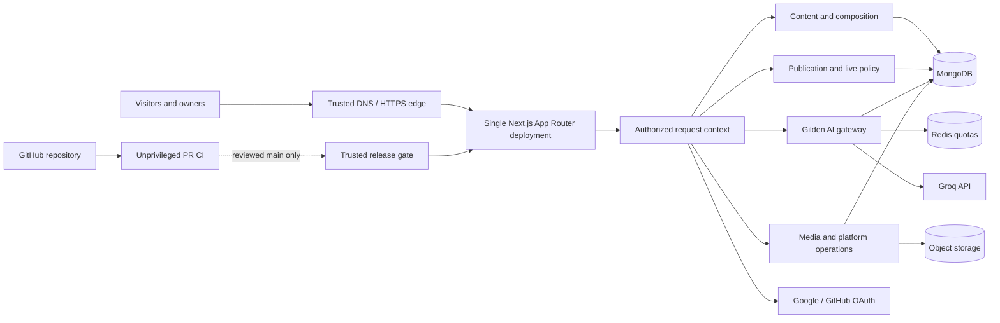
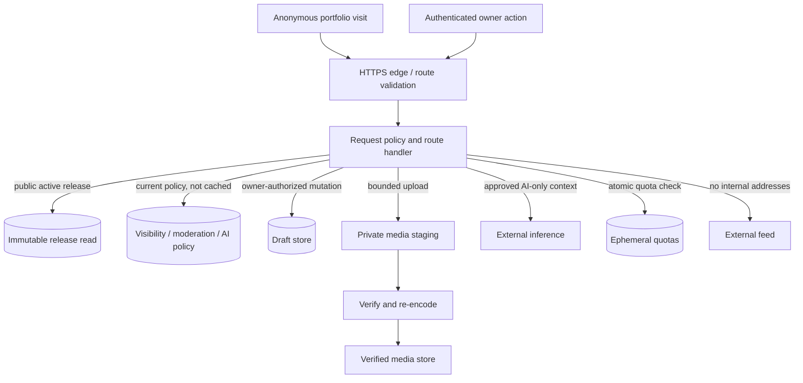
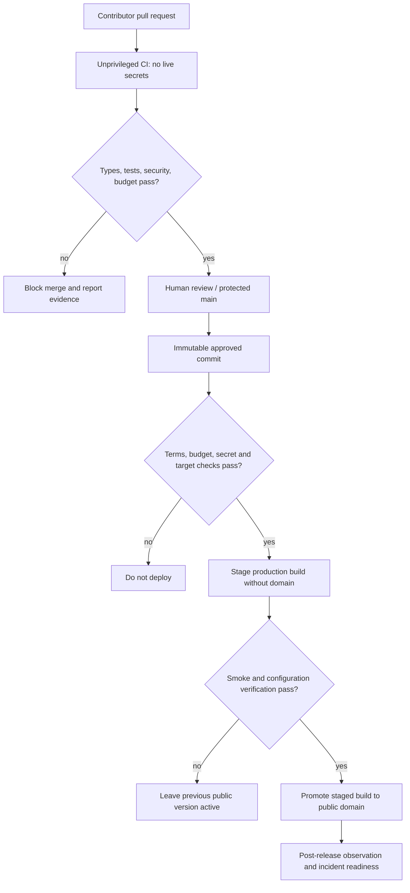
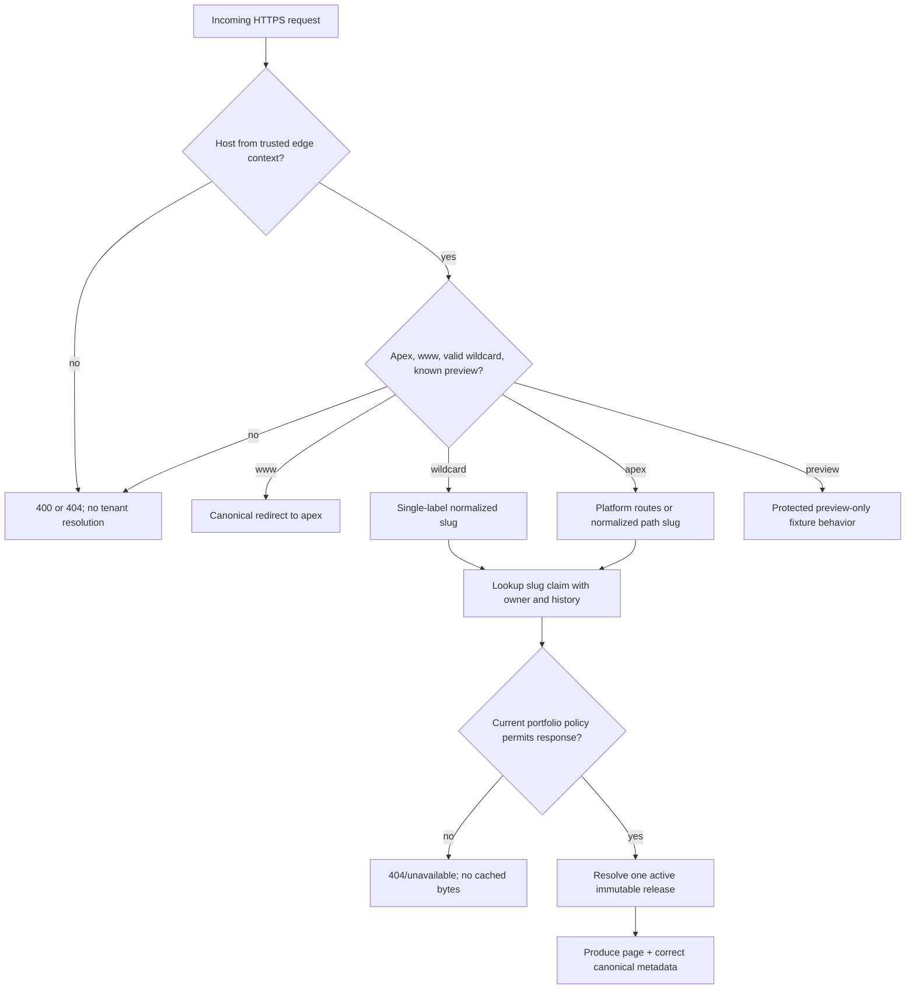
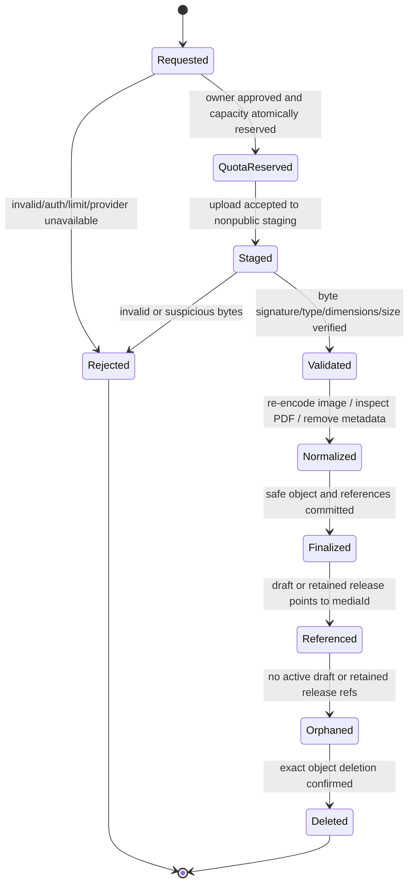
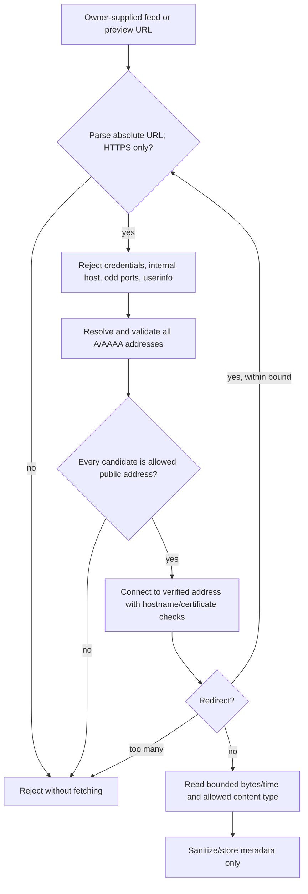
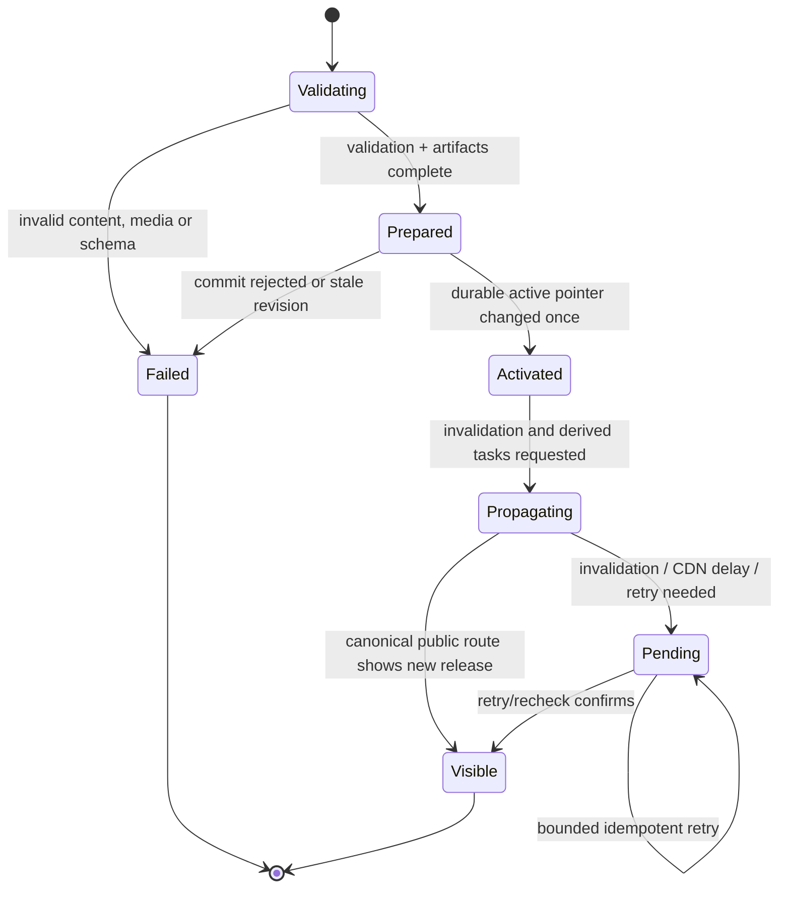
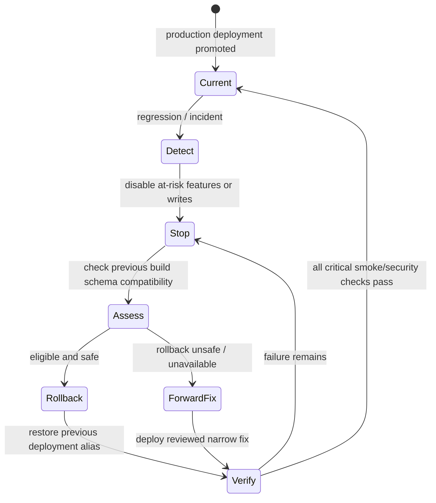
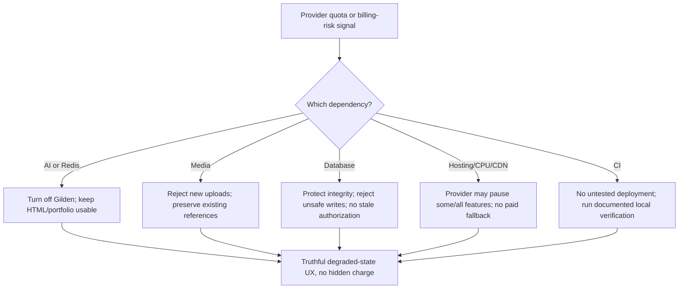

# 10 - Deployment Strategy, Infrastructure Security, CI/CD and Operations

> **Product:** GildedIn
> **Document ID:** GID-ARCH-10  
> **Version:** 2.0.0  
> **Status:** Normative deployment specification with explicitly unresolved feasibility gates  
> **Prepared:** 2026-11-19  
> **Owner:** Product maintainer / engineering / security  
> **Classification:** Public architectural design; do not insert real credentials, connection strings, personal identifiers, or live infrastructure screenshots containing secrets.  
> **Implementation status:** This document prescribes and evaluates deployment controls. It does **not** assert that an account, DNS zone, service plan, secret store, pipeline, or production deployment has been configured or validated.

**Normative language:** `MUST` is a release-blocking requirement; `MUST NOT` is a prohibition; `SHOULD` is the default unless an ADR explains an exception; `MAY` is optional. A _verified provider fact_ is supported by an official external source; a _design decision_ is a GildedIn requirement; a _feasibility gate_ requires evidence from the actual provider account and deployed configuration. Time-sensitive provider information must be rechecked before launch, upgrade, provider migration, and materially changed terms.

**Companion documents:** [01 System Overview](01-system-overview.md) | [02 Requirements and Scope](02-requirements-and-scope.md) | [03 UI/UX](03-ui-ux.md) | [04 C4 Diagrams](04-c4-diagrams.md) | [05 Data Model](05-data-model.md) | [06 API Design](06-api-design.md) | [07 Security Design](07-security-design.md) | [08 Storage and Sync](08-storage-and-sync-strategy.md) | [09 Errors and Logging](09-error-handling-and-logging.md) | [11 Testing](11-testing-strategy.md) | [12 ADRs](12-architecture-decision-record.md).

## Document navigation

1. [Purpose, scope and precedence](#1-purpose-scope-and-precedence)
2. [Deployment requirements and nonnegotiable invariants](#2-deployment-requirements-and-nonnegotiable-invariants)
3. [Architecture, deployable boundaries and trust zones](#3-architecture-deployable-boundaries-and-trust-zones)
4. [Provider eligibility, cost and data-use due diligence](#4-provider-eligibility-cost-and-data-use-due-diligence)
5. [Operating environments and production isolation](#5-operating-environments-and-production-isolation)
6. [Repository governance and secure supply chain](#6-repository-governance-and-secure-supply-chain)
7. [CI pipeline and release quality gates](#7-ci-pipeline-and-release-quality-gates)
8. [Production delivery and promotion](#8-production-delivery-and-promotion)
9. [Typed configuration and environment variables](#9-typed-configuration-and-environment-variables)
10. [Secret management and lifecycle](#10-secret-management-and-lifecycle)
11. [Domains, DNS, TLS and host routing](#11-domains-dns-tls-and-host-routing)
12. [Authentication provider deployment](#12-authentication-provider-deployment)
13. [MongoDB deployment security](#13-mongodb-deployment-security)
14. [Object storage, media delivery and quota admission](#14-object-storage-media-delivery-and-quota-admission)
15. [Redis, AI and abuse-defense providers](#15-redis-ai-and-abuse-defense-providers)
16. [External feeds, GitHub metadata and outbound networking](#16-external-feeds-github-metadata-and-outbound-networking)
17. [Rendering, CDN, caching and revocation](#17-rendering-cdn-caching-and-revocation)
18. [Background operations without required workers](#18-background-operations-without-required-workers)
19. [Data migrations and release compatibility](#19-data-migrations-and-release-compatibility)
20. [Rollback, kill switches and emergency containment](#20-rollback-kill-switches-and-emergency-containment)
21. [Telemetry, alerts and platform operations](#21-telemetry-alerts-and-platform-operations)
22. [Resource, budget and capacity analysis](#22-resource-budget-and-capacity-analysis)
23. [Privacy, retention and provider processing](#23-privacy-retention-and-provider-processing)
24. [Browser and response security configuration](#24-browser-and-response-security-configuration)
25. [Performance and accessibility deployment policy](#25-performance-and-accessibility-deployment-policy)
26. [Operational incident and recovery runbooks](#26-operational-incident-and-recovery-runbooks)
27. [Host portability and provider substitution](#27-host-portability-and-provider-substitution)
28. [Containers, IaC, networking and excluded infrastructure](#28-containers-iac-networking-and-excluded-infrastructure)
29. [Maintenance, sustainability and decommissioning](#29-maintenance-sustainability-and-decommissioning)
30. [Deployment acceptance test catalog](#30-deployment-acceptance-test-catalog)
31. [Evidence records, gates and readiness decision](#31-evidence-records-gates-and-readiness-decision)
32. [Traceability to requirements, threats and ADRs](#32-traceability-to-requirements-threats-and-adrs)
33. [Reference configuration templates](#33-reference-configuration-templates)
34. [Glossary and decision status](#34-glossary-and-decision-status)
35. [Primary sources and research notes](#35-primary-sources-and-research-notes)

---

## 1. Purpose, scope and precedence

### 1.1 Purpose

This is the deployment, configuration, release, and operations contract for **GildedIn**, a free, public, open-source portfolio-building platform. It must deliver secure multi-tenant content creation, a full visual editor, immutable published portfolios, owner-controlled AI assistance, responsive rendering, and dual path/subdomain addresses without incurring new platform expenditure. Production readiness requires verifiable controls, not merely a successful `next build`.

The document defines **what must be true before code reaches the public domain**, how the system crosses trust boundaries when deployed, who is allowed to change the deployed system, and how failures are contained when resources are limited. Its scope covers app and provider configuration, DNS/TLS, CI/CD, access control, database and object-store provisioning, secret handling, cache policy, logging, and deployment rollback. It is not an instruction to deploy now.

### 1.2 Specification precedence

1. Nonnegotiable product and privacy constraints in [02](02-requirements-and-scope.md) and [07](07-security-design.md).
2. Security invariants of [05](05-data-model.md), [06](06-api-design.md), and [08](08-storage-and-sync-strategy.md).
3. Accepted architectural decisions in [12](12-architecture-decision-record.md).
4. This document's operational choices, interpreted against current provider facts.
5. Package examples and command snippets, which are **illustrative until tested against pinned versions**.

A hosting tutorial, free-tier dashboard, example `.env`, AI-generated snippet, or optional plugin configuration cannot override a security invariant. When evidence demonstrates that a deployment requirement is impossible within $0, **block launch and document the problem**. Do not silently weaken tenant isolation, add billable services, or claim a feature works because a provider advertises it.

### 1.3 Source classification

- **Product fact:** one active portfolio per account initially; stable `accountId` and `portfolioId`; `/dashboard` at the apex; both `/{slug}` and `{slug}.aaroophan.dev`; no production-like remote test environment; $0 additional spend.
- **Architecture decision:** Next.js App Router/TypeScript modular monolith with typed adapters; one application deployment; MongoDB source of truth; versioned draft and immutable publication; public policy gate before revocable output.
- **Preferred vendor:** Vercel Hobby; MongoDB Atlas Free; Vercel Blob Hobby; Upstash Redis Free; Groq; Cloudflare Turnstile. Vendor choices are conditional, not security certification or entitlement.
- **Verification dependent:** Hobby eligibility for the exact public service; Vercel data-use opt-out effective state; wildcard DNS/certificate; card/billing requirement; Atlas network exposure; object-store provider hard stop; secure staged upload capability; available CI features; app compatibility on selected host.
- **Accepted limitation:** no guaranteed independent backup, RPO, RTO, continuous availability, paid monitoring or emergency support response.

### 1.4 Applicability and deliberate exclusions

| Concern                                               | Applicability                                                                                | Decision and reason                                                                                   |
| ----------------------------------------------------- | -------------------------------------------------------------------------------------------- | ----------------------------------------------------------------------------------------------------- |
| CI/CD, provenance and dependency integrity            | Required                                                                                     | Public code and deploy credentials are high-value attack surfaces.                                    |
| HTTPS, DNS, CDN and reverse proxy                     | Required                                                                                     | Dual-host multitenant routing and browser sessions need verified origin boundaries.                   |
| MongoDB network and DB roles                          | Required                                                                                     | Private draft and account information are sensitive and tenant-specific.                              |
| Object storage and safe uploads                       | Required                                                                                     | Public files, PDFs and image processing are part of launch.                                           |
| Redis                                                 | Optional implementation dependency, functionally required when relying on distributed quotas | AI must fail closed if atomic rate limits cannot be enforced.                                         |
| Containerization                                      | Optional                                                                                     | Only for portable/self-hosted delivery or local reproducibility; not a reason to add an orchestrator. |
| WebSockets                                            | Not required                                                                                 | Gilden streaming uses HTTP streaming/SSE; editor collaboration is not in scope.                       |
| Separate queues, Kafka, RabbitMQ                      | Not required                                                                                 | Small bounded job journal and opportunistic retries are sufficient to start.                          |
| Kubernetes, service mesh, self-managed load balancers | Excluded                                                                                     | Operational cost and risk exceed product need.                                                        |
| Paid WAF, DDoS products, dedicated egress             | Not approved                                                                                 | Must never be enabled under $0 constraint.                                                            |
| Payments, subscriptions, billing APIs                 | Excluded                                                                                     | Product is free and nonmonetized.                                                                     |
| Independent DR site or paid backups                   | Excluded at launch                                                                           | Data-loss risk is accepted and disclosed; integrity controls are still mandatory.                     |
| Separate test/UAT cloud environment                   | Excluded                                                                                     | Local synthetic isolation and safe production smoke tests replace it.                                 |
| Hosted uptime SLA                                     | Not promised                                                                                 | Free provider availability is not under product control.                                              |
| Custom scripts/shaders from users                     | Prohibited                                                                                   | Published websites run only approved components and data.                                             |

## 2. Deployment requirements and nonnegotiable invariants

### 2.1 Release-critical invariants

| ID      | Invariant                                                                                                   | Violation blocks                   | Evidence                                                         |
| ------- | ----------------------------------------------------------------------------------------------------------- | ---------------------------------- | ---------------------------------------------------------------- |
| DEP-I01 | No provider can charge for usage or require a payment card under approved configuration.                    | Activation of provider/integration | Account-level plan, billing and limit screenshots; terms checked |
| DEP-I02 | Host terms permit the actual workload and data processing.                                                  | Production deploy                  | Eligibility decision and privacy review                          |
| DEP-I03 | Every production writable provider is inaccessible from untrusted PR/test jobs.                             | Any merge/deploy                   | Negative tests, secret mapping, firewall and CI workflow review  |
| DEP-I04 | Every tenant request resolves identity from a trusted hostname and authorized portfolio lookup.             | Public launch                      | Apex/wildcard/forged-host integration tests                      |
| DEP-I05 | Session cookies are host-only to `aaroophan.dev` and are not sent to tenant subdomains.                     | Authentication enablement          | Browser network capture in real TLS                              |
| DEP-I06 | Authorization applies at every server entry, even if Proxy already rewrote the URL.                         | Any API release                    | BOLA/BOPLA and Server Action tests                               |
| DEP-I07 | Private drafts, credentials, session data and contact inboxes never enter shared/public CDN cache.          | Production launch                  | Cache header and body inspection                                 |
| DEP-I08 | Published bytes are served only after authoritative current visibility/moderation checks.                   | Public publish                     | Warm-cache suspension test                                       |
| DEP-I09 | AI requests compare active release and live policy generation; stale contexts are refused.                  | Gilden enablement                  | Revoke/republish during streaming                                |
| DEP-I10 | Production writing requires verified provider identity and least-privilege service credentials.             | DB, media, AI launch               | Provider scopes, DB roles, secrets evidence                      |
| DEP-I11 | Application rollback does not revert tenant data, AI approvals, or security policy.                         | Release pipeline                   | Rollback rehearsal                                               |
| DEP-I12 | Draft publication is idempotent and activates one complete immutable release.                               | Publishing launch                  | Crash/retry and double-publish simulations                       |
| DEP-I13 | External fetchers cannot reach localhost, RFC1918, link-local or cloud metadata endpoints.                  | RSS/preview enablement             | SSRF/redirection/DNS-rebinding tests                             |
| DEP-I14 | Generated artifacts cannot contain hidden unpublished data or unintended personally identifying metadata.   | Media, SEO, search, AI             | Payload/static export and EXIF review                            |
| DEP-I15 | Vulnerable or unreviewed third-party CI code cannot access production deployment tokens.                    | Pipeline enablement                | Full-SHA pins, permission audit, fork test                       |
| DEP-I16 | Provider exhaustion never silently escalates to a paid plan or disables mandatory authorization.            | Provider selection                 | Exhaustion and fail-closed tests                                 |
| DEP-I17 | The owner has a truthful view of publication and propagation state.                                         | Publishing launch                  | Lost response, delayed invalidation, status tests                |
| DEP-I18 | Runtime logging suppresses secrets, visitor chat text and sensitive tenant content.                         | Observability enablement           | Log fixture assertions                                           |
| DEP-I19 | Required privacy notice and accepted data-loss limitation are visible before user disclosure.               | Public registration                | UX capture and legal/privacy review                              |
| DEP-I20 | DNS/TLS, callback addresses, wildcard host and reserved-name routing are checked on the actual chosen host. | Public launch                      | Real network and browser evidence                                |

### 2.2 Security control ownership

| Trust boundary          | Provider's responsibility                                  | GildedIn's responsibility                                                                            |
| ----------------------- | ---------------------------------------------------------- | ---------------------------------------------------------------------------------------------------- |
| HTTPS at managed edge   | Operate configured TLS endpoint and renewal                | Own/verify domain, certificates, HSTS scope, host validation, redirects                              |
| Hosted execution        | Physical runtime isolation as provider offers              | Limit secrets, request validation, dependencies, Node security and origin policy                     |
| Managed MongoDB         | Secure its database service according to provider contract | Strong credentials, narrow roles, access list, indexes, encrypted connections and tenant queries     |
| Hosted object store     | Store and deliver objects per provider settings            | Validate file bytes, limit sizes, stage privately, enforce refs, quotas and safe content disposition |
| OAuth identity provider | Authenticate subject according to provider flow            | Verify assertions, bind stable subject, control linking/session/CSRF                                 |
| Redis/AI providers      | Service functionality and plan enforcement                 | Do not place tenant secrets in logs, cap usage, minimize AI context and fail closed                  |
| CI platform             | Runner execution environment                               | Restrict workflows, third-party actions, secrets, artifacts, permissions and deployment targets      |

**Shared-responsibility principle:** managed services are not secure by default for GildedIn's specific tenancy and privacy requirements. Provider authentication, HTTPS, encryption at rest or a managed certificate do not prove authorization, safe caching, correct data-use terms or isolation across owner accounts. See [S08], [S15], [S23].

### 2.3 Requirements and scope traceability

This document operationalizes `OPS-001..OPS-007`, `SEC-001..SEC-012`, `TEN-006..TEN-009`, `IAM-005..IAM-008`, `PUB-001..PUB-008`, `AI-003..AI-008`, `MED-001..MED-004`, and the quality gates in [02](02-requirements-and-scope.md). It further implements [ADR-001](12-architecture-decision-record.md), ADR-010..014, ADR-016..023, ADR-026, ADR-029..030, ADR-032 and ADR-034. The security threats are defined more fully in [07](07-security-design.md); deployment validation does not replace application security testing.

## 3. Architecture, deployable boundaries and trust zones

### 3.1 One application, multiple logical modules

The production artifact is one versioned **Next.js App Router, React and TypeScript application** with Node-capable server execution, public SSR/semantic renderers, an owner-only editor, account and admin interfaces, API Route Handlers, and optional Server Actions. Domain modules expose typed interfaces: identity/tenancy, content, composition, publishing, media, AI, operations. Third-party infrastructure is accessed only through server-side adapters.

A distributed architecture is not necessary for the 100-500 actively maintained portfolio planning target. A modular monolith reduces separate deploy identities, cross-service tokens, network policies and incident surface. Critical security decisions must nevertheless remain centralized rather than scattered among pages and adapters.



Diagram legend: solid arrows are intended runtime dependencies; the dotted arrow from CI is a conditional promotion authorization, **not** permission for PR code to access live deployment credentials. The edge is responsible for incoming transport, not application authorization. Diagram details appear in [04](04-c4-diagrams.md).

### 3.2 Named trust zones

| Zone                           | Examples                                                  | Can be trusted for                                                                 | Must not be trusted for                                                   |
| ------------------------------ | --------------------------------------------------------- | ---------------------------------------------------------------------------------- | ------------------------------------------------------------------------- |
| Z0 Anonymous Internet          | Public browser, visitors, web crawlers, malicious clients | Nothing beyond validated protocol structures                                       | Owner identity, source IP headers, host routing, document IDs             |
| Z1 Authenticated browser       | Owner dashboard, admin UI                                 | Presence of authenticated cookie after server verification                         | Authorization claims supplied by JS, tenant references, signed URLs       |
| Z2 Trusted application runtime | Route Handlers, Server Actions, internal modules          | Execution of reviewed code and validated secret configuration                      | Validity of external responses or uploaded bytes                          |
| Z3 Managed data services       | MongoDB, object store, Redis                              | Verified service availability and authenticated store operations                   | Data suitability for public release, cross-tenant correctness             |
| Z4 External identity and AI    | Google, GitHub, Groq, RSS servers                         | Provider-authenticated subject/returned service response after protocol validation | Content safety, private-data disclosure decisions, generated AI citations |
| Z5 Source control and CI       | Repo, GitHub Actions, external actions                    | Reviewed and approved commit after checks                                          | Untrusted PR scripts or artifacts, secrets in fork workflows              |
| Z6 Provider control plane      | Registrar, DNS, hosting account, secret settings          | Authorized administrative configuration                                            | Retained settings remaining unchanged without monitoring                  |

Every boundary crossing requires an explicit input contract and identity/authority decision. All production credentials and deploy settings are privileged resources; a public repository is not a trusted secret store.

### 3.3 Browser-to-server and server-to-provider diagram



### 3.4 Regional placement and networking

Choose the managed function region _after_ checking the MongoDB cluster region and actual user latency. Prefer colocating server execution with the primary database when host settings permit, because unnecessary interregion round trips increase latency and may incur transfer charges on some services. Do not promise static Vercel function egress IPs unless the selected plan actually offers them. Atlas allowlisting and Vercel outbound IP behavior are deployment gates; widening the database list to `0.0.0.0/0` is a documented residual risk, **not** proof of network security. If only public egress is possible under $0, defend with TLS, strong unique credentials, least privilege, limited service roles, strict quotas and rotation, and evaluate whether remaining risk is acceptable. [S15], [S16].

### 3.5 Runtime assumptions

- Node-capable deployment supports Next.js SSR/streaming, `crypto`, MongoDB driver, response headers, and Groq streaming within the actual function-time limit.
- Functions are stateless and may be killed or restarted; disk and in-memory state are not durable. Durable operations use MongoDB and object storage.
- Server instances may execute concurrently. Do not store rate limits, account sessions or publish locks only in process memory.
- No job is assumed to continue after a request returns unless a provider explicitly guarantees that execution model; background completion has an operation record and safe retry.
- WebGL executes in the browser, never as a server prerequisite for public HTML. Failure of scene initialization cannot block navigation or core content.
- No request-time dependence on paid integrations or future domain renewal is assumed.

## 4. Provider eligibility, cost and data-use due diligence

### 4.1 Mandatory provider decision procedure

1. Identify the exact billing account, plan, legal terms and permitted production use; do not use broad marketing text as authorization.
2. Confirm **no payment card** and **no billable overage path** under the configuration actually available to this account. A soft budget alert is insufficient.
3. Record included storage, requests, bandwidth, compute, function duration, write/operation counts, rate limits, deployment count, and their reset periods.
4. Confirm service data regions, controller/processor roles, model-training/reuse terms, data retention and deletion pathways. Apply any available privacy opt-outs before sending tenant data.
5. Verify real capabilities: credentials, TLS, outbound network limits, WebGL delivery, signed/private uploads, cache invalidation, wildcard domains and auth callbacks.
6. Test quota exhaustion using synthetic resources or provider-supported safe procedures, without intentionally exhausting production tenants.
7. Record precise source, date, provider-account evidence, result, owner and unresolved risk. Recheck when terms or plan change.
8. If any P0 condition fails, keep that integration disabled and choose another compliant provider or block launch. Do not auto-upgrade.

### 4.2 Provider matrix

| Capability                 | Preferred candidate                         | Officially documented condition / concern                                                                  | Gate outcome required                                                                  |
| -------------------------- | ------------------------------------------- | ---------------------------------------------------------------------------------------------------------- | -------------------------------------------------------------------------------------- |
| Next.js hosting            | Vercel Hobby                                | Free plan, personal/non-commercial restriction; limits may interrupt service. [S01], [S02]                 | This exact public product is eligible; production account is Hobby; no overage billing |
| Hosting content processing | Vercel                                      | Hobby/model-training terms allow certain processing unless opted out in team settings. [S03], [S04]        | Opt-out verified; data flow/notice reviewed before private tenant content              |
| Wildcard subdomains        | Vercel nameservers/wildcard                 | Wildcard certificate requires nameserver method; domain delegation is an actual task. [S05]                | Apex, www, wildcard, mail records and certificate verified                             |
| Object storage             | Vercel Blob Hobby if safe                   | 1 GB-month included storage, 10 GB transfer, operation counts; Hobby stops access at limit. [S06]          | Upload security, zero-overage behavior, private staging and delivery validated         |
| Database                   | MongoDB Atlas M0 Free                       | Free-tier quotas/features and mandatory TLS; provider-managed network rules. [S07], [S08]                  | Account plan and available transactions/indexes validated; backup charges disabled     |
| Redis                      | Upstash Redis Free                          | 256 MB, 500,000 commands/month, 10 GB bandwidth under published current pricing. [S09]                     | No Pay-as-you-go; atomically enforced quotas; fail-closed AI behavior                  |
| Hosted AI                  | Groq free tier                              | Shared organization rate limits; model and token allowances change. [S10]                                  | No paid usage route; server key only; platform hard caps; outage UX tested             |
| Bot verification           | Cloudflare Turnstile Free                   | Free widgets have a configured-hostname ceiling; server-side token verification required. [S11]            | Use apex submission origin; no arbitrary tenant-host widget explosion                  |
| Git and CI                 | Public GitHub repository and GitHub Actions | Branch rulesets and permission controls available for public repos; limits need verification. [S12], [S13] | Trusted branch rules and no-secret PR workflow demonstrated                            |
| Domain registration        | Existing `aaroophan.dev`                    | Current ownership/renewal, DNS zone and authoritative nameservers unknown                                  | DNS inventory completed; existing-paid domain is available during launch               |

**Do not infer:** provider signup without a card from a pricing page alone; continued Hobby eligibility from lack of monetization; a guaranteed uptime SLA from free status; unlimited CDN delivery from free function allowance; or a backup from three in-database release revisions.

### 4.3 Vercel Hobby eligibility and privacy are distinct checks

Vercel's published terms restrict Hobby to personal or noncommercial use, while giving Vercel discretion to change plan access. A free public product is **not automatically accepted as eligible** merely because users are not charged. The deployment record must contain a defensible eligibility decision, with provider clarification if necessary. If deemed ineligible, use an alternative host rather than violating terms. [S01], [S02].

Separately, the October 19, 2026 terms state that certain content on Hobby or trial Pro may be used to train models, and describe an account-level opt-out. **Before processing private user records, drafts, uploaded resumes or contact messages**, inspect Team Settings > Data Preferences, disable model training where applicable, document the setting and effective scope, and evaluate onward sharing and data-processing requirements. No setting is assumed to retroactively remove data previously processed. If privacy needs cannot be met, block provider activation. [S03], [S04].

An opt-out is not a blanket provider confidentiality guarantee; account administrators must also review log/preview visibility, integration installers, support access, storage encryption, retention and the effect of deleting a project.

### 4.4 MongoDB free backup charges: explicit rejection

Atlas now documents an **optional backup subscription for M0 Free clusters** that is billed separately (advertised as $0.10/day, up to $3/month at the time of research). It is not compatible with the absolute no-spend requirement and **MUST NOT be enabled**. [S14]. The documented product policy accepts no independent guaranteed backup, RPO or RTO, but still requires safe write protocols, immutable release versions, owner export and honest disclosure. Do not infer that a provider's internal redundancy is a customer-available restore capability.

### 4.5 Storage arithmetic and no-surprise-bill proof

At 500 active owners and 15 MiB originals each, potential original media alone is `500 * 15 MiB = 7,500 MiB (~7.32 GiB)`. Derived variants, retained versions and media transfer add additional usage. A 1 GB-month included allowance cannot guarantee every owner can use the entire 15 MiB allowance simultaneously. **Global admission control** must enforce a lower safe operational ceiling. Provider hard limits must block unmetered external consumption that application-level upload counters cannot regulate (e.g., public bandwidth or read operations). If no service meets both quota behavior and security needs, disable new uploads, **not** authorization or already-published access.

The AI scale envelope is similarly conditional. With a hypothetical 500 portfolios, 20 visitors each/day and 15 AI messages per visitor, requests would total 150,000/day before retries. This is an illustrative upper-bound scenario, not a forecast and not an entitlement from Groq. The no-spend design allows Gilden alone to become unavailable without affecting public HTML, owner publishing, or ordinary contact links.

### 4.6 Provider due-diligence record template

```yaml
provider_decision:
  service: example-service
  owner: maintainer
  reviewed_at_utc: "YYYY-MM-DDTHH:MM:SSZ"
  terms_url: "https://provider.example/terms"
  pricing_url: "https://provider.example/pricing"
  exact_plan: "free-tier-name"
  expected_purpose: "public no-code portfolio platform"
  account_requires_payment_card: false # verify, not an assertion
  account_can_accrue_overage_charges: false # verified hard stop
  usage_ceiling:
    storage: "provider-specific"
    compute: "provider-specific"
    bandwidth: "provider-specific"
  data_use_and_opt_out_review: "evidence reference"
  tenancy_risk_review: "evidence reference"
  exhaustion_behavior: "observed / documented"
  approval_status: "blocked" # blocked | approved | replace
  evidence_id: "EV-DEP-000"
```

The example domain and fields are placeholders. Mark a claim **unknown** if the provider will not demonstrate it; do not invent `false` values for mandatory protections.

## 5. Operating environments and production isolation

### 5.1 Environment matrix

The project does **not** operate a separate paid or production-like staging/UAT environment. It still needs clear trust separation between local, automated testing, protected preview artifacts and production. The absence of a separate remote test environment is not permission to reuse production resources for convenience.

| Dimension    | Local development                                   | GitHub CI / PR build                         | Protected provider preview                 | Production                                           |
| ------------ | --------------------------------------------------- | -------------------------------------------- | ------------------------------------------ | ---------------------------------------------------- |
| Source       | Developer worktree                                  | Exact PR commit                              | Exact untrusted/approved commit            | Reviewed, signed-off `main` commit                   |
| Database     | Local MongoDB or ephemeral synthetic DB             | Dedicated ephemeral database, never live URI | Synthetic fixture mode or **no DB writes** | Approved Atlas DB                                    |
| OAuth        | Test identity stub or separately configured dev app | Mocked / protocol simulation                 | Disabled or nonproduction callbacks        | Google/GitHub registered callbacks                   |
| Object store | Memory/file adapter and deterministic test media    | Isolated fake store                          | No production storage credentials          | Approved restricted store                            |
| Groq         | Deterministic fake adapter by default               | Mock; no real tenant context                 | Disabled                                   | Approved inference key + quotas                      |
| Redis        | In-process fake for deterministic tests             | Isolated local ephemeral Redis               | Disabled/fake                              | Approved free Redis; AI fail closed when unavailable |
| Domains      | `localhost`/loopback                                | `localhost` only                             | Host-generated preview address             | Apex, `www`, wildcard                                |
| Secrets      | Local ignored env only                              | No production secrets                        | No production secrets                      | Restricted provider configuration                    |
| Writes       | Synthetic developer data                            | Synthetic test data only                     | Ideally none to persistent resources       | Server-authorized writes                             |
| Exposure     | Local only                                          | Internal CI logs (sanitized)                 | Provider-authenticated preview             | Public pages plus protected owner/admin routes       |

**Source-code invariant:** production env and database credentials MUST never be injected into `pull_request`, `workflow_run`, fork PR or unreviewed build steps. A GitHub Actions environment named `production` is appropriate for protected deploy jobs, but its current availability and reviewer/branch restrictions must be checked on the actual plan. [S12], [S13].

### 5.2 Typed environment identity

A single database connection string is not an environment identity. Set an explicit `APP_ENV=local|test|preview|production`, independently validate the expected database name, host, cloud account IDs and allowed feature flags, and use a **fail-closed test guard**. A test process must refuse to start if:

- `APP_ENV` is `production` or cannot be determined;
- database hostname or database name matches a denylisted production target;
- a production-only environment secret is present in a PR/test job, or test cloud credentials equal production credentials;
- an external live upload, deletion, email or inference adapter is selected without an explicitly named, nonproduction account;
- a test harness tries to override these rules using `NODE_ENV`, a command-line flag or a hidden default.

Make it difficult to _accidentally_ write to production and prohibit _deliberate_ destructive tests against production resources through repository policy. Type validation alone cannot prevent a developer from supplying a genuine live URL; CI guardrails and IAM must prevent connection as well.

### 5.3 Local environment bootstrap

1. Install a pinned Node.js LTS version meeting Next.js requirements; pin npm or chosen package manager using `packageManager` and lockfile. Do not guess a future package major version from the machine's installed Node version.
2. Download only public repository code and lockfile. Do not copy real production `.env` files to contributors.
3. Copy `.env.example` to `.env.local` and populate only local placeholders or developer-specific restricted credentials. Never include `.env.local` in source control or public chat artifacts.
4. Start a local MongoDB instance **or** a genuinely isolated DB under a free approved account. Prefer localhost for repeatable integration tests.
5. Use local object-store adapter with intentionally harmless test images/PDFs; test real provider adapters in an explicitly approved single-purpose smoke test, not every developer run.
6. Configure a fake identity provider or local test sessions for development. Authorization tests must still exercise real server policy and denied paths; mocks may substitute protocol verification only in controlled fixtures.
7. Run lint/typecheck/unit/integration/build and interactive accessibility tests before opening a PR.
8. Use a local `host` fixture only when verifying host parsing. **Do not** treat local wildcard DNS resolution as evidence that real wildcard TLS works.

```text
local process
  -> APP_ENV=local
  -> local database and fake external adapters
  -> no production DNS, secrets, account IDs or hosted egress
  -> synthetic accountIds / portfolioIds and media
  -> deterministic tests and build
```

### 5.4 Protected previews as build validation only

If Vercel Git integration auto-creates previews, enable _Vercel Authentication / Standard Protection_ where the selected plan permits it. Vercel currently documents this on Hobby, but deployment protection is not a replacement for application authorization. [S17]. Preview deployments MUST not have active production database credentials or OAuth callback secrets. They may verify static rendering, bundle size, CSP/header rendering and client-side editor behavior with sanitized fixtures.

A preview URL containing `vercel.app` is not an alternate trusted hostname for production `/{slug}` or auth-callback routing. Preview hostnames are explicitly allowlisted only for preview purposes, not fed through the tenant wildcard resolver. Host-generated previews MUST have `noindex`, and accidental indexing of synthetic private data must be prevented at its source, not only in robots directives.

### 5.5 Reproducibility and environment parity boundaries

Environment parity means **shared application code and contract-compatible adapters**, not cloned production identities or data. Keep schema fixtures, upload validation policy, API validation rules and renderer versions identical while allowing fake provider implementations in tests. Staged production build verification tests the deployed artifact and resource configuration without granting public preview branches live credentials.

A separate cloud test environment MAY be introduced in a later architecture revision only with new authorization and a demonstrably zero-cost, isolated deployment account. It is not silently required now.

## 6. Repository governance and secure supply chain

### 6.1 Repository and branch model

Use one source repository containing application code, tests, docs, reviewed CI workflows and package lockfile. Keep `main` as the only tracked production branch. Use short-lived branches: `feat/<topic>`, `fix/<topic>`, `security/<topic>`, `docs/<topic>`. Do not build unrelated long-lived release trains or a separate deployment repository for a solo-maintained product.

```text
main (protected; only reviewed release source)
  |-- feat/visual-canvas-selection
  |-- fix/ai-policy-revocation
  |-- security/host-header-validation
  `-- docs/publication-contract
```

PR requirements:

- Link affected requirement IDs (`SEC-003`, `PUB-002`, etc.), relevant ADR and negative test; describe risk and blast radius.
- Review modifications to `.github/workflows/*`, `next.config.*`, `proxy.ts`, `package.json`, lockfiles, provider adapters, auth, published renderer, schema validators and secrets handling as security-sensitive.
- Require passing checks before merge; disallow direct main pushes if plan supports rulesets.
- No admin exception without documented emergency reason and post-event audit. Do not promise two-person approval if maintainer is alone; at minimum keep an auditable self-review checklist and signed provenance.
- Protect tags used for releases, and link each tagged revision to its build/deploy ID.
- Keep repository public **without exposing actual provider credentials, tenant exports or internal incident evidence**. The public docs may describe security architecture but not enable bypass of undisclosed operational secrets.

GitHub documents rulesets for public repositories on Free plans, subject to account-specific configuration. [S12].

### 6.2 Supply-chain threat model

An adversary may control a fork PR, an npm dependency, an install script, a GitHub Action tag, a malicious test fixture, README content, a generated deployment archive or a compromised maintainer token. Their objectives can include stealing production secrets, modifying deployed code, poisoning caches, changing protected DNS, or exfiltrating stored tenant data. Treat a green CI check as one input, **not** evidence that arbitrary code executed in that job is trusted.

Required controls:

1. Pin dependency versions through a committed lockfile; use deterministic installation (`npm ci` if npm is selected).
2. Run dependency audit and SCA; distinguish advisory noise from reachable exploitable flaws. Block verified critical/high issues on the exposed path, or record an ADR with an explicit temporary exception and expiry.
3. Enable dependency-update review, lockfile inspection and license compatibility checks. A tool's own license must be compatible with the final open-source distribution and its assets.
4. Pin GitHub Actions to reviewed immutable full SHAs (or adopt verified workflow dependency lockfiles) rather than moving tags. [S13].
5. Restrict workflow `GITHUB_TOKEN` permissions explicitly. PR testing needs `contents: read` at most in normal workflows.
6. Do not execute untrusted `pull_request_target`/`workflow_run` checkouts or their generated artifacts in a privileged job. [S13].
7. Avoid passing secrets through command-line arguments, test reporters, build caches, HTML artifacts or failure screenshots.
8. Restrict npm lifecycle scripts where feasible. Install scripts may execute arbitrary code; review high-risk new packages and pin provenance. `npm ci --ignore-scripts` is not safe as a universal drop-in because some legitimate packages need native/postinstall processing; decide and test per dependency set.
9. Use strict branch rules, validated production identity and manual release approval for sensitive changes.
10. Rotate compromised tokens immediately and invalidate old deployment sessions/cache as necessary; history rewriting alone does not remove leaked credentials.

### 6.3 Static and dependency security checks

Proposed free tooling: TypeScript strict mode, ESLint, Vitest, Playwright, axe-core, Lighthouse CI, `npm audit`/OSV-Scanner, CodeQL for supported languages/repository visibility, Gitleaks or equivalent reviewed secret scanner, and license inventory/NOTICE generation. Confirm each tool's license and current free eligibility before enabling. Do not automatically upload private test logs or tenant fixtures to SaaS scanners.

| Check               | Example focus                                                            | Release policy                          |
| ------------------- | ------------------------------------------------------------------------ | --------------------------------------- |
| Typecheck           | Typed env/config, API schemas, module boundaries                         | Block on error                          |
| Unit/property-based | Slug normalization, canonical JSON, policies, block bounds               | Block on critical failure               |
| Integration         | Atomic CAS, uniqueness, idempotency, tenant isolation                    | Block on critical failure               |
| E2E                 | Auth, editing, publication, owner override, privacy, 404                 | Block on critical failure               |
| Static security     | Unsafe runtime patterns, SQL/NoSQL, SSRF, XSS, secrets                   | Investigate finding, block verified P0  |
| SCA/licensing       | Known vulnerabilities, vulnerable transitive packages, license conflicts | Resolve/block before shipping high risk |
| Visual/performance  | Mobile, WebGL disabled, JS/asset budgets, CWV estimates                  | Block agreed critical regressions       |
| Config audit        | `NEXT_PUBLIC_` leaks, missing secret, unwanted billable flag, CSP        | Block on mismatch                       |

### 6.4 Dependency updates and emergency vulnerability response

Automated update PRs should run the same checks as human PRs. Do not auto-merge major versions of Next.js/Auth.js/MongoDB drivers or security-critical parsing/rendering libraries. Review release notes and security advisories for behavior changes affecting caching, cookies, host handling or serialization. For a critical known exploitable vulnerability, disable the affected endpoint/feature if safe to do so, deploy the narrowly scoped patched dependency, and verify no data exposure; do not wait for unrelated feature work.

A lightweight dependency bill of materials MAY be emitted as CycloneDX JSON as a CI artifact when license and cost allow; SBOM generation does not replace vulnerability management. Exclude secrets and tenant data from package provenance.

### 6.5 Documentation as a change-controlled artifact

Security, deployment, API, privacy, schema and design documents must change when their corresponding contract changes. A PR that adds object-storage functionality, OAuth scopes, AI extraction rules, a new subdomain, or new data retention path must update the corresponding controls and tests. Keep a small changelog for ADR decisions; avoid speculative infrastructure diagrams that no longer describe actual deployed components.

## 7. CI pipeline and release quality gates

### 7.1 Two distinct pipelines

**PR CI** is unprivileged and executes untrusted contributor code using synthetic resources. It validates code quality and deployment compatibility; it never deploys a writable production service.

**Trusted production release** is triggered only for a reviewed commit on protected `main`, after CI is complete and deployment settings are verified. It has narrowly scoped deploy permissions and performs staged deployment, smoke verification and promotion or documented release approval. Keep these two trust levels separated even if they run on the same CI vendor.



### 7.2 Workflow examples - PR quality gate

The example below is a **template**, not an assertion that this repo already contains these scripts or that these action SHAs are the most recent. Pin and review precise action commits and replace script names only after the package manifest defines them. The workflow deliberately has no deployment secrets and does not run against an existing production domain.

```yaml
name: CI - unprivileged quality checks
on:
  pull_request:
    branches: [main]
  workflow_dispatch:

permissions:
  contents: read

concurrency:
  group: ci-${{ github.workflow }}-${{ github.ref }}
  cancel-in-progress: true

jobs:
  quality:
    runs-on: ubuntu-latest
    timeout-minutes: 20
    env:
      APP_ENV: test
      INTEGRATION_MODE: fake
      DISABLE_NETWORK_IN_TESTS: "true"
      # No database, OAuth, Blob, Groq, or Redis production secrets.
    steps:
      - name: Checkout reviewed action SHA
        uses: actions/checkout@11bd71901bbe5b1630ceea73d27597364c9af683 # v4.2.2; review before use
        with:
          persist-credentials: false
      - name: Setup Node - use reviewed full SHA
        # Replace this non-executable placeholder with a verified commit SHA.
        run: |
          echo "Install pinned Node LTS using approved runner mechanism"
          node --version
          npm --version
      - name: Install exactly locked dependencies
        run: npm ci
      - name: Validate test environment cannot be production
        run: npm run guard:test-env
      - name: Types and lint
        run: |
          npm run typecheck
          npm run lint
      - name: Unit and integration tests
        run: npm run test:ci
      - name: Build without live provider credentials
        run: npm run build:ci
      - name: Dependency audit
        run: npm audit --omit=dev --audit-level=high
```

For a fully reproducible workflow, replace the environment placeholder with a **reviewed pinned Node setup action**, a version from `packageManager`/`.node-version`, the actual scripts, and a local MongoDB service when integration tests need one. `npm audit` alone is neither a full security proof nor guaranteed to have perfect coverage; pair it with review and focused adversarial tests. Do not make CI depend on uncontrolled production external responses.

### 7.3 CI job order and artifacts

1. **Preflight:** prove no production env values, validate committed lockfile, list changed security-sensitive files and codeowners where available.
2. **Static checks:** typecheck, lint, formatting, forbidden imports/dependency boundaries, license scan, secret scanner, SCA.
3. **Unit/property tests:** schema parser, slug normalization, index generation, content binding, URL filtering, stable serialization, media-type detection.
4. **Integration tests:** local MongoDB unique indexes and CAS; idempotent publication; finite quota; media references; fail-closed policy; SSRF test harness.
5. **UI/E2E:** browser test matrix with synthetic users, mobile canvas controls, direct 404, noindex, screenshot diffs where stable.
6. **Build and static artifact inspection:** production Next.js build with fake data; inspect `.next/static` outputs for secret markers; check CSP/header configuration and the public rendering bundle.
7. **Performance:** Lighthouse CI or equivalent against a deterministic local fixture and JS/scene budgets; manual physical-device spot checks where automated emulation is insufficient.
8. **Evidence:** redacted logs, job IDs, test report counts and checksums, vulnerability findings, deployment candidate commit. Do not retain traces containing cookies/contact messages.

CI should run fast targeted checks on each PR and broader synthetic performance/security suites on a low-frequency schedule or before public release. If free CI limits are reached, no untested production code is automatically deployed; tests can be run locally with logged evidence. An offline result must not be reported as passed.

### 7.4 Branch protection and job permissions

Use a public repo ruleset for `main`: require PRs, block force pushes, require designated checks, and limit bypasses where supported. Avoid both `pull_request_target` with untrusted checkout and privileged deployment on a fork PR. Use least `GITHUB_TOKEN` permissions. Keep deployment tokens outside repo secrets visible to ordinary test jobs, ideally in a protected environment usable only by approved main-branch jobs. Prefer human confirmation for initial releases and sensitive migrations.

### 7.5 CI artifact hygiene

- Store only sanitized test fixtures, test count summaries, compiled nonsecret reports and expected screenshots.
- Do not upload `.env*`, `.vercel`, logs with credentials, real OAuth authorization codes, user contact messages, chats, MongoDB dumps, or browser session state.
- Set short artifact retention where configurable and prohibit accidental public Pages publication of internal reports.
- Scrub synthetic emails to obvious test domains and avoid using real production profile copies.
- Review third-party GitHub Actions and infrastructure actions before bumping versions.

## 8. Production delivery and promotion

### 8.1 Recommended release pattern

Prefer **production-build staging plus deliberate promotion** if supported at $0 with available provider controls. This allows verifying the exact production-configured build before assigning the canonical public domain. Vercel documents staging a production deployment without domain assignment, then promoting it; promoting a preview build may trigger a new production build and is not equivalent to releasing the tested binary. [S18], [S19].

If manual staging cannot be done safely or within plan limits, use Vercel Git deployments only with verified production branch controls, required checks and documented release rollback. Do not claim CI tests gate an automatic public deployment unless the host's deployment-check settings actually enforce that gate. The exact chosen release mode must be recorded in the production deployment runbook.

### 8.2 Trusted release procedure (operator checklist)

1. Verify git repository, `main` protection, approved commit SHA and successful CI; refuse a mutable branch or unreviewed fork.
2. Check environment owner/team/project identity; never guess which Vercel project the CLI is linked to. Verify account plan, scope and billing one more time.
3. Confirm no new secrets or provider endpoints were added without review. Read environment-variable _names and classifications_, not secret values, in audit output.
4. Verify documented compatibility of the current schema version with the current and previous application deployment.
5. Run only backward-compatible, idempotent index/schema preparation if required, through a consciously authorized production operation; do not let an unreviewed build automatically mutate production schema.
6. Create a production build with its intended environment; stage it without assigning the public domain where supported.
7. Verify immutable deployment ID, git SHA, build metadata, TLS, headers, redirects, health checks, and protected routes. Use synthetic, non-destructive observations only.
8. Manually review that no privacy, quota, rollback or release gate is open.
9. Promote the staged production build to `aaroophan.dev` and its configured hosts.
10. Run post-promotion smoke tests (read-only where possible), watch error rates, performance, policy suppression and provider quota status.
11. Record the promotion and exact verification evidence. Roll back the application artifact on an application regression, not tenant data.

### 8.3 Vercel CLI reference commands

Commands shown here are **operator examples**, not instructions to run without checking current CLI version and account scope. Prefer dashboard promotion when that simplifies correct manual verification for a solo maintainer. Never place a production token on a shell command line or paste token values into logs.

```bash
# Read-only checks after linking the intended provider project.
vercel ls
vercel inspect https://deployment-id.example.vercel.app

# Trusted production build staging (only after approved main gate).
vercel deploy --prod --skip-domain

# Promote an inspected staged production deployment.
vercel promote https://deployment-id.example.vercel.app

# Inspect and observe; exact flags depend on pinned CLI version.
vercel logs https://deployment-id.example.vercel.app

# Application rollback to eligible prior deployment.
vercel rollback
```

Replace `deployment-id.example.vercel.app` with the **verified** returned deployment URL. Do not invent deployment IDs, rely on `vercel ls` alone for identity, or use a preview URL as proof that production environment variables and callbacks work. Vercel's rollback documentation notes eligibility/plan limits and that rollback disables automatic alias assignment until a promotion resumes normal behavior. [S20].

### 8.4 Standard Git integration alternative

Vercel can deploy branch previews and automatically build/release changes from the production branch. [S21]. This is acceptable **only after** enabling required status checks and proving how the actual provider gates public promotion. If Deployment Checks are available on the account, they can delay promotion while CI checks run. [S22]. If not, configure a manual staged-production workflow; don't implicitly allow deployment before security checks.

### 8.5 CI-issued deployment credentials

If CLI deployment from CI is necessary, use `VERCEL_TOKEN` as a restricted protected-environment secret, plus exact project/team IDs. Pin CLI version; ensure the release job executes only the approved `main` SHA, with explicit approval. Do not supply token to `npm install`, test runners, untrusted `postinstall` scripts or external automation integrations. Separate build from token-bearing deploy where practical. A production `vercel pull` can place secrets on disk in CI; prefer the host build or a restricted, trusted runner with secure artifact handling if the design requires `--prebuilt`. The exact credential/secret placement must be verified for the installed CLI and provider account.

**Important:** do not enable an external package workflow solely because it is listed in a skill or provider example. A direct Git integration plus checks may minimize token handling; a staged CLI pipeline may provide stronger release control. Choose based on observed capability and security constraints.

### 8.6 Two independent kinds of release

| Release              | Initiated by            | Atomic decision                                                                       | Rollback                                                                |
| -------------------- | ----------------------- | ------------------------------------------------------------------------------------- | ----------------------------------------------------------------------- |
| Application artifact | Maintainer / trusted CI | Production deployment alias points to an immutable app build                          | Restore previous eligible deployment; data remains current              |
| Tenant portfolio     | Authenticated owner     | Portfolio's active immutable `releaseId` pointer changes after compile and validation | Restore previous retained release _into draft_, then explicitly publish |

A failed application rollout MUST not call a database restore or change tenant's active release pointers. Conversely, restoring an owner's portfolio MUST not change the deployed application version. Both kinds of release need compatibility checks and separate audit events.

## 9. Typed configuration and environment variables

### 9.1 Environment-contract principles

Configuration is part of the security boundary. An environment variable is **untrusted configuration input** until validated, even when supplied by a managed host. Typos, unrecognized provider plans, null values, accidental test endpoints and values copied from a production project can lead to data leaks or bills.

- Define schema centrally in `src/lib/config/server.ts` and `src/lib/config/public.ts`. Import `server-only` in server configuration modules where supported and do not export secrets into client-importable packages.
- Parse and validate at process startup or first server route invocation, before creating persistent adapters or mutating data. Keep public build/test modes deterministic.
- Never use a missing-production-secret fallback such as `process.env.AUTH_SECRET ?? 'development-secret'` when `APP_ENV=production`.
- Reject unknown/invalid enum values for provider modes, `APP_ENV`, CDN settings, optional integrations, release flags and plan modes.
- Treat security flags as **deny by default** and available only to authorized maintainer/deploy operations. A user-controlled request cannot set `FEATURE_AI_ENABLED=true` for the platform.
- Keep server secrets unprefixed; a `NEXT_PUBLIC_` value is embedded into browser JavaScript at build time in Next.js and is **public**, even if its name includes `KEY` or `TOKEN`. [S24].
- Maintain exactly one canonical origin for platform session issuance. Never derive authentication redirects from arbitrary incoming `Host` or forwarded headers.
- Validate `APP_CANONICAL_ORIGIN`, normalized hostname and allowed callback URIs against explicit literals in production.
- Use environment-aware provider adapters. Test/fake adapters must not be selected for a release candidate accidentally; ensure disabled optional providers degrade explicitly.

### 9.2 Proposed environment-variable inventory

These are semantic names; they must be reconciled with the selected Auth.js, MongoDB, Blob, Redis and Groq SDK versions before writing code. A blank cell means a value must not be provided in that environment, **not** that it is unimportant.

| Variable / configuration key           | Classification              | Local / CI                     | Production obligation                                           |
| -------------------------------------- | --------------------------- | ------------------------------ | --------------------------------------------------------------- |
| `APP_ENV`                              | Nonsecret control           | `local` / `test`               | Exactly `production`                                            |
| `APP_CANONICAL_ORIGIN`                 | Public configuration        | `http://localhost:3000`        | `https://aaroophan.dev`                                         |
| `APP_DOMAIN`                           | Public configuration        | Loopback or controlled fixture | `aaroophan.dev`                                                 |
| `APP_WILDCARD_ENABLED`                 | Security-sensitive flag     | `false`/fixture                | `true` only after wildcard proof                                |
| `APP_DEPLOY_COMMIT_SHA`                | Nonsecret provenance        | CI-injected SHA                | Immutable, verifiable commit hash                               |
| `APP_RELEASE_VERSION`                  | Nonsecret provenance        | Local tag or dev value         | Reviewed semver / commit identifier                             |
| `AUTH_SECRET`                          | Sensitive secret            | Fixture/random local secret    | Strong independent random secret                                |
| `AUTH_GOOGLE_ID`, `AUTH_GOOGLE_SECRET` | OAuth credential            | Mock / dev-specific            | Registered prod app with exact callback                         |
| `AUTH_GITHUB_ID`, `AUTH_GITHUB_SECRET` | OAuth credential            | Mock / dev-specific            | Registered prod app and minimum scopes                          |
| `MONGODB_URI`                          | Sensitive secret            | Local DB                       | Approved Atlas credentials and TLS                              |
| `MONGODB_DB`                           | Critical nonsecret identity | Unique test DB                 | Explicit production DB, not `test`                              |
| `MEDIA_PROVIDER`                       | Restricted enum             | `memory` / `filesystem`        | Approved zero-charge provider                                   |
| `MEDIA_*` provider credentials         | Sensitive                   | Fake or dev-specific           | Dedicated scoped store credentials                              |
| `REDIS_REST_URL`, `REDIS_REST_TOKEN`   | Endpoint and secret         | Fake/local                     | Approved free account, no paid fallback                         |
| `GROQ_API_KEY`                         | Secret                      | Not present                    | Scoped key, server-only, quota-approved                         |
| `GROQ_MODEL_ID`                        | Validated identifier        | Fake model                     | Allowlisted provider model ID                                   |
| `TURNSTILE_SECRET_KEY`                 | Secret                      | Test key only                  | Prod widget server verification                                 |
| `NEXT_PUBLIC_TURNSTILE_SITE_KEY`       | Public key                  | Test site key                  | Prod public site key only                                       |
| `FEATURE_AI_PLATFORM`                  | Sensitive switch            | `off`                          | `off` until all AI gates pass                                   |
| `FEATURE_UPLOADS_PLATFORM`             | Sensitive switch            | `off`/fake                     | `off` until quota and staging proof                             |
| `FEATURE_RSS_SYNC`                     | Sensitive switch            | `off`                          | `off` until SSRF test gate                                      |
| `FEATURE_REGISTRATION`                 | Operational switch          | Deterministic                  | `on` only after auth/abuse gates                                |
| `AI_GLOBAL_MESSAGE_LIMIT`              | Sensitive bounded integer   | Small test value               | Configured provider budget, no owner override                   |
| `MEDIA_GLOBAL_SAFE_BYTES`              | Sensitive bounded integer   | Test limit                     | Below physically enforced provider allowance                    |
| `AUDIT_RETENTION_DAYS`                 | Retention config            | Short fixture                  | Proposed 90-day target if feasible                              |
| `LOG_RETENTION_DAYS`                   | Retention target            | Test fixture                   | Proposed 30-day target if feasible, not assumed host capability |

Do not represent optional features as enabled merely because credentials exist. An AI key being configured is not proof the data-use terms and per-request policies are satisfied. A provider account named `free` is not proof that its limits have a hard stop.

### 9.3 Runtime config validation example

```ts
// Illustrative implementation; update to the selected Zod/API versions.
import "server-only";
import { z } from "zod";

const Origin = z
  .string()
  .url()
  .refine((v) => v.startsWith("https://") || v === "http://localhost:3000");

const Env = z
  .object({
    APP_ENV: z.enum(["local", "test", "preview", "production"]),
    APP_CANONICAL_ORIGIN: Origin,
    APP_DOMAIN: z.string().min(1),
    MONGODB_URI: z.string().min(1),
    MONGODB_DB: z.string().min(1),
    MEDIA_PROVIDER: z.enum(["memory", "filesystem", "approved-object-store"]),
    FEATURE_AI_PLATFORM: z.enum(["on", "off"]).default("off"),
    FEATURE_UPLOADS_PLATFORM: z.enum(["on", "off"]).default("off"),
    FEATURE_RSS_SYNC: z.enum(["on", "off"]).default("off"),
    MEDIA_GLOBAL_SAFE_BYTES: z.coerce.number().int().nonnegative(),
  })
  .superRefine((env, ctx) => {
    if (env.APP_ENV !== "production") return;
    if (env.APP_CANONICAL_ORIGIN !== "https://aaroophan.dev") {
      ctx.addIssue({
        code: "custom",
        message: "Invalid production origin",
        path: ["APP_CANONICAL_ORIGIN"],
      });
    }
    if (
      env.MEDIA_PROVIDER === "memory" ||
      env.MEDIA_PROVIDER === "filesystem"
    ) {
      ctx.addIssue({
        code: "custom",
        message: "Local media backend forbidden in production",
        path: ["MEDIA_PROVIDER"],
      });
    }
    if (env.MONGODB_DB === "test") {
      ctx.addIssue({
        code: "custom",
        message: "Production database identity invalid",
        path: ["MONGODB_DB"],
      });
    }
  });

export function loadServerEnv() {
  const parsed = Env.safeParse(process.env);
  if (!parsed.success) {
    // Never print raw env or parsed input, which may contain credentials.
    throw new Error("Invalid server configuration");
  }
  return parsed.data;
}
```

This is a **partial schema**: a production implementation must separately validate credentials, cookie/session settings, provider account IDs, secrets, and feature dependencies. The code intentionally does not log parsed environment values or make network calls. A future CI `guard:test-env` must implement denylisted production cluster/account checks outside this sample.

### 9.4 Secret inventory and public key distinction

The public Turnstile site key, public domain and renderer feature presets are not secrets. OAuth client secrets, provider session-signing keys, MongoDB connection URIs, Redis REST tokens, Groq keys, admin bootstrap credentials and deploy tokens are secrets. Store only the smallest necessary secrets, in the appropriate provider environment, with an owner and rotation plan.

### 9.5 Configuration changes as releases

Changing a provider URL, OAuth callback, shared cookie, CDN caching rule, media mode, AI provider or global quota can be as consequential as code deployment. Require config-change review and a release record with before/after **key names and nonsecret hashes**, effective timestamp, operator and rollback instructions. Never publish raw secret values in PRs or incident reports.

## 10. Secret management and lifecycle

### 10.1 Creation and provisioning

- Generate secrets using an approved cryptographic random generator, not usernames, dates or hardcoded examples.
- Use independent secrets for production, local/dev and test; do not reuse Google/GitHub app secrets across environments where it can be avoided.
- Scope credentials per provider and operation: runtime app uses only collection read/write required, while migration/admin runs with temporarily elevated separate credentials.
- Do not put runtime credentials into `NEXT_PUBLIC_*`, HTML comments, social metadata, source maps, CI artifacts or Docker build arguments.
- Grant cloud settings access to the minimum named maintainer/operator identities. Enable MFA/passkeys for the source-control, domain and hosting control-plane accounts.
- Prefer short-lived federated credentials when provider supports them under the approved plan; avoid assuming OIDC federation replaces all required service API keys.

### 10.2 Rotation inventory

| Secret                            | When to rotate                                            | Impact                                   | Safe process                                                                |
| --------------------------------- | --------------------------------------------------------- | ---------------------------------------- | --------------------------------------------------------------------------- |
| Auth.js session secret            | Suspected compromise, ownership transfer, security policy | Existing sessions may invalidate         | Issue new secret, revoke sessions, deploy, verify auth/CSRF                 |
| Google/GitHub OAuth client secret | Provider compromise, leaked CI, access change             | Logins/callbacks could fail              | Create new secret, update hosting env, deploy and test callback, revoke old |
| MongoDB app DB user password      | Exposure, role change, periodic risk review               | Data read/write interruption             | Provision replacement least-privilege account, switch, verify, drop old     |
| Object-store token                | Suspicious upload/deletion, access change                 | Media uploads/deletes can fail           | Restrict/replace, verify scoped operations, revoke previous token           |
| Redis token                       | Counter exposure or suspected tampering                   | AI quotas may be unavailable             | Fail closed AI, swap token, verify atomic rate limit                        |
| Groq key                          | Leak, unanticipated use                                   | AI unavailable                           | Disable Gilden, rotate, audit usage, enable after quota verification        |
| Turnstile secret                  | Leak or widget rotation                                   | Contact/registration challenges may fail | Rotate, verify server-side Siteverify, update hostname policy               |
| Deploy token                      | Source control or CI compromise, maintainer change        | Production deployment unauthorized       | Revoke immediately, restrict protected job, establish new token             |
| Domain registrar token            | DNS takeover suspicion                                    | Host/TLS ownership affected              | Lock registrar, change credentials, review DNS records and certs            |

Rotation must be logged as an audit event without the secret value. Rotation of a compromised production secret is an incident, not a routine configuration edit.

### 10.3 No accidental disclosure by diagnostics

Error middleware must omit connection strings, request `Authorization` values, cookies, OAuth `code`/`state`/`nonce`, session IDs, AI prompts, RSS response bodies and sensitive contact payloads. `console.log(process.env)`, raw request dumping, `curl -v` with credentials, CI `set -x`, and source map publication of server internals are forbidden. Restrict `.env` and `.vercel` artifacts in `.gitignore` and CI artifact policy. Provider control panels may automatically retain logs; verify their account-level visibility and retention.

### 10.4 Repository-publication controls

Use pre-commit secret scanning and server-side/CI scan. For an accidental commit: revoke secrets first, investigate token use, invalidate derived sessions, then remove sensitive files/history as a secondary containment step. A deleted commit is not reliable secret erasure from forks, caches or logs. Publish a short SECURITY.md that gives responsible vulnerability disclosure instructions without embedding operational credentials.

## 11. Domains, DNS, TLS and host routing

### 11.1 Required address matrix

| Request hostname / path                       | Expected behavior                                          | Security and SEO handling                               |
| --------------------------------------------- | ---------------------------------------------------------- | ------------------------------------------------------- |
| `aaroophan.dev/`                              | Platform marketing and curated/searchable directory        | Canonical apex origin                                   |
| `www.aaroophan.dev/*`                         | Permanent redirect to equivalent apex path                 | Preserve safe path/query, not arbitrary redirect host   |
| `aaroophan.dev/dashboard/*`                   | Protected owner dashboard                                  | Apex host-only cookie, CSRF, `noindex`, `no-store`      |
| `aaroophan.dev/api/*`                         | Primary account, contact, admin and API endpoints          | Strict host/origin/role policy                          |
| `aaroophan.dev/{slug}`                        | Published public portfolio                                 | Canonical path; current policy gate                     |
| `aaroophan.dev/{slug}/projects/{projectSlug}` | Published project details                                  | Per-project metadata/canonical; policy gate             |
| `{slug}.aaroophan.dev/`                       | Same portfolio and release on subdomain                    | Same canonical apex path, navigation stays on subdomain |
| `{slug}.aaroophan.dev/projects/{projectSlug}` | Same detail page                                           | Full deep-link parity and canonical apex path           |
| `unknown.aaroophan.dev`                       | Branded 404                                                | No homepage redirect or arbitrary account creation      |
| Old slug path/subdomain                       | Redirect to current path/subdomain based on retained claim | No redirect to another owner; avoid redirect cycles     |
| Reserved/service subdomain                    | Handle only from explicit reserved mapping                 | Must never resolve as tenant                            |
| Provider preview hostname                     | Test/preview route with no live auth/data                  | Protected, noindex, no production tenant routing        |

The general slug grammar is lowercase ASCII letters/digits/hyphens, length 3-30, with a global reserved list and case-insensitive uniqueness. The canonical link on both URL models points to `https://aaroophan.dev/{slug}[detail]`, regardless of user-facing subdomain navigation. `www` is a separate explicit redirect, not a regular tenant.

### 11.2 Host source of truth

Do not authorize tenant identity from `X-Forwarded-Host` supplied by a client, arbitrary `Host`/port values, user input `portfolioId`, or a public slug without authoritative mapping. A trusted edge may normalize forwarding headers, but that trust boundary must be proven and documented. Use a configured allowed-host set (apex, `www`, wildcard with one-label canonical validation, and preview hosts explicitly in preview mode) before extracting a potential slug.

`proxy.ts` in Next.js 16 may rewrite host-based routes but is **not** a complete authorization or session system. Every server render/data write/API entry independently resolves current tenant identity and live authorization. [S25].

### 11.3 DNS inventory and wildcard certificate prerequisite

Vercel's current wildcard domain guidance explicitly requires the nameserver method because wildcard certificate validation needs DNS control. Vercel automation cannot remove the registrar delegation step or preserve records it has never seen. [S05]. Before any nameserver change:

1. Identify the exact registrar and current authoritative nameservers (NS records), registrar lock, account MFA and expiry.
2. Export the complete DNS zone: `A`, `AAAA`, `CNAME`, `MX`, `TXT` (SPF, DKIM, DMARC and verification), `CAA`, SRV, SSHFP and other custom records if present.
3. Identify services tied to subdomains, including mail, work tools, development hosts, APIs, certificates and verification records.
4. Confirm the root domain and wildcard are supported within the exact selected provider plan, and assess certificate issuance/rate restrictions.
5. Prepare the new provider DNS zone with existing records carried over, preserving mail delivery and ownership proof.
6. Delegate nameservers only when the migration plan has a verified rollback procedure and previous records recorded.
7. Validate apex, www and wildcard routes with fresh resolvers and a real TLS browser. Test unknown/reserved tenants, old slug redirects and deep routes.
8. Verify renewal and authoritative account privileges; keep domain access independent from an untrusted contributor's CI job.

Vercel's DNS product may manage records after delegation, but the registrar and existing services remain the owner's responsibility. Do not claim wildcard SSL works without live network evidence.

### 11.4 TLS and cookie validation

Use HTTPS for all production paths; redirect plain HTTP to HTTPS at the trusted edge. At a minimum, verify contemporary TLS version support, certificate SAN/wildcard coverage, normal browser trust chain and automatic renewal behavior. The session cookie MUST be host-only to `aaroophan.dev` and MUST NOT set `Domain=.aaroophan.dev`. Where the auth library supports it, use a `__Host-` prefixed cookie, `Secure`, `HttpOnly`, `Path=/` and an appropriate SameSite policy. Confirm actual cookie behavior on iOS Safari, Chrome, Firefox and direct subdomain requests.

**Critical nuance:** a host-only cookie prevents sending the cookie to `alex.aaroophan.dev`, but sibling subdomains are typically **same-site** for cookie purposes; `SameSite` alone cannot protect mutating apex routes against same-site cross-origin attacks. State-changing APIs and Server Actions MUST validate exact `Origin`, CSRF tokens where appropriate, session authorization, allowed methods, and Fetch Metadata as defense in depth. Never enable broad `*.aaroophan.dev` credentialed CORS on account mutation endpoints.

### 11.5 HSTS rollout and subdomain exposure

HSTS `includeSubDomains` applies to all subdomains, including mail/UI/third-party services; do not enable it blindly before the full DNS/TLS inventory is understood. Begin with a measured max-age on the apex after testing, then consider raising it and adding `includeSubDomains` after **all** relevant hosts are HTTPS-capable. HSTS preload is irreversible in the short term and should require a separate explicit decision. [S26].

### 11.6 Host routing reference procedure



Normalization must reject Unicode homograph tricks in the canonical slug, embedded credentials, invalid ports, percent-encoded hostname surprises, wildcard nested labels, reserved service names and malformed DNS names. Unlisted is discoverability policy, not visitor authentication. API routes and admin paths always have higher priority than portfolio slugs on the apex.

### 11.7 DNS and cookie negative-test inventory

- DNS change does not delete MX/TXT records or break existing mail.
- `www` 308/301 redirects consistently, not through an open redirect.
- Unknown tenant hostname yields branded 404, not a 200 homepage or another tenant.
- Valid slug paths and subdomains resolve the **same** portfolio ID and published release ID.
- Cross-tenant string substitution in path, host, backend ID and media ID never crosses ownership boundary.
- An old slug claim is retained after rename and cannot be registered by another account.
- Session cookie set on apex does not accompany subdomain fetches or requests.
- A malicious subdomain page sending a same-site POST cannot mutate owner data without exact origin/CSRF verification.
- Forged forwarded headers do not alter canonical URL, tenant identity, OAuth callback or API target.
- Suspended tenant stays inaccessible with old CDN cache warmed.
- OAuth login never redirects to a user-provided host outside the approved platform policy.

## 12. Authentication provider deployment

### 12.1 Google OIDC and GitHub OAuth are separate protocols and identities

Configure Google and GitHub application records independently. Identify users by `(provider, providerSubject)` and map to a stable internal `accountId`; never auto-link accounts by display email. Require fresh authenticated confirmation for account linking and support explicit last-login-provider protection. The production OAuth application registration must include only the verified apex callbacks actually used by the installed authentication library, e.g.:

```text
https://aaroophan.dev/api/auth/callback/google
https://aaroophan.dev/api/auth/callback/github
```

These are **examples following common Auth.js routes**, not a guarantee of the final callback path. Validate with the pinned installed Auth.js version. OAuth callbacks must not be accepted from wildcard tenant subdomains or uncontrolled preview URLs.

### 12.2 Authentication callback controls

- Configure the exact authorized redirect URIs, allowed scopes and authentication endpoint in each provider console.
- Validate protocol `state`, PKCE where supported/applicable, `nonce` for applicable OIDC responses, ID token issuer/audience/expiry, and nonce/state session binding.
- Permit only verified user identities from provider protocols; email presence and equality are not ownership proof.
- Never include provider access tokens in browser session payload, HTML, logs or analytics; do not request private GitHub repository scopes for normal login.
- Sessions are signed/encrypted using the established library's documented mechanism. Rotate secrets after compromise.
- Require recent reauthentication for linking/unlinking, permanent account deletion and sensitive administration.
- Audit linking, unlinking, session revocation, administrator role changes and recovery decisions without saving raw provider tokens.
- A user without a verified email may still have a verified GitHub provider identity, but email-dependent features stay unavailable until verified via an approved mechanism.

NIST's identity guidance emphasizes verifying assertions and respecting approved attribute use, and OAuth security BCP recommends robust redirect/authorization protections. [S27], [S28].

### 12.3 Callback and account-linking failure cases

| Failure                                        | Result                                                               | Operator evidence                           |
| ---------------------------------------------- | -------------------------------------------------------------------- | ------------------------------------------- |
| Mismatched state or issuer                     | Reject login; no session creation                                    | Redacted security event; not raw code/state |
| Duplicate provider subject                     | Resolve only the already bound account                               | Unique index and integration test           |
| Same email from different provider, no linking | Keep separate accounts                                               | Cross-account takeover test                 |
| Link request from unverified session           | Reject; require recent auth                                          | Access policy test                          |
| Unlink only method                             | Block with conflict                                                  | Owner UX acceptance                         |
| Provider outage                                | Login temporarily unavailable; public pages unaffected               | Graceful degradation test                   |
| Compromised OAuth secret                       | Disable provider temporarily, rotate, invalidate suspicious sessions | Incident runbook                            |

## 13. MongoDB deployment security

### 13.1 Provisioning policy

- Select approved Atlas Free tier only after verifying actual plan, quotas, region, network rules, no-card/no-charge status and data-use expectations.
- Create separate database application and administrative identities where available. Runtime app credentials must have the minimum practical roles; database owner/root rights should not be used for ordinary requests.
- Enable mandatory TLS and verify hostname/certificate through the official driver. Atlas docs say TLS is enforced; the client must still use the connection safely. [S15], [S16].
- Prefer narrow IP access lists. If provider egress changes or lacks fixed IPs, record the residual risk of broader ingress and apply strong credentials, TLS and least privilege; do not describe wide IP ingress as secure by default.
- Store only the normalized schema and necessary indexes. Avoid building a separate analytics cluster, paid database tier or full-search service just for architectural completeness.
- Make connection pooling bounded for serverless fan-out and close local test clients. Excess connections can exhaust Atlas Free limits.
- Use explicit database name and collection names. Never let an empty `MONGODB_DB` select a default `test` database in production.
- Enable schema validation and unique indexes for critical ownership invariants according to [05](05-data-model.md). Create indexes via reviewed migration step, not automatic runtime writes by every cold start.

### 13.2 Data consistency capability gate

MongoDB's single-document atomic writes do not by themselves make a multi-document release transaction atomic. GildedIn prepares immutable release artifacts, journal records, `slugClaims`, and active pointers; design a validated compare-and-swap or transaction protocol for every cross-document invariant. The exact Atlas Free feature availability and driver behavior **must be tested against the chosen cluster tier** before launch.

Acceptance tests must prove:

1. One winner under concurrent slug-claim attempts.
2. Only one acknowledged draft revision progresses when two tabs race.
3. Publication compiles a fixed draft revision and does not activate a mixed release.
4. Replayed idempotency keys return an existing operation without duplicate revision consumption.
5. A lost HTTP response after commit is reconciled by querying authoritative operation/pointer state.
6. Suspended/deleted portfolio cannot publish through a delayed job.
7. Expired contact records are hidden on read even when physical TTL cleanup lags.
8. Media quota reservations remain atomic under concurrent uploads.

The documents [05](05-data-model.md) and [08](08-storage-and-sync-strategy.md) define the intended data contracts; **their existence is not proof** that a particular free provider can implement them as described.

### 13.3 Minimum database inventory

At deployment, inventory application collections such as accounts, provider identities, sessions, portfolios, slug claims, drafts, published releases, publication operations, media/assets and reservations, live policy, AI knowledge state, contact messages, reports, audit events and aggregate counters. Exact collection names are defined by [05](05-data-model.md). For each, document:

- identity and tenant scope (`accountId`, `portfolioId`);
- mandatory validation and index uniqueness;
- read/write privileges of application services;
- privacy classification and data retention;
- expected maximum footprint and index growth;
- whether a failure is fail-open, fail-closed or optional-degraded;
- export/deletion and orphan-cleanup behavior.

### 13.4 No guaranteed backups

The deployment explicitly does **not** promise a managed backup, RTO or RPO. Atlas's optional paid free-cluster backup add-on must not be enabled. [S14]. Three retained releases are in the **same logical storage fault domain** and do not survive all cluster/provider losses. Users must be told that content loss may be unrecoverable and given practical data export while the service is working. Keep account exports owner-scoped, bounded and protected; export is a user feature, not a claim of automatic platform disaster recovery.

Do not instruct administrators to restore a production dump to a public test instance to debug defects. If a restore is ever introduced as a controlled product change, document approval, target isolation, consent, encryption and deletion.

### 13.5 Database incident containment

If suspicious access is detected: disable mutations as appropriate; revoke/rotate DB credentials; review affected scopes; preserve safe event metadata; verify current policies and tenant boundaries; replace compromised database account; announce any required user incident response. Provider downtime must not make authorization fall back to unauthenticated reads. An expired Atlas cluster or free-tier cap may interrupt the entire application; publish read cache may serve best-effort public data **only if the live security policy remains authoritative and verifiable**.

## 14. Object storage, media delivery and quota admission

### 14.1 Required storage capabilities

The object-store adapter must support logical owner-scoped keys, private staging for unverified files, authenticated upload authorization, safe download modes, scoped deletion and provider-level hard usage limits. It must not require a public write token in the browser or create a billable overage path. Provider capability must be **proved**; not all managed object stores offer private blobs and upload tokens on the same plan.

### 14.2 Media lifecycle



**Upload gate:** authenticate owner; enforce tenant/media limits; verify file size/type and current global allowance; reserve capacity atomically; issue tightly scoped staged upload capability with expiry and server-validated key; complete upload only after validating actual bytes, metadata, ownership and provider object state; re-encode images to remove EXIF/GPS and enforce size; store safe immutable media references. On failures, refund reservations idempotently after verifying provider outcome. Do not trust client-declared MIME or image dimensions.

### 14.3 Quota and cost consistency

Proposed product caps:

| Metric                 | Limit                                            | Meaning                                                                                |
| ---------------------- | ------------------------------------------------ | -------------------------------------------------------------------------------------- |
| Media per portfolio    | 15 MiB                                           | Accepted originals counted to owner; derived variants consume global provider capacity |
| Files per portfolio    | 30                                               | Original logical assets, regardless of current visible section                         |
| Individual image input | 1 MiB                                            | Before processing                                                                      |
| Individual PDF resume  | 2 MiB                                            | Validated type and safe delivery                                                       |
| Image dimensions       | 4096 x 4096                                      | Maximum input pixels per dimension before processing                                   |
| Global capacity        | Strictly below available safe provider hard stop | Also consider transfer/read/write operations and variants                              |

At most, 500 owners could collectively reserve 7.32 GiB of originals; a provider with 1 GB-month included storage does not meet that theoretical sum. **Normal operation can admit fewer uploads than the per-owner allowance permits**. Owner UX must distinguish owner quota, global storage unavailability and temporary provider cap. Neither manual cleanup nor deletion of other owners' data may be used as an invisible capacity-management strategy.

### 14.4 Public media and deletion limitation

A public portfolio image intentionally published to the Internet may be cached by browsers, CDNs or third parties. GildedIn can remove its storage object and invalidate its own cache but cannot guarantee erasure of previously downloaded copies. Private staged files and uploaded documents not published must never have broadly accessible public URLs. A PDF resume must use safe content type and disposition headers with appropriate `X-Content-Type-Options: nosniff`, plus a deliberately restricted viewing context. Avoid executable SVG and untrusted HTML in file delivery.

When an old published revision references media, retain it until that revision is no longer restorable **unless a security/privacy erasure overrides retention**, in which case old revision data must be marked no longer restorable or sanitized. Never let reference garbage collection delete files still needed by a retained release. See [08](08-storage-and-sync-strategy.md).

### 14.5 Direct-to-object-store versus server streaming

A serverless application should not receive large file bodies unless the implementation, function duration and memory constraints allow it. A direct-to-store upload can reduce compute and proxy transfer but is safe only with **server-authorized, short-lived, constrained staging** and post-upload verification. If the provider cannot meet private staging, short-lived scoped tokens, no-charge semantics and strict byte validation, do not use its convenient public upload API. Prefer a narrower supported provider or temporarily disable media upload rather than storing unverified files publicly.

## 15. Redis, AI and abuse-defense providers

### 15.1 Redis usage and failure policy

Redis is appropriate for short-lived atomic counters (per anonymous session, portfolio and platform), rate-limit windows, and opportunistic idempotency/lease coordination where the durable source of truth is still MongoDB. Redis is **not** an authoritative store of released content, private account identity or irreversible moderation decisions. Its free plan can be exhausted; availability is not guaranteed. [S09].

If the Redis adapter cannot prove atomic quota admission and current session quota state, disable Gilden and other Redis-dependent costly operations. Do not let failed rate limiting result in unlimited Groq calls. For contact forms or signup, fallback must still enforce appropriate abuse controls or temporarily reject unsafe submissions, not quietly expose a spam endpoint.

### 15.2 AI provider deployment policy

- Groq API key remains server-side; owner/visitor never supplies the platform inference key to browser JS.
- Before enabling Gilden, verify the actual free inference plan has no accidental paid usage path and respects model quotas.
- Enforce caps per short-lived anonymous visitor, portfolio, and global platform; initial per-visitor cap is **15/day**.
- Build AI context only from the active published release and explicitly approved current AI fields, with policy version consistency. Newly created fields are denied by default.
- No visitor identity/profile data or full chat transcripts stored by GildedIn for this feature. Groq still processes the request content as an external processor; review provider data-handling terms and disclose appropriately.
- Verify structured citation IDs against the approved published release before returning links.
- Never allow Gilden to request private contact information, send messages, create appointments or ingest unrestricted tenant-side prompts.
- Set strict request body size, prompt/context size, maximum output tokens, timeout, stream cancellation and retry budgets.
- On provider outage, rate cap, policy uncertainty or unavailable matching snapshot, Gilden shows an unavailable state and helpful public links; the portfolio itself works.

Groq documents its limits at the organization level rather than per portfolio. [S10]. A popular public tenant cannot be allowed to exhaust a shared paid fallback. Do not provision a paid alternate model without explicit change of the $0 constraint.

### 15.3 Turnstile and anti-bot policy

Turnstile Free has a limit on hostnames per widget and does not offer unlimited-hostname widgets. [S11]. Centralize challenge-backed submissions (signup, inbox/contact, abusive account operations) on `aaroophan.dev` where feasible, rather than configuring separate widgets for hundreds of tenant subdomains. Validate `Siteverify` responses **server-side**, including success, action/hostname where applicable and token freshness. The public widget is not an anti-CSRF or identity proof substitute. [S29].

If Turnstile is unavailable, allow read-only public browsing, but reject high-risk submissions or apply an independently justified local defense. Do not have a disabled captcha silently turn into an unrestricted signup/contact endpoint.

### 15.4 Provider failure matrix

| Dependency                  | Failure                             | Required behavior                                                                  |
| --------------------------- | ----------------------------------- | ---------------------------------------------------------------------------------- |
| Redis quota or outage       | Cannot check AI allowance           | Gilden unavailable; public pages remain functional                                 |
| Groq unavailable            | Cannot stream model output          | Gilden unavailable; contact links and portfolio remain available                   |
| Turnstile unreachable       | Cannot verify high-risk submission  | Submission paused/errored; public content still readable                           |
| External RSS feed fails     | Cannot refresh article previews     | Retain validated cached previews/manual links; no tenant content mutation          |
| MongoDB unavailable         | Current policy/owner not verifiable | Refuse authorization-dependent content and writes; do not serve stale private data |
| Object storage unavailable  | Cannot upload/serve some media      | Block new uploads, render safe placeholders where possible; no unverified links    |
| AI snapshot not yet rebuilt | New portfolio publication active    | AI shows preparing/unavailable, no fallback to previous release context            |
| DNS/TLS failure on wildcard | Subdomains cannot be served safely  | Do not bypass TLS; canonical apex paths may work if correctly configured           |

## 16. External feeds, GitHub metadata and outbound networking

### 16.1 Remote fetch is a privileged network operation

RSS, Medium preview, GitHub profile and external metadata fetchers turn user-provided URLs into server-side outbound network access. This is a classic SSRF surface, even if the fetched content is only used for a portfolio thumbnail. Implement safe parsing, scheme allowlists, public-destination checks, address pinning/connection-time verification, redirects bounded and revalidated, response size caps, timeouts, content-type validation, no cookie forwarding, and no credential forwarding. See [S30].

### 16.2 Allowed egress matrix

| Request kind                   | Destination                        | Authorization                          | Security controls                                                |
| ------------------------------ | ---------------------------------- | -------------------------------------- | ---------------------------------------------------------------- |
| Google/GitHub OAuth            | Registered provider endpoints      | Login state verified                   | Only trusted TLS endpoint, exact redirect URI, no arbitrary host |
| Groq inference                 | Pinned provider API endpoint       | AI-approved content, quotas and policy | Fixed host, timeout, no browser key, no user-determined URL      |
| Turnstile Siteverify           | Cloudflare endpoint                | Submission policy                      | Secret server-only, bounded request, hostname validation         |
| MongoDB and Redis              | Configured service hosts           | Server-side only                       | TLS, authenticated role, bounded timeouts/pools                  |
| RSS/Medium feed                | Owner-supplied public HTTPS target | Owner-authenticated feed config        | SSRF-safe connector, redirect and DNS checks                     |
| Link metadata preview          | Owner-supplied public HTTPS target | Owner-authenticated preview request    | Same SSRF rules, explicit size/content caps                      |
| GitHub public profile metadata | GitHub official public APIs        | Owner-configured public profile        | Public-only scopes, cache/stale fallback                         |
| User iframe/video              | Approved provider                  | Published component allowlist          | Safe iframe flags, no scripts controlled by user                 |

### 16.3 SSRF fail-closed algorithm



**Do not** resolve once for validation and then let a default HTTP client independently resolve again; this introduces a DNS-rebinding window. Apply limits to each hop, both IP families, IPv4-mapped IPv6, link-local/metadata ranges, alternate schemes, Unicode/IDNA hostnames and redirects. In an environment where connection pinning cannot be made reliable, **disable automatic feed/URL metadata fetching** and use manual entries. [S30].

### 16.4 Third-party data license and attribution

External articles remain on their canonical publication sites; GildedIn should store minimal preview data and link back rather than ingest full copyrighted articles without authorization. GitHub rate limits and licenses can change; fetch only public data initially and cache it with bounded TTLs. A failed external sync must not break the owner's saved draft or immutable published release. The public portfolio renders the last approved release, not a live scrape of every external service.

## 17. Rendering, CDN, caching and revocation

### 17.1 Cache eligible data, not authorization decisions

A published release can be reused as immutable content bytes keyed by `(portfolioId, releaseId, rendererVersion)`. The current owner, account, moderation and visibility policy cannot be treated as immutable merely because the content release is immutable. Every public entry route checks current policy **before** returning revocable content. The same applies to search, OG images, sitemap, media gateways, Gilden, and project details.

| Resource                         | Cache recommendation                                                  | Mandatory guard                                               |
| -------------------------------- | --------------------------------------------------------------------- | ------------------------------------------------------------- |
| Public immutable release payload | Shared cache keyed by release version                                 | Live policy must permit its delivery                          |
| Public HTML                      | Cache only if security gate cannot be bypassed by direct CDN URL/path | Re-evaluate live moderation and visibility on every entry     |
| Owner dashboard and drafts       | `private, no-store`                                                   | Auth + owner authorization; never CDN shared                  |
| Session/login/callbacks          | `no-store`                                                            | Exact origin/CSRF/session controls                            |
| Contact inbox, export, audit     | `private, no-store`                                                   | Owner/admin permission, no public signed URL leak             |
| AI knowledge                     | Server-side derived cache by release+policy                           | Active release and live AI policy equality                    |
| Public SEO/OG/search index       | Derived from same release                                             | Suppression state and indexing policy checked                 |
| Verified public image            | Immutable CDN where intentional                                       | Remove from live references; deletion may lag external caches |
| Private/staged upload            | Not publicly cacheable                                                | Token-bound server authorization and staging privacy          |

### 17.2 Targeted revalidation and stale content

The user accepts modest propagation delay after Publish; a successful publish transaction establishes the active release, then cache invalidation may be pending. `revalidateTag(tag, 'max')` in Next.js currently uses stale-while-revalidate semantics; `updateTag` immediately expires a cache tag but only works inside Server Actions. [S31], [S32]. Neither is permission to show suspended tenant content while a cache is stale.

**Preferred strategy:** store revocable policy outside cached static HTML, check it through an uncached request-time gateway, and cache _only_ immutable release artifacts. Never serve a fully cached HTML page directly from the edge if that bypasses an authoritative policy decision needed for suspension or privacy. This introduces a latency/availability trade-off: if the policy store fails, protected/revocable content must not leak. Test the real host's cache and middleware behavior, including generated static paths, `fetch` tags, CDN redirects, image optimizer paths and fallback deployment URLs.

### 17.3 Publication propagation state machine



The state `Activated` is a committed database fact. A network timeout after activation must not be reported as a failed publish without checking operation state. Security-relevant policy changes bypass ordinary propagation rules and must block previously exposed routes through a live decision.

### 17.4 Host and bypass cache adversarial tests

- Warm both apex and subdomain pages, then suspend the tenant; neither URL returns protected HTML.
- Warm project OG images, sitemap, search index and Gilden context, then hide an item; each surface suppresses it.
- Test direct object store URLs and previous deployment aliases; a security policy cannot be considered effective if either can bypass it.
- Confirm no private session cookie or authorization response in shared CDN cache.
- Publish two consecutive releases while visitors hit different hosts; each response contains only one release.
- Change slug and canonical URL; old cache entries never resolve to a new owner's content.
- Change a site's indexing state to unlisted; sitemap and robots/metadata behavior follows policy with documented propagation.

## 18. Background operations without required workers

### 18.1 What genuinely needs deferred execution

GildedIn needs bounded asynchronous work for AI knowledge compilation, image processing (when not completed synchronously), RSS refresh, media garbage collection, expiration cleanup, publication cache reconciliation, and account deletion. It does **not** require a separate queue broker, permanently running worker process or Kubernetes. The core principle: record durable **operation intent and status** before any side effect that must survive request termination.

### 18.2 Operation journal contract

Each durable operation stores opaque `operationId`, owner/portfolio scope, operation type, subject IDs, requested snapshot/revision, expected security/policy version, idempotency key digest, state, attempts, next-eligible-at, lease/fence token where necessary, timestamps, and redacted failure code. Sensitive payloads remain in the correct private store, not an unprotected job message.

A background attempt must:

1. Read the authoritative operation record and validate its ownership/authorization context.
2. Acquire a bounded lease or CAS token; no two workers may both commit irreversible effects.
3. Recheck current security/policy state, portfolio deletion and source revision before commit.
4. Execute a bounded external/provider call with timeouts, retry budget and idempotency semantics.
5. Write the resulting state atomically where possible; reconcile unknown outcomes from provider metadata/operation records.
6. Release or expire lease; avoid infinite aggressive retries on provider quotas.

### 18.3 Trigger patterns consistent with $0

- **Owner-driven:** Recheck Publication, Retry Upload, Refresh RSS, Resume Deletion controls trigger bounded authenticated operations.
- **Opportunistic:** A legitimate owner request may reconcile an already pending idempotent operation if it can do so within the request budget and with authorization checks.
- **Scheduled:** A free provider cron can process bounded backlogs if available, but no core user safety invariant may depend solely on its scheduled invocation. Verify cron cadence and plan restrictions.
- **Manual maintainer:** Run an idempotent administrative reconciliation command for rare backlog cleanup, with audit and no broad database privileges in public requests.

A hosted function being killed after sending an HTTP response is a normal failure mode. Do not rely on fire-and-forget promises unless the chosen provider supports an explicit completion guarantee. The operation journal lets the next authorized attempt recover without duplicate published versions, deleted files or sent messages.

### 18.4 Scheduled job authorization

Any cron HTTP endpoint must require an independently configured authentication secret or provider-verified scheduler identity; it must not accept arbitrary public callers. Validate method, host, authorization, request body and bounded batch size; record attempts in audit. No cron endpoint may bypass tenant/moderation policy to complete an operation after a portfolio was deleted.

### 18.5 What does not need background infrastructure

Normal public reads, static project search-index downloads, client-side WebGL, accessible layout rendering, local autosave UI state and simple contact inbox writes should remain request-driven. WebSockets and pub/sub are not prerequisites for one-owner editing and optimistic concurrency. Add them only if future collaboration/notifications establish a measured requirement.

## 19. Data migrations and release compatibility

### 19.1 Schema evolution before deployments

The database is the authority for account ownership, drafts, slug claims, live policies and immutable releases. Application deployment must not accidentally break previously published portfolios or corrupt pending operations. Versioned schema/renderer contracts make it possible to release code while maintaining content produced by prior versions.

Rules:

- Schema and index changes are reviewed separately from ordinary route rendering.
- Prefer **expand -> migrate -> switch reads -> contract**: add compatible fields/indexes, backfill bounded records, deploy readers supporting old/new schemas, verify, then remove old fields in a later release only after a safe transition.
- Never make existing client-created layouts invalid merely because a renderer or block library package changed.
- Run migration steps once under an authorized deployment identity, not on every serverless cold start or every anonymous page request.
- Use idempotent update predicates and operation checkpoints so interruption does not duplicate owner content or reset counters.
- Preserve or explicitly transform slug history, media references, AI approval, search source IDs, `policyVersion` and active release references.
- If a migration changes visibility/authorization semantics, treat it as a security migration requiring fail-closed proof before rollout.

### 19.2 Compatibility matrix

| Component            | Old artifact                     | New artifact                                                     | Required result                                                    |
| -------------------- | -------------------------------- | ---------------------------------------------------------------- | ------------------------------------------------------------------ |
| Release JSON schema  | `schemaVersion=N`                | New renderer understands N and N+1, or explicit tested migration | Old releases remain renderable or launch blocked                   |
| Visual blocks        | Prior component version          | Updated block registry                                           | No silent loss of layout/reading order                             |
| Draft API            | Older open browser tab           | New server version                                               | 409/412 conflict with recovery, never silent overwrite             |
| Session              | Session issued before app deploy | New session library config                                       | Safe acceptance or deliberate reauthentication                     |
| AI approval          | Old release/policy pair          | New release/policy pair                                          | Fail closed until matching snapshot compiled                       |
| Media reference      | Old object key                   | New storage adapter                                              | Existing published files remain resolvable or documented migration |
| Index definition     | Old uniqueness constraint        | New index                                                        | No duplicate claims or lost records                                |
| Public canonical URL | Previous slug                    | Updated slug claim                                               | Redirect without another tenant takeover                           |

### 19.3 No destructive automatic migrations on boot

When a new application version starts, it should validate a lightweight database compatibility marker. If a critical migration is absent or incompatible, refuse affected writes and surface a safe operator error. Do not let each cold-start instance race to create/drop unique indexes or mutate millions of records. A small free cluster can be resource-limited; migration batches require bounds and monitoring.

### 19.4 Migration rehearsal without production test environment

Run the migration against synthetic fixture data and structurally representative locally generated records. Generate variants for all supported schema/renderer versions and all three retained release states. Test crash points between preparation, index creation, policy writes and pointer changes. Real production migration proceeds only after this evidence and a manual provider readiness gate. No production data copy to a public test deployment is allowed.

### 19.5 Application rollback after a migration

The immediately previous application build should remain compatible with the expanded schema for the planned rollback window. If rollback would be unsafe, block promotion until a safe forward-fix/compatibility plan exists. A Vercel instant rollback reassigns a deployment alias; it does not undo MongoDB migrations, revoke leaked keys or reverse publication commits. [S18], [S20].

## 20. Rollback, kill switches and emergency containment

### 20.1 Rollback categories

**Application artifact rollback** changes which audited Next.js build serves traffic. It should be possible through the provider's deployment history, within its actual free-plan rollback policy. Vercel documents that Hobby can roll back to a previous eligible deployment, not arbitrary historical versions on every plan. [S20]. Verify availability before relying on rollback as an incident procedure.

**Owner portfolio restoration** is a separate business operation: take one of the three retained immutable public releases, restore it into a new working draft, validate it, then explicitly publish a new immutable release. Do not instant-swap the old release behind the owner's back.

**Security reversal** is not a release rollback: leaked credentials are rotated, compromised identities revoked, content suppression applied in live policy, and provider access changed. Never roll back security policy because a prior deployment's code was preferred.

**Provider rollback** can restore a previous DNS/project configuration only when current terms, account privileges and DNS state permit it. Domain rollbacks may take time and must not be described as instantaneous.

### 20.2 Feature flags and their safety contracts

Flags are intentionally simple and server-evaluated. No feature flag may grant an owner privileges beyond their authorization. Optional rendering preferences may be public, but switches affecting remote spending, identity or privacy are privileged.

| Flag                           | Default                                  | Can be turned off without new app build?       | Off behavior                                                      |
| ------------------------------ | ---------------------------------------- | ---------------------------------------------- | ----------------------------------------------------------------- |
| `registration_enabled`         | Off until acceptance passed              | Preferred via authoritative operational config | Registration closed, existing sessions unaffected                 |
| `ai_global_enabled`            | Off until approved                       | Required emergency capability                  | Gilden unavailable everywhere                                     |
| `uploads_enabled`              | Off until media gate passed              | Required                                       | New upload initiation blocked, existing public media not deleted  |
| `feed_sync_enabled`            | Off until SSRF gate passed               | Required                                       | Existing approved metadata remains in published release           |
| `external_metadata_enabled`    | Off until safe fetch verified            | Required                                       | Manual link editing still works                                   |
| `public_directory_enabled`     | Disabled until discovery/privacy checked | Should                                         | Direct public portfolio links still work                          |
| `analytics_collection_enabled` | Strictly minimal                         | Should                                         | Tracking stops; historical aggregate retention applies            |
| `cinematic_scene_enabled`      | Optional                                 | Should                                         | Static/SVG fallback, content unaffected                           |
| `contact_submissions_enabled`  | On only after abuse checks               | Required if spam attack                        | Form reports unavailable; contact links remain                    |
| `global_maintenance_mode`      | Off normally                             | Required emergency capability                  | Selected mutations pause; public behavior follows security policy |

The emergency switch storage itself must have defined consistency. A cached or client-side flag is not a sufficient control for disabling AI inference or uploads under attack. Store authoritative global controls in server-managed provider configuration or current database policy; test visibility of changes across multiple server instances. If the flag store is unavailable, critical paid-risk and security-sensitive features fail closed. Avoid implementing a separate high-cost feature flag service.

### 20.3 Deployment rollback procedure

1. Identify incident scope, current build SHA/deployment ID, schema changes and user impact.
2. Determine whether an application rollback can restore safety without violating current data schema or security policy.
3. If yes, select the exact previously **eligible** deployment and perform host-supported rollback (dashboard or pinned CLI); verify target before action.
4. Check apex, `www`, wildcard deep links, OAuth callbacks, public security gate, private APIs, contact and AI kill switches.
5. Confirm whether automatic production domain assignment was disabled by rollback; restore only after a new verified promotion. [S20].
6. Preserve relevant redacted error/audit evidence and record exact timestamps, SHA, deployment and corrective action.
7. If rollback is impossible, apply scoped kill switch and forward-fix. Do not enable unsafe stale content just to maintain availability.

### 20.4 Security emergency suppression

The live moderation/authorization policy must be able to block a compromised tenant, project or AI context without rebuilding immutable releases. The kill switch must apply across apex and subdomain routes, direct project pages, directory/sitemap/search results, OG delivery, AI retrieval, media gateways and API endpoints. A cached page delivered directly by a CDN without live policy evaluation may violate the requirement; deployment certification must test this exact path. Emergency suppression should be idempotent and auditable.

### 20.5 Rollback state diagram



## 21. Telemetry, alerts and platform operations

### 21.1 Three distinct forms of evidence

| Type                  | Purpose                                                   | Example                                                                 | Retention/visibility                                  |
| --------------------- | --------------------------------------------------------- | ----------------------------------------------------------------------- | ----------------------------------------------------- |
| Runtime logs          | Diagnose recent application errors                        | request ID, stable code, module, duration, release ID                   | Restricted to operator; no sensitive payloads         |
| Security audit events | Explain privileged/sensitive state changes                | provider linked, publication, moderation, deletion, credential rotation | Restricted and independently protected where feasible |
| Aggregate metrics     | Recognize failures/slowdowns without identifying visitors | 5xx rate, publish failure ratio, median/p75 CWV, AI unavailable count   | Minimal dimensionality and privacy-safe               |

Never use raw visitor chat prompts, private draft content, contact message bodies, authorization headers, OAuth codes or full connection URIs as log fields. Normalize request IDs and avoid treating raw client-provided request IDs as trusted. Audit writes should be durable enough to support material changes where the provider budget allows, but if an audit persistence failure would make a privileged action unverifiable, that operation must fail closed according to [09](09-error-handling-and-logging.md).

### 21.2 Current free-tier log limitation

Vercel's current Hobby documentation lists **one hour of runtime logs, with a row cap**, not a guaranteed 30-day searchable log history. [S02]. Therefore the desired 30-day error log target in [02](02-requirements-and-scope.md) and [09](09-error-handling-and-logging.md) is **conditional on a separate approved no-cost mechanism**. Do not claim this is satisfied by the host. Security audit events intended for up to 90 days should be stored as bounded, privacy-reviewed database records if feasible; these are not backups and may be lost if the database is lost. Free log drains/third-party observability integration must be assessed for data-processing terms, quota and card requirements before enabling.

### 21.3 Minimum operational indicators

| Signal                  | Dimensions permitted                                   | Actionable threshold example           | Required response                                                       |
| ----------------------- | ------------------------------------------------------ | -------------------------------------- | ----------------------------------------------------------------------- |
| Page 5xx rate           | Route family, release SHA, coarse time bucket          | Sudden increase vs known baseline      | Inspect recent deployment, DB, provider errors; rollback if regressions |
| Dashboard API failures  | API category and error code                            | Consecutive save failures              | Stop promising Saved; show local recovery/retry                         |
| Publish stuck           | Operation state and age bucket                         | Beyond documented expected propagation | Recheck publication; do not duplicate release                           |
| Tenant denial anomalies | Error category, not raw slugs/IP                       | Unexpected spike                       | Assess BOLA/probing; rate-limit; preserve redacted evidence             |
| AI 429/503              | Model, provider, portfolio ID hashed for operator only | Quota errors or free cap reached       | Disable Gilden or tighten global cap; no paid fallback                  |
| Storage usage           | Physical bytes, owner reserved bytes, operation count  | Approaching safe ceiling               | Stop new uploads, preserve existing media                               |
| Atlas headroom          | Storage %, connections, read latency                   | Low safe headroom                      | Reduce writes, inspect indexes, disable optional work                   |
| OAuth callbacks         | Provider and sanitized code                            | Increased state/issuer failures        | Review provider settings, secret compromise, recent deploy              |
| Revocation mismatch     | Security version / current policy mismatch             | Any confirmed public leak              | P0 incident, disable path, patch immediately                            |
| Web Vitals              | Page type, viewport class, device class                | p75 LCP/INP/CLS regression             | Degrade scene or revert asset/feature                                   |
| DNS/TLS                 | Cert expiry, authoritative NS and host reachability    | Any invalid certificate/host           | Pause affected host route; restore correct zone                         |

Thresholds are initially provisional engineering alerts, not evidence of an availability SLA. Avoid cardinality explosion by using raw user IDs, paths, IPs or request bodies as metric labels. Never embed a full slug+project URL in high-volume metrics if it increases risk or cost.

### 21.4 Administration status page

A compact owner-only platform operations view should display: current deployment SHA/version, database connectivity and safe usage estimate, storage admission status, Redis and Groq availability, publication pending counts, number of recent errors, OAuth provider health and allowed feature flags. This is _operational data_, not a public diagnostics endpoint. Do not expose API keys, database hostnames with credentials, exact internal network addresses, audit payloads or private user content.

The status page must not perform expensive network probes on every render. Cache short-lived sanitized status snapshots behind authentication, with bounded refresh and rate limits.

### 21.5 Alert delivery under zero budget

If free provider notifications can email the maintainer without an additional paid service, use them for severe account security changes and critical provider exhaustion. If not, rely on the provider account dashboard and periodic manual inspection, with documented operational limits. Avoid wiring alerting to an unverified paid integration or a new general-purpose background system. Delivery is not guaranteed; the runbook must work even when the maintainer learns of an incident through user report.

### 21.6 Service status and incident communications

Public status reporting should be simple and factual: which feature is unavailable, when it was noticed, whether public portfolios remain accessible, what users can do, and when the status was last checked. No fabricated ETA or promise of repair time. Do not publish detailed exploit paths while a security incident is open, but do not conceal material privacy/security impact from affected users when applicable disclosure obligations exist.

## 22. Resource, budget and capacity analysis

### 22.1 Nonnegotiable zero-cost rule

The service has **zero new spending**, **no subscriptions**, **no usage-based charges**, **no required payment card**. Existing already-paid `aaroophan.dev` can be used while available; future renewals are not assumed funded. An auto-upgrade triggered by reaching a free quota is prohibited. A provider balance/credit, emailed warning, or soft budget is not an enforceable $0 bound.

### 22.2 Budget risk table

| Resource        | Growth driver                                       | Code-level prevention                                                | What the provider must guarantee                                  |
| --------------- | --------------------------------------------------- | -------------------------------------------------------------------- | ----------------------------------------------------------------- |
| CPU/invocations | SSR, bot traffic, image optimizer, public API calls | CDN strategy, bounded work, adaptive animation, rate limits          | Hard free-plan stop or unequivocal no-bill behavior               |
| DB storage      | Accounts, drafts, releases, indexes, audit, reports | Hard 100 KiB release, 20 blocks, 3 revisions, TTL cleanup            | No automatic paid tier and safe stop on storage exhaustion        |
| Object storage  | Originals, variants, revisions                      | 15 MiB/owner cap, global reservations, reference GC                  | Hard storage and operation/transfer ceiling                       |
| Object transfer | Popular image embeds, large resumes, crawlers       | Optimize variants, caching, dimensions, bandwidth monitoring         | No overages even if malicious visitors repeatedly download assets |
| Redis commands  | AI per-message atomic counters, rate checks         | Bounded quota checks, skip no-op calls                               | Free command ceiling and no automatic paid fallback               |
| Groq tokens     | Long prompts, multiple turns, retries               | Strict context/output token limits, per-visitor/tenant/global quotas | Nonbillable plan; no implicit paid overage                        |
| GitHub Actions  | Frequent PRs, browsers/load tests                   | Deterministic fast jobs, scheduled full checks only when needed      | No unexpected billing path                                        |
| DNS/TLS         | Wildcard certs and queries                          | Use existing managed DNS and certificate issuance                    | No new paid zone/certificate requirement                          |
| Email           | Contact forwarding/alerts                           | In-product owner inbox, free provider notifications                  | No paid mail provider needed                                      |
| Hosted logs     | Runtime high-volume events                          | Aggressive sampling, aggregation, redaction                          | No billable log retention or drain                                |

### 22.3 Owner caps versus global provider caps

**Owner limits** are fairness controls; **global limits** are protection against whole-platform provider exhaustion. One owner being under 15 MiB does not entitle them to upload if global free storage is full. One visitor below 15 messages/day cannot access Gilden if platform-wide Groq quota is exhausted. Be explicit in UI: provider unavailable or capacity reached; don't expose internal account quota or arbitrary other-owner usage.

### 22.4 Planning envelope

- **500 actively maintained portfolios** is a workload design target, not proof of guaranteed capacity.
- Each active portfolio has maximum 20 authored visual nodes, 20 collection items, 20 custom fields/section, 3 schema nesting levels, 100 KiB published JSON, 3 retained releases.
- The theoretical 500-owner original media maximum is 7,500 MiB (about 7.32 GiB), before variants and transfer. On a 1 GB-month store, global admission necessarily runs out before all owners reach their personal quotas.
- A hypothetical upper bound of 150,000 AI messages/day illustrates why per-owner and global quotas are mandatory even though ordinary public pages should have lower latency through cached immutable releases.
- Some data (JWT/session stores, security audit, slug claim history) is not bounded by the published release byte cap. Model realistic growth separately.

### 22.5 Quota exhaustion response



Do not assume Vercel alone “takes care of” all provider quotas; each external service has separate limits and policy. If Vercel Hobby halts traffic, the application cannot guarantee a graceful in-app error page because no code may execute. Operators should document that limitation. No capacity controller or microservice is needed solely to predict improbable volume; safe hard stops and explicit error states are enough.

### 22.6 Free-provider verification log

Maintain a small versioned public **provider policy register** with nonsecret plan names, URLs and observed limits. Keep card/billing settings in a private operations evidence store with no secret values. Re-evaluate provider status at launch and when a provider announces a plan change. A plan that becomes billable should be disabled or replaced before the billing transition, not left operational with hope that traffic stays low.

## 23. Privacy, retention and provider processing

### 23.1 Data mapping by provider

| Dataset                                  | Hosted location                                   | Privacy rule                                        | External processors                                                  |
| ---------------------------------------- | ------------------------------------------------- | --------------------------------------------------- | -------------------------------------------------------------------- |
| OAuth subject, account/email if verified | MongoDB accounts/provider identity                | Private by default                                  | Google/GitHub during authentication; hosting/storage data processing |
| Draft content and private references     | MongoDB private draft                             | Owner-only; never public/AI by default              | Hosting/runtime, DB vendor                                           |
| Published content                        | Immutable release in DB + authorized public cache | Public only after publication and policy            | Host/CDN, search/social crawlers for public URLs                     |
| Contact submissions                      | MongoDB owner inbox                               | Voluntary, protected, 30-day retention target       | Host/DB; no mail forwarding initially                                |
| Gilden context                           | Derived approved release                          | Only owner-approved fields to model                 | Groq inference provider                                              |
| Visitor chat messages                    | Transient request/process                         | No GildedIn transcript storage                      | Groq necessarily processes submitted prompt; verify provider terms   |
| Anonymous rate-limit token               | Short-lived Redis                                 | Technical abuse-control data only                   | Redis provider                                                       |
| Resume/images                            | Private staged then intentional published object  | Strip EXIF, validate PDFs; public only when enabled | Object-store/CDN vendor                                              |
| Operational logs                         | Host log service or approved bounded store        | Redact secrets, chat and personal bodies            | Hosting/log processor if enabled                                     |
| Audit events                             | Restricted bounded DB collection                  | Record sensitive transitions, no tokens/body        | DB vendor                                                            |

**Privacy statement accuracy:** “GildedIn does not store chat transcripts” is not the same as “AI text is never transmitted outside the platform.” Gilden sends approved portfolio context and visitor prompts to the selected inference provider. This must be clearly disclosed, and data processing/use terms must be reviewed before enabling AI.

### 23.2 Retention windows, practical feasibility and deletion

Proposed targets: contact submissions **30 days**, security/error logs **30 days when feasible**, security audit events **90 days when feasible**, rate-limit counters until their configured window, and no stored Gilden chat transcripts. Time-based deletion from database might be asynchronous; read APIs must enforce expiry even before TTL cleanup. User-initiated permanent deletion removes live public access promptly and follows the deletion operation for stored data/media; third-party caches and provider-managed backups may retain copies within their disclosed policies.

**Important limitations:** Vercel Hobby's published short log retention does not meet the error-log target by itself. Atlas free-cluster backup is not guaranteed as a no-cost feature; paid backup add-ons violate the rule. The system must accurately disclose lack of guaranteed independent recovery. Users should be able to export owner-scoped content/metadata/media for independent safekeeping while the service is available.

### 23.3 Consent, notice and worldwide users

Worldwide self-registration does not establish compliance with every jurisdiction automatically. Product/legal review must determine required privacy notices, age-related rules, cross-border processing, erasure/subject access obligations, and contact-form notice, based on deployment location and actual data collected. The owner's preference for a minimal notice cannot override legal obligations. Do not claim GDPR, DPA, ISO, SOC2 or similar formal certification without specific evidence. See [07](07-security-design.md) for privacy threat and lawfulness review gates.

### 23.4 Privacy and model-training configuration gate

Vercel's current Hobby terms include a model-training opt-out control in team settings. [S03], [S04]. Verify it is disabled **before** private tenant data begins processing, and log the effective account/project settings without sensitive details. Review separate terms for Groq, Atlas, Blob, Upstash and any third-party analytics/scanners; never infer that one provider's opt-out applies to all processors. If an appropriate privacy configuration is impossible at $0, disable the integration or block the host.

### 23.5 Minimizing incident data

Security investigations need event type, time, actor/portfolio pseudonymous ID, affected operation ID, release SHA and action, not private data payloads. Do not copy full tenant data into an issue, GitHub Action report, public gist, chat conversation or public repository. If an owner reports harmful content, keep access to that report restricted and time bounded. Any legal disclosure/incident notification must be based on verified facts and applicable obligations.

## 24. Browser and response security configuration

### 24.1 Security headers as code and deployment tests

The response header policy belongs to the application/edge configuration and is verified on real public and authenticated routes. A generic copy-pasted CSP can break Next.js, Three.js, OAuth redirects, Web Workers or Turnstile, while an overly broad CSP can fail to meaningfully reduce XSS. Define and test a policy per route class. OWASP's HTTP Headers guidance covers CSP, frame protection and MIME-sniffing resistance. [S33].

### 24.2 Proposed route header matrix

| Header / response behavior        | Public portfolio                                                                                  | Owner/dashboard                     | API/auth                                            | Uploaded PDF/media                                 |
| --------------------------------- | ------------------------------------------------------------------------------------------------- | ----------------------------------- | --------------------------------------------------- | -------------------------------------------------- |
| HTTPS                             | Required                                                                                          | Required                            | Required                                            | Required                                           |
| `Content-Security-Policy`         | Strict script/object/frame allowlist with nonce/hash strategy tested for selected Next.js runtime | Stricter; no untrusted user scripts | API generally JSON; protect adjacent HTML endpoints | Isolated viewer/frame or no HTML execution         |
| `X-Content-Type-Options: nosniff` | Yes                                                                                               | Yes                                 | Yes                                                 | Yes                                                |
| `Referrer-Policy`                 | Minimize external referrer detail                                                                 | Strict                              | Strict                                              | Strict                                             |
| `frame-ancestors` or XFO          | No unauthorized framing                                                                           | Deny framing of dashboard           | Context-specific                                    | Frame only approved PDF context if designed        |
| HSTS                              | Verified policy after DNS audit                                                                   | Same apex                           | Same apex                                           | Same host policy                                   |
| `Cache-Control`                   | Public release only after policy gate                                                             | `private, no-store`                 | `no-store` for private or mutable                   | Public immutable only when intentionally published |
| `Permissions-Policy`              | Disable unnecessary capabilities                                                                  | Disable unnecessary capabilities    | N/A as relevant                                     | Restrict embed sandbox features                    |
| `Cross-Origin-Resource-Policy`    | Evaluate intentional public image sharing                                                         | Restrictive                         | Restrictive                                         | Explicit media policy                              |
| `X-Robots-Tag`/meta               | Indexable published only; unlisted noindex                                                        | `noindex`                           | `noindex`                                           | Reflect publication/unlisted intent                |

Never use a broad `Access-Control-Allow-Origin: *` with credentials or treat CORS as tenant authorization. A public portfolio being served at the same apex origin as `/dashboard` makes user-controlled rich text particularly sensitive: if arbitrary scripts execute in a published portfolio, they can initiate same-origin requests regardless of HttpOnly cookies. Therefore the renderer must **never** execute arbitrary owner-supplied JS/HTML/events/unsandboxed embeds. This security requirement is stricter than ordinary decorative template flexibility.

### 24.3 CSP and approved external integrations

When enabling Google OAuth, GitHub OAuth, Turnstile, Groq streaming, approved YouTube embeds, client-side visual libraries and Three.js resources, record each allowed endpoint and reason. Do not simply set `script-src *`, `connect-src *`, `'unsafe-eval'` or unrestricted `frame-src` to fix an integration error. Build CSP from tested narrow origins and use nonce/hash strategies for dynamic Next.js scripts where supported; verify generated HTML and CSP on the actual deployed build. Treat changes as security-sensitive PRs with tests.

### 24.4 Uploaded media and rich content

Serve only sanitized image variants under known MIME types. Disallow executable SVG files as user-uploaded images unless a separately reviewed sanitization/isolation system exists. PDF responses must not be served as HTML; use content disposition/viewer sandbox, `nosniff`, safe download filenames and origin isolation where feasible. Block direct access to private staged keys. User-entered `style` values must be normalized to safe tokens, constrained dimensions and approved layout properties, not arbitrary CSS injection.

### 24.5 HSTS and `includeSubDomains`

Do not set long-lived HSTS includeSubDomains before verifying every existing subdomain, especially email or service endpoints that might not be ready for HTTPS. MDN documents that HSTS includes all subdomains when requested and warns about long-lived certificate implications. [S26]. A migration or erroneous DNS zone change can strand users, so include rollback and support implications in the launch evidence.

## 25. Performance and accessibility deployment policy

### 25.1 Targets are measured, not assumed

- Representative public platform pages and published portfolio routes target Lighthouse performance, accessibility, SEO and best-practices scores of at least 90 in an agreed production measurement profile.
- Real-user Core Web Vitals target p75 **LCP <= 2.5 s**, **INP <= 200 ms**, **CLS <= 0.1**; raw synthetic lab numbers are not a substitute for representative field measurements.
- The editor must be usable on mobile/tablet and keyboard-only, meeting the product's WCAG 2.2 AA goal; accessibility failures affecting core workflow block release.
- Public critical JS target <=200 KB compressed; deferred scene code <=350 KB compressed; initial 3D assets <=1 MB; public first load ideally <=1 MB mobile and <=2 MB desktop. These are proposed budgets from [02](02-requirements-and-scope.md) and [03](03-ui-ux.md), to be validated by actual builds and user journeys, not absolute claims.

### 25.2 Runtime performance policy

- Server-render essential hero content and semantic heading/navigation immediately.
- Defer or lazy-load Three.js after essential HTML becomes useful; avoid expensive server/client hydration dependencies in public page root.
- Use one coordinated scene where practical; do not instantiate many WebGL contexts simply because a section needs a technical corner.
- Adapt resolution, particle count, update frequency and shadow complexity to actual frame-time and visitor motion preferences.
- Stop unnecessary animation when tab is hidden or offscreen. Use static/SVG fallback when WebGL is unavailable.
- Use responsive optimized images and minimize repeated object-store transfers, without making image optimization an expensive uncapped provider cost path.
- Do not import editor runtime, canvas selection handles, rich text authoring or admin-only packages into the public portfolio bundle.
- Prefer compact publish-time search index and SEO output over repeated expensive server-side search queries.

### 25.3 Test representative published compositions

The platform must not only test an empty/sample portfolio. At least these fixtures are necessary: minimal published profile; image-heavy project grid; maximal 20-node composition; longest allowed legal content; mobile breakpoint overrides; rich technical case study; animation Off and Cinematic; multiple projects with detail URLs; unlisted and hidden fields; WebGL-disabled browser; slow network and low-powered mobile. Output correctness, first paint, keyboard focus and screen-reader order all matter.

### 25.4 Interaction versus performance trade-offs

The cinematic scene is a user-selectable enhancement; Standard mode should protect default performance. If browser hardware cannot sustain scene rendering, degrade to Subtle or Minimal Static rather than blocking content or ignoring system reduced-motion preference. A lighter scene is a feature quality decision, not a failure to implement the design vision. Visual animations must never change the semantic order or prevent core buttons from being activated.

### 25.5 Rollout budgets and regression thresholds

Performance tests run on every relevant PR (targeted bundle/Lighthouse checks) and periodically against deployed pages, with controlled frequency appropriate to free CI. A severe regression in main flow, major layout shift, broken reduced-motion state or inaccessible canvas edit operation is a release blocker; a small synthetic score variation may require investigation rather than automatic blame. Record lab conditions, CPU throttling profile, device, network, URL, app build and content fixture.

## 26. Operational incident and recovery runbooks

### 26.1 Runbook conventions

A runbook MUST describe a **recognizable signal**, immediate containment, diagnosis without exfiltrating tenant data, safe recovery, and verification. With one maintainer and zero paid support, there is no assumed 24/7 response service or guaranteed incident ETA. Critical security problems take priority over keeping decorative or optional features online. Time references are UTC in incident artifacts; owner-facing messages should be localized only for display.

| Severity | Meaning                                                                              | Examples                                                                   | Operator bias                                                                      |
| -------- | ------------------------------------------------------------------------------------ | -------------------------------------------------------------------------- | ---------------------------------------------------------------------------------- |
| SEV-0    | Confirmed cross-tenant/private-data exposure or compromised production control plane | Owner A can read Owner B draft; active exploit                             | Contain immediately, revoke exposure, preserve evidence, fulfill legal obligations |
| SEV-1    | Critical security integrity failure or sustained core production outage              | Unsafe host routing, inaccessible all public pages, DB unauthorized writes | Disable affected feature, stop writes, investigate provider/app                    |
| SEV-2    | Important user journey broken, data integrity uncertain                              | Publish response lost, uploads fail, OAuth linking broken                  | Reconcile authoritative records; targeted rollback or fix                          |
| SEV-3    | Optional feature degraded or cosmetic regression                                     | Gilden quota, Medium feed, cinematic scene failure                         | Degrade independently; schedule fix without endangering core                       |

**Evidence required for all incidents:** incident ID, first detected time, scope, affected deployment SHA, current feature flags, last successful known test, relevant sanitized error codes, action taken, operator, verification result, user communication decision and follow-up change. Do not log full user content as “evidence” without a clear lawful and protective reason.

### 26.2 OP-01 - Suspected cross-tenant data exposure

**Signals:** another owner's draft/project appears; private contact material accessible by swapped ID; invalid hostname resolves to a tenant; cross-tenant cached page response.

**Contain:** disable affected private route/public CDN bypass; if broad leak is possible, put affected feature into maintenance and revoke exposed sessions/credentials as justified. Prevent more writes if identifier isolation is uncertain.

**Diagnose:** reproduce with two synthetic accounts and a pair of distinct owned portfolio IDs, using reviewed safe test environment; inspect authorization predicates, active policies, host resolver, cache keys and response headers. Determine whether a static artifact or media URL bypassed the gate.

**Recover:** correct server-side owner checks and cache policy, invalidate exposed cache where possible, rotate implicated credentials, deploy a narrow verified fix. Recheck direct routes and provider deployment aliases.

**Exit evidence:** cross-tenant read/write matrix passes; warm-cache suppression passes on both URL forms; incident assessment and required disclosures completed. See [07](07-security-design.md), [09](09-error-handling-and-logging.md).

### 26.3 OP-02 - Compromised GitHub Action or deploy credential

**Signals:** unexpected production deployment, changed action SHA, secret scanner alert, unreviewed workflow or suspicious GitHub token use.

**Contain:** revoke deploy token, restrict CI workflows, pause automatic production promotion, disable suspicious workflow runs, rotate impacted provider keys. Lock maintainer account and review MFA/authentication.

**Diagnose:** inspect commit and workflow provenance, GitHub audit/actions logs (within retention), account and project configuration, deployment hashes and provider activity; do not run the untrusted workflow again with secrets.

**Recover:** return to reviewed build, reissue least-privilege credentials, pin actions, update branch rules and remove compromised artifacts. Check if source code altered identity/security module.

**Exit evidence:** only approved SHA deployed, token rotation confirmed, negative fork PR secret test passes, no secret-bearing artifact exposed.

### 26.4 OP-03 - OAuth provider outage or callback mismatch

**Signals:** many `state`/issuer errors, Google or GitHub login failures, wrong OAuth redirect host.

**Contain:** disable the broken provider/login entry if it risks account confusion; do not silently switch to email identity or bypass callback verification. Existing valid sessions may continue if secure; public portfolios remain readable.

**Diagnose:** verify exact registered callback, provider client ID/secret mapping, apex origin, cookie host, TLS, clocks, SameSite/CSRF and recent config changes.

**Recover:** correct provider configuration through controlled release, rotate suspected leaked secrets, verify both fresh and linked accounts without merging by email.

**Exit evidence:** two-provider sign-in and linking E2E pass, malformed `state` denied, no session on subdomain.

### 26.5 OP-04 - DNS or wildcard TLS incident

**Signals:** certificate warning, some subdomains return wrong portfolio, `www` loop, mail outages after nameserver change.

**Contain:** avoid HTTP fallback or bypassing TLS. Keep safe apex routes if operational; block invalid wildcard hosts. If domain control compromised, lock registrar and rotate DNS account credentials.

**Diagnose:** compare current zone to exported inventory; inspect authoritative NS, apex/wildcard A/CNAME, CAA, mail verification and cert issuance status. Test with independent resolvers and actual browser.

**Recover:** restore correct zone/delegation under registrar authority; reissue certificate through supported provider; invalidate bad route rewrites if needed.

**Exit evidence:** apex/www/wildcard certificate and deep links valid, unknown tenant 404, mail records preserved, callback origin unchanged.

### 26.6 OP-05 - Draft save conflict or unknown save result

**Signals:** editor shows stale revision, second tab overwrote a draft, request timeout after autosave.

**Contain:** preserve unsaved client edits and stop further automatic overwrite attempts; do not claim Saved until server confirms mutation ID/revision.

**Diagnose:** compare client mutation ID with acknowledged draft revision, server CAS results and operation log. Check duplicate retries and out-of-order network responses.

**Recover:** offer reload/compare/copy of unsaved changes, resume with authorized new revision, verify no published change occurred during draft save.

**Exit evidence:** two-tab conflict and late-ack tests pass; no silent merged fields or lost content.

### 26.7 OP-06 - Publication committed but client reports timeout

**Signals:** network failure after Publish; release count unexpectedly grows; public site inconsistent across hosts.

**Contain:** prevent blind repeated Publish with a new key. Keep current active pointer and old public release stable until reconciliation.

**Diagnose:** query authoritative publication operation by idempotency key and active pointer, compare fixed draft revision and release hash; inspect deferred propagation state.

**Recover:** return current operation status for same key, run idempotent cache recheck, update dashboard to Published / propagation pending / Failed based on durable truth.

**Exit evidence:** no duplicate release or media work; both host forms converge; three-revision retention maintained.

### 26.8 OP-07 - Moderation or visibility revocation appears stale

**Signals:** suspended profile visible via cached URL or direct project link; hidden item still in sitemap/search/OG/Gilden.

**Contain:** fail closed affected response routes, disable CDN bypass, disable AI for portfolio. Do not wait for ordinary stale-while-revalidate expiration.

**Diagnose:** inspect live `securityVersion`/moderation policy, route cache mode, edge bypass and derived artifacts; record the exact leak surface.

**Recover:** enforce authoritative gate, purge/invalidate caches and public metadata, verify every deep link and media route.

**Exit evidence:** warm-cache and previous-deployment-URL security tests pass on both path/subdomain. A cached third-party screenshot cannot be reliably recalled; document it accurately.

### 26.9 OP-08 - Gilden reveals or cites forbidden information

**Signals:** AI response includes private reference details, old unreleased content, fabricated source URL or revoked field.

**Contain:** disable the assistant globally or for affected portfolio; revoke AI context and any token at risk. Keep public pages and editing available.

**Diagnose:** compare active release ID, approval policyVersion and derived knowledge hash, source allowlist and field-level filters. Confirm what was actually transmitted to Groq. Do not store new prompts to investigate unless a narrowly justified security process is approved.

**Recover:** patch context compiler/policy gate, rebuild derived snapshot after approval, verify prompt-injection and citation tests. If sensitive data was transmitted externally, assess provider notification and disclosure obligations.

**Exit evidence:** revoked/hidden fields are absent at context construction and response; prior snapshot cannot be used; model hallucinated URLs cannot be emitted as citations.

### 26.10 OP-09 - Object store quota or upload security failure

**Signals:** uploads fail despite owner headroom, new public file accessible before validation, provider physical quota near full.

**Contain:** disable new uploads; revoke affected upload capabilities; isolate suspicious staged objects. Do not delete existing owner media indiscriminately to reclaim space.

**Diagnose:** compare global reservation ledger and actual store bytes, upload op status, processing variants, object visibility and provider transfer/operation counts.

**Recover:** repair quota reconciliation, delete only proven orphan keys, rotate leaked storage credentials, test signature/type checks and reference safety.

**Exit evidence:** concurrent admission cannot exceed safe physical cap, raw staging inaccessible, retained releases still render referenced media.

### 26.11 OP-10 - Malicious PDF, image or rich-text payload

**Signals:** parser errors, executable content in preview, SVG/HTML served as image, stored XSS or unsafe PDF viewer.

**Contain:** disable affected media and template component, block preview/rendering route, quarantine suspect media, revoke public derived links where feasible.

**Diagnose:** inspect sanitized file metadata and a controlled reproduction; avoid opening suspicious files on an operator workstation. Audit `Content-Type`, `nosniff`, CSP and isolation.

**Recover:** patch parsing/normalization and output encoding, revalidate existing affected media, rebuild safe variants, review publishing gate.

**Exit evidence:** known polyglot/HTML/SVG/PDF payload fixtures are rejected or isolated and cannot execute in application origin.

### 26.12 OP-11 - SSRF or dangerous external metadata fetch

**Signals:** provider reports internal metadata access, fetched URL resolves to private network, suspicious redirects or DNS rebinding test fails.

**Contain:** disable remote feed/preview fetch via server flag. Revoke possibly exposed provider credentials and evaluate blast radius.

**Diagnose:** trace sanitized hostname, DNS addresses checked versus actually connected IP, redirect chain, timeout/error classifications. Do not publish live secret-bearing URL or response body.

**Recover:** implement connection-time IP restriction; if host cannot support it, keep feature disabled and use manual metadata only.

**Exit evidence:** IPv4/IPv6 private/link-local/metadata test matrix, rebinding, redirect-to-private, encoded host and alternate-scheme tests pass.

### 26.13 OP-12 - Database storage cap or cluster outage

**Signals:** Atlas quotas, sudden write failures, slow connections, missing live policy responses.

**Contain:** disable new registrations/uploads and other writes as necessary; **deny** authorization-dependent data when current policy cannot be verified. Do not treat stale release cache as an access grant.

**Diagnose:** inspect provider quota dashboard, query/index usage, connection pool, known write operation status and resource spikes. Avoid destructive bulk cleanup.

**Recover:** reduce nonessential jobs and load; reclaim only explicitly expired/verified orphan records; revalidate consistency before reopening mutation endpoints.

**Exit evidence:** durable pointer and slug invariants hold, no partial tenant leak, users receive accurate degraded-state UX. No promise of RTO/RPO.

### 26.14 OP-13 - Groq/Redis free quota exhausted

**Signals:** provider `429`, Redis denied commands, Gilden unavailable, unexpected API usage increase.

**Contain:** stop AI requests globally; do not enable paid fallback or unlimited bypass. Ensure other public features remain available.

**Diagnose:** review per-visitor, owner, global quota counters and model/output token caps, anonymous bot activity, actual provider plan.

**Recover:** wait for documented allowance reset or revise safe limits within free plan; rotate key if misuse suspected. Only then reenable.

**Exit evidence:** no additional billable call path, AI failure response safe, no chat transcript persistence.

### 26.15 OP-14 - Missing audit evidence / log compromise

**Signals:** publication or admin action lacks audit event; sensitive secret appears in logs; provider retains less than anticipated.

**Contain:** block further high-risk privileged changes if audit durability is required; revoke leaked credentials; restrict log access.

**Diagnose:** check audit-store write result, retention configuration, provider console access, redaction unit tests and trace IDs.

**Recover:** patch redaction and audit write path, explicitly document irrecoverable evidence gaps, restore from approved records if available without inventing history.

**Exit evidence:** privileged action produces protected audit event; log fixtures contain no tokens/chat/private data; retention limitations disclosed.

### 26.16 OP-15 - Account deletion or export operation stuck

**Signals:** deleted profile still public, export status ambiguous, media remains referenced after deletion request.

**Contain:** revoke account/session and suppress public portfolio immediately; prevent new writes and generated AI calls for affected tenant.

**Diagnose:** inspect deletion/export operation journal, owner authorization, media reference graph, provider delete results and retention policy.

**Recover:** resume idempotent job with current policy and media reference checks; never send archive to a guessable URL; keep owner informed of current status accurately.

**Exit evidence:** blocked public/API access, data removed per policy as feasible, audit is privacy-minimal, CDN/third-party limits explained.

### 26.17 OP-16 - Three.js/WebGL performance regression

**Signals:** Lighthouse drop, high input delay, mobile browser crash, GPU overheating or inaccessible reduced-motion experience.

**Contain:** switch server-approved visual preset to Minimal Static/Subtle; keep core semantic content accessible.

**Diagnose:** compare JS/scene asset budgets, GPU frame-time, over-eager hydration, browser compatibility and `prefers-reduced-motion` behavior.

**Recover:** reduce resolution/geometry/particle updates or revert scene package; run physical-device and screen-reader regressions.

**Exit evidence:** mobile/desktop performance thresholds and essential interactions restored, regardless of WebGL support.

### 26.18 Incident readiness and disclosure

Maintain a private incident-contact channel and public reporting method, with the maintainer identified operationally without exposing private security credentials. At minimum: ability to suspend a user, pause AI/uploads/registration, inspect active release and current policy, identify app SHA, revoke provider keys, and revert a deployment. Document data-loss limitation and available export. Determine notification obligations from actual affected users and applicable laws rather than copying a generic compliance statement.

## 27. Host portability and provider substitution

### 27.1 Portability requirement and the honest limit

Hosting portability is mandatory if the preferred host cannot legally or technically run the exact service under $0. Portability does **not** mean every Next.js feature has identical behavior on all hosts. A replacement must prove server runtime/streaming, proxy/route rewrites, cache behavior, signed media flow, OAuth callbacks, wildcard TLS and the current security revocation gate. Application domain logic should be independent of Vercel; infrastructure adapters and operational settings are expected to change.

### 27.2 Internal boundaries and prohibited coupling

Define these interfaces in application-owned modules:

```ts
interface PublishedArtifactStore {
  readOne(portfolioId: string, releaseId: string): Promise<unknown | null>;
}
interface ObjectStorageAdapter {
  reserveStagedUpload(input: unknown): Promise<unknown>;
  verifyStagedObject(input: unknown): Promise<unknown>;
  removeExactObject(input: unknown): Promise<void>;
}
interface QuotaAdapter {
  admitAtomic(input: unknown): Promise<{ accepted: boolean }>;
}
interface AiInferenceAdapter {
  streamApprovedContext(input: unknown): AsyncIterable<unknown>;
}
interface HostRoutingAdapter {
  verifiedHost(request: Request): string | null;
}
```

These are conceptual interfaces, not implementation-complete types. In real code, replace `unknown` with explicit validated domain schemas and error types. Do not leak `@vercel/blob` response shapes, Vercel tag names, Redis-specific result objects, raw Mongo `_id`s, or Groq SDK errors through public API contracts. Prefer stable typed domain errors, e.g., `STORAGE_QUOTA_REACHED`, `AI_UNAVAILABLE`, `PUBLISH_PROPAGATION_PENDING`.

### 27.3 Alternate host evaluation matrix

| Required capability                                  | Verification method                         | Failure consequence                               |
| ---------------------------------------------------- | ------------------------------------------- | ------------------------------------------------- |
| No card/overage or paid upgrade                      | Account plan/terms, provider confirmation   | Reject provider                                   |
| Server-side Next.js routes and API streaming         | Smoke SSR + SSE cancellation in deployment  | Block feature or provider                         |
| Node/MongoDB driver compatibility                    | Connection/query and auth tests             | Reject provider                                   |
| Wildcard DNS + TLS or documented feasible equivalent | Real wildcard cert and deep links           | Cannot satisfy first-release dual URL requirement |
| Host-only cookies and exact-origin policy            | Real browser cookie/CSRF tests              | Security blocker                                  |
| Reliable live policy gate despite CDN                | Suspend/AI revoke with warmed caches        | Security blocker                                  |
| Private staging and media quotas                     | Upload and direct object URL tests          | Disable uploads or provider                       |
| Secure environment/secret storage                    | Privileged deploy test and leakage scan     | Reject provider                                   |
| Release rollback or safe forward-fix                 | Versioned deployment and compatibility test | Document accepted operational risk or reject      |
| Terms and privacy processing                         | Legal/technical review                      | Reject provider                                   |
| Region/egress support and quotas                     | Live connection and quota test              | Block affected integration                        |

### 27.4 Portable Node deployment path

The fallback can be a Next.js Node server using its appropriate deployment output on an eligible free host. A single container or process may be appropriate where the provider offers a genuinely free bounded runtime. Verify platform support for server components, caching, Image optimization, route matching, headers, production streaming and persistent external storage. Do not assume a generic static-only host can replace an App Router application with authenticated dashboard, dynamic server APIs and publish-time policy checks.

### 27.5 CDN and cache portability

On some hosts, edge cache and application cache are separate and Next.js APIs differ. Maintain an adapter for invalidation and explicit release-version keys, but prioritize the **request-time current policy gate** over a particular cache provider feature. If the alternative host cannot guarantee bypass prevention, reduce shared HTML caching rather than accepting unsafe stale authorization.

### 27.6 Domain relocation without data migration

Because the canonical platform domain remains `aaroophan.dev`, hosting migration should keep portfolio records and stable internal IDs unchanged. Update DNS/TLS and host routing, not account ownership. Re-register OAuth callbacks only if actual origin changes. Preserve slug history, SEO canonicals and sitemap. Test both apex and wildcard before moving traffic; prevent simultaneous mutable deployments with conflicting write semantics.

### 27.7 Portability proof before launch

A lightweight automated compile plus smoke run using a second runtime/container is a desirable exercise; it need not involve a paid second production site. The critical acceptance is that domain-level modules can be tested with fake adapters and can build without importing Vercel-specific dependencies into core business logic. A working provider migration is a future operations event; do not falsely declare it already executed.

## 28. Containers, IaC, networking and excluded infrastructure

### 28.1 Containers are optional

GildedIn does not require Docker or a dedicated VM to run on a managed Next.js platform. If containers assist local integration or portability, use a multi-stage build with a pinned trusted base image by digest, nonroot runtime identity, minimal runtime filesystem, limited capabilities and no secrets in layers. Never mount privileged Docker socket into app runtime or run `--privileged` solely to make tests pass.

### 28.2 Illustrative Dockerfile for portable Node hosting

```dockerfile
# Outline only: pin verified image digests, exact Node runtime, and Next.js output mode.
FROM node:22-alpine AS builder
WORKDIR /app
COPY package.json package-lock.json ./
RUN npm ci
COPY . .
RUN npm run build

FROM node:22-alpine AS runner
WORKDIR /app
ENV NODE_ENV=production
# Review Next.js standalone output configuration and copy only necessary assets.
# Do not copy .env files or the builder's node_modules indiscriminately.
# Use a non-root user and host-injected runtime secrets.
USER node
EXPOSE 3000
# Replace this example with the audited standalone output entrypoint.
CMD ["node", "server.js"]
```

This is **not a verified runnable Dockerfile** because it intentionally omits the project-specific standalone output copy steps and digest pins. It demonstrates the security and portability decisions, not an executable production artifact. A complete Dockerfile must be tested for required static/public assets, server output, `server.js` location, native package compatibility, read-only filesystem and nonroot permissions. Do not deploy it as-is.

### 28.3 Infrastructure as Code

Infrastructure settings MAY be codified in Terraform or equivalent only when that helps preserve secure configuration without introducing paid provider APIs or leaking secrets in state files. At zero budget, a reviewed manual infrastructure inventory and reproducible runbook may be safer and simpler than a complex IaC workflow with privileged credentials. If IaC is used:

- protect state/backups because they may include secrets;
- pin providers and review planned changes;
- require manual approval before destructive apply;
- do not grant untrusted PR code access to cloud/IaC credentials;
- separate generated preview plans from production apply;
- use `plan` with synthetic/unprivileged access where possible;
- record actual applied state and rollback procedure.

### 28.4 Network architecture and load balancing

Use the host's managed HTTP/TLS edge and load balancer rather than building a dedicated one. Internal services are provider-managed endpoints accessed over TLS with minimum permissions. No private mesh or VPN is assumed on a free plan; if Atlas/network exposure remains too permissive, require an explicit risk gate instead of claiming that a CDN or WAF blocks direct database access. SSRF protections remain mandatory even with managed egress. A CDN does not replace rate limiting of authenticated writes or direct AI calls.

### 28.5 Non-applicable infrastructure matrix

| Technology / area             | Initial decision                    | Reconsider only when                                                                          |
| ----------------------------- | ----------------------------------- | --------------------------------------------------------------------------------------------- |
| Kubernetes / Helm             | Excluded                            | Multiple independently scaled services, paid infrastructure and operations capacity justified |
| RabbitMQ/Kafka                | Excluded                            | Durable high-volume asynchronous integration demand demonstrated                              |
| WebSockets                    | Excluded                            | Realtime multi-editor collaboration or required push features added                           |
| Microservices                 | Excluded                            | Clear independently deployable trust/scale boundary proven                                    |
| Self-managed reverse proxy    | Excluded                            | Chosen host requires it and safe configuration is economical                                  |
| Commercial WAF/Bot Management | Not approved                        | Budget/product terms change; security review done                                             |
| Dedicated object CDN          | Not approved unless included safely | Object-transfer behavior or security requires it and no-charge exists                         |
| Paid database tier            | Excluded                            | Explicit product budget decision changes                                                      |
| Paid alerting/log aggregation | Excluded                            | Strict $0 operating model changes                                                             |
| Full event sourcing           | Excluded                            | Business audit/rollback demands exceed snapshots/operation journal                            |
| Full vector RAG               | Excluded                            | Approved AI corpus exceeds economical structured context                                      |
| Payments and invoicing        | Excluded                            | Product strategy changes                                                                      |

## 29. Maintenance, sustainability and decommissioning

### 29.1 Operating cadence

A solo-maintained platform needs a manageable review schedule, not a fictitious dedicated SRE team. Use event-driven checks after deployments and provider notices, plus a light periodic review. Recommend:

| Cadence                              | Review                                                                                                        | Evidence                      |
| ------------------------------------ | ------------------------------------------------------------------------------------------------------------- | ----------------------------- |
| Each PR                              | Security-sensitive changes, tests, license/secret scan, bundle budgets                                        | CI run link and signed-off PR |
| Each production deploy               | Account/plan, exact SHA, secrets names, DNS/TLS smoke, authorization and degraded paths                       | Deployment record             |
| Weekly when actively operated        | Provider quota headroom, audit anomalies, failed publishes, external errors, accessibility/performance sample | Short operations checklist    |
| Monthly                              | Dependency advisories, registered DNS/SSL ownership, retention jobs, terms updates, key access review         | Maintenance note              |
| On critical advisory/provider notice | Immediate impact assessment and feature kill switch when necessary                                            | Incident/ADR                  |
| Before domain expiry                 | Renewal viability, DNS registrar access, continuity and public communication plan                             | Domain inventory and decision |

### 29.2 Support boundaries

Provide a minimal contact/reporting mechanism for bugs, abuse and security disclosures. Public users should not be promised response within a certain time or a guaranteed fix. Product UX must make the important temporary constraints visible: AI may be offline, upload quotas may be reached, and platform-wide service may become unavailable without paid fallback.

### 29.3 Account closure and user export

Before a deliberate shutdown, publish notice if feasible and allow authenticated owners to export their structured content, schema, layout, design settings, metadata and original available media. Revoke and delete provider secrets, remove domain routing, close free resources, and update GitHub repository status/readme without exposing personal data. Delete managed resources and audit/retention artifacts as provider policy allows; document what cannot be confirmed. A cloud account deletion is not proof that independent public caches or user downloads were erased.

### 29.4 Provider contract change

If a formerly free plan requires a card, starts charging overages, changes AI content-use terms, ends wildcard domain support or restricts noncommercial SaaS use, **disable affected service before the transition if possible**. Evaluate an eligible alternative and communicate degraded availability. Do not introduce unsupported privacy/legal exceptions for continuity. Domain/host portability is a design requirement, not a guarantee that a qualifying alternative exists at every moment.

### 29.5 Known accepted residual risks

- No guaranteed offsite backup, disaster recovery, uptime SLA or 24-hour on-call support.
- Historical audit/log evidence may be lost when free provider retention expires.
- Third-party provider outages can disable specific features; hosting/database outages can disable core service.
- App-controlled quotas cannot prevent all incoming public transfer costs; the provider must enforce no-charge behavior.
- Domain renewal outside already-paid term is not funded.
- Abuse moderation and content legality are operator responsibilities; automated technical filters are incomplete.
- Public media and HTML already downloaded by visitors cannot be recalled with certainty.
- Device-specific cinematic effects can be reduced to preserve access/performance.
- Vendor portability does not imply one-click migration, guaranteed identical cache semantics or unmodified OAuth setup.

These risks require clear disclosure and deliberate acceptance, not fictitious guarantees.

## 30. Deployment acceptance test catalog

### 30.1 Test organization and evidence standard

These test cases are additional deployment-focused acceptance cases. Application-level security, data and API tests are described in [07](07-security-design.md), [08](08-storage-and-sync-strategy.md), [09](09-error-handling-and-logging.md) and [11](11-testing-strategy.md). Every test MUST record: exact source commit, environment (synthetic, protected preview or production), relevant provider plan, observed result, evidence location, date, reviewer and whether the test was automated or manual. Do not mark an unexecuted or provider-gated test as passed.

A test ID prefixed `DEP-T` belongs to this document. Test execution must use synthetic accounts, safe payloads and controlled rate/quotas; destructive attacks and real provider exhaustion are simulated whenever possible. Provider account verification, DNS/TLS, OAuth callbacks and hard-stop behavior require actual deployment evidence and cannot be fully proved by local mocks.

### 30.2 Governance, free provider selection and configuration

| Test     | Scenario / input                                              | Expected result / evidence                                                |
| -------- | ------------------------------------------------------------- | ------------------------------------------------------------------------- |
| DEP-T001 | Inspect hosting account and current Hobby terms               | Exact use case eligible or host blocked; evidence archived                |
| DEP-T002 | Inspect model-training preferences before tenant onboarding   | Opt-out configured and data-use review signed off, or host blocked        |
| DEP-T003 | Verify any new service account requires a payment card        | Provider rejected if card mandatory                                       |
| DEP-T004 | Verify overage behavior for hosting/storage/AI                | No way to accrue spend without explicit forbidden account change          |
| DEP-T005 | Compare documented quotas to configured account plan          | No assumptions based on different tier/marketing plan                     |
| DEP-T006 | Attempt optional paid Atlas M0 backup configuration review    | Paid add-on disabled and visibly excluded from policy                     |
| DEP-T007 | Inspect Groq organization API limits                          | Limits recorded by model and updated when provider changes                |
| DEP-T008 | Inspect Upstash account tier                                  | Exactly Free, no pay-as-you-go or upgrade trigger                         |
| DEP-T009 | Inspect Blob capacity, operations and transfer behavior       | All relevant quotas recorded; safe global upload threshold configured     |
| DEP-T010 | Simulate resource exhaustion                                  | Affected feature degrades safely, never disables authorization            |
| DEP-T011 | Provider changes free terms                                   | Maintainer review record opened and integration disabled if unsuitable    |
| DEP-T012 | Audit `NEXT_PUBLIC_*` variable names and compiled bundle      | No private keys, URIs, tokens, session state or PII exposed               |
| DEP-T013 | Remove mandatory production config value                      | Production build/runtime fails with sanitized error, no insecure fallback |
| DEP-T014 | Invalid production canonical origin supplied                  | Deployment fails closed before accepting auth/tenant traffic              |
| DEP-T015 | Fake/test provider adapter selected with `APP_ENV=production` | Deployment gate blocks release                                            |

### 30.3 CI/CD and source-control security

| Test     | Scenario / input                                                | Expected result / evidence                                              |
| -------- | --------------------------------------------------------------- | ----------------------------------------------------------------------- |
| DEP-T016 | Untrusted fork PR changes application code                      | No production secrets, credentials or privileged deploy available       |
| DEP-T017 | Untrusted fork PR modifies workflow file                        | Cannot invoke privileged production job using fork checkout             |
| DEP-T018 | Attempt direct push to protected `main`                         | Rejected according to reviewed ruleset                                  |
| DEP-T019 | PR fails typecheck/security/tenant integration                  | Merge blocked by required checks                                        |
| DEP-T020 | Third-party action points to movable tag in privileged job      | Policy rejects or requires reviewed immutable pin                       |
| DEP-T021 | Malicious npm package tries to read CI secrets                  | CI unprivileged environment contains no production secrets              |
| DEP-T022 | Secret scanner finds test token marker                          | CI reports and blocks according to secret policy                        |
| DEP-T023 | Runtime package known exploitable high vulnerability            | Verified exposure blocks merge; risk exception requires expiry          |
| DEP-T024 | Incompatible third-party license introduced                     | Merge blocked pending license review                                    |
| DEP-T025 | Build artifact inspected for `.env`/session state               | No secret-bearing files included                                        |
| DEP-T026 | Actions artifact and cache review                               | Only sanitized evidence retained; short retention configured            |
| DEP-T027 | Production release initiated from unreviewed commit             | Rejected by branch/environment gate                                     |
| DEP-T028 | Deployment project/team identifier differs from approved target | Release blocked; no deployment to unintended project                    |
| DEP-T029 | Deploy SHA differs from tested main commit                      | Release not promoted                                                    |
| DEP-T030 | App release after rollback                                      | Correct verified promotion restores expected domain assignment behavior |

### 30.4 Test and production isolation

| Test     | Scenario / input                                             | Expected result / evidence                                |
| -------- | ------------------------------------------------------------ | --------------------------------------------------------- |
| DEP-T031 | CI uses production Atlas hostname                            | Preflight fails before connection                         |
| DEP-T032 | CI has production OAuth client secret                        | Secret boundary check fails                               |
| DEP-T033 | CI provider adapter attempts real public upload              | Blocked; fake/isolated adapter used                       |
| DEP-T034 | CI test tries to delete live tenant                          | Provider credentials unavailable; operation impossible    |
| DEP-T035 | Preview deployment requests production DB                    | No production credentials; request denied                 |
| DEP-T036 | Preview website requested without maintainer authentication  | Provider preview protection blocks access when configured |
| DEP-T037 | Protected preview has synthetic profile                      | `noindex`, no real private tenant info                    |
| DEP-T038 | `APP_ENV=test` overrides domain to production origin         | Test guard rejects                                        |
| DEP-T039 | Developer environment has absent remote provider credentials | Deterministic fixture path remains usable                 |
| DEP-T040 | Production has a fake/test-only session bypass               | Forbidden by deployment/schema/permission tests           |

### 30.5 Domains, host routing, TLS and browser isolation

| Test     | Scenario / input                                               | Expected result / evidence                                    |
| -------- | -------------------------------------------------------------- | ------------------------------------------------------------- |
| DEP-T041 | Request apex platform homepage                                 | Correct brand and canonical HTTPS                             |
| DEP-T042 | Request `www` with path/query                                  | Permanent safe redirect to apex preserving allowed path/query |
| DEP-T043 | Request known path portfolio                                   | Correct tenant, active release, canonical path URL            |
| DEP-T044 | Request known subdomain portfolio                              | Same tenant and release; navigation remains on subdomain      |
| DEP-T045 | Request project detail on both host forms                      | Same project and release, correct canonical and OG            |
| DEP-T046 | Unknown wildcard tenant host                                   | Branded 404, not a broad successful homepage                  |
| DEP-T047 | Reserved `api`/`www`/`dashboard` label requested               | No assignment as normal owner tenant                          |
| DEP-T048 | Forge `Host`/`X-Forwarded-Host` to another tenant              | Reject or ignore untrusted value; no cross-tenant content     |
| DEP-T049 | Uppercase, malformed, nested or punycode wildcard label        | Canonical normalization or safe denial per slug grammar       |
| DEP-T050 | Old slug after authenticated rename                            | Correct redirect; no possibility of claim by another owner    |
| DEP-T051 | Browser requests apex, then tenant subdomain                   | Apex session cookie not sent to tenant host                   |
| DEP-T052 | Same-site subdomain page submits account-changing POST to apex | Exact Origin/CSRF controls reject forgery                     |
| DEP-T053 | Execute OAuth callback from tenant subdomain                   | Reject; callback accepts only registered apex address         |
| DEP-T054 | Inspect wildcard and apex certificate from a real network      | Trusted valid TLS; correct SAN coverage and renewal path      |
| DEP-T055 | Compare old and new DNS zones                                  | MX/SPF/DKIM/DMARC/service records preserved where applicable  |
| DEP-T056 | Enable HSTS includeSubDomains before host audit                | Release gate blocks until subdomains HTTPS-ready              |
| DEP-T057 | Test unknown provider preview host as tenant                   | No tenant routing or owner session issued                     |

### 30.6 Identity, data and content authorization

| Test     | Scenario / input                                             | Expected result / evidence                            |
| -------- | ------------------------------------------------------------ | ----------------------------------------------------- |
| DEP-T058 | Sign in with Google subject                                  | Stable provider identity, secure session on apex      |
| DEP-T059 | Sign in with GitHub subject without verified public email    | Subject verified; email-dependent features restricted |
| DEP-T060 | Same email on Google/GitHub, no explicit link                | No automatic merge                                    |
| DEP-T061 | Link provider without recent authenticated owner session     | Rejected, audited appropriately                       |
| DEP-T062 | Disconnect last usable provider                              | Blocked                                               |
| DEP-T063 | Attempt to register first account as administrator           | No automatic admin role                               |
| DEP-T064 | Cross-tenant `portfolioId` in draft API                      | Denied with no data exposure                          |
| DEP-T065 | Cross-tenant media ID in delete/preview API                  | Denied, no mutation                                   |
| DEP-T066 | Slug claim race on real approved MongoDB tier                | Exactly one owner succeeds; no duplicate claims       |
| DEP-T067 | Concurrent draft saves on real approved MongoDB tier         | Stale revision rejected; no overwritten newer draft   |
| DEP-T068 | Two simultaneous Publish operations and idempotency retries  | Single authorized activation and consistent release   |
| DEP-T069 | Database unavailable during live moderation lookup           | Protected/revocable response is not served stale      |
| DEP-T070 | Authenticated draft response sent to shared cache inspection | `private, no-store` and no CDN exposure               |

### 30.7 Publishing, caching and AI

| Test     | Scenario / input                                 | Expected result / evidence                                             |
| -------- | ------------------------------------------------ | ---------------------------------------------------------------------- |
| DEP-T071 | Publish valid fixed draft                        | One immutable release activated; metadata and search from same release |
| DEP-T072 | Fail after release preparation before activation | Old active release remains; orphan preparation safely retried/cleaned  |
| DEP-T073 | Lose HTTP response after pointer commit          | Operation lookup finds committed status; no second release             |
| DEP-T074 | Cache invalidation fails after publication       | UI says propagation pending; idempotent retry available                |
| DEP-T075 | Warm public CDN cache then suspend tenant        | No protected content on apex, subdomain or deep routes                 |
| DEP-T076 | Moderate one project in published release        | Search, OG, project URL and Gilden all suppress it                     |
| DEP-T077 | Mark portfolio unlisted                          | Removed from sitemap/directory and `noindex`; URL remains accessible   |
| DEP-T078 | Revoke AI field after snapshot build             | No subsequent inference request receives old field                     |
| DEP-T079 | Publish while AI snapshot compile pending        | Public content active; AI unavailable until matching snapshot ready    |
| DEP-T080 | Disable Gilden during streaming                  | Cancel/stop further output as controllable; no stale new request       |
| DEP-T081 | Redis unavailable during AI request              | AI fails closed, no unmetered Groq call                                |
| DEP-T082 | Groq returns 429/quota exceeded                  | Friendly AI unavailable state, public portfolio still works            |
| DEP-T083 | Gilden produces unapproved citation URL          | Response removes/blocks invalid citation                               |
| DEP-T084 | Gilden message in another language               | English-only handling per product policy                               |
| DEP-T085 | AI analytics inspected                           | Aggregate counts only; no visitor chat bodies stored                   |

### 30.8 Media, external fetches and privacy

| Test     | Scenario / input                                  | Expected result / evidence                                           |
| -------- | ------------------------------------------------- | -------------------------------------------------------------------- |
| DEP-T086 | Client uploads forged MIME with HTML/SVG payload  | Reject unsafe content, no executable public URL                      |
| DEP-T087 | Upload image containing GPS EXIF metadata         | Normalized variant removes identifying metadata                      |
| DEP-T088 | Upload PDF with deceptive extension/content       | Signature/parser checks reject or isolate unsafe document            |
| DEP-T089 | Stage object but do not finish validation         | Object remains nonpublic                                             |
| DEP-T090 | Race two uploads near global capacity             | Atomic reservations prevent oversubscription                         |
| DEP-T091 | Delete media still used by retained release       | Denied/deferred; old revision remains valid                          |
| DEP-T092 | Privacy erasure conflicts with old revision       | Erasure wins; affected revision sanitized/marked unrestorable        |
| DEP-T093 | RSS URL redirects to metadata/private IP          | Reject without connecting to forbidden destination                   |
| DEP-T094 | DNS answer changes after validation               | Connection-time IP restriction defeats rebinding                     |
| DEP-T095 | RSS feed stalls or returns huge response          | Timeout/byte cap; portfolio unaffected                               |
| DEP-T096 | Turnstile token omitted/spoofed/reused            | Protected submission rejected server-side                            |
| DEP-T097 | Submit contact form on anonymous public route     | Only approved text fields stored; bounded retention, spam controls   |
| DEP-T098 | Contact message reaches expiry before TTL cleanup | Owner inbox no longer returns it                                     |
| DEP-T099 | Export portfolio for wrong account                | Denied; no cross-tenant archive URL                                  |
| DEP-T100 | Delete account                                    | Access revoked, public hidden, idempotent deletion progress recorded |

### 30.9 Security headers, performance and continuity

| Test     | Scenario / input                                   | Expected result / evidence                                                    |
| -------- | -------------------------------------------------- | ----------------------------------------------------------------------------- |
| DEP-T101 | Inspect real public HTML headers                   | Reviewed CSP, MIME, referrer, framing and caching policy present              |
| DEP-T102 | Inspect `/dashboard` and private API headers       | Private/no-store, noindex where appropriate, no CORS wildcard credential leak |
| DEP-T103 | Attempt user-authored script/event/unsafe CSS      | Rejected by schema/compiler, not executed in apex origin                      |
| DEP-T104 | Direct public PDF and image retrieval              | Safe type/disposition and allowed visibility policy                           |
| DEP-T105 | WebGL unavailable                                  | Essential content, navigation and forms work                                  |
| DEP-T106 | `prefers-reduced-motion` active                    | Essential animations disabled/reduced; no missing content                     |
| DEP-T107 | Mobile poor-performance simulation                 | Adaptive lower-complexity scene, content responsive                           |
| DEP-T108 | Representative public Lighthouse run               | Recorded scores under reproducible test profile                               |
| DEP-T109 | Bundle-size and 3D-asset budget regression         | CI fails or reviewed exception recorded                                       |
| DEP-T110 | Keyboard and screen reader navigation              | Hero, search, editor, dialog and publish controls usable                      |
| DEP-T111 | Host provider halts at free quota                  | No billable escalation; document actual availability behavior                 |
| DEP-T112 | Database storage full                              | Writes fail safely; no partial releases or privilege bypass                   |
| DEP-T113 | Provider logs expire after actual retention window | No false promise of 30-day host logs; short retention recorded                |
| DEP-T114 | Security audit store rejects write                 | Sensitive operation follows fail-closed policy                                |
| DEP-T115 | Roll back application version                      | Current data/security policy intact; compatibility proved                     |
| DEP-T116 | Recover old portfolio version                      | Restore to draft, explicit re-publish, no app deploy needed                   |
| DEP-T117 | Disable remote feed provider                       | Public published blog previews retained/hidden safely, core up                |
| DEP-T118 | Disable object store uploads                       | Existing media not automatically deleted                                      |
| DEP-T119 | Evaluate alternative host with portable adapters   | Core tests pass without direct Vercel dependencies                            |
| DEP-T120 | Simulate full shutdown/owner export                | Tenant export secure; credentials and live DNS cleanup documented             |

### 30.10 Test execution categories

- **Automatable locally:** DEP-T016..T040 where CI provider evidence can be mocked, core draft/slug and API tests, upload/SSRF fixtures, cache policy unit tests, no-WebGL and keyboard browser tests.
- **Provider-account evidence required:** DEP-T001..T011, real wildcard/TLS/cookie/provider callback cases, actual quota and free-plan behavior, deployment rollback eligibility, host-data-use preferences.
- **Real deployment smoke without destructive writes:** Host routing, public SEO, secure headers, current policy gate, provider status, read-only account protection.
- **Manual review:** Domain/MX preservation, legal/privacy notice, third-party license, visual scene quality, screen-reader checks, incident readiness and account plan screenshot.

**Do not infer a pass** when the host is not yet configured. No test intentionally sends malicious PDFs to random third parties, exhausts an actual shared free service, or uses unauthorized production credentials.

## 31. Evidence records, gates and readiness decision

### 31.1 Gate ownership and meaning

The deployment owner maintains a single evidence log. A gate's state is `not-started`, `blocked`, `in-progress`, `verified`, or `accepted-risk` (only where the project requirements explicitly permit risk acceptance). A P0 security/privacy/billing/tenant-isolation gate **cannot** be converted to `accepted-risk` merely to meet a release date; the product has no fixed launch deadline.

| Gate       | Release condition                                                      | Required evidence                                                                | Links                                            |
| ---------- | ---------------------------------------------------------------------- | -------------------------------------------------------------------------------- | ------------------------------------------------ |
| **DEP-01** | Hosting eligibility and tenant data-use setting verified               | Terms review, exact use case, privacy opt-out screenshot or approved replacement | OPS-007; ADR-023                                 |
| **DEP-02** | Every required service demonstrably $0/no-card/no-overage              | Plan names, quota/hard-stop proof, provider policy register                      | OPS-001; ADR-022                                 |
| **DEP-03** | Apex/www/wildcard DNS/TLS works                                        | Zone inventory, live cert, NS proof, both URL model traces                       | TEN-006..008; ADR-011                            |
| **DEP-04** | OAuth, host-only cookies and CSRF validated                            | Exact callbacks, origin and subdomain cookie tests                               | IAM-001..008; SEC-003                            |
| **DEP-05** | MongoDB uniqueness/transaction/CAS protocol verified                   | Real approved tier integration report                                            | TEN-004; PUB-002; [05](05-data-model.md)         |
| **DEP-06** | Media private staging, processing and quota admission proven           | File-type adversarial tests, direct URL check, global reservation race           | MED-001..004; ADR-017..018                       |
| **DEP-07** | Cached content cannot bypass live policy                               | Warm-cache suspension, unlisted and AI revoke tests on both hosts                | TEN-009; AI-004; ADR-012..014                    |
| **DEP-08** | CI branch, secrets, code scan and deployment provenance protected      | Fork PR negative test, ruleset screenshot, commit SHA/release audit              | SEC-011; ADR-029                                 |
| **DEP-09** | Production smoke, representative accessibility/performance checks pass | Browser matrices, Lighthouse and reduced-motion evidence                         | UX and NFR in [02](02-requirements-and-scope.md) |
| **DEP-10** | Accurate privacy, data loss and abuse support information              | Notice review, export deletion UX, abuse report route                            | SEC-012; OPS-006                                 |
| **DEP-11** | Safe deployment/rollback protocol rehearsed                            | Staged production promotion and application compatibility test                   | ADR-006; ADR-023                                 |
| **DEP-12** | Config, secret lifecycle and provider accounts verified                | Redacted env schema report, roles/rotation checklist                             | SEC-006; ADR-026                                 |
| **DEP-13** | SSRF-safe remote metadata path verified or disabled                    | DNS rebinding/redirect tests, bounded egress evidence                            | SEC-005; ADR-019                                 |
| **DEP-14** | AI has quota hard stops and policy isolation                           | Release/policy pair checks, no transcript storage, 429 handling                  | AI-002..008                                      |
| **DEP-15** | Security audit and fail-closed operations verified                     | Restricted audit sample and failed audit-write test                              | SEC-010; [09](09-error-handling-and-logging.md)  |
| **DEP-16** | Provider failure modes and public continuity stated                    | Offline provider simulation, truthful status UX                                  | OPS-005; ADR-034                                 |
| **DEP-17** | Versioned content/renderer compatibility proven                        | Previous deployment/release fixtures + index migration rehearsal                 | ADR-005..009                                     |
| **DEP-18** | Documentation, license and maintenance ownership established           | Requirement-ID links, MIT license ownership review, runbook sign-off             | ADR-031; SEC-001                                 |

The first ten gate IDs preserve the baseline gate vocabulary used by the companion specifications. Newly added gates extend, rather than redefine, that vocabulary. The release record must identify any platform-specific gate that remains impossible, not hide it under “operator discretion.”

### 31.2 Evidence manifest example

```yaml
release_evidence:
  release_candidate: "v2.0.0-beta.1"
  reviewed_commit_sha: "<full-commit-sha>"
  build_artifact_digest: "<sha256>"
  provider_project: "<verified-nonsecret-project-id>"
  production_domain: "aaroophan.dev"
  review_date_utc: "YYYY-MM-DD"
  responsible_operator: "<maintainer-role>"
  mandatory_gates:
    DEP-01: "not-started"
    DEP-02: "not-started"
    DEP-03: "not-started"
    DEP-04: "not-started"
    DEP-05: "not-started"
    DEP-06: "not-started"
    DEP-07: "not-started"
    DEP-08: "not-started"
    DEP-09: "not-started"
    DEP-10: "not-started"
  evidence_links: [] # private or sanitized; not credentials
  release_decision: "blocked"
  blockers:
    - "Replace with actual unfinished gate, never guess a success"
```

The example is deliberately unverified. A real release manifest must record all DEP-01..DEP-18 outcomes and evidence; it must not include raw auth, storage, deploy or DB secrets. The operator records a dated source snapshot for every changing free-plan term.

### 31.3 Preflight checklist by phase

**Before account provisioning:** [ ] confirm the host legal and privacy conditions; [ ] inventory DNS and account MFA; [ ] confirm no required payment card; [ ] verify provider hard stops; [ ] record no-backup risk and user export requirement.

**Before production secrets:** [ ] private app module boundaries built; [ ] API schemas and tenant policies tested; [ ] restricted DB roles, storage scopes, OAuth callbacks and session-cookie settings approved; [ ] no untrusted CI job has production secret access.

**Before wildcard activation:** [ ] preserve domain records; [ ] verify actual certificate and wildcard; [ ] test unknown/reserved tenant hosts, apex canonical tags, redirects and mail records; [ ] validate same-site cross-origin CSRF protections.

**Before public registration:** [ ] idempotent account and slug claims; [ ] production owner/admin bootstrap; [ ] privacy/data-loss disclosure; [ ] abuse report; [ ] contact intake abuse protection; [ ] secret rotation checklist.

**Before enabling uploads:** [ ] staged storage nonpublic; [ ] provider hard capacity; [ ] byte-level validation; [ ] EXIF removal; [ ] PDF isolation; [ ] reference-safe GC and quota races.

**Before enabling Gilden:** [ ] explicit owner opt-in; [ ] current release/context policy and citations; [ ] free-tier account hard limits; [ ] streaming cancellation; [ ] redacted logs; [ ] no transcripts; [ ] English-only and unavailable UX.

**Before each promotion:** [ ] exact SHA, lockfile and plan verified; [ ] required tests/CI pass; [ ] schema compatibility; [ ] smoke and rollback plan; [ ] protected status; [ ] post-deploy observability.

**After promotion:** [ ] apex/www/wildcard all answer correctly; [ ] owner login and private-route denial; [ ] warm-cache suspension probe; [ ] no leak of secrets or test data; [ ] optional integrations degrade independently; [ ] release record closed.

### 31.4 Readiness decision rules

- **Ready:** all P0 and selected launch P1 gates verified, no unaccepted high-risk security issue, no billing risk, lawful/acceptable hosting and tenant data-processing terms, minimum user journeys and measured quality gates passed.
- **Blocked:** any P0 gate unknown/failing, unsupported wildcard certificate, secrets in CI preview, potential billable provider, unsafe media, tenant leak, policy revocation bypass, publication partial-commit uncertainty or invalid OAuth callback.
- **Limited beta:** only when all P0 gates pass and remaining optional enhancements are explicitly staged behind safe flags. No “limited beta” exception permits private-data disclosure or unreviewed charging.

## 32. Traceability to requirements, threats and ADRs

### 32.1 Requirement traceability

| Requirement / decision      | Deployment sections | Test evidence              | Primary risk                            |
| --------------------------- | ------------------- | -------------------------- | --------------------------------------- |
| OPS-001 / ADR-022           | 4, 14, 15, 22       | DEP-T001..T011, DEP-T111   | Unexpected invoice or card requirement  |
| OPS-002 / ADR-023           | 3, 8, 27            | DEP-T119, gate DEP-01      | Host ineligibility or lock-in           |
| OPS-003 / ADR-029           | 5, 6, 7             | DEP-T016..T040             | Production contamination by test code   |
| OPS-004 / SEC-010           | 21, 23, 26          | DEP-T113..T114             | Missing evidence or log disclosure      |
| OPS-005 / ADR-034           | 15, 18, 22          | DEP-T079..T082, T111..T112 | Unsafe degraded service                 |
| OPS-006 / ADR-021           | 13, 23, 29          | DEP-T100, gate DEP-10      | False durability guarantees             |
| OPS-007 / ADR-035           | 4, 23, 31           | DEP-T002, DEP-T012         | Unapproved provider data reuse          |
| IAM-005 / SEC-003           | 9, 11, 12, 24       | DEP-T051..T054             | Session/CSRF compromise                 |
| TEN-004..009 / ADR-011..013 | 11, 13, 17          | DEP-T041..T050, T075..T077 | Wrong tenant, stale disclosure          |
| CNT-001.. / ADR-007..009    | 3, 19, 25           | DEP-T103, T107, T109       | Renderer and schema drift               |
| PUB-001..008 / ADR-005..006 | 17, 18, 19, 20      | DEP-T067..T074, T115..T116 | Mixed release or duplicate publish      |
| AI-002..008 / ADR-014..016  | 15, 17, 22, 23      | DEP-T078..T085             | Private knowledge or unbounded spending |
| MED-001..004 / ADR-017..018 | 14, 17              | DEP-T086..T092             | Malicious/stale uploads and quota race  |
| SEC-005 / ADR-019           | 16, 26              | DEP-T093..T095             | SSRF and credential exfiltration        |
| SEC-006..011 / ADR-026      | 6, 7, 9, 10, 24     | DEP-T016..T030, T101..T104 | Supply chain and platform compromise    |

The authoritative per-requirement acceptance criteria remain in [02](02-requirements-and-scope.md); the data exactness lives in [05](05-data-model.md) and the API protocol in [06](06-api-design.md). This document extends them with deployment evidence, not duplicate divergent business rules.

### 32.2 Deployment threat register

| Threat                                     | Typical entry point            | Control to prove                                      | Residual limitation                                          |
| ------------------------------------------ | ------------------------------ | ----------------------------------------------------- | ------------------------------------------------------------ |
| Malicious contributor obtains deploy token | Fork PR / privileged Action    | No-secret PR workflow, pin actions, protected env     | Maintainer credentials can still be phished                  |
| Hosting terms violated                     | Noncommercial Hobby assumption | Actual eligibility proof                              | Provider may change terms later                              |
| Private data used in third-party training  | Provider default data policy   | Documented opt-out and scope review                   | External processor handling not fully controllable           |
| Surprise metered charge                    | Provider plan/overage settings | Hard no-bill plan gate                                | DDoS may still cause unavailability                          |
| Tenant host confusion                      | Wildcard rewrite/forged host   | Trusted host resolution, reserved labels              | DNS/TLS provider errors possible                             |
| Session stolen via untrusted content       | Same-origin public pages       | Sanitized blocks, CSP, exact origin CSRF              | New browser vulnerabilities remain possible                  |
| Subdomain-origin CSRF                      | Attacker tenant host           | Origin/CSRF, host-only cookie                         | SameSite alone not sufficient                                |
| Private draft cached publicly              | CDN/data-fetch policy          | `no-store`, owner ACL, response test                  | Provider caching semantics can change                        |
| Suspended profile leaks from stale CDN     | Old release URL                | Live policy gate on every public entry                | Already downloaded copies cannot be recalled                 |
| AI reveals unapproved fields               | Context compiler/old snapshot  | Active release/policy match, explicit allowlist       | Text already sent to model cannot be revoked                 |
| SSRF reaches cloud metadata                | Owner RSS URL                  | Connection-time IP and redirect validation            | Some serverless clients lack needed control; disable feature |
| Upload executes same-origin script         | SVG/polyglot/PDF               | Private stage, byte validation, reencode, isolate     | Malicious document viewers can have residual risk            |
| Media quota races                          | Parallel uploads               | Atomic ledger plus provider hard stop                 | Provider operation/transfer quota remains distinct           |
| Atlas network exposure                     | Public DB endpoint             | TLS, strong secrets, least roles and allowlist        | Free host may not have narrow static egress                  |
| Partial publish commit                     | Crash between records          | Durable operation, fixed draft, CAS activation        | Cross-doc protocol needs cluster proof                       |
| Unverifiable incident due to log expiry    | Free hosting retention         | Bounded DB audit and disclosure                       | No guaranteed historical forensic archive                    |
| DNS hijack or mail breakage                | Registrar/nameserver update    | MFA, zone inventory, rollback proof                   | Third-party DNS operational risk                             |
| Schema incompatibility after app rollback  | New data vs old build          | Expand/migrate/compatibility tests                    | Old app may be unsafe; forward-fix necessary                 |
| Production secrets leak in SSR payload     | Misnamed env/private import    | `NEXT_PUBLIC_` scan, server-only modules              | Runtime compromise still dangerous                           |
| Unbounded AI costs/abuse                   | Public chatbot                 | Per-visitor, portfolio and global quotas, fail closed | Chatbot may be unavailable under free caps                   |

### 32.3 Requirement change discipline

When the operator must alter a specified control because a provider no longer supports it, create an ADR update with: product requirement affected, security/privacy impact, proof, alternatives, whether zero-spend remains true, test changes, migration steps, operator approval and new status. Never silently rewrite a requirement to fit a provider limitation. Security-invariant changes should trigger a threat-model and API/data-model review.

## 33. Reference configuration templates

The following artifacts are **proposed templates** for implementation, not files installed into the actual repository. They should be split into source-controlled nonsecret configuration and secret-bearing provider settings. Examples use obvious placeholders and avoid live account values.

### 33.1 `.env.example` (nonsecret placeholders only)

```dotenv
# Never put production credentials into this file.
APP_ENV=local
APP_CANONICAL_ORIGIN=http://localhost:3000
APP_DOMAIN=localhost
APP_WILDCARD_ENABLED=false
APP_DEPLOY_COMMIT_SHA=local
APP_RELEASE_VERSION=2.0.0-dev

# Local test or disposable development database ONLY.
MONGODB_URI=mongodb://127.0.0.1:27017
MONGODB_DB=gildedin_local
MEDIA_PROVIDER=filesystem
MEDIA_GLOBAL_SAFE_BYTES=10485760

# Keep optional external integrations off in development.
FEATURE_AI_PLATFORM=off
FEATURE_UPLOADS_PLATFORM=off
FEATURE_RSS_SYNC=off
FEATURE_REGISTRATION=off

# Supply local-only randomly generated values in ignored .env.local as needed.
# AUTH_SECRET=
# AUTH_GOOGLE_ID=
# AUTH_GOOGLE_SECRET=
# AUTH_GITHUB_ID=
# AUTH_GITHUB_SECRET=
# REDIS_REST_URL=
# REDIS_REST_TOKEN=
# GROQ_API_KEY=
# TURNSTILE_SECRET_KEY=
# NEXT_PUBLIC_TURNSTILE_SITE_KEY=
```

No `AUTH_SECRET` or MongoDB production URI should appear in this public template. The `MONGODB_URI` loopback example is for development only. Test injection of real production-looking connection URLs in CI must fail the guard.

### 33.2 Nonsecret policy defaults (YAML)

```yaml
product:
  primary_origin: "https://aaroophan.dev"
  canonical_url_mode: apex_path
  subdomain_navigation: true
  portfolio_owner_limit_per_account: 1
  max_visual_blocks_per_portfolio: 20
  max_collection_items: 20
  max_custom_fields_per_section: 20
  max_schema_depth: 3
  max_published_release_utf8_bytes: 102400
  retained_published_releases: 3
  media:
    max_original_files_per_portfolio: 30
    max_owner_media_bytes: 15728640
    max_input_image_bytes: 1048576
    max_input_pdf_bytes: 2097152
    max_image_width: 4096
    max_image_height: 4096
    global_safe_capacity_bytes: null # Must be verified before uploads enabled
  ai:
    enabled_by_default: false
    visitor_messages_per_day: 15
    owner_monthly_limit: null # Must be selected from the real free provider budget
    platform_global_limit: null # Must be selected from the real free provider budget
    accepted_language: en
  animation:
    owner_default: standard
    respect_reduced_motion: true
  retention_targets:
    contact_days: 30
    audit_days_if_feasible: 90
    error_log_days_if_feasible: 30
```

This policy is **not a complete runtime configuration schema** and intentionally leaves dangerous unknown caps as `null`. Parsing must refuse to enable the corresponding feature until safe positive caps are configured. These byte values use MiB (1,048,576 bytes) and the canonical release uses 100 KiB (102,400 bytes) per [02](02-requirements-and-scope.md).

### 33.3 Security-sensitive URL rules (pseudocode)

```ts
// Architecture pseudocode; explicit edge trust adapter is required.
function determineRoute(ctx: VerifiedEdgeContext) {
  if (!ctx.isTrustedHost) return { kind: "reject" as const };
  if (ctx.host === "www.aaroophan.dev")
    return { kind: "redirect-apex" as const };
  if (ctx.host === "aaroophan.dev") return { kind: "apex-route" as const };
  const slug = oneValidatedLabelBeforeApex(ctx.host, "aaroophan.dev");
  if (!slug || isReservedServiceSlug(slug)) return { kind: "reject" as const };
  return { kind: "tenant-route" as const, slug };
}

// Later, inside the server handler (never only in a Proxy rewrite):
// 1. Read slug claim -> stable portfolioId.
// 2. Check current visibility/moderation/security version.
// 3. Resolve a single immutable active release.
// 4. Authorize route or return non-disclosing unavailable result.
// 5. Construct canonical metadata from verified portfolio identity.
```

`VerifiedEdgeContext`, `oneValidatedLabelBeforeApex`, and `isReservedServiceSlug` are deliberately abstract because correct input source depends on verified hosting proxy semantics; they are not importable production functions. Refuse arbitrary forwarded hostnames, ports and open redirects.

### 33.4 Emergency global feature policy (example)

```json
{
  "schemaVersion": 1,
  "changedBy": "system-maintainer-verified-id",
  "changedAt": "2026-11-19T00:00:00Z",
  "revision": 1,
  "features": {
    "registration": false,
    "uploads": false,
    "ai": false,
    "feedSync": false,
    "contactSubmissions": false,
    "cinematic3d": false
  },
  "reasonCode": "PRELAUNCH"
}
```

A real authoritative flag change requires authenticated maintainer identity, recent reauthentication for sensitive actions, CAS update, audit event and propagation verification. Neither a browser query parameter nor a public JSON document may enable server-side features or override quotas.

### 33.5 Safe release record example

```json
{
  "releaseVersion": "v2.0.0-beta.1",
  "commitSha": "<verified-commit-sha>",
  "deployedAtUtc": "2026-11-19T00:00:00Z",
  "provider": "chosen-provider",
  "environment": "production",
  "targetDomain": "aaroophan.dev",
  "deploymentId": "<verified-provider-id>",
  "checks": {
    "security": "not-run",
    "privacy": "not-run",
    "billing": "not-run",
    "dnsTls": "not-run",
    "smoke": "not-run"
  },
  "promotionState": "blocked"
}
```

This is an illustration with explicit unverified status, not evidence of an actual production release. The final release record can include SHA256 digest, signed provenance and nonsecret configuration hash if practical.

### 33.6 Administrative health response design

Public unauthenticated health endpoints should reveal only coarse availability (or be disabled). Protected administrative status may show sanitized component state:

```json
{
  "status": "degraded",
  "appVersion": "2.0.0-beta.1",
  "checkedAt": "2026-11-19T00:00:00Z",
  "components": {
    "database": "ok",
    "mediaUpload": "unavailable",
    "ai": "disabled",
    "publication": "ok",
    "dnsTls": "unknown"
  }
}
```

Do not return raw provider usernames, account IDs, database hostnames, vendor error bodies, API tokens, rate-limit identities or visitor analytics in public health checks. A read of health data should not itself create unbounded provider requests.

## 34. Glossary and decision status

| Term                         | Meaning in this document                                                                                      |
| ---------------------------- | ------------------------------------------------------------------------------------------------------------- |
| **Apex**                     | `aaroophan.dev`, the primary GildedIn platform domain.                                                        |
| **Tenant**                   | One independently identified portfolio with stable `portfolioId` and owner authorization.                     |
| **Canonical path**           | Primary SEO address at `https://aaroophan.dev/{slug}` (plus detail path).                                     |
| **Wildcard**                 | Single-label user subdomain such as `alex.aaroophan.dev`.                                                     |
| **Host-only cookie**         | Session cookie restricted to one specific hostname without broad `Domain` attribute.                          |
| **Same-site vs same-origin** | Related subdomains can be same-site yet are different origins; CSRF/origin checks remain necessary.           |
| **Immutable release**        | Validated content snapshot with fixed ID and hash activated by a separate control-plane pointer.              |
| **Active pointer**           | Authoritative portfolio record selecting one public release.                                                  |
| **Live policy**              | Current visibility/moderation/AI approval independent of immutable content and caches.                        |
| **CAS**                      | Compare-and-swap conditional update preventing stale overwrites.                                              |
| **Idempotency key**          | Scoped retry identity that returns the same logical operation result after network uncertainty.               |
| **Propagation**              | Post-publication updating of caches/search/OG/AI artifacts; may lag an already committed active pointer.      |
| **Hard stop**                | Provider enforces no additional billable usage when free allowance exhausted.                                 |
| **Free plan**                | Provider product label; _not_ independently sufficient proof of no-card or no-overage.                        |
| **RTO/RPO**                  | Recovery-time/recovery-point objectives; not guaranteed for this product.                                     |
| **Staged production build**  | Production-configured deployment not yet assigned to public domain.                                           |
| **Preview**                  | Nonproduction test deployment/URL with no production tenant access.                                           |
| **Supply-chain integrity**   | Confidence that build inputs, dependencies, CI actions and artifacts are reviewed, constrained and traceable. |
| **SSRF**                     | Server-side request forgery via unsafe network fetcher.                                                       |
| **CSP**                      | Content Security Policy for limiting browser content and script execution.                                    |
| **HSTS**                     | Browser-enforced HTTPS policy requiring domain/subdomain care.                                                |
| **Data minimization**        | Process and retain only information necessary for explicitly approved functions.                              |

### 34.1 Fixed requirements

No new spend/card/overage; secure multi-tenant ownership; one application modular monolith; Google/GitHub identity with explicit linking; server-first public rendering; independent draft/published/live-policy states; owner-controlled Gilden knowledge; dual URL models subject to real TLS proof; public accessibility and SEO; no independent DR guarantees; test isolation; current 2.0 content/media limits; open-source distribution with license decision tracked.

### 34.2 Preferred, changeable implementation choices

Exact Vercel/GitHub Actions/Redis/Blob/Groq versions, package managers, Node LTS major, release CLI workflow, storage adapter, instrumentation library, and cron trigger implementation. Change requires preserved invariants and evidence, not a speculative rewrite of core business logic.

### 34.3 Explicit open feasibility gates

- Is this public nonmonetized SaaS permitted by the preferred host's current Hobby terms?
- Is the provider's current content-use/model-training opt-out effective for intended tenant data?
- Does the account demonstrate no-card/no-overage for all services and resource types?
- Can the actual DNS account safely delegate/control wildcard TLS without breaking existing DNS?
- Does the chosen free database tier support the exact single/multi-document consistency protocol?
- Can the object store provide nonpublic staging, safe uploads and hard total usage limits?
- Does the chosen hosting path reliably apply a live policy gate to all publicly reachable caches/aliases?
- Are protected preview/release/rollback controls usable without paid upgrades?
- Is there a zero-cost mechanism for desired audit retention and incident evidence, or must disclosed limitations be stricter?
- Do selected open-source libraries/fonts satisfy rights, compatibility and performance requirements?

All these are _preimplementation verification tasks_, not factual claims that an account has already passed them.

## 35. Primary sources and research notes

### 35.1 Source use and freshness

The following are primary provider documents, standards or authoritative platform references consulted for this specification, as accessible on **2026-11-19**. URLs are included directly for maintainer verification. Product decisions are not sourced to vendors, and provider capability claims must be rechecked in the account at launch. A source describing a feature is **not** evidence the current free plan enables it for this account. Standards inform control design but do not certify the resulting system.

| ID  | Primary source                                                                                                                                                                             | Relevance and careful interpretation                                                                                 |
| --- | ------------------------------------------------------------------------------------------------------------------------------------------------------------------------------------------ | -------------------------------------------------------------------------------------------------------------------- |
| S01 | [Vercel Terms of Service](https://vercel.com/legal/terms)                                                                                                                                  | Hobby use restrictions; provider discretion; data/content handling; current terms dated October 19, 2026.            |
| S02 | [Vercel Hobby plan](https://vercel.com/docs/plans/hobby)                                                                                                                                   | Included compute/requests, 1-hour runtime log retention, free-plan restrictions and capacity; plan changes possible. |
| S03 | [Vercel Terms - content/model training](https://vercel.com/legal/terms)                                                                                                                    | Default training permission on certain Hobby/trial workloads and described opt-out; requires account review.         |
| S04 | [Vercel terms update explanation](https://vercel.com/changelog/updates-to-terms-of-service-march-2026)                                                                                     | Team Settings > Data Preferences opt-out guidance; supplementary to current binding terms.                           |
| S05 | [Vercel working with domains](https://vercel.com/docs/domains/working-with-domains)                                                                                                        | Wildcard domain requires nameserver-based setup for certificate validation.                                          |
| S06 | [Vercel Blob usage and pricing](https://vercel.com/docs/vercel-blob/usage-and-pricing)                                                                                                     | Hobby 1 GB-month/transfer/operation limits; access stops when over allowance, no overage charges in Hobby.           |
| S07 | [MongoDB Atlas Free cluster limitations](https://www.mongodb.com/docs/atlas/reference/free-shared-limitations/)                                                                            | Free limits and feature variability; verify selected tier and current cluster behavior.                              |
| S08 | [MongoDB Atlas security](https://www.mongodb.com/docs/atlas/architecture/current/security/)                                                                                                | Managed-service shared responsibility for TLS, access policy and customer configuration.                             |
| S09 | [Upstash Redis pricing](https://upstash.com/pricing/redis)                                                                                                                                 | Free 256 MB/500K monthly commands/10 GB allowance; no automatic paid fallback assumption.                            |
| S10 | [Groq API rate limits](https://console.groq.com/docs/rate-limits)                                                                                                                          | Organization-level request/token budget across portfolios; verify model-specific limits.                             |
| S11 | [Cloudflare Turnstile free plan](https://developers.cloudflare.com/turnstile/plans/)                                                                                                       | 10 hostnames/widget on Free and use of centralized apex forms.                                                       |
| S12 | [GitHub rulesets for public repositories](https://docs.github.com/en/repositories/configuring-branches-and-merges-in-your-repository/managing-rulesets/managing-rulesets-for-a-repository) | Public repo Free-plan protection scope; actual ruleset evidence still needed.                                        |
| S13 | [GitHub Actions secure use](https://docs.github.com/en/actions/reference/security/secure-use)                                                                                              | `pull_request_target` risks, least permissions, action pinning and secret exposure.                                  |
| S14 | [MongoDB Atlas Free-cluster backup subscription](https://www.mongodb.com/docs/atlas/backup/cloud-backup/free-cluster-backup/)                                                              | Optional backup add-on is **billable**, so explicitly disabled under strict $0.                                      |
| S15 | [MongoDB shared responsibility and security architecture](https://www.mongodb.com/docs/atlas/architecture/current/security/)                                                               | Provider TLS and infrastructure are not substitutes for application tenant authorization.                            |
| S16 | [MongoDB Atlas network security](https://www.mongodb.com/docs/atlas/architecture/current/network-security/)                                                                                | TLS enforcement and IP allowlist controls; narrow public egress may be difficult on free hosts.                      |
| S17 | [Vercel deployment protection](https://vercel.com/docs/deployment-protection)                                                                                                              | Standard preview protection using Vercel Authentication on Hobby; verify actual scope.                               |
| S18 | [Vercel promotion of deployments](https://vercel.com/docs/deployments/promoting-a-deployment)                                                                                              | Staged production builds and differences from preview promotion.                                                     |
| S19 | [Vercel CLI deploy](https://vercel.com/docs/cli/deploy)                                                                                                                                    | `--prod`, `--skip-domain`, `--prebuilt` semantics; pin CLI and review current flags.                                 |
| S20 | [Vercel instant rollback](https://vercel.com/docs/instant-rollback)                                                                                                                        | Rollback eligibility and paused automatic domain assignment.                                                         |
| S21 | [Vercel Git deployments](https://vercel.com/docs/git)                                                                                                                                      | Branch preview and production deployment behavior; not automatic proof of CI gating.                                 |
| S22 | [Vercel deployment checks](https://vercel.com/docs/deployment-checks)                                                                                                                      | Optional gating of production promotion; verify plan and actual project settings.                                    |
| S23 | [NIST SP 800-218 SSDF](https://csrc.nist.gov/pubs/sp/800/218/final)                                                                                                                        | Security activities throughout design, build, test and release.                                                      |
| S24 | [Next.js environment variables](https://nextjs.org/docs/app/guides/environment-variables)                                                                                                  | `NEXT_PUBLIC_` exposure and build-time inlining; use server-only for secrets.                                        |
| S25 | [Next.js 16 Proxy](https://nextjs.org/docs/app/getting-started/proxy)                                                                                                                      | `proxy.ts` can rewrite, but is not complete session or authorization system.                                         |
| S26 | [MDN Strict-Transport-Security](https://developer.mozilla.org/en-US/docs/Web/HTTP/Reference/Headers/Strict-Transport-Security)                                                             | `includeSubDomains` and preload effects; do not enable before DNS/TLS readiness.                                     |
| S27 | [NIST SP 800-63C-4 Federation](https://pages.nist.gov/800-63-4/sp800-63c.html)                                                                                                             | Identity federation/assertion verification and attribute minimization.                                               |
| S28 | [RFC 9700 - OAuth 2.0 Security Best Current Practice](https://www.rfc-editor.org/rfc/rfc9700.html)                                                                                         | Redirect URI, OAuth flows and authorization security guidance.                                                       |
| S29 | [Cloudflare Turnstile server validation](https://developers.cloudflare.com/turnstile/get-started/server-side-validation/)                                                                  | Server-side Siteverify mandatory; check token action/hostname and failures.                                          |
| S30 | [OWASP SSRF Prevention Cheat Sheet](https://cheatsheetseries.owasp.org/cheatsheets/Server_Side_Request_Forgery_Prevention_Cheat_Sheet.html)                                                | Redirect and connection-time destination validation, metadata IP exclusion.                                          |
| S31 | [Next.js revalidateTag](https://nextjs.org/docs/app/api-reference/functions/revalidateTag)                                                                                                 | Stale-while-revalidate for ordinary content propagation, not revocation.                                             |
| S32 | [Next.js updateTag](https://nextjs.org/docs/app/api-reference/functions/updateTag)                                                                                                         | Immediate expiry in Server Actions; not available in arbitrary Route Handlers.                                       |
| S33 | [OWASP HTTP Headers Cheat Sheet](https://cheatsheetseries.owasp.org/cheatsheets/HTTP_Headers_Cheat_Sheet.html)                                                                             | CSP, MIME, framing, HSTS and secure response policy.                                                                 |
| S34 | [OWASP ASVS 5.0.0](https://asvs.owasp.org/)                                                                                                                                                | Structured web-app security verification baseline; not certification.                                                |
| S35 | [OWASP CI/CD Security Cheat Sheet](https://cheatsheetseries.owasp.org/cheatsheets/CI_CD_Security_Cheat_Sheet.html)                                                                         | Pipeline identity, artifact integrity, secret hygiene and reviews.                                                   |
| S36 | [W3C WCAG 2.2](https://www.w3.org/TR/WCAG22/)                                                                                                                                              | Accessibility acceptance standard; keyboard and reduced-motion considerations.                                       |
| S37 | [Google Core Web Vitals](https://web.dev/articles/vitals)                                                                                                                                  | p75 LCP, INP and CLS thresholds; field data differs from lab scores.                                                 |
| S38 | [GitHub CodeQL scanning](https://docs.github.com/en/code-security/code-scanning/introduction-to-code-scanning/about-code-scanning-with-codeql)                                             | Static analysis candidate for supported public repository workflows.                                                 |
| S39 | [Cloudflare Turnstile hostname management](https://developers.cloudflare.com/turnstile/additional-configuration/hostname-management/)                                                      | Explicit configured-host limitation; avoid one widget per tenant on free plan.                                       |
| S40 | [Vercel CLI and staged deployment guidance](https://vercel.com/docs/cli)                                                                                                                   | Operator command verification and project/environment identity.                                                      |

### 35.2 Important source-specific cautions

1. **Provider eligibility is not the same as price.** A no-charge plan with terms that prohibit the product's use is not a valid deployment candidate.
2. **Provider privacy opt-out is not retroactive deletion proof.** Apply before processing real tenant content and review each processor separately.
3. **The MongoDB M0 paid backup offering changes an earlier common assumption that free clusters have only free backup options.** The optional backup subscription cannot be enabled under this product's cost model; no independent recovery guarantee is made.
4. **A CDN cache is not an authorization policy engine.** A public cached artifact can still violate live suppression if it is served through an unguarded path.
5. **GitHub Actions green status is not a trusted release identity by itself.** Protect branch, token, action versions, artifacts and environment permissions.
6. **Browser same-site behavior does not equal origin isolation.** Host-only cookies and exact-origin CSRF checks matter because owners control content on sibling subdomains.
7. **Published code samples are not deployment evidence.** Validate against the chosen pinned runtime/provider before executing them.

### 35.3 Research and decision update procedure

For each provider-dependent change, attach: source URL, observed publication/update date if available, verified account settings, selected tier, planned data processed, no-spend proof, integration test result, ADR change and operator sign-off. Retest a real wildcard, OAuth redirect, database consistency behavior and storage quota after major provider or Next.js upgrades.

---

**Document conclusion:** GildedIn is deployable as a single managed Next.js application **only after** the chosen provider passes legal/privacy/zero-spend gates and the implemented system proves tenant isolation, correct wildcard routing, safe publication and immediate security suppression. No extra service, test environment or complex infrastructure is required by default. When mandatory capabilities cannot be established with approved free services, the correct action is to keep the affected feature disabled or block public launch, not to purchase an unapproved tier, claim untested guarantees or weaken the security model.
