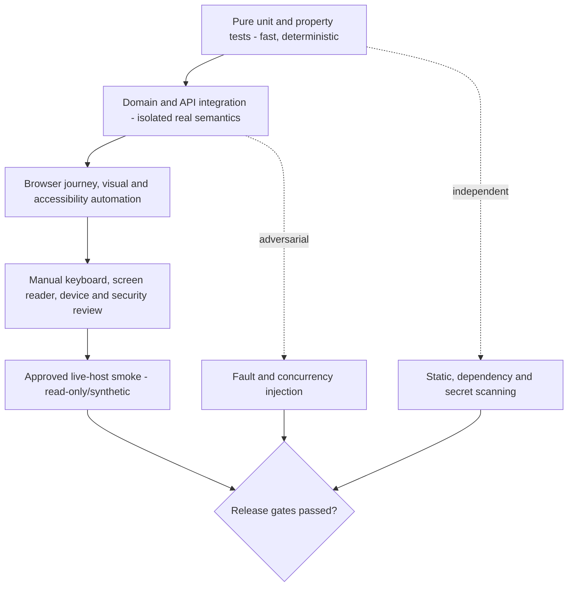
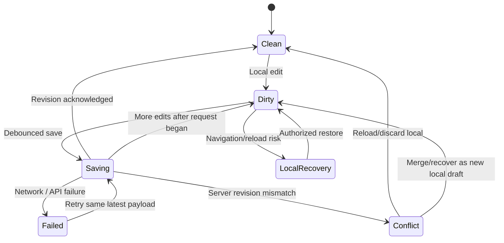
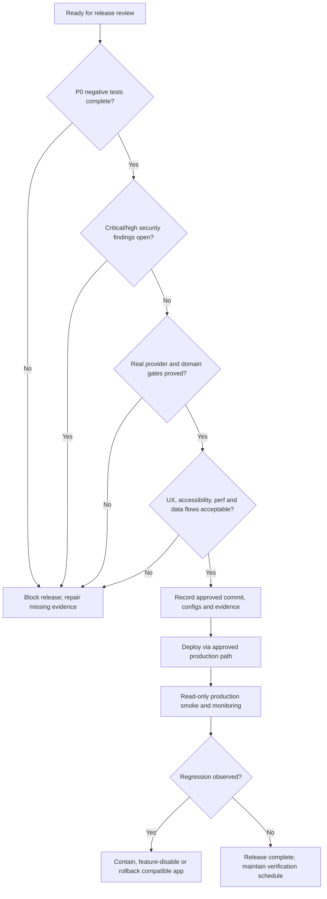
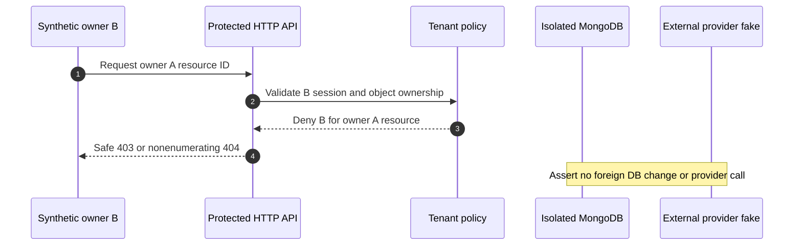
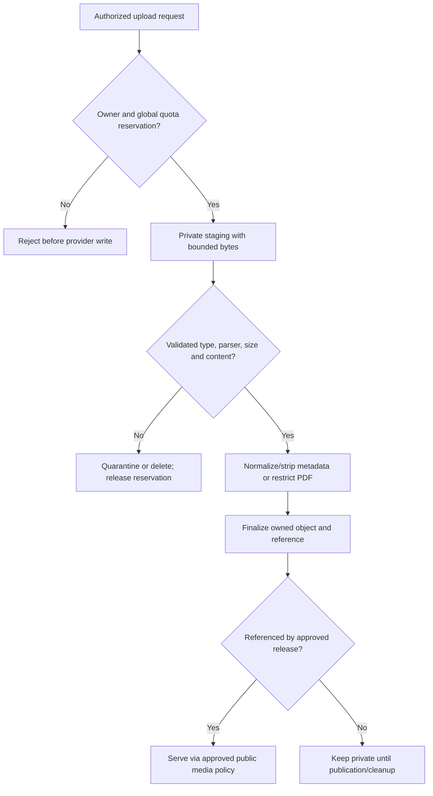
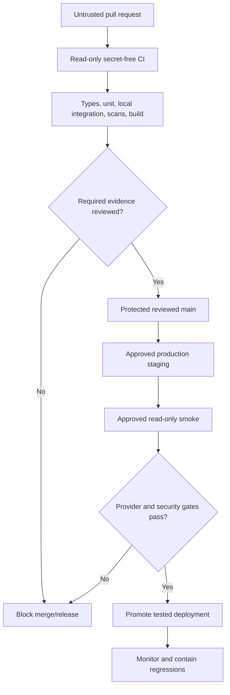
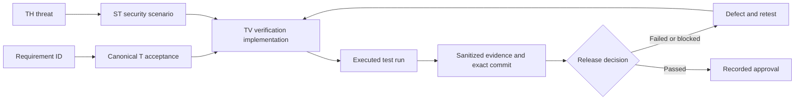

# 11 - Testing Strategy, Verification Architecture, Security Assurance, and Release Quality Gates

> **Product:** GildedIn
> **Document ID:** GI-ARCH-11  
> **Version:** 2.0.0 - detailed specification baseline  
> **Reviewed:** 2026-11-19  
> **Status:** Normative proposed test specification. Test cases and gates are requirements for implementation; no application test result, certification, browser support claim, or production deployment is implied.  
> **Authority:** [02 - Requirements and Scope](02-requirements-and-scope.md) defines product requirements and canonical `T-*` acceptance identifiers; [03 - UI/UX](03-ui-ux.md) defines interaction and accessibility behavior; [04 - C4 Diagrams](04-c4-diagrams.md) defines trust and runtime boundaries; [05 - Data Model](05-data-model.md) defines persisted records; [06 - API Design](06-api-design.md) defines HTTP behavior; [07 - Security Design](07-security-design.md) defines threats `TH-01` to `TH-45` and detailed `ST-*` tests; [08 - Storage and Sync](08-storage-and-sync-strategy.md) defines consistency; [09 - Error Handling and Logging](09-error-handling-and-logging.md) defines diagnostics and incidents; [10 - Deployment Strategy](10-deployment-strategy.md) defines release prerequisites; [12 - ADRs](12-architecture-decision-record.md) explains trade-offs.  
> **Audience:** product owner, solo maintainer, collaborators, security reviewers, frontend/backend developers, accessibility reviewers, test authors, and release approvers.

> [!IMPORTANT]
> **Security and privacy are testable release conditions, not the absence of scanner warnings.** No tool, provider, library, domain, network, browser, identity service, datastore, or AI provider is presumed trustworthy. A passed unit test does not substitute for a negative authorization test; a green preview build does not establish production-domain security; an axe scan does not certify WCAG 2.2 AA; three published revisions are not independent disaster recovery. Known exploitable critical or high-severity confidentiality/integrity vulnerabilities block public launch, even if other metrics pass.

> [!NOTE]
> **Scope limitation:** This is a design and verification plan for a new product. All commands, code snippets, target thresholds, and examples require implementation and execution in the eventual repository. External-provider eligibility and configuration must be checked against the actual account before production use. $0 means no new payment, card requirement, subscription, billable overflow, or test-generated invoice.

## Document map

1. [Purpose, precedence and normative terminology](#1-purpose-precedence-and-normative-terminology)
2. [Test mission and quality model](#2-test-mission-and-quality-model)
3. [Scope, applicability and exclusions](#3-scope-applicability-and-exclusions)
4. [Requirements, threats and evidence traceability](#4-requirements-threats-and-evidence-traceability)
5. [Risk-based prioritization and severity](#5-risk-based-prioritization-and-severity)
6. [Test architecture and tools](#6-test-architecture-and-tools)
7. [Test environments and absolute isolation](#7-test-environments-and-absolute-isolation)
8. [Synthetic fixtures, data factories and determinism](#8-synthetic-fixtures-data-factories-and-determinism)
9. [Static analysis, dependency and supply-chain testing](#9-static-analysis-dependency-and-supply-chain-testing)
10. [Pure unit, model and property-based testing](#10-pure-unit-model-and-property-based-testing)
11. [Authentication, sessions and account linking](#11-authentication-sessions-and-account-linking)
12. [Authorization, tenancy and hostname routing](#12-authorization-tenancy-and-hostname-routing)
13. [Metadata, reusable content, schema and compiler testing](#13-metadata-reusable-content-schema-and-compiler-testing)
14. [Visual editor, responsive composition and interaction testing](#14-visual-editor-responsive-composition-and-interaction-testing)
15. [Autosave, concurrency and recovery testing](#15-autosave-concurrency-and-recovery-testing)
16. [Publication, immutable releases and consistency](#16-publication-immutable-releases-and-consistency)
17. [Public read, cache, revocation and SEO testing](#17-public-read-cache-revocation-and-seo-testing)
18. [Media processing, storage, quotas and deletion](#18-media-processing-storage-quotas-and-deletion)
19. [Gilden AI: knowledge, safety and streaming](#19-gilden-ai-knowledge-safety-and-streaming)
20. [Contact, analytics, directory and external feeds](#20-contact-analytics-directory-and-external-feeds)
21. [Moderation, privacy, export and deletion](#21-moderation-privacy-export-and-deletion)
22. [API contract, adversarial and protocol testing](#22-api-contract-adversarial-and-protocol-testing)
23. [Database, index, migrations and data integrity](#23-database-index-migrations-and-data-integrity)
24. [Accessibility and inclusive interaction verification](#24-accessibility-and-inclusive-interaction-verification)
25. [Browser, device, WebGL and visual testing](#25-browser-device-webgl-and-visual-testing)
26. [Performance, capacity and zero-spend verification](#26-performance-capacity-and-zero-spend-verification)
27. [Reliability and fault-injection program](#27-reliability-and-fault-injection-program)
28. [Security assessment and threat-to-test coverage](#28-security-assessment-and-threat-to-test-coverage)
29. [Automated end-to-end journeys](#29-automated-end-to-end-journeys)
30. [CI pipeline, schedules and secured runners](#30-ci-pipeline-schedules-and-secured-runners)
31. [Test evidence, retention and reporting](#31-test-evidence-retention-and-reporting)
32. [Release criteria, waivers and launch decision](#32-release-criteria-waivers-and-launch-decision)
33. [Detailed verification catalog](#33-detailed-verification-catalog)
34. [Ownership, change control and maintenance](#34-ownership-change-control-and-maintenance)
35. [Known limitations and unproven prerequisites](#35-known-limitations-and-unproven-prerequisites)
36. [Glossary](#36-glossary)
37. [Primary sources and technical references](#37-primary-sources-and-technical-references)

---

## 1. Purpose, precedence and normative terminology

### 1.1 Why testing is a first-class design artifact

GildedIn allows unrelated owners to author structured data, place interactive components, attach media, enable AI grounded in portfolio content, and publish under both a path and a subdomain. This is fundamentally different from testing a fixed-content portfolio site. A regression can simultaneously expose another tenant's private content, break keyboard access to a visually moved button, activate a partially compiled publication, cause an AI response to use revoked content, or leak a session through a sibling subdomain. The test architecture must therefore exercise **cross-boundary invariants**, not just UI snapshots.

Every feature proposal must identify: (1) its data and trust entry points; (2) its positive observable behavior; (3) its most damaging negative or failure behavior; (4) isolation requirements; (5) instrumentation needed to demonstrate the outcome; (6) deterministic automated tests; (7) manual tests where human judgment is necessary; and (8) a launch blocker policy. Applying verification at design time is consistent with NIST SSDF's integration of secure practices into the software lifecycle [S01], OWASP ASVS 5.0.0 as a verification requirements catalog [S02], and OWASP WSTG as a technique guide [S03].

### 1.2 Precedence and consistency

1. [02](02-requirements-and-scope.md) owns requirement IDs `IAM-001`, `TEN-001`, `EDT-001`, etc., and the canonical test IDs `T-IAM-01`, `T-TEN-01`, etc.
2. [07](07-security-design.md) owns threat IDs `TH-01` through `TH-45` and granular security scenarios `ST-IAM-*`, `ST-TEN-*`, `ST-REN-*`, `ST-MED-*`, `ST-SSRF-*`, `ST-AI-*`, `ST-PUB-*`, `ST-PRIV-*`, and `ST-OPS-*`.
3. This document adds granular verification cases prefixed `TV-` without renaming or reinterpreting canonical IDs. It maps them back to source requirements and threats.
4. [06](06-api-design.md) controls precise endpoint status, error code, headers, pagination, and concurrency semantics. A test must use its specified behavior rather than make up a new status based on convention.
5. [05](05-data-model.md) and [08](08-storage-and-sync-strategy.md) define how a draft, immutable release, live policy, publication operation, media reservation, and AI knowledge snapshot relate. Those consistency rules overrule test simplifications.
6. [03](03-ui-ux.md) controls screen-reader order, responsive canvas interactions, live status messaging, and motion behavior; passing a screenshot cannot override those obligations.
7. [10](10-deployment-strategy.md) defines provider due diligence and deployment gates. Automated local mocks do not meet real DNS, TLS, privacy, or cost gates.

If specifications conflict, create a visible `SPEC-CONFLICT` ticket identifying the exact requirement and source sections. Do not silently modify the expected test result to match whichever implementation exists. The test author is required to stop a security-relevant feature from being declared ready until the conflict has a documented decision.

### 1.3 Normative verbs and statuses

- **MUST / MUST NOT:** required for the affected launch scope; an unproven invariant is not a pass.
- **SHOULD:** required default with an explicit, dated exception record if omitted.
- **MAY:** optional capability; if implemented, it remains subject to common authorization and privacy rules.
- **PASS:** observed expected outcome with identifiable evidence.
- **FAIL:** observed violation, including wrong outcome or unauthorized side effect.
- **BLOCKED:** environment/tool dependency prevented execution; not evidence of correctness.
- **NOT RUN:** deliberately not executed; not evidence of correctness.
- **INCONCLUSIVE:** assertions/telemetry insufficient to distinguish safe from unsafe behavior.
- **FLAKY:** non-deterministic behavior requires triage; no silent repeated rerun-to-green on a release blocker.
- **NOT APPLICABLE:** excluded from a specific release because the feature is absent, with cited scope authority.

A launch gate accepts `PASS`, or a formally accepted noncritical limitation where the source permits it. `BLOCKED`, `NOT RUN`, `INCONCLUSIVE`, and `FLAKY` are never represented as `PASS`.

## 2. Test mission and quality model

### 2.1 The central quality proposition

A person without coding knowledge can design a distinctive technical portfolio using a free-positioned canvas, publish a responsive semantically meaningful HTML website, and optionally enable a portfolio-specific AI assistant. Other tenants, viewers, and administrators must remain isolated. An attractive desktop screenshot is insufficient if mobile content overlaps, keyboard operation fails, private data escapes via a search index, or a publication combines mismatched versions.

Quality is judged across these attributes:

| Attribute       | User-visible contract                                                       | Primary measurable evidence                                                  | Hard stop when                                              |
| --------------- | --------------------------------------------------------------------------- | ---------------------------------------------------------------------------- | ----------------------------------------------------------- |
| Security        | No identity, data, or role crossing without authorization                   | Two-tenant negative suite, auth/CSRF/host/renderer tests, audit evidence     | Unauthorized access, action or disclosure exists            |
| Privacy         | Published, private and AI-approved are separate controls                    | Sentinel scans of HTML, JSON-LD, OG, search, AI requests, logs, exports, CDN | Private values leak or deletion/revocation fails            |
| Integrity       | One validated immutable release per activation                              | Multi-step failure injection, conditional writes, idempotent retries         | Mixed release, duplicate effect, lost draft or unsafe GC    |
| Availability    | Essential public reading survives optional provider failures where feasible | AI/feed/storage/Redis failure test, safe fallbacks                           | Optional outage breaks unrelated core flow unnecessarily    |
| Accessibility   | WCAG 2.2 AA target and non-drag alternatives                                | axe + manual keyboard/NVDA/VoiceOver + document outline                      | Critical public/editor path inaccessible                    |
| Responsiveness  | Desktop/tablet/mobile rules preserve content                                | Breakpoint and in-between widths, content expansion, focus tests             | Essential content clipped/covered/unreachable               |
| Performance     | Fast content first; expensive 3D adaptive                                   | Lighthouse lab, field p75, CPU/long tasks, GPU lifecycle                     | Regressions exceed approved gates with no mitigation        |
| SEO             | Separate verified canonical metadata for each public resource               | HTML inspection, sitemap and robots parsing, crawl simulation                | Draft/unlisted/private data indexed, canonical wrong tenant |
| Usability       | Draft and publication status are truthful                                   | Recovery E2E, autosave failure, conflict and publish status                  | User is misled into data loss or accidental publication     |
| Maintainability | Changes have reproducible evidence                                          | Typed contracts, small test fixtures, deterministic CI and ownership         | Critical behavior only tested manually with no plan         |
| Cost            | No paid resource or overage path is possible                                | Provider configuration record, limit-failure probes, resource arithmetic     | Card/auto-upgrade/unbounded paid call is required           |

### 2.2 Acceptance pyramid and risk weighting

The distribution is **many pure unit/model tests**, **focused data/API integration tests**, **small high-value browser journeys**, and **manual security/accessibility work at selected boundaries**. This is a strategy, not a coverage percentage mandate. An account-owner scope check deserves repetitive negative API tests because visual E2E alone cannot expose all ownership paths. Conversely, cinematic motion smoothness requires browser profiling and device observation rather than broad snapshots of implementation internals.



The test pyramid does **not** imply that higher layers can be omitted. It explains which defects each layer can find efficiently. All security-sensitive cross-layer behaviors require at least one integration or browser assertion as well as narrow unit checks.

### 2.3 Prevention and observability

Security is demonstrated by observing both **response** and **side effects**. A denied UI may still have created a media object; a refused AI answer may still have sent private content to Groq; a failing publish response may follow a committed active-pointer change. Tests must inspect durable records, mocked provider invocation logs, outgoing network requests and audit events. For data-minimization assertions, absence must be checked at each expected sink, not inferred from a refusal in the interface.

Test instrumentation is not a production backdoor. Any fault hooks, forced-clock controls, synthetic auth providers, and test routes must be compiled/configured only in isolated test mode and must fail to start when production environment indicators are present. Tests must explicitly verify their removal from production builds.

## 3. Scope, applicability and exclusions

### 3.1 In scope for first public beta

| Surface                                             | Test subjects                                                                                            | Not sufficient by itself        |
| --------------------------------------------------- | -------------------------------------------------------------------------------------------------------- | ------------------------------- |
| Marketing homepage and curated/searchable directory | SEO, noindex filtering, accessible onboarding CTA, performance, example portfolio approval               | Static screenshots              |
| Google OIDC/GitHub OAuth                            | Subject binding, state/PKCE/nonce when applicable, linking, reauth, sessions                             | Successful mocked login         |
| Portfolio identity and routes                       | Stable ID, canonical slug, subdomain, aliases, reserved hosts, 404/410, unlisted                         | One apex-route smoke            |
| Dashboard/onboarding                                | Empty-state, first portfolio, protected mutation, error recovery, mobile essentials                      | Form-only happy path            |
| Content/schema engine                               | Typed fields, nesting/references, data binding, computed fields, safe imports, limits                    | Valid JSON serialization        |
| Free-positioned editor                              | Per-section composition, grouping, resize, overlays, reading order, responsive overrides, touch/keyboard | Dragging with mouse             |
| Draft and publication                               | Autosave, CAS, immutable release, idempotency, propagation pending, restoration                          | Single successful Publish click |
| Gilden AI                                           | Owner opt-in, per-field approval, matching release, safe citations, stream interruptions, quotas         | Model's self-reported safety    |
| Media                                               | Owner-scoped private staging, safe decoding, EXIF removal, PDFs, quotas, references, deletion            | File-extension validation       |
| External metadata                                   | Restricted Medium/RSS/GitHub metadata, SSRF protection, cached fallback                                  | Fetching an ordinary HTTPS URL  |
| Contact and analytics                               | Voluntary text-only contact, 30-day expiry, aggregate counts and optional public metrics                 | Form visual success             |
| Moderation, export, deletion                        | Live suppress, admin authority, bounded export, idempotent cleanup                                       | Database records absent only    |
| Quality and operations                              | Web Vitals, WCAG, a11y alternatives, privacy provider due diligence, zero-charge limits                  | Green CI build                  |

### 3.2 Explicit non-goals and conditional applicability

No billing/payment gateway, commercial subscriptions, microservices, message broker, Kubernetes, container orchestration, arbitrary user JavaScript, user-published executable plugins, unrestricted iframe providers, user-defined schema formulas, user-supplied shaders, private-repository GitHub access, persistent visitor chat history, mandatory vector database, customer-specific subdomain cookie sessions, independent hosted staging environment, or guaranteed database disaster recovery is required for beta. **Do not add testing infrastructure for non-existent components.**

- **Containers:** test Docker image hardening only if an actual Docker deployment/build runtime is selected. Container security does not justify introducing containers into a managed Next.js deploy.
- **IaC:** test infrastructure-as-code validation only if IaC is adopted; otherwise inspect actual provider configuration and exported settings.
- **WebSockets:** test if an actual approved feature uses them; AI streaming initially uses SSE/HTTP, not a custom WebSocket stack.
- **Queues:** test idempotent scheduled/on-demand reconciliation; no broker durability assertions without a broker.
- **Payment security and PCI DSS:** not applicable without financial processing.
- **Offline editing:** optional in-session recovery is not a promised offline collaboration/PWA; verify that unsent edits are not incorrectly represented as saved.
- **Backups/disaster recovery:** independent backup is not a guaranteed capability. Validate integrity, reference-safe revision restoration and accurate disclosure. Do not fabricate backup/restore evidence.
- **Multilingual publication:** English only for first release; browser Unicode attack cases still matter.
- **Collaboration:** one active portfolio owner and no shared editing roles in beta; simultaneous browser tabs and concurrent request races still matter.

## 4. Requirements, threats and evidence traceability

### 4.1 Canonical identifiers

`02` defines 97 baseline requirement IDs and corresponding `T-*` acceptance IDs. These are contract pointers, not individual automated test functions. Each `T-*` acceptance result may aggregate many `TV-*` granular tests plus manual review. `07` separately specifies 45 threat IDs and a named adversarial `ST-*` suite; the testing repository should retain the same IDs when implementing it. Additional test IDs in this document are of form `TV-<DOMAIN>-<three-digit sequence>`, and must not collide with the canonical `T-*` or `ST-*` namespaces.

A coverage record must store **requirement ID -> canonical acceptance ID -> detailed test IDs -> code change -> result/evidence -> threat IDs where applicable**. Examples:

| Requirement | Canonical acceptance | Detailed tests / review                             | Threat     | Evidence needed                                       |
| ----------- | -------------------- | --------------------------------------------------- | ---------- | ----------------------------------------------------- |
| `IAM-002`   | `T-IAM-02`           | `ST-IAM-05`, provider-subject collision integration | `TH-01`    | Separate accounts; no linked row unexpectedly created |
| `TEN-002`   | `T-TEN-02`           | `ST-TEN-01`, matrix across all private resources    | `TH-05`    | No foreign data or side effect across endpoints       |
| `EDT-004`   | `T-EDT-04`           | DOM reading-order test, manual NVDA/VoiceOver       | `TH-40`    | Comprehensible focus and screen-reader sequence       |
| `PUB-002`   | `T-PUB-02`           | Failure-injection checkpoints, reader consistency   | `TH-16`    | Single active pointer; no mixed payload               |
| `AI-004`    | `T-AI-04`            | `ST-AI-06/07/08`, outbound mock context inspection  | `TH-20`    | No outdated knowledge used or sent                    |
| `MED-003`   | `T-MED-03`           | `ST-MED-06`, atomic quota race                      | `TH-43`    | No global cap overshoot                               |
| `SEO-002`   | `T-SEO-02`           | `ST-PUB-04/06`, sitemap/OG/search sentinel scan     | `TH-18/36` | No suppressed/private content in derived artifacts    |
| `SEC-011`   | `T-SEC-11`           | `ST-OPS-01/11` and CI policy inspection             | `TH-27/28` | Fork has no deployment credentials                    |
| `OPS-007`   | `T-OPS-07`           | `ST-PRIV-06`, `ST-OPS-09`                           | `TH-33`    | Dated approved provider data-use evidence             |

### 4.2 Traceability completeness rule

For every `P0` requirement, the backlog MUST link at least one automated negative test and any necessary human/live evidence. `P1` items within launch scope require reproducible acceptance and risk-based negative testing; optional features not included in a particular release are marked `NOT APPLICABLE` with explicit scope and feature flag. Some documents use shorter display identifiers such as `SEC-01` while `02` establishes `SEC-001` as canonical; normalize display forms only in the test registry, never invent additional numbered product requirements.

A requirement with zero implementation evidence remains **Unverified**. Tool-name presence in a workflow is not evidence that the control works. A test run must be bound to an exact source commit, relevant schema version, fixtures and environment.

### 4.3 Coverage dimensions

For each security-sensitive behavior, require the following dimensions wherever relevant: owner A success; owner B denial; guest denial; admin policy-specific action; malformed input; stale version; replay/duplicate; simultaneous calls; provider failure; browser with reduced capability; logging privacy; resource/cost quota; and cleanup. Not every matrix combination needs an individual E2E test, but every untested combination must have a risk rationale.

## 5. Risk-based prioritization and severity

### 5.1 Risk ranking

| Priority                | Meaning                                                                                                                             | Required testing behavior                                                    |
| ----------------------- | ----------------------------------------------------------------------------------------------------------------------------------- | ---------------------------------------------------------------------------- |
| P0 / critical invariant | Identity takeover, cross-tenant read/write, public script execution, draft/PII leak, incorrect active release, billable side effect | Unit + integration + adversarial; release cannot proceed if unverified       |
| P1 / high user impact   | Mobile publishing, keyboard editor, media safely retrievable, cached propagation visibility, AI citations and quota behavior        | Automated where deterministic, manual where needed; block until criteria met |
| P2 / enhancement        | Additional animation preset polish, nonessential analytics chart nuance, optional UI refinement                                     | Regression and targeted usability review; documented deferral possible       |

Severity is **not** equivalent to frequency. A one-step exploit allowing tenant B to read tenant A's private inbox is more serious than a frequent cosmetic rendering error. The accepted lack of independent backups is a known availability/durability risk, but it does not allow tests to ignore preventable corruption or secret leakage.

### 5.2 Defect grading and exception process

- **Critical:** demonstrable unauthorized sensitive-data access or write, account compromise, executable untrusted content on privileged origin, uncontrolled charges. Immediate block; investigate containment.
- **High:** meaningful confidentiality/integrity issue or severe broken core workflow with plausible exploitation; cannot ship public beta while open.
- **Medium:** localized weakness without demonstrated critical path; owner may accept temporarily only with documented workaround, scope, expiry, and test evidence.
- **Low:** small cosmetic/aesthetic problem with no security/accessibility impact; prioritize by user experience.

A waiver record must include exact failing test IDs, root cause, affected tenants/users, compensating control, due date, maintenance owner, and evidence. **Critical and exploitable high findings cannot be waived merely because the project is free.** Product owner risk acceptance for non-security availability limitations is separate from security exceptions.

## 6. Test architecture and tools

### 6.1 Proposed toolchain

| Layer               | Candidate                                                          | Execution                 | Purpose                                                     | Dependency caveat                                                       |
| ------------------- | ------------------------------------------------------------------ | ------------------------- | ----------------------------------------------------------- | ----------------------------------------------------------------------- |
| Type/format         | TypeScript compiler, ESLint, formatter                             | Every PR                  | Type errors and risky patterns                              | Pin exact reviewed major/executable versions                            |
| Unit/behavior       | Vitest                                                             | Every PR                  | Pure functions, compiler, validators, data transformations  | Mocks do not prove real DB semantics                                    |
| Property/fuzz       | fast-check or maintained equivalent                                | Core domain PR            | Constraints, invariants, adversarial parsers                | Seed and shrink trace required                                          |
| React component     | Testing Library + user-event                                       | UI PR                     | Accessible interactions, state, semantics                   | jsdom is not a real browser                                             |
| Axe automated rules | axe-core/playwright integration                                    | UI PR and release         | Detect automatable WCAG violations                          | Manual review still mandatory                                           |
| Mongo integration   | Isolated local single-node replica set where transactions required | Storage/API PR            | Conditional updates, indexes, transaction behavior          | Fake in-memory adapter is insufficient for DB-specific semantics        |
| API contract        | OpenAPI 3.1 validator, schema tools, HTTP harness                  | API PR                    | Body/header/status/problem contracts                        | Validate against same published OpenAPI version                         |
| Browser E2E         | Playwright                                                         | Selected PR; full release | User journeys, host routing, keyboard, screenshots, network | Use isolated contexts/test IDs; authentication state is sensitive [S04] |
| Visual regression   | Playwright `toHaveScreenshot`                                      | UI PR + release           | Layout stability with controlled fonts and motion           | Baselines require controlled OS/browser [S05]                           |
| Web performance     | Lighthouse CI, browser performance timeline, Web Vitals            | Relevant PR + weekly      | Scores/budgets, main-thread, lazy 3D                        | Lab scores not field p75 [S06]                                          |
| Security review     | OWASP ASVS/WSTG checklists, ZAP locally if appropriate             | High-risk PR and beta     | Probe unique auth/tenant/content threats                    | Scanners do not understand all business rules [S02][S03]                |
| CI security         | GitHub Actions, CodeQL, dependency/secret/license checks           | Every PR and scheduled    | Supply-chain and secure pipeline                            | Public/fork permissions and feature availability vary [S07]             |
| Provider simulation | Local HTTP fakes for OAuth, Groq, storage, RSS/Turnstile           | Integration/E2E           | Outages, malformed responses, rate quota, abuse             | No production calls in automated tests                                  |

All tool choices are **candidates**, not permanently mandated libraries. The platform should own its domain contracts and select maintained MIT-compatible (or otherwise license-compatible) tools behind them. The exact compatible version matrix must be documented and checked against the installed Node, Next.js, React, MongoDB driver and Playwright versions. Next.js recommends browser-level tests for async Server Component behavior where unit frameworks do not represent the real runtime [S08].

### 6.2 Test folder architecture (illustrative)

```text
tests/
  fixtures/
    accounts.ts                 # synthetic owner A/B, public guest, admin
    portfolios.ts               # drafts, active releases, visibility states
    media.ts                    # clean, corrupt, malicious, privacy metadata
    knowledge.ts                # approved/revoked AI data markers
    clocks.ts                   # deterministic time source
  unit/
    identity/
    schemas/
    composition/
    release-compiler/
    permissions/
  property/
    graph-acyclicity.test.ts
    canonical-serializer.test.ts
    slug-space.test.ts
    layout-constraints.test.ts
  integration/
    mongo/
    auth/
    api/
    publishing/
    provider-fakes/
    media/
    audit/
  e2e/
    owner-onboarding.spec.ts
    editor-mobile.spec.ts
    publishing-conflict.spec.ts
    tenant-denial.spec.ts
    public-portfolio.spec.ts
    gilden-disabled.spec.ts
    privacy-visibility.spec.ts
  security/
    app-boundaries/
    ssrf/
    uploads/
    ai-policy/
  accessibility/
    manual-checklists/
  performance/
    budgets/
    profiles/
  evidence/
    templates/                 # never check in raw credentialed traces
```

A future implementation can distribute tests alongside modules as long as the same separation and naming contract is preserved. Test-only providers must not be imported into production bundles.

### 6.3 Standard test case template

```yaml
id: TV-TEN-001
requirement_ids: [TEN-002]
canonical_acceptance: T-TEN-02
threat_ids: [TH-05]
level: integration
priority: P0
fixture: two-owner-private-drafts-v2
precondition: owner A and B sessions valid
steps:
  - perform authenticated owner A draft read
  - repeat with owner B token and owner A portfolio ID
expected:
  http: 403-or-nonenumerating-404-as-API-contract
  private_data_in_response: false
  cross_tenant_database_write: false
  secrets_in_logs: false
evidence:
  - assertion-report
  - sanitized-http-transcript
  - database-diff
status: NOT_RUN
```

This is a **test-case record**, not a finished YAML harness or permission to route test traffic to production.

## 7. Test environments and absolute isolation

### 7.1 Permitted environments

1. **Unit and pure component tests:** local process, no outbound network, no cloud credentials.
2. **Domain integration:** disposable local database with actual required feature semantics; a single-node local replica set when transaction tests depend on transactions. Local synthetic Redis substitute or controlled Redis fixture as needed.
3. **Browser E2E:** locally built Next.js server wired to synthetic identities and local services, not real provider accounts.
4. **Production deployment smoke:** narrowly scoped read-only/synthetic non-mutating checks and manually approved provider-configuration inspections. No mutation of live tenant content, destructive load, fake OAuth login against real user accounts, secret scans of live data, or production fuzzing.
5. **Real device/accessibility checks:** selected representative public test portfolio with explicit consent and no PII, or isolated local version.

There is no mandatory separately hosted staging stack. Real DNS/TLS and deployment-specific rules still require verification on the authorized target environment without introducing production test pollution.

### 7.2 Preflight environment gate

Every integration and E2E process MUST fail before constructing a database client if any of the following occurs:

- The environment lacks explicit test mode and a uniquely named disposable test database.
- A URI or database/cluster fingerprint is on the protected production denylist.
- Known production storage buckets, Redis endpoints, AI keys, webhook tokens, or OAuth credentials are present when the suite does not need them.
- A test attempts to connect to an unapproved public host, IP range or cloud account.
- A destructive test uses a non-disposable namespace or fails to prove the test data owns every object it intends to delete.
- A forked PR receives privileged secrets or access to a protected production environment.

**Denylist alone is insufficient**: a renamed production host must still be blocked by an affirmative allowlist and unique test credentials. Validate resolved endpoints and application-layer identifiers, not only substrings of environment variable names. For MongoDB, enforce an explicit test database name, verify server identity, and check each destructive namespace; for storage use synthetic bucket or in-memory adapter. A database test running as a user with production privileges is a failure of the environment design.

### 7.3 Illustrative preflight guard

```ts
// Pseudocode: extend with signed/verified endpoint identity and deployment policy.
export function assertIsolatedTestConfig(
  env: Record<string, string | undefined>,
) {
  if (env.NODE_ENV !== "test" || env.GI_TEST_MODE !== "1") {
    throw new Error("Integration tests require explicit isolated test mode");
  }
  const db = env.GI_TEST_DATABASE_NAME;
  if (!db || !/^gildedin_test_[a-z0-9_]{6,40}$/.test(db)) {
    throw new Error("Disposable test database name required");
  }
  if (!env.GI_TEST_TARGET_ALLOWLIST) {
    throw new Error("Approved local test target allowlist is missing");
  }
  for (const key of [
    "VERCEL_TOKEN",
    "GROQ_API_KEY",
    "AUTH_GOOGLE_SECRET",
    "AUTH_GITHUB_SECRET",
    "PRODUCTION_DATABASE_URI",
  ]) {
    if (env[key])
      throw new Error(`Production capability present in test: ${key}`);
  }
  // Verify actual resolved DB host, network namespace, database permissions,
  // and storage/provider identities before any destructive action.
}
```

The example intentionally cannot establish complete isolation by itself. The test harness must independently demonstrate that supplying production credentials causes startup refusal and **no network connection occurs first**.

### 7.4 No privilege escalation through CI

Untrusted PR jobs run with read-only repository permissions, no secrets, no production OIDC federation, no protected environment approvals, and no privileged artifact consumers. Do not use `pull_request_target` or `workflow_run` to check out and execute attacker-controlled PR code with elevated credentials; GitHub explicitly warns against this pattern [S07]. Code analysis results and artifacts from forks remain untrusted inputs even after CI completes.

## 8. Synthetic fixtures, data factories and determinism

### 8.1 Fixture manifest

| Fixture ID   | Record(s)                                                                                         | Important assertion                              |
| ------------ | ------------------------------------------------------------------------------------------------- | ------------------------------------------------ |
| FX-A01       | Owner A with verified Google subject and stable account ID                                        | Email not identity authority                     |
| FX-B01       | Owner B with distinct GitHub subject, coincident email claim                                      | No automatic account merge                       |
| FX-ADM       | Explicitly provisioned administrator                                                              | Admin permissions cannot be self-assigned        |
| FX-A-P1      | Portfolio A canonical `alex`, alias `old-alex`, active release R2                                 | Old routes resolve safely; identity stable       |
| FX-B-P1      | Portfolio B canonical `blair`, unlisted                                                           | No directory/sitemap; direct link remains public |
| FX-C-P1      | Suspended portfolio with cached published R1                                                      | Live policy blocks controlled delivery           |
| FX-A-D3      | Draft revision 3 with unpublished project and private reference sentinel                          | No publication/AI/search/OG leakage              |
| FX-A-R1/R2   | Immutable snapshots with distinct names, metadata, media refs                                     | No mixed releases                                |
| FX-A-AI      | Approved knowledge for R2, revoked field, pending R3                                              | Wrong release cannot answer                      |
| FX-LAYOUT    | 320px, tablet and desktop layouts with nested/overlapping nodes                                   | Reading order and overflow rules                 |
| FX-OVERLIMIT | 21 blocks, 21 items, 21 fields, nested level 4, 100 KiB+1 byte                                    | Exact validations and no partial effects         |
| FX-IMG       | Real image, corrupted image, GPS-tagged photo, SVG disguised as PNG, decompression-bomb surrogate | Safe normalization and bounds                    |
| FX-PDF       | Valid PDF, truncated PDF, unsupported encrypted PDF and active-content sample                     | Defined acceptance/rejection/isolation           |
| FX-FEED      | HTTPS feed redirecting to private address, DNS rebind and oversized stream                        | No prohibited outbound network access            |
| FX-STREAM    | AI stream with valid chunks, partial chunks, disconnect and malicious citation                    | Correct state, quota and URL validation          |
| FX-QUOTA     | Concurrent upload reservations near global allowance                                              | Atomic admission and safe denial                 |
| FX-DELETE    | Account deletion pending while publish/AI/feed job completes late                                 | No resurrection or new public writes             |

### 8.2 Adversarial value coverage

Factories MUST support empty strings, zero, booleans, nullable fields, far-future dates, out-of-range numbers, UTF-8 multi-byte characters, right-to-left and combining Unicode for display stress (despite English-only publication), malformed percent-encoding, punycode host confusion, duplicate JSON keys when decoder behavior matters, `__proto__` and Mongo `$`/dot operators, embedded HTML and SVG, malicious URL schemes, invalid reference IDs, deep nesting, excessively long field names, binary nulls and unbounded arrays.

Use recognizable _synthetic_ secret markers (`DO_NOT_PUBLISH_PRIVATE_A_...`) rather than real email, API keys, private references or credentials. Search for each marker across page HTML, `__NEXT_DATA__` or equivalent inline data, JSON-LD, page responses, Open Graph, sitemap, search index, AI request payload, error body, headers, browser storage and log capture. A single accidental match is a failed privacy boundary test. Store private sentinels only in disposable fixtures.

### 8.3 Deterministic clocks, ids and network

- Inject a test clock for session expiry, rate limits, contact retention (30 days), audit retention (90 days), slug redirect semantics and idempotency windows.
- Seed pseudo-random property tests and record the seed in failure artifacts. Shrunk counterexample must be reproducible.
- Use controlled UUID/ID generation or normalize IDs in snapshots, but still test real uniqueness and unpredictable IDs at integration level.
- Freeze animations, disable WebGL or select deterministic scene seeds for visual snapshots; do not mock the actual renderer for every performance/device test.
- Simulate timeouts, DNS changes, HTTP redirects, partial responses and network partitioning through a local test proxy. Never target a real cloud metadata endpoint in a test.
- Reset database, browser context, Redis counters and test object store between independent suites. Shared state is allowed only in expressly serialized concurrency scenarios.

### 8.4 Fixture data lifecycle and artifact privacy

Synthetic fixtures should be generated from code, versioned, and explicitly labeled as invented test data. Do not clone real portfolios into CI. Any screenshot or trace should use synthetic display names and non-sensitive images. Raw Playwright storage-state files may include session cookies; place them in ignored directories, encrypt/restrict local retention where possible, and never upload them as publicly accessible artifacts [S04]. A bug report may contain a sanitized request/response and deterministic seed, but never a real bearer token or visitor message body.

---

## 9. Static analysis, dependency and supply-chain testing

### 9.1 Static quality gates

Every code-changing pull request should execute TypeScript type checking, lint rules for React hooks/Next.js boundaries, formatting verification, a successful optimized production build, and tests for affected modules. Type checking cannot prove runtime input validation; negative JSON and HTTP tests remain essential. Prohibit `any`-casts or ignored TypeScript errors around authorization, persisted data, publication, host parsing, secrets and AI payload construction unless narrowly justified and reviewed.

Security-relevant source checks must examine dangerous browser sinks (`dangerouslySetInnerHTML`, unsafe DOM APIs, HTML/Markdown rendering, dynamic iframes, `javascript:` links), raw Mongo selector construction, untrusted user-driven CSS/style generation, `eval` or dynamic imports from content, unsanitized structured-data output, and network calls based on user-provided URLs. Distinguish legitimate safe use from unsafe use through review; keyword matches are not automatically vulnerabilities.

### 9.2 Software composition analysis

Run dependency vulnerability analysis against the committed lockfile and the resolved **production dependency graph**; also review development/build-time packages because their install scripts execute in CI. The gate blocks confirmed critical or high findings affecting a reachable GildedIn feature with no effective mitigation. It does not blindly block all transitive advisories irrespective of exploitability. Record advisory identifier, installed versions, affected code path, upgrade or compensating mitigation, verification, and review date. Pin dependencies to reproducible resolved versions and review updates as complete units.

License scanning should identify incompatible obligations for source redistribution and a free hosted service. The product intends an MIT release subject to ownership audit, not an assertion that every dependency/asset is MIT. The font-license check MUST examine web-embedding rights for Oswald, Roboto, Ink Free and Mistral; an installed Windows font is not automatically redistributable. Confirm that any library's package license, assets, bundled code or generated artifacts can lawfully ship under the selected architecture.

### 9.3 CI trust tests

- Forked PR attempts to print secret variable names/values and access cloud provider APIs: no credentials present; no privilege escalation.
- PR attempts malicious `postinstall`, workflow file rewrite, package lock replacement or artifact poisoning: no production key available; protected deployment review applies.
- Workflow changes enabling `pull_request_target`, `workflow_run`, or broad `permissions: write-all`: block until security-reviewed. An audit job MUST NOT execute foreign code under privileged context [S07].
- Actions use reviewed full commit SHA pinning or an equivalently governed verified policy; update and compare supply-chain attestations where supported.
- Client build artifact scanning detects unexpected keys, private server variables and owner data. Server-only modules cannot enter public bundles.
- Source maps and error pages do not expose credentials. Public source maps are assessed for secret leakage even if source maps are intentionally deployed.
- Workflow gate checks skipped jobs explicitly, so an absent security result cannot satisfy a required check.

### 9.4 Secure coding review checklist

A reviewer of any new endpoint must answer: which actor can invoke it; which portfolio ID is checked; which user-controlled fields are writable; what happens after owner deletion/suspension; how the endpoint behaves on duplicate requests and timeouts; whether a forged hostname affects routing; what is logged; whether output enters an untrusted browser sink; whether it calls an external provider or can charge money; whether it modifies cache, search, AI or media; and which negative test proves enforcement. A negative answer is a bug or documented scope limitation, not a reason to waive the review.

## 10. Pure unit, model and property-based testing

### 10.1 Slug and URL canonicalization

Verify canonical slugs use ASCII letters, digits and hyphens, length 3-30, no leading/trailing invalid separator, case-insensitive uniqueness, lowercased lookup and preserved display capitalization. Reserved names include `api`, `dashboard`, `login`, `admin`, `www`, `app`, `help`, `settings`, plus actual reserved DNS/application routes. Test case collisions, historic slug reservation, concurrent claims, malformed percent escapes, double-encoding, encoded path separators, Unicode confusables, query/fragment injection and header/control characters. The absence of a known malicious string is not enough; the parser must accept only its specified grammar.

One stable `portfolioId` represents the portfolio across path-based and subdomain URLs. Unit-test the public canonical URL builder independently of untrusted `Host` headers; only a validated configured origin can appear in redirects, metadata, OAuth return URLs or social previews. Historical aliases must not become owner selection authority without live policy and slug ownership resolution.

### 10.2 Schema compiler and typed data

For each field type (text, rich text, URL, email, date, number, boolean, image, PDF, list, object, relation and selectable option), test valid values, missing values, nullable values, defaults, optionality, transformed output and invalid values. Validate schema versions, unknown fields, nested collections and arbitrary JSON import against allowlisted schema grammar. Reject recursive/remote refs, prototype-polluting keys, Mongo operators, property paths that escape the tenant aggregate, unbounded collection depth and executor-like strings passed to unsafe sinks.

The fixed GildedIn limits are normative:

| Constraint                   | Exactly accepted | Exactly rejected                  | Counting definition                                                        |
| ---------------------------- | ---------------- | --------------------------------- | -------------------------------------------------------------------------- |
| Nested schema depth          | 3                | 4                                 | Source schema container levels, not display wrappers                       |
| Custom fields per section    | 20               | 21                                | User-authored fields; platform-required identity fields excluded           |
| Owner-authored visual blocks | 20               | 21                                | All pages and sections, including nested authored nodes                    |
| Items per collection         | 20               | 21                                | Persisted entries, not repetitions displayed from same ID                  |
| Serialized published release | 100 KiB          | 100 KiB + 1 byte                  | Canonical UTF-8 encoding with layout, schemas, theme, content and metadata |
| Published releases retained  | 3                | 4 retained after safe GC complete | Not counting draft or failed intermediate artifacts                        |
| Media originals              | 30               | 31                                | Referenced originals; variants still consume global storage capacity       |
| Individual image upload      | 1 MiB            | Over cap                          | Actual content bytes, regardless of declared Content-Length                |
| PDF resume                   | 2 MiB            | Over cap                          | Actual processed bytes and validated document format                       |
| Total media per portfolio    | 15 MiB           | Over cap                          | Includes stored original content per agreed accounting rule                |

The product uses 100 KiB = 102,400 bytes and MiB = 1,048,576 bytes for the specified binary limits; tests must not mix decimal MB and binary MiB. Counting rules are sourced from [02](02-requirements-and-scope.md), [05](05-data-model.md) and [08](08-storage-and-sync-strategy.md).

### 10.3 Property-based graph and layout invariants

Let `G=(V,E)` be an arbitrary generated canvas graph. Properties to prove for every valid graph: every node has a unique ID; every parent exists in the same authorized portfolio; no cycle occurs; Hero is unique and first; nodes have bounded depth/size; a content binding references an owned existing object; a serialized graph round-trips without semantic change; a repeater counts as one authored node independent of its 0..20 rendered items; every logical content element has a coherent reading-order location; unknown component types are rejected or mapped to a defined noninteractive safe fallback; no custom property produces executable CSS or JS.

Generate deep tree and near-limit cases, shapes with zero/negative/NaN/infinite dimensions, mixed absolute/auto/hybrid positioning, far-offscreen positions, overlarge `z-index`, grouping loops, inaccessible overlapping controls, and duplicate semantic IDs. Check the public compiler's output for bounded CSS and finite layout; a node cannot use its transforms to make the page unintentionally horizontally scroll. Tests must cover width changes between breakpoints rather than only exactly desktop/tablet/mobile presets.

### 10.4 Release compiler determinism

Given an identical validated draft and compiler version, canonical release output should be stable regardless of the order in which internal Mongo queries return values, object key insertion order or rendering environment. Use canonical serialization and stable content IDs; normalize intentionally nondeterministic timestamps outside the canonical content hash. Test byte-size enforcement against the **final compiled release**, not only draft JSON. Confirm hidden/private content never enters released HTML, metadata, search index, data attributes, download manifest or AI material, even if an approved block references an otherwise hidden field.

Test compiler migrations against persisted past schema versions. A new renderer must not silently reinterpret `x`/`y` anchoring, change reading order or lose authored group hierarchy. Migration tests must use pre-migration serialized fixture snapshots committed as test data; do not derive both expected and actual results from the current compiler implementation.

### 10.5 Derived data and pure policy rules

Test duration calculations (time zones, leap years, end before start, ongoing roles), search normalization, RSS item deduplication, field-level AI approvals, anonymous rate-limit windows, safe citation routing, link protocol filtering, noindex rules, media usage accounting and role predicates as pure functions. Keep policy decisions at the domain layer: testing a React component that hides a button is not proof that its API rejects the operation.

## 11. Authentication, sessions and account linking

### 11.1 Auth boundary and provider-subject tests

For Google OIDC, verify exact trusted issuer/audience, state, nonce where applicable, PKCE where supported/required, OAuth callback URI allowlist, authorization code one-time use, provider error handling and rejection of substituted token claims. For GitHub OAuth, verify the durable provider account ID and authorized verified email claim retrieval if needed, without treating a public email field as proof. Account identity MUST bind to `(provider, providerSubject)` and then the internal account ID, **never just email**. An email collision between providers or existing accounts must not merge identities. Align the selected library's actual options and provider version with OAuth BCP RFC 9700 [S09] and OIDC Core [S10].

Untrusted `state`, `redirect_uri`, `returnTo`, `Host`, `X-Forwarded-Host`, path slug, and login return URL must not cause open redirects or callback host poisoning. A failed OAuth attempt must neither create a user unexpectedly nor link the target external account. Replay a callback with prior state and ensure no extra account link or login results. Timeout or provider outage must present a safe retry message without leaking token contents.

### 11.2 Linking, unlinking and account recovery

A currently authenticated owner may link an additional Google/GitHub account only after the fresh confirmation flow specified in [06](06-api-design.md). Test target identity already linked elsewhere, partial OAuth callback, attempted link to a different account with coincident email, provider unlink while its session is active, last verified provider removal, session expiration during link, and account deletion concurrently with link completion. One safe provider must remain linked after any successful unlink. Manual recovery via email similarity is prohibited.

### 11.3 Session lifecycle, cookies, CSRF and CORS

Apex session cookies must be host-only, `Secure`, `HttpOnly`, scoped to `/`, with appropriate SameSite and a `__Host-` prefix where viable. **A sibling subdomain is same-site but not same-origin:** SameSite is not sufficient to stop an attacker-controlled portfolio subdomain from inducing a request to the apex. Test double-submit/synchronizer CSRF defense or the adopted anti-CSRF mechanism, exact Origin and Fetch Metadata checks, and denial of credentialed cross-origin reads. Test CSRF for Server Actions as well as Route Handlers, including non-JSON forms and unusual content types.

| Attempt                                                | Expected observable result                                               |
| ------------------------------------------------------ | ------------------------------------------------------------------------ |
| Cross-subdomain HTML form POST to `/dashboard` action  | No state change without valid CSRF and origin rules                      |
| Attacker-origin XHR with `credentials: include`        | Browser cannot read protected response; server denies unsupported origin |
| Forged `Origin` matching tenant subdomain              | Not treated as trusted dashboard origin                                  |
| Cookie delivered to `alex.aaroophan.dev`               | Apex session absent from network request                                 |
| Session replay after logout, suspension or deletion    | No authorized read/write                                                 |
| Cross-account session-state artifact replay            | Account and tenant identity cannot be switched                           |
| Session refresh and concurrent revoke                  | Revocation wins for subsequent privileged operations                     |
| Login with provider error or unauthorized callback     | No session; no accidental account created                                |
| Session cookie omitted on HTTPS/HTTP downgrade attempt | Protected access unavailable; HTTPS enforced                             |

Any owner mutation path that works by changing request method, Content-Type or client wrapper but bypasses the same authorization policy is a failure. Test step-up reauthentication for deletion, unlinking and administrator-sensitive commands.

## 12. Authorization, tenancy and hostname routing

### 12.1 Two-tenant authorization sweep

Build a machine-readable inventory of **every** data operation and test it under Owner A, Owner B, visitor, suspended owner and administrator. This includes direct HTTP routes, Server Actions, privileged server utilities, internal publication/reconciliation functions and asynchronous job continuations. For each resource ID (draft, nested content item, gallery media, upload reservation, revision, publication operation, AI policy, inbox message, analytics setting, export job), swap in an ID from the other portfolio. Assert both no sensitive response and **no side effects**; optionally use a non-enumerating 404 where specified, but never mistake the exact status for the security proof.

Test client-supplied fields such as `ownerId`, `portfolioId`, `accountId`, `platformRole`, `activeReleaseId`, `moderationStatus`, `sourcePortfolioId`, `aiApproved` and quota counters. The server must never allow those fields to override its authoritative actor or object lookup. Mass assignment, nested property updates and JSON Patch-like operations require an allowlist for each command type. Use restricted database roles to ensure a compromised interface does not trivially access unrelated data when the application's scope check is bypassed.

### 12.2 Hostname normalization, routing and cookies

Evaluate, using the **same stable portfolio ID**, the canonical apex path `https://aaroophan.dev/alex`, subdomain `https://alex.aaroophan.dev/`, and detail pages under both. Subdomain navigation retains its current host; SEO canonical points to the approved path-based URL. Unknown subdomains return branded 404; reserved names and existing explicitly configured DNS records must not be interpreted as portfolio slugs. Historical slugs redirect only while still owned by the same portfolio, without creating loops or leaking hidden content.

Tests must include forged Host, X-Forwarded-Host and Forwarded headers; capitalized/mixed-case hosts; trailing dots; ports; Unicode/punycode; encoded slash and path traversal; unknown wildcard names; URL-decoded reserved names; DNS records for `www`, `api`, `mail`, and `dev`; and actual TLS certificate coverage. An application-level mock can prove parsing but **cannot prove** real wildcard DNS or HTTPS. Those are explicit deployment tests authorized for the actual domain. Vercel's automation does not remove the prerequisite of valid DNS ownership and setup.

### 12.3 Live moderation and revocation

Create a published R1, warm every relevant CDN/application cache, then suspend or disable the portfolio. Fresh public requests on apex and subdomain, detail routes, JSON data endpoints, OG metadata/images, sitemap, search, AI and controlled media retrieval must respect the live policy. Deliberately force policy-service outage; cached allow decisions must not be used as an authorization fallback. The application may return a safe 404 or 503 as specified, but **not** publish the suppressed content.

There is an architectural proof obligation: a hosting provider that serves immutable HTML from a CDN _before_ the application can run a live policy check cannot meet immediate server-side revocation for that route by merely calling revalidation. The deployment test must demonstrate the actual gate location or require a different delivery topology. A configuration assertion in code alone is inadequate.

## 13. Metadata, reusable content, schema and compiler testing

### 13.1 Content collections and relationships

Verify that reusable project records have stable IDs across featured Hero, project grid and detail pages. A draft change updates every draft reference immediately, while the active release remains unchanged. Deleting referenced records is blocked or explicitly detaches dependent bindings after impact preview. Relationship operations reject foreign-portfolio content IDs. One-to-many and many-to-many relationships must not create cycles that can cause unbounded renderer traversal or repeated expensive queries. A content item with no dedicated page uses an anchor or existing section route for citations, not an invented public URL.

Test collection reorder, category rename/delete, filters and featured flags; results must be stable under simultaneous editor writes. Test empty collections, duplicate item IDs, missing references, more than 20 items and malformed nested arrays. A change to collection display order must not mutate the canonical content IDs or previously published release.

### 13.2 JSON import, rich text and approved blocks

Only supported schema and block tokens are accepted; arbitrary React source, CSS rules, MDX execution, user JavaScript, custom shader files, raw unsandboxed iframes, and unbounded computed formulas are rejected. Run adversarial imports with `__proto__`, `constructor`, path dots, `$where`, Mongo query operators, getters or magic tokens, recursive `$ref` structures, malformed schemas and large payloads. Tests must inspect both import-validation response and subsequent rendered output.

For rich text, support approved headings, links, images, code, tables and sanitized Mermaid-style diagrams. Test Markdown/HTML conversion without allowing script nodes or event handlers to cross into the final DOM. For approved external embeds, verify URL allowlist, iframe sandbox, `referrerpolicy`, permissions, clickjacking/cross-origin constraints, and no unapproved JavaScript ability to read session data.

### 13.3 Compiled representation and accessibility

A public compiler must produce semantic HTML, meaningful H1/heading sequence, labels/roles, navigable anchors and predictable reading order **independent of visual z-index and absolute coordinates**. Verify at least one informative image with alt text, intentionally decorative image handling, empty title prevention and non-interactive fallback for unsupported blocks. A release cannot claim accessible content if text is present only in WebGL pixels, canvas bitmaps or animation-driven transient nodes.

## 14. Visual editor, responsive composition and interaction testing

### 14.1 Editor behavior matrix

| Feature                     | Desktop pointer       | Keyboard/single-pointer alternative | Touch/mobile                    | Safety check                                      |
| --------------------------- | --------------------- | ----------------------------------- | ------------------------------- | ------------------------------------------------- |
| Select and move             | click/drag handle     | inspector X/Y or move controls      | tap then numeric/nudge controls | cannot move essential content off accessible page |
| Resize                      | corner handle         | width/height inspector controls     | touch handles or numeric fields | bounded dimensions and overflow warning           |
| Rotate supported decoration | rotate handle         | numeric angle input                 | inspector                       | interactive text/navigation not made unusable     |
| Group/ungroup               | multi-select          | list/outline and command            | selection mode                  | parent cycles impossible                          |
| Alignment/distribution      | guideline, snapping   | menu/keyboard actions               | toolbar                         | layout constraints remain consistent              |
| Layering/z-order            | object tree controls  | accessible reorder controls         | touch object list               | focus targets not obscured                        |
| Duplicate                   | command               | keyboard/menu button                | action menu                     | 20-block cap enforced atomically                  |
| Lock/unlock                 | inspector command     | accessible toggle                   | action menu                     | locking does not prevent required edit workaround |
| Repeater binding            | collection picker     | labeled field/collection selection  | inspector                       | owner-only data and counts constrained            |
| Section order               | drag list             | move up/down                        | touch up/down                   | Hero remains first, unique                        |
| Inline text                 | click text            | focus edit control                  | tap field                       | semantic text remains readable and sanitizable    |
| Preview modes               | desktop/tablet/mobile | accessible segmented control        | viewport selector               | no draft leak to guest                            |
| Animation preview           | Play control          | equivalent keyboard action          | tap control                     | reduced motion and WebGL fallback                 |

### 14.2 Breakpoint and stress grid

Exercise viewports at 320, 360, 375, 390, 414, 480, 600, 768, 820, 1024, 1280, 1440 and 1920 CSS pixels, plus widths immediately before and after the implementation's actual breakpoints. Also test 200% and 400% text zoom, long headings, user-entered Unicode, long URLs, 20 items in a card repeater, overlapping focusable elements and 20 authored nodes across several sections. Width values are **coverage samples**, not new breakpoint definitions.

For auto layout, content growth should naturally reflow. For free-positioned fixed-height content, detect clipping or overlap and block severe publication errors; do not silently truncate vital text. Validate mobile/desktop overrides refer to same content IDs unless separate authored content is intentional. Responsive hidden variants must not leak denied content into DOM/AI or create duplicate accessible content at the same viewport.

### 14.3 Editor state and human factors

Users must understand the difference between local edits, debounced draft saves, preview and public publication. Test steady-state indicators, save-in-progress, failed save, conflict, reconnect and publish-propagation pending, using the exact copy and screen-reader announcements from [03](03-ui-ux.md). A save indicator that shows "Saved" before durable acknowledgment is a correctness failure. A modal that traps focus or loses selection after errors is an accessibility and productivity failure.

## 15. Autosave, concurrency and recovery testing

### 15.1 State transitions



The implementation may use different internal state names; the externally observable contracts above are mandatory. `Clean` means server acknowledgment for the exact latest intended draft revision, not merely the last HTTP promise resolved. Each request must carry the intended base revision; late acknowledgments cannot overwrite more recent local edits.

### 15.2 Required race/failure cases

1. Two tabs load revision 12; both attempt changes. Only one conditional save succeeds; the other sees a specified conflict (the product API currently uses 409 for draft conflicts). Neither may silently overwrite the winner.
2. A starts save of old text; B edits newer text locally; old save acknowledgment arrives last. UI remains Dirty until newer text is acknowledged.
3. Save commits, response is lost. Reconciliation identifies current server revision and avoids duplicate side effects or false "unsaved" status.
4. Debounced request is cancelled on navigation while a local edit exists. Warn/recover without claiming the new value was persisted.
5. Browser recovers an account-scoped local draft after reload, but logged-out next user cannot read the previous account's recovery data.
6. Session expires mid-save. The API returns the correct auth error; local edits remain in memory with appropriate privacy boundary and reauth flow.
7. Object move and text edit overlap in separate panels/tabs; schema validation runs on the complete resulting draft, not on contradictory partial state.
8. Restore revision into a draft when unsaved edits exist. Owner confirms loss/replacement or uses a new recovery branch as specified; no unrequested live publish occurs.
9. Redis/AI provider unavailable while editing. Draft save continues because optional systems are decoupled.
10. API conflict body contains no other editor's private data beyond authorized revision/concurrency metadata.

### 15.3 What is not supported

The first release does not promise offline collaboration, persistent multi-device undo history, live cursor presence, or automatic three-way merge. Test that the product does not misrepresent these absent capabilities. Undo/redo applies to the current editing session; browser recovery is best effort with explicit privacy clearing.

## 16. Publication, immutable releases and consistency

### 16.1 Release state and atomicity

Publication must select one authoritative draft revision, validate it, compile all release artifacts, write an immutable complete release, and activate exactly that release through the declared atomic mechanism. The test must distinguish **preparation**, **activation** and **propagation**. A public reader samples one active release pointer and must never combine layout R2 with content R1, or SEO R3 with public search R2. Draft writes while a publication is preparing must not rewrite already selected release input or make the active pointer refer to a structurally inconsistent artifact.

```mermaid
sequenceDiagram
  autonumber
  participant E as Owner editor
  participant P as Publish API
  participant D as Draft and release store
  participant C as Public cache
  participant K as Gilden knowledge
  E->>P: Publish draft rev=12, key=K1
  P->>D: Reserve/idempotency; validate fixed draft rev12
  P->>D: Write immutable R7 and derived public artifacts
  P->>D: Atomically activate R7 if preconditions still valid
  D-->>P: Committed R7
  P-->>E: Published; propagation pending if necessary
  P-->>C: Targeted invalidation/reconciliation
  P-->>K: Prepare R7-approved knowledge snapshot
  Note over C,K: Optional work cannot rewrite active release
```

The necessary cross-document transaction/conditional-write protocol is an implementation proof obligation. MongoDB guarantees atomic single-document updates and supports transactions for related multi-document changes, but **the configuration and exact consistency semantics must be tested**; a unit mock cannot establish them [S11]. If the deployment's real database feature set cannot support the selected protocol, the application must choose a safe equivalent before launch.

### 16.2 Publication crash and retry injection points

| Checkpoint                                         | Injected outcome                        | Required result                                                |
| -------------------------------------------------- | --------------------------------------- | -------------------------------------------------------------- |
| Before idempotency reservation                     | HTTP timeout                            | No release/pointer; safe retry                                 |
| After operation reservation                        | Process crash                           | Same key returns/recovers same operation                       |
| While validating schema                            | Invalid hidden reference/size/alt       | No activation; actionable validation error                     |
| After writing immutable release, before activation | Crash                                   | Old active pointer remains valid; orphan candidate reclaimable |
| During compare-and-set of active pointer           | Concurrent edit/publish                 | Defined one-winner result; no release mixture                  |
| After activation, before response                  | Lost response                           | Retry same key resolves committed result, not a new release    |
| After activation, before cache revalidation        | Cache service failure                   | `propagation_pending`; security policy still authoritative     |
| During search/SEO artifact access                  | Partial cache expiry                    | Each response uses consistent active release                   |
| During AI knowledge generation                     | Groq/context job timeout                | Published page remains live; Gilden temporarily unavailable    |
| During revision retention GC                       | Concurrent restore or media delete      | Referenced artifacts remain; safe retry                        |
| During account deletion                            | Delayed completion from old publication | No resource resurrection or public reactivation                |

Test repeated idempotency key with **different request payload** and cross-tenant reuse of a key; the implementation must scope keys and reject inconsistent reuse, not cause one owner's result to be returned to another. Test request cancellation after activation and ensure it does not roll back a durable publication. Restoring an older release creates a new draft, not a live rollback, and publication of that draft becomes a new immutable release.

### 16.3 Revision and reference safety

After successful release creation, retain at most the three newest restorable published releases under the declared policy; media referenced by current draft or retained releases cannot be garbage collected. A privacy-driven forced erasure can invalidate old revision media; the UI must report an incomplete/unrestorable artifact rather than secretly retaining private media. Do not confuse "three versions available" with an independent backup. Test that a database crash or loss can still destroy all three to verify the documentation's limitation is honest.

## 17. Public read, cache, revocation and SEO testing

### 17.1 Public rendering matrix

Every published portfolio is resolved from a validated host/path and active release, followed by live visibility/moderation authorization. Test both path and subdomain route structures, every project/case-study route, historical aliases and unknown hosts. Public pages must render meaningful semantic text before expensive WebGL initializes and without JavaScript where core static HTML is expected. Cache keys must distinguish portfolio ID, release identity, route and relevant rendering policy, without using client-provided untrusted IDs as authority.

### 17.2 Revocation cannot be treated as cache invalidation

For disabled/suspended/moderated content, the test must include a **real caching layer** where possible: warm content, change authoritative live policy, then fetch through every delivery path. Calling a revalidation API in a mock is not sufficient. If CDN bypasses the application entirely, no amount of positive API testing proves immediate deny. Record actual CDN/edge behavior and whether an authorized check executes before cached HTML delivery. A failed live-policy check must fail closed; safe temporary unavailability is better than resurrecting prohibited content.

Note unavoidable external limitations: a cached screenshot, externally indexed result, third-party social crawler cache or previously downloaded file cannot always be recalled. Acceptance proves fresh controlled delivery and best-effort purge/metadata changes, not impossible global memory erasure.

### 17.3 SEO and discovery test matrix

| Resource and state                  | Canonical                                         | `noindex`                    | Sitemap/directory           | Detail OG and JSON-LD                       |
| ----------------------------------- | ------------------------------------------------- | ---------------------------- | --------------------------- | ------------------------------------------- |
| Public apex portfolio               | Approved path URL                                 | No                           | Present where configured    | Tenant-scoped published data                |
| Same public portfolio via subdomain | Apex path URL                                     | No, canonical deduplicates   | No duplicate entry          | Same release identity                       |
| Unlisted portfolio                  | May identify path URL but not expose via site map | Yes                          | Excluded                    | Restricted preview generation as configured |
| Owner-only draft/preview            | Must not create public indexed canonical          | Yes/no-store                 | Excluded                    | No public crawler artifacts                 |
| Unpublished/deleted                 | None or retired link policy                       | N/A or gone                  | Excluded                    | Not served as active content                |
| Suspended/moderated                 | No public leak, live deny                         | Suppressed                   | Excluded                    | Suppressed under controlled routes          |
| Project detail                      | Resource-specific canonical                       | Follows owner/indexing state | Include only when indexable | Project-specific title/description/OG       |

Test `robots.txt`, XML sitemap syntax, host-specific sitemaps, correct per-portfolio canonical for every detail route, unique H1, JSON-LD escaping, social image leakage, renamed project routes, removed project 404/410, category filters and public search. Schema compiler and metadata generator must not include hidden/private/AI-only fields merely because those values exist in a stored document. For actual external crawler behavior, use controlled URL inspection and internal metadata checks; do not promise immediate Google de-indexing [S12].

---

## 18. Media processing, storage, quotas and deletion

### 18.1 Threat-based upload acceptance

Every uploaded original starts private, owner-scoped and non-executable. It is **not** trusted because a browser supplies a filename, extension, `Content-Type`, declared dimensions or image preview. Test the complete sequence: authentication and quota reservation, upload to private staging, server verification, bounded decode/parse, sanitization/re-encoding where required, media metadata registration, final authorization, publication reference, public delivery and retirement. The OWASP File Upload Cheat Sheet recommends a layered approach because extensions, MIME and signatures are individually insufficient [S13].

| Upload class    | Negative payloads                                                                                        | Expected behavior / evidence                                                                       |
| --------------- | -------------------------------------------------------------------------------------------------------- | -------------------------------------------------------------------------------------------------- |
| Image type      | SVG/HTML masquerading as PNG, fake MIME, double extensions, alternate Unicode name                       | Reject or safely normalize to permitted raster output; never render as origin-privileged HTML      |
| Image decoder   | Truncated bytes, malformed chunks, high-ratio compression, huge dimensions, decompression-bomb surrogate | Bounded process/memory/time; no published object on failure                                        |
| EXIF and GPS    | Known dummy GPS EXIF, camera device serial, orientation metadata                                         | Public normalizations lack unnecessary identifying metadata                                        |
| Image rendering | Oversized bitmap, animated GIF if unsupported, unsupported color profile                                 | Deterministic allowed variant or explicit rejection                                                |
| PDF resume      | Encrypted, truncated, malformed, suspicious active actions, incorrect signature, crafted object graph    | Reject/quarantine or serve through restricted isolated mechanism; no silent unsafe inline exposure |
| Filename        | Dot segments, path separators, null, very long, control characters                                       | Storage key generated by server and never directory traversal                                      |
| Access control  | Guess staged object ID; foreign owner finalize/delete                                                    | Deny before object delivery or mutation                                                            |
| Quotas          | Parallel reservations, finalize twice, interrupted upload, oversized stream                              | Atomic limits, no orphan billable usage, idempotent cleanup                                        |
| Lifecycle       | Media removed in new draft but retained R1 references it                                                 | Media preserved until all legitimate refs expire, unless privacy erasure overrides                 |
| Delivery        | Wrong `Content-Type`, sniffing, unexpected executable response                                           | Strict headers and same-origin isolation verified in browser                                       |

For PDF validation, do not claim full malware safety from file signatures. Use restricted behavior and a defensible reject policy if a free safe parser or scanner cannot establish acceptable risk. Verify `Content-Disposition`, `X-Content-Type-Options`, isolation of the media origin where needed, `Cache-Control` behavior and document-viewer protections against script execution or origin confusion. Test denied PDFs do not remain accessible through a preview URL or residual CDN key.

### 18.2 Quota race and accounting

Use local simulated global capacity near its hard boundary. Start concurrent upload reservations whose combined size exceeds the remaining allowance; only the admitted amount may be finalized. Ensure both per-owner 15 MiB and global hard threshold apply **before** any provider write that could trigger charges. Recheck after actual processed size; variants still consume physical provider capacity even if some product quotas count originals. On an interrupted or corrupted upload, release the reservation exactly once after grace expiry and delete staged leftovers. A retry must not double count usage; an attacker must not bypass limits by changing filenames or upload IDs.

No automated test should upload payloads to a real free service merely to discover its consumption ceiling. Use local counters and provider contract inspection for normal test runs; real account quota/billing safeguards are separately signed off in deployment gates. If a provider cannot enforce zero-charge behavior, the test outcome is **deployment blocked**, not "test passed because charges were unlikely".

### 18.3 Safe deletion and retrieval

Test media reference graph traversal across working draft, active release and two retained earlier releases. In ordinary cleanup, delete only truly orphaned original and derived variants. If a user invokes privacy erasure, update the live delivery policy immediately and mark old releases incomplete when they contain erased media. Backend deletion must be idempotent, scoped to the authorized owner, and non-resurrectable by delayed processing jobs. External CDN caches may retain copies temporarily; test controlled gateway deny, invalidation requests and accurate user-facing explanation, not an impossible instantaneous global deletion promise.

## 19. Gilden AI: knowledge, safety and streaming

### 19.1 Grounding and data boundary

Gilden is owner-opt-in, English-only, portfolio-specific and independent of navigation/editing. It is enabled only when a published Hero and About provide appropriate explicitly approved information. Build a **filtered knowledge snapshot for the active published release**, with default-denied new fields and field/section approval. Owner-private drafts, unapproved references, private emails, contact-inbox messages, login account records, other tenants' data, and older release snapshots must be absent from outbound model requests. Inspect a fake Groq provider's received payload, not the model's denial language, to prove this.

Create the following synthetic cases:

1. Published R1 and matching approved snapshot K1 answer correctly.
2. R2 activated while K2 still building: no fallback to stale K1; Gilden unavailable with links to public pages.
3. One field approved, adjacent field denied: only approved field reaches provider.
4. Owner adds a new field to an approved section: it remains denied until explicitly approved.
5. Owner disables Gilden: new requests denied immediately; running generation cancelled when feasible.
6. Owner revokes one value: subsequent requests consult authoritative policy/version and omit it even if cached snapshot still contains stale bytes.
7. Draft-only update: Gilden continues using appropriate published snapshot; never reads draft.
8. Unlisted portfolio: AI availability follows explicit owner setting and unlisted access rules; no accidental public directory discovery.
9. Moderated project or suspended portfolio: no knowledge use or response from suppressed material.
10. Approved PDF with private reference details: extractor and approval logic cannot silently expose document-wide unapproved content; if reliable field filtering is impossible, the document must be excluded.

### 19.2 Adversarial prompts and structured outputs

OWASP identifies direct/indirect prompt injection, tool misuse, output leakage and malicious link generation as separate risks [S14]. Gilden should have no arbitrary tool execution capability. Adversarial test inputs must include visitor requests to override instructions, malicious FAQs, infected text in approved PDFs, misleading Markdown links, HTML-like embedded content, obfuscated role delimiters, encoded text and requests to produce arbitrary external citations. A refusal by the model does not prove that private data was not transmitted; instrumentation must assert the allowlisted source set and zero private-marker occurrences.

A **source-link validator outside the model** receives structured content-reference IDs, checks the matching release, resolves to a known allowed public detail page or section anchor, and rejects unapproved absolute URLs. Test model outputs containing `javascript:`, encoded fake path, malicious external host, cross-tenant slug, nonexistent project, and citations to hidden content; none may turn into a trusted clickable citation. Markdown/streamed assistant content must be escaped or rendered through a restricted safe formatter rather than injected as raw HTML. Test that model output cannot silently invoke contact submission or change owner settings.

### 19.3 Streaming, cancellation and quotas

Test provider SSE (or adopted streaming transport) with valid events, partial UTF-8 chunks, split JSON frames, malformed event, unexpected close, idle timeout, browser navigation, client abort, server abort, provider 429/500, and simultaneous requests. The client should show partial answer marked interrupted when appropriate; started generation counts toward the visitor quota as specified, without allowing repeated cancellation to escape accounting.

| Resource control            | Required scenario                                                                                |
| --------------------------- | ------------------------------------------------------------------------------------------------ |
| Visitor daily limit         | 15 allowed within configured window; 16th denied                                                 |
| Portfolio monthly allowance | Atomic reservation blocks extra request after cap                                                |
| Platform-wide provider cap  | Many portfolios compete; no cross-portfolio overshoot                                            |
| Concurrent streaming        | Reserve before provider call; safe settle on failure/cancel                                      |
| Redis unavailable           | No new provider calls; portfolio website unaffected                                              |
| Groq unavailable            | Chat temporarily unavailable; no unlimited retries                                               |
| Oversized context/prompt    | Server-side token/byte bounds; reject/trim only authorized facts                                 |
| Conversation persistence    | Browser session only; no GildedIn server-side chat transcript stored                             |
| User privacy                | Provider receives necessary prompt during inference; UI accurately discloses external processing |
| Citation references         | Link IDs matched to active release and trusted URL builder                                       |

A quota test should verify the actual counter protocol, not only the configured integer. Use controlled clocks, atomic counter simulations and mocked provider instrumentation. Distributed quota semantics may rely on Redis scripts or transactions; integration tests must exercise the actual chosen mechanism. Do not claim per-visitor uniqueness against a determined attacker; short-lived anonymous sessions plus coarse abuse protection are a privacy-conscious deterrent, not strong identity verification.

### 19.4 AI evaluation methodology

Use three scored datasets, each versioned and synthetic: **grounded fact questions** (can cite a known project or skill), **insufficient-information questions** (must say not available), and **adversarial instruction questions** (must not override policy or disclose a hidden marker). Grade with deterministic structural assertions wherever possible: allowed source set, correct release ID, no private payload, valid citations, quota compliance, proper unavailable fallback. Human review grades helpfulness, tone, and factual fidelity; automated LLM judges can assist but cannot independently authorize launch. Track false-positive/false-negative classifications and evaluate under the supported English-only policy.

Sample metrics: answer-grounding rate by curated cases, rate of fabricated citations (must be zero for validated link actions), rate of private marker sent to provider (must be zero), bypassed quota requests (zero), and refusal for intentionally unsupported questions. Record model name/version, adapter version, prompt/schema version, seeded portfolio and evaluation date. New model versions require a focused re-evaluation because provider behavior can change without application deployment.

## 20. Contact, analytics, directory and external feeds

### 20.1 Contact form and inbox

A visitor can voluntarily submit text-only name, email, message/subject and optional organization via the separate consent-aware contact workflow. Gilden must neither collect those fields in its own chat flow nor automatically submit chat content to the inbox. Test owner-enabled/disabled contact form, CAPTCHA or Turnstile where configured, validation, body limits, CSRF where applicable, anti-bot throttling, duplicate submission, email injection, cross-tenant inbox reads, and idempotent message deletion. The public UI must not expose the owner's inbox or email unless explicitly approved for publication.

At the retention boundary (30 days), test that expired submissions are not available through the API **even before** background TTL deletion runs. TTL deletion delay cannot become a privacy/access-control bypass. Test owner export during the permitted window; messages cannot be kept indefinitely in the application through a "star" flag that contradicts the retention policy. Contact input, IP and email must not be copied to aggregate analytics or normal error logs.

### 20.2 Analytics

Analytics aggregate page views, project clicks and outbound-link interactions without persistent visitor identities or raw browsing trails. Validate that ingestion rejects foreign portfolio IDs, uses server-authorized route identity, bounds event counts and sizes, applies bot-filtering where possible, and never turns raw event data into public output. Owner-only statistics are private by default; changing a public statistics setting requires authorization and explicit owner opt-in. Public aggregate counts must remain clearly approximate rather than presented as fraud-proof.

Tests include duplicate events, spoofed referer, repeated automation, time-window rollover, high cardinality payload, deleted portfolio, disabled analytics, missing consent requirement in applicable region, and datastore failure. Aggregate counts must not leak individual visitor locations, message content, IP addresses or provider session IDs.

### 20.3 Directory and portfolio search

The homepage may show curated examples and a lightweight searchable public directory. Test only truly public, approved and nonsuspended portfolios appear; unlisted, draft-only, disabled and deleted portfolios are excluded. Search filters must not discover private project titles through counts, hidden categories or error messages. Per-portfolio search index is derived at publication time from approved visible content. Test direct URL retrieval as well as search result visibility; no separate paid search backend is required.

### 20.4 RSS/Medium and GitHub metadata

RSS sync is optional and bounded. Test username/RSS URL/manual links, single primary feed, local cached fallback, malformed XML, feed 304 if supported, invalid date/thumbnail, reordering, deleted posts and inaccessible remote URLs. Remote fetch paths should enforce URL allowlists or equivalent safe egress, public IP validation at **connection time**, every redirect hop, size/time bounds and content sanitization. Simulate DNS rebinding via an instrumented local resolver/connector; do not test by actually contacting cloud instance metadata or internal networks. If chosen serverless runtime cannot implement safe DNS pinning or egress restrictions, the automatic fetch feature must be disabled rather than weakening the SSRF control [S15].

GitHub authentication should not silently request private repository scope. For optional public repository metadata, test read-only access, provider 403/rate limit, missing public details and graceful fallback to manually supplied portfolio content.

## 21. Moderation, privacy, export and deletion

### 21.1 Moderation with immutable releases

Administrators can suspend a portfolio or hide a specific content item via **live moderation policy**, not by editing history. Test unauthorized user attempting to set moderation state, admin step-up, audit entry, temporary quarantine, appeal flow, and stale cached artifact access. Moderated content must be excluded from public HTML, relevant derived search/SEO, directory and Gilden; an immutable release may retain historical bytes, but the live policy must prevent controlled public delivery. If this cannot be enforced for an asset at a selected hosting layer, report a deployment-blocking limitation, not a simulated pass.

### 21.2 Privacy preferences and deletion

Test owner control of public references, testimonial consent, field/section visibility, AI approval, public analytics and unlisted status. Sensitive fields must default private or AI-denied as specified. Deletion and export require authenticated owner scope and fresh reauthentication for irreversible actions. An export bundle contains the owner-authorized data, schema, tokens, layouts, manifest and accessible media references, with no other tenant's records, session tokens, private provider secrets or hidden system diagnostic objects. Export links or streamed archives must not remain publicly retrievable beyond the prescribed window.

When account deletion starts: immediately revoke sessions; block new writes and jobs; remove public access; mark owned data for idempotent cleanup; delete stored assets; remove scheduled work; and record narrowly scoped audit evidence. Simulate a delayed publish, AI snapshot build, upload finalize, RSS sync or analytics flush that completes after deletion begins. None may resurrect a portfolio, leak data or create a new public object. Backup copies may persist within documented provider retention; the system must not promise immediate removal from external backups it cannot control.

### 21.3 Privacy-processing assessment

Before launch, manually validate the data inventory and disclosure for Google/GitHub identity claims, public media, private drafts, visitor form content, Redis quota signals, Groq prompt processing, CDN caching, logging, analytics and provider content-processing terms. Review applicable privacy-law obligations separately from technical testing; this document is not a legal determination. Privacy notice and required consent/acknowledgments are deployment acceptance criteria where applicable. Test browser behavior against the actual disclosure, including whether third parties receive unnecessary personal data before an owner/visitor action.

## 22. API contract, adversarial and protocol testing

### 22.1 Contract-first API coverage

Every implemented route must be matched against [06](06-api-design.md)'s OpenAPI 3.1 contract and the selected JSON Schema revision. Exercise authenticated and unauthenticated calls, content negotiation, required/unknown fields, booleans/nulls, max body size, conditional revisions, pagination limits, idempotency headers, error formats, rate-limit responses and response security headers. Generated types are a convenience, not proof that the server enforces the schema.

Standard error payloads must not contain call stacks, Mongo query text, secret material, email addresses of unrelated tenants or internal provider response bodies. Tests should check status, stable error code, field-level validation details and consistent request correlation ID. Use exact status semantics specified in [06](06-api-design.md); particularly, GildedIn's 409 draft-revision conflict contract must not be silently changed to 412 by a test author despite the general HTTP `If-Match` convention. If native precondition headers are adopted, update the canonical API document first.

### 22.2 Protocol robustness

Test invalid JSON, duplicate content-length, chunked request limits, malformed/duplicate headers, unsupported methods, non-JSON `Content-Type`, unsafe redirects, CORS preflight, structured body size before parsing, request abort during mutation, connection timeout, partial downstream response and slow-client stream. The objective is bounded resource use and correct side-effect semantics, not merely graceful error strings. Use local test proxies for malformed network traffic and avoid targeting providers with potentially abusive traffic.

For public `GET`, ensure no mutation or paid work occurs unintentionally. Dynamic media transformations should be bounded and cached; no unauthenticated endpoint should repeatedly generate expensive OG images, remote previews or LLM calls without quota/authorization checks. Test that `OPTIONS` or `HEAD` do not become alternate mutation paths. Confirm standardized correlation IDs are validated and do not permit log-injection or arbitrary raw strings.

### 22.3 Property-based negative API tests

Construct a resource matrix: account, portfolio, draft, content, release, media, publication operation, AI policy, contact inbox, export, moderation and analytics. For each resource generate foreign owner IDs, unknown IDs, malformed IDs and IDs from deleted records. Generate extra privileged fields within valid request shapes. Invoke relevant read, create, update, delete, upload, export and administrative actions. Assert consistent policy decisions and no change to objects outside the authorized tenant. Maintain a mapping back to `T-TEN-02`, `T-SEC-02`, and `TH-05/06`.

## 23. Database, index, migrations and data integrity

### 23.1 MongoDB-specific requirements

A local database test must establish the behavior of indexes, collations/normalized unique slug claims, provider identity uniqueness, one-active-portfolio constraint, conditional draft revision writes, publication operation uniqueness, active release pointer atomicity, TTL expiration, transaction semantics and write conflicts. Do not simulate these solely with JavaScript Maps. MongoDB documents explicitly distinguish single-document atomicity from multi-document transactions [S11]. A local replica set is appropriate for transaction tests; verify actual selected managed tier supports the chosen operations at launch, rather than assume the local deployment and production tiers are identical.

Run duplicate-key races with two connections, not sequential pseudo-concurrency. Test a Mongo failure after write acknowledgment, ambiguous network timeout, driver retry behavior, primary/network interruption where legal/possible in local replicas, index migration failure, invalid document attempts and mixed schema versions. Public reads must load only the release identified by the active pointer, even if new draft writes are in progress.

### 23.2 Index and query evidence

For critical tenant-scoped queries, assert that the query includes the verified portfolio owner/portfolio ID and proper live policy. Review query plans with representative 100 and 500 active portfolio fixtures, checking collection scans, index selection and worst-case large nested docs. Index presence alone does not guarantee access control or performance; inspect actual queries. Avoid production database explain plans that require privileged or risky operations.

### 23.3 Migration tests

Every schema upgrade must have a migration fixture set, an **expand/contract compatibility** review across old and new application versions, forward-only production data transform plan, and rollback semantics. Test old release readability, old aliases, JSON schema version conversion, index creation/uniqueness, retained media references and missing optional fields. If a new binary version cannot read old published release formats, the deployment cannot rely on immediate application rollback unless a compatible adapter or previously verified migration is available. **Application rollback is not equivalent to restoring tenant content.**

### 23.4 Retention and deletion

TTL is asynchronous in MongoDB and should be treated as cleanup, not a confidentiality gate. Tests must enforce access expiry at read time and then separately verify background deletion. Delete account flow must check every owned collection and object inventory; idempotency and generation checks prevent late jobs from recreating rows. Observe logs and audit records for data minimization during the deletion process.

## 24. Accessibility and inclusive interaction verification

### 24.1 Target and methodology

The product targets **WCAG 2.2 Level AA** across public portfolios and essential editor functionality [S16]. Use automated axe scans to detect automatable defects, then manual keyboard and assistive-technology tests for the behavior that scanners cannot determine [S17]. For a broad assessment, follow the sampling, exploration, complete-process and reporting approach in WCAG-EM 2.0 (W3C Group Note, July 2026) [S18]. The method helps structure evaluation; completing automated checks or a single sampled assessment does not guarantee conformance across arbitrary owner-authored content.

### 24.2 Required accessibility checks

| WCAG concern            | GildedIn-specific test                                         | Required interpretation                                            |
| ----------------------- | -------------------------------------------------------------- | ------------------------------------------------------------------ |
| Text alternatives       | Hero/media/card gallery, generated OG alt display              | Informative images named, decorative images marked correctly       |
| Document structure      | H1, sections, project detail, readings order                   | Semantic order coherent despite free canvas coordinates            |
| Contrast and color      | Dark/light themes, user tokens, controls, focus rings          | Sufficient contrast; no color-only meaning                         |
| Reflow and zoom         | 320 CSS px, text resize and 200/400% zoom                      | No essential loss, forced two-axis scrolling where not excepted    |
| Keyboard                | Editor object tree, grouping, order, inspector, dialogs, menus | Every essential action reachable without drag                      |
| Dragging movements      | Group move/resize, section reorder, gallery order              | Non-drag single-pointer alternative per SC 2.5.7                   |
| Target size             | Touch handles, close buttons, editor toolbars                  | 24x24 CSS px minimum or valid specified exception per SC 2.5.8     |
| Focus not obscured      | Sticky header, floating Gilden, modal, inspector               | Keyboard-focused control not hidden by overlays (SC 2.4.11)        |
| Accessible auth         | Google/GitHub login/error and recent reauth                    | No unnecessary cognitive barrier; correct labels/status            |
| Consistent help         | Help links and contact/report flows                            | Navigation predictable across screens                              |
| Status and errors       | Saving, conflict, quota, publish propagation                   | ARIA live regions announce important changes without flood         |
| Tabs/carousel/accordion | Safe interactive blocks and owner editor                       | Appropriate focus, name, role, state and key behavior              |
| Motion                  | Letter reveal, 3D, scanning corners, focus                     | Reduced-motion fallback preserves information, no forced animation |
| Timing                  | Session expiration, autosave warnings, AI stream               | User informed and enabled to recover without accidental loss       |
| Touch                   | Precision editor actions on phone/tablet                       | Single-pointer alternative, no hover-only functionality            |

The 24 CSS px figure is a minimum with documented exceptions, not a recommendation to create tiny mobile touch controls; GildedIn should favor larger touch targets where feasible. Testing must account for sticky/fixed headers and 3D overlays that could obscure real focus targets.

### 24.3 Browser and assistive technology pairings

- Windows: current Chrome and Firefox with NVDA; Windows Edge with keyboard-only testing.
- macOS: Safari with VoiceOver; Chrome for public/editor regression.
- iPhone: iOS Safari with VoiceOver and touch.
- Android: Chrome with TalkBack where available; low-end Android performance and scrolling.
- Tablet: touch controls, viewport switching, inspector and modal focus.
- No-WebGL and system `prefers-reduced-motion: reduce`: verify complete semantic content and all essential actions.

The goal is the latest two stable major versions of major evergreen browsers where their release model supports that rule, but the **actual versions tested must be recorded**. Simulated mobile viewports alone do not prove touch or screen-reader operation on physical devices. If access to a real device is unavailable, mark the corresponding manual gate `BLOCKED` and state the unverified surface.

### 24.4 Owner-generated accessibility

The platform cannot guarantee that arbitrary user-authored prose is clear or that every uploaded image description is accurate. It can enforce structural limits, accessible components, required alt text for informative images, safe defaults, reading-order constraints, severe overlap prevention and publish validation. Test that invalid owner customizations are rejected before publication and do not allow accessibility bypass through JSON import or internal API. Test owner-visible warnings and remediation controls, not merely internal validator return values.

## 25. Browser, device, WebGL and visual testing

### 25.1 Matrix and execution selection

| Target          | Browser               | Routes                                              | Special concern                                 |
| --------------- | --------------------- | --------------------------------------------------- | ----------------------------------------------- |
| Low-end Android | Chrome mobile         | Public, project, search, Gilden and minimal editing | Adaptive scene, memory, scroll, touch           |
| Modern Android  | Chrome mobile         | Entire public and dashboard flow                    | Forms, editor inspector and overlays            |
| iPhone          | iOS Safari            | Public, OAuth redirects, editor, contact            | Safe-area, viewport changes, WebGL fallback     |
| Tablet          | Safari/Chrome         | Editor and preview                                  | Touch resize, drag alternative, split layout    |
| Windows         | Chrome/Edge/Firefox   | Public + full editor                                | Browser CSS/scroll, focus, pointer              |
| macOS           | Safari/Chrome         | Public and editor                                   | WebGL/GPU differences, font fallbacks           |
| WebGL disabled  | Each relevant browser | All public routes                                   | Complete semantic text + static technical layer |
| Reduced-motion  | Browser preference    | Hero and component motion                           | No essential text exists only during animation  |
| Slow connection | Throttled browser     | Entry and update flows                              | Hero LCP, media, truthful save/retry            |

### 25.2 Visual regression policy

Use committed baselines for representative content/layout combinations, fixed font versions, consistent OS and browser builds, stable viewport/device scale, suppressed cursor caret, deterministic time and reduced-motion mode. Snapshot meaningful screens (hero, responsive case study, editor controls, Gilden floating widget, invalid publish, conflict dialog, empty state, accessibility focus) rather than every microscopic hover state. Keep small visual baselines for major brands and four scene presets; expensive cinematic motion should be verified with targeted video/performance review instead of fragile per-frame pixel equality [S05].

For each changed screenshot, review semantic correctness as well as pixels. Baseline updates require a human reviewer with an explanation; auto-regenerating snapshots to make tests green defeats regression testing. Never place real portfolio screenshots or private edit state into public PR artifacts.

### 25.3 Three.js and animation verification

- One shared WebGL context where applicable; no uncontrolled context multiplication across page transitions.
- WebGL init only after critical semantic content; no delaying LCP to wait for shader compilation.
- Shader/model/texture resources properly disposed on unmount; tab-hidden and offscreen rendering paused.
- Device frame-time monitor reduces effects when performance drops; validate hysteresis avoids quality thrashing.
- Cinematic mode is opt-in; Standard adapts to performance budget; Off/Reduced Motion retains the visual identity statically.
- Individual-letter introduction announces the complete text once semantically; decorative letters are hidden from assistive technology.
- Letter animation full replay once per tab session, shorter/static on return, optional replay, interruption safe.
- Technical corners respond to keyboard focus as well as pointer; no interaction relies exclusively on hover.
- Long articles/case studies have low or no continuous WebGL activity.
- No owner-supplied shaders/JS; scene configurations validated through known presets and bounded numeric options.

GPU testing is subject to real-device variation. A good screenshot does not measure frame pacing, thermal impact or GPU memory lifecycle. Capture `requestAnimationFrame` timings, long tasks, performance traces, number of contexts, texture sizes and a note of the device/GPU; avoid running full high-volume GPU tests in CI that cannot support a graphics context.

## 26. Performance, capacity and zero-spend verification

### 26.1 User-perceived targets

GildedIn's proposed public-page Lighthouse targets are **90+** for Performance, Accessibility, SEO and Best Practices on representative production builds. For real user experience, measure p75 (when enough privacy-compatible data exists) **LCP <= 2.5s, INP <= 200ms, CLS <= 0.1**. Google's Web Vitals guidance distinguishes real-user metrics from lab measurements [S06]. Do not present a lab score as a guarantee for every real visitor. The authenticated dashboard is primarily measured by task completion, interaction latency and accessibility rather than SEO scores.

### 26.2 Provisional resource budgets

| Metric                           | Initial target                                        | Measurement method                                   |
| -------------------------------- | ----------------------------------------------------- | ---------------------------------------------------- |
| Critical compressed JavaScript   | <=200 KiB                                             | Build stats and actual transfer for initial route    |
| Deferred 3D JavaScript           | <=350 KiB compressed                                  | Network waterfall and bundle analysis                |
| Initial 3D models/textures       | <=1 MiB                                               | Resource sizes including variants                    |
| Desktop page first-load transfer | <=2 MiB                                               | Browser cold-load network totals under defined cache |
| Mobile first-load transfer       | Aim <=1 MiB                                           | Throttled mobile run; confirm LCP trade-offs         |
| LCP                              | <=2.5 seconds p75                                     | RUM when permitted, Lighthouse diagnostic            |
| INP                              | <=200 milliseconds p75                                | RUM and controlled interaction trace                 |
| CLS                              | <=0.1 p75                                             | RUM and lab layout-shift trace                       |
| Lighthouse categories            | >=90 each                                             | Repeated representative production-build runs        |
| Performance capacity             | 100-500 actively maintained portfolios planning range | Synthetic 100/500 owner index and workload profiles  |

A resource budget is not a silent reason to remove required visual identity. Prefer adaptive scene quality, lazy loading, font licensing/subsetting and selective animation over blocking critical text or forcing WebGL. Failures in user-controlled media need useful owner warnings and bounded optimized output; the public platform should not guarantee arbitrary original uploads fit the budget.

### 26.3 Benchmarking protocol

1. Record exact commit, runtime, browser version, OS/device, CPU/GPU, viewport, connection profile, cache state, scene preset and synthetic portfolio fixture.
2. Use a production build, not `next dev` with debugging overhead.
3. Warm and cold runs are separately reported; Lighthouse CI should use multiple runs and specified aggregation. Do not silently take the best value.
4. Benchmark page types: marketing, short student portfolio, rich engineer portfolio, 20-block limit composition, project case study, unlisted path, no-WebGL fallback and mobile responsive variants.
5. Profile initial HTML, JS hydration, image prioritization, critical fonts, WebGL import/initialization, interactions, layout shifts, long tasks and AI widget idle cost.
6. Test with and without the optional AI widget enabled; the disabled widget must not download heavy AI/model assets unnecessarily.
7. Record regression difference against approved baseline; explain threshold changes through ADR/requirements update.
8. Capture real-user p75 only when enough samples and privacy consent/processing rules permit; mark sparse samples as insufficient, not success.

### 26.4 Scalability and quota tests

Synthetic fixture populations: 1, 10, 100 and 500 published owners, plus 500 active drafts with modest updates. Test directory searches, slug/alias resolution, per-portfolio detail page reads, repeated publish operations, parallel autosaves, media reservations and Gilden quota contention. Profile response times and DB query plans with no external cost. **Do not** assume 500 portfolio owners implies 500 simultaneous AI sessions; inference capacity is constrained by shared provider limits.

The theoretical 500 owners x 15 MiB storage allocation is about 7.32 GiB (7,500 MiB), excluding derived image variants and storage overhead. This is greater than many free-tier media allowances, so test global quota denial and truthful messaging rather than promise all users can fill their maximum simultaneously. Database storage and egress must be estimated as separate resources. Do not run destructive public load tests on Vercel Hobby or shared free providers; use local/approved isolated environments and conservative synthetic models.

### 26.5 Cost and provider eligibility gates

Tests should confirm the selected host/Redis/database/media/AI accounts meet the $0 constraints: no payment card required, no subscription upgrade, no automatic billable overages, identifiable hard usage limits, and correct data-processing terms. A provider's free marketing page is **not** proof of nonbillability or public-SaaS eligibility. Capture account configuration screenshots/exported settings, terms version/date, quotas, privacy opt-out state, and disabled add-ons. If Vercel Hobby is ineligible for this public SaaS, stop and evaluate a compliant portable host; do not misrepresent non-commercial eligibility as a tested fact.

## 27. Reliability and fault-injection program

### 27.1 Fault matrix

| Injected fault                          | Protected invariant                | Expected degraded result                                                                              |
| --------------------------------------- | ---------------------------------- | ----------------------------------------------------------------------------------------------------- |
| Mongo unavailable at public request     | No private/draft leak              | Previously approved cached release where live policy can still be checked, otherwise safe unavailable |
| Mongo timeout after draft write         | No silent lost local edit          | Reconcile revision, do not falsely claim unsaved/saved                                                |
| Mongo timeout after publish commit      | No duplicate activation            | Retry same idempotency key returns existing status                                                    |
| Cache invalidation failure              | Live policy still authoritative    | Published, propagation pending, idempotent retry                                                      |
| Live policy store unavailable           | No stale allow                     | Safe deny/unavailable across public and AI                                                            |
| Redis unavailable                       | No unmetered AI/expensive service  | Block provider calls; public portfolio intact                                                         |
| Groq 429/500/outage                     | No core-site outage                | Accessible assistant-unavailable state                                                                |
| AI stream interrupted                   | Quota/accounting remains correct   | Partial response marked interrupted; no transcript persisted                                          |
| Storage reservation race                | No global hard limit overshoot     | Later upload denied before provider write                                                             |
| Media transform crash                   | No executable partial artifact     | Staging remains private; retry/cleanup                                                                |
| RSS timeout or SSRF rejection           | No internal network connection     | Cached preview or manual metadata retained                                                            |
| Turnstile unavailable                   | No spam bypass for protected forms | Block/slow sensitive submission, keep public viewing                                                  |
| DNS/TLS missing wildcard                | No impersonation/misrouting        | Subdomain feature not declared ready; apex safe                                                       |
| Host logs unavailable                   | No fabricated retention claim      | Instrument limited audit, disclose diagnostic gap                                                     |
| Suspended owner during delayed job      | No resurrection                    | Late effect cancelled/invalidated                                                                     |
| Deploy rollback during schema migration | Old code still compatible          | Prior application deployed only if contract-compatible                                                |
| Local database lost                     | No false backup promise            | Data loss risk documented, no pretend recovery                                                        |

### 27.2 Failpoints and scheduling

Instrument deterministic failpoints in the **isolated** domain test harness at every persisted state transition: before write; after write before ack; after temporary artifact; after pointer commit; before cache change; while AI snapshot building; while media GC collecting references; after account deletion flag; while outgoing feed redirect resolves. Combine failpoints with concurrent workers, fake clocks and controlled provider responses. Detect unbounded retries and reconnect storms by counting attempts and total simulated elapsed time, not merely checking HTTP status.

### 27.3 Recovery and incident readiness

For each failure, verify the user-facing status, audit event, correlation ID, safe retry or manual action, and absence of sensitive data in logs. Execute local incident exercises for cross-tenant leak, provider key exposure, AI-approved-field leak, unsafe file, and public moderation bypass. The correct action may be to disable a feature until safe reconfiguration, rather than pursue availability while risks persist. Link incident lessons to new regression tests and security-threat register updates.

---

## 28. Security assessment and threat-to-test coverage

### 28.1 Method and authorization

Use OWASP ASVS 5.0.0 as the verification-control baseline and OWASP WSTG v4.2 as the stable procedural reference; consider newer WSTG development content when applicable without declaring it a published stable replacement [S02][S03]. Evaluate the entire application as an untrusted-content multi-tenant platform, not a conventional portfolio. The security reviewer should start from C4 trust boundaries [04](04-c4-diagrams.md), identify actor capabilities, trace sensitive data flows and map each identified attack to an observable control. OWASP API Security Top 10 supplies object/property authorization and resource consumption categories; cloud configuration and supply chain require separate review [S19].

Only test systems, domains, fake identities, files and network endpoints owned/controlled by the project or explicitly authorized for assessment. Never scan unrelated portfolio sites, brute-force real provider logins, test service ceilings against free public tiers, or transmit executable payloads to strangers. Local dummy SSRF targets, loopback HTTP fakes and nonpersistent sandbox files are enough to test outbound controls safely.

### 28.2 Minimum assessment procedure

1. **Scope:** list entry points (browser, editor, API, auth callbacks, Server Actions, object upload, media read, AI stream, feed fetch, admin, CI and DNS). Distinguish fully owned systems from third-party providers and external caches.
2. **Assets:** map provider subjects, sessions, drafts, unpublished facts, releases, live access policy, private references, form inbox, uploaded files, secrets, quota counters, audit records and published content.
3. **Threat scenarios:** start with `TH-01` to `TH-45` in [07](07-security-design.md). For any added capability, review new threats before implementation and assign IDs through the security document.
4. **Assurance controls:** define code location, server-side validation and failure mode. Controls must be demonstrable at runtime, not merely inferred from framework claims.
5. **Evidence:** use isolated tests, browser observations, network/outbound provider capture, record diffs, CI configuration evidence, and limited approved live inspection.
6. **Analysis:** classify exploitability/impact, identify bypass paths, track defects and retest after fix. A failed test remains failed until a new reproducible result demonstrates correction.
7. **Maintenance:** re-review authorization, input and output sinks when modules, domains, renderer, providers or authentication schemes change.

### 28.3 Mandatory adversarial coverage by trust boundary

| Trust boundary                         | Required attack category                                                    | Test evidence                                                 |
| -------------------------------------- | --------------------------------------------------------------------------- | ------------------------------------------------------------- |
| OAuth assertion -> account             | account collision, issuer/nonce/state/redirect swap, token replay           | identity record/sessions unchanged on invalid callback        |
| Tenant browser -> apex admin           | CSRF from same-site subdomain, CORS readable response, session cookie scope | browser network trace and no mutation                         |
| User route/ID -> storage               | BOLA/BOPLA, mass assignment, forged host                                    | no cross-tenant read or write and correct actor resolution    |
| Draft/custom content -> HTML           | XSS, unsafe URLs, CSS, SVG, iframe, Mermaid output                          | CSP/DOM/network proof that no code executes                   |
| Public release -> edge cache           | stale moderation, private cache, policy outages                             | actual gateway or edge denial on fresh requests               |
| Media staging -> public                | content sniffing, parser attack, malicious PDF, quota abuse                 | normalized/rejected file and bounded resource use             |
| External URL -> server network         | redirect to private IP, DNS rebinding, decompression bomb                   | instrumented connector shows prohibited connection absent     |
| Published approved data -> Groq        | prompt injection, private marker, stale knowledge                           | fake provider receives only approved facts                    |
| Model output -> visitor                | bad citations, raw HTML/script, external redirects                          | validated links, sanitized output and no unauthorized actions |
| CI -> cloud configuration              | untrusted PR, malicious install script, secret leak                         | no production credentials/permissions visible or usable       |
| Owner deletion -> asynchronous effects | delayed publish/upload resurrection                                         | no new records/files/public content after delete flag         |

### 28.4 Verification threats versus risks

A risk may be **accepted** only where project requirements explicitly permit that outcome. Independent backup/disaster recovery is not guaranteed because of $0 operation, so the security assessment should verify clear disclosure, safe write protocols, data export and bounded revision restoration. This does not authorize accidental deletion bugs. Similarly, AI output is probabilistic, so a finite prompt injection suite cannot prove universal resistance; the deterministic boundary should guarantee no unauthorized external tools or private data in provider context, and human review assesses the model's residual behavior. No penetration test, dependency scanner, or source audit certifies future absence of vulnerabilities.

### 28.5 External security testing and remediation

A focused manual application penetration review is recommended before public beta even if a paid assessor is impossible. The maintainer should use an isolated representative release and at least one independent security-minded contributor if available. Work from current OWASP WSTG test cases for auth, session management, access control, input validation, business logic, APIs and client-side execution. Record proof, severity and remediation. Repeat this focused review after domain/routing changes, a new rich-text renderer, different file processing, major auth upgrade or AI provider adapter change.

The complete `TH-01` to `TH-45` crosswalk is maintained in the detailed catalog below, referencing the original control/tests from [07](07-security-design.md).

## 29. Automated end-to-end journeys

### 29.1 First-release journey list

| Journey ID | Role           | Steps and assertions                                                                        | Failure variations                                       |
| ---------- | -------------- | ------------------------------------------------------------------------------------------- | -------------------------------------------------------- |
| E2E-01     | Guest -> owner | Google provider simulation, registration, no portfolio, dashboard onboarding                | provider errors, callback replay, email collision        |
| E2E-02     | Guest -> owner | GitHub provider simulation, verified subject without public email, link Google after reauth | last-provider removal, other-account collision           |
| E2E-03     | Owner          | Create portfolio, valid slug, Hero identity, simple About, draft save, preview              | reserved names, duplicate claim, 21st limit              |
| E2E-04     | Owner          | Create custom collection, bind repeater, compose section, group/resize                      | foreign content reference, invalid schema, focus overlay |
| E2E-05     | Owner          | Switch desktop/tablet/mobile, override positions, inspect intermediate widths               | clipping, inaccessible reading order, unsupported WebGL  |
| E2E-06     | Owner          | Edit text; local preview immediate; saved revision; publish; public visible                 | offline save, lost ack, 409 multi-tab conflict           |
| E2E-07     | Owner          | Publish R1, edit R2, restore R1 as draft, publish R3                                        | double click, interrupted publish, cache pending         |
| E2E-08     | Visitor        | Load apex and subdomain portfolio, project detail, search, navigation                       | malformed host, missing project, noindex                 |
| E2E-09     | Owner          | Upload image/PDF, crop, set alt, publish media                                              | corrupt, over quota, EXIF, foreign finalize              |
| E2E-10     | Owner/visitor  | Approve AI fields, enable Gilden, ask grounded fact, follow citation                        | revoked field, wrong release, provider outage            |
| E2E-11     | Visitor        | Visit Gilden, interrupt stream, recover to public links                                     | quota, short chunk, invalid model URL                    |
| E2E-12     | Visitor/owner  | Submit separate contact form; read owner-only inbox                                         | captcha fail, cross-tenant access, expiry                |
| E2E-13     | Owner          | Enable public stats; directory/public search works                                          | unlisted/suspended exclusion, spoofed metrics            |
| E2E-14     | Admin          | Moderate project/portfolio; public paths and AI deny                                        | stale CDN, unauthorized owner moderation                 |
| E2E-15     | Owner          | Export, fresh reauth, delete account, verify public gone                                    | late jobs, orphan objects, different tenant unchanged    |
| E2E-16     | Guest          | Keyboard-only site, screen-reader flow, reduced motion, no WebGL                            | floating Gilden covering CTA, semantic order broken      |

These journeys run against synthetic fixture accounts. A green E2E result on a mocked OAuth provider is **not** evidence that real registered redirect URI, DNS or TLS configuration is correct. Conversely, a read-only real-host smoke should never create fake portfolios in production to satisfy a journey.

### 29.2 Browser context and authentication state

Playwright browser contexts isolate cookies and local state across tests [S04]. Use one context per guest or test owner unless a particular multi-tab scenario intentionally shares a session. Authentication storage-state files are sensitive, must be generated only for synthetic accounts, excluded from Git and sanitized before any artifact publication. Two owners used in a BOLA E2E must not share the same authenticated browser context or server-side test token cache.

### 29.3 Stable selection and failure capture

Use accessibility-first locators (`getByRole`, `getByLabel`, `getByText` where appropriate) rather than brittle CSS selectors whenever possible. Inspect element names and roles as part of the test: a failed accessible locator may indicate an actual UX/accessibility problem, not just selector maintenance. Use explicit deterministic waits for save/release acknowledgments, avoiding arbitrary `sleep` calls. Capture traces and screenshots on failures, but sanitize/censor synthetic session state and discard any unexpected real credential before attaching to an issue. Never accept pass-by-retry with no investigation of a first-attempt failure in a P0 path.

### 29.4 Illustrative Playwright test (synthetic only)

```ts
import { test, expect } from "@playwright/test";

test("other owner cannot view a private draft", async ({
  browser,
  request,
}) => {
  // Synthetic fixtures only; setup endpoint never exists in production.
  const ownerA = await syntheticOwner("A");
  const ownerB = await syntheticOwner("B");
  const aDraft = await createSyntheticDraft(ownerA);
  const contextB = await browser.newContext({
    storageState: ownerB.storageState,
  });
  const pageB = await contextB.newPage();
  await pageB.goto("/dashboard");
  const response = await request.get(
    `/api/portfolios/${aDraft.portfolioId}/draft`,
    {
      headers: ownerB.testRequestHeaders,
    },
  );
  expect([403, 404]).toContain(response.status());
  expect(await response.text()).not.toContain(aDraft.privateSentinel);
  expect(await readSyntheticDraft(aDraft.portfolioId)).toEqual(aDraft.original);
  await contextB.close();
});
```

`syntheticOwner`, `createSyntheticDraft`, and `readSyntheticDraft` are **illustrative harness interfaces, not existing imported functions**. The real test must use a session-aware request context and observe that the server accepted owner B's identity, not a fabricated header accidentally ignored by the application. Test names and URLs must be adapted to the final [06](06-api-design.md) route inventory.

## 30. CI pipeline, schedules and secured runners

### 30.1 Execution lanes

| Lane                     | Trigger                                            | Required jobs                                                               | Secrets allowed                                            | Outcome                     |
| ------------------------ | -------------------------------------------------- | --------------------------------------------------------------------------- | ---------------------------------------------------------- | --------------------------- |
| Local fast               | Developer change                                   | Type/lint, unit, schema tests                                               | None                                                       | Fast feedback before commit |
| PR baseline              | Every pull request, forks included                 | Type, lint, unit, SCA/secret/license, build, selected API/component tests   | None, read-only token                                      | Required merge gate         |
| PR public-render         | Changes to renderer/SEO/design                     | Baseline + Playwright screenshots, axe, LHCI budgets                        | None                                                       | Required when affected      |
| PR sensitive             | Auth/tenant/data/publish/AI/media/CI changes       | Baseline + targeted adversarial tests, Mongo integration, failure injection | Synthetic only                                             | Required when affected      |
| Release-candidate        | Maintainer approved                                | Full browser matrix, security and privacy, published release validation     | Protected minimal creds only when unavoidable and approved | Release decision input      |
| Weekly                   | Resource quotas allow                              | Dependency refresh, broad local perf, read-only DNS/TLS check, sampled E2E  | Narrow read-only credentials                               | Issue creation/follow-up    |
| Provider/incident change | Terms, new SDK, auth/storage change, vulnerability | Targeted threat regression and live config revalidation                     | Approved restricted access                                 | Reapproval of affected gate |

Use pull request paths only to **add relevant checks**, never to bypass the mandatory security baseline; a critical endpoint change may be in a shared library outside the path glob. CI provider quotas are part of the $0 budget: cap job concurrency, timeout, artifact retention and scheduled frequency without silently skipping mandatory correctness checks. When capacity is exhausted, block release until a valid check runs rather than upgrading to a paid tier.

### 30.2 Reference GitHub Actions skeleton

```yaml
# Illustrative only. Pin exact tool versions and runner images before adoption.
name: verification
on:
  pull_request:
  workflow_dispatch:
permissions:
  contents: read
concurrency:
  group: verification-${{ github.workflow }}-${{ github.ref }}
  cancel-in-progress: true
jobs:
  baseline:
    runs-on: ubuntu-latest
    timeout-minutes: 15
    steps:
      # Replace this with a reviewed full commit SHA pin.
      - uses: actions/checkout@11bd71901bbe5b1630ceea73d27597364c9af683
        with:
          persist-credentials: false
      # Use a reviewed pinned Node installation action and supported Node version.
      - name: Install dependencies reproducibly
        run: npm ci --ignore-scripts
      - name: Type and lint checks
        run: npm run check:types && npm run lint
      - name: Pure unit suite
        run: npm run test:unit -- --run
      - name: Build (synthetic configuration only)
        run: npm run build
        env:
          GI_TEST_MODE: "1"
          GI_DISABLE_EXTERNAL_SERVICES: "1"
  # Add local integration/E2E jobs using only ephemeral fixtures.
  # No production deploy, real OAuth secrets, privileged environment or billing key.
```

This skeleton must not be copied unchanged: `check:types`, `test:unit` and `build` scripts, Node installation, Next.js build environment, native package scripts, exact action SHAs and test preflight need implementation. `npm ci --ignore-scripts` protects against some install-time code execution but **may break legitimate native dependencies or build tooling**; verify a secure, maintainable exception strategy, rather than re-enabling scripts from untrusted PRs in a privileged job. Avoid `pull_request_target` and artifact-driven privileged execution. Review whether hosted checks are free for the intended public repository before enabling them.

### 30.3 Reference Vitest/property example

```ts
import { describe, expect, it } from "vitest";
// Product code and property tool must be implemented/pinned.

describe("published release limit", () => {
  it("measures canonical UTF-8 bytes, not JavaScript string length", () => {
    const boundary = 100 * 1024;
    expect(boundary).toBe(102400);
    const bytes = new TextEncoder().encode("abc");
    expect(bytes.byteLength).toBe(3);
    // The release compiler's canonicalSerialize() is tested separately.
  });
});
```

The example illustrates a contract pattern, **not a complete serializer test**. Full tests must call the actual code, use boundary fixtures and verify operation side effects.

### 30.4 Performance policy in CI

Lighthouse CI is used against a production build of synthetic public routes. Repeated runs reduce variability; category assertions/size budgets are configured according to approved PR gating and platform resources [S20]. For an early baseline, treat small one-off score fluctuations as signals for investigation rather than claiming absolute performance guarantees. Once stable baselines exist, a deliberate regression above the approved threshold blocks a public-rendering PR. Record which scene mode and hardware/runner were measured.

### 30.5 Branches, reviews and deployment separation

Use small PRs with requirement/test IDs in descriptions and protected main branch. No direct release from an unreviewed fork or from a test job's uploaded artifacts. Deployment follows [10](10-deployment-strategy.md)'s approved path (Git integration with verified checks or a staged production build/promote process). If a release rollback is required, verify application/schema compatibility and that live tenant publication and moderation data remain unchanged. Environment configuration secrets are supplied only by the approved hosting system, not stored in test fixtures.

## 31. Test evidence, retention and reporting

### 31.1 Evidence record and integrity

Every gate needs a stable evidence entry. A test result MUST record its build commit SHA, schema/compiler version, fixture version, local/provider environment type, timestamp, exact test ID, expected/actual output, status, runner/browser, relevant screenshot/log/trace, defect reference and remediation/retest link. A green badge without these associations has low forensic value, especially when an AI model or provider policy changes out of band.

```json
{
  "testId": "TV-PUB-007",
  "canonicalAcceptance": "T-PUB-03",
  "threatIds": ["TH-24"],
  "sourceCommit": "<reviewed-commit-sha>",
  "fixtureVersion": "synthetic-v3",
  "environment": "isolated-local-replica-set",
  "executedAt": "2026-11-19T00:00:00Z",
  "status": "NOT_RUN",
  "expected": "retry returns same publication operation",
  "actual": null,
  "evidence": [],
  "defectId": null
}
```

This JSON is an example of the required shape and is **not a claimed test execution**. Human accessibility results should include keyboard sequence and assistive technology versions; performance reports require device/network settings; real-host checks need sanitized DNS/TLS evidence.

### 31.2 Artifact data minimization

Do not upload real visitor chat transcripts, personal emails, OAuth tokens, auth state files, service keys, production database dumps, unredacted network traces or private portfolio preview screenshots to public CI artifacts. Public tests use synthetic content. Restrict raw debug traces locally, redact request headers/body fields, exclude provider payloads except fake markers, and set short artifact retention for ordinary failures. Audit logs containing security events may need restricted storage and longer logical retention than host runtime logs; provider plans may not support the preferred 30/90-day target, and that gap must be recorded.

### 31.3 Quality dashboard and scorecards

Track **critical requirement pass rate**, **number of high/critical findings open**, **P0 negative path coverage**, **unverified provider gates**, **flake count**, **mean time to reproduce a failure**, **cross-document spec conflicts**, **Web Vitals regression**, **accessibility blockers**, and **number of cost-risk provider integrations**. Avoid gamifying line coverage or total test count. An increase in passing trivial tests does not offset a single missing tenant boundary.

### 31.4 Defect report template

```text
Title: [GI][Security/UX/etc][P0/P1] Observable problem
Build/commit: <sha>
Environment: <local synthetic / approved production smoke>
Requirements: IAM-002, TEN-002, ...
Threats: TH-01, TH-05, ...
Tests: T-TEN-02, ST-TEN-01, TV-TEN-001
Fixture/seed: <version and random seed>
Precondition: <exact setup>
Steps: <minimal reproducible sequence>
Expected: <observable contract>
Actual: <observed violation, redacted>
Side effects: <database/object/audit changes>
Impact: <affected actors and data classes>
Severity and rationale: <classification>
Evidence: <sanitized logs/trace/screenshot>
Mitigation: <fix or feature disabled>
Regression: <new or updated test ID>
Retest: <commit, date, status>
```

## 32. Release criteria, waivers and launch decision

### 32.1 Gate matrix

| Gate                       | Proof required                                                                             | Blocker condition                                                   |
| -------------------------- | ------------------------------------------------------------------------------------------ | ------------------------------------------------------------------- |
| G-01 Specification         | All P0 requirements mapped to tests and decisions                                          | Inconsistent authorization or publication behavior unaddressed      |
| G-02 Identity              | Google/GitHub callback/link/session with negative tests                                    | Account collision, CSRF, open redirect or session leak              |
| G-03 Tenant isolation      | Full private resource matrix including export/media/admin                                  | Any foreign read/write or unauthorized privilege                    |
| G-04 Untrusted content     | Rich text/CSS/schema/embeds safe; CSP actual deployment                                    | Executable user content on privileged origin                        |
| G-05 Editing               | Mobile essentials, keyboard/inspector alternatives, no silent loss                         | Inaccessible critical edit/publish path or lost drafts              |
| G-06 Publication           | Atomic active pointer, immutable snapshots, idempotency, crash tests                       | Mixed release, duplicate activation, wrong restore                  |
| G-07 Live revocation       | Host/CDN/AI/media/search gates proven                                                      | Suspended/denied content served after policy change                 |
| G-08 AI privacy            | Per-field approvals, release match, outbound inspection, quota denial                      | Private context, stale knowledge, unmetered provider call           |
| G-09 Media                 | Verified types, private staging, quota races, reference-safe deletion                      | Executable file, foreign object, storage overshoot                  |
| G-10 External fetch        | No SSRF/private-network egress under redirects and DNS changes                             | Any prohibited connection path or unsafe fallback                   |
| G-11 Privacy               | Accurate notice, contact expiry, transcript absence, account deletion                      | Unapproved personal-data processing or persistent exposure          |
| G-12 Accessibility         | Representative WCAG 2.2 AA tests and manual core journeys                                  | Unusable core function for keyboard/screen-reader users             |
| G-13 Performance/SEO       | Representative Lighthouse/WV budgets, canonical and index rules                            | Serious approved-budget regression, private indexing                |
| G-14 CI and supply chain   | Protected branch, no secrets for PRs, vulnerability/license reviews                        | Exposed credentials, malicious privileged workflow                  |
| G-15 Hosting and cost      | Eligibility, $0, DNS/TLS, provider training/data handling verified                         | Potential charges, unapproved provider processing, wildcard failure |
| G-16 Operational readiness | Incident runbooks, moderation kill switches, errors/audit retention limitations understood | No viable security containment or false recovery promises           |

A single feature may satisfy multiple gates; evidence must explicitly show it. These gates complement the 18 deployment gates in [10](10-deployment-strategy.md) rather than replacing or renumbering them.

### 32.2 Launch checklist

- [ ] Security threat review current with no unmitigated exploitable critical/high finding.
- [ ] Provider billing/terms/handling and privacy settings documented and approved.
- [ ] Google/GitHub auth and explicit linking tested, including same-email collision.
- [ ] Apex-only session, same-site subdomain CSRF defense and strict CORS proven.
- [ ] Public path/subdomain mapping and real wildcard TLS verified.
- [ ] Cross-tenant resource matrix, overposting and untrusted Host tests pass.
- [ ] Canvas/preview, content limits, accessibility reading order and mobile essentials pass.
- [ ] Autosave failures, concurrency and lost response recovery tested.
- [ ] Immutable release, idempotent retry, restore-as-draft and media retention tested.
- [ ] Live moderation, disabled/unlisted and policy-store failure paths proven at delivery boundary.
- [ ] Gilden opt-in/field approvals, active-release match, quotas and outage fallback tested.
- [ ] Upload validation, EXIF stripping, PDF isolation and quota race verified.
- [ ] RSS SSRF controls and safe manual fallback verified or remote fetch disabled.
- [ ] Contact expiry, analytics privacy, data export and account deletion verified.
- [ ] Browser accessibility evaluation and representative performance/SEO gates recorded.
- [ ] Exact release commit and evidence package archived safely.
- [ ] No optional paid services or surprise charge mechanisms activated.

### 32.3 Gate decision workflow



### 32.4 Waivers and accepted limits

No critical or exploitable high security exception is permitted for a public beta. A noncritical exception requires severity, scope, responsible person, compensating control, due date and regression tests. The accepted lack of independent disaster recovery and possibly short runtime-log retention must be transparently described as **limitations**, not classified as tests passed or hidden from users. A missing live-host TLS or billing verification is a blocking prerequisite, not a low-severity cosmetic issue.

---

## 33. Detailed verification catalog

### 33.1 How to read the catalog

The entries below refine canonical `T-*` cases. They are **design-time tests**, not executed evidence. Test IDs use `TV-<DOMAIN>-NNN`. Every row describes a unique experiment, expected observable behavior, a relevant requirement or canonical acceptance, and an owning layer. The security threat crosswalk is derived from the authoritative `TH-*` register; if a threat definition changes, update [07](07-security-design.md) before changing acceptance behavior here.

### 33.2 Baseline requirement-to-verification matrix (97 canonical requirements)

Each `TV-BASE-*` record is an acceptance test design derived from the corresponding requirement row in [02](02-requirements-and-scope.md). The acceptance requirement is normative; the named layer is a suggested implementation mechanism. A row is **not passed** merely because the expected sentence appears here.

| Verification ID | Requirement / priority | Experiment or capability                                                                                                   | Observable acceptance                                                                        | Evidence layer / canonical test                       |
| --------------- | ---------------------- | -------------------------------------------------------------------------------------------------------------------------- | -------------------------------------------------------------------------------------------- | ----------------------------------------------------- |
| `TV-BASE-001`   | `IAM-001` / P0         | Public Google OIDC and GitHub OAuth registration/sign-in                                                                   | Success and rejection paths proven with provider simulation; no custom passwords (T-IAM-01)  | auth + database integration; `T-IAM-01`               |
| `TV-BASE-002`   | `IAM-002` / P0         | Identity joins on (provider, stable subject), not email                                                                    | Same email with different provider creates no silent takeover (T-IAM-02)                     | auth + database integration; `T-IAM-02`               |
| `TV-BASE-003`   | `IAM-003` / P0         | Account linking requires current session + fresh confirmation of target identity                                           | Cross-account merge rejected unless both identities controlled (T-IAM-03)                    | auth + database integration; `T-IAM-03`               |
| `TV-BASE-004`   | `IAM-004` / P0         | Cannot remove last usable verified provider                                                                                | Conflict response; owner remains able to authenticate (T-IAM-04)                             | auth + database integration; `T-IAM-04`               |
| `TV-BASE-005`   | `IAM-005` / P0         | Revocable secure host-only session on apex                                                                                 | No session cookie sent to tenant subdomain; logout invalidation (T-IAM-05)                   | auth + database integration; `T-IAM-05`               |
| `TV-BASE-006`   | `IAM-006` / P0         | Admin role provisioned in trusted procedure, not first sign-up                                                             | Unprivileged users cannot become admin; bootstrap auditable (T-IAM-06)                       | auth + database integration; `T-IAM-06`               |
| `TV-BASE-007`   | `IAM-007` / P1         | Registration may end without portfolio                                                                                     | Dashboard offers onboarding; no null-owner anomalies (T-IAM-07)                              | auth + database integration; `T-IAM-07`               |
| `TV-BASE-008`   | `IAM-008` / P0         | Sensitive actions demand recent reauthentication                                                                           | Delete, unlink, ownership changes, admin actions checked (T-IAM-08)                          | auth + database integration; `T-IAM-08`               |
| `TV-BASE-009`   | `IAM-009` / P1         | Verified GitHub subject permitted without public email                                                                     | Email-dependent feature stays disabled until verification (T-IAM-09)                         | auth + database integration; `T-IAM-09`               |
| `TV-BASE-010`   | `TEN-001` / P0         | Separate stable accountId and portfolioId                                                                                  | Rename does not change ownership or references (T-TEN-01)                                    | API isolation + deployed-host smoke; `T-TEN-01`       |
| `TV-BASE-011`   | `TEN-002` / P0         | All private tenant operations enforce owner or admin check                                                                 | Cross-account ID substitution always 403/404 (T-TEN-02)                                      | API isolation + deployed-host smoke; `T-TEN-02`       |
| `TV-BASE-012`   | `TEN-003` / P0         | One active portfolio per account in beta                                                                                   | Concurrency-safe uniqueness; schema allows later expansion (T-TEN-03)                        | API isolation + deployed-host smoke; `T-TEN-03`       |
| `TV-BASE-013`   | `TEN-004` / P0         | Unique canonical ASCII slug 3–30, lowercased; reserved words blocked                                                       | Parallel claims yield one winner; consistent normalized handling (T-TEN-04)                  | API isolation + deployed-host smoke; `T-TEN-04`       |
| `TV-BASE-014`   | `TEN-005` / P1         | Keep old slugs assigned to same portfolio while it exists                                                                  | Old path and subdomain redirect; hijack prevented (T-TEN-05)                                 | API isolation + deployed-host smoke; `T-TEN-05`       |
| `TV-BASE-015`   | `TEN-006` / P0         | Path and subdomain host resolve the same portfolio/release                                                                 | All detail routes mirror content and are tested with actual TLS (T-TEN-06)                   | API isolation + deployed-host smoke; `T-TEN-06`       |
| `TV-BASE-016`   | `TEN-007` / P0         | Trusted hostname validation and unknown subdomain 404                                                                      | Forged Host/X-Forwarded-Host has no cross-tenant effect (T-TEN-07)                           | API isolation + deployed-host smoke; `T-TEN-07`       |
| `TV-BASE-017`   | `TEN-008` / P1         | www redirects to apex; both URL models support same navigation                                                             | Subdomain links stay on subdomain; canonical points to path (T-TEN-08)                       | API isolation + deployed-host smoke; `T-TEN-08`       |
| `TV-BASE-018`   | `TEN-009` / P0         | Suspended/disabled portfolio suppressed even with stale release cached                                                     | Every public entry path checks authoritative policy (T-TEN-09)                               | API isolation + deployed-host smoke; `T-TEN-09`       |
| `TV-BASE-019`   | `CNT-001` / P0         | Hero mandatory, unique and first; other sections repeatable                                                                | Validation rejects duplicate Hero and invalid order (T-CNT-01)                               | schema/property + compiled output; `T-CNT-01`         |
| `TV-BASE-020`   | `CNT-002` / P0         | Typed configurable fields, nested objects/lists, constraints                                                               | Known types and JSON imports cannot smuggle untrusted operations (T-CNT-02)                  | schema/property + compiled output; `T-CNT-02`         |
| `TV-BASE-021`   | `CNT-003` / P0         | Reusable stable content IDs and references                                                                                 | Update once changes all draft bindings; public unchanged until Publish (T-CNT-03)            | schema/property + compiled output; `T-CNT-03`         |
| `TV-BASE-022`   | `CNT-004` / P1         | User-defined sections and safe layouts from block catalog                                                                  | No executable components, CSS or scripts accepted (T-CNT-04)                                 | schema/property + compiled output; `T-CNT-04`         |
| `TV-BASE-023`   | `CNT-005` / P0         | Referential integrity across owner-scoped collections                                                                      | Deletion with live references requires explicit detach; no foreign tenant binding (T-CNT-05) | schema/property + compiled output; `T-CNT-05`         |
| `TV-BASE-024`   | `CNT-006` / P1         | Hidden section content persists in draft but is not published/AI-visible                                                   | Public and Gilden omit excluded content (T-CNT-06)                                           | schema/property + compiled output; `T-CNT-06`         |
| `TV-BASE-025`   | `CNT-007` / P1         | Visual schema designer and safe JSON-schema-subset import                                                                  | Unsupported $ref, recursive/remote refs and prototypes rejected (T-CNT-07)                   | schema/property + compiled output; `T-CNT-07`         |
| `TV-BASE-026`   | `CNT-008` / P1         | Built-in derived dates/durations only                                                                                      | No arbitrary formula evaluation; deterministic output (T-CNT-08)                             | schema/property + compiled output; `T-CNT-08`         |
| `TV-BASE-027`   | `CNT-009` / P1         | Projects: categories, filtering, feature flag, shareable case-study detail pages                                           | Correct canonical, links, and stable slug behavior (T-CNT-09)                                | schema/property + compiled output; `T-CNT-09`         |
| `TV-BASE-028`   | `CNT-010` / P1         | Medium RSS/username/manual links, preview metadata only                                                                    | Feed outage leaves cached content; SSRF checks (T-CNT-10)                                    | schema/property + compiled output; `T-CNT-10`         |
| `TV-BASE-029`   | `CNT-011` / P1         | Public portfolio search uses generated release-only client index                                                           | Hidden/private content absent from index (T-CNT-11)                                          | schema/property + compiled output; `T-CNT-11`         |
| `TV-BASE-030`   | `EDT-001` / P0         | Inline edits plus inspector for structured objects                                                                         | Local preview updates immediately; input remains valid (T-EDT-01)                            | component/browser + keyboard; `T-EDT-01`              |
| `TV-BASE-031`   | `EDT-002` / P0         | Per-section free-positioning with auto/absolute/hybrid groups                                                              | Coordinates/constraints serialize and reproduce across viewport modes (T-EDT-02)             | component/browser + keyboard; `T-EDT-02`              |
| `TV-BASE-032`   | `EDT-003` / P0         | Desktop/tablet/mobile previews with derived layouts and overrides                                                          | No unexpected horizontal overflow, missing controls or text clipping (T-EDT-03)              | component/browser + keyboard; `T-EDT-03`              |
| `TV-BASE-033`   | `EDT-004` / P0         | Semantic reading order distinct from visual stacking                                                                       | Keyboard/screen-reader traversal makes sense at every width (T-EDT-04)                       | component/browser + keyboard; `T-EDT-04`              |
| `TV-BASE-034`   | `EDT-005` / P1         | Grouping, resizing, snapping, z-order, locking, multi-select, undo/redo                                                    | Non-drag keyboard or inspector alternatives (T-EDT-05)                                       | component/browser + keyboard; `T-EDT-05`              |
| `TV-BASE-035`   | `EDT-006` / P1         | Repeater block renders typed collection with accessible navigation                                                         | Generated cards don't each count toward owner node limit (T-EDT-06)                          | component/browser + keyboard; `T-EDT-06`              |
| `TV-BASE-036`   | `EDT-007` / P1         | Safe interactions: tabs, modal, carousel, scroll, show/hide, form                                                          | No arbitrary JS; equivalent keyboard interaction (T-EDT-07)                                  | component/browser + keyboard; `T-EDT-07`              |
| `TV-BASE-037`   | `EDT-008` / P0         | Draft autosaves with debounce, visible save/failure status                                                                 | Network failure retains changes; no silent loss (T-EDT-08)                                   | component/browser + keyboard; `T-EDT-08`              |
| `TV-BASE-038`   | `EDT-009` / P0         | Optimistic draft revision and compare/recovery on 409 conflict                                                             | Two tabs cannot silently overwrite (T-EDT-09)                                                | component/browser + keyboard; `T-EDT-09`              |
| `TV-BASE-039`   | `EDT-010` / P0         | Owner-only preview and Play Animation Preview                                                                              | URL guessing does not expose draft (T-EDT-10)                                                | component/browser + keyboard; `T-EDT-10`              |
| `TV-BASE-040`   | `PUB-001` / P0         | Validate schema, semantic accessibility, links, file readiness and output byte limits before publish                       | Hard violations block atomic activation (T-PUB-01)                                           | Mongo concurrency + fault injection; `T-PUB-01`       |
| `TV-BASE-041`   | `PUB-002` / P0         | Immutable release and single atomic active pointer                                                                         | No mixed content across concurrent readers (T-PUB-02)                                        | Mongo concurrency + fault injection; `T-PUB-02`       |
| `TV-BASE-042`   | `PUB-003` / P0         | Idempotent publish operation keyed to owner+portfolio+key                                                                  | Retry yields same release/status (T-PUB-03)                                                  | Mongo concurrency + fault injection; `T-PUB-03`       |
| `TV-BASE-043`   | `PUB-004` / P1         | Cache propagation status and safe recheck/retry                                                                            | Failure after activation reports propagation_pending (T-PUB-04)                              | Mongo concurrency + fault injection; `T-PUB-04`       |
| `TV-BASE-044`   | `PUB-005` / P0         | Restore version as draft; explicit re-publish                                                                              | Existing public release not overwritten on restore (T-PUB-05)                                | Mongo concurrency + fault injection; `T-PUB-05`       |
| `TV-BASE-045`   | `PUB-006` / P1         | Retain three release versions and referenced media                                                                         | GC never removes media used by retained revision (T-PUB-06)                                  | Mongo concurrency + fault injection; `T-PUB-06`       |
| `TV-BASE-046`   | `PUB-007` / P0         | Separate visibility (public\|unlisted) and moderation                                                                      | Changes apply without content re-publication and bypass stale release (T-PUB-07)             | Mongo concurrency + fault injection; `T-PUB-07`       |
| `TV-BASE-047`   | `PUB-008` / P1         | Owner may disable/unpublish or permanently delete portfolio                                                                | Correct 404/410 and cache suppression behavior (T-PUB-08)                                    | Mongo concurrency + fault injection; `T-PUB-08`       |
| `TV-BASE-048`   | `AI-001` / P0          | Gilden optional, owner opt-in, English only                                                                                | Disabled default; enable only with released approved intro content (T-AI-01)                 | provider fake + security boundary; `T-AI-01`          |
| `TV-BASE-049`   | `AI-002` / P0          | Section + field allowlist, newly added fields default denied                                                               | New private fields never enter generated context (T-AI-02)                                   | provider fake + security boundary; `T-AI-02`          |
| `TV-BASE-050`   | `AI-003` / P0          | Gilden uses matching approved published release, not draft                                                                 | In-progress publish never mixes knowledge versions (T-AI-03)                                 | provider fake + security boundary; `T-AI-03`          |
| `TV-BASE-051`   | `AI-004` / P0          | Live revocation/pause before every request                                                                                 | Policy-store outage fails closed; old context rejected (T-AI-04)                             | provider fake + security boundary; `T-AI-04`          |
| `TV-BASE-052`   | `AI-005` / P0          | Factual answers use validated release source IDs                                                                           | No fabricated project links; unsupported claims refused (T-AI-05)                            | provider fake + security boundary; `T-AI-05`          |
| `TV-BASE-053`   | `AI-006` / P1          | Streams where supported, with cancellation and fallback                                                                    | Interrupted output marked; quota still consumed (T-AI-06)                                    | provider fake + security boundary; `T-AI-06`          |
| `TV-BASE-054`   | `AI-007` / P0          | 15 visitor messages/day, owner/month and platform global ceilings                                                          | Atomic counters, 429/503 safe degradation (T-AI-07)                                          | provider fake + security boundary; `T-AI-07`          |
| `TV-BASE-055`   | `AI-008` / P0          | No visitor chat transcript or identity stored by GildedIn                                                                  | Only short-lived technical rate-limit tokens/aggregate counts (T-AI-08)                      | provider fake + security boundary; `T-AI-08`          |
| `TV-BASE-056`   | `AI-009` / P1          | Owner selects Gilden name, tone preset, greeting, placement                                                                | No arbitrary system prompt / control bypass (T-AI-09)                                        | provider fake + security boundary; `T-AI-09`          |
| `TV-BASE-057`   | `AI-010` / P1          | Optionally approved public PDF text and FAQ                                                                                | Explicit document-level consent and sensitive text redaction (T-AI-10)                       | provider fake + security boundary; `T-AI-10`          |
| `TV-BASE-058`   | `MED-001` / P0         | Secure image and PDF uploads with ownership, limits, signatures                                                            | Spoofed/malicious files rejected; no raw user path usage (T-MED-01)                          | upload/fake store + image parser; `T-MED-01`          |
| `TV-BASE-059`   | `MED-002` / P0         | EXIF removal, image re-encode, alt text and crop/focal data                                                                | New safe variant, original never accidentally exposed (T-MED-02)                             | upload/fake store + image parser; `T-MED-02`          |
| `TV-BASE-060`   | `MED-003` / P0         | Provider/global and per-portfolio quotas enforce before write                                                              | Concurrent uploads cannot exceed allocated safe capacity (T-MED-03)                          | upload/fake store + image parser; `T-MED-03`          |
| `TV-BASE-061`   | `MED-004` / P0         | Referenced media survives revisions; orphan cleanup and deletion                                                           | No broken release on replace/delete (T-MED-04)                                               | upload/fake store + image parser; `T-MED-04`          |
| `TV-BASE-062`   | `MED-005` / P1         | View/download résumé with restrictive response headers                                                                     | PDFs not served as executable HTML; owner privacy controls (T-MED-05)                        | upload/fake store + image parser; `T-MED-05`          |
| `TV-BASE-063`   | `CON-001` / P1         | Consent-based text-only contact form, owner inbox                                                                          | No exposed owner email needed; 30-day TTL; abuse protected (T-CON-01)                        | form/API + TTL clock; `T-CON-01`                      |
| `TV-BASE-064`   | `ANA-001` / P1         | Privacy-preserving aggregated views/clicks and optional public stats                                                       | No fingerprinting; public counters owner-opt-in (T-ANA-01)                                   | aggregate API + privacy; `T-ANA-01`                   |
| `TV-BASE-065`   | `ADM-001` / P0         | Admin suspensions and per-item moderation overlay                                                                          | Policy wins over cached release/search/AI (T-ADM-01)                                         | privileged API + public deny; `T-ADM-01`              |
| `TV-BASE-066`   | `ADM-002` / P1         | Abuse report and owner appeal mechanism                                                                                    | Admin records action, scoped reason and timestamps (T-ADM-02)                                | privileged API + public deny; `T-ADM-02`              |
| `TV-BASE-067`   | `ADM-003` / P1         | Compact operational status panel, no secrets                                                                               | Restricted admin access; no public internal error details (T-ADM-03)                         | privileged API + public deny; `T-ADM-03`              |
| `TV-BASE-068`   | `ACC-001` / P1         | Export structured data, layouts, asset manifest and available original media                                               | Archive readable outside GildedIn, accessible only by owner (T-ACC-01)                       | export/delete integration; `T-ACC-01`                 |
| `TV-BASE-069`   | `ACC-002` / P0         | Idempotent account deletion, immediate public suppression, queued cleanup                                                  | No public access after acceptance; disclosed backup lag (T-ACC-02)                           | export/delete integration; `T-ACC-02`                 |
| `TV-BASE-070`   | `SEC-001` / P0         | Threat-model high-risk data flows before implementation                                                                    | Reviewed threat register with owners and tests (T-SEC-01)                                    | negative security review; `T-SEC-01`                  |
| `TV-BASE-071`   | `SEC-002` / P0         | Default-deny server-side authorization including property-level controls                                                   | BOLA/BOPLA mutation and reads fail consistently (T-SEC-02)                                   | negative security review; `T-SEC-02`                  |
| `TV-BASE-072`   | `SEC-003` / P0         | HTTPS, secure cookies, CSRF and origin checks, CSP                                                                         | Production headers/callback tests (T-SEC-03)                                                 | negative security review; `T-SEC-03`                  |
| `TV-BASE-073`   | `SEC-004` / P0         | Structured validation for every input and safe output encoding                                                             | XSS, prototype pollution, unsafe URL tests (T-SEC-04)                                        | negative security review; `T-SEC-04`                  |
| `TV-BASE-074`   | `SEC-005` / P0         | SSRF-defended RSS, link preview and remote asset fetches                                                                   | DNS rebinding, redirect and metadata-IP rejection (T-SEC-05)                                 | negative security review; `T-SEC-05`                  |
| `TV-BASE-075`   | `SEC-006` / P0         | Secrets server-only, least privilege, rotate and audit                                                                     | No secrets in client bundle or logs (T-SEC-06)                                               | negative security review; `T-SEC-06`                  |
| `TV-BASE-076`   | `SEC-007` / P0         | Upload, CSP and iframe allowlisting prevent arbitrary code execution                                                       | Polyglot file, malicious PDF, rich-text fuzz tests (T-SEC-07)                                | negative security review; `T-SEC-07`                  |
| `TV-BASE-077`   | `SEC-008` / P0         | Public AI cannot access data beyond policy-approved release                                                                | Prompt injection + hidden-field leakage tests (T-SEC-08)                                     | negative security review; `T-SEC-08`                  |
| `TV-BASE-078`   | `SEC-009` / P0         | Rate limits, body limits, budget ceilings and bot mitigations                                                              | Abuse tests avoid unbounded resource requests (T-SEC-09)                                     | negative security review; `T-SEC-09`                  |
| `TV-BASE-079`   | `SEC-010` / P0         | Audit admin access, publishing, identity linking, deletion, moderation                                                     | No sensitive chat data or token logging (T-SEC-10)                                           | negative security review; `T-SEC-10`                  |
| `TV-BASE-080`   | `SEC-011` / P0         | Production secrets protected against untrusted PR execution                                                                | Branch protection and restricted CI permissions (T-SEC-11)                                   | negative security review; `T-SEC-11`                  |
| `TV-BASE-081`   | `SEC-012` / P1         | Privacy notice, explicit AI visibility, retention/deletion rules                                                           | Data-inventory and legal launch checklist (T-SEC-12)                                         | negative security review; `T-SEC-12`                  |
| `TV-BASE-082`   | `UX-001` / P0          | WCAG 2.2 AA target on public and essential editor flows                                                                    | axe + manual keyboard/VoiceOver/NVDA (T-UX-01)                                               | browser + manual accessibility; `T-UX-01`             |
| `TV-BASE-083`   | `UX-002` / P0          | No WebGL or animation required for core content                                                                            | Motion-off and WebGL-disabled tests (T-UX-02)                                                | browser + manual accessibility; `T-UX-02`             |
| `TV-BASE-084`   | `UX-003` / P1          | Signature dark-blue aesthetic, font rules and 3D scene presets                                                             | Responsive design QA + font license check (T-UX-03)                                          | browser + manual accessibility; `T-UX-03`             |
| `TV-BASE-085`   | `UX-004` / P1          | Off/Subtle/Standard/Cinematic controls and system reduced motion precedence                                                | Preference and visibility lifecycle tests (T-UX-04)                                          | browser + manual accessibility; `T-UX-04`             |
| `TV-BASE-086`   | `SEO-001` / P1         | Unique server-rendered metadata, canonicals, sitemaps, JSON-LD and OG                                                      | Compare path/subdomain detail pages (T-SEO-01)                                               | HTML/crawler artifact inspection; `T-SEO-01`          |
| `TV-BASE-087`   | `SEO-002` / P0         | Draft/unlisted/suspended excluded from index/discovery                                                                     | robots/noindex/sitemap status tests (T-SEO-02)                                               | HTML/crawler artifact inspection; `T-SEO-02`          |
| `TV-BASE-088`   | `PRF-001` / P1         | Representative public Lighthouse ≥90 in four applicable categories                                                         | CI artifacts and manual device validation (T-PRF-01)                                         | production-build lab + field evidence; `T-PRF-01`     |
| `TV-BASE-089`   | `PRF-002` / P1         | p75 LCP≤2.5s, INP≤200ms, CLS≤0.1                                                                                           | Real-user or documented lab proxy until sample sufficient (T-PRF-02)                         | production-build lab + field evidence; `T-PRF-02`     |
| `TV-BASE-090`   | `PRF-003` / P1         | Progressive WebGL and JS/asset transfer budgets                                                                            | Budget checks, adaptive quality and fallback (T-PRF-03)                                      | production-build lab + field evidence; `T-PRF-03`     |
| `TV-BASE-091`   | `OPS-001` / P0         | Zero new spending and no payment-card dependency                                                                           | Provider-plan evidence and cost gate (T-OPS-01)                                              | CI/provider evidence + failure simulation; `T-OPS-01` |
| `TV-BASE-092`   | `OPS-002` / P0         | Hosting portability, no hidden Vercel business logic                                                                       | Build/deploy adapter proof (T-OPS-02)                                                        | CI/provider evidence + failure simulation; `T-OPS-02` |
| `TV-BASE-093`   | `OPS-003` / P0         | Production isolation from local tests; no test writes to live resources                                                    | CI environment guard and negative test (T-OPS-03)                                            | CI/provider evidence + failure simulation; `T-OPS-03` |
| `TV-BASE-094`   | `OPS-004` / P1         | Structured redacted logging, metrics and bounded retention                                                                 | 30-day logs, 90-day audit where technically feasible (T-OPS-04)                              | CI/provider evidence + failure simulation; `T-OPS-04` |
| `TV-BASE-095`   | `OPS-005` / P0         | Allow free-tier exhaustion to degrade safely, never bypass authorization or charge                                         | Quota/failure simulations (T-OPS-05)                                                         | CI/provider evidence + failure simulation; `T-OPS-05` |
| `TV-BASE-096`   | `OPS-006` / P0         | Clear disclosure: no guaranteed backup, availability or disaster recovery                                                  | Owner-facing notice verified (T-OPS-06)                                                      | CI/provider evidence + failure simulation; `T-OPS-06` |
| `TV-BASE-097`   | `OPS-007` / P0         | Review hosting provider content-use/model-training terms and verify opt-out/privacy settings before processing tenant data | Config evidence, terms review and safe alternate host when necessary (T-OPS-07)              | CI/provider evidence + failure simulation; `T-OPS-07` |

**Execution rule:** When a baseline requirement is satisfied by several separate endpoints or screens, expand its canonical acceptance case into distinct `TV-*` functions for positive, unauthorized, malformed, concurrent and unavailable-service behavior. Keep source IDs stable.

### 33.3 Security threat regression crosswalk (45 authoritative threats)

This table is derived from the 45-item threat register in [07](07-security-design.md). The original risk statements, control categories and `ST-*` identifiers remain authoritative. These rows are not a replacement for the concrete adversarial scripts in that document.

| Verification ID | Threat                                     | Attack / observed danger                                                                | Minimum defense under test                                                                                                     | Source test(s)     |
| --------------- | ------------------------------------------ | --------------------------------------------------------------------------------------- | ------------------------------------------------------------------------------------------------------------------------------ | ------------------ |
| `TV-THR-001`    | `TH-01` (Critical)                         | Google/GitHub email collision silently links a foreign identity                         | Unique (provider,subject); verified link; never auto-merge on email; demonstrate reject/no side effect under attack            | T-IAM-02/03        |
| `TV-THR-002`    | `TH-02` (High)                             | OAuth state, code, callback, PKCE or redirect manipulation                              | State, PKCE S256, OIDC nonce/issuer, exact callback, redirect allowlist; demonstrate reject/no side effect under attack        | T-IAM-01; T-SEC-03 |
| `TV-THR-003`    | `TH-03` (Critical)                         | Stolen/fixed session, host-cookie injection from sibling subdomain                      | Opaque revocable session; \_\_Host- scope; rotation; MFA delegated to provider; demonstrate reject/no side effect under attack | T-IAM-05           |
| `TV-THR-004`    | `TH-04` (Critical)                         | Cross-subdomain form/POST to apex using browser cookies                                 | CSRF token, exact Origin, Fetch Metadata, narrow CORS; demonstrate reject/no side effect under attack                          | T-SEC-03           |
| `TV-THR-005`    | `TH-05` (Critical)                         | Cross-tenant ID substitution in draft, media, release, export                           | Scope query to verified actor and portfolio, test every endpoint; demonstrate reject/no side effect under attack               | T-TEN-02           |
| `TV-THR-006`    | `TH-06` (Critical)                         | Client alters platformRoles, owner, active release or moderation flag                   | Allowlisted commands, server-owned fields excluded, property policy; demonstrate reject/no side effect under attack            | T-SEC-02/04        |
| `TV-THR-007`    | `TH-07` (High)                             | Host/X-Forwarded-Host spoof routes to wrong tenant                                      | Trusted edge host, normalized allowlist, reject unknown hosts; demonstrate reject/no side effect under attack                  | T-TEN-07           |
| `TV-THR-008`    | `TH-08` (High)                             | Mongo selector/operator or prototype pollution in imported JSON                         | No client-built query, reject dangerous keys, typed AST limits; demonstrate reject/no side effect under attack                 | T-SEC-04           |
| `TV-THR-009`    | `TH-09` (Critical)                         | Stored XSS in rich text, diagram, embed, metadata or custom block                       | Sanitized AST, safe output, CSP, no raw user JS/MDX; demonstrate reject/no side effect under attack                            | T-SEC-04/07        |
| `TV-THR-010`    | `TH-10` (High)                             | CSS/URL injection, javascript:, hidden remote exfiltration                              | Typed CSS properties, URL scheme and host policies, safe links; demonstrate reject/no side effect under attack                 | T-CNT-04; T-SEC-07 |
| `TV-THR-011`    | `TH-11` (High)                             | Arbitrary iframe provider or SVG active content                                         | Approved embeds, sandbox, origin segregation, CSP; demonstrate reject/no side effect under attack                              | T-SEC-07           |
| `TV-THR-012`    | `TH-12` (Critical)                         | SSRF to localhost, metadata IP, redirect or DNS rebinding                               | Egress allowlist/connect-time public-IP enforcement or disable fetch; demonstrate reject/no side effect under attack           | T-SEC-05           |
| `TV-THR-013`    | `TH-13` (High)                             | Polyglot image/PDF, parser exploit, decompression bomb                                  | Signature, safe decoders, re-encoding, resource/time ceilings; demonstrate reject/no side effect under attack                  | T-MED-01           |
| `TV-THR-014`    | `TH-14` (High)                             | EXIF/GPS in uploads or private staging unintentionally public                           | Strip metadata, private staging, publish approval; demonstrate reject/no side effect under attack                              | T-MED-02           |
| `TV-THR-015`    | `TH-15` (High)                             | Deleted/private asset remains reachable by old capability or cache                      | Lifecycle state, scoped retrieval, key rotation and purge best effort; demonstrate reject/no side effect under attack          | T-MED-04/05        |
| `TV-THR-016`    | `TH-16` (High)                             | Mixed old/new draft components served after partial publication                         | Immutable compiled release; atomic pointer; no draft joins; demonstrate reject/no side effect under attack                     | T-PUB-02           |
| `TV-THR-017`    | `TH-17` (Critical)                         | Cache serves suspended/moderated portfolio after revocation                             | Mandatory live public gate, no static bypass, deny unknown policy; demonstrate reject/no side effect under attack              | T-ADM-01; T-TEN-09 |
| `TV-THR-018`    | `TH-18` (High)                             | Draft/private content enters sitemap, OG, preview or search                             | Positive field selection, derived-artifact privacy probes; demonstrate reject/no side effect under attack                      | T-SEO-02           |
| `TV-THR-019`    | `TH-19` (High)                             | Prompt injection from visitor, FAQ, PDF or RSS                                          | No AI tools; structural data separation; model output untrusted; demonstrate reject/no side effect under attack                | T-SEC-08           |
| `TV-THR-020`    | `TH-20` (Critical)                         | AI context leaks newly private/revoked reference detail                                 | Field approvals default deny; active release + live policy check; demonstrate reject/no side effect under attack               | T-AI-02/04         |
| `TV-THR-021`    | `TH-21` (High)                             | AI hallucinates citations or attacker URLs to phishing site                             | Server-validated source IDs → known release route map; demonstrate reject/no side effect under attack                          | T-AI-05            |
| `TV-THR-022`    | `TH-22` (High)                             | AI budget/token abuse bypasses per-visitor or global counters                           | Atomic quotas, stream accounting, fail closed on quota failures; demonstrate reject/no side effect under attack                | T-AI-07            |
| `TV-THR-023`    | `TH-23` (Medium)                           | Form, reporting or signup flooded by bots                                               | Body limits, per-action quotas, validated Turnstile when needed; demonstrate reject/no side effect under attack                | T-SEC-09           |
| `TV-THR-024`    | `TH-24` (High)                             | Duplicate publication/rollback in race or retry                                         | Idempotency key, uniqueness and conditional active pointer; demonstrate reject/no side effect under attack                     | T-PUB-02/03        |
| `TV-THR-025`    | `TH-25` (High)                             | Media from another portfolio referenced or deleted                                      | Asset ownership, immutable ref graph, exact-key deletion; demonstrate reject/no side effect under attack                       | T-MED-04           |
| `TV-THR-026`    | `TH-26` (Critical)                         | Export package includes another owner's private data                                    | Owner-scoped manifest, scoped artifact, short-lived auth; demonstrate reject/no side effect under attack                       | T-ACC-01           |
| `TV-THR-027`    | `TH-27` (Critical)                         | Secrets in public repo, CI output, client bundle or logs                                | Secret scanning, environment boundary, redaction and rotation; demonstrate reject/no side effect under attack                  | T-SEC-06/11        |
| `TV-THR-028`    | `TH-28` (High)                             | Malicious package/PR gains code execution or deploy credentials                         | Pinned actions, lockfile, review, least-privilege CI, protected deploy; demonstrate reject/no side effect under attack         | T-SEC-11           |
| `TV-THR-029`    | `TH-29` (High)                             | Policy provider unavailable, app incorrectly assumes previous allow                     | Fail closed, safe 503 or unavailable response; demonstrate reject/no side effect under attack                                  | T-OPS-05           |
| `TV-THR-030`    | `TH-30` (High, accepted availability risk) | Loss of sole datastore and three revisions, no independent backup                       | Integrity measures, disclosure, exports, no recovery promises; demonstrate reject/no side effect under attack                  | T-OPS-06           |
| `TV-THR-031`    | `TH-31` (High)                             | Chat PII, email or tokens leaked into analytics, errors and logs                        | Allowlist instrumentation, redaction, data retention and access; demonstrate reject/no side effect under attack                | T-AI-08; T-OPS-04  |
| `TV-THR-032`    | `TH-32` (High)                             | Attacker hosts impersonation or phishing portfolio                                      | Safe URL rendering, report/review, rapid suppression gate; demonstrate reject/no side effect under attack                      | T-ADM-01/02        |
| `TV-THR-033`    | `TH-33` (High privacy risk)                | Host provider uses submitted project data for AI training contrary to user expectations | Review terms, verify opt-out, minimize content or change host; demonstrate reject/no side effect under attack                  | T-OPS-07           |
| `TV-THR-034`    | `TH-34` (High)                             | Editor recovery in local storage exposed across accounts                                | Account+portfolio partitioning, expiry, clear on logout, avoid secret material; demonstrate reject/no side effect under attack | T-EDT-09; T-SEC-12 |
| `TV-THR-035`    | `TH-35` (High)                             | postMessage, iframe preview or shared-origin confusion                                  | Exact sender origin, message schema, isolated iframe capability; demonstrate reject/no side effect under attack                | T-SEC-03/07        |
| `TV-THR-036`    | `TH-36` (High)                             | Generated OG/search index or CDN asset survives moderation                              | Live gate on all artifact paths, purge/rebuild, re-crawl noindex; demonstrate reject/no side effect under attack               | T-SEO-02; T-ADM-01 |
| `TV-THR-037`    | `TH-37` (High)                             | Delayed publish, upload or AI job resurrects deleting account                           | Live generation/status checks before side effects, cancel tokens; demonstrate reject/no side effect under attack               | T-ACC-02; T-PUB-05 |
| `TV-THR-038`    | `TH-38` (Medium)                           | Forged/replayed bot challenge treated as auth                                           | Siteverify on server; verify hostname/action; own rate limits; demonstrate reject/no side effect under attack                  | T-SEC-09           |
| `TV-THR-039`    | `TH-39` (Medium)                           | Anonymous metrics spam falsifies public owner statistics                                | Aggregated bounded metrics; low-trust labels; bot filtering; demonstrate reject/no side effect under attack                    | T-ANA-01           |
| `TV-THR-040`    | `TH-40` (Medium)                           | Expensive user-defined visual scene or shader freezes client                            | No custom shaders, runtime budgets, adaptive WebGL and fallback; demonstrate reject/no side effect under attack                | T-UX-02; T-PRF-03  |
| `TV-THR-041`    | `TH-41` (Critical)                         | CORS misconfiguration permits tenant subdomain to read apex API                         | Default no credentialed CORS, exact origins and cross-origin tests; demonstrate reject/no side effect under attack             | T-SEC-03           |
| `TV-THR-042`    | `TH-42` (Critical)                         | Preview, unlisted or draft response cached and shared cross-tenant                      | private, no-store for owner data; test proxy/edge caching; demonstrate reject/no side effect under attack                      | T-SEC-02; T-PUB-01 |
| `TV-THR-043`    | `TH-43` (High)                             | Global media quota bypass via parallel upload reservations                              | Atomic quota reservations, finalize reconciliation, hard global ceiling; demonstrate reject/no side effect under attack        | T-MED-03; T-OPS-05 |
| `TV-THR-044`    | `TH-44` (High)                             | Broad DB IP access or overprivileged DB role enables exfiltration after key leak        | Restrict network, TLS, minimal users, key rotation, env isolation; demonstrate reject/no side effect under attack              | T-SEC-06; T-OPS-03 |
| `TV-THR-045`    | `TH-45` (High)                             | OAuth callback or absolute URLs reflect untrusted Host into redirects                   | Constant registered callback origin, canonical URL builder; demonstrate reject/no side effect under attack                     | T-IAM-01; T-TEN-07 |

**Review rule:** Every `TH-*` row has a named owner, test implementation and disposition before beta. For an unavailable security control, record `BLOCKED` with a reason. A model refusal, static analyzer success or CDN invalidation request is not a substitute for a verified trust-boundary test.

### 33.4 Additional adversarial and operational edge cases

The following cases extend the baseline where the actual observable failure is important. They are separate IDs and may be implemented as smaller test functions.

| Verification ID | Primary area / contract | Controlled experiment                                                   | Required observable outcome                                     | Preferred layer          |
| --------------- | ----------------------- | ----------------------------------------------------------------------- | --------------------------------------------------------------- | ------------------------ |
| `TV-EDGE-001`   | `IAM-001`               | Replay same OAuth code/state after successful callback                  | No second session or new provider link                          | auth integration         |
| `TV-EDGE-002`   | `IAM-002`               | Two providers assert same email with different stable subjects          | No silent merge; account linkage unchanged                      | auth integration         |
| `TV-EDGE-003`   | `IAM-003`               | Begin linking in owner A tab, return from provider with owner B context | Reject mismatched identity and prevent account takeover         | auth/browser             |
| `TV-EDGE-004`   | `IAM-004`               | Remove final verified provider when user has active session             | Reject and preserve usable sign-in                              | API integration          |
| `TV-EDGE-005`   | `IAM-005`               | Open attacker owner subdomain and submit apex POST                      | No mutation; CSRF and Origin reject                             | real-browser local hosts |
| `TV-EDGE-006`   | `IAM-008`               | Sensitive account deletion with old authentication time                 | Require recent auth; no records deleted                         | API integration          |
| `TV-EDGE-007`   | `IAM-009`               | GitHub subject verified but email absent                                | Account supported; email-dependent operations disabled          | OAuth fake               |
| `TV-EDGE-008`   | `TEN-007`               | Supply untrusted forwarding headers and valid-looking subdomain         | No portfolio resolution based on attacker-controlled header     | HTTP integration         |
| `TV-EDGE-009`   | `TEN-006`               | Request same project via apex and subdomain while release changes       | Each response corresponds wholly to one active release          | browser+database         |
| `TV-EDGE-010`   | `TEN-005`               | Reserve old slug, then another owner races for claim                    | Existing portfolio retains historical slug                      | Mongo index race         |
| `TV-EDGE-011`   | `TEN-009`               | Warm CDN then suspend portfolio and simulate policy error               | Fresh controlled delivery denies; no stale allow fallback       | deployment smoke         |
| `TV-EDGE-012`   | `TEN-002`               | Guess another tenant publication-operation ID                           | No status/content disclosed and no side effect                  | API isolation            |
| `TV-EDGE-013`   | `CNT-002`               | Import 4-level nested schema and recursive reference                    | Reject before save; old draft revision remains                  | property+integration     |
| `TV-EDGE-014`   | `CNT-003`               | Change project in one draft binding with three render references        | All draft views update; active release remains unchanged        | component+compiler       |
| `TV-EDGE-015`   | `CNT-005`               | Delete collection item referenced by hidden featured block              | Explicit reference impact and safe detachment required          | domain integration       |
| `TV-EDGE-016`   | `CNT-007`               | JSON contains **proto** and Mongo dotted/operator keys                  | Parser/schema rejects without prototype or selector effect      | fuzz unit                |
| `TV-EDGE-017`   | `CNT-011`               | Private reference marker in indexed project metadata                    | No marker in search index or client resources                   | compiled artifact scan   |
| `TV-EDGE-018`   | `CNT-009`               | Delete published project while stale OG image cached                    | Controlled detail/social path follows removal/moderation policy | public edge probe        |
| `TV-EDGE-019`   | `EDT-004`               | Set visual z-order unlike logical reading order                         | Keyboard and reader follow declared semantic order              | manual+DOM               |
| `TV-EDGE-020`   | `EDT-003`               | Load 20-block layout at 320px with long text                            | No unreachable primary controls or unacceptable clipping        | browser visual           |
| `TV-EDGE-021`   | `EDT-005`               | Move a card without dragging using inspector inputs                     | Same layout result as drag; focus remains predictable           | keyboard E2E             |
| `TV-EDGE-022`   | `EDT-006`               | Repeater binds 20 projects in a single authored node                    | All 20 cards render; authored block count increments once       | compiler+browser         |
| `TV-EDGE-023`   | `EDT-008`               | Network drops after debounce before server acknowledgment               | Unsaved state remains; Retry Save works; no false Saved         | E2E fault proxy          |
| `TV-EDGE-024`   | `EDT-009`               | Late ack for older tab arrives after newer local edit                   | Newer edit not discarded; revision conflict surfaced            | two-tab E2E              |
| `TV-EDGE-025`   | `EDT-010`               | Owner B guesses preview URL from owner A session                        | Private draft not in response, HTML cache or error              | API+browser              |
| `TV-EDGE-026`   | `PUB-001`               | Required alt omitted on informative published image                     | Release validation blocks publication with correction path      | compiler+E2E             |
| `TV-EDGE-027`   | `PUB-002`               | Process dies after immutable release write but before pointer           | Old release still live; candidate can be reconciled             | Mongo fault injection    |
| `TV-EDGE-028`   | `PUB-003`               | Publish commits then response lost; retry same key                      | Exactly one operation/release; result recovered                 | Mongo fault injection    |
| `TV-EDGE-029`   | `PUB-003`               | Concurrent publish requests with same key but differing payload         | Conflict or stored outcome; no arbitrary reinterpretation       | API concurrency          |
| `TV-EDGE-030`   | `PUB-004`               | Cache revalidation fails after pointer activation                       | Accurate propagation_pending; no rollback of valid commit       | domain integration       |
| `TV-EDGE-031`   | `PUB-005`               | Restore R1 while draft contains unsaved R3 changes                      | Explicit owner decision; no unrequested live mutation           | E2E                      |
| `TV-EDGE-032`   | `PUB-006`               | GC runs while old release media is being restored                       | No referenced original deletion                                 | storage race             |
| `TV-EDGE-033`   | `PUB-007`               | Unlisted portfolio queried through public search sitemap                | Not discoverable; URL itself remains accessible                 | SEO integration          |
| `TV-EDGE-034`   | `PUB-008`               | Suspended portfolio old static HTML stored at edge                      | Response denied at live gate or deployment blocked              | real-edge proof          |
| `TV-EDGE-035`   | `MED-001`               | HTML/SVG renamed .png with image MIME                                   | Reject or encode safe raster; no browser JS                     | upload integration       |
| `TV-EDGE-036`   | `MED-001`               | PDF with malicious active content and fake metadata                     | Reject/quarantine or restricted viewer; no privileged execution | PDF parser/browser       |
| `TV-EDGE-037`   | `MED-002`               | Photo with fake GPS metadata and unusual orientation                    | Normalized output stripped of unnecessary EXIF; correct display | image fixture            |
| `TV-EDGE-038`   | `MED-003`               | Parallel uploads near owner and global cap                              | Atomic admission; no overage or double-charge                   | storage race             |
| `TV-EDGE-039`   | `MED-004`               | Try deleting media from another owner through object ID                 | No delete; no identifier enumeration                            | API+store                |
| `TV-EDGE-040`   | `MED-005`               | Owner deletes public resume, old download URL requested                 | Controlled gateway denies per deletion policy                   | gateway browser          |
| `TV-EDGE-041`   | `AI-001`                | Owner enables bot with no approved About content                        | Bot remains disabled with actionable owner message              | API+E2E                  |
| `TV-EDGE-042`   | `AI-002`                | Add new private custom field to approved section                        | New field absent from provider input by default                 | provider fake            |
| `TV-EDGE-043`   | `AI-003`                | Inject instruction via portfolio FAQ and public PDF excerpt             | No authority escalation or extra tools; private data absent     | AI adversarial           |
| `TV-EDGE-044`   | `AI-004`                | Publish new release while old knowledge snapshot exists                 | Old knowledge not used; temporary fallback until new ready      | AI integration           |
| `TV-EDGE-045`   | `AI-004`                | Revoke one field during ongoing response                                | Stop new requests and cancel future output where possible       | stream fault             |
| `TV-EDGE-046`   | `AI-005`                | Model suggests unknown external citation URL                            | No trusted clickable citation; only validated content IDs       | output validator         |
| `TV-EDGE-047`   | `AI-006`                | Model answers unrelated question as portfolio fact                      | Out-of-scope response redirects to owner content                | curated evaluation       |
| `TV-EDGE-048`   | `AI-007`                | Abort stream repeatedly before completion                               | Started request counted; global provider quota held             | quota integration        |
| `TV-EDGE-049`   | `AI-007`                | Redis unavailable while visitor has valid browser state                 | No new Groq call; public portfolio navigable                    | provider fake            |
| `TV-EDGE-050`   | `AI-008`                | Send synthetic secret marker in chatbot input                           | No request body/transcript in persisted logs or analytics       | storage/log scan         |
| `TV-EDGE-051`   | `AI-009`                | Visitor refreshes page during chat                                      | Ephemeral history gone as designed; no server transcript        | E2E                      |
| `TV-EDGE-052`   | `AI-010`                | Approved resume with unapproved reference email                         | Sensitive field never sent to provider; reject unsafe extract   | document privacy         |
| `TV-EDGE-053`   | `CON-001`               | Contact form with invalid CAPTCHA result                                | Rejected, no inbox row                                          | form integration         |
| `TV-EDGE-054`   | `CON-001`               | Inbox message age crosses 30 days before TTL sweep                      | Owner API refuses expired record                                | fake clock               |
| `TV-EDGE-055`   | `ANA-001`               | Guest forges owner public-stat visibility toggle                        | Rejected; private analytics remain private                      | API auth                 |
| `TV-EDGE-056`   | `ANA-001`               | Bot repeats view event in 100 rapid calls                               | Bounded aggregate; no user profiling                            | analytics sim            |
| `TV-EDGE-057`   | `ADM-001`               | Moderator hides project while search cache warm                         | Page, search, AI and OG obey live suppression                   | edge integration         |
| `TV-EDGE-058`   | `ADM-002`               | Visitor reports malicious portfolio with specific project URL           | Report accepted/bounded without arbitrary file or script        | API+admin                |
| `TV-EDGE-059`   | `ACC-001`               | Export manifest of owner with foreign media ID injected                 | No foreign bytes or metadata in archive                         | export integration       |
| `TV-EDGE-060`   | `ACC-002`               | Delayed publish resumes after delete is initiated                       | No new public release/asset created                             | deletion race            |
| `TV-EDGE-061`   | `SEC-005`               | Feed changes DNS public to private between validation/connect           | Connector prevents private network connection                   | instrumented SSRF        |
| `TV-EDGE-062`   | `SEC-007`               | Unsafe iframe/JS inserted into rich-text diagram                        | No code executes under privileged origin                        | browser CSP              |
| `TV-EDGE-063`   | `SEC-011`               | Forked PR attempts to run npm postinstall with cloud secret             | No production secret in runner or artifact                      | CI security              |
| `TV-EDGE-064`   | `SEC-012`               | Browser recovery draft remains after switching accounts                 | Prior account cached draft inaccessible                         | privacy browser          |
| `TV-EDGE-065`   | `SEO-002`               | A hidden project appears via JSON-LD but not visible UI                 | Compiler/sitemap tests fail on hidden marker                    | derived scan             |
| `TV-EDGE-066`   | `UX-002`                | Gilden floating widget obscures focused primary CTA                     | Focus visible and accessible through overlay adjustment         | keyboard screen          |
| `TV-EDGE-067`   | `UX-003`                | Small touch target at 22px with no WCAG exception                       | Accessibility audit fails until fixed                           | a11y manual              |
| `TV-EDGE-068`   | `PRF-003`               | WebGL compile fails on low-end phone                                    | Static fallback keeps content and controls                      | device test              |
| `TV-EDGE-069`   | `PRF-002`               | Lighthouse lab good but field INP p75 bad                               | Record failure to meet field quality target                     | RUM analysis             |
| `TV-EDGE-070`   | `OPS-001`               | Provider requires card/usage charges to enable storage                  | Feature gate refuses activation; alternate provider needed      | provider review          |
| `TV-EDGE-071`   | `OPS-003`               | Test setup supplied with production Mongo URI                           | Process aborts before any production network/write              | preflight negative       |
| `TV-EDGE-072`   | `OPS-004`               | Error logs include synthetic contact email/message                      | Redaction/data-minimization test fails                          | captured logs            |
| `TV-EDGE-073`   | `OPS-005`               | Global media allowance exhausted mid-upload                             | Safe deny; no billable writes; existing content intact          | quota fake               |
| `TV-EDGE-074`   | `OPS-006`               | Data-loss disclosure checked during owner onboarding                    | Clear limitation, no promised recovery                          | UX manual                |
| `TV-EDGE-075`   | `OPS-007`               | Hosting training opt-out not demonstrated                               | Production launch gate BLOCKED                                  | manual attestation       |

**Catalog size at this revision:** 97 baseline requirement entries + 45 security threat entries + 75 additional edge-case entries = **217 named verification records**. This is a proposed catalog size, **not** an executed test count and not evidence of test coverage. Multiple records may share one test implementation if all individual assertions and evidence remain visible.

### 33.5 Verification architecture diagrams and inspection routes

**Cross-tenant denial proof.** A negative HTTP status is only one observable. Verification must also inspect durable mutations and unauthorized downstream calls; a foreign object should never reach a provider even if the outer handler eventually returns an error.



**AI knowledge release gating.** A new active release can become readable before the optional AI knowledge artifact is ready, but an older snapshot must never be substituted once the public release changes.

```mermaid
sequenceDiagram
  autonumber
  participant OWNER as Portfolio owner
  participant PUB as Publish service
  participant DB as Active release and policy
  participant KNOW as Knowledge builder
  participant CHAT as Gilden endpoint
  participant MODEL as Fake Groq provider
  OWNER->>PUB: Publish version R2
  PUB->>DB: Activate R2 atomically
  PUB-->>OWNER: Published; AI preparing
  CHAT->>DB: Resolve active R2 and policy
  CHAT-->>OWNER: Unavailable until matching knowledge
  KNOW->>DB: Store approved K2 for R2
  CHAT->>DB: Validate R2, K2 and live approval
  CHAT->>MODEL: Send only approved R2 context
  Note over CHAT,MODEL: Test revoked fields absent; citations mapped to R2
```

**Media safety and quota test flow.** A failed validation or quota reservation must leave the original private and perform no irreversible public or billable action.



**Continuous integration trust zones.** A synthetic PR test has no production capability. Release credential handling is a distinct protected operation subject to approval and source verification.



**Evidence lineage.** Every result should be traceable to a product contract and a concrete executed check, not merely to a file name or a green badge.



These diagrams specify control and verification intent; they do not claim that a particular runtime, CI runner, cache or provider has already implemented the illustrated behavior. Review them against [04](04-c4-diagrams.md) and validate Mermaid rendering in the final documentation pipeline.

## 34. Ownership, change control and maintenance

### 34.1 Responsibility model for a small open-source project

GildedIn is initially solo-maintained, so assurance must be reproducible without a dedicated security department. The maintainer remains the accountable approver for production release, provider account configuration and security exceptions. Contributors own the tests for their changed code. A reviewer (the maintainer or independent contributor) checks that changes respect cross-tenant boundaries and that test fixture assertions actually exercise real domain logic. An occasional independent security/accessibility review is strongly preferred for high-risk components. Do not fabricate peer review if the same person authors and approves the change; record the actual review process.

| Responsibility                         | Primary owner                   | Evidence / cadence                                        |
| -------------------------------------- | ------------------------------- | --------------------------------------------------------- |
| Requirement-test coverage              | Feature implementer             | PR description and test mapping                           |
| Domain schema and compiler regressions | Content/composition maintainer  | Property suite and stored fixture versions                |
| Auth/tenant/security boundaries        | Security reviewer or maintainer | Threat/test checklist and negative tests on each change   |
| UI accessibility                       | UI implementer + manual tester  | Keyboard/NVDA/VoiceOver report per relevant change        |
| Public performance                     | Frontend maintainer             | Production-build Lighthouse/trace and field analysis      |
| CI hardening                           | Repository administrator        | Workflow diff review and permission audit                 |
| Hosting/billing/processing terms       | Product/hosting owner           | Dated provider account evidence before launch and changes |
| Incident response                      | Maintainer                      | Recorded response, containment and regression test        |
| Launch sign-off                        | Product owner/maintainer        | Requirements matrix and documented gate decision          |

### 34.2 Definition of Ready for a feature

Before writing implementation code for a security-sensitive feature, require: a source requirement ID; actor/portfolio trust boundary; positive and abuse story; data classification; expected public/draft/AI visibility; API status and concurrency expectations; resource budget; zero-cost feasibility; negative tests; accessibility implications; logging/retention needs; and rollback/feature-disable plan. If the feature adds a new provider, it requires separate security/privacy/cost due diligence before an API key is configured.

### 34.3 Definition of Done

A feature is complete only when it satisfies its source requirement and the relevant `T-*` acceptance, executes its `ST-*` security cases, has stable error behavior, meets accessibility/performance criteria, documents configuration/keys, updates diagrams/data model/API as needed and includes sanitized evidence of tests. A completed visual layout with no tenant authorization evidence is **not Done**. A working new AI model with no outbound-context review is **not Done**. A changed media quota without storage billing risk analysis is **not Done**.

### 34.4 Regression process and defect prevention

When a defect is found: reproduce with a small synthetic fixture; add a failing test that isolates the invariant; fix the smallest domain component; run affected integrations and any wider blast-radius tests; validate no side effects; update the acceptance/evidence map; merge through normal gates; and verify a safe production smoke. For an incident, also check logs/audit retention, revoke credentials if implicated, and revise risk assumptions. Test fixtures should reflect real bug structure without copying user PII.

### 34.5 Change-impact matrix

| Change type                      | Minimum additional verification                                                       |
| -------------------------------- | ------------------------------------------------------------------------------------- |
| New auth provider/identity claim | `IAM`, same-email collision, provider callback/redirect, sessions and linked accounts |
| Domain/host routing              | `TEN`, host header, apex/subdomain canonical, cookie CSRF, DNS/TLS                    |
| User content block               | schema, safe DOM, semantics, keyboard, responsive compiler, source bundle scan        |
| Canvas layout algorithm          | property tests, 320px/in-between widths, reading order, screenshots, WebGL disabled   |
| Draft update/storage             | CAS races, stale writes, lost ack, local recovery and privacy isolation               |
| Publication pipeline             | crash checkpoints, same-key retries, active pointer, cache/AI/search consistency      |
| New AI provider or model         | prompt/context leakage, streaming, citations, quota, processing terms                 |
| Media decoder/storage            | parser fuzz, EXIF, object ownership, retention, global quota, no charge               |
| RSS/metadata fetcher             | SSRF redirects, DNS rebinding, remote size, content HTML, fallback                    |
| CDN/cache/edge changes           | live revocation on actual delivery path, policy-store failure, SEO paths              |
| Logging/analytics                | no PII/transcripts, retention TTL, cross-tenant statistics, audit integrity           |
| DB migration/index               | unique-index races, old release readability, rollback, write compatibility            |
| New major dependency             | license/SCA, install behavior, bundle, supply-chain, regression                       |
| Vercel/provider upgrade          | eligibility, billing, auth/DNS/TLS, privacy/training, actual runtime semantics        |

### 34.6 Measurement review cadence

On each PR: compile, static scan, unit, targeted security and contract tests. Before merging risk-sensitive changes: full affected integration and browser tests. Weekly if free CI capacity allows: dependency review, broader performance measurements and read-only DNS/TLS status. Before initial public beta and major releases: full negative matrix, manual accessibility, real host/subdomain checks and provider cost/privacy confirmation. After serious incident: incident-specific regression proof before removing containment. A missed scheduled check must be marked missed; it must not generate a fictional green report.

### 34.7 Document governance

Changes to a canonical `T-*` test or its expected behavior require [02](02-requirements-and-scope.md) update. New security threats require [07](07-security-design.md) update. Changed HTTP status/problem fields require [06](06-api-design.md) update. Data migration semantics require [05](05-data-model.md)/[08](08-storage-and-sync-strategy.md). Release/deployment acceptance changes require [10](10-deployment-strategy.md). This document must then update affected `TV-*` and mapping rows. All new tests should include an owner, fixture/version, automated/manual level and skip policy.

## 35. Known limitations and unproven prerequisites

### 35.1 Testing cannot establish everything

1. **No formal security certification:** OWASP ASVS/WSTG test work is evidence of verification activities, not proof of total vulnerability absence or a formal attestation.
2. **AI randomness:** finite adversarial prompts do not prove immunity to all prompt injections; deterministic access-control boundaries must carry the primary safety guarantee.
3. **WCAG:** automated rules are partial and manual representative sampling cannot guarantee every owner composition is accessible; platform validators must reduce unsafe options.
4. **Lighthouse:** lab scores vary with hardware and networking, and do not replace real-user p75 metrics or prove a zero-cls experience on all devices.
5. **Caching:** a fresh controlled request can be denied after live policy revocation, but third-party copies, screenshots, search engines and downloaded files cannot always be immediately recalled.
6. **Backup:** the free operating model does not guarantee independent backups, high availability or disaster recovery; revision history is not a disaster-recovery service.
7. **Production parity:** local replicas and provider fakes can model behavior but do not prove production tier compatibility, actual wildcard TLS/cookies or provider legal eligibility.
8. **Real devices:** emulation helps but cannot reproduce all GPU, iOS Safari, NVDA or VoiceOver characteristics; physical devices and manual evaluation remain important.
9. **Cost:** usage tests must avoid generating actual bills. Financial safety is proved by account eligibility, hard-billing controls, vendor terms and documented configuration, not by intentionally exhausting live allowance.
10. **Data deletion:** asynchronous database TTL, storage processing and external caches may outlast live access restriction. Enforce deny at read time and accurately disclose retention windows.
11. **Log completeness:** host runtime logs may be much shorter-lived than preferred 30-day operational retention; retained audit evidence must be separately proven, and unavailable historical data cannot be fabricated.
12. **Licensing:** the fonts and third-party code/assets require actual distribution rights. An automated license checker cannot determine every image's or original work's ownership.

### 35.2 Launch feasibility checklist (must be demonstrated, not assumed)

| Item                                          | Evidence needed                                                           | Failed/unverified behavior                           |
| --------------------------------------------- | ------------------------------------------------------------------------- | ---------------------------------------------------- |
| Vercel Hobby eligibility for public free SaaS | Current applicable terms and written/account confirmation if required     | Select another $0 permitted host; deployment blocked |
| Free-tier spend cap                           | No payment card/billable overages and no enabled paid add-ons             | Reject provider/feature or reduce scope              |
| Wildcard DNS and certificates                 | Real HTTPS for apex, www and sample subdomains, preserved DNS records     | Disable subdomain launch; not silently claim support |
| OAuth callbacks and cookie scope              | Real registered callback configuration and apex-only cookie capture       | Login/security launch blocked                        |
| DB tier capability                            | Verified indexes/transactions/consistency and privacy account settings    | Change protocol/tier/provider or block functionality |
| Object storage and media gateway              | Global hard quota + secure staging + reference-safe delivery              | No public uploads until safe and zero-charge         |
| AI provider budget                            | Hard shared quota, key handling, processing terms                         | Keep Gilden disabled if cannot guarantee safe limit  |
| SSRF-safe remote fetch                        | Connection-time allowlist/public-IP enforcement or safe alternative       | Disable automatic RSS/preview fetch                  |
| Security revocation behind cache              | Live check precedes all controlled delivery or equivalent proven topology | Block public moderation-sensitive delivery           |
| Browser CSP and user content                  | Tested real policy with renderer and approved embeds                      | Reject unsafe block or isolate origin                |
| AI training/data-use settings                 | Dated provider terms, opt-out where relevant, lawful privacy disclosure   | No private tenant data sent to unapproved host       |
| Manual a11y/device evidence                   | Record exact browser, OS, input and issue remediation                     | Claim limited coverage, block core inaccessibility   |
| No guaranteed DR disclosure                   | Owner-facing notice and export strategy                                   | Launch blocked for misleading promises               |

### 35.3 Open technical choices that tests must drive

The exact implementation of cross-document atomic publication, authoritative live policy before CDN cache, upload reservation/reconciliation, SSRF-safe egress on the chosen serverless runtime, ephemeral AI quota counters, editor DOM reading-order compiler and storage gateway may require a technical prototype. Tests in this document define the **required observable result**, not a mandate to choose a premature library or infrastructure. A feasibility prototype failing a core invariant is a reason to change architecture before implementation, not to relax the test silently.

## 36. Glossary

| Term                         | Precise meaning in this document                                                                       |
| ---------------------------- | ------------------------------------------------------------------------------------------------------ |
| Actor                        | Authenticated portfolio owner/admin or unauthenticated public visitor                                  |
| Account                      | Stable internal identity that can own a portfolio and link login providers                             |
| Portfolio                    | Tenant resource with stable `portfolioId`, slug, drafts and releases                                   |
| BOLA / BOPLA                 | Broken Object Level Authorization / Broken Object Property Level Authorization                         |
| CAS                          | Compare-and-set; conditional update keyed to expected revision/pointer                                 |
| Canonical acceptance         | `T-*` requirement-level verification identifier from document 02                                       |
| Content binding              | Visual component's reference to stable content object/field                                            |
| Draft                        | Mutable owner-only working state, never automatically public                                           |
| Immutable release            | Fully prepared public content snapshot, not rewritten after activation                                 |
| Active pointer               | Authoritative selected published release ID for a portfolio                                            |
| Propagation                  | Cache/search/AI derived synchronization after publication activation                                   |
| Live policy                  | Mutable visibility, moderation, and AI revocation controls evaluated independently of cached release   |
| Security threat              | `TH-*` scenario and required control defined in document 07                                            |
| Security scenario            | `ST-*` granular adversarial case defined in document 07                                                |
| Verification case            | `TV-*` granular experiment defined or mapped in this document                                          |
| Tenant isolation             | Server enforcement that an actor's credentials cannot access a different portfolio's private resources |
| Host-only cookie             | Cookie with no Domain attribute and therefore not automatically sent to sibling subdomains             |
| Same-site / same-origin      | Different browser concepts; sibling subdomains can share a site yet remain different origins           |
| Bounded external integration | External service with explicit trust, time, size, permission and cost limits                           |
| SSRF                         | Server-Side Request Forgery; unauthorized server-originated network requests                           |
| RUM                          | Real User Monitoring, aggregated within applicable consent/privacy requirements                        |
| LCP / INP / CLS              | Largest Contentful Paint / Interaction to Next Paint / Cumulative Layout Shift                         |
| CI                           | Continuous Integration; automation that validates source without automatic release authorization       |
| OWASP ASVS                   | Application Security Verification Standard; verification requirements catalog                          |
| WSTG                         | Web Security Testing Guide; procedural security assessment methodology                                 |
| WCAG 2.2 AA                  | Web accessibility conformance target, not an automatically granted certification                       |
| Reduced motion               | Browser/visitor setting that suppresses nonessential motion while preserving content                   |
| Fail closed                  | No unauthorized action or exposure when a required policy/limit cannot be checked                      |
| Provider fake                | Isolated instrumented local substitute for an external cloud/OAuth/AI service                          |
| Evidence                     | Reproducible record of executed tests/configuration; this document itself is not evidence              |
| P0/P1/P2                     | Requirement delivery and risk priorities; not equal to defect severity                                 |
| SSR                          | Server-Side Rendering, used for semantic published pages                                               |
| R1/R2/R3                     | Generic labels for successive immutable portfolio release records                                      |
| Zero spend                   | No new payments, card requirement, paid add-on or billable overage                                     |
| Disaster recovery            | Restoring service/data after infrastructure loss; not guaranteed by three revisions                    |

## 37. Primary sources and technical references

The following references are the technical basis for requirements and suggested verification methods. Research checked on **2026-11-19**. Source guidance is contextual: adopting a library or following a checklist does not confer compliance or protection automatically. Versioned primary specifications take precedence over blog summaries where they disagree.

| Ref       | Primary source                                                                                                                           | Relevant verification claim / limitation                                              |
| --------- | ---------------------------------------------------------------------------------------------------------------------------------------- | ------------------------------------------------------------------------------------- |
| **[S01]** | [NIST SP 800-218, Secure Software Development Framework v1.1](https://csrc.nist.gov/pubs/sp/800/218/final)                               | Integrating secure development into SDLC and responding to vulnerabilities            |
| **[S02]** | [OWASP ASVS 5.0.0](https://asvs.owasp.org/)                                                                                              | Current stable web security verification control catalog, published May 2025          |
| **[S03]** | [OWASP WSTG v4.2 (stable)](https://wstg.owasp.org/v4.2/)                                                                                 | Web testing categories and reproducible procedures; development v5 is not stable v4.2 |
| **[S04]** | [Playwright authentication](https://playwright.dev/docs/auth)                                                                            | Browser context isolation, storage-state reuse and sensitive session handling         |
| **[S05]** | [Playwright visual comparisons](https://playwright.dev/docs/test-snapshots)                                                              | Screenshot baselines and controlled visual regression                                 |
| **[S06]** | [Google Web Vitals](https://web.dev/articles/vitals)                                                                                     | LCP, INP, CLS and lab versus real-world measurement distinction                       |
| **[S07]** | [GitHub Actions secure use](https://docs.github.com/en/actions/reference/security/secure-use)                                            | Untrusted PR code, privileged workflows and CI trust boundaries                       |
| **[S08]** | [Next.js App Router testing guide](https://nextjs.org/docs/app/guides/testing)                                                           | Recommended test layers and browser testing for async Server Components               |
| **[S09]** | [RFC 9700 OAuth 2.0 Security BCP](https://www.rfc-editor.org/rfc/rfc9700)                                                                | OAuth state/PKCE and best-current-practice threat mitigation                          |
| **[S10]** | [OpenID Connect Core 1.0](https://openid.net/specs/openid-connect-core-1_0.html)                                                         | Provider assertion, issuer/audience/nonce and identity claim validation               |
| **[S11]** | [MongoDB transaction guarantees](https://www.mongodb.com/docs/manual/core/transactions/)                                                 | Single-document atomicity versus multi-document transactions                          |
| **[S12]** | [Google Search canonicalization guidance](https://developers.google.com/search/docs/crawling-indexing/consolidate-duplicate-urls)        | Duplicate URL canonicals and indexing expectations                                    |
| **[S13]** | [OWASP File Upload Cheat Sheet](https://cheatsheetseries.owasp.org/cheatsheets/File_Upload_Cheat_Sheet.html)                             | Layered validation, private storage, parser and public content risks                  |
| **[S14]** | [OWASP LLM Prompt Injection Prevention](https://cheatsheetseries.owasp.org/cheatsheets/LLM_Prompt_Injection_Prevention_Cheat_Sheet.html) | Untrusted instructions, provider tools, structured output and model limits            |
| **[S15]** | [OWASP SSRF Prevention](https://cheatsheetseries.owasp.org/cheatsheets/Server_Side_Request_Forgery_Prevention_Cheat_Sheet.html)          | URL/DNS/network validation, internal address and redirect defense                     |
| **[S16]** | [W3C WCAG 2.2 Recommendation](https://www.w3.org/TR/WCAG22/)                                                                             | Normative accessibility criteria including dragging, focus and target size            |
| **[S17]** | [Playwright accessibility testing with axe](https://playwright.dev/docs/accessibility-testing)                                           | Automated checks and explicit limits of automation                                    |
| **[S18]** | [W3C WCAG-EM 2.0](https://www.w3.org/TR/WCAG-EM/)                                                                                        | Representative-sample/manual accessibility evaluation methodology (2026 Group Note)   |
| **[S19]** | [OWASP API Security Top 10 2023](https://api-security.owasp.org/editions/2023/en/0x00-header/)                                           | BOLA, BOPLA, resource consumption and API trust boundaries                            |
| **[S20]** | [Lighthouse CI configuration](https://googlechrome.github.io/lighthouse-ci/docs/configuration.html)                                      | Category assertions, budgets, repeated measurement and CI integration                 |
| **[S21]** | [MongoDB Atlas Free Cluster Limits](https://www.mongodb.com/docs/atlas/reference/free-shared-limitations/)                               | Managed free-tier limits and capability differences for production acceptance         |
| **[S22]** | [MongoDB TTL Indexes](https://www.mongodb.com/docs/manual/core/index-ttl/)                                                               | Background expiration and the necessity of application-level read-time expiry         |
| **[S23]** | [OWASP Logging Cheat Sheet](https://cheatsheetseries.owasp.org/cheatsheets/Logging_Cheat_Sheet.html)                                     | Logging scope, redaction, sensitive data and operational event handling               |
| **[S24]** | [OpenAPI Specification 3.1.1](https://spec.openapis.org/oas/v3.1.1.html)                                                                 | Contract syntax used by the companion API specification                               |
| **[S25]** | [GitHub CodeQL documentation](https://docs.github.com/en/code-security/concepts/code-scanning/codeql/codeql-code-scanning)               | Public repository static-analysis feature eligibility and limits                      |
| **[S26]** | [Playwright test configuration](https://playwright.dev/docs/test-configuration)                                                          | Projects, retries, timeouts, browser and environment isolation                        |
| **[S27]** | [Vitest coverage documentation](https://vitest.dev/guide/coverage.html)                                                                  | V8/Istanbul coverage is a diagnostic metric, not a security proof                     |
| **[S28]** | [W3C WAI WCAG-EM overview](https://www.w3.org/WAI/test-evaluate/conformance/wcag-em/)                                                    | Practical accessibility evaluation and reporting methodology                          |
| **[S29]** | [GitHub Actions Security hardening](https://docs.github.com/en/actions/reference/security/secure-use)                                    | Least-privilege runners, trusted branches and artifact review                         |
| **[S30]** | [OWASP Web Security Testing Guide project](https://wstg.owasp.org/)                                                                      | Current project landing page and versioned reference method                           |
| **[S31]** | [Next.js security guidance](https://nextjs.org/docs/app/guides/data-security)                                                            | Server component/action security and data-access boundaries, version-dependent        |
| **[S32]** | [OWASP Authorization Cheat Sheet](https://cheatsheetseries.owasp.org/cheatsheets/Authorization_Cheat_Sheet.html)                         | Server-side denial and authorization verification                                     |
| **[S33]** | [Google Search sitemaps overview](https://developers.google.com/search/docs/crawling-indexing/sitemaps/overview)                         | Scope and discovery expectations for generated sitemaps                               |
| **[S34]** | [Vercel Domains and wildcard domain documentation](https://vercel.com/docs/domains/working-with-domains)                                 | Real-world DNS/TLS configuration and provider-specific prerequisite verification      |

**Standards interpretation:** OWASP ASVS and WCAG are not checklists automatically fulfilled by passing an arbitrary scan. OAuth BCP and OIDC Core apply to the configured identity protocols, not to an invented custom login system. Provider terms, feature availability and billing behavior may change; review the actual plan and effective terms at deployment. The product's security/privacy requirements continue to apply when a provider advertises a feature as managed or secure.

---

> **Completion condition for this specification:** The document defines _what must be demonstrated_, how to demonstrate it safely, and which unproven conditions block deployment. It is complete as a proposed testing strategy when cross-references and examples validate; an actual build remains **unverified until tests are implemented and executed**. The authoritative security decision remains in the owning domain service, never in a client-side test or UI-only rule.
