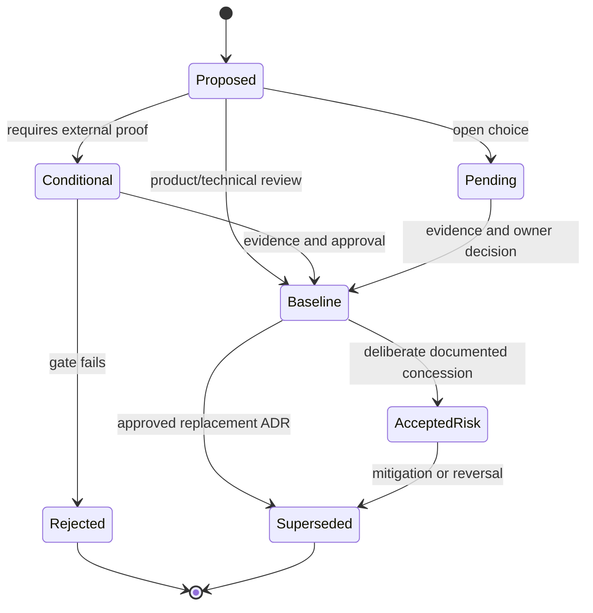
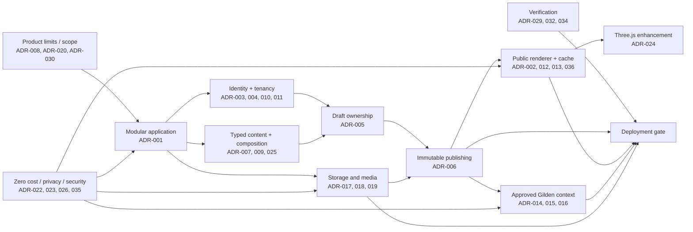
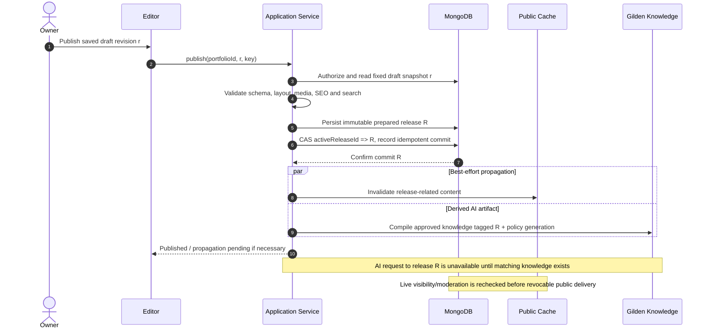
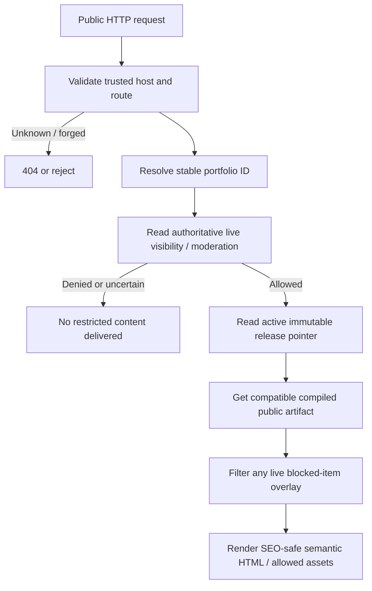
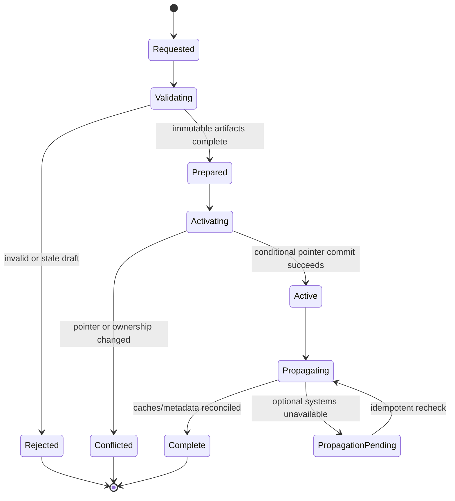

# 12 - Architecture Decision Record: GildedIn

> **Document ID:** GI-ARCH-012  
> **Version:** 2.0.0 - expanded decision register  
> **Prepared:** 2026-11-19  
> **Status:** Normative decision baseline with explicitly conditional provider, licensing, legal and feasibility decisions  
> **Decision authority:** Product owner for product constraints and accepted risk; application maintainer for replaceable implementation choices; security, privacy and deployment gates are release-blocking  
> **Classification:** Public engineering architecture; no credentials, personal identifiers, real production configuration or customer data  
> **Primary source of product requirements:** [02 - Requirements and Scope](02-requirements-and-scope.md)  
> **Companion specifications:** [01 System Overview](01-system-overview.md) · [03 UI/UX](03-ui-ux.md) · [04 C4 Diagrams](04-c4-diagrams.md) · [05 Data Model](05-data-model.md) · [06 API Design](06-api-design.md) · [07 Security Design](07-security-design.md) · [08 Storage and Sync](08-storage-and-sync-strategy.md) · [09 Error Handling and Logging](09-error-handling-and-logging.md) · [10 Deployment](10-deployment-strategy.md) · [11 Testing](11-testing-strategy.md)

> [!IMPORTANT]
> This register documents **what is selected, why, under which conditions, and how to prove it**. It does **not** certify the deployment, authorize spending, establish that a particular provider's service terms permit this SaaS, or prove that an implementation has passed security tests. A conditional decision cannot be treated as operationally accepted until its evidence gate passes.

## Document navigation

1. [Purpose and decision governance](#1-purpose-and-decision-governance)
2. [Decision index and dependency map](#2-decision-index-and-dependency-map)
3. [Architecture decision drivers and evaluation framework](#3-architecture-decision-drivers-and-evaluation-framework)
4. [Detailed ADR-001 through ADR-036](#4-detailed-architecture-decision-records)
5. [Cross-decision consistency contracts](#5-cross-decision-consistency-contracts)
6. [Threat, requirement and verification traceability](#6-threat-requirement-and-verification-traceability)
7. [Feasibility and external-service gates](#7-feasibility-and-external-service-gates)
8. [Decision change control and supersession](#8-decision-change-control-and-supersession)
9. [Implementation staging and proof sequencing](#9-implementation-staging-and-proof-sequencing)
10. [Reference architecture contracts and examples](#10-reference-architecture-contracts-and-examples)
11. [Accepted risks, constraints and non-guarantees](#11-accepted-risks-constraints-and-non-guarantees)
12. [Research bibliography and evidence status](#12-research-bibliography-and-evidence-status)
13. [Glossary and decision sign-off checklist](#13-glossary-and-decision-sign-off-checklist)

---

## 1. Purpose and decision governance

### 1.1 Why this record exists

GildedIn is a free, open-source, multi-user portfolio platform that combines typed owner-controlled content, a responsive free-positioned visual editor, server-rendered public portfolio sites and an optional portfolio-specific assistant named **Gilden**. The platform powers its owner's own portfolio as an ordinary tenant. Individual user portfolios must not depend on hardcoded account identities, privileged slugs or per-user application deployments.

GildedIn has deliberately conflicting forces: immersive 3D and stringent loading performance; visual freedom and meaningful semantic reading order; publicly crawlable portfolios and private drafts; responsive caching and immediate security revocation; free anonymous AI use and finite provider quotas; unrestricted registration and a strict **no-new-spend** constraint. The choices that resolve those conflicts are architectural: changing them later would alter schemas, public URL semantics, trust boundaries, storage contracts or operational risk.

An ADR records a **decision rather than a feature wish**. Feature behavior is specified in [02](02-requirements-and-scope.md), [03](03-ui-ux.md), [05](05-data-model.md) and [06](06-api-design.md). This record explains why the architecture implements that behavior in a particular way and which alternatives were rejected. Detailed threat definitions and test procedures remain in [07](07-security-design.md) and [11](11-testing-strategy.md). A future implementer must consult those normative sources instead of treating an ADR summary as a replacement.

### 1.2 Normative precedence and ambiguity handling

The conflict-resolution order is:

1. Applicable law, binding provider terms and safety/privacy obligations. An illegal or contractually ineligible implementation is not permitted by an ADR.
2. Explicit product-level constraints and acceptance requirements in [02](02-requirements-and-scope.md), with product-owner-approved changes recorded as revisions.
3. Security and privacy invariants in [07](07-security-design.md), including default-deny authorization and minimization.
4. Data model, HTTP/API, lifecycle and UX contracts in [05](05-data-model.md), [06](06-api-design.md), [08](08-storage-and-sync-strategy.md) and [03](03-ui-ux.md).
5. These ADRs for implementation choices, rationale and managed exceptions.
6. Specific package versions, cloud settings and code patterns, validated against the actual chosen runtime.

A verified conflict is written into an **alignment issue** with competing source locations, owner, proposed resolution and tests. Do not silently reconcile a literal requirement by changing its meaning in code. Example: [06](06-api-design.md) discusses HTTP `If-Match` and `412` under RFC 9110, while the product-level editor conflict contract says `409`. The implementation must either adopt an interoperable `412` for genuine conditional requests and preserve `409` for domain conflicts, or explicitly amend both requirements and tests. This decision is tracked in ADR-032.

### 1.3 Status model

| Status            | Definition                                                                       | What can proceed                                          | What cannot be claimed                                                             |
| ----------------- | -------------------------------------------------------------------------------- | --------------------------------------------------------- | ---------------------------------------------------------------------------------- |
| **Baseline**      | Selected system design that satisfies the current intended product contract      | Implementation, prototypes, local tests and design review | Live effectiveness or operational proof before tests                               |
| **Conditional**   | Intended choice contingent on technical, legal, licensing or provider evidence   | Research, abstraction design and non-production proof     | Production readiness or permanent vendor commitment                                |
| **Pending**       | Open alternative requiring a product or rights decision                          | Investigation and feasibility comparisons                 | Decision complete, dependencies authorized                                         |
| **Accepted risk** | Product chooses an explicit negative consequence rather than funding a guarantee | Documentation, reduced promises, preventive measures      | A guarantee of confidentiality, recoverability or continuity not actually provided |
| **Superseded**    | Replaced by a later approved record, kept for historical traceability            | New implementation according to replacement               | Continued reliance on the replaced decision                                        |

A **Baseline** is not the same as a completed feature. Each record contains its own _verification obligation_. Product preference is not evidence. Decisions are dated and versioned, and any material reversal must have a replacement decision with a migration plan.

### 1.4 Roles and approval boundaries

| Role                                                                 | Decides                                                                                                             | Cannot waive without further authority                                               |
| -------------------------------------------------------------------- | ------------------------------------------------------------------------------------------------------------------- | ------------------------------------------------------------------------------------ |
| Product owner                                                        | Audience, $0 constraint, fixed numerical limits, visible UX scope, accepted service outages, backup-risk acceptance | Applicable law, verified ownership/privacy duties, contractual provider restrictions |
| Architect/maintainer                                                 | Module boundaries, data contract implementation, cache adapters, package selection, indexes, migration order        | Tenant isolation, prior decisions classified as product-fixed                        |
| Security reviewer (may be same maintainer with explicit review pass) | Threat evidence, sensitive-data pathways, auth and policy control adequacy                                          | Accept high-severity exposure solely to meet feature deadline                        |
| Deployment operator                                                  | Provider account settings, domain/DNS evidence, secret configuration, rollback readiness                            | Uncontrolled billing or use of a provider not proven eligible                        |
| External legal/rights determination when relevant                    | License/asset rights and privacy duties                                                                             | Engineering's responsibility to implement accurate technical controls                |

For a solo-maintained project, roles indicate **separate review passes**, not a requirement to hire staff. Record who approved a meaningful change, the date and actual evidence. Do not fill signatures with invented people.

### 1.5 Required fields for every ADR

A material ADR has: stable ID; title; version and status; context; decision drivers; chosen contract; rejected alternatives; advantages; disadvantages and accepted trade-offs; security, privacy and tenant boundaries; consistency, failure and rollback semantics; dependencies and migration; test/evidence obligations; source links; change triggers; and owner/approval metadata if formally accepted. Every implementation-heavy choice is subordinate to an interface that GildedIn owns, preventing provider SDKs or editor libraries from silently becoming permanent data formats.

### 1.6 Decision lifecycle



The lifecycle diagram describes governance, not a software state machine. An architectural gate can remain conditional even if development is underway. A new decision must not delete or silently rewrite prior historical reasoning.

### 1.7 What belongs in an ADR, and what does not

An ADR is justified when the choice changes tenant or privacy isolation, persisted schema meaning, domain topology, publication consistency, operational cost, provider lock-in, security controls, accessibility guarantees, deployment workflow, or an interface consumed by multiple modules. Changing a button's border radius, refactoring a private helper or updating a patch-version dependency usually does not require a new ADR unless it changes one of those boundaries.

---

## 2. Decision index and dependency map

The register preserves **ADR-001 through ADR-036**, as referenced by other specifications. Entries retain their existing statuses. `Conditional` is a release-gate state, not a judgment that the architecture is poor. The final technology version or free provider can change under a controlled ADR without changing fixed product behavior.

| ADR | Decision                                                   | Status        | Primary document                                              | Proof / release gate                                         |
| --- | ---------------------------------------------------------- | ------------- | ------------------------------------------------------------- | ------------------------------------------------------------ |
| 001 | Modular monolith                                           | Baseline      | [01](01-system-overview.md), [04](04-c4-diagrams.md)          | Module and dependency-boundary checks                        |
| 002 | Server-first semantic public rendering                     | Baseline      | [03](03-ui-ux.md)                                             | Accessibility, JS-off and CWV tests                          |
| 003 | MongoDB, tenant-scoped identifiers and records             | Baseline      | [05](05-data-model.md)                                        | Unique indexes and isolation tests                           |
| 004 | OAuth/OIDC providers and deliberate account linking        | Baseline      | [07](07-security-design.md)                                   | Provider and account-takeover tests                          |
| 005 | Draft state independent from public content                | Baseline      | [05](05-data-model.md), [08](08-storage-and-sync-strategy.md) | No draft exposure                                            |
| 006 | Immutable publication                                      | Baseline      | [08](08-storage-and-sync-strategy.md)                         | Atomic pointer, retry and concurrency tests                  |
| 007 | Hybrid free-positioned responsive composition              | Baseline      | [03](03-ui-ux.md)                                             | Breakpoint/semantic/focus tests                              |
| 008 | Fixed product content quotas                               | Baseline      | [02](02-requirements-and-scope.md)                            | Edge and bypass tests                                        |
| 009 | Versioned content schemas and safe block catalogue         | Baseline      | [05](05-data-model.md)                                        | Malicious schema and migration tests                         |
| 010 | Host-only sessions and CSRF controls                       | Baseline      | [07](07-security-design.md)                                   | Cross-origin, session fixation tests                         |
| 011 | Path/subdomain portfolio routing                           | Conditional   | [10](10-deployment-strategy.md)                               | DNS, wildcard TLS, host validation, SEO                      |
| 012 | Dynamic security and moderation gate                       | Baseline      | [07](07-security-design.md)                                   | Warm-cache revocation tests                                  |
| 013 | Split cache strategy: content versus policy                | Baseline      | [08](08-storage-and-sync-strategy.md)                         | No stale-policy disclosure                                   |
| 014 | Opt-in Gilden on approved published knowledge              | Baseline      | [07](07-security-design.md)                                   | Negative AI disclosure tests                                 |
| 015 | Groq adapter without initial vector/RAG stack              | Conditional   | [06](06-api-design.md)                                        | Quota/availability/provider terms                            |
| 016 | Redis rate accounting with fail-closed AI admission        | Baseline      | [09](09-error-handling-and-logging.md)                        | Concurrency and Redis-outage tests                           |
| 017 | Managed media objects with global quota reservations       | Conditional   | [08](08-storage-and-sync-strategy.md)                         | Zero-billing proof and storage limits                        |
| 018 | Safe image/PDF handling and retention                      | Baseline      | [07](07-security-design.md)                                   | Malformed files and revalidation tests                       |
| 019 | SSRF-protected external feed/metadata ingestion            | Baseline      | [07](07-security-design.md)                                   | DNS rebinding and redirects                                  |
| 020 | One active owner portfolio initially                       | Baseline      | [05](05-data-model.md)                                        | Parallel registration/creation tests                         |
| 021 | No guaranteed independent backup                           | Accepted risk | [10](10-deployment-strategy.md)                               | Disclosure and deletion semantics                            |
| 022 | Absolute $0 and no silent overages                         | Baseline      | [10](10-deployment-strategy.md)                               | Billing/card/eligibility checklist                           |
| 023 | Vercel Hobby as provisional hosting                        | Conditional   | [10](10-deployment-strategy.md)                               | Eligibility, content-training opt-out and domain feasibility |
| 024 | Progressive cinematic rendering and motion                 | Baseline      | [03](03-ui-ux.md)                                             | WebGL-off and reduced-motion tests                           |
| 025 | Replaceable editor/animation library adapters              | Conditional   | [03](03-ui-ux.md)                                             | Compatibility, license, perf tests                           |
| 026 | Encryption, secrets, header and CSP baselines              | Baseline      | [07](07-security-design.md)                                   | Security deployment tests                                    |
| 027 | Aggregate-only analytics and public opt-in                 | Baseline      | [09](09-error-handling-and-logging.md)                        | No raw visitor tracing                                       |
| 028 | Minimal contact data and retention                         | Baseline      | [07](07-security-design.md)                                   | TTL and export/deletion tests                                |
| 029 | Local-isolated tests; no production test writes            | Baseline      | [11](11-testing-strategy.md)                                  | Environment-block tests                                      |
| 030 | No payment, broker, external job worker or native blog CMS | Baseline      | [02](02-requirements-and-scope.md)                            | Scope review                                                 |
| 031 | MIT source licensing                                       | Pending       | [10](10-deployment-strategy.md)                               | Ownership and license audit                                  |
| 032 | HTTP API contracts, Problem Details and OpenAPI            | Baseline      | [06](06-api-design.md)                                        | Contract and error consistency                               |
| 033 | One primary RSS feed and owner-reviewed external links     | Baseline      | [06](06-api-design.md)                                        | Cache/outage/SSRF tests                                      |
| 034 | Independent optional integration failures                  | Baseline      | [09](09-error-handling-and-logging.md)                        | Failure injection                                            |
| 035 | Minimal truthful privacy notice and consent controls       | Conditional   | [07](07-security-design.md)                                   | Applicable-law and provider policy review                    |
| 036 | Semantic content and independent public access controls    | Baseline      | [03](03-ui-ux.md), [07](07-security-design.md)                | noindex not treated as access protection                     |

## 3. Architecture decision drivers and evaluation framework

### 3.1 Product drivers versus engineering preferences

The highest priority is correct behavior, not adherence to a fashionable technology stack. Requirements `IAM-*`, `TEN-*`, `SEC-*`, `PUB-*`, `AI-*` and `OPS-*` in [02](02-requirements-and-scope.md) define important constraints. Specific library versions, provider names, cache APIs and implementation files are **replaceable** where proof supports replacement. The product owner has fixed the core experience and some hard limits; engineers may change the mechanical implementation through reviewed decisions.

| Driver                                  | Desired result                                  | Conflict it creates                                         | Binding evaluation                                                                                       |
| --------------------------------------- | ----------------------------------------------- | ----------------------------------------------------------- | -------------------------------------------------------------------------------------------------------- |
| Unrestricted-looking visual composition | Design-tool freedom within supported primitives | Potentially broken semantics/responsive behavior            | Public output must remain responsive, accessible and semantic; unsupported compositions block publishing |
| Cinematic technical motion              | Recognizable brand and visual delight           | GPU/JS cost and reduced-motion accessibility                | Lazy scene, adaptive quality and graceful non-WebGL delivery                                             |
| Free public SaaS                        | Worldwide no-cost signup and hosted portfolios  | Finite hosting/database/AI/storage resources                | No new charges or required payment cards; graceful degradation                                           |
| One application                         | Solo-maintainable system                        | Coupling and a shared failure domain                        | Modular domain boundaries, service-level authorization and bounded workloads                             |
| Editable content                        | Fast inline authoring/autosave                  | Concurrent tabs and partial network failures                | Compare-and-swap draft revisions with explicit recovery                                                  |
| Immediate useful publishing             | No deployments per owner                        | Risk of mixed and stale data                                | Immutable compiled releases and one authoritative activation point                                       |
| Cached public performance               | Reduced database work and latency               | Security/moderation revocation lag                          | Live policy gate distinct from immutable cached content                                                  |
| Portfolio-specific AI                   | Helpful contextual assistant                    | Prompt injection, privacy and finite quotas                 | Opt-in allowlisted release context, live revocation, no chat transcript storage                          |
| Both URL formats                        | Memorable paths and tenant subdomains           | DNS/TLS complexity, same-site cookie attacks, duplicate SEO | Canonical path + host-only apex auth and proven wildcard deployment                                      |
| Open source                             | Community reuse and inspection                  | Asset/font rights and supply-chain exposure                 | Explicit license audit, least-privilege CI and no tenant secrets                                         |

A requirement cannot be satisfied merely by passing a unit test that mocks away its risk. For example, an isolated cache adapter test cannot prove DNS-based routing or CDN revocation, and an axe-core pass cannot establish all WCAG 2.2 AA interactions. The implementation plan needs separate code, integration, actual deployed and manual-evidence gates.

### 3.2 Evaluation rubric

Evaluate alternatives in this order; later benefits never silently override an earlier hard constraint:

1. **Legal, contractual and privacy eligibility:** Does the service allow this use? Is the data-use arrangement accurate and disclosed?
2. **Security invariants:** Does it preserve owner/tenant isolation, unauthorized-state denial, safe output and revocation? Can those conditions be tested?
3. **Correctness and durability of logical operations:** Can retries, concurrency and data consistency be proved without pretending a shared free resource is a backup?
4. **User experience and accessibility:** Does a beginner accomplish the complete workflow on mobile and with assistive technology?
5. **Performance and scalability:** Is it measured against representative production builds and realistic 100–500 portfolio planning assumptions?
6. **No-charge operational feasibility:** Does it require a card, monthly fee or overage exposure? How does it fail when exhausted?
7. **Maintainability and reversibility:** Is the model versioned, provider-independent and simple enough for a solo maintainer?

A weighted score may be used only **after** eliminating options that fail a mandatory gate. A candidate with excellent UX but unconstrained billing, or excellent LCP but cross-tenant data exposure, is not eligible to win a weighted comparison.

### 3.3 Architectural fitness scenarios

A _fitness scenario_ states a quality requirement in observable form. The following table is non-exhaustive; [11](11-testing-strategy.md) owns exhaustive verification procedures.

| Scenario     | Stimulus                                                      | Required observable behavior                                          | Principal ADRs          |
| ------------ | ------------------------------------------------------------- | --------------------------------------------------------------------- | ----------------------- |
| TEN-FIT-01   | Tenant A submits tenant B's draft ID                          | No cross-tenant read/write, no evidence of B's existence              | 003, 004, 010, 032      |
| PUB-FIT-01   | Browser loses response after active-pointer update            | Retry returns prior operation result; one release, no duplicates      | 005, 006, 013, 032      |
| PUB-FIT-02   | Two tabs edit revision `r`                                    | One wins; other sees conflict/recovery, not silent overwrite          | 005, 006, 032           |
| SEC-FIT-01   | Admin suspends a portfolio with warm caches                   | New requests through supported delivery paths deny content            | 012, 013, 036           |
| AI-FIT-01    | Owner revokes a new custom field after AI approval            | New AI admission cannot use the field; stale context invalid          | 009, 012, 014, 016      |
| AI-FIT-02    | Groq or Redis unavailable                                     | Public portfolio renders; AI shows controlled unavailability          | 014, 015, 016, 034      |
| UX-FIT-01    | Switch from desktop to 320px mobile and 400% zoom             | Semantic reading order remains coherent; no essential clipped control | 002, 007, 024           |
| UX-FIT-02    | Drag and resize unavailable to pointer user                   | Inspector/button equivalent performs same operation                   | 007, 025                |
| MEDIA-FIT-01 | Parallel uploads hit last global free bytes                   | Admission budget cannot be overcommitted                              | 008, 017, 018           |
| HOST-FIT-01  | Unknown malicious sibling subdomain requests account mutation | No session leak or unauthorized write; host rejected                  | 010, 011, 026           |
| HOST-FIT-02  | Wildcard certificate configuration absent                     | Feature fails launch gate rather than being described as ready        | 011, 023                |
| OPS-FIT-01   | Paid backup option is visible in provider dashboard           | Remains disabled under no-spend requirement                           | 021, 022                |
| OPS-FIT-02   | Untrusted pull request changes workflow                       | No production credentials or trusted deployment rights                | 026, 029, 031           |
| SEO-FIT-01   | Same project reached by path and subdomain                    | Same release, correct self/path canonical signals and metadata        | 002, 011, 036           |
| DATA-FIT-01  | Account deletion during delayed upload/AI task                | Tombstone prevents post-deletion resurrection                         | 017, 018, 021, 034, 036 |

### 3.4 Dependency topology of the major decisions



This is an **architectural dependency** diagram, not a runtime call graph or proof that a provider account currently exists. Its most important direction is that source-of-truth data and security policy precede runtime presentation. AI and Three.js are optional dependents; they cannot own content availability.

### 3.5 Explicit negative architecture decisions

The initial product does **not** add a second backend merely to make the diagram larger; does **not** use CSS transforms or Three.js as the text and accessibility renderer; does **not** place all sections directly into the AI system prompt; does **not** cache authorization as a stale static response; does **not** infer owner identity from email/slug; does **not** expose `NEXT_PUBLIC_*` secrets; does **not** depend on arbitrary user-provided React/JS; does **not** call any provider that can silently generate a bill; and does **not** claim three database revisions are disaster recovery.

### 3.6 Design changes that require an explicit new decision

A new authentication provider, custom domain canonical strategy, collaborative editing, expanded caps, paid or card-backed media provider, native blog composer, public visitor account system, vector search, user-authored executable plugins, external queue/worker service, persistent chat transcripts, per-visitor tracking, immutable-release encoding change or loss of security revocation ability must cause explicit review. A library patch or visual microadjustment usually does not, unless it crosses an existing decision boundary.

---

## 4. Detailed architecture decision records

Each record below retains its stable identifier and baseline rationale, followed by a deeper engineering contract. The **additional details interpret-not supersede-the definitive requirements** in the companion documents. External-source claims are linked near the relevant ADR and consolidated in §12. Where the chosen provider or runtime is still conditional, implementation examples are design illustrations rather than operational instructions to use real credentials.

## ADR-001: Modular monolith

**Status:** Baseline. **Decision:** One Next.js/TypeScript application with explicit domain modules for identity, tenancy, content, composition, publishing, media, Gilden, search, analytics, moderation and administration. Public route handlers and editor commands call application services; services depend on interfaces; infrastructure adapters implement database, storage, Redis, external OAuth and Groq.

**Context:** The project targets solo maintenance and roughly 100–500 active portfolios, with zero new operational spending. Separate microservices would increase deployments, credentials, network failure paths and failure diagnosis before demonstrating a scale need. **Alternatives:** microservices; separate NestJS/.NET backend; serverless event mesh; fully coupled Next.js files. **Consequences:** simpler test/deploy path but risk of monolithic source coupling, addressed by module ownership, no cross-module infrastructure imports, typed boundaries and dependency checks. **Security:** centralize authorization at application-service boundaries, not only route middleware. **Verification:** module dependency tests and an unauthorized-access matrix; no authenticated handler may bypass owner authorization. **Requirements:** REQ references in [02](02-requirements-and-scope.md). **Evidence:** [C4](https://c4model.com/introduction), [OWASP ASVS](https://asvs.owasp.org/).

### Decision drivers and evaluation

The dominant drivers are single-maintainer operability, a realistic initial estate of 100–500 active portfolios, the need to deploy without creating a new bill, and consistent authorization across APIs, loaders and workflows. A microservice topology would not make the system automatically more secure or scalable: it would create independent network credentials, distributed tracing requirements, interservice authentication, retries and multiple places to implement tenant isolation. Conversely, a monolithic codebase in which all route handlers import MongoDB collections directly would reduce deployment count but make policy bypass likely. The selected middle ground is **one executable application with enforceable internal boundaries**.

Suggested bounded modules are `identity`, `portfolio`, `schema`, `content`, `composition`, `publishing`, `media`, `ai`, `discovery`, `contact`, `analytics`, `moderation` and `operations`. Modules expose application commands and read services; route handlers adapt HTTP requests into command input. Infrastructure adapters handle MongoDB, object storage, Redis, OAuth, external feeds and Groq. The browser receives typed presentation data and never a database driver, privileged policy object or signing key. Domain modules must not import from `app/api`, Next.js route segments or provider-specific SDKs.

### Ownership, interfaces and forbidden dependencies

- **Required call path:** request boundary → authenticate or anonymous policy → normalize target portfolio → authorize action and fields → validate payload → domain command → persistence adapter → map result to HTTP/HTML.
- **Forbidden:** `app/api` directly changing a collection based only on supplied `portfolioId`; AI route importing private draft repositories; public renderer reading arbitrary account settings; shared utilities circumventing authorization through a generic `getDocument(id)` method.
- **Acceptable:** within one deployment, application services invoke each other synchronously through reviewed interfaces. Transactions, retry scheduling and provider calls are not promoted to external services without a new ADR.

### Costs and negative consequences

Module boundaries require deliberate dependency reviews, consistent type definitions and integration testing. A single deployment shares a failure domain, deployment cadence and some memory/compute pressure. The whole site can still be disrupted by a primary host outage; a modular monolith is not automatic high availability. If one module consumes excessive CPU, it can impact its neighbors; use resource limits, timeouts, isolated lazy imports, load tests and bounded work rather than premature service extraction.

### Failure, change trigger and proof

A failure in RSS, AI or analytics must not make published content unavailable. A catastrophic database or hosting fault may affect the site and is an explicitly accepted operational limitation. New services are justified only by measured incompatible scaling characteristics, operational isolation requirements or a verified provider/platform limitation. Proof includes architecture dependency tests, module import checks, two-tenant authorization tests at **every entry point**, and a diagram showing actual deployable boundaries. Align with `SEC-002`, `OPS-002`, `OPS-005` and ADR-034. Sources: [C4](https://c4model.com/introduction), [OWASP ASVS 5.0](https://asvs.owasp.org/).

## ADR-002: Server-first semantic public rendering

**Status:** Baseline. **Decision:** Public pages render indexable, semantic HTML and responsive CSS from immutable releases; client JavaScript and WebGL are enhancements. The editor can use heavier client modules but its runtime is not required for viewing a public portfolio.

**Alternatives:** client-only SPA; exported canvas image; fully server-rendered interactive editor. **Rationale:** visitor experience, search discoverability and accessibility require a meaningful page without an editor runtime. **Consequences:** two interpreters of one versioned composition contract (editor and public), necessitating deterministic parity tests. **Security:** only server-approved schemas enter published markup; enforce safe tags/attributes, links and CSP. **Verification:** disable JavaScript/WebGL, test correct semantic navigation, metadata, body content and forms; measure CWV. **Sources:** [Next.js rendering](https://nextjs.org/docs/app/building-your-application/rendering), [WCAG 2.2](https://www.w3.org/TR/WCAG22/), [Google canonical guidance](https://developers.google.com/search/docs/crawling-indexing/consolidate-duplicate-urls).

### Delivery and rendering contract

The default public route receives a validated host/path identity, resolves the portfolio's active release and current policy, and renders useful HTML before client-side effects initialize. Heading order, section navigation, lists, article bodies, images with text alternatives, canonical URLs, Open Graph metadata and safe links are server-owned artifacts. A portfolio must remain navigable with JavaScript turned off; a contact form may use ordinary progressive enhancement, but failure to load a WebGL bundle must not hide the form or public projects. The dashboard/editor remains a separate, interaction-heavy client island and is not shipped to anonymous visitors.

### Rendering choices examined

| Option                                              | Benefit                                    | Reason not selected                                                                                          |
| --------------------------------------------------- | ------------------------------------------ | ------------------------------------------------------------------------------------------------------------ |
| Entire portfolio as browser-only React app          | Simplifies editor/public component sharing | Initial HTML and content availability depend unnecessarily on JS; increases hydration cost and failure modes |
| Static exported pages per owner                     | Simple fast public delivery                | Complicates near-immediate publishing, dynamic moderation, hostname routing and future revocation            |
| Screenshots/Canvas-only portfolio                   | Exact visual parity with editor            | Fails textual SEO, accessible semantics, selectable content and responsive layout                            |
| Server semantic HTML with optional hydrated islands | Content-first, indexable, resilient        | Requires careful parity between design schema and renderer; **selected**                                     |

### Security and accessibility implications

Rendering HTML on the server is not itself sufficient protection. All owner-authored content must pass allowlist compilation and context-correct output encoding. HTML and rich text cannot contain executable custom components, raw JS event handlers, untrusted `srcdoc` or arbitrary CSS. The public route must not serialize private ownership metadata or hidden field values to client props merely because those fields are not visually rendered. Content selection must precede serialization. Live moderation/visibility policy is evaluated separately from cached HTML. Keyboard order and DOM reading order must derive from the approved semantic order rather than element screen coordinates.

### Performance and verification

The public critical path excludes React Moveable, editor state stores, upload parsers, Lexical editing bundles, Groq SDK and the Three.js scene. Prefer server component boundaries, route-level imports and lazy 3D activation after initial content. Measure real production build sizes rather than assuming tree shaking works. Verify representative mobile pages with JS off, reduced motion, WebGL off and slow connections; measure LCP ≤2.5 s, INP ≤200 ms and CLS ≤0.1 at p75 when field data is sufficient, plus applicable Lighthouse 90+ goals. Capture failing screen-reader headings, incorrect metadata and missing links as release blockers. Requirement links: `SEO-001`, `UX-001`, `UX-002`, `PRF-001`–`003`. Sources: [Next.js rendering](https://nextjs.org/docs/app), [WCAG 2.2](https://www.w3.org/TR/WCAG22/), [Core Web Vitals](https://web.dev/articles/vitals).

## ADR-003: MongoDB, tenant-scoped identifiers and records

**Status:** Baseline. **Decision:** MongoDB persists accounts, provider identities, portfolio records, drafts, immutable release data, approval policies, media metadata and bounded operational records. Stable opaque `portfolioId` and `accountId` are authorization keys; mutable slugs and email are **not** owner keys. All private queries scope to portfolio ID after membership checks. **Alternatives:** PostgreSQL relational model; isolated database per owner; slug-as-primary-key. **Trade-off:** flexible content structure suits bounded schemas, but references, index selection and document sizes require explicit validation. **Security:** unique provider-subject index; centralized slug claim registry; owner-scoped access; never trust `portfolioId` in a client body absent authorization. **Verification:** duplicate provider, slug collision, isolation, and concurrent claims; inspect indexes under actual provider limits. **Source:** [MongoDB write atomicity](https://www.mongodb.com/docs/manual/core/write-operations-atomicity/).

### Persistence boundaries and identity invariants

MongoDB is a **selected database**, not the authorization system. `accountId` identifies an internal account; `(provider, providerSubject)` identifies an external sign-in identity; `portfolioId` identifies the owner-independent portfolio; a normalized slug is a mutable public locator. The same portfolio ID is resolved by path and subdomain. Private reads and writes require an authenticated account and an explicit membership or owner check, independent of the caller-supplied ID. Public reads resolve only an active immutable release through a public policy gate. Unique indexes enforce slug claims and provider-subject uniqueness; application validation alone cannot protect concurrent requests.

### Physical data decisions

- Separate records for accounts/provider identities, portfolios, mutable draft state, release artifacts, publication operations, live visibility/moderation policy, media/reservation metadata, AI knowledge versions, contact submissions and aggregate analytics. Exact names and field shapes come from [05](05-data-model.md).
- Keep the principal draft revision and active-release pointer in well-defined concurrency aggregates. Where multiple documents must move together, use a proven transaction on the selected tier or a documented single-document control/pointer protocol with recoverable preparation state; **do not assume multi-document atomicity**.
- Index by the actual query's tenant scope and order: `(portfolioId, status, createdAt)` for appropriate release or media lookups, unique normalized slug claims, and `(provider, providerSubject)` for identities. Verify every index against actual schema and free-tier capabilities before migration.
- Avoid embedding entire uploaded files or large media variants in database documents. Keep immutable content payloads bounded, with media objects held by storage and referenced through opaque IDs.

### Trade-offs and alternatives

A relational schema could provide stronger declarative foreign-key constraints and transactional joins; it is a valid fallback if MongoDB's constrained provider tier cannot satisfy required concurrency proofs. A collection per tenant could simplify some access boundaries but multiplies provisioning/index work and hampers free-tier sustainability. Embedding everything into one portfolio document simplifies atomic writes but risks document contention, unbounded growth and accidental public/private data mixing. The selected approach accepts application-enforced referential integrity with strict tests and bounded schemas.

### Security, migration and tests

Use least-privilege database credentials, TLS and restricted network access where provider permits; redact MongoDB errors before showing them to users. Prevent query operator/prototype injection by compiling known typed filters, not merging arbitrary input. Enforce unique indexes before admitting sign-ups, detect incompatible existing data, and keep migrations expand/contract safe for previous releases. Negative tests: mutate a second tenant's `portfolioId`, duplicate provider identity, concurrently claim a slug, race draft saves, restore revisions under current schema, and verify rejected operations produce no effects. Requirement IDs: `TEN-001`–`009`, `IAM-001`–`009`, `SEC-002`, `PUB-002`. Sources: [MongoDB single-document atomicity](https://www.mongodb.com/docs/manual/core/write-operations-atomicity/), [MongoDB transactions](https://www.mongodb.com/docs/manual/core/transactions/).

## ADR-004: OAuth/OIDC with explicit linking

**Status:** Baseline. **Decision:** Google OIDC and GitHub OAuth with verified provider-specific immutable subject IDs. Account linking requires already-authenticated ownership and fresh confirmation; equal email values never trigger automatic linking. One verified working provider must remain connected. **Alternatives:** custom passwords; automatic email merging; public visitor accounts. **Trade-off:** reduced password infrastructure, but dependence on identity providers and difficult single-provider account recovery. **Security:** correct OAuth state/PKCE/nonce as applicable; strict callback origin; provider-identity uniqueness; verified email only for email-dependent features. **Verification:** forged callback, duplicate provider, two accounts with same email, removed last provider, session fixation and lost-provider behavior. **Sources:** [OAuth 2.0 Security BCP RFC 9700](https://www.rfc-editor.org/rfc/rfc9700.html), [Auth.js OAuth account linking](https://authjs.dev/reference/core/providers).

### Provider identity and account linking protocol

Google's login must validate OpenID Connect issuer, audience, signature, expiration, nonce when applicable and the provider subject. GitHub's OAuth identity must be bound to its stable provider account ID, not an unverified profile email. The registered callback URL and allowed return URL must be exact; account-linking requests require a valid already-authenticated user session, recent confirmation, a provider authentication transaction tied to that session and an explicit uniqueness check before persisting `(provider,subject)`. No signed-in email collision can silently merge accounts or transfer portfolios.

### Why not passwords or automatic merging

Implementing local passwords would add password hashing policy, reset tokens, email deliverability, abuse and recovery flows with no first-release product value. Depending solely on OAuth reduces that surface but increases reliance on two external identity providers and requires clear user messaging when the sole provider is unavailable. Automatic email matching is unsafe because email verification semantics differ among OAuth providers; the provider's immutable ID is the proof of login, **not automatically proof of an existing GildedIn account**.

### Sensitive action boundaries

At least one functioning provider remains linked. Unlinking, deleting an account, moving ownership or changing privileged settings requires recent reauthentication, anti-CSRF measures and a server-side audit event. If two previously created GildedIn accounts are to be consolidated, prove control of **both accounts**, assess ownership/release collisions and conduct an explicit audited operation; do not use a shortcut based on email equality. Account recovery through the original provider is the default when the only linked provider is lost; do not implement informal support-based takeover.

### Failure behavior and proof

Invalid OAuth `state`, wrong `iss`, missing/forged `nonce`, non-matching redirect URI, callback replay, duplicate linked provider and wrong-owner unlink must all be rejected with generic user-facing errors and redacted diagnostic events. Broken provider login may block new sessions, but must not affect anonymously served public pages. Testing must use correct provider mocks locally, and a controlled real-provider proof before enabling sign-in publicly. Requirement IDs include `IAM-001`–`009`, `SEC-003`, `SEC-010`. Primary sources: [RFC 9700 OAuth Security BCP](https://www.rfc-editor.org/rfc/rfc9700.html), [OpenID Connect Core](https://openid.net/specs/openid-connect-core-1_0.html), [Auth.js account linking guidance](https://authjs.dev/concepts#security), [NIST SP 800-63-4](https://csrc.nist.gov/pubs/sp/800/63/4/final).

## ADR-005: Drafts separate from published releases

**Status:** Baseline. **Decision:** Draft save never modifies an active release. Edit commands use revision-based optimistic concurrency; the preview selects the current authenticated draft, not cached public content. **Alternatives:** directly update section records; per-field public writes; autosave directly to public. **Security:** draft routes always require owner authorization, must set `no-store`, avoid link-sharing, and never appear in public SEO/search/AI. **Verification:** stale-tab conflict; draft-only private field; failed autosave; local recovery cleared on logout; publication remains unchanged while editing. **Sources:** [Mongo atomic updates](https://www.mongodb.com/docs/manual/core/write-operations-atomicity/), [OWASP API BOLA](https://owasp.org/API-Security/editions/2023/en/0xa1-broken-object-level-authorization/).

### Draft and public data must be physically and logically distinguishable

Each portfolio has one owner-editable draft representation, with a monotonically increasing revision and schema/renderer version. An authorized editor can alter typed content, section visibility, layout nodes, theme, media references and SEO options. Autosave writes are conditional on the expected revision; **a successful draft write cannot mutate the currently published release**. Owner preview reads the exact authorized draft without public cache, sitemap, feeds, search index or Gilden knowledge side effects. Inline editing and inspector editing must use the same revision protocol so one path cannot silently overwrite the other.

### Editor concurrency and local recovery

A tab maintains distinct local UI state, last acknowledged server state and in-flight mutation identity. Debounce writes, but never treat local optimistic state as durably saved until the server confirms the new revision. Late acknowledgments must not roll the UI backwards. When another tab has saved a newer revision, return the specified domain conflict, show the current revision and offer comparison/reload or local copy recovery; never overwrite automatically. A browser-local recovery snapshot is optional and must be scoped to user+portfolio and cleared on logout/account switch. Avoid retaining secrets or contact inbox data in that snapshot.

### Alternatives and trade-offs

Directly writing published content on every keystroke would simplify persistence and entirely break draft/publish separation. Field-level CRDT collaboration could reduce conflicts but adds data-model and privacy complexity without multi-user live collaboration being required. Server-side field patches with revision compare-and-swap are the chosen simpler protocol. The cost is that the user may need to resolve conflicts manually; that is safer than silently losing or publishing someone else's changes.

### Security, tests and reversibility

Draft endpoints require authenticated owner checks and `Cache-Control: private, no-store`. Draft IDs, preview IDs and schema imports are not authority tokens. Every public path must be tested against draft-only content, disabled sections and unapproved AI fields. Close/reopen the editor during failed saves and verify status is truthful. Export/restoration must distinguish current saved draft from historical published revision. Test unauthorized preview guesses, multi-tab stale write, browser reload, interrupted network and logout cleanup. Requirements: `EDT-008`–`010`, `PUB-001`, `SEC-002`, `ACC-001`.

## ADR-006: Immutable publication

**Status:** Baseline. **Decision:** Publish validates a selected immutable draft revision, prepares a release with serialized bounded content/layout/SEO/search/media references, then performs a single conditional activation of `activeReleaseId`. A durable idempotency record prevents duplicate releases; retain three recent published revisions. Later AI context is release-matched and can become ready asynchronously. **Alternatives:** atomic updates across all section docs on request; event sourcing; in-place latest-version edits. **Security:** release generated from explicit public allowlists; read-time visibility/moderation gate independent of cache; revalidation never becomes authorization. **Failure handling:** stale revision 409, duplicate request returns existing operation, propagation pending is a non-fatal status, pre-activation media validation. **Verification:** parallel publishes, same-key retries, crash before/after activation, mixed-version prevention and restore-to-draft. **Sources:** [Mongo transactions](https://www.mongodb.com/docs/manual/core/transactions/), [Mongo single-document atomicity](https://www.mongodb.com/docs/manual/core/write-operations-atomicity/), [Next.js cache revalidation](https://nextjs.org/docs/app/api-reference/functions/revalidateTag).

### Exact publication protocol and commit point

Publication operates on a **fixed server-read draft revision**, not whatever the editor happens to contain a few milliseconds later. The command authorizes the owner, checks expected draft revision and an idempotency key scoped to owner+portfolio, then compiles content/layout/SEO/search metadata from that snapshot. Compilation verifies field exposure, graph integrity, required media readiness, bounded content size, semantic reading order, safe links and accessibility blockers. A prepared release is immutable and may be referenced only after all required artifacts are ready. The commit point is a conditional update of the authoritative portfolio control pointer (`activeReleaseId`) and publication sequence. Redis, Gilden context generation and CDN cache invalidation are not the commit point.

### Competing writers and partially successful operations

Publication and draft edits must coordinate against an agreed revision so a request cannot activate a stale snapshot while truthfully claiming it published the latest accepted draft. Concurrent publish commands must not both win or consume extra revision slots; conditional writes and idempotency records must survive repeated requests and unknown network outcomes. If the response is lost after the pointer commits, a retry must reveal the operation's existing status. If propagation fails, return `published / propagation_pending`, retain the active release and provide an idempotent recheck. If Gilden's new knowledge is not ready, the public page is served while Gilden is temporarily unavailable for that release.

### Alternatives and implementation flexibility

Updating nine or more public section documents in place is vulnerable to mixed-version reads. Distributed two-phase commit or event sourcing would add enormous complexity for a small portfolio product. A MongoDB transaction is acceptable **only if supported and tested by the actual chosen tier**, while a single-document conditional pointer with prepared immutable artifacts is a viable alternative. If the chosen atomicity protocol cannot prove the required no-mixed-release invariant, publishing does **not** pass its release gate.

### Revisions, media and privacy

Retain three published releases; restoration loads an older release into a **new draft**, then requires explicit Publish. Media referenced by any retained restorable release remains until safe garbage collection; urgent privacy erasure supersedes convenience of old-revision restoration and may make a historical release un-restorable. Do not leak private fields via search indexes, OG images, compiled markup or AI knowledge. Verify precommit crash, postcommit crash, duplicate key, key collision, parallel publishers, slow media stage, cache failure, AI outage and forced revocation during a warm cache. Requirements: `PUB-001`–`008`, `MED-004`, `AI-003`, `AI-004`. Sources: [MongoDB write atomicity](https://www.mongodb.com/docs/manual/core/write-operations-atomicity/), [MongoDB transactions](https://www.mongodb.com/docs/manual/core/transactions/), [Next.js revalidation](https://nextjs.org/docs/app/getting-started/revalidating).

## ADR-007: Hybrid responsive visual composition

**Status:** Baseline. **Decision:** Each section owns a canvas. Nodes can be auto-layout, absolute, or hybrid groups, storing anchors, constraints, dimensions, breakpoint overrides, parent and semantic reading order. Editor transforms are translated to valid responsive CSS and semantic HTML by the public renderer. **Alternatives:** absolute pixels everywhere; only CSS Grid; raw design-tool-exported DOM. **Trade-off:** highest implementation complexity but central product differentiation. **Security/accessibility:** valid nesting, no arbitrary scripts/styles, independent keyboard order, touch and button equivalents, detect obscured controls and overflow. **Verification:** representative 320–1440px layouts, text expansion, zoom, keyboard reorder, screen readers, malicious node trees and cyclic-parent attempts. **Sources:** [WCAG 2.2 dragging](https://www.w3.org/WAI/WCAG22/Understanding/dragging-movements.html), [WCAG focus order](https://www.w3.org/WAI/WCAG22/Understanding/focus-order.html).

### The actual authored representation

An editor section has a bounded tree of owned visual nodes. Each node records a stable `nodeId`, a vetted `blockType` and `blockVersion`, its parent, ordered children or reference targets, content binding and a layout descriptor. `auto` nodes express flex/grid flow; `absolute` nodes express positioned composition within a known parent; `hybrid` groups combine free-positioned parent containers with responsive internal layout. The renderer compiles these descriptions into safe DOM/CSS, **not** serialized browser transforms. The editor and public renderer must share a versioned composition contract but may use different libraries and loading strategies.

### Responsive and semantic rules

One section canvas, multiple logical viewport modes: desktop, tablet and mobile. Default tablet/mobile arrangements are derived from constraints and allow sparse overrides instead of three independently cloned documents. Widths between breakpoints flow using intrinsic sizes, min/max dimensions, container queries or proportional constraints; the output is not a frozen artboard screenshot. The Hero remains the first section and only one Hero is present. Every visual node must have a logical reading order independent of z-index. Interactive nodes cannot be covered so completely that keyboard, single-pointer or touch users cannot operate them.

### Choice of controlled freedom

| Candidate                                                           | Advantages                                   | Constraint or rejection                                                    |
| ------------------------------------------------------------------- | -------------------------------------------- | -------------------------------------------------------------------------- |
| Absolute `x/y` everywhere                                           | Maximum edit precision, small initial editor | Responsive text overflow, focus order and mobile adaptation become brittle |
| Only auto-flow sections                                             | Stable HTML and accessibility                | Conflicts with the product's genuine free-positioned creativity            |
| CSS/JS authored by end users                                        | Maximum expressiveness                       | Arbitrary execution and unsafe CSS violate shared-origin tenancy model     |
| Safe visual primitives plus constrained absolute/hybrid/auto layout | Design freedom with enforceable safety       | More original engineering work; **selected**                               |

### Security and UX obligations

The validator rejects invalid parent cycles, extremely deep node trees, unknown attributes or block versions, nonfinite dimension values, forbidden CSS values, z-order traps, focusable overlays that cannot be dismissed, and unrecoverable overflow. Each drag action has a keyboard **and a one-pointer no-drag alternative**, which are separate WCAG obligations. An inspector can set precise position, ordering, alignments, group behavior and breakpoint visibility. Assistive technology receives one meaningful semantic instance per responsive viewport; redundant hidden variants are not exposed. Motion must not be necessary for navigation or comprehension.

### Proof and change triggers

Prototype actual editor→published parity, not just editor screenshots. Test text growth, 200% and 400% zoom, long labels, RTL content if later supported (no first-release multilingual publishing), keyboard focus, touch sorting, 320-pixel mobile widths, iOS Safari, low-end Android, WebGL disabled and screen-reader traversal. There must be explicit limits on supported composition combinations and their validation. Requirements `EDT-001`–`007`, `UX-001`–`004`; citations: [WCAG 2.2](https://www.w3.org/TR/WCAG22/), [Understanding dragging movements](https://www.w3.org/WAI/WCAG22/Understanding/dragging-movements).

## ADR-008: Fixed product limits

**Status:** Baseline. **Decision:** Three nested schema levels, 20 custom fields per section, 20 authored visual nodes across the entire portfolio (including nested authored nodes; repeated rendered instances exempt), 20 items per collection, 100 KiB canonical published JSON payload, three retained releases. Media limits: 15 MiB originals per portfolio, at most 30 files, 1 MiB image, 2 MiB PDF, input dimensions ≤4096×4096. **Alternatives:** no caps; dynamic per-tier caps; server-only limits without UI. **Trade-off:** meaningful creative restrictions and possible rich-case-study overflow, balanced against fixed $0 operation. **Security:** all limits enforced at server boundaries, before expensive processing and at publication; avoid JSON nesting/payload DoS and race-based quota bypass. **Verification:** exact boundary and concurrent bypass tests; document KiB/MiB counting and never promise capacity for 500 fully provisioned portfolios. **See:** [02](02-requirements-and-scope.md), [08](08-storage-and-sync-strategy.md).

### Exact product counting semantics

The following are intentionally **hard owner-facing limits** for the first release, configurable centrally in source but not elevated by tenants: schema nesting depth = 3; custom fields per section = 20; **user-authored visual nodes per entire portfolio = 20**, including children; items per collection = 20; canonical serialized published release payload ≤100 KiB = **102,400 UTF-8 bytes**; retained published releases = 3. Media: total accounted originals per portfolio ≤15 MiB, ≤30 files, single image input ≤1 MiB, PDF ≤2 MiB, dimensions ≤4096×4096 before processing. These figures come from [02](02-requirements-and-scope.md); they do not prove global provider capacity.

A _repeater_ is one authored node even when it renders many generated cards. Its nested authored card template may contain separate counted nodes, depending on the canonical node tree; generated runtime instances do not multiply the authored count. Hidden or draft-only authored nodes still count toward authoring limits. Media references and descriptive metadata count toward the serialized release; media binary bytes do not. All byte-size checks use the same deterministic canonical serializer on server compilation and acceptance tests, not different browser JSON heuristics.

### Why hard caps were selected

A zero-new-spend SaaS cannot plausibly offer unlimited nested page builders, image variants or AI context without abuse controls. Small fixed limits cap validation cost, release size, query complexity and storage admission under provider caps. They are not a security substitute for rate limiting, CPU budgets or content scanning. The main negative consequence is that complex long-form case studies and heavy layouts may exceed the limit. The editor must expose clear counters, pre-publish warnings and alternatives such as data repeaters or linking to canonical external articles, rather than pretending the experience is unbounded.

### Enforcement and threat boundaries

Enforce limits at authoring APIs, import parsers, database validators when feasible, media reservations and publication compiler; no browser-only limit is authoritative. Count current referenced media, retained-revision references and pending reservations under one atomic admission protocol. Concurrent uploads must not both see the same free capacity and overcommit. Validate payload sizes **before** allocating large deserialization structures and make recursion/depth checks iterative or bounded. Introduce provider-global headroom because 500 × 15 MiB exceeds a 1-GB free blob store. The system refuses additional uploads before global exhaustion and does not delete owners' live files automatically to create capacity.

### Verification and review

Test every exact equality boundary and one beyond, multibyte UTF-8 characters, nested nodes, repeaters, disabled content, duplicate media reservations, abandoned uploads, simultaneous owners and unexpectedly large generated data. Document a product-owner-approved ADR revision to change a fixed limit. Never treat the 100–500 active-portfolio planning figure as a guaranteed resource entitlement. Requirements `CNT-003`, `EDT-006`, `PUB-001`, `MED-003`, `OPS-001` and `OPS-005`.

## ADR-009: Versioned schemas and safe blocks

**Status:** Baseline. **Decision:** Typed, versioned content schemas, bounded relationships, reusable content IDs and allowlisted blocks. JSON schema import is interpreted as validated data; no user JavaScript, arbitrary React/MDX, unrestricted CSS or executable expressions. Rich text uses sanitized AST/structured nodes and approved embeds. **Alternatives:** raw HTML/JS builder; no custom fields; direct database schema projection. **Security:** whitelist allowed field types and properties; avoid prototype pollution, recursive components, XSS and unsafe URL protocols; fail closed on unknown component version. **Verification:** hostile JSON, HTML, URLs, Mermaid diagrams, schema migration and downgraded components. **Sources:** [OWASP XSS Prevention](https://cheatsheetseries.owasp.org/cheatsheets/Cross_Site_Scripting_Prevention_Cheat_Sheet.html), [OWASP Input Validation](https://cheatsheetseries.owasp.org/cheatsheets/Input_Validation_Cheat_Sheet.html).

### Canonical schema and rendering principles

Owner-authored schema is **data**, never executable code. A field definition has a whitelisted type (e.g., short text, rich text, URL, date, boolean, number, image, document, relation, list, object, option), stable identity, description, required/default rules, range constraints and visibility/AI approval metadata. Collections own typed items and stable IDs; independent composition nodes bind to references instead of duplicating content. Versioned schema/renderer/block registries identify exactly which compiler produced a release. Unknown fields are not interpreted through dynamic template evaluation.

### Restricted block and interaction model

Initial blocks may include headings, text, images, buttons, cards, containers, grids, timelines, galleries, repeaters, tabs, accordions, carousels and a limited contact form. Allowed interactions are a safe declarative enum: navigation, scrolling, modal open/close, tab switch, show/hide, carousel advance and validated form submission. No `eval`, `new Function`, user script, raw MDX, arbitrary HTML/SVG event handler, shader upload or unsafe URL protocols. Rich text must be represented through approved typed nodes and sanitized output, including syntax-highlighted code and deliberately restricted Mermaid/diagram content.

### Alternatives and ownership of the contract

A general-purpose page builder with arbitrary HTML would appear faster to implement but has unbounded XSS and style-isolation implications for a SaaS serving users under a shared parent domain. A fixed template with only fixed fields would reduce risk but fail the core differentiator. JSON Schema import is permitted as **validated input** to an owned schema representation, not as a second runtime interpreter with hidden expressiveness. Lexical and other editors may generate temporary in-memory structures; on save, convert to GildedIn's versioned format and reject unknown or unsupported constructs.

### Migration and safety

Compatible field widening may be migrated with explicit versioned transforms and diagnostics. Destructive or lossy changes require impact previews and explicit owner confirmation. Existing immutable releases remain readable using backward-compatible renderers or tested migration paths; never silently rewrite published history to make a new editor convenient. Deleted shared content with live bindings should be blocked until references are detached or explicitly removed. Validate graph integrity and per-field visibility before rendering, search generation, AI extraction, exports and OG images.

### Evidence

Fuzz schema import (prototype pollution, recursive self-reference, invalid numbers, untrusted URLs, unexpected keys), test block catalog version mismatch, migration round trips, retained-release rendering and escape of hostile rich text in all HTML contexts. Requirements `CNT-001`–`008`, `EDT-007`, `SEC-004`, `SEC-007`. Sources: [OWASP Input Validation Cheat Sheet](https://cheatsheetseries.owasp.org/cheatsheets/Input_Validation_Cheat_Sheet.html), [OWASP XSS Prevention](https://cheatsheetseries.owasp.org/cheatsheets/Cross_Site_Scripting_Prevention_Cheat_Sheet.html), [JSON Schema specification](https://json-schema.org/specification).

## ADR-010: Narrow host-only session and CSRF defense

**Status:** Baseline. **Decision:** Authenticated dashboard accessible only on apex host; signed/opaque revocable session cookie with `Secure`, `HttpOnly`, appropriate `SameSite`, `Path=/`, and no `Domain` attribute, using `__Host-` semantics where feasible. Server verifies origin and CSRF for unsafe browser mutations in addition to authorization. **Alternatives:** parent-domain cookies; storing OAuth tokens in browser local storage; bearer tokens shared with portfolio subdomains. **Rationale:** tenant-controlled subdomains must never inherit dashboard session cookies. **Verification:** document.cookie inaccessible token, subdomain request contains no apex session, cross-site POST denied, session revocation, OAuth redirects still work. **Source:** [OWASP Session Management](https://cheatsheetseries.owasp.org/cheatsheets/Session_Management_Cheat_Sheet.html), [OWASP CSRF](https://cheatsheetseries.owasp.org/cheatsheets/Cross-Site_Request_Forgery_Prevention_Cheat_Sheet.html).

### Why sibling subdomains materially change web security

`aaroophan.dev` hosts protected onboarding, `/dashboard` and administrative actions, while `{slug}.aaroophan.dev` serves user-controlled public content. Those are **different origins** but usually the same _site_ for cookie and SameSite evaluation. Consequently, a host-only session cookie protects against direct cookie delivery to sibling portfolio hosts but **does not make state-changing apex endpoints immune to cross-site request forgery from a malicious sibling origin**. The server must enforce anti-CSRF tokens and/or strict origin/fetch-metadata policy, validate content types and reject cross-origin writes; `SameSite=Lax` by itself is insufficient for this threat model.

### Session and callback contract

The session cookie is `Secure`, `HttpOnly`, host-only, narrow Path and appropriately `SameSite`; where compatible, prefer the `__Host-` prefix with no Domain attribute. Rotate session identity after authentication and sensitive changes, apply idle and absolute expiry, and invalidate on logout or account suspension. Never use `Domain=.aaroophan.dev`. The OAuth redirect URI is a constant trusted apex origin registered with the identity provider. Reject protocol- or header-inferred callback URLs based on attacker-controlled `Host` or `X-Forwarded-Host`. Avoid wildcard-origin CORS with credentials and never reflect arbitrary Origin into `Access-Control-Allow-Origin`.

### Public-page same-origin exposure

Even though user-authored scripts are disallowed, no single HTML sanitizer should be assumed flawless. Strict CSP, context-aware escaping, approved rich-text AST, safe URLs, approved iframe sources and separate response policies lower cross-origin and same-origin risk. User-controlled subdomains cannot become an escape hatch to set parent-domain cookies or exploit dashboard CSRF. Trusted framework cookies and session infrastructure must be reviewed with actual browser tests, not only typed config defaults.

### Failure and proof

Test authenticated apex request issued from a malicious sibling portfolio origin, credentialed fetch, CSRF token omission, Origin missing/untrusted, forged `Host`, mixed case and IDNA variants, top-level navigation to a write endpoint, callback redirect manipulation, cookie fixation and logout. Security errors must not enumerate accounts. Preserve apex account operations without enabling cross-subdomain session sharing. Requirements `IAM-004`–`009`, `SEC-003`, `TEN-004`, `TEN-007`. Sources: [OWASP CSRF Prevention](https://cheatsheetseries.owasp.org/cheatsheets/Cross-Site_Request_Forgery_Prevention_Cheat_Sheet.html), [MDN Set-Cookie](https://developer.mozilla.org/en-US/docs/Web/HTTP/Headers/Set-Cookie), [RFC 9700](https://www.rfc-editor.org/rfc/rfc9700.html).

## ADR-011: Dual paths and wildcard subdomains

**Status:** Conditional. **Decision:** Public `aaroophan.dev/slug` is canonical. When wildcard hostname, TLS and trust boundary tests pass, serve equivalent pages at `slug.aaroophan.dev` without switching host during navigation; return matching canonical path metadata. Reserved routes and existing explicit subdomains precede wildcard routing; old slugs redirect under a central slug registry. **Alternatives:** path only; subdomains only; subdomains as canonical. **Risk:** wildcard DNS/TLS configuration, host-header confusion, OAuth cookie leakage, index duplication and historical slug takeover. **Gate:** prove nameserver/DNS prerequisites and certificates, correct routing for known/unknown hosts, reserved routes and old aliases. Until verified, do not claim subdomain support is deployed. **Sources:** [Vercel wildcard domains](https://vercel.com/docs/domains/working-with-domains), [Google canonical URLs](https://developers.google.com/search/docs/crawling-indexing/consolidate-duplicate-urls).

### One portfolio identity, two presentation hosts

The primary identity is a stable `portfolioId`; its normalized, unique slug is a locator. Public users can navigate both `https://aaroophan.dev/{slug}` and `https://{slug}.aaroophan.dev/`, including equivalent project/detail routes. Navigating inside a subdomain retains that host while search canonical tags point to matching path-based URLs. The GildedIn marketing home remains at the apex; owner editing is at the apex `/dashboard`. `www.aaroophan.dev` redirects to the apex. Unknown slugs or hosts return a neutral 404 and do not inherit an unrelated owner or platform page.

### Host and slug validation

A single pure hostname/route resolver normalizes only approved origin forms and checks a hardcoded allowlist/reserved-host registry before resolving tenant slugs. It must not trust arbitrary `Host`, `Forwarded` or `X-Forwarded-Host` headers from untrusted clients, nor infer authority from any appearance of the domain as a substring. HTTPS, exact expected root domain, label count, IDNA handling, port policy, path grammar and slug claim history must be checked consistently. API routes, admin paths, well-known paths, email-related subdomains and other named infrastructure routes are reserved. Old slugs remain tied to their original portfolio while active and redirect to the current canonical slug; do not allow an unrelated user to capture them.

### SEO and lifecycle implications

For each published detail page, generate correct canonical, Open Graph URL, internal link and sitemap entries from a trusted canonical builder, not from request headers. Path and subdomain pages must resolve the same **active immutable release** and live moderation policy. A `rel=canonical` indicates preference but does not turn the subdomain into an access-controlled site. Draft, hidden, deleted or moderated content may not be exposed because a different host was used. The owner can configure indexing for public/unlisted, but subdomain navigation remains usable even when path-based pages are canonical.

### External infrastructure gate

Wildcard DNS/TLS is **not proven by choosing Vercel**. Provider documentation currently describes a nameserver-based wildcard certificate configuration. Verify authoritative nameservers, explicit existing DNS records, apex `www`, every actual wildcard request, certificate chain/renewal, redirects and OAuth callback placement in the deployed environment. If this gate fails, subdomain support remains incomplete and must not be advertised as released. Conditional implementation can proceed behind a host resolver and a fallback host adapter; do not fabricate an alternate configuration. Requirements `TEN-001`–`009`, `SEO-001`, `SEO-002`, `OPS-002`. Sources: [Vercel wildcard domains](https://vercel.com/docs/domains/working-with-domains), [Google canonical guidance](https://developers.google.com/search/docs/crawling-indexing/consolidate-duplicate-urls).

## ADR-012: Authoritative security revocation and moderation

**Status:** Baseline. **Decision:** Current portfolio status, account suspension, content suppression and AI access version are authoritative live policy, not attributes frozen only into old cached output. Security-sensitive changes bypass or invalidate public-serving caches and require a live allow/deny decision before serving protected data. If the policy lookup cannot be made, fail closed for AI and suppressed resources; define outage behavior carefully for ordinary already-public pages. **Alternatives:** cache TTL as sole policy; mutate all historical releases; assume CDN purges instantaneous. **Limitation:** no mechanism can retract content a third party already downloaded. **Verification:** warm-cache suspension, content report hide, AI field revocation, policy-store outage, stale CDN purge response. **Sources:** [OWASP authorization](https://cheatsheetseries.owasp.org/cheatsheets/Authorization_Cheat_Sheet.html), [OWASP caching guidance](https://cheatsheetseries.owasp.org/cheatsheets/REST_Security_Cheat_Sheet.html).

### Authority and revocation model

Moderation and security suppression are **live policy**, not merely content fields baked into a published JSON snapshot. A portfolio can have a technically valid immutable release while its current public visibility is disabled, its account is suspended or an individual item has been administratively hidden. That overlay must be consulted at every public delivery boundary before returning revocable material. The search index, directory, public rendered page, asset authorization and Gilden must all honor the authoritative policy; deleting a link from navigation or issuing a `revalidateTag` call is insufficient.

### Caches and the negative guarantee

CDNs, browser caches and search engine indexes are not under instantaneous control. The minimum truthful guarantee is that **new requests which reach the enforcing gate after revocation do not receive prohibited content**. Public bytes previously received, third-party caches already populated or externally downloaded files cannot be retroactively erased. Security-critical HTML or media that needs immediate denial must use an uncacheable/short-lived gate or a delivery architecture whose CDN/key revocation mechanism has been demonstrated. If public objects have immutable URLs accessible directly beyond that gate, a policy-only change will **not** reliably revoke their delivery; the storage strategy must accommodate object deletion/rotation or route-mediated authorization.

### Threat scenarios

Suspending owner A while A's portfolio page is warm in a CDN must not continue exposing it to new compliant requests. Removing project P through moderation must remove P from the public detail route, search index output and Gilden source selection without altering owner-authored historical releases. Disabling AI access to a field must revoke the field before the next AI admission decision; an existing provider request may already have seen previously approved text and cannot be undone. Avoid claims of immediate erasure of bytes that have already been sent to browsers, AI providers or search crawlers.

### Failure and verification

If the policy backend is unavailable, a request whose access cannot be established must fail closed, even when a cached release exists. This may lower availability and is preferable to showing prohibited content. Simulate warm CDN/Next.js caches, direct asset URLs, multiple hosts, pending publications, account deletion, admin suppression, permission revocation during SSE and API timeouts. Capture evidence from the **real public delivery boundary**, not merely a mocked application callback. Requirements `ADM-001`, `PUB-007`, `AI-004`, `SEC-002`, `SEC-008`. Sources: [OWASP Authorization Cheat Sheet](https://cheatsheetseries.owasp.org/cheatsheets/Authorization_Cheat_Sheet.html), [Next.js Revalidating](https://nextjs.org/docs/app/getting-started/revalidating).

## ADR-013: Cache immutable release artifacts, not mutable authorization

**Status:** Baseline. **Decision:** Cache immutable published content by portfolio/release; separately resolve active release and current visibility policy using appropriate freshness. Drafts and contact inbox are `no-store`; HTML cache keys include trusted host/route and canonical identity to avoid tenant contamination. Ordinary publish supports propagation pending and targeted revalidation. **Alternatives:** full-route static cache ignoring policy; `no-store` for everything; global cache flush. **Trade-off:** some storage and cache complexity to achieve performance without compromising revocation. **Verification:** cross-tenant cache collisions, stale publish, `noindex` changes, blocked content, wrong-host canonical and AI mismatch. **Sources:** [Next.js updateTag](https://nextjs.org/docs/app/api-reference/functions/updateTag), [revalidateTag](https://nextjs.org/docs/app/api-reference/functions/revalidateTag).

### Two fundamentally different caching problems

A compiled release is an immutable content artifact; it can be keyed by `portfolioId + releaseId + rendererVersion`, cached, served through a CDN and reused until garbage-collected. Visibility, suspension, ownership and field-level AI consent are **mutable authorization decisions**. They must not be stored as long-lived, freely cached results if revocation is intended to take effect promptly. The public request path resolves current policy and current active release, then selects the prepared immutable artifact. This design prevents stale component HTML from becoming its own authorization credential.

### Chosen cache layers and rules

| Data                                 | Eligible for shared cache?                        | Invalidation or change strategy                                     |
| ------------------------------------ | ------------------------------------------------- | ------------------------------------------------------------------- |
| Compiled allowed public release      | Yes, if policy gate is guaranteed before response | Immutable key; renderer version binding; bounded retention          |
| Owner draft/preview or inbox         | No                                                | `Cache-Control: private, no-store`, owner authorization per request |
| Login/session or admin operations    | No                                                | Host-only cookie, no-store, anti-CSRF, current auth state           |
| AI knowledge artifact                | Private server-side cache only                    | Release ID + policy generation; deny stale version                  |
| Portfolio live visibility/moderation | Not as stale public data                          | Fresh authoritative lookup or bounded fail-closed proof             |
| Public aggregate metrics             | Yes when coarse and non-sensitive                 | Eventual/periodic refresh                                           |

Next.js `revalidateTag(tag, 'max')` permits stale-while-revalidate, which is useful for ordinary published content propagation; it must not serve as the only remedy for a suspension or privacy revocation. `updateTag` is a Server Action-only API with different immediate-expiration semantics; route handler use must be chosen according to the current Next.js version. A hosting-portable cache adapter should express product semantics (`invalidateRelease`, `getRelease`, `authorizeDelivery`), not expose framework cache primitives throughout the domain layer.

### Alternative strategies

Disabling all caches would simplify reasoning but sacrifice performance and free compute. Caching the entire route response including policy for minutes or hours is dangerous for immediate suppression. Permanently static exports are easy to CDN-host but complicate secure revocation. A two-layer release/policy model is more complex but matches the accepted requirement that ordinary content updates may propagate later while security-critical decisions fail closed.

### Proof obligations

Run tests across path and subdomain routes, before/after activating a release, with cache warm, policy changed and backend read timed out. Test that `Cache-Control` headers follow data sensitivity and `Vary` cannot accidentally mix hostnames, owners or auth states. Verify CDN settings actually respect these properties; framework unit tests do not prove edge behavior. Revalidation failures return a visible propagation status without undoing a completed database publish. Requirements `PUB-002`, `PUB-004`, `PUB-007`, `SEO-001`, `SEC-002`. Sources: [Next.js revalidation](https://nextjs.org/docs/app/getting-started/revalidating), [updateTag](https://nextjs.org/docs/app/api-reference/functions/updateTag), [RFC 9111 HTTP Caching](https://www.rfc-editor.org/rfc/rfc9111.html).

## ADR-014: Gilden uses explicitly approved published knowledge

**Status:** Baseline. **Decision:** Gilden is opt-in, English only, clearly identified as AI, and receives only current, owner-approved published source paths (including separately approved document excerpts). New fields are excluded until approved; hidden/private/revoked fields never enter contextual prompts. Context must match active release and live policy version. Citations resolve from validated internal source IDs to current public URLs. **Alternatives:** dump full Mongo sections to prompt; unrestricted owner system prompts; default AI on. **Security:** untrusted user text is never an instruction overriding policy; output is not a source of authorization; no transcript storage; external inference receives visitor text and approved snippets, disclosed to visitor. **Verification:** prompts requesting private references, owner credentials, non-approved PDFs, stale-release projects, invented links and prompt injection. **Source:** [OWASP LLM Prompt Injection](https://cheatsheetseries.owasp.org/cheatsheets/LLM_Prompt_Injection_Prevention_Cheat_Sheet.html).

### The data-flow boundary for Gilden

Gilden is an **opt-in feature per published portfolio**, initially disabled. It must answer only from an allowlisted snapshot compiled from public, owner-approved content and optionally approved FAQ/document extracts. The approval model supports section and field control. Newly added fields are denied by default even when their parent section was approved. Hidden/private references, account metadata, unpublished drafts, contact inbox entries and visitor chat transcripts are never sources for public answers. A public portfolio does not become an AI knowledge base simply because its raw MongoDB objects can be retrieved internally.

### Snapshot consistency and revocation

Every Gilden request resolves the portfolio's current active release and current AI policy generation. The compiled knowledge includes a reference to both. If the release changed and corresponding knowledge is not ready, Gilden returns a temporary unavailable state rather than answering from an old release. If the owner revokes a field or disables Gilden, admission fails immediately; old knowledge versions become unusable. Under an in-flight stream, the implementation periodically checks policy and aborts where practical, but cannot unsend text already streamed to a browser or payload already transmitted to the inference service.

### Grounding, citations and prompt injection

Model instructions cannot make untrusted portfolio text safe. Content may contain prompts such as “ignore previous instructions” in project descriptions, uploaded PDF text or RSS summaries. Treat such strings as data, not authority. Never give the model database credentials, tenant management tools, server-side unrestricted fetch, email-sending capability or arbitrary action execution. Source citations are selected from approved stable release IDs and generated using trusted server routing, then validated-not taken at face value from a model-generated URL. Unknown facts should produce an explicit evidence-limited answer.

### Privacy-specific behaviors

Visitors remain anonymous to Gilden. GildedIn does not persist chat body transcripts, visitor email or lead identities as part of this workflow. Temporary conversation state is memory/session-local, with short-lived technical quota signals and aggregate counters only. However, the question content necessarily travels to the inference provider; this must be accurately disclosed, and server logs must not persist prompts. Gilden may link to a separate voluntary contact form but may not collect contact details inside chat, silently prefill fields from prior messages or submit without the visitor's review.

### Tests and release gates

Seed test portfolios with private reference emails, draft-only records, intentionally malicious prompts, newly added fields, stale knowledge and canonical URL mismatches; verify nothing forbidden is transmitted to Groq or emitted in citations. Test revocation during active SSE, knowledge builder failure, shared provider rate exhaustion and provider outage. Minimum content for opt-in is meaningful approved published introductory information. Requirements `AI-001`–`010`, `SEC-008`, `SEC-012`, `CON-001`. Sources: [OWASP LLM Top 10](https://genai.owasp.org/llm-top-10/), [NIST AI RMF](https://www.nist.gov/itl/ai-risk-management-framework).

## ADR-015: Groq adapter; no initial vector database

**Status:** Conditional. **Decision:** A bounded adapter supplies Gilden responses using Groq if provider terms, quotas and response behavior fit zero-cost operation; stream with cancellation accounting and have a non-stream fallback. Prepare small approved context snapshots during publishing, separately from release activation. **Alternatives:** vector search/RAG service; self-host inference; multiple live providers; no AI. **Rationale:** published portfolio knowledge is intentionally small and structured, so embeddings/vector indexing adds complexity without demonstrated retrieval benefit. **Failure:** disabled assistant leaves portfolio intact; rate exhaustion returns contact/project links and a non-internal message. **Gate:** test legal/provider constraints, stable token budget, anonymous abuse, latency, no-charge behavior. **Sources:** [Groq rate limits](https://console.groq.com/docs/rate-limits), [OWASP LLM](https://owasp.org/www-project-top-10-for-large-language-model-applications/).

### Provider boundary and prompt construction

Groq is preferred as the initial provider behind a narrow `InferenceProvider` interface. The adapter receives a finite system policy, validated approved release fragments, a bounded visitor question and a resource budget. It returns a structured stream or final response plus usage metadata; the public handler separately resolves/corrects source citations. It does not receive direct draft objects, data-store handles or an open-ended tool interface. Model identifiers, token budgets, provider timeouts and acceptable error codes belong to runtime configuration, not owner-written content.

### Why no vector database now

With the fixed ~100 KiB published release size, small AI-approved subsets and one portfolio per owner, a filtered structured knowledge snapshot is the simplest initial retrieval strategy. A vector store would add embedding credentials, tenant-scoped vector filters, sync/erasure semantics, another service cap, cross-tenant retrieval risks and potentially usage-based charges. This does not prohibit a future retrieval architecture: it defers it until measurable quality/size needs show direct context is inadequate. An approved vector search would need its own ADR, threat model, deletion semantics, citations and billing proof.

### Alternatives and costs

Other hosted model providers are technically acceptable if they meet quality, cost and privacy gates; provider-neutral interfaces prevent permanent coupling. Running local models on a laptop does not create a free hosted inference service for arbitrary public visitors and would add availability/security responsibilities. A paid serverless AI gateway would violate the current no-spend requirement. Groq's free account-level rate limits are external and may change; the platform must apply stricter independent quotas, not assume provider quotas protect every user equally.

### Security and provider due diligence

Evaluate model data-use/retention policies, provider terms permitting this product, request/response logging behavior, regional transfer implications, abuse handling, provider rate-limit headers and account controls. This is especially necessary because uploaded/approved public text can still contain sensitive accidental disclosures. Do not assert that Groq never retains or processes prompts without verifying current terms. If zero-billing enforcement or privacy requirements cannot be established, keep the optional AI feature unavailable; do not block public portfolio rendering.

### Verification and triggers

Use mocked provider responses plus a bounded real-provider smoke test after key setup, with no user private content. Test missing API key, timeouts, token exhaustion, unsupported model, malformed stream, prompt injection, context overflow and cancellation. Review the decision when average approved context size approaches request limits, factual answer error rate becomes measurable, or a provider policy changes. Requirements `AI-001`–`008`, `OPS-001`, `OPS-007`. Sources: [Groq rate limits](https://console.groq.com/docs/rate-limits), [OWASP LLM guidance](https://genai.owasp.org/), [NIST AI RMF](https://www.nist.gov/itl/ai-risk-management-framework).

## ADR-016: Redis quotas and safe provider failure

**Status:** Baseline. **Decision:** Atomic Redis counters or equivalent limiter enforce visitor (initial 15/day), per-portfolio and platform-level AI quotas plus short-lived coarse IP abuse controls. Reserve/charge at a defined point before generation; started requests count even when client cancels; avoid exposing platform keys. If usage counters or current AI access policy are unavailable, reject AI calls instead of sending unmetered requests. **Alternatives:** client counters; Mongo event log for every message; unlimited usage. **Trade-off:** temporary AI unavailability in Redis outages is preferable to unexpected spend or unrestricted abuse. **Verification:** parallel 16th request, cross-portfolio sharing, clock skew, day boundary, cancel/retry, Redis outage and malformed anonymous token. **Sources:** [Upstash pricing](https://upstash.com/pricing/redis), [OWASP Denial of Service](https://cheatsheetseries.owasp.org/cheatsheets/Denial_of_Service_Cheat_Sheet.html).

### A layered abuse budget, not just a counter

The owner opt-in chatbot is public to anonymous visitors and uses platform-funded finite inference capacity. Therefore, preflight admission must cap per-anonymous-session usage (initially 15 messages per visitor per day), per-portfolio monthly requests/tokens, platform-wide requests/tokens and concurrency. The selected cache or Redis store must support **atomic** consumption when multiple requests arrive simultaneously, an expiry model that does not silently lose quota state, and a fail-closed response when admission cannot be verified. Technical visitor sessions should be short-lived and avoid cross-site tracking; coarse IP-based signals are secondary abuse mitigation, not a long-term personal profile.

### Quota processing order

1. Validate host/portfolio and active release; check moderation/AI opt-in and live consent generation.
2. Parse and bound question size; apply cheap bot/spam validation without sending content to Groq.
3. Atomically reserve platform, portfolio and visitor quota with concurrency guard; do not create independent counters that can each approve the same last unit.
4. Compile approved context; enforce token limits; start provider request with a hard timeout and bounded stream.
5. Record aggregate counts and consumed/reserved tokens according to an explicit settlement rule, including interrupted streams; once generation begins, a canceled response counts toward the visitor's message quota.
6. Return safe `429` for known rate limits or an appropriate unavailable response for policy/provider failure, without revealing global quota or other tenants' usage.

### Alternatives and security trade-offs

Browser-only counters are trivial to reset; IP-only limits penalize shared networks and are vulnerable to rotation; a strict per-user identity would contradict anonymous visitor requirements. Redis or a comparable provider is selected as a lightweight distributed counter, **not a source of authorization truth**. The app must not accidentally permit unlimited traffic when Redis is down, because an outage under load would cause exactly the financial and abuse scenario the limits prevent. If no appropriate free tier can be proven, AI remains disabled.

### Operational consequences

Provider free quotas vary, and 500 active portfolios cannot all be promised their maximum per-user allowance simultaneously. Explicitly tell owners AI can be temporarily unavailable; do not show internal billing or provider limits. Measure quota-related errors, aggregate invocation counts, provider latency and hard-stop triggers without recording chat messages. Redis keys must be namespaced by deployment and portfolio to avoid test/production collisions. Security tests should race hundreds of admissions at a boundary, inject Redis unavailability and verify no Groq call when budget is denied. Requirements `AI-007`, `AI-008`, `SEC-009`, `OPS-005`; sources: [Groq rate limits](https://console.groq.com/docs/rate-limits), [OWASP API Unrestricted Resource Consumption](https://owasp.org/API-Security/editions/2023/en/0xa4-unrestricted-resource-consumption/).

## ADR-017: Zero-charge object storage with atomic quota reservations

**Status:** Conditional. **Decision:** Uploaded media stored as opaque objects outside application code and Mongo documents, accessed through a storage adapter. Reserve per-portfolio and global byte/file quota atomically before upload; validate finalized actual bytes, inspect/transcode, then promote into referenced public assets. Never delete media held by the draft or three retained releases. **Alternatives:** Mongo GridFS; bundling uploads in deploy; unrestricted R2 with metered overages; paid storage. **Conditions:** selected provider must not require a payment card or allow unexpected charges; test hard stop and abuse behavior. **Trade-off:** storage limits may prevent new uploads while existing assets remain available. **Verification:** concurrent reservations, failed finalize, orphan cleanup, global capacity, retention/rollback, tenant object-key isolation. **Sources:** [Vercel Blob usage](https://vercel.com/docs/vercel-blob/usage-and-pricing), [OWASP File Upload](https://cheatsheetseries.owasp.org/cheatsheets/File_Upload_Cheat_Sheet.html).

### Two quota systems, one hard no-charge guarantee

Per-owner media entitlement and actual provider capacity are distinct. A portfolio may be allowed up to 15 MiB of original media and 30 files, but **this cannot be promised as simultaneously available to hundreds of owners** if the free object store has a smaller global allowance. The platform therefore maintains a global, operator-configured safe-capacity budget and owner-level reservations. New uploads are refused before overcommit, leaving already-published assets intact. Storage provider onboarding must demonstrate that no usage above the included allowance can generate a bill, with no payment card required.

### Upload lifecycle contract

A client requests an authenticated reservation for a bounded image or PDF. The server checks owner, file count, pending reservations, bytes already committed and global headroom using a concurrent-safe admission protocol. The upload is staged privately with an opaque identifier. Finalization re-verifies actual bytes/signature/metadata and performs safe processing; a verified asset becomes referencable from a draft. A publish compiler may reference only assets in a `ready` state owned by the portfolio or explicitly shareable under a tested policy. Failed/canceled reservations expire and release capacity without exposing the staged object publicly.

### Alternatives and operations

Vercel Blob Hobby may be an option if billing and usage semantics meet the verified gate. Other free managed object stores can replace it if they provably meet hard no-charge behavior. Cloudflare R2 with metered overages or payment card requirements is **not** automatically acceptable merely because it advertises a free allowance. Writing uploaded files into the Next.js deployment cannot provide durable storage for serverless instances. Saving binaries in MongoDB consumes scarce database quota and increases query/backups/processing costs.

### Visibility and deletion risks

Opaque names prevent casual guessing but are **not** authorization. Private/staged objects must be accessed using provider-signed operations or a server-verified route. Media published openly can be copied and cached externally; deleting the object and invalidating CDN edges is best-effort and does not retract copies. Reference accounting includes active drafts, three retained releases and explicit privacy erasure exceptions. A provider that cannot support the necessary isolation or revocation cannot host confidential assets under a false promise.

### Proof

Test two simultaneous upload reservations at the last available byte, aborted multipart uploads, forged ownership, direct stage URL access, malformed signature, media-in-old-revision restoration, quota exhaustion, asset processing failure, no overage billing and provider terms. Maintain an operator evidence record for actual global limits. Requirements `MED-001`–`005`, `OPS-001`, `OPS-005`. Source: [Vercel Blob usage and pricing](https://vercel.com/docs/vercel-blob/usage-and-pricing).

## ADR-018: Media normalization, PDF isolation and data minimization

**Status:** Baseline. **Decision:** Validate file signatures, dimensions, limits, parser behavior and asset ownership independently of browser MIME. Normalize images through safe decoder/reencoder, strip unnecessary EXIF/GPS and store alt text; PDFs have constrained view/download headers and parser validation, no assumption that MIME check equals malware scanning. **Alternatives:** serve upload bytes unchanged; accept arbitrary SVG/HTML; install mandatory paid malware-scanning service. **Risk:** free tools cannot guarantee malware-free PDFs; reject suspicious files, use isolated presentation and disclose residual risks. **Verification:** polyglot, invalid MIME, decompression bomb, EXIF, path traversal, content sniffing, media deletion/404. **Sources:** [OWASP File Upload](https://cheatsheetseries.owasp.org/cheatsheets/File_Upload_Cheat_Sheet.html), [MDN Content-Security-Policy](https://developer.mozilla.org/en-US/docs/Web/HTTP/CSP).

### Untrusted binary files are a separate threat boundary

GildedIn accepts owner-provided images and résumé PDFs, which are not trusted merely because their owner is authenticated. Browser MIME type, filename extension and supplied dimensions are attacker-controlled hints. Server verification checks declared type, signature, length and actual parser output. Images are decoded, checked for dangerous dimensions and decompression bombs, then re-encoded into approved formats with EXIF/GPS metadata removed by default. Uploaded PDFs require restrictive byte/type limits, structural validation and a carefully designed viewing/delivery context; do not claim that parsing or MIME checks provide malware scanning.

### Processing separation and object lifecycle

Keep raw bytes in private staging. Only verified processed variants or explicitly allowed safe originals may become public references. Use separate storage namespaces/prefixes and content policies for staging versus publishable objects. The public renderer references safe metadata and eligible media IDs, not arbitrary user-controlled storage paths. Content-Disposition, Content-Type, `nosniff`, CSP and sandboxed viewing behavior must match asset type; prevent active HTML/polyglot content from rendering as same-origin scripts. Stage and processing endpoints must be bounded in CPU, memory, file count and request timeout.

### Critical consent and retention choices

Images may contain hidden GPS or device metadata that should not follow a user into a public portfolio. Sanitization also reduces metadata-based cross-tenant leakage via accidental object reuse. A résumé may contain contact/reference details that are visible publicly but **not approved for Gilden**; document-level AI extraction must inspect and redact separately, not assume public PDF equals AI approval. An owner can hide or replace a résumé without immediately deleting media needed by a retained release, but a genuine privacy erasure request may invalidate an older revision's restoration capability.

### Alternatives and limits

Accepting arbitrary uploads or SVGs would broaden XSS and file-parser attack surfaces. Heavy paid malware-scanning pipelines conflict with the zero-cost constraint; the chosen policy is to reject suspicious PDFs and restrict their serving. Allowing only images with no PDF would be simpler but violate the résumé requirement. Automatic client-side compression is an optimization, not final trust validation; the server must validate the delivered file again.

### Acceptance tests

Exercise polyglot formats, SVG/HTML disguised as JPEG, malicious embedded links, compressed oversized images, EXIF retention, invalid PDF cross-reference tables, ZIP-bomb analogues, file race/replacement, direct stage access and cross-tenant asset ID substitution. Verify alt text and decorative-image semantics, crops/focal variants and download headers. The response to a failed scan is **rejection/isolation**, not silent public publication. Requirements `MED-001`–`005`, `SEC-007`, `AI-010`. Sources: [OWASP File Upload Cheat Sheet](https://cheatsheetseries.owasp.org/cheatsheets/File_Upload_Cheat_Sheet.html), [OWASP Unrestricted File Upload](https://owasp.org/www-community/vulnerabilities/Unrestricted_File_Upload).

## ADR-019: SSRF-protected remote metadata and feed import

**Status:** Baseline. **Decision:** Only server-approved HTTP(S) connections to public routable addresses after DNS validation, with redirect revalidation, bounded response size, content types, timeouts and no credential forwarding; where safe resolution cannot be guaranteed, fail and allow manual metadata entry. **Alternatives:** fetch arbitrary submitted URL; fetch in browser with CORS bypass; no integrations. **Security:** explicitly prohibit loopback, RFC1918, link-local, cloud metadata and domain rebinding attempts across redirects; protect internal services. **Verification:** IPv6 localhost, encoding tricks, CNAME, 30x to private IP, re-resolution, DNS rebinding, giant RSS and XML parser attacks. **Sources:** [OWASP SSRF Prevention](https://cheatsheetseries.owasp.org/cheatsheets/Server_Side_Request_Forgery_Prevention_Cheat_Sheet.html).

### Untrusted remote fetch is not an ordinary API call

Owners may register one Medium/RSS feed and request safe external link metadata. These URLs are attacker-controlled even when created by authenticated owners. An attacker could aim the fetcher at cloud metadata endpoints, private network services, loopback listeners, alternate IP encodings, DNS-rebinding hostnames or an otherwise safe URL that redirects into a prohibited destination. A successful outbound HTTP request could disclose internal network configuration or sensitive data, or consume large free-tier resources. All remote ingestion must cross an explicit SSRF-protection adapter.

### Selected request policy

Only `https` (and selectively `http` for approved RSS if consciously allowed) is supported; reject credentials in URLs, forbidden ports and non-host HTTP targets. Canonicalize URLs, resolve all DNS addresses, reject nonpublic destinations and revalidate each redirect hop. Validate **the actual connected address**, not only the host's first DNS resolution, to counter rebinding and address-family tricks. Prefer a connector/client with controlled DNS resolution/pinning and no transparent unsafe redirects; where hosting/network limitations prevent enforcement, disable automatic fetch and require manual owner-provided titles, excerpts and images. Use strict response-size caps, parser limits, MIME allowlists and timeouts.

### Content and rights boundary

Fetched pages and RSS are untrusted text, not trusted UI or AI instructions. Extract only metadata needed for previews-title, short excerpt, date, image (if safely retrievable), canonical external URL-and sanitize it before storage or rendering. Do not automatically publish an entire external article, store its full body, or feed it wholesale into Gilden. Cached external metadata can become stale; it should be marked as a synchronized preview, with owner review on removal/errors. The public page must remain available on fetch failure and prefer existing approved cached metadata or manual values.

### Alternatives and consequence analysis

Client-side browser fetches avoid exposing the server to some SSRF paths but frequently fail due to CORS and complicate consistent caching. Unrestricted server fetch with a normal HTTP client is unacceptable. A dedicated proxy service could isolate egress, but it would introduce an extra provider and zero-cost verification. Manual-only links are the guaranteed safe fallback when a robust outbound network control cannot be demonstrated. This is a **conditional feature capability** within the broader baseline choice to offer RSS support.

### Threat evidence and tests

Test `127.0.0.1`, `::1`, private IPv4 ranges, mixed DNS A/AAAA, decimal/hex representations, link-local metadata IP, redirect chains, private hosts that become public and vice versa, oversized bodies, malformed XML, content-type spoofing, redirect loops and stalled streams. Confirm no private headers/cookies are forwarded and no internal error details leak. Requirements `CNT-010`, `SEC-005`, `SEC-007`, `OPS-005`. Source: [OWASP SSRF Prevention Cheat Sheet](https://cheatsheetseries.owasp.org/cheatsheets/Server_Side_Request_Forgery_Prevention_Cheat_Sheet.html).

## ADR-020: One active owned portfolio now, independent IDs for future scale

**Status:** Baseline. **Decision:** One active/onboarding/owner-disabled portfolio per account in first-release UI; independent `portfolioId` and ownership records support multiple portfolios later. A suspended portfolio does **not** free a slot for creating another under the same account, avoiding policy bypass. **Alternatives:** multiple portfolios immediately; account ID directly as portfolio ID; enforce only in frontend. **Security:** atomic uniqueness/claims; mutation checks based on owner-account relationship; no orphan reallocation on account linking. **Verification:** two concurrent Create Portfolio calls, suspended status, account link, deletion/recreate and owner-switch attempts. **See:** [05](05-data-model.md).

### Scope of first-release ownership

One active portfolio per account is a **user-interface and enforced ownership constraint at launch**, not a demand to make `accountId` and `portfolioId` the same field. Accounts may exist with no portfolio while onboarding is incomplete. Each portfolio owns its own stable ID, normalized slug history, draft, published releases, media, AI settings, analytics and public presence. Access checks operate through explicit owner/member relationships rather than special-case logic for a favored account. Administrator access is separately scoped and audited.

### Why future multiple portfolios are represented now

Designing independent account and portfolio IDs avoids a difficult future migration when users can manage separate professional identities, portfolios for different roles or future collaborators. It does **not** require implementing multiple-portfolio navigation or workspace permission complexity in the initial beta. A database invariant or conditional creation operation enforces the one-active-portfolio limit under concurrent onboarding requests. A simple non-unique application query followed by insert is insufficient because two tabs could create duplicates.

### Identity and URL consequences

A normalized slug belongs to a portfolio, not to the external OAuth provider or owner email. Changing a handle must update slug claims/redirect history without changing the content's stable identity or ownership checks. Path and subdomain routes resolve the same record. On account deletion, public content becomes inaccessible before asynchronous media/data cleanup; releasing a slug later is a deliberate anti-impersonation decision rather than an automatic `deleteMany` side effect. Directories and featured-card attribution use published owner-display fields, not private account profile metadata unless explicitly approved.

### Alternatives rejected

Tying portfolio identity to `users.email` appears convenient but fails on email changes, multi-provider linking, unknown verified email and future multiple portfolios. Keeping one nested `portfolio` object under account simplifies current CRUD but mixes account-private and public data and inhibits separate lifecycle/slug indexing. A generic collaborator-role engine from day one is unnecessary feature surface and risks privilege confusion. Instead use the small role model (Administrator, Owner, anonymous Visitor) with explicit domain relationships.

### Proof

Create accounts without portfolios; race onboarding in two tabs; link a second provider; rename a slug; try to transfer owner via client body; attempt a second portfolio creation; delete an account with released media; test an administrator cannot claim a portfolio merely by changing a URL. Requirements `IAM-001`–`009`, `TEN-001`–`009`, `ACC-002`, `SEC-002`.

## ADR-021: No guaranteed independent disaster recovery

**Status:** Accepted risk. **Decision:** Do not purchase backup/DR services or promise independent restoration. Three published releases and user exports provide limited recovery from editing mistakes and some recoverable incidents; they are not protection against loss of the primary database/storage. **Alternatives:** paid managed backups; mirrored storage; mandatory self-hosted backups. **Security/privacy:** never imply recoverability that is not assured; deletion from managed provider backups follows disclosed provider windows where applicable. **Verification:** user-facing disclosure, validated export integrity, idempotent delete flow and truthful incident communication. **See:** [10](10-deployment-strategy.md) and [09](09-error-handling-and-logging.md).

### Accepted operational risk, not a claim of durability

The product prioritizes **no new spending** over guaranteed independent backups, region-level failover and contractual recovery SLAs. MongoDB Atlas or another managed tier may offer features that look like backups, but their availability, charges and restoration semantics differ by provider and tier. The application **must not assume** that a backup can be restored merely because a free cluster exists. Three published releases allow correction of certain content mistakes within the same live database; they are **not independent disaster recovery** against deletion, corruption of the shared storage system or provider outage.

### Prevention that remains mandatory

Accepting this risk does not authorize careless writes. Use schema validation, optimistic draft revision checks, immutable release compilation, limited privileged access, idempotent deletion, clear data lifecycle rules and export capability. Avoid unbounded DB-admin operations in request handlers. For schema migrations, run on local fixtures, make expand/contract changes compatible, and never execute untested production data rewrites. A voluntary user export provides an additional user-controlled copy but is not marketed as guaranteed backup.

### What owners must be told

The onboarding/help/privacy experience must accurately disclose that GildedIn has no guaranteed independent backup or restoration service, may be temporarily unavailable when provider free allowances are exhausted, and may irreversibly lose information after a provider or operator disaster. Do not hide this in vague statements such as “your data is safe.” Also document the separate behavior of permanent account deletion, retained snapshots where they exist and any inability to purge third-party/browser caches immediately.

### Alternatives and reversal trigger

Paid snapshots, redundant databases, object replication, geographically independent copies and continuous disaster recovery would materially improve recoverability, but they violate the current budget unless a genuinely no-charge and properly consented design is proven. An untested cron job copying data to an unsecured personal Drive is not an adequate substitute; it creates new privacy, credential and lifecycle risks. If product owner later funds backup or a provider offers enforceable free independent backup, write a new ADR defining encryption, retention, access, restore testing, loss objectives and deletion obligations.

### Evidence and failure drills

Verify the absence of accidental paid backup add-ons, test user exports and restore-to-draft, simulate a database outage, ensure the UI does not promise recovery, and prove delete/visibility controls do not become bypassable when a backup interface is unavailable. Requirements `OPS-001`, `OPS-006`, `ACC-001`, `PUB-005`. Relevant provider source: [MongoDB Atlas free-cluster backup documentation](https://www.mongodb.com/docs/atlas/backup/cloud-backup/free-cluster-backup/), which currently describes an **optional billed** free-cluster backup subscription; it is not approved under this constraint.

## ADR-022: Absolute no-spend provider policy

**Status:** Baseline. **Decision:** No new spending, cards, subscriptions or metered overages. Services must demonstrably hard-stop or refuse above free allowances. Existing already-paid assets may be used without assuming future renewals. **Alternatives:** budget alerts with overruns; free trial requiring card; self-funding tiers. **Rationale:** alerts do not prevent a bill. **Consequence:** temporary feature loss, blocked uploads, and hosting unavailability are allowed outcomes; never promise unlimited reliability or capacity. **Verification:** provider billing terms, product plan, credentials, no-charge enforcement, and review at deployment and provider changes. **See:** [10](10-deployment-strategy.md).

### Binding budget definition

The platform may use free provider allowances and already-paid resources while available, but **no new paid subscriptions, no usage-based charges, no required payment card and no spending commitment** are authorized. A service is rejected if a free allowance can silently roll into billable usage or if an operator cannot establish a hard non-charge boundary. This applies to hosting, storage, DB, inference, bot defense, monitoring, workflow automation, external analytics and any future plug-in-not merely to public serving costs. Free-for-users does not mean free for the operator; this rule is a real technical product constraint.

### Provider onboarding record

For each provider record: product/tier and account owner; eligibility of a non-monetized public SaaS; billing/card requirements; exact included storage, request, CPU, bandwidth and concurrency limits; behavior at exhaustion; automatic upgrades; data-use/training/retention terms; ability to delete data; monitoring and alarms; secure secret handling; and whether official support/restore or wildcard DNS is included. Capture the provider page/date and, when safe, relevant console settings. Do not place tokens, billing identifiers or user secrets into the ADR. Reverify before production launch and after a provider terms change.

### Alternatives and trade-offs

A budget-capped paid platform is still disallowed if it requires a card or can charge before a pause. A server hosted on a personal laptop may avoid cloud subscriptions but introduces electricity, availability, network hardening and maintenance costs that are not reliably zero. Choosing smaller free limits with hard failure is acceptable. The trade-off is variable availability, denied uploads, throttled AI, limited observability and inability to promise 500 fully allocated portfolios. Users must receive clear status, not indefinite retries that increase load.

### Enforcement beyond UI messaging

Server-side upload reservations and AI admission budgets must reject before expensive external calls. Deployment credentials cannot have unnecessary access to billing/product upgrades. Do not activate optional paid Atlas backups, paid storage features, paid tracing or high-throughput Groq plans. CI workflows have concurrency/time limits; periodic tests consume free build resources and should be scoped. Provider exhaustion cannot relax auth, suppress policy or return stale prohibited content merely to keep the site appearing online.

### Verification

Manually review provider terms and console plans; script quota threshold tests in local simulators; verify billing is nonbillable by provider product design rather than hoping a configured warning catches charges. Keep a launch gate blocking any unverified charging dependency. Requirements `OPS-001`, `OPS-005`, `OPS-007`, `MED-003`, `AI-007`. Sources: [Vercel Terms](https://vercel.com/legal/terms), [Vercel Blob Hobby](https://vercel.com/docs/vercel-blob/usage-and-pricing), [Groq rate limits](https://console.groq.com/docs/rate-limits).

## ADR-023: Vercel Hobby is a conditional host, not a product guarantee

**Status:** Conditional. **Decision:** Prefer Vercel if eligibility and $0 restrictions are verified; retain migration path to a different compatible host. **Alternatives:** other free Next.js-compatible hosts; self-host; paid Vercel. **Security/operations:** deployment secrets scoped, rollback, DNS/TLS tests; never depend on Vercel caching/proxy interfaces in pure domain logic. **Gate:** confirm non-commercial Hobby eligibility for a public SaaS, wildcard custom domain setup, hard-stop consumption, runtime compatibility, **the October 19, 2026 terms permitting model training on Hobby and its account-setting opt-out (verify configured opt-out before processing private tenant content)**, and actual service coverage. If this data-use arrangement is not acceptable or verifiable, select another host. The product is not approved for deployment until all gates pass. **Sources:** [Vercel legal terms](https://vercel.com/legal/terms), [Vercel usage and limits](https://vercel.com/docs/plans/hobby), [Vercel domains](https://vercel.com/docs/domains).

### Vercel is an option, not architecture authority

A single Next.js application running on Vercel Hobby is preferred for operator convenience and preview deployments. But Vercel's terms restrict Hobby to personal or non-commercial use and give the provider discretion over deployment availability. The exact free, public, multi-user product must be verified as eligible, not simply assumed eligible because no subscriptions are charged. Its domain, function, blob, build, image and logging caps can change. The application therefore owns hosting-neutral interfaces for content, cache invalidation, media, environment validation and background reconciliation.

### Independent privacy gate

Vercel's platform data-use provisions and account controls need review separately from price eligibility. Vercel has publicly described a Hobby AI-training opt-out in Team/Project data preferences. A privacy-conscious deployment must verify the applicable **current** terms, provider processing scope and effective opt-out before private tenant content or secrets are processed. Do not conflate GitHub source code being public with authorization to train on private user uploads or contact submissions. If the required opt-out cannot be confirmed or data handling is unacceptable, move hosting or prevent private processing.

### Infrastructure compatibility constraints

Wildcard certificates currently require a specific nameserver arrangement on Vercel; the provider does not magically configure all existing DNS services. The deployment must preserve real MX/TXT/CAA and explicit subdomain records and prove apex, `www`, wildcard and OAuth callbacks. The Next.js app must not depend on undocumented edge-specific capabilities or a persistent function-local filesystem. Review Next.js cache APIs by version, since some such as `updateTag` are restricted to Server Actions; define a service contract instead of scattering these calls into domain commands.

### Trade-offs and fallback

A portable host adapter may require extra tests and can sacrifice Vercel-specific optimization; it is worth the modest complexity because provider eligibility is a release condition. Other compatible free providers must satisfy the full list: no card, no billable overage, valid product terms, TLS, host routing, secure secrets, database connectivity and required runtime APIs. Selecting an alternate host is a controlled ADR amendment, not permission to rewrite the application into an unrelated stack.

### Evidence

Before public registration: obtain terms/eligibility evidence; confirm privacy settings, plan and no-charge behavior; prove wildcard routing, callbacks, host-only cookies, image delivery, cache revocation, build/runtime constraints and rollback. If any critical gate fails, **do not announce production-ready Vercel support**. Requirements `OPS-001`, `OPS-002`, `OPS-007`, `TEN-003`, `SEC-003`. Sources: [Vercel Terms](https://vercel.com/legal/terms), [Vercel Terms updates](https://vercel.com/changelog/updates-to-terms-of-service-march-2026), [Vercel Wildcards](https://vercel.com/docs/domains/working-with-domains).

## ADR-024: Cinematic Three.js with accessible, low-cost fallback

**Status:** Baseline. **Decision:** Server-render core Hero text; lazily initialize one coordinated Three.js environment with selectable scene presets and runtime quality adaptation. Animate only where valuable; reduced motion, WebGL unavailable, low-power devices and long-form content must work with static/CSS/SVG alternatives. **Alternatives:** always-on full 3D; no WebGL; many independent scene contexts. **Trade-off:** heavier design-engineering work for recognizable visual brand without forcing GPU dependency. **Verification:** LCP/INP/CLS, visual regressions, hidden-tab suspension, resource disposal and WCAG reduction. **Sources:** [web.dev CWV](https://web.dev/articles/vitals), [WCAG 2.2](https://www.w3.org/TR/WCAG22/).

### A 3D visual identity without a WebGL dependency for content

The public portfolio's signature atmosphere is dark-blue technical minimalism, line-work, animated corners, individual-letter text reveals and spatial interconnected elements. Three.js and related adapters provide a lazily activated **full-viewport hero environment** and selected spatial transitions, not the text renderer, navigation system, form implementation or SEO data source. A public document remains functional when WebGL fails or a visitor disables motion. Each tenant selects from vetted scene presets and bounded colors, density, intensity and interaction options; arbitrary shaders or executable scene scripts are disallowed.

### Quality-level hierarchy

Four owner-default/visitor-override modes are Off, Subtle, Standard and Cinematic. **Standard** is the suggested default subject to measured performance. OS `prefers-reduced-motion` takes precedence over owner-directed automatic animation; visitors can make deliberate choices in a manner consistent with accessibility. On mobile or weak GPUs, reduce pixel ratio, particle count, materials, shadows and update rate. Pause rendering when hidden or out of viewport. Reuse a scene where economical; do not create a WebGL context for each card. Dispose resources on unmount or failed initialization.

### Trade-off and design consequences

A purely CSS-based visual identity is simpler and faster but lacks the spatial, content-driven holographic continuity central to GildedIn. A fully interactive 3D website could deliver cinematic effects but harm discoverability, accessibility, battery use and loading metrics. The selected hybrid is intentionally harder to coordinate: it requires deterministic scene scheduling, lazy imports, stable DOM text and safe restoration of focus/scroll during navigation. Ordinary grids and technical corners should use CSS/SVG if more efficient; use Three.js only where perspective/spatial rendering actually adds value.

### Performance and safety verification

No model, texture or 3D code should block initial heading paint. Representative initial targets are compressed critical JS ≤200 KB, deferred scene code ≤350 KB, initial 3D assets ≤1 MB, mobile first-load transfer around ≤1 MB and desktop ≤2 MB; these remain provisional engineering budgets, not claims of implementation. Run Lighthouse production builds, p75 field CWV when available, frame timing on low-end devices, Safari/WebGL loss, and GPU lifecycle/leak tests. Verify 3D-derived content uses only explicitly visible released fields, not private draft entities. Requirements `UX-001`–`004`, `PRF-001`–`003`, `SEC-007`. Sources: [WCAG 2.2](https://www.w3.org/TR/WCAG22/), [web.dev Vitals](https://web.dev/articles/vitals), [Three.js docs](https://threejs.org/docs/).

## ADR-025: Select tools behind owned editor contracts

**Status:** Conditional. **Decision:** Evaluate React Moveable for transformations, dnd-kit for accessible sorting, Lexical for rich text, React Three Fiber/Drei for Three scenes, Anime.js for timelines, Motion for React presence, Zod for boundary validation, and Tailwind CSS for styling. These are candidates, not owners of permanent data schemas. **Alternatives:** implement all interaction physics in-house; library-owned JSON format; unrestricted plugin ecosystem. **Gate:** verify current license, maintenance, package version compatibility, tree-shaking, SSR and accessibility, mobile input, security vulnerabilities and measured performance. **Sources:** [React Moveable](https://github.com/daybrush/moveable), [dnd-kit](https://dndkit.com/), [Lexical](https://lexical.dev/), [React Three Fiber](https://r3f.docs.pmnd.rs/).

### Library selection and architectural ownership

The editor needs nontrivial interaction mechanics-dragging, resizing, snapping, grouping, sorting, accessible rich text and 3D scene manipulation. Reimplementing mature primitives from scratch would spend the project's limited engineering capacity on pointer handling, browser quirks and state machines rather than its distinctive composition compiler. Candidates include React Moveable for transforms, dnd-kit for sorting, Lexical for rich text, React Three Fiber/Drei for Three.js, Anime.js for coordinated timelines, Motion for React presence, Zod for input validation and Tailwind CSS for styles. **These are candidates, not irrevocable dependencies.**

### Permanent contracts belong to GildedIn

No third-party editor's serialized scene graph is the source-of-truth release schema. The domain defines its own stable node, field, collection, layout and interaction descriptions. Adapters translate app models into a library's temporary manipulation state and translate user actions back into validated commands. If a drag library changes major versions or loses maintenance, the public renderer and saved portfolios should continue working. Provider-specific data formats are permitted only inside the adapter boundary and must never be stored as an undocumented long-term contract.

### Evaluation criteria, in order

1. License compatibility with the eventual open-source project, including bundled assets/transitive dependencies.
2. Maintenance health, current security advisories, supported framework/runtime versions and TypeScript quality.
3. Keyboard, touch, single-pointer non-drag alternatives, focus behavior, screen-reader semantics and reduced motion.
4. Server-rendering safety, lazy-load capability, bundle size and tree-shaking measurements in the actual production build.
5. Data ownership and graceful degradation when the library fails to initialize.
6. Fit with product-specific grouping, breakpoint constraints, history/undo and responsive editor semantics.

### Rejected directions and risks

A library-owned proprietary canvas format gives quick demonstrations but locks data into its transform model. Adopting every attractive animation library simultaneously can cause conflicting transforms, wasted JS and unpredictable motion. An unrestricted plugin ecosystem would create executable third-party components operating in user portfolio origins, which is unacceptable in the initial threat model. The chosen policy is narrow library responsibilities: Anime.js for synchronized/3D timelines, Motion for React lifecycle where needed, CSS for lightweight effects, and no two systems writing the same property concurrently.

### Proof and migration

Build a thin vertical slice: create/rescale/move/group two elements on desktop/tablet/mobile; serialize; refresh editor; compile and publish; inspect keyboard, mobile, screen reader and WebGL-disabled output. Record exact package and license versions after the proof. If a candidate fails, swap the adapter before accepting it into the launch bill of materials. Requirements `EDT-002`–`007`, `UX-001`, `PRF-003`, `SEC-011`. Sources: [React Moveable](https://github.com/daybrush/moveable), [dnd-kit](https://dndkit.com/), [Lexical](https://lexical.dev/), [R3F](https://r3f.docs.pmnd.rs/).

## ADR-026: Transport security, secret isolation and browser hardening

**Status:** Baseline. **Decision:** TLS end-to-end, encrypted transport to database/storage/providers, least-privilege application identities, secret values only in protected runtime config, rotation on disclosure, safe HTTP headers and a tested CSP compatible with rich text and approved 3D assets. Never place Groq, OAuth client secrets, storage signing keys or admin credentials in `NEXT_PUBLIC_*` variables. **Alternatives:** public client credentials; wildcard CORS; loose CSP with universal `unsafe-inline`; secrets committed in examples. **Verification:** secret scan, CSP report-only trial then enforcement, environment validator, wildcard CORS rejection, direct-object authorization and masked logs. **Sources:** [OWASP Secrets Management](https://cheatsheetseries.owasp.org/cheatsheets/Secrets_Management_Cheat_Sheet.html), [OWASP Secure Headers](https://owasp.org/www-project-secure-headers/).

### Defense in depth is designed into deployable contracts

Every browser→server, server→database, server→storage and server→AI call crosses an explicit trust boundary. HTTPS protects transport but does not authorize ownership; signed sessions authenticate users but do not validate property-level access; input schemas reject malformed data but do not replace context-aware HTML encoding. The architecture therefore layers validated host routing, OAuth/OIDC state, narrow host-only cookies, CSRF/origin checks, tenant/property authorization, allowlisted output rendering, secret isolation, CSP/security headers, least-privilege providers, redacted logs and deployment-time checks.

### Browser policy by route class

Protected dashboard and admin routes need stricter `Cache-Control: private, no-store`, clickjacking defenses, anti-CSRF, origin restrictions and a tested CSP. Public portfolios may permit safe media and approved 3D assets but must not be allowed arbitrary script URLs, inline event handlers or uncontrolled embeds. Uploaded PDF viewing should use a constrained context. `frame-ancestors` applies through CSP; choose an explicit per-surface policy instead of one universal template that breaks legitimate provider callback or embedded media needs. Do not use wildcard credentialed CORS.

### Secrets and cryptography policy

OAuth client secrets, Groq keys, storage upload/signing material, session signing keys and administrator provisioning credentials must exist only in protected server configuration. No secrets in `NEXT_PUBLIC_*`, React props, source-control examples, build artifacts, error telemetry or browser-readable environment diagnostics. Restrict privileges to provider functions actually used; rotate exposed keys and invalidate sessions where needed. Use provider encryption at rest only after reviewing its actual guarantees; do not assert end-to-end encryption for content processed by the app.

### Alternatives and consequences

Relying exclusively on framework defaults leaves gaps when untrusted subdomains and user-authored content interact with cookies and origin checks. A single broad CSP using `unsafe-inline` can accommodate animations quickly but weakens script defenses; explicit nonces/hashes and narrowly scoped policies are preferred after compatible testing. Extremely rigid CSP without a report-only staging phase can break essential editor features; policy rollout must be deliberate, testable and observable.

### Validation, incident path and review trigger

Before deployment, inspect response headers across apex, subdomain, API, PDF and preview routes; test session and CSRF attacks, secret scanning, downgrade/TLS behavior, compromised provider token and error redaction. Any new public iframe source, upload type, analytics tag or AI provider requires a new outbound/data/privacy review. Requirements `SEC-001`–`011`, `IAM-004`, `TEN-007`; sources: [OWASP ASVS](https://asvs.owasp.org/), [OWASP Secrets Management](https://cheatsheetseries.owasp.org/cheatsheets/Secrets_Management_Cheat_Sheet.html), [OWASP Secure Headers](https://owasp.org/www-project-secure-headers/).

## ADR-027: Aggregate-only analytics, optional public display

**Status:** Baseline. **Decision:** Count published page views and selected project/outbound interactions without building identity profiles or detailed geographic tracing. Owner analytics are private by default; the owner can separately publish selected aggregates as a safe block. **Alternatives:** invasive visitor profiling; paid analytics SaaS; no analytics. **Security/privacy:** deduplication must not become persistent fingerprinting; avoid raw IPs in portfolio metrics. **Verification:** inspect collection schema, short-lived counters, public opt-in and disable flow, anti-counter-inflation constraints and cross-tenant dashboard access. **See:** [07](07-security-design.md), [09](09-error-handling-and-logging.md).

### Why aggregated analytics are enough

Owners need basic feedback that their portfolio is being viewed, and optionally wish to show a public visitor count. The product does **not** need cross-site user profiles, fingerprinting, per-visitor history or geo-precise traces to satisfy this goal. Each public page view/project click/outbound click is a bounded event that can increment aggregated totals in a tenant-scoped counter. The dashboard may present totals and recent trends; a public statistics component is rendered only after explicit owner opt-in. Public analytics never include an identifiable visitor log.

### Counting and integrity constraints

Counts may be approximate: deduplication across retries/bots is best-effort and must not turn into persistent unique identity tracking. Avoid collecting full IP addresses in analytics records; security systems may separately process short-lived coarse abuse signals under a disclosed purpose. Prevent unbounded write amplification from bots by rate limiting and aggregation where feasible. A missing analytics provider may show temporarily unavailable metrics but must not stall a portfolio request or publication. Public metrics never expose the operator's detailed service usage or other tenants' statistics.

### Data boundaries and alternatives

A paid analytics SaaS violates the $0 constraint and usually introduces third-party tracking/privacy configuration. Advanced session replay is disproportionately intrusive for this product and is excluded. No analytics at all would simplify privacy but remove an explicitly requested feature. A first-party aggregate approach minimizes external data sharing and reduces export/deletion complexity. If a new library starts setting cookies or sending visitor IDs to a third party, it is **not** a drop-in change; require privacy and licensing review plus a new ADR.

### UI and failure behavior

Default analytics visibility is private to the owner. An optional public block may show broad total visits/project clicks and trend graphs; it should not claim precision beyond its measurement method. UI copy must distinguish estimated aggregate events from unique people. Owners can disable public display without editing the saved analytics history; deleting the account clears associated aggregate counters according to the documented schedule. Public analytics settings never grant others access to the owner dashboard.

### Verification

Inspect network traffic for fingerprint identifiers, cross-domain trackers, personal metadata and unauthorized telemetry. Simulate high-rate bots, logging outages, third-party script injection and portfolio privacy revocation; confirm no raw visitor traffic is stored in owner-accessible tables. Requirements `ANA-001`, `SEC-012`, `OPS-004`, `ADM-003`. Sources: [OWASP Privacy Risks](https://owasp.org/www-project-top-10-privacy-risks/), [W3C Privacy Principles](https://www.w3.org/TR/privacy-principles/).

## ADR-028: Minimal contact inbox and bounded retention

**Status:** Baseline. **Decision:** Separate user-consented text-only contact form, stored owner-only with 30-day expiry. Gilden never secretly captures visitor identity and cannot submit contact forms autonomously. Public visitors can remain unauthenticated. **Alternatives:** send every lead directly by SMTP; retain messages permanently; AI-managed lead capture. **Security:** rate limits, bot challenge when appropriate, output sanitization, no attachment handling, bounded message length and tenant-scoped inbox access. **Verification:** CSRF/bot/spam, autoexpiry, export, deletion, AI-chat/contact separation. **See:** [07](07-security-design.md) and [09](09-error-handling-and-logging.md).

### Separation of chat and contact flows

A visitor may optionally choose to send a message to the portfolio owner without revealing the owner's email address. The contact form and short-lived owner-only inbox are independent of Gilden. Gilden may point to the form or suggest wording locally after explicit user action, but does **not** collect visitor identity in conversation, transfer chat content, or submit the form autonomously. That separation is both a privacy boundary and a UX trust contract. Visitors can view portfolios and ask Gilden questions without accounts or contact submissions.

### Data minimization and control

A submission contains only bounded text such as name, reply email, subject/message and optional organization, along with minimal technical anti-abuse metadata required for the operation. Do not permit attachments. Stored messages are scoped to the owner portfolio, hidden from public pages and from AI knowledge extraction, and expire automatically after 30 days. Owners may export messages outside GildedIn if they choose to keep them; indefinite retention inside the platform is not offered. Delete upon account erasure, subject to provider backup limitations documented truthfully.

### Threats and implementation constraints

Public forms are targets for spam, mail-bombing analogues, XSS, header injection, resource abuse and enumeration. Enforce input length/format, rate limits, bot challenges on suspicious behavior, destination owner authorization and safe output escaping. Because storage is first party, do not require a paid email delivery service. Avoid exposing email addresses through public HTML, response errors or generated OG metadata when the owner has not opted to publish them. Use appropriate anti-CSRF/Origin handling for mutable endpoints and do not infer authorization from a hidden form field.

### User-experience and disclosure

Before submission, tell visitors exactly what information will be sent to the owner and how long it is retained. On success provide an unambiguous receipt; do not promise email delivery or immediate response when the system only writes to an inbox. If quota or inbox storage is unavailable, fail safely with a clear retry-later message, not an invisible success. The owner should see a bounded inbox list and export/delete actions, never another owner's submissions.

### Verification

Exercise malicious scripts in every field, oversized input, blocked sender domains if policy applies, abuse bursts, a suspended owner, disabled form, simultaneous user deletes, message TTL expiration and owner export. Validate that AI outputs do not get submitted into the form silently. Requirements `CON-001`, `AI-008`, `ACC-002`, `SEC-009`, `SEC-012`. Source: [OWASP Input Validation](https://cheatsheetseries.owasp.org/cheatsheets/Input_Validation_Cheat_Sheet.html).

## ADR-029: Local test isolation with strict production guardrails

**Status:** Baseline. **Decision:** Tests use local/ephemeral Mongo fixtures, fake object storage, mocked Groq/OAuth, and non-production hostnames. There is no separate hosted staging environment initially. Tests must fail fast if production connection strings, production hostname, or actual provider keys are detected. **Alternatives:** test against production, paid staging, live end-to-end OAuth in every PR. **Trade-off:** some environment drift risk, mitigated by adapter-contract tests and explicit pre-deployment verification. **Verification:** purposely inject production-like env in CI and assert hard failure; test security-sensitive flows without touching production. **Sources:** [OWASP ASVS](https://asvs.owasp.org/), [Playwright](https://playwright.dev/).

### No test process may reach production data

There is no separately hosted staging environment at initial launch. The authoritative development/testing environment is local or ephemeral, using synthetic data, disposable MongoDB instances, fake object storage, mocked OAuth/Groq, fixed clock and deterministic hostnames. CI must not inherit production connection strings, cloud tokens or environment files from ordinary pull-request jobs. A **preflight test guard** rejects production-looking database URIs, root domains and provider keys before a test opens a network connection, and verification includes testing that the guard actually fails on adversarial configuration.

### Why this is a security decision

A well-intentioned end-to-end test can delete or mutate a portfolio, create paid AI usage, enumerate contact messages, upload attacker-controlled media or contaminate real analytics if run against live services. This is a major risk for a solo maintainer with no recovery guarantee. Repository pull requests and workflow files are untrusted until reviewed. GitHub Actions permissions should default to read-only; secret-bearing deployment environments require branch restrictions and approval. Never run arbitrary untrusted PR code with live deployment credentials just to gather preview screenshots.

### Trade-offs

A full dedicated hosted staging environment provides high realism but risks violating the cost constraint and doubles secrets/infrastructure. Local simulation cannot perfectly reproduce provider wildcard TLS, HTTP edge caching, real OAuth consent and storage exhaustion. Therefore, pair broad local tests with a **small, reviewed, non-destructive production-readiness checklist** executed only through authorized operator actions. Production smoke checks must not create/delete real user data; they should use safe health reads or carefully controlled synthetic paths.

### CI and evidence contract

Required checks include TypeScript/static analysis, schema and API contract checks, dependency/license/secret scanning, unit tests, local integration, Playwright E2E, axe checks, production-build/bundle checks and targeted Lighthouse runs. Security-negative tests cover cross-tenant access, forged host/cookie/CSRF, policy revocation, SSRF and stale publication. Logs/artifacts must not capture real tokens, user prompts or contact inbox data. Source licenses and GitHub Actions are reviewed/pinned where feasible.

### Reversibility and tests

Migrations are rehearsed on fixtures; a production release is enabled only after the safe build and actual environment gates pass. Force the CI guard through intentionally fake production-like values and assert failure. Test forked PRs cannot access secrets. Requirements `OPS-003`, `SEC-011`, `PUB-003`, `SEC-002`, `OPS-007`. Sources: [GitHub Actions security](https://docs.github.com/en/actions/security-for-github-actions/security-guides/security-hardening-for-github-actions), [Playwright](https://playwright.dev/).

## ADR-030: Excluded infrastructures unless evidence demonstrates need

**Status:** Baseline. **Decision:** No paid services, payment handling, Kubernetes, microservices, external message broker, separate NestJS backend, native blogging editor, visitor accounts, multi-language publishing, live collaboration or generic user-authored scripts in first release. Minimal best-effort scheduled tasks may be used, but no always-on background worker assumed. **Alternatives:** comprehensive enterprise platform from launch. **Rationale:** defer attack surface and operational dependencies that do not support the verified core journeys. **Change trigger:** a measurable need, explicit requirements, acceptable zero-cost implementation, threat analysis, new ADR and tests. **See:** [02](02-requirements-and-scope.md).

### Every dependency consumes a trust and operations budget

The product's first release does not need payment processing, subscriptions, native article publishing, synchronized multi-person editing, arbitrary user scripts, WebSocket live collaboration, a distributed broker, a Kubernetes cluster, a separate long-running worker fleet or a second application backend. Adding those technologies for their own sake would increase credential management, public endpoints, runtime cost, attack surface and maintenance needs without satisfying a verified requirement. The baseline deliberately uses bounded synchronous domain workflows, immutable releases and best-effort reconciliation without an always-on queue consumer.

### Applicability matrix

| Proposed technology             | Present applicability                                   | Future trigger                                                 |
| ------------------------------- | ------------------------------------------------------- | -------------------------------------------------------------- |
| Kubernetes / service mesh       | Not justified for one modular deployment                | Multiple independently scaling workloads and funded operations |
| RabbitMQ / Kafka                | No durable cross-service event network needed           | Proven volume/latency requirement plus zero-charge operation   |
| WebSockets / collaborative CRDT | One owner editor and optimistic revision checks suffice | Confirmed concurrent live collaboration product requirement    |
| Payments/subscriptions          | Explicit non-monetized product                          | Product owner changes financial policy and compliance scope    |
| Native CMS/blog composer        | External RSS/manual links cover need                    | Demonstrated demand for first-party article hosting            |
| Custom plugins/scripts          | Unsafe shared-origin execution surface                  | Vetted sandbox architecture and security review                |
| Vector database                 | Approved text fits bounded direct context               | Retrieval quality/size benchmark demonstrates need             |
| Full offline editing            | Not required beyond local recovery snapshot             | Explicit reliable offline collaboration/sync contract          |

### Complexity and trade-off acknowledgement

Not building an external worker means uploads, feed synchronization and delayed publication propagation must be designed as idempotent resumable operations triggered by authorized requests or limited free scheduled tasks. Not building collaboration means stale-tab conflicts will require explicit user resolution. Not building password auth means provider outage can impede login. These negative effects are deliberate and must be visible in UX/error documentation.

### Governance and triggers

Before adding a previously excluded component, write a new requirement with concrete acceptance criteria, evaluate simpler alternatives, assess user data/authorization changes, establish provider billing and licensing terms, validate performance and security, and record migration/rollback. A library's popularity or another product's architecture is not evidence of need. Requirements `OPS-001`, `OPS-002`, `OPS-005` and the explicit exclusions in [02](02-requirements-and-scope.md).

## ADR-031: MIT open-source license subject to ownership audit

**Status:** Pending. **Provisional decision:** MIT is attractive for low-friction contribution, but must not be applied blindly to files/assets without proof of rights. **Alternatives:** Apache-2.0 (explicit patent grant), AGPL-3.0 (network copyleft), private source. **Trade-off:** MIT allows commercial closed-source derivatives; it does not require hosted modifications to be open. **Gate:** inventory third-party code/assets/font licenses, obtain contributor rights, ensure no protected proprietary content is distributed, publish LICENSE and notices after a deliberate choice. **Sources:** [OSI MIT](https://opensource.org/license/mit), [OSI Apache 2](https://opensource.org/license/apache-2-0), [OSI AGPL 3](https://opensource.org/license/agpl-v3).

### Licensing is a product choice and a rights question

GildedIn will be open source and free to use. MIT is currently the **preferred** code license because it is simple, well understood and compatible with many library ecosystems. That is not a completed authorization to license third-party work. A source repository can contain application code, copied snippets, font binaries, sound, images, model assets and templates subject to different rights. The maintainer must inventory these assets and establish the right to redistribute each before publishing a license notice claiming blanket ownership.

### Options and consequences

| License                        | Benefits                                                                   | Material cost or implication                                                                        |
| ------------------------------ | -------------------------------------------------------------------------- | --------------------------------------------------------------------------------------------------- |
| MIT - preferred, pending audit | Short, permissive, common for web libraries                                | Allows proprietary and commercial derivatives; no explicit patent-license language as in Apache-2.0 |
| Apache-2.0                     | Express patent provisions, clear notices                                   | Longer text and contribution obligations requiring review                                           |
| AGPL-3.0                       | Network copyleft can require source provision for modified hosted variants | More complicated compatibility and contribution decision; may reduce adopter interest               |
| Private source                 | Simple immediate rights control                                            | Conflicts with explicit open-source product direction                                               |

Choosing MIT does **not** prevent someone else charging for a derived product. If preventing closed-source hosted derivatives is an actual product objective, revisiting AGPL is rational. The SaaS's no-monetization policy is independent from what a permissive source-code license allows third parties to do. This distinction must not be hidden in marketing copy.

### Required rights audit

Review own code provenance, dependencies and their licenses (including build-time and CSS assets), fonts Oswald/Roboto and preferred Ink Free/Mistral, texture/model/particle assets, icons, screenshots, content examples, template designs and any third-party resource. Do not extract Windows system font files into a public web distribution without proper rights. Keep license/NOTICE files where required and record SPDX identifiers when known. Separate application source license from owners' portfolio content: allowing users to publish content on the SaaS **does not automatically make that content MIT-licensed**.

### Contributor and operator considerations

Define whether contributions require a CLA/DCO or project contribution statement consistent with the chosen license; do not add a complex legal workflow without need. License notices should not leak tenant content or hidden credentials in fixture archives. The platform brand, domain and logo may have distinct trademark or asset-use constraints. A rights or license issue is a release blocker for the affected asset even if the code builds.

### Evidence and trigger

Generate SBOM/license inventory, manually review ambiguous entries, verify font web embedding rights, document asset provenance and then explicitly approve MIT or another selected license. Revisit when template contributions, plugin marketplaces or hosted forks become central. Requirements `OPS-007`, `SEC-011`, `UX-003`; sources: [OSI MIT](https://opensource.org/license/mit), [OSI Apache 2.0](https://opensource.org/license/apache-2-0), [OSI AGPL-3.0](https://opensource.org/license/agpl-v3), [Microsoft font redistribution guidance](https://learn.microsoft.com/en-us/typography/fonts/font-faq).

## ADR-032: Contract-first HTTP APIs and standardized errors

**Status:** Baseline. **Decision:** Typed application commands behind versioned HTTP APIs; OpenAPI 3.1 as contract reference, Zod runtime validation, and `application/problem+json` per RFC 9457 with stable domain error codes, request IDs and no internals. Use idempotency keys for publish and upload finalization; enforce optimistic concurrency revisions for editor writes. **Alternatives:** unconstrained endpoint objects; framework-generated HTTP error strings; GraphQL for all operations. **Verification:** OpenAPI parity, BOLA tests, too-large body, invalid schema, error consistency and missing auth. **Sources:** [OpenAPI 3.1](https://spec.openapis.org/oas/v3.1.1.html), [RFC 9457](https://www.rfc-editor.org/rfc/rfc9457.html).

### Contract-first, typed and authorization-aware HTTP surface

Each server operation is defined by method, stable path, authentication/authorization policy, request schema, allowed field set, response schema, status codes, idempotency semantics, expected concurrency revision and resource limits. The wire contract is documented in OpenAPI 3.1.x with JSON Schema-compatible validation examples; Zod may implement runtime parsing, but documentation and actual handler behavior must agree. Public routes resolve trusted host/slugs; owner routes derive authorization from the authenticated account and checked portfolio relationship. No route implicitly trusts a `portfolioId`, media ID, release ID or column name supplied by the client.

### Common failure vocabulary

Use `application/problem+json` with stable `type`, `title`, `status`, explanatory safe `detail`, correlation handle and a programmatic domain `code`. The body must not include stack traces, MongoDB error text, Groq prompts, contact messages, connection strings or internal policy state. Typical classes include 400 malformed, 401 unauthenticated, 403 forbidden, 404 undiscoverable target, 409 domain conflict, 412 failed HTTP precondition, 413 over size, 422 structurally parseable but invalid, 429 rate limited, 503 unavailable or denied provider admission. Specific domain mappings and examples are authoritative in [06](06-api-design.md).

### HTTP concurrency standards reconciliation

The product's initial editor contract names `409` for a stale draft revision. RFC 9110 defines **412 Precondition Failed** when `If-Match` evaluates false. To preserve both interoperability and user experience: recommend `412` for a real `If-Match` failure and `409` for a concurrent domain operation that is not merely an HTTP precondition failure; UI can map both to the same conflict-recovery flow. This is an **explicit proposed alignment**, not permission to alter the normative requirement silently. Record the final mapping in [02], [06] and [11] before implementation acceptance, and test generic conditional clients if using `If-Match`.

### Idempotency, streaming and security

Create publication, upload-finalize and deletion operations with idempotency keys scoped to owner+portfolio+operation and a fingerprint of the intended command. Same key+same payload returns prior status; same key+different payload conflicts. The Gilden streaming endpoint provides bounded event types and event correlation without storing user prompts; cancellation/error paths are defined. Cross-origin state-changing requests must not bypass CSRF; content negotiation and error representation cannot leak whether another tenant's document exists.

### Alternatives and proof

GraphQL for the entire platform would add query-complexity and field-authorization surface without proven need; undocumented Next.js handlers are difficult to test and maintain. Contract tests should compare real handlers, generated schemas and documented status codes; fuzz body sizes and unknown keys; test duplicate/late results and BOLA/BOPLA. Requirements `SEC-002`, `SEC-004`, `EDT-009`, `PUB-003`. Sources: [OpenAPI 3.1.1](https://spec.openapis.org/oas/v3.1.1.html), [RFC 9457](https://www.rfc-editor.org/rfc/rfc9457.html), [RFC 9110](https://www.rfc-editor.org/rfc/rfc9110.html).

## ADR-033: External blogging via bounded RSS and manual links

**Status:** Baseline. **Decision:** One primary feed per owner with cached title/excerpt/date/image/canonical URL, plus manually maintained article entries. Do not ingest full articles by default or host a native publishing CMS. **Alternatives:** built-in blog editor; unrestricted feed scraping; direct browser calls to Medium. **Security:** SSRF control, HTML sanitization, timeouts, content ownership/rights, attribution and safe failure to manual metadata. **Verification:** feed outage, invalid XML, removed article and owner review, links to correct canonical article. **See:** ADR-019 and [06](06-api-design.md).

### Why external publishing is the initial content strategy

GildedIn is optimized for professional portfolios, not a universal publishing CMS. Owners can surface technical articles via one primary Medium/RSS feed or manually entered canonical links. A cached preview contains only title, excerpt, published date, optional safely processed thumbnail, source label and canonical external URL. It does not reproduce full articles or claim ownership of their bodies. Article previews can be embedded in portfolio sections and public search, subject to visibility and indexing controls; clicking a result opens the external canonical post.

### Trust and rights policy

The owner cannot simply give GildedIn unrestricted permission to crawl any URL and store arbitrary copyrighted material. Safely fetch minimal preview metadata, respect the source's content constraints where applicable, and maintain attribution. Remote HTML/XML must be parsed using a restricted parser; URLs and redirect chains pass ADR-019's SSRF rules. A private feed token or external account credential is not required for ordinary public feeds. Avoid automatically enriching Gilden with full article bodies; only approved portfolio summaries/preview fields are eligible.

### Failure and lifecycle behavior

A feed timeout, HTTP 429, malformed XML or source outage must not block the public portfolio, editor or publication. Preserve previously approved cached previews for a defined freshness period or hide unavailable entries with owner review; do not substitute a generic 500. If an article disappears, flag the item rather than silently deleting an owner's manual entry. Manual metadata is a fallback and must remain editable without invoking remote fetch. One primary feed is enough initially, but collection schema should not assume the feed identity is the permanent content ID.

### Alternatives and change trigger

A first-party WYSIWYG blogging system would require article lifecycle, moderation, rich-content hosting, URL/schema management, migration and additional security review. It is deferred. Browser-side RSS fetching cannot guarantee CORS or server-side caching; a server-side adapter is chosen only if SSRF controls can be proven. Multiple independent feeds may be added later without changing canonical manual content IDs. If professional users demand native publishing, specify that as a product change with a full security and storage ADR.

### Verification

Test long/short excerpts, unsafe HTML links, self-referential feeds, returned HTTP errors, disallowed redirect destinations, removed articles, rights/attribution UI and empty feed. Confirm click tracking remains aggregate and AI content remains approval-bound. Requirements `CNT-010`, `CNT-011`, `SEC-005`, `AI-002`; source: [OWASP SSRF Prevention](https://cheatsheetseries.owasp.org/cheatsheets/Server_Side_Request_Forgery_Prevention_Cheat_Sheet.html).

## ADR-034: Optional integration failures never take down public content

**Status:** Baseline. **Decision:** Groq, Redis quota checks, Medium, GitHub metadata and external preview services degrade independently. Public pages continue serving validated published content when optional integrations fail; AI fails closed with clear explanatory fallback. **Alternatives:** make all integrations synchronous critical dependencies of public render; retry indefinitely inline. **Risk:** stale external previews or temporarily unavailable AI; show status and manual recheck without exposing provider secrets. **Verification:** dependency fault injection for each integration, no cascading timeout and no publication rollback after active-release commit due solely to cache propagation. **See:** [09](09-error-handling-and-logging.md).

### Functional resilience must be explicit at module boundaries

Optional AI, Redis analytics, external RSS, GitHub metadata, social previews and noncritical decorative assets can fail independently. Public content rendering reads the published release and authoritative policy, not the real-time result of every optional external provider. The release stays readable and navigable when Groq is down; the editor and publishing remain available if feed synchronization fails; a missing stats counter does not generate a 500 for a project page. Each integration has a bounded timeout, a classified error and a deliberate fallback.

### Dependency classification

| Dependency                           | Critical to anonymous content?                          | Failure response                                                 |
| ------------------------------------ | ------------------------------------------------------- | ---------------------------------------------------------------- |
| Approved release store + live policy | **Yes**, unless a proved revocable cache/gate can serve | Deny uncertain access; may show unavailable                      |
| Identity provider                    | No for existing anonymous content                       | Login/link action unavailable; published portfolio continues     |
| Gilden/Groq                          | No                                                      | Friendly assistant-unavailable message and content links         |
| Redis AI admission                   | Critical for **AI request only**                        | AI fails closed; public portfolio continues                      |
| Medium/GitHub enrichment             | No                                                      | Cached/manual preview or no optional enrichment                  |
| Analytics counter                    | No                                                      | Omit/update later; do not block page                             |
| Asset store                          | Depends on currently referenced images/PDF              | Text/navigation remain useful; show safe fallback where possible |

### Retries are bounded and idempotent

Blindly retrying every failure may amplify provider quota exhaustion, duplicate writes or spend. Read-only external metadata calls can use small retry budgets on transient errors. Publication propagation and media cleanup use operation IDs plus idempotent recheck. Persistent AI provider quota denial should not trigger rapid retries; return the proper unavailable state. Database unknown outcomes require status reconciliation, not a second unkeyed publish. Optional work should not be implicitly required by an atomic release activation.

### Monitoring and privacy constraints

Record aggregate provider status, classified failure rates and correlation IDs without private payloads, visitor prompts or secrets. User-visible errors should say what remains available and which action can be retried; they should not quote provider stack traces. Under strict zero-cost retention, the operator may have limited historical telemetry; do not promise deep incident forensics. A provider change must preserve the existing degradation contract or be accepted via a new ADR.

### Proof

Inject timeouts and malformed responses into every adapter; verify no cascading failure or indefinite spinner. Use load tests to ensure retries are not multiplicative. Check the public UI while disabling AI, Redis, RSS and external link previews one at a time. Requirements `OPS-005`, `AI-004`, `PUB-004`, `CNT-010`, `ANA-001`. Sources: [OWASP API Security Top 10](https://owasp.org/API-Security/editions/2023/en/0x11-t10/), [RFC 9457](https://www.rfc-editor.org/rfc/rfc9457.html).

## ADR-035: Accurate privacy information and lawful processing

**Status:** Conditional. **Decision:** Publish short, truthful privacy notice and onboarding notices describing account information, public content, object storage, anonymous rate-limit signals, external Groq processing, contact messages and retention. Separate visibility and consent controls for references, AI-approved fields and public analytics. If the applicable law/provider terms require more, satisfy those obligations prior to launch rather than assuming a notice alone is compliance. **Alternatives:** no notices; claim zero personal data processing; publish excessive boilerplate without reflecting actual behavior. **Gate:** legal/regional obligations review, provider DPA/retention checks, verify user-facing claims against code and actual config. **Sources:** [GDPR principles (EU Commission)](https://commission.europa.eu/law/law-topic/data-protection/information-individuals_en), [OWASP Privacy Risks](https://owasp.org/www-project-top-10-privacy-risks/).

### Privacy duties attach to actual data processing

GildedIn operates public portfolios while handling provider-linked account identities, owner uploads, contact messages, technical security signals and possibly visitor questions transmitted to external inference. Avoid claims like “anonymous means no data processing” or “no chat history means the AI provider processes nothing.” The chosen design minimizes stored data, but applicable law, service-provider agreements and regional registration still require review. Publish a concise **truthful** privacy notice explaining categories, purposes, recipients, retention, export/deletion procedures and contact channel; add notices/consents where required, not a decorative unchecked box.

### Data inventory and classification obligation

- **Account private:** internal IDs, OAuth identities, verified emails if collected, sessions, recovery link state and security audit.
- **Owner drafts/private:** unpublished content, unpublished media, hidden references and schema configurations.
- **Public released:** explicitly published fields/media approved for public display; may be indexed and externally copied.
- **AI approved:** a strict subset of current release plus separately approved FAQ/document extracts; sent to the external AI provider during requests.
- **Visitor voluntary contact:** text form fields retained for 30 days in owner-only inbox.
- **Operational pseudonymous:** short-lived abuse/rate-limit tokens and restricted audit/log metadata; no default stored chatbot message bodies.

Visibility toggles and AI approval must operate on actual fields, including new custom fields. Publishing a portfolio or résumé does not automatically consent to using every hidden field in a prompt. Owner references/testimonials require the referenced person's consent where necessary; private reference phone/email must not be exposed through prompts, search, exports or generated media by default.

### Provider contractual implications

Check data-use/retention terms for hosting, storage, database, analytics, OAuth, bot defense and Groq. Vercel has described a platform-data model-training preference for Hobby users; verify and disable it when applicable, or select another provider before tenant-private data processing. Public open-source licensing does not override a portfolio owner's rights to their own content. Worldwide sign-up does not mean legal compliance obligations vanish; determine which notices, rights workflows and regional constraints actually apply before launch.

### Consequences and verification

Minimal telemetry can make abuse analysis less detailed. Thirty-day contact retention can frustrate long-term customer follow-up; owners may export voluntarily. No guaranteed independent backup limits restoration; deletion from provider backups can lag disclosed windows. Verify actual providers and data-flows against every sentence of published privacy copy; test that deleted content disappears from live public routes and AI knowledge, with honest limitations for external caches. This ADR remains **Conditional** until legal/provider review is recorded. Requirements `SEC-012`, `OPS-007`, `CON-001`, `ACC-002`, `AI-008`. Sources: [EU Commission data protection information](https://commission.europa.eu/law/law-topic/data-protection/information-individuals_en), [OWASP Privacy Risks](https://owasp.org/www-project-top-10-privacy-risks/), [Vercel Terms changes](https://vercel.com/changelog/updates-to-terms-of-service-march-2026).

## ADR-036: Public, unlisted, draft and moderated are distinct concepts

**Status:** Baseline. **Decision:** Content state (`draft` versus active release), discovery visibility (`public` or `unlisted`), and security moderation (`allowed`, blocked object or suspended portfolio) are orthogonal; they must not be collapsed into one overloaded status field. Unlisted pages remain publicly viewable when the URL is known; `noindex` is not access control. Drafts require owner authentication. **Alternatives:** `private` flag serving draft through public URL; `robots` as confidentiality; access controlled only by UI navigation. **Verification:** metadata/robots, sitemap omission, direct URL, suspended content 404/neutral message and owner-only preview. **Sources:** [Google noindex](https://developers.google.com/search/docs/crawling-indexing/block-indexing), [OWASP authorization](https://cheatsheetseries.owasp.org/cheatsheets/Authorization_Cheat_Sheet.html).

### Three independent axes, not one overloaded status

A portfolio has (1) an **authoring/release** state, (2) **discovery visibility**, and (3) **live safety/moderation** status. A draft is owner-private; a published release is immutable content that may remain active; a visibility setting can mark that active release public or unlisted; a moderation overlay can independently deny delivery of the whole portfolio or a particular content item. Confusing these axes leads to leaked drafts, broken SEO, inability to block dangerous content without editing immutable history, and unlisted pages incorrectly treated as secret.

### Behavior matrix

| Authoring/release              | Visibility | Moderation                 | Public request result                     | Search/AI expectation                                                                                  |
| ------------------------------ | ---------- | -------------------------- | ----------------------------------------- | ------------------------------------------------------------------------------------------------------ |
| Draft only / no active release | Any        | Allowed                    | Branded 404 / not published               | No public index or AI knowledge                                                                        |
| Active release                 | Public     | Allowed                    | Published content                         | Indexable if owner config allows; AI if separately enabled/approved                                    |
| Active release                 | Unlisted   | Allowed                    | Accessible to anyone with URL             | `noindex`, excluded from platform directory/sitemap, AI only if enabled/approved under explicit policy |
| Active release                 | Any        | Portfolio suspended        | Neutral unavailable / denied content      | Excluded from search, AI, directory; policy checked live                                               |
| Active release                 | Any        | Item blocked               | Filter/deny affected item or detail route | Blocked item absent from search, AI and page                                                           |
| Active release                 | Any        | Owner disabled/unpublished | Branded 404                               | Not indexed and no AI                                                                                  |

### Security and SEO distinctions

`robots.txt`, `noindex`, omitted sitemaps and canonical tags are instructions/signals for crawlers, not controls preventing a user with the URL from loading content. An unlisted portfolio is not private. A draft preview remains authenticated and no-store. A public release may contain a hidden section that is intentionally referenced from another visible collection; visibility decisions must be validated at each binding, not inferred from simplistic document-wide flags. Removed/suspended media needs authorization or deletion at the actual delivery boundary where enforceable.

### Alternatives and trade-offs

A single status enum (`draft|published|private|suspended`) is easy to implement initially but cannot express a suspended portfolio with a preserved active release, a public release under unpublished draft edits, or a published unlisted page. Three axes require more query/validation logic but make policy coherent. Private visitor-authenticated portfolios are not a launch feature; do not label unlisted as an implementation of private authentication.

### Proof

Exhaustively cross product states over both hostnames and detail routes, with warm caches and live policy changes. Verify sitemap, `robots`, page metadata, direct URLs, Gilden admission, directory inclusion, project search and media delivery. Requirement IDs: `PUB-007`, `PUB-008`, `SEO-001`, `SEO-002`, `ADM-001`, `AI-004`. Sources: [Google noindex](https://developers.google.com/search/docs/crawling-indexing/block-indexing), [Google canonical](https://developers.google.com/search/docs/crawling-indexing/consolidate-duplicate-urls), [OWASP authorization](https://cheatsheetseries.owasp.org/cheatsheets/Authorization_Cheat_Sheet.html).

---

## 5. Cross-decision consistency contracts

These contracts are _non-negotiable interactions between ADRs_. An implementation can satisfy each ADR in isolation and still fail the system when the combination is wrong-for example, when a perfectly versioned cache returns forbidden content because its moderation check is stale. During issue decomposition, map each acceptance criterion to one or more integration tests that cross the named module boundaries.

### 5.1 Contract register

| ID   | Cross-cutting invariant                                                                       | ADR dependencies   | Authoritative artifact / test location               |
| ---- | --------------------------------------------------------------------------------------------- | ------------------ | ---------------------------------------------------- |
| X-01 | User ownership is keyed by stable internal IDs, never mutable email/slug                      | 003, 004, 020      | [05](05-data-model.md), `T-IAM-*`, `T-TEN-*`         |
| X-02 | An account can exist without a portfolio; only one active portfolio is initially permitted    | 003, 020           | [05](05-data-model.md), `T-TEN-*`                    |
| X-03 | Public path and subdomain resolve the same portfolio/release and no other tenant              | 010, 011, 036      | [06](06-api-design.md), `T-TEN-*`                    |
| X-04 | Apex dashboard session cookies never propagate to tenant subdomains                           | 004, 010, 011      | [07](07-security-design.md), `T-SEC-03`              |
| X-05 | Sibling subdomains cannot trigger authenticated apex writes through SameSite assumptions      | 010, 026, 032      | [07](07-security-design.md), `T-IAM-*`               |
| X-06 | Private draft and public release cannot share a writable aggregate                            | 005, 006           | [08](08-storage-and-sync-strategy.md), `T-PUB-01`    |
| X-07 | Every draft mutation is revision checked, and stale editors recover explicitly                | 005, 006, 032      | [06](06-api-design.md), `T-EDT-09`                   |
| X-08 | A published page never combines two release generations                                       | 003, 006, 013      | [05](05-data-model.md), `T-PUB-02`                   |
| X-09 | A lost publish response plus retry never creates duplicate releases                           | 006, 032           | [08](08-storage-and-sync-strategy.md), `T-PUB-03`    |
| X-10 | Cache propagation may lag without rolling back a committed release                            | 006, 013, 034      | [08](08-storage-and-sync-strategy.md), `T-PUB-04`    |
| X-11 | A live denial wins over any previously cached public artifact                                 | 012, 013, 036      | [07](07-security-design.md), `T-ADM-01`              |
| X-12 | Restoring a published version creates a new draft, never publishes automatically              | 005, 006           | [08](08-storage-and-sync-strategy.md), `T-PUB-05`    |
| X-13 | Three retained release manifests keep their referenced media unless privacy erasure overrides | 006, 017, 018      | [08](08-storage-and-sync-strategy.md), `T-MED-04`    |
| X-14 | Reusable content is stored once and bindings are validated against owner scope                | 003, 007, 009      | [05](05-data-model.md), `T-CNT-*`                    |
| X-15 | Authoring node count is fixed; repeater-generated instances do not multiply it                | 007, 008, 009      | [02](02-requirements-and-scope.md), `T-EDT-06`       |
| X-16 | Semantic reading order and focus do not depend on visual x/y/z position                       | 002, 007, 024      | [03](03-ui-ux.md), `T-EDT-04`                        |
| X-17 | User-imported JSON/rich text is structured data, never executable template code               | 007, 009, 026      | [07](07-security-design.md), `T-SEC-04/07`           |
| X-18 | Only current approved, published fields enter a Gilden request                                | 006, 012, 014      | [07](07-security-design.md), `T-AI-02/03/04`         |
| X-19 | Knowledge version mismatch disables Gilden, not the published portfolio                       | 014, 015, 034      | [08](08-storage-and-sync-strategy.md), `T-AI-03`     |
| X-20 | AI rate admission is atomic and cannot fail open when counter store is down                   | 015, 016, 022      | [09](09-error-handling-and-logging.md), `T-AI-07`    |
| X-21 | Public contact submissions never become a chatbot conversation history                        | 014, 028, 035      | [07](07-security-design.md), `T-AI-08`, `T-CON-01`   |
| X-22 | Uploaded media starts private and can be published only after server verification             | 017, 018, 026      | [08](08-storage-and-sync-strategy.md), `T-MED-01/02` |
| X-23 | Owner and global media capacity checks are concurrency safe                                   | 008, 017, 022      | [08](08-storage-and-sync-strategy.md), `T-MED-03`    |
| X-24 | Remote RSS/link fetch never connects to an unapproved destination                             | 019, 033           | [07](07-security-design.md), `T-SEC-05`              |
| X-25 | No production tests use real tenant data or live credentials                                  | 022, 023, 029      | [11](11-testing-strategy.md), `T-OPS-03`             |
| X-26 | No unverified provider can impose a new charge                                                | 017, 021, 022, 023 | [10](10-deployment-strategy.md), `T-OPS-01/05/07`    |
| X-27 | Vendor outages do not implicitly deauthorize data or authorize stale policies                 | 012, 013, 034      | [09](09-error-handling-and-logging.md), `T-OPS-05`   |
| X-28 | Open-source release does not redistribute unlicensed fonts/assets or user content             | 025, 031, 035      | [10](10-deployment-strategy.md), licensing gate      |
| X-29 | Unlisted is discoverability policy, not confidentiality                                       | 011, 036           | [02](02-requirements-and-scope.md), `T-SEO-02`       |
| X-30 | Audit events do not become a secret/PII leakage path                                          | 026, 027, 028, 035 | [09](09-error-handling-and-logging.md), `T-SEC-10`   |

### 5.2 Publication and AI synchronization diagram



The sequence does not claim `par` is one atomic transaction. In particular, external AI and cache work happens **after** the release pointer's commit. A retry after a lost response reads existing operation state; it does not start an unrelated publish.

### 5.3 Public request and live policy boundary



This simplified graph is a **security statement**, not a promise that a CDN will always execute application code before a response. When deploying behind a CDN, prove the real delivery path has the gate or adjust caching so revocable data cannot be served without current authorization.

### 5.4 Deletion and retained revision tension

A valid published revision may reference a media object that an owner later requests erased for privacy. The default retention rule in ADR-017 protects restorable versions. However, the privacy-erasure requirement in ADR-018/035 can override this, intentionally making a historical revision un-restorable without the erased object. The system must track the broken reference and explain it. The alternative-silently retaining a purportedly erased personal document for old release compatibility-is not acceptable. The same conflict applies to AI knowledge snapshots: stale knowledge must be invalidated even if the associated release still exists as a historical artifact.

### 5.5 No mixed status axes

`draftRevision`, `activeReleaseId`, `visibility`, `moderation`, `aiEnabled`, `aiPolicyGeneration` and `storageLifecycle` have separate meanings. A single `status` field must not represent all these concepts. Their relationships are defined through explicit invariants rather than loosely coupled booleans that client code can mutate. An owner changing public→unlisted does not need to create a new content release; an administrator suspending a portfolio does not rewrite historical publications; changing AI consent does not publish draft fields.

---

## 6. Threat, requirement and verification traceability

### 6.1 Authoritative identifiers and review method

Requirements in [02](02-requirements-and-scope.md) are named `IAM-###`, `TEN-###`, `CNT-###`, `EDT-###`, `PUB-###`, `AI-###`, `MED-###`, `CON-###`, `ANA-###`, `ADM-###`, `ACC-###`, `SEC-###`, `UX-###`, `SEO-###`, `PRF-###` and `OPS-###`. The security threat register in [07](07-security-design.md) owns **TH-01 through TH-45**; these IDs are not invented or renamed here. The test catalog in [11](11-testing-strategy.md) owns the executable acceptance cases, including `T-*` IDs. The following maps high-risk threat groups to the ADRs responsible for preventing, detecting and testing the failure.

| Security threats                  | Threat context                                                 | Preventive ADRs    | Required negative evidence                                                      |
| --------------------------------- | -------------------------------------------------------------- | ------------------ | ------------------------------------------------------------------------------- |
| TH-01, TH-02                      | Email-based identity takeover, forged OAuth callback           | 004, 010, 026      | Provider subject uniqueness; state/PKCE/nonce; confirmed link intent            |
| TH-03, TH-04, TH-41               | Session fixation, sibling-subdomain CSRF and CORS              | 010, 011, 026      | Browser host-cookie tests, cross-origin write/read denial                       |
| TH-05, TH-06, TH-25, TH-26        | Broken object/property-level tenant authorization              | 001, 003, 020, 032 | Second-tenant mutation across every repository/route                            |
| TH-07, TH-45                      | Host spoofing and open redirect/callback abuse                 | 010, 011, 026      | Forged trusted headers, malformed hosts, exact callback origin                  |
| TH-08, TH-09, TH-10, TH-11, TH-35 | Injection in schemas, rich text, CSS/embeds and preview origin | 002, 007, 009, 026 | Fuzz parser, sanitizer, embed and CSP; no executable user code                  |
| TH-12                             | Remote SSRF and rebinding                                      | 019, 033           | Actual connected-IP and redirect-chain verification                             |
| TH-13, TH-14, TH-15, TH-43        | Dangerous files, EXIF, stale media and quota races             | 008, 017, 018      | Malformed/polyglot inputs, metadata stripping, direct access and racing uploads |
| TH-16, TH-24                      | Partial release mixes and retry duplication                    | 005, 006, 032      | Fixed draft snapshots, CAS, key-scoped idempotency                              |
| TH-17, TH-29, TH-36, TH-42        | Stale policy caches and draft/private cache leaks              | 005, 012, 013, 036 | Warm-cache deny, no-store checks, policy-store failure                          |
| TH-18                             | Hidden/private data in SEO, OG or search                       | 002, 009, 012, 036 | Public compiler allowlists and crawler metadata inspection                      |
| TH-19, TH-20, TH-21, TH-31        | AI prompt injection, leaked private context/citations/logging  | 014, 015, 026, 035 | Approved-context byte inspection, citation validation, no chat logs             |
| TH-22, TH-23, TH-38               | AI usage exhaustion, bot floods, challenge replay              | 016, 022, 028      | Atomic budget admission and trusted challenge verification                      |
| TH-27, TH-28, TH-44               | Secrets, CI compromise and broad database permissions          | 003, 026, 029, 031 | Read-only PR jobs, secret scanning, least privilege and rotation                |
| TH-30                             | Unrecoverable loss without independent backup                  | 021, 022           | Accurate disclosure, safe writes and export proof                               |
| TH-32                             | Phishing and impersonation portfolios                          | 012, 020, 036      | Reporting, moderation overlay and blocked delivery                              |
| TH-33                             | Hosting provider data use/training                             | 022, 023, 035      | Terms review and verified data-use settings                                     |
| TH-34                             | Local editor recovery leakage across accounts                  | 005, 029, 035      | Scoped recovery and logout cleanup                                              |
| TH-37                             | Deletion race resurrects media/knowledge                       | 006, 017, 018, 034 | Tombstone-aware completion and idempotent cleanup                               |
| TH-39                             | Analytics poisoning                                            | 027                | Bounded aggregate counters and no visitor profiling                             |
| TH-40                             | Expensive rendering scene freezes client                       | 007, 024, 025      | Budget/fps tests, WebGL fallback and idle pause                                 |

The mapping is not a security certificate. Each threat requires test evidence **on the actual enforcement boundary**, residual-risk review and release approval. Some threats cannot be eliminated entirely (e.g., content that a visitor already saved before revocation). These limitations must be described precisely, not used to waive all related preventive controls.

### 6.2 Requirement-to-decision impact map

| Requirement family | Primary ADRs                                    | Most important acceptance property                                    |
| ------------------ | ----------------------------------------------- | --------------------------------------------------------------------- |
| IAM / TEN          | 003, 004, 010, 011, 020, 036                    | Stable ownership, correct host resolution, no cross-tenant read/write |
| CNT                | 003, 008, 009, 033                              | Bounded typed reusable data and safe external preview content         |
| EDT                | 002, 005, 007, 008, 025                         | Responsive editing, semantic order, safe autosave/recovery            |
| PUB                | 005, 006, 012, 013, 036                         | One immutable active release; idempotency; revocation                 |
| AI                 | 012, 014, 015, 016                              | Approved release context only; private data excluded; fail closed     |
| MED                | 008, 017, 018                                   | Safe staging, processing, reference retention and global quota        |
| CON / ANA          | 027, 028, 035                                   | Voluntary contact and aggregate privacy by design                     |
| ADM / ACC          | 012, 020, 021, 035, 036                         | Live suppression, clear deletion/retention/export                     |
| SEC                | 004, 009, 010, 012, 014, 017–019, 026, 029, 032 | Threat-driven, enforceable controls at all trust boundaries           |
| UX / SEO / PRF     | 002, 007, 011, 024, 025, 036                    | Semantic public HTML, SEO canonicals, performant 3D fallback          |
| OPS                | 001, 021–023, 026, 029–031, 034, 035            | $0, host portability, secure CI and honest operational limits         |

### 6.3 Required evidence artifacts

Every launch-critical ADR must have a review record containing at least: decision ID/version; impacted requirement IDs; negative test IDs; actual commit/build and runtime version; environment category; test command and result; manual review finding when automated tests cannot establish the property; unresolved P0 issues; approved provider/asset license records when relevant; and the maintainer's explicit go/no-go statement. Sensitive tokens, exact private endpoints, real session cookies and contact submissions must **not** be pasted into public evidence or CI artifacts.

The dedicated testing document specifies the full suite. This ADR register does not invent passing test results. Evidence links may be added when implementation starts; until then, status is **specified / not yet demonstrated**.

---

## 7. Feasibility and external-service gates

### 7.1 Evidence is required before real data is processed

A provider's website advertising a free plan establishes **a candidate**, not an approved production dependency. Proving that a service is free for some workloads is insufficient when the project requires no mandatory payment card, no metered charges, acceptable user-content processing terms and predictable failure behavior. Similarly, an SDK being documented does not prove the selected Next.js runtime and MongoDB tier support the exact transactional or cache semantics chosen. The table identifies gates originally recorded in this ADR baseline; its rows are not statuses of completed verification.

| Gate           | Evidence needed for release                                                                                                                    | Security/privacy/cost failure response                                                   | Linked ADRs        |
| -------------- | ---------------------------------------------------------------------------------------------------------------------------------------------- | ---------------------------------------------------------------------------------------- | ------------------ |
| **HOST-01**    | Reviewed current Vercel Hobby terms or written provider confirmation allowing the actual public SaaS; compatible no-charge alternate evaluated | Do not deploy on ineligible Hobby plan                                                   | 022, 023           |
| **HOST-02**    | Authoritative DNS inventory; proof apex, `www`, wildcard subdomain and real browser TLS; explicit-record preservation                          | Disable/withhold advertised subdomains until proven                                      | 010, 011, 023      |
| **HOST-03**    | Verified current host data-use terms and effective AI-training opt-out/settings on the actual account, with relevant processing assessment     | Do not process tenant-private data on an unsuitable configuration; change host if needed | 023, 026, 035      |
| **COST-01**    | Every approved provider requires no card or new spending and cannot silently charge beyond allowance                                           | Reject provider; no budget-warning-only exception                                        | 017, 021, 022, 023 |
| **MEDIA-01**   | Storage permissions, private staging, nonbillable hard limits, ability to reject new writes, global reservation tests                          | Upload stays disabled; existing valid media not deleted speculatively                    | 008, 017, 018      |
| **AUTH-01**    | Pinned Auth.js/library version, approved OAuth provider behavior, callback, link/unlink, cookie, CSRF and browser tests                        | No public account linking/signup until corrected                                         | 004, 010           |
| **DB-01**      | Free DB tier supports required indexes/conditional writes and chosen multi-document protocol; real integration proof                           | Revise transactional protocol or provider; do not claim atomic publication               | 003, 005, 006      |
| **FONT-01**    | Proof of licensed web embedding for Oswald/Roboto and preferred Ink Free/Mistral; fallbacks licensed                                           | Use permitted fallback, do not ship unauthorized font files                              | 024, 025, 031      |
| **AI-01**      | Model terms, account rate limits, nonbillable hard behavior, privacy data-use, fail-closed admission test                                      | Keep Gilden disabled/unavailable without harming portfolio                               | 014, 015, 016, 022 |
| **A11Y-01**    | Editor/public preview tested across mobile, keyboard, non-drag pointer and screen reader                                                       | Narrow unsafe composition combinations or change compiler                                | 002, 007, 025      |
| **PERF-01**    | Production page Lighthouse/transfer/frame-time evidence and representative CWV                                                                 | Lower scene/default complexity or optimize implementation                                | 002, 024, 025      |
| **LEGAL-01**   | Actual applicable privacy notices and other legal duties reviewed against countries, users, provider terms and retention                       | Hold public registration when required disclosures/lawfulness unproven                   | 021, 031, 035      |
| **LICENSE-01** | Source, dependency, font, media and template rights audit, selected source license authorized                                                  | Do not distribute incompatible content or imply full MIT coverage                        | 025, 031           |

Do not add a fabricated green “Passed” column. When implementation evidence exists, create a dated evidence entry with artifact identifier, reviewer, provider account scope, validated version and a link to the actual non-sensitive evidence. Provider terms and free caps must be periodically rechecked; a passed gate can become **expired** after policy changes.

### 7.2 Hard limits versus provider-dependent allowances

| Limit or capacity statement  | Owner-visible contract                               | Infrastructure interpretation                                                             |
| ---------------------------- | ---------------------------------------------------- | ----------------------------------------------------------------------------------------- |
| 20 authored blocks           | Per entire portfolio, nested authored nodes included | Does not cap runtime repeater instances or CPU by itself                                  |
| 20 collection items          | Per typed collection                                 | Bound relationship resolution and UI pagination/search logic                              |
| 3 nested schema levels       | Compile and import limit                             | Reject excessive recursion before expensive parse/compile                                 |
| 20 custom fields/section     | Typed-schema authoring limit                         | Does not bypass total serialized release cap                                              |
| 100 KiB published release    | 102,400 bytes canonical serialized JSON              | Does not include binary media, but references and metadata count                          |
| 3 releases                   | Three most recent published releases maintained      | Not independent backup; privacy erase may impair restoration                              |
| 15 MiB media originals/owner | Upper entitlement, conditional on global headroom    | 500 × 15 MiB ≈ 7.32 GiB of originals, before variants; cannot be promised on a 1-GB store |
| 30 files/owner               | Upload count upper bound                             | Reservation and safe garbage collection are still mandatory                               |
| 1 MiB image / 2 MiB PDF      | Per-upload input bounds                              | Provider restrictions and derived variants may consume more global space                  |
| 15 AI messages/visitor/day   | Initial configurable admission policy                | Also constrained by owner/platform limits and provider rate availability                  |
| 100–500 active portfolios    | Capacity-planning target                             | Not a registered-user limit or guaranteed free-tier service level                         |

A later increase in these figures must be evaluated across serializer size, media costs, database indexes, AI prompt budgets, editor UX and anti-abuse before the product owner approves the change.

### 7.3 Selected provider research notes

- **Vercel Hobby:** Current published terms restrict Hobby to personal/non-commercial use and allow the provider to alter features or stop deployments; the exact public SaaS use is subject to explicit eligibility review. [Source](https://vercel.com/legal/terms).
- **Vercel wildcard domains:** Provider documentation says wildcard certificate setup requires the nameserver method; deployed DNS/TLS must be tested for the actual domain. [Source](https://vercel.com/docs/domains/working-with-domains).
- **Vercel platform data-use:** Its terms change announcement describes a Hobby training opt-out through data-preference settings; verify actual present behavior and scope rather than repeating a dated marketing claim. [Source](https://vercel.com/changelog/updates-to-terms-of-service-march-2026).
- **Vercel Blob Hobby:** Current documentation states Hobby does not bill overages for Blob but access can be unavailable after exceeding limits; this does not validate unrelated services or global project charges. [Source](https://vercel.com/docs/vercel-blob/usage-and-pricing).
- **MongoDB:** Single-document updates are atomic, while multi-document atomicity requires a supported transactional protocol; a release pointer design can reduce transaction scope but must still prove its invariants. [Source](https://www.mongodb.com/docs/manual/core/write-operations-atomicity/).
- **MongoDB free-cluster backups:** Official docs describe an optional billed backup subscription for free clusters, which is not permissible under the no-spend constraint. [Source](https://www.mongodb.com/docs/atlas/backup/cloud-backup/free-cluster-backup/).
- **Groq:** Provider limits apply at organization level, not independently to individual portfolios; local quotas still required. [Source](https://console.groq.com/docs/rate-limits).
- **Next.js caching:** `revalidateTag` with a stale-while-revalidate profile and `updateTag` in Server Actions have different semantics; neither replaces live security authorization. [Source](https://nextjs.org/docs/app/getting-started/revalidating).

These are **dated research findings** (reviewed 2026-11-19) rather than a declaration that any vendor account has been inspected or configured.

---

## 8. Decision change control and supersession

### 8.1 A material architecture change has a concrete protocol

1. **Identify the trigger:** New requirement, failed feasibility gate, security finding, unacceptable user behavior, scaling evidence, provider terms change or runtime incompatibility.
2. **Reopen the affected ADR IDs:** Reference their current status and exact product-level requirements. Name dependent interfaces, persisted content, published releases, AI snapshots and UI contracts.
3. **Describe alternatives:** Include the minimum viable change, rejected approaches, migration/rollback cost, privacy consequences and whether the no-spend rule remains satisfied.
4. **Threat review before code:** Map to existing TH IDs; create new threat IDs in the authoritative security document if a genuinely new threat exists. Do not silently redefine threat meanings.
5. **Prove a vertical slice:** Build a local or safe isolated proof using synthetic data. Include browser/performance/accessibility evidence when relevant.
6. **Agree the semantic contract:** Update [02](02-requirements-and-scope.md), [05](05-data-model.md), [06](06-api-design.md), [07](07-security-design.md), [08](08-storage-and-sync-strategy.md) and [11](11-testing-strategy.md) as impacted.
7. **Approve and version:** Update status, record reviewers and date; if replaced, keep the old ADR and link to a new identifier with explicit supersession.
8. **Deploy only after gates:** Migration compatibility tests, provider approval, no-charge checks and security acceptance evidence must be complete.

### 8.2 Versioning policy

Within this consolidated document, keep `ADR-001`–`ADR-036` stable. Typo fixes or clarifications may increment a record revision without changing intent. A material reversal should create `ADR-037` or later, mark the original `Superseded by ADR-037`, and record what data/behavior migrates. Do not renumber all decisions because an earlier item is removed. Historical content is part of architectural reasoning, not source code to rewrite away.

### 8.3 Full new-ADR template

```markdown
## ADR-XXX: Decision stated as an action

- **Date:** YYYY-MM-DD
- **Version:** 1.0
- **Status:** Proposed | Conditional | Baseline | Pending | Accepted risk | Superseded
- **Decision owner / reviewers:** Actual names or roles, no invented approval
- **Supersedes / depends on:** ADR-### references
- **Requirements:** Exact requirement IDs from 02
- **Threats:** Exact TH IDs from 07 or new approved threat addition

### Context and decision drivers

Who is affected? What fails or cannot be fulfilled with the current model?

### Constraints and non-goals

Security/privacy, cost, scope, accessibility and compatibility limits.

### Options and trade-offs

For each viable option: correctness, risk, complexity, operating cost and reversibility.

### Decision

Specific behavior and interface boundaries, including forbidden shortcuts.

### Security and privacy impact

Assets, trust crossings, authorization, retention, data processors and abuse cases.

### Concurrency and failure behavior

Expected operation states, uncertain outcomes, timeouts, idempotency and revocation.

### Migration and rollback

Schema releases, old URLs, existing releases, API compatibility and reversal procedure.

### Tests and evidence

Local, integration, deployed, manual and negative test IDs; unresolved evidence gates.

### Consequences

Benefits, disadvantages, accepted risks and change triggers.

### Sources

Primary standards and provider docs with verification date.

### Sign-off

Actual decision and reviewer evidence only.
```

### 8.4 Change examples that require careful review

**Example A - raise authored blocks from 20 to 100.** This affects layout validation complexity, serialization size, saved draft JSON, replay time, editor gesture performance, public DOM size, mobile focus order, storage budgets and AI context only indirectly. It is not a one-line constant change. Revisit ADR-007/008/009/024 and test worst-case nested interactions.

**Example B - add a vector database to Gilden.** This introduces new hosted processor, embeddings, tenant filter requirements, data retention/deletion, potential provider billing and stale context revocation. Revisit ADR-014/015/016/021/022/035, and demand negative cross-tenant retrieval tests.

**Example C - move off Vercel Hobby.** Hosting portability is allowed, but prove canonical routing, wildcard TLS, signed callback URLs, provider secret handling, cache revocation, function timeout behavior, media delivery, cost and deployment rollback on the new host. Update ADR-011/013/017/022/023/026/029.

**Example D - permit arbitrary imported JavaScript or custom shaders.** This is a product and threat-model reversal, not a UI enhancement. The existing shared-origin safe-block architecture does not authorize it. A sandbox with a separate origin, strict message bridges, capability boundaries, quotas and content moderation would require substantial new design and security review.

---

## 9. Implementation staging and proof sequencing

The order below is a _risk-reducing sequence_, not a dated plan or authorization to start implementation. Features remain in launch scope unless explicitly deferred by the product owner.

| Stage                                                | Primary ADRs                      | Minimum proof before proceeding                                                                                    |
| ---------------------------------------------------- | --------------------------------- | ------------------------------------------------------------------------------------------------------------------ |
| **S0 - Eligibility and data policy**                 | 021–023, 026, 031, 035            | Provider/account/asset rights and zero-spend feasibility recorded; unapproved integrations disabled                |
| **S1 - Identity and tenancy spine**                  | 001, 003, 004, 010, 011, 020, 032 | Google/GitHub identity, host-only session, slug collision, two-tenant access isolation, callback host tests        |
| **S2 - Content and composition compiler**            | 002, 007–009, 024, 025            | Versioned schema, 20-node limit, semantic HTML and adaptive layout with editor/public parity                       |
| **S3 - Draft, media and publication**                | 005, 006, 012, 013, 017, 018, 036 | Autosave CAS, safe upload, fixed-snapshot compile, atomic release activation, warm-cache revocation                |
| **S4 - Portfolio discovery and optional extensions** | 014–016, 019, 027, 028, 033, 034  | Gilden consent and quota, feeds, contact, aggregates, directory, independent failure tests                         |
| **S5 - Production readiness**                        | All                               | E2E/ASVS/OWASP/API, WCAG and Web Vitals gates; real DNS/TLS; non-destructive deploy/rollback; source/license audit |

The feature stages can overlap in local development, but a later public surface cannot be marked done while an earlier identity/policy invariant remains unproven. Avoid testing the live production DB simply because hosting is free; stage proofs locally and perform a minimal reviewed non-destructive deployment verification.

### 9.1 Vertical-slice proof examples

**Security slice:** create account A and account B, sign in A, attempt B's draft/API/media/export with A's session, then vary Host, origin, ID and JSON property. Verify every boundary denies and audit records contain no private payload.

**Canvas slice:** author one text-and-image free-positioned Hero, a repeatable projects grid and a custom field/section; resize through three modes; publish; disable JavaScript/WebGL; verify text, heading hierarchy, focus and layout parity; then load with a low-end phone profile.

**Publishing slice:** save revision `r`, trigger two concurrent publications with overlapping idempotency keys, kill the request after DB commit, retry; validate exactly one active release and consistent release-specific SEO/AI context. Change moderation with warmed caches and verify authoritative denial.

**Cost slice:** simulate small remaining object storage/AI budgets under concurrent load, reject overcommit and ensure no provider call follows a denied admission. Verify real provider plans/settings before connecting public traffic.

### 9.2 Evidence lifecycle and ownership

Save build evidence with a non-sensitive test fixture ID, exact commit and selected package/provider versions. Manual observations (e.g., certificate, console data preference, screen-reader task) need a timestamp and reviewer. Mark unavailable evidence as `not verified`; do not infer a pass from a design document, screenshot of a local mock or a provider's general marketing page. A failed P0 security/tenancy test blocks public release even if the visual demo looks complete.

---

## 10. Reference architecture contracts and examples

The snippets below are **illustrative architectural contracts, not a production library, migration script or verified working deployment**. They are deliberately smaller than the complete definitions in [05](05-data-model.md) and [06](06-api-design.md). Concrete field names, error mappings, route placement and the final concurrency algorithm must be reconciled with the tested implementation and its selected provider before use. The purpose is to make ADR consequences visible in code-review terms.

### 10.1 Owned application ports

```ts
// Illustrative architecture interfaces, not a promise of implemented files.
type AccountId = string & { readonly __brand: "AccountId" };
type PortfolioId = string & { readonly __brand: "PortfolioId" };
type ReleaseId = string & { readonly __brand: "ReleaseId" };

type AuthContext = {
  accountId: AccountId;
  authenticatedAt: Date;
  sessionId: string;
  roles: readonly ("owner" | "platform-admin")[];
};

type PortfolioPolicy = {
  portfolioId: PortfolioId;
  visibility: "public" | "unlisted" | "disabled";
  moderation: "allowed" | "suspended";
  policyGeneration: number;
  aiEnabled: boolean;
  aiPolicyGeneration: number;
};

interface PortfolioAuthorization {
  requireOwner(ctx: AuthContext, portfolioId: PortfolioId): Promise<void>;
  requireCurrentPublicAccess(
    portfolioId: PortfolioId,
  ): Promise<PortfolioPolicy>;
  requireCurrentAiAccess(portfolioId: PortfolioId): Promise<PortfolioPolicy>;
}

interface PublishedReleaseReader {
  getActiveReleaseId(portfolioId: PortfolioId): Promise<ReleaseId | null>;
  getCompiledRelease(
    portfolioId: PortfolioId,
    releaseId: ReleaseId,
  ): Promise<unknown>;
}

interface AiInferenceProvider {
  streamApprovedAnswer(input: {
    approvedContext: readonly string[];
    question: string;
    maxOutputTokens: number;
    abortSignal: AbortSignal;
  }): AsyncIterable<
    { type: "text"; text: string } | { type: "usage"; tokens: number }
  >;
}
```

Security interpretation: an authenticated session is passed as a **verified server-created context**; the client cannot choose `accountId`, roles or policy generations. Public availability is not derived solely from a cached release. The interface `requireCurrentPublicAccess` intentionally fails on unavailable authority rather than returning a cached `allowed` policy. A real implementation needs stronger nominal ID validation, error types and cancellation behavior.

### 10.2 Canonical product limits

```json
{
  "limitsVersion": 1,
  "schemaDepth": 3,
  "customFieldsPerSection": 20,
  "authoredBlocksPerPortfolio": 20,
  "collectionItems": 20,
  "publishedReleaseBytes": 102400,
  "retainedPublishedReleases": 3,
  "mediaOriginalBytesPerPortfolio": 15728640,
  "mediaFilesPerPortfolio": 30,
  "imageInputBytes": 1048576,
  "pdfInputBytes": 2097152,
  "imageMaxWidth": 4096,
  "imageMaxHeight": 4096,
  "aiVisitorMessagesPerDay": 15
}
```

The serialized release cap is counted as canonical **UTF-8 bytes**, not JavaScript string length, and each media byte cap is in MiB. The provider's safe remaining global capacity can deny an upload even while a user has unused per-portfolio allowance. The example intentionally omits provider-wide quotas and request limits whose exact values require runtime/account verification; do not default those to infinity.

### 10.3 Tenant-safe route resolution

```ts
// Pseudocode illustrating trust ordering; do not directly bind raw Host to authority.
type TrustedRequestAuthority = {
  hostname: string; // Derived by validated trusted infrastructure configuration.
  protocol: "https";
};

type PortfolioTarget =
  | { kind: "marketing" }
  | { kind: "dashboard" }
  | { kind: "portfolio"; normalizedSlug: string }
  | { kind: "not-found" };

function classifyPublicRoute(
  authority: TrustedRequestAuthority,
  pathname: string,
  rootDomain: string,
  isReserved: (slug: string) => boolean,
  validSlug: (slug: string) => boolean,
): PortfolioTarget {
  const hostname = authority.hostname.toLowerCase();
  if (authority.protocol !== "https") return { kind: "not-found" };

  if (hostname === rootDomain) {
    if (pathname === "/") return { kind: "marketing" };
    if (pathname === "/dashboard" || pathname.startsWith("/dashboard/")) {
      return { kind: "dashboard" };
    }
    const candidate = pathname.split("/")[1]?.toLowerCase() ?? "";
    if (!validSlug(candidate) || isReserved(candidate))
      return { kind: "not-found" };
    return { kind: "portfolio", normalizedSlug: candidate };
  }

  if (hostname.endsWith(`.${rootDomain}`)) {
    const label = hostname.slice(0, -rootDomain.length - 1);
    if (
      !label ||
      label.includes(".") ||
      isReserved(label) ||
      !validSlug(label)
    ) {
      return { kind: "not-found" };
    }
    return { kind: "portfolio", normalizedSlug: label };
  }
  return { kind: "not-found" };
}
```

**Important:** this helper is intentionally incomplete for actual DNS/HTTP deployment. It assumes the `TrustedRequestAuthority` has been established by an infrastructure-specific trusted-host policy; accepting unvalidated user `Host` or forwarded headers as that value would defeat the security boundary. It also omits detail-route parsing, `www` redirect and IDNA handling. Those behaviors are normative in [06](06-api-design.md) and ADR-011, and require additional tests.

### 10.4 Compare-and-swap draft persistence

```ts
// Illustrative MongoDB-style command; actual schema/field placement from 05.
async function saveDraftCommand(input: {
  portfolioId: PortfolioId;
  actor: AuthContext;
  expectedRevision: number;
  validatedDraft: unknown;
}) {
  await authorization.requireOwner(input.actor, input.portfolioId);
  // The validatedDraft is already parsed with allowlisted types and limits.
  const result = await draftCollection.updateOne(
    { portfolioId: input.portfolioId, revision: input.expectedRevision },
    {
      $set: { document: input.validatedDraft, updatedAt: new Date() },
      $inc: { revision: 1 },
    },
  );
  if (result.modifiedCount !== 1) {
    throw new DraftRevisionConflict(input.portfolioId);
  }
  return { revision: input.expectedRevision + 1 };
}
```

This is a **single-document** concurrency illustration, grounded in MongoDB's documented atomic conditional updates. It cannot alone prove every cross-record security/ownership condition; account suspension, portfolio lifecycle and publication coordination must follow the explicitly proven protocol. The example omits imports intentionally and is not runnable application source.

### 10.5 Publish operation state, idempotency and release activation



Invariant: _the release becomes public exactly at a successful authoritative pointer change, not when a background worker is scheduled or a cache returns 200_. A durable operation record keyed by `(portfolioId, ownerId, idempotencyKey)` must distinguish key reuse with changed parameters from true retries. Race handling must prevent stale draft publication and preserve the operation result after an HTTP response is lost. Actual MongoDB transaction availability is a conditional verification decision; the state graph is not evidence that a selected database tier supports a desired multi-document atomic commit.

### 10.6 Live AI consent and release binding

```text
AI admission (conceptual)
  validate actual supported public host and portfolio
  -> read current authoritative public/moderation policy
  -> read current authoritative AI enablement and policy generation
  -> resolve active release ID
  -> load approved knowledge with exactly the same release ID
     and matching policy generation
  -> reject if the knowledge does not match or live policy cannot be verified
  -> atomically reserve visitor + portfolio + global quota
  -> call inference provider with bounded approved excerpts only
  -> stream answer with validated release citations and cancellation support
  -> record only permitted aggregate counters and redacted errors
```

Never use the model output to choose a database account ID, authorization target or arbitrary URL. Never serialize hidden draft data into a prop, log or prompt and depend on a renderer not to show it. A new custom field must be denied from AI access by default until explicitly approved. Mid-stream consent revocation must halt future processing where possible, with an accurate statement that already transmitted content cannot be withdrawn.

### 10.7 Typed API problem and safe response pattern

```json
{
  "type": "https://aaroophan.dev/problems/draft-revision-conflict",
  "title": "Your draft changed in another session",
  "status": 409,
  "detail": "Reload the latest draft or review your unsaved changes before saving again.",
  "code": "DRAFT_REVISION_CONFLICT",
  "requestId": "req_example_01"
}
```

This represents the **domain-level 409** UX conflict. If a real `If-Match` HTTP precondition evaluates false, RFC 9110 normally calls for `412`; see ADR-032's explicit alignment requirement. Neither problem form should disclose another tenant's data, unexpected DB diagnostics or secrets. The example URL is conceptual and should resolve to an actually documented problem type before production. Follow RFC 9457 for `application/problem+json` and the exact shared code registry in [06](06-api-design.md).

---

## 11. Accepted risks, constraints and non-guarantees

### 11.1 Register of deliberate limitations

| Risk / limitation                         | Accepted or required posture                                                                     | Not acceptable                                                            |
| ----------------------------------------- | ------------------------------------------------------------------------------------------------ | ------------------------------------------------------------------------- |
| Provider free-tier exhaustion             | Optional services or all of site may become temporarily unavailable without new charges          | Silent overage billing, bypassing security to keep service running        |
| No independent backup                     | May cause permanent unrecoverable data loss; disclose and offer export                           | Claiming three publication snapshots are disaster recovery                |
| Short host log retention                  | Limited retrospective forensics under free plan; retain permitted restricted audit when possible | Logging prompts, private contact bodies or secrets for convenience        |
| Fixed 20-block/100-KiB composition limits | Restrict exceptionally complex published designs; count precisely and explain                    | Marketing as unlimited arbitrary code/canvas output                       |
| Provider-linked authentication            | Outage or loss of sole linked provider may impede account recovery                               | Insecure email-only manual ownership override                             |
| External Groq and other APIs              | Provider-dependent latency/data processing, temporary unavailability                             | Unbounded requests, unreviewed provider terms, secret disclosure          |
| Public/unlisted access                    | Unlisted URLs remain accessible to URL holders                                                   | Claiming `noindex` provides confidentiality                               |
| External media/browser caches             | Already retrieved public files cannot be perfectly retracted                                     | Claiming immediate global erasure or relying solely on cache invalidation |
| Mobile 3D degradation                     | Reduced spatial effects, static fallback                                                         | Content inaccessible when WebGL fails                                     |
| No hosted staging                         | Some provider integration verification must be performed carefully                               | CI tests touching production data or real confidential accounts           |
| MIT choice pending                        | License is recommended but rights approval remains open                                          | Redistributing unlicensed system fonts/media as open source               |

### 11.2 What is not an accepted risk

The following are **release blockers**, not acceptable trade-offs: cross-tenant data exposure; a callback that can link the wrong account; untrusted owner code executing in shared application origin; stale suspended content reaching a new request through an uncontrolled public cache; an AI request receiving a private or revoked field; unbounded upload/AI provider spending; unsafe SSRF access to internal services; a worker resurrecting a deleted portfolio; real test activity corrupting production user data; or silently misrepresenting privacy/provider training behavior.

A product owner may accept lower uptime or limited recoverability, but these decisions do not authorize disclosure of another person's private information. If a free host cannot meet a necessary security boundary, **the feature or deployment is not eligible**, regardless of the business desire to launch.

### 11.3 Incident-driven ADR review

A confirmed security incident that demonstrates an ADR control assumption was false must reopen that decision. Record the triggering event without exposing user-specific details publicly, immediate containment, whether a design assumption or implementation defect failed, whether the revised policy still meets product requirements, and the regression tests added. The incident record belongs in the protected operational area; the public ADR should summarize the technical lesson without disclosing secrets or sensitive victim information.

---

## 12. Research bibliography and evidence status

### 12.1 Source evaluation method

This document distinguishes three kinds of statement:

- **Product requirement:** Grounded in the GildedIn specification and owner-approved constraints, especially [02](02-requirements-and-scope.md). It does not require a third-party URL to be binding.
- **Engineering recommendation:** An architectural interpretation supported by standards, reference guidance and trade-off analysis. Its effectiveness must be demonstrated by implementation tests.
- **External or time-varying claim:** A description of a provider plan, SDK behavior, legal term, free quota or product feature. It must be reverified on the actual product account/runtime before relying on it.

Official standards, vendor reference manuals and maintained project specifications take precedence over tutorials, social comments or benchmark anecdotes. Where a vendor's docs contradict one another, record the discrepancy as an open gate and run a real proof rather than choosing the more convenient wording. The links below are primary or project-maintained sources consulted for the research baseline or carried forward from the companion specifications; an entry does **not** mean every URL or provider setting has been retested in the actual deployment.

### 12.2 Architecture governance and system design

| Ref | Primary reference                                                              | Contribution to decisions                                                                     |
| --- | ------------------------------------------------------------------------------ | --------------------------------------------------------------------------------------------- |
| S01 | [MADR / Architecture Decision Record templates](https://adr.github.io/madr/)   | ADR status, context, alternatives and decision consequences; governance across all 36 records |
| S02 | [Architecture Decision Record templates](https://adr.github.io/adr-templates/) | Nygard-style and extended record conventions                                                  |
| S03 | [C4 model](https://c4model.com/introduction)                                   | Distinguishing deployable containers from internal logical components                         |
| S04 | [OpenAPI 3.1.1 specification](https://spec.openapis.org/oas/v3.1.1.html)       | Contract-first HTTP schema expectations, ADR-032                                              |
| S05 | [RFC 9457 - Problem Details](https://www.rfc-editor.org/rfc/rfc9457.html)      | Stable machine-readable error responses                                                       |
| S06 | [RFC 9110 - HTTP Semantics](https://www.rfc-editor.org/rfc/rfc9110.html)       | `If-Match`, 412 precondition and HTTP status behavior                                         |
| S07 | [RFC 9111 - HTTP Caching](https://www.rfc-editor.org/rfc/rfc9111.html)         | Shared/private caching semantics and protected content handling                               |
| S08 | [JSON Schema specification](https://json-schema.org/specification)             | Typed schema import, compatible validation vocabulary                                         |

### 12.3 Security, identity and privacy

| Ref | Primary reference                                                                                                                           | Contribution to decisions                                                          |
| --- | ------------------------------------------------------------------------------------------------------------------------------------------- | ---------------------------------------------------------------------------------- |
| S09 | [OWASP ASVS 5.0](https://asvs.owasp.org/)                                                                                                   | Security control requirements, verification and threat-driven launch gates         |
| S10 | [OWASP API Security Top 10 (2023)](https://owasp.org/API-Security/editions/2023/en/0x11-t10/)                                               | Object/property authorization, resource consumption, SSRF and configuration risks  |
| S11 | [OWASP Authorization Cheat Sheet](https://cheatsheetseries.owasp.org/cheatsheets/Authorization_Cheat_Sheet.html)                            | Default deny and server-side authorization per entry point                         |
| S12 | [OWASP CSRF Prevention Cheat Sheet](https://cheatsheetseries.owasp.org/cheatsheets/Cross-Site_Request_Forgery_Prevention_Cheat_Sheet.html)  | Sibling-subdomain request protections, ADR-010                                     |
| S13 | [OWASP XSS Prevention Cheat Sheet](https://cheatsheetseries.owasp.org/cheatsheets/Cross_Site_Scripting_Prevention_Cheat_Sheet.html)         | Content encoding and safe block/rich-text rendering                                |
| S14 | [OWASP Input Validation Cheat Sheet](https://cheatsheetseries.owasp.org/cheatsheets/Input_Validation_Cheat_Sheet.html)                      | Unknown-field denial, typed imports, limits, safe parsing                          |
| S15 | [OWASP SSRF Prevention Cheat Sheet](https://cheatsheetseries.owasp.org/cheatsheets/Server_Side_Request_Forgery_Prevention_Cheat_Sheet.html) | DNS, redirect and actual-network destination checks                                |
| S16 | [OWASP File Upload Cheat Sheet](https://cheatsheetseries.owasp.org/cheatsheets/File_Upload_Cheat_Sheet.html)                                | Untrusted image/PDF handling and storage lifecycle                                 |
| S17 | [OWASP Secrets Management Cheat Sheet](https://cheatsheetseries.owasp.org/cheatsheets/Secrets_Management_Cheat_Sheet.html)                  | Credentials in server runtime and rotation process                                 |
| S18 | [OWASP Secure Headers Project](https://owasp.org/www-project-secure-headers/)                                                               | Per-surface browser response hardening                                             |
| S19 | [OWASP Top 10 for LLM Applications](https://genai.owasp.org/llm-top-10/)                                                                    | Prompt injection, untrusted AI input and output, tool boundary                     |
| S20 | [RFC 9700 - OAuth 2.0 Security Best Current Practice](https://www.rfc-editor.org/rfc/rfc9700.html)                                          | State, PKCE, callback integrity and modern OAuth risk                              |
| S21 | [OpenID Connect Core 1.0](https://openid.net/specs/openid-connect-core-1_0.html)                                                            | Subject/issuer claims and ID token validation                                      |
| S22 | [NIST SP 800-63-4 Digital Identity Guidelines](https://csrc.nist.gov/pubs/sp/800/63/4/final)                                                | Identity federation and account assurance guidance                                 |
| S23 | [Auth.js concepts/security](https://authjs.dev/concepts#security)                                                                           | Avoid unsafe automatic email-based OAuth linking; verify selected version behavior |
| S24 | [MDN `Set-Cookie`](https://developer.mozilla.org/en-US/docs/Web/HTTP/Headers/Set-Cookie)                                                    | Cookie Domain/Path, `Secure`, `HttpOnly`, `SameSite`, `__Host-` constraints        |
| S25 | [EU Commission - data protection information](https://commission.europa.eu/law/law-topic/data-protection/information-individuals_en)        | Privacy-notice and processing considerations where law applies                     |
| S26 | [OWASP Top 10 Privacy Risks](https://owasp.org/www-project-top-10-privacy-risks/)                                                           | Visitor data minimization and third-party risk                                     |
| S27 | [W3C Privacy Principles](https://www.w3.org/TR/privacy-principles/)                                                                         | Proportional collection and privacy-preserving interface principles                |
| S28 | [NIST AI Risk Management Framework](https://www.nist.gov/itl/ai-risk-management-framework)                                                  | Governed AI risk identification and evidence boundaries                            |

### 12.4 Data, rendering, performance and provider specifics

| Ref | Primary reference                                                                                                                                         | Contribution to decisions                                             |
| --- | --------------------------------------------------------------------------------------------------------------------------------------------------------- | --------------------------------------------------------------------- |
| S29 | [MongoDB write atomicity](https://www.mongodb.com/docs/manual/core/write-operations-atomicity/)                                                           | Compare-and-swap and limitations of multi-document operations         |
| S30 | [MongoDB transactions](https://www.mongodb.com/docs/manual/core/transactions/)                                                                            | Conditional support for multi-record atomic protocols                 |
| S31 | [MongoDB Atlas free-cluster backups](https://www.mongodb.com/docs/atlas/backup/cloud-backup/free-cluster-backup/)                                         | Optional billed backup is outside approved $0 constraint              |
| S32 | [Next.js caching and revalidation](https://nextjs.org/docs/app/getting-started/revalidating)                                                              | Cached release content and revalidation semantics                     |
| S33 | [Next.js `updateTag`](https://nextjs.org/docs/app/api-reference/functions/updateTag)                                                                      | Immediate cache expiration in supported Server Action contexts        |
| S34 | [Google Search canonical URL guidance](https://developers.google.com/search/docs/crawling-indexing/consolidate-duplicate-urls)                            | Equivalent path/subdomain page SEO and canonical signals              |
| S35 | [Google Search `noindex` guidance](https://developers.google.com/search/docs/crawling-indexing/block-indexing)                                            | Index suppression not equivalent to confidentiality                   |
| S36 | [WCAG 2.2](https://www.w3.org/TR/WCAG22/)                                                                                                                 | Accessible editor/public navigation, pointer and semantic obligations |
| S37 | [Understanding WCAG Dragging Movements](https://www.w3.org/WAI/WCAG22/Understanding/dragging-movements)                                                   | Single-pointer alternatives in addition to keyboard support           |
| S38 | [web.dev - Core Web Vitals](https://web.dev/articles/vitals)                                                                                              | LCP, INP and CLS targets and field measurement                        |
| S39 | [Three.js documentation](https://threejs.org/docs/)                                                                                                       | GPU lifecycle and scene architecture consideration                    |
| S40 | [Vercel Terms of Service](https://vercel.com/legal/terms)                                                                                                 | Hobby eligibility, non-commercial restriction and provider discretion |
| S41 | [Vercel domain/wildcard documentation](https://vercel.com/docs/domains/working-with-domains)                                                              | Nameserver-based wildcard certificate prerequisite                    |
| S42 | [Vercel Blob pricing and usage](https://vercel.com/docs/vercel-blob/usage-and-pricing)                                                                    | Free Blob cap, interruption at exhaustion, provider media feasibility |
| S43 | [Vercel Terms change - data preference](https://vercel.com/changelog/updates-to-terms-of-service-march-2026)                                              | Account-level training opt-out requirement to verify                  |
| S44 | [Groq rate limits](https://console.groq.com/docs/rate-limits)                                                                                             | Organization-level inference limits and admission quotas              |
| S45 | [GitHub Actions security hardening](https://docs.github.com/en/actions/security-for-github-actions/security-guides/security-hardening-for-github-actions) | Trusted CI jobs and deployment secret controls                        |
| S46 | [Playwright documentation](https://playwright.dev/)                                                                                                       | Browser E2E and controlled test fixtures                              |
| S47 | [React Moveable](https://github.com/daybrush/moveable)                                                                                                    | Candidate free-positioning interaction adapter                        |
| S48 | [dnd-kit](https://dndkit.com/)                                                                                                                            | Candidate accessible ordering adapter                                 |
| S49 | [Lexical](https://lexical.dev/)                                                                                                                           | Candidate safe rich-text editor framework                             |
| S50 | [React Three Fiber](https://r3f.docs.pmnd.rs/)                                                                                                            | Candidate Three.js/React rendering adapter                            |
| S51 | [Open Source Initiative - MIT](https://opensource.org/license/mit)                                                                                        | Permissive code license under consideration                           |
| S52 | [Open Source Initiative - Apache-2.0](https://opensource.org/license/apache-2-0)                                                                          | Explicit patent-related licensing alternative                         |
| S53 | [Open Source Initiative - AGPL-3.0](https://opensource.org/license/agpl-v3)                                                                               | Network-copyleft licensing alternative                                |
| S54 | [Microsoft font FAQ](https://learn.microsoft.com/en-us/typography/fonts/font-faq)                                                                         | Web-embedding and redistribution rights for Microsoft-provided fonts  |

### 12.5 Source currency and decision revalidation

External product pages and free-plan thresholds are volatile. The **research date is 2026-11-19**, but the actual Vercel, MongoDB, Groq, GitHub and storage accounts have not been inspected by this document, and no live deployment test has been conducted as part of writing the ADR. Before turning a `Conditional` decision into `Baseline`, record the observed **current** provider settings and evidence. For OAuth/Next.js/MongoDB, pin chosen versions and validate their documented behavior in a proof-not merely a web search result.

Framework and standards citations establish relevant guidance, but they do not establish implementation compliance. Similarly, project package sites show candidates, not proof of license compatibility across transitive dependencies. The absence of a feature from an ADR is not permission to assume the provider supplies it by default.

---

## 13. Glossary and decision sign-off checklist

### 13.1 Working glossary

| Term                         | Meaning in GildedIn                                                                               |
| ---------------------------- | ------------------------------------------------------------------------------------------------- |
| **ADR**                      | Architecture Decision Record: context, choice, alternatives and consequences retained with source |
| **Baseline**                 | Selected design subject to implementation/test proof, not an assertion of completed work          |
| **Conditional**              | Choice cannot be considered deployable until its specified gate is proven                         |
| **Accepted risk**            | Known negative outcome openly chosen by product owner, without pretending it is solved            |
| **Account**                  | Internal authenticated identity distinct from its linked OAuth provider subjects                  |
| **Provider subject**         | Stable provider-specific identifier under a verified issuer/provider                              |
| **Portfolio ID**             | Stable internal identity for one owner-managed portfolio                                          |
| **Slug**                     | Normalized mutable public locator; not an authorization key                                       |
| **Draft**                    | Owner-editable unpublished state with revision control                                            |
| **Draft revision**           | Monotonic version used for optimistic concurrency and conflict detection                          |
| **Release**                  | Immutable compiled published snapshot of public content/layout/metadata/media references          |
| **Active-release pointer**   | Authoritative portfolio control value selecting the public release                                |
| **Publication operation**    | Idempotently identified command recording preparation, commit and propagation                     |
| **Propagation pending**      | Publish committed but cache/derived artifact reconciliation not yet complete                      |
| **Live policy**              | Current visibility, moderation or AI permission that can revoke access independently of a release |
| **Compiled public artifact** | Release-specific safe semantic output or read model, potentially cacheable under policy gate      |
| **AI policy generation**     | Changing identifier that invalidates an earlier AI approval context                               |
| **Knowledge snapshot**       | Approved, release-matched and bounded text used by Gilden                                         |
| **Block**                    | One owner-authored visual primitive/node in the stored composition tree                           |
| **Repeater**                 | One authored visual primitive that renders multiple items from a typed collection                 |
| **Hybrid layout**            | Positioned container with internally responsive flex/grid/flow behavior                           |
| **Semantic order**           | Logical DOM/navigation reading order independent of visual stacking and coordinates               |
| **Media reservation**        | Concurrency-safe temporary accounting of pending stored bytes/files                               |
| **SSRF**                     | Server-side request forgery: untrusted remote URL leading a server to unintended network access   |
| **BOLA/BOPLA**               | Broken Object Level Authorization / Broken Object Property Level Authorization                    |
| **CSP**                      | Content Security Policy controlling permitted browser content execution and sources               |
| **CSRF**                     | Cross-site request forgery, including same-site sibling-subdomain threats                         |
| **No-spend gate**            | Proof no additional charge or required card can result from selected provider behavior            |
| **RTO/RPO**                  | Recovery time/point objectives, **not guaranteed** under current no-independent-backup posture    |
| **Open source**              | Source distributed under an approved license; does not automatically license tenants' content     |
| **Proof evidence**           | Reproducible real test/configuration observation tied to version/environment and reviewer         |

### 13.2 Final ADR consistency sign-off

Before an implementation sprint begins, check:

- [ ] The relevant requirement IDs are still accurate in [02](02-requirements-and-scope.md).
- [ ] Each changed capability has a current ADR or a documented reason why no architectural decision changed.
- [ ] Every `Conditional` gate on the intended deployment path has explicit verified evidence or the dependent feature is disabled.
- [ ] Architecture diagrams still distinguish logical modules, runtime/browser and external deployable services.
- [ ] Data, API, security, cache and publication documents agree about **who authorizes** each state change.
- [ ] No path can route tenant A's request to tenant B's draft, published release, media, contact inbox or AI snapshot.
- [ ] Revocation and deletion semantics are proven at the public delivery and external-provider boundaries, with limitations stated.
- [ ] Fixed product limits and media capacity arithmetic are consistent across UI, API, storage and acceptance tests.
- [ ] No provider requires a payment card, a paid backup add-on or unbounded overage exposure.
- [ ] Asset/font rights and the source-code license are explicitly approved rather than assumed.
- [ ] PR/CI checks and local tests cannot mutate production data or expose protected secrets.
- [ ] Accessibility requires both keyboard and appropriate pointer alternatives, with manual screen-reader evidence.
- [ ] Error messages, logs, analytics and AI workflows respect data minimization.
- [ ] Every unresolved P0 security issue is blocking, not silently reclassified as a minor known limitation.

**Document completion criterion:** This ADR is complete as an architectural decision **specification** when all 36 records, dependency maps, traceability, conditional gates and reliable reference links are present and consistent. It becomes evidence of an actually secure and deployable product **only after** the separately documented implementation and release tests pass. The system's fundamental goal remains a visually exceptional, user-owned portfolio experience that is published as fast, accessible and security-reviewed web content without building an unnecessarily expensive infrastructure platform.
