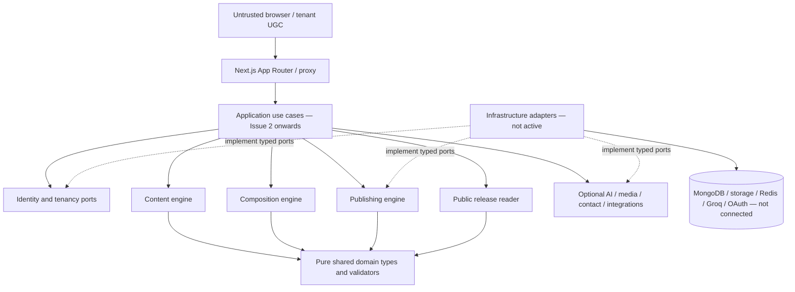

# Issue 1 — Executable architectural boundaries

**Product:** GildedIn. **Implementation scope:** Issue 1 only. **Authority:** [01 Overview](../docs/specifications/01-system-overview.md), [04 C4 diagrams §3.1–3.10](../docs/specifications/04-c4-diagrams.md), [05 Data Model](../docs/specifications/05-data-model.md), [06 API](../docs/specifications/06-api-design.md), [07 Security](../docs/specifications/07-security-design.md), [08 Storage](../docs/specifications/08-storage-and-sync-strategy.md) and [12 ADR-001/030](../docs/specifications/12-architecture-decision-record.md).

## One deployable; domain-owned boundaries

The graph is a *logical* representation inside **one** Next.js/TypeScript modular monolith, not separate services or deployments. Application-level orchestrations coordinate use cases; core domain interfaces do not depend on a vendor's SDK. Domain and shared types are valid without a running Next.js server. `src/domain` contains the initial port contracts; implementation belongs to later issues, not placeholder methods that pretend to authenticate or query data.

## Source-to-boundary mapping

| Source | Owner | Allowed dependencies | Never imports |
| --- | --- | --- | --- |
| `src/shared/domain/**` | Opaque IDs, validation, quotas, API contract, trust-neutral host classifier | Other pure shared code, Web standard types | React, Next.js, Node-only service APIs, provider SDKs |
| `src/domain/{content,composition,publishing}/**` | Three independent domain engines and domain-defined ports | Shared value objects and explicit typed domain contracts | Browser editor, database, Next routes, vendor SDKs |
| `src/domain/{identity,tenancy,delivery,media,gilden,integrations,operations}/**` | Security/ownership/read-model port boundaries | Shared objects and narrow domain interfaces | Arbitrary Mongo collection methods and live API clients |
| `src/application/**` | Authenticated, policy-enforcing use cases when implemented | Pure domain and domain-owned ports | Direct vendor SDKs / React UI |
| `src/infrastructure/**` | Replaceable providers in Issues 3–19 | Implemented domain-owned ports | Browser, editor, public renderer |
| `src/app/**` | HTTP entrypoints, SSR and unavailable placeholders | Next.js, approved application query/command surface, safe shared types | Direct database collections, Groq or media SDKs |
| `src/proxy.ts` | Host zoning and dispatch only | Next.js request/response and pure host classification | Authorization or release activation decisions |

## Forbidden edges enforced by a runnable check

`npm run check:boundaries` walks import statements and rejects static forbidden or circular edges. The negative tests inject a route importing infrastructure, domain importing Next, and circular module imports and assert that the checker fails. These do not replace the more comprehensive TypeScript/ESLint/AST policy checks scheduled for Issue 2; alias and import rewriting should remain reviewed.

The forbidden behaviors from [04 §3.9](../docs/specifications/04-c4-diagrams.md) include: browser-to-MongoDB, editor-to-active-release update, public renderer-to-draft collection, Gilden-to-arbitrary portfolio data, search-to-hidden/private fields, user JSON to arbitrary React component names, and cached page bypassing a live suspension. **They are not implemented as functioning features in Issue 1.**

## Exactly what can be reached in the Issue 1 shell

| Route | Issue 1 response / boundary | Future owning issue |
| --- | --- | --- |
| `/` | Static non-personal GildedIn foundation page | 9 |
| `/login` | Explicitly unavailable; no password/mock authentication | 4 and 9 |
| `/dashboard` | Server-side `notFound()` (no account state accessible) | 4 and 9 |
| `/dashboard/preview` | Server-side `notFound()` (no draft data accessible) | 11 |
| `/{slug}` | `notFound()` regardless of guess | 5, 13, 14 |
| `{slug}.aaroophan.dev/*` | Denied until actual TLS and edge proof; even internal dispatch returns `notFound()` | 5 and 19 |
| `/api/v1/*` | Privacy-safe `503` Problem Details; `no-store` | 6 and subsequent |
| Unknown host/forged forwarded host | `421`, no content and `no-store` | 5 and 19 |

No sessions, provider credentials, drafts, releases or privileged data are present. `src/proxy.ts` is **not** a substitute for endpoint authorization. No active release exists, and `robots.ts` prevents premature indexing. Stage 1 `Cache-Control: no-store` is intentionally conservative; later publishing must separate caches from live policy.

## Contract-driven next steps

Issue 2 introduces test isolation, typed config, HTTP origin/cookie protections, secrets and CI. Issue 3 adds real bounded persistence. Issue 4 adds authenticated sessions. Issue 5 proves tenant routing. Issue 7 defines the persistent safe composition tree before Issue 10 builds canvas controls, and Issue 13 publishes only validated immutable releases.
